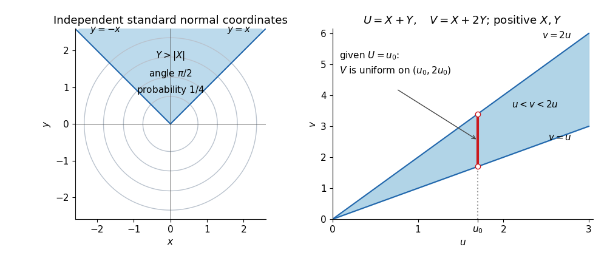

# 2015

↑ **Parent:** [Past exam of the probability course of the University of Oxford](../past-exam-of-the-probability-course-of-the-university-of-oxford.md)

Source paper: [released examination archive](https://www.whatdotheyknow.com/request/ba_computer_science_past_papers/response/2577745/attach/2/202402%20183%20CS%20Papers.zip?cookie_passthrough=1), member `2014/T/a13764w1.pdf`. The printed cover dates this examination to 23 June 2015. The initial unlettered prompt in Question 3 is indexed as (a), matching the subsequent printed (b) and (c).

**Table of contents**

- [1](#1)
  - [a](#1/a)
    - [i](#1/a/i)
      - [Solution](#1/a/i/solution)
    - [ii](#1/a/ii)
      - [Solution](#1/a/ii/solution)
  - [b](#1/b)
    - [i](#1/b/i)
      - [Solution](#1/b/i/solution)
    - [ii](#1/b/ii)
      - [Solution](#1/b/ii/solution)
    - [iii](#1/b/iii)
      - [Solution](#1/b/iii/solution)
  - [c](#1/c)
    - [i](#1/c/i)
      - [Solution](#1/c/i/solution)
    - [ii](#1/c/ii)
      - [Solution](#1/c/ii/solution)
    - [iii](#1/c/iii)
      - [Solution](#1/c/iii/solution)
- [2](#2)
  - [a](#2/a)
    - [i](#2/a/i)
      - [Solution](#2/a/i/solution)
    - [ii](#2/a/ii)
      - [Solution](#2/a/ii/solution)
  - [b](#2/b)
    - [i](#2/b/i)
      - [Solution](#2/b/i/solution)
    - [ii](#2/b/ii)
      - [Solution](#2/b/ii/solution)
    - [iii](#2/b/iii)
      - [Solution](#2/b/iii/solution)
- [3](#3)
  - [a](#3/a)
    - [Solution](#3/a/solution)
  - [b](#3/b)
    - [i](#3/b/i)
      - [Solution](#3/b/i/solution)
    - [ii](#3/b/ii)
      - [Solution](#3/b/ii/solution)
    - [iii](#3/b/iii)
      - [Solution](#3/b/iii/solution)
  - [c](#3/c)
    - [i](#3/c/i)
      - [Solution](#3/c/i/solution)
    - [ii](#3/c/ii)
      - [Solution](#3/c/ii/solution)

## 1

↑ **Parent:** [2015](2015.md)

<h3 id="1/a">a</h3>

↑ **Parent:** [1](#1)

<h4 id="1/a/i">i</h4>

↑ **Parent:** [A](#1/a)

<h5 id="1/a/i/solution">Solution</h5>

↑ **Parent:** [I](#1/a/i)

The [sample maximum](../probability-theory.md#sample-maximum) has [cumulative distribution function](../probability-distribution.md#cumulative-distribution-function)

$$
F_{M_n}(x)=\mathbb P(X_1\leq x,\ldots,X_n\leq x)
=\begin{cases}0,&x<0,\\x^n,&0\leq x\leq1,\\1,&x>1.\end{cases}
$$

The product $x^n$ follows from [independence of random variables](../random-variable.md#independent-random-variables) and the [continuous uniform distribution](../continuous-probability-distribution.md#continuous-uniform-distribution) of each observation. For every $x<1$, this [cumulative distribution function](../probability-distribution.md#cumulative-distribution-function) tends to zero; for $x>1$ it equals one. These are exactly the values of the [cumulative distribution function](../probability-distribution.md#cumulative-distribution-function) of the constant [random variable](../random-variable.md) $1$ at its continuity points. Therefore, by the definition of [convergence in distribution](../convergence-of-random-variables.md#convergence-in-distribution),

$$
\boxed{M_n\xrightarrow{\mathrm d}1.}
$$

At $x=1$ the limiting [cumulative distribution function](../probability-distribution.md#cumulative-distribution-function) is discontinuous, so the definition does not require checking that point, although $F_{M_n}(1)=1$ also holds.

<h4 id="1/a/ii">ii</h4>

↑ **Parent:** [A](#1/a)

<h5 id="1/a/ii/solution">Solution</h5>

↑ **Parent:** [Ii](#1/a/ii)

Put $Z_n=n(1-M_n)$. Its [survival function](../survival-analysis.md#survival-function) is

$$
\mathbb P(Z_n>z)=\begin{cases}
1,&z<0,\\
(1-z/n)^n,&0\leq z\leq n,\\
0,&z>n.
\end{cases}
$$

For each fixed $z\geq0$, eventually $n\geq z$, and the [exponential limit](../calculus.md#exponential-limit) gives $(1-z/n)^n\to e^{-z}$. Thus its [cumulative distribution function](../probability-distribution.md#cumulative-distribution-function) tends to $0$ for $z<0$ and to $1-e^{-z}$ for $z\geq0$. This continuous limiting [cumulative distribution function](../probability-distribution.md#cumulative-distribution-function) identifies the [exponential distribution](../continuous-probability-distribution.md#exponential-distribution) with rate one:

$$
\boxed{n(1-M_n)\xrightarrow{\mathrm d}\operatorname{Exp}(1).}
$$

This is the [exponential endpoint limit of a uniform maximum](../probability-theory.md#exponential-endpoint-limit-of-a-uniform-maximum): the gap from the upper endpoint is typically of order $1/n$, although the maximum itself approaches a constant.

<h3 id="1/b">b</h3>

↑ **Parent:** [1](#1)

<h4 id="1/b/i">i</h4>

↑ **Parent:** [B](#1/b)

<h5 id="1/b/i/solution">Solution</h5>

↑ **Parent:** [I](#1/b/i)

The [moment-generating function](../probability-distribution.md#moment-generating-function) of a real [random variable](../random-variable.md) $X$ is

$$
\boxed{M_X(t)=\mathbb E[e^{tX}]}
$$

for real $t$ for which this [expected value](../expected-value.md) is finite. Because the integrand is nonnegative, the extended [expected value](../expected-value.md) is always defined, but it may equal $+\infty$. We always have $M_X(0)=1$; the usual uniqueness and convergence theorems require finiteness on an open [interval](../real-analysis.md#interval-mathematics) containing zero. When this condition holds, derivatives at zero recover the [moments](../expected-value.md#moment), $M_X^{(r)}(0)=\mathbb E[X^r]$.

<h4 id="1/b/ii">ii</h4>

↑ **Parent:** [B](#1/b)

<h5 id="1/b/ii/solution">Solution</h5>

↑ **Parent:** [Ii](#1/b/ii)

Using the [probability mass function](../probability-distribution.md#probability-mass-function) of the [Poisson distribution](../discrete-probability-distribution.md#poisson-distribution) and the power series of the [exponential function](../calculus.md#exponential-function),

$$
M_X(t)=\sum_{j=0}^{\infty}e^{tj}e^{-\mu}\frac{\mu^j}{j!}
=e^{-\mu}\sum_{j=0}^{\infty}\frac{(\mu e^t)^j}{j!}
=\boxed{\exp\{\mu(e^t-1)\}.}
$$

This [moment-generating function of a Poisson distribution](../discrete-probability-distribution.md#moment-generating-function-of-a-poisson-distribution) is finite for every real $t$. It also covers $\mu=0$, when $X=0$ with [probability](../probability-theory.md#probability) one and the [moment-generating function](../probability-distribution.md#moment-generating-function) is identically one.

<h4 id="1/b/iii">iii</h4>

↑ **Parent:** [B](#1/b)

<h5 id="1/b/iii/solution">Solution</h5>

↑ **Parent:** [Iii](#1/b/iii)

Complete the square in the integral against the [standard normal density](../probability-distribution.md#standard-normal-density):

$$
\begin{aligned}
M_X(t)&=\frac1{\sqrt{2\pi}}\int_{-\infty}^{\infty}e^{tx-x^2/2}\,dx\\
&=e^{t^2/2}\frac1{\sqrt{2\pi}}\int_{-\infty}^{\infty}e^{-(x-t)^2/2}\,dx
=\boxed{e^{t^2/2}.}
\end{aligned}
$$

The remaining integral is one because its integrand is the [probability density function](../continuous-probability-distribution.md#probability-density-function) of the [normal distribution](../probability-distribution.md#normal-distribution) $N(t,1)$. Hence the [moment-generating function of a standard normal variable](../probability-distribution.md#moment-generating-function-of-a-standard-normal-variable) is finite on the whole real line.

<h3 id="1/c">c</h3>

↑ **Parent:** [1](#1)

<h4 id="1/c/i">i</h4>

↑ **Parent:** [C](#1/c)

<h5 id="1/c/i/solution">Solution</h5>

↑ **Parent:** [I](#1/c/i)

The [Poisson process](../poisson-process.md) gives $N_k\sim\operatorname{Pois}(k)$, with [expected value](../expected-value.md) and [variance](../variance.md) both equal to $k$. Consequently $Y_k=(N_k-k)/\sqrt{k}$. Scaling and translating the argument in the [moment-generating function of a Poisson distribution](../discrete-probability-distribution.md#moment-generating-function-of-a-poisson-distribution) gives, for every real $t$,

$$
\begin{aligned}
M_{Y_k}(t)
&=e^{-t\sqrt{k}}M_{N_k}(t/\sqrt{k})\\
&=\boxed{\exp\!\left\{k\left(e^{t/\sqrt{k}}-1-\frac{t}{\sqrt{k}}\right)\right\}.}
\end{aligned}
$$

The centering term must remain inside the exponent: omitting it would leave a divergent first-order contribution.

<h4 id="1/c/ii">ii</h4>

↑ **Parent:** [C](#1/c)

<h5 id="1/c/ii/solution">Solution</h5>

↑ **Parent:** [Ii](#1/c/ii)

For fixed real $t$, [Taylor's theorem](../calculus.md#taylor-s-theorem) for the [exponential function](../calculus.md#exponential-function) gives

$$
e^{t/\sqrt{k}}=1+\frac t{\sqrt{k}}+\frac{t^2}{2k}+O(k^{-3/2}).
$$

Substituting into the previous [moment-generating function](../probability-distribution.md#moment-generating-function),

$$
\log M_{Y_k}(t)=\frac{t^2}{2}+O(k^{-1/2}),\qquad
M_{Y_k}(t)\longrightarrow e^{t^2/2}.
$$

The [continuity theorem for moment-generating functions](../probability-distribution.md#convergence-theorem-for-moment-generating-functions) states that, if the [moment-generating functions](../probability-distribution.md#moment-generating-function) of $Z_n$ and $Z$ are finite on a common open [interval](../real-analysis.md#interval-mathematics) containing zero and $M_{Z_n}(t)\to M_Z(t)$ throughout that interval, then $Z_n\xrightarrow{\mathrm d}Z$. Here finiteness holds for all real $t$, and the limit is the [moment-generating function of a standard normal variable](../probability-distribution.md#moment-generating-function-of-a-standard-normal-variable). Therefore

$$
\boxed{Y_k\xrightarrow{\mathrm d}N(0,1).}
$$

This proves the required instance of the [Poisson central limit theorem](../discrete-probability-distribution.md#poisson-central-limit-theorem) directly from [moment-generating functions](../probability-distribution.md#moment-generating-function); no appeal to a general [central limit theorem](../convergence-of-random-variables.md#central-limit-theorem) is needed.

<h4 id="1/c/iii">iii</h4>

↑ **Parent:** [C](#1/c)

<h5 id="1/c/iii/solution">Solution</h5>

↑ **Parent:** [Iii](#1/c/iii)

Write $A_k=N_{2k}-N_k$ and $B_k=N_k$. The [stationary increments](../stochastic-process.md#stationary-increments) and [independent increments](../stochastic-process.md#independent-increments) of the [Poisson process](../poisson-process.md) make $A_k$ and $B_k$ [independent random variables](../random-variable.md#independent-random-variables), each with [Poisson distribution](../discrete-probability-distribution.md#poisson-distribution) of parameter $k$. Thus

$$
\frac{N_{2k}-2N_k}{\sqrt{k}}=\frac{A_k-B_k}{\sqrt{k}}.
$$

Multiplication of the two [moment-generating functions](../probability-distribution.md#moment-generating-function) gives

$$
M_k(t)=\exp\!\left\{k\left(e^{t/\sqrt{k}}+e^{-t/\sqrt{k}}-2\right)\right\}.
$$

The odd terms cancel in [Taylor's theorem](../calculus.md#taylor-s-theorem), so $\log M_k(t)=t^2+O(k^{-1})$. The limit $e^{t^2}$ is the [moment-generating function of a normal distribution](../probability-distribution.md#moment-generating-function-of-a-normal-distribution) with [mean](../expected-value.md) zero and [variance](../variance.md) two. The same [continuity theorem for moment-generating functions](../probability-distribution.md#convergence-theorem-for-moment-generating-functions) therefore yields

$$
\boxed{\frac{N_{2k}-2N_k}{\sqrt{k}}\xrightarrow{\mathrm d}N(0,2).}
$$

In particular, the two equal-length increments must be separated before using [independence](../random-variable.md#independent-random-variables): $N_{2k}$ and $N_k$ themselves are dependent.

## 2

↑ **Parent:** [2015](2015.md)

<h3 id="2/a">a</h3>

↑ **Parent:** [2](#2)

<h4 id="2/a/i">i</h4>

↑ **Parent:** [A](#2/a)

<h5 id="2/a/i/solution">Solution</h5>

↑ **Parent:** [I](#2/a/i)

The [joint probability density](../continuous-probability-distribution.md#joint-probability-density) of the two [independent](../random-variable.md#independent-random-variables) [standard normal random variables](../probability-distribution.md#standard-normal-random-variable) is $(2\pi)^{-1}e^{-(x^2+y^2)/2}$. The [polar coordinates](../multivariable-calculus.md#polar-coordinates) map has absolute [Jacobian determinant](../multivariable-calculus.md#jacobian-determinant) $r$, so the [change of variables for probability densities](../continuous-probability-distribution.md#change-of-variables-for-probability-densities) gives

$$
\boxed{f_{R,\Theta}(r,\theta)=\frac r{2\pi}e^{-r^2/2}
\mathbf1_{\{r>0,\ 0\leq\theta<2\pi\}}.}
$$

At the origin the angle may be assigned arbitrarily: that point has [probability](../probability-theory.md#probability) zero. The [joint probability density](../continuous-probability-distribution.md#joint-probability-density) factorizes as a [Rayleigh distribution](../continuous-probability-distribution.md#rayleigh-distribution) density $r e^{-r^2/2}$ and a [continuous uniform distribution](../continuous-probability-distribution.md#continuous-uniform-distribution) density $1/(2\pi)$. Hence $R$ and $\Theta$ are [independent](../random-variable.md#independent-random-variables).

For $u>0$, substitute $s=r^2/2$ to find

$$
\mathbb P(R^2\leq u)=\int_0^{\sqrt u}r e^{-r^2/2}\,dr
=\boxed{1-e^{-u/2}.}
$$

Therefore $R^2\sim\operatorname{Exp}(1/2)$, equivalently $\chi_2^2$, and applying a measurable function to $R$ preserves its [independence](../random-variable.md#independent-random-variables) from $\Theta$. Explicitly, with $S=R^2$,

$$
\boxed{f_{\Theta,S}(\theta,s)=\frac1{4\pi}e^{-s/2}
\mathbf1_{\{0\leq\theta<2\pi,\ s>0\}}.}
$$

Thus $\Theta\sim\operatorname{Unif}[0,2\pi)$ and $S\sim\operatorname{Exp}(1/2)$ independently. This [polar decomposition of a planar standard normal vector](../probability-distribution.md#polar-decomposition-of-a-planar-standard-normal-vector) separates the uniformly distributed direction from its random squared distance.

<h4 id="2/a/ii">ii</h4>

↑ **Parent:** [A](#2/a)

<h5 id="2/a/ii/solution">Solution</h5>

↑ **Parent:** [Ii](#2/a/ii)

Set $\alpha=\arctan c\in(0,\pi/2)$. In [polar coordinates](../multivariable-calculus.md#polar-coordinates), the event is $\sin\Theta>c|\cos\Theta|$, the angular sector

$$
\alpha<\Theta<\pi-\alpha.
$$

Because $\Theta$ has the [continuous uniform distribution](../continuous-probability-distribution.md#continuous-uniform-distribution) on an interval of length $2\pi$, the [probability](../probability-theory.md#probability) is the sector's angular length divided by $2\pi$:

$$
\boxed{\mathbb P(Y>c|X|)=\frac{\pi-2\arctan c}{2\pi}
=\frac12-\frac1\pi\arctan c.}
$$

The [symmetry](../physics.md#symmetry-physics) of the [standard normal distribution](../probability-distribution.md#standard-normal-distribution) in $Y$ makes the lower sector $Y<-c|X|$ equally likely. Their disjoint union is $|Y/X|>c$, apart from $X=0$, an event of [probability](../probability-theory.md#probability) zero. Therefore the requested [cumulative distribution function](../probability-distribution.md#cumulative-distribution-function) is

$$
\boxed{F_{|Y/X|}(z)=\begin{cases}0,&z<0,\\[2pt]
\dfrac2\pi\arctan z,&z\geq0.
\end{cases}}
$$

This is the unit-scale [half-Cauchy distribution](../probability-distribution.md#half-cauchy-distribution). At $z=0$ there is no atom, and as $z\to\infty$ the [cumulative distribution function](../probability-distribution.md#cumulative-distribution-function) tends to one.

**[Figure 1](#2/a/ii/image-gaussian-angular-probability-and-the-support-of-a-transformed-exponential-pair). Gaussian angular probability and the support of a transformed exponential pair**.

The left panel uses $c=1$, giving a sector of angle $\pi/2$ and [probability](../probability-theory.md#probability) $1/4$. The right panel displays the domain $u<v<2u$ for the next [change of variables for probability densities](../continuous-probability-distribution.md#change-of-variables-for-probability-densities); a vertical section through it determines the conditional range.

<h3 id="2/b">b</h3>

↑ **Parent:** [2](#2)

<h4 id="2/b/i">i</h4>

↑ **Parent:** [B](#2/b)

<h5 id="2/b/i/solution">Solution</h5>

↑ **Parent:** [I](#2/b/i)

The inverse [linear transformation](../vector-space.md#linear-map) is

$$
x=2u-v,\qquad y=v-u,
\qquad
\left|\det\frac{\partial(x,y)}{\partial(u,v)}\right|
=\left|\det\begin{pmatrix}2&-1\\-1&1\end{pmatrix}\right|=1.
$$

The positive support $x>0,y>0$ is exactly $u>0$ and $u<v<2u$. The [independence](../random-variable.md#independent-random-variables) and rate-one [exponential distributions](../continuous-probability-distribution.md#exponential-distribution) give $f_{X,Y}(x,y)=e^{-x-y}$ there. Since $x+y=u$, the [change of variables for probability densities](../continuous-probability-distribution.md#change-of-variables-for-probability-densities) yields

$$
\boxed{f_{U,V}(u,v)=e^{-u}\mathbf1_{\{u>0,\ u<v<2u\}}.}
$$

Although the density's value depends only on $u$, its support does not factor as a product of fixed intervals. Thus this expression does not imply [independence](../random-variable.md#independent-random-variables) of $U$ and $V$.

<h4 id="2/b/ii">ii</h4>

↑ **Parent:** [B](#2/b)

<h5 id="2/b/ii/solution">Solution</h5>

↑ **Parent:** [Ii](#2/b/ii)

Integrating the [joint probability density](../continuous-probability-distribution.md#joint-probability-density) across $u<v<2u$ gives the [marginal density](../probability-distribution.md#marginal-density)

$$
f_U(u)=\int_u^{2u}e^{-u}\,dv=u e^{-u},\qquad u>0.
$$

For every $u>0$, the [conditional probability density](../probability-theory.md#conditional-density) is consequently

$$
f_{V\mid U}(v\mid u)=\frac{f_{U,V}(u,v)}{f_U(u)}
=\frac1u\mathbf1_{\{u<v<2u\}}.
$$

Hence

$$
\boxed{V\mid U=u\sim\operatorname{Unif}(u,2u).}
$$

This also follows from [two independent exponential variables conditioned on their sum](../continuous-probability-distribution.md#two-independent-exponential-variables-conditioned-on-their-sum): given $X+Y=u$, the variable $Y$ is uniform on $(0,u)$, and $V=u+Y$. Conditioning on $U=u$ here is defined through the [conditional probability density](../probability-theory.md#conditional-density), rather than division by $\mathbb P(U=u)$, which is zero. The endpoint $u=0$ lies outside the positive marginal support and needs no specified conditional law.

<h4 id="2/b/iii">iii</h4>

↑ **Parent:** [B](#2/b)

<h5 id="2/b/iii/solution">Solution</h5>

↑ **Parent:** [Iii](#2/b/iii)

For fixed $v>0$, the support inequalities become $v/2<u<v$. The [marginal density](../probability-distribution.md#marginal-density) is therefore

$$
\boxed{f_V(v)=\int_{v/2}^{v}e^{-u}\,du
=\begin{cases}e^{-v/2}-e^{-v},&v>0,\\0,&v\leq0.\end{cases}}
$$

It is nonnegative and integrates to $2-1=1$. Another interpretation is that $V=X+2Y$ sums [independent](../random-variable.md#independent-random-variables) [exponential random variables](../continuous-probability-distribution.md#exponential-distribution) of rates $1$ and $1/2$, so it has a [hypoexponential distribution](../continuous-probability-distribution.md#hypoexponential-distribution). The [mean](../expected-value.md) is $1+2=3$, which agrees with $\int_0^\infty v(e^{-v/2}-e^{-v})\,dv=4-1=3$.

## 3

↑ **Parent:** [2015](2015.md)

<h3 id="3/a">a</h3>

↑ **Parent:** [3](#3)

<h4 id="3/a/solution">Solution</h4>

↑ **Parent:** [A](#3/a)

The [strong law of large numbers](../convergence-of-random-variables.md#strong-law-of-large-numbers) says that, for real [independent and identically distributed random variables](../random-variable.md#independent-and-identically-distributed-random-variables) $Z_1,Z_2,\ldots$ with $\mathbb E|Z_1|<\infty$,

$$
\boxed{\mathbb P\!\left(\frac1n\sum_{i=1}^n Z_i\longrightarrow\mathbb E Z_1\right)=1.}
$$

The assertion is [almost sure convergence](../convergence-of-random-variables.md#almost-sure-convergence) of the entire sequence of [sample means](../variance.md#sample-mean). Finite first absolute [moment](../expected-value.md#moment) suffices; a finite [variance](../variance.md) is not required.

<h3 id="3/b">b</h3>

↑ **Parent:** [3](#3)

<h4 id="3/b/i">i</h4>

↑ **Parent:** [B](#3/b)

<h5 id="3/b/i/solution">Solution</h5>

↑ **Parent:** [I](#3/b/i)

Put $q=1-p$ and $\xi_i=Y_i-Y_{i-1}$. The [Markov property](../markov-chain.md#markov-property) and the state-independent transition probabilities show that, conditional on the whole previous history, $\xi_i$ is $+1$ with [probability](../probability-theory.md#probability) $p$ and $-1$ with [probability](../probability-theory.md#probability) $q$. Multiplying these conditional probabilities for any finite step sequence proves that the $\xi_i$ are [independent and identically distributed random variables](../random-variable.md#independent-and-identically-distributed-random-variables), with

$$
\mathbb E\xi_i=p-q=2p-1>0.
$$

Because $Y_n=k+\sum_{i=1}^n\xi_i$, the [strong law of large numbers](../convergence-of-random-variables.md#strong-law-of-large-numbers) gives

$$
\boxed{\frac{Y_n}{n}=\frac kn+\frac1n\sum_{i=1}^n\xi_i
\xrightarrow{\mathrm{a.s.}}\mu=2p-1.}
$$

In particular, $Y_n\to+\infty$ [almost surely](../convergence-of-random-variables.md#almost-sure-convergence). This stronger pathwise consequence will determine both eventual crossings and the asymptotic [first-passage times](../markov-chain.md#first-passage-time).

<h4 id="3/b/ii">ii</h4>

↑ **Parent:** [B](#3/b)

<h5 id="3/b/ii/solution">Solution</h5>

↑ **Parent:** [Ii](#3/b/ii)

For $k=0$, the target is reached at time zero, so $h_0=1$. For $k<0$, the preceding [almost sure convergence](../convergence-of-random-variables.md#almost-sure-convergence) gives $Y_n\to+\infty$ with [probability](../probability-theory.md#probability) one. A [sample path](../stochastic-process.md#sample-path) with unit upward and downward steps must visit every intermediate [integer](../integer.md) when it crosses from a negative value to a positive value. It must therefore visit zero at a finite time. Thus

$$
\boxed{h_k=1\quad\text{for every }k\leq0.}
$$

The unit-step property matters: positive long-run displacement alone would not force a walk with larger upward jumps to land exactly on zero.

<h4 id="3/b/iii">iii</h4>

↑ **Parent:** [B](#3/b)

<h5 id="3/b/iii/solution">Solution</h5>

↑ **Parent:** [Iii](#3/b/iii)

The [first-step analysis](../analysis.md#first-step-analysis) gives $h_0=1$ and, for $k\geq1$,

$$
h_k=p h_{k+1}+q h_{k-1}.
$$

The [minimal nonnegative solution for hitting probabilities](../markov-chain.md#hitting-probability-is-the-minimal-nonnegative-harmonic-extension) theorem states that the probability of ever hitting a target is the pointwise smallest nonnegative solution of this transition recurrence with value one at the target. It follows by comparing any such solution with the probabilities of hitting within $n$ steps, then taking their increasing limit.

The characteristic equation $pr^2-r+q=0$ has distinct roots $1$ and $\beta=q/p\in(0,1)$. Hence every solution on the nonnegative integers with boundary value one has the form

$$
g_k=A+(1-A)\beta^k.
$$

If it is nonnegative for all $k$, taking $k\to\infty$ forces $A\geq0$, and therefore $g_k-\beta^k=A(1-\beta^k)\geq0$. The candidate $g_k=\beta^k$ is itself nonnegative and satisfies the recurrence and boundary value. It is consequently the minimal solution, giving the [biased random walk hitting probability](../random-walk.md#biased-random-walk-hitting-probability)

$$
\boxed{h_k=\left(\frac{1-p}{p}\right)^k,\qquad k>0;\qquad
\beta=\frac{1-p}{p}.}
$$

On the negative half-line the already established values $h_k=1$ satisfy the same recurrence away from zero. No unproved boundary condition at infinity has been imposed.

<h3 id="3/c">c</h3>

↑ **Parent:** [3](#3)

<h4 id="3/c/i">i</h4>

↑ **Parent:** [C](#3/c)

<h5 id="3/c/i/solution">Solution</h5>

↑ **Parent:** [I](#3/c/i)

Since $Y_n\to+\infty$ [almost surely](../convergence-of-random-variables.md#almost-sure-convergence), only finitely many early values can attain the global [minimum](../set.md#minimum-of-a-subset-of-a-total-order); it is a finite [integer](../integer.md). Also $W\leq Y_0=0$. For every [nonnegative integer](../arithmetic.md#natural-number) $m$, the unit-step property and translation invariance of the increments give

$$
\mathbb P(-W\geq m)
=\mathbb P_0(\text{ever visit }-m)
=\mathbb P_m(\text{ever visit }0)=\beta^m,
\qquad\beta=\frac{1-p}{p}.
$$

Subtracting consecutive tails yields the [probability mass function](../probability-distribution.md#probability-mass-function)

$$
\boxed{\mathbb P(-W=m)=(1-\beta)\beta^m,\qquad m=0,1,\ldots.}
$$

Thus $-W$ has the [geometric distribution](../discrete-probability-distribution.md#geometric-distribution) counting failures before the first success, with success parameter

$$
\boxed{1-\beta=\frac{2p-1}{p}.}
$$

This support convention is essential: the [minimum of an upward-biased random walk](../random-walk.md#minimum-of-an-upward-biased-random-walk) can equal its starting position, so $-W=0$ has positive [probability](../probability-theory.md#probability).

<h4 id="3/c/ii">ii</h4>

↑ **Parent:** [C](#3/c)

<h5 id="3/c/ii/solution">Solution</h5>

↑ **Parent:** [Ii](#3/c/ii)

Work on the single event of [probability](../probability-theory.md#probability) one where $Y_n/n\to\mu=2p-1>0$. On every [sample path](../stochastic-process.md#sample-path) in that event, $Y_n\to+\infty$ and the unit-step property ensures that every positive [integer](../integer.md) $j$ is reached, so $T_j<\infty$. Starting from zero requires at least $j$ steps to reach $j$, hence $T_j\geq j$ and $T_j\to\infty$.

The convergent numerical sequence $Y_n/n$ on this fixed [sample path](../stochastic-process.md#sample-path) also converges along its possibly random subsequence $n=T_j$. Since $Y_{T_j}=j$,

$$
\frac{j}{T_j}=\frac{Y_{T_j}}{T_j}\longrightarrow\mu.
$$

Taking the reciprocal is valid because $\mu>0$. We obtain

$$
\boxed{\mathbb P\!\left(\frac{T_j}{j}\longrightarrow\alpha\right)=1,
\qquad\alpha=\frac1{2p-1}.}
$$

This is a [first-passage law of large numbers for an upward skip-free random walk](../random-walk.md#first-passage-law-of-large-numbers-for-an-upward-skip-free-random-walk). No independence between the [hitting times](../markov-chain.md#first-passage-time) and the path is needed: [almost sure convergence](../convergence-of-random-variables.md#almost-sure-convergence) already supplies convergence along every diverging subsequence on the same event.

## ↑ Ancestors (9)

1. [Past exam of the probability course of the University of Oxford](../past-exam-of-the-probability-course-of-the-university-of-oxford.md)
2. [Probability course of the University of Oxford](../university-of-oxford.md#probability-course-of-the-university-of-oxford)
3. [Year 2 of the mathematics course of the University of Oxford](../university-of-oxford.md#year-2-of-the-mathematics-course-of-the-university-of-oxford)
4. [Mathematics course of the University of Oxford](../university-of-oxford.md#mathematics-course-of-the-university-of-oxford)
5. [Undergraduate course of the University of Oxford](../university-of-oxford.md#undergraduate-course-of-the-university-of-oxford)
6. [Course of the University of Oxford](../university-of-oxford.md#course-of-the-university-of-oxford)
7. [University of Oxford](../university-of-oxford.md)
8. [List of universities](../README.md#list-of-universities)
9. [Codex Wiki](../README.md)
