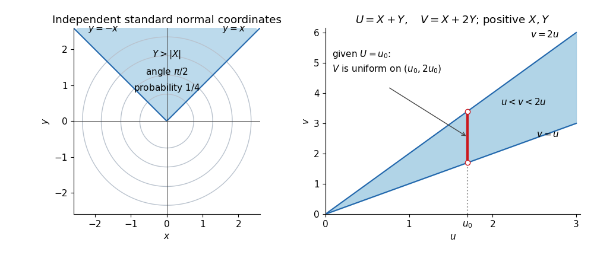

<h1 id="2/a/ii/solution">Solution</h1>

↑ **Parent:** [Ii](../ii.md)

Set $\alpha=\arctan c\in(0,\pi/2)$. In [polar coordinates](../../../../../polar-coordinates.md), the event is $\sin\Theta>c|\cos\Theta|$, the angular sector

$$
\alpha<\Theta<\pi-\alpha.
$$

Because $\Theta$ has the [continuous uniform distribution](../../../../../continuous-uniform-distribution.md) on an interval of length $2\pi$, the [probability](../../../../../probability.md) is the sector's angular length divided by $2\pi$:

$$
\boxed{\mathbb P(Y>c|X|)=\frac{\pi-2\arctan c}{2\pi}
=\frac12-\frac1\pi\arctan c.}
$$

The [symmetry](../../../../../symmetry-physics.md) of the [standard normal distribution](../../../../../standard-normal-distribution.md) in $Y$ makes the lower sector $Y<-c|X|$ equally likely. Their disjoint union is $|Y/X|>c$, apart from $X=0$, an event of [probability](../../../../../probability.md) zero. Therefore the requested [cumulative distribution function](../../../../../cumulative-distribution-function.md) is

$$
\boxed{F_{|Y/X|}(z)=\begin{cases}0,&z<0,\\[2pt]
\dfrac2\pi\arctan z,&z\geq0.
\end{cases}}
$$

This is the unit-scale [half-Cauchy distribution](../../../../../half-cauchy-distribution.md). At $z=0$ there is no atom, and as $z\to\infty$ the [cumulative distribution function](../../../../../cumulative-distribution-function.md) tends to one.

**[Figure 1](#2/a/ii/image-gaussian-angular-probability-and-the-support-of-a-transformed-exponential-pair). Gaussian angular probability and the support of a transformed exponential pair**.

The left panel uses $c=1$, giving a sector of angle $\pi/2$ and [probability](../../../../../probability.md) $1/4$. The right panel displays the domain $u<v<2u$ for the next [change of variables for probability densities](../../../../../change-of-variables-for-probability-densities.md); a vertical section through it determines the conditional range.

## ↑ Ancestors (13)

1. [Ii](../ii.md)
2. [A](../../a.md)
3. [2](../../../2.md)
4. [2015](../../../../2015-split.md)
5. [Past exam of the probability course of the University of Oxford](../../../../split.md)
6. [Probability course of the University of Oxford](../../../../../probability-course-of-the-university-of-oxford.md)
7. [Year 2 of the mathematics course of the University of Oxford](../../../../../year-2-of-the-mathematics-course-of-the-university-of-oxford.md)
8. [Mathematics course of the University of Oxford](../../../../../mathematics-course-of-the-university-of-oxford.md)
9. [Undergraduate course of the University of Oxford](../../../../../undergraduate-course-of-the-university-of-oxford.md)
10. [Course of the University of Oxford](../../../../../course-of-the-university-of-oxford.md)
11. [University of Oxford](../../../../../university-of-oxford-split.md)
12. [List of universities](../../../../../list-of-universities.md)
13. [Codex Wiki](../../../../../split.md)
