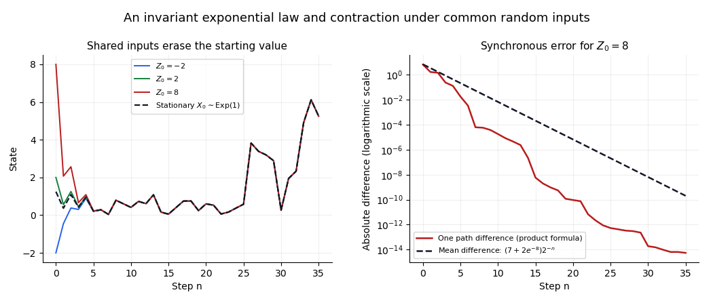
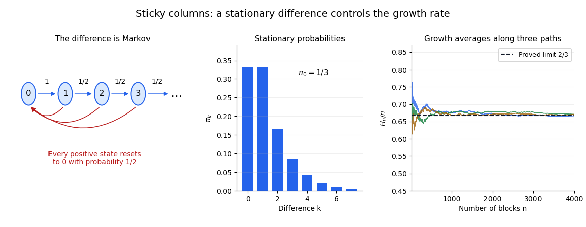

# 2017

↑ **Parent:** [Past exam of the probability course of the University of Oxford](../past-exam-of-the-probability-course-of-the-university-of-oxford.md)

Source paper: [released examination archive](https://www.whatdotheyknow.com/request/ba_computer_science_past_papers/response/2577745/attach/2/202402%20183%20CS%20Papers.zip?cookie_passthrough=1), member `2016/T/a13764w1.pdf`. The printed cover dates this examination to 15 June 2017.

**Table of contents**

- [1](#1)
  - [a](#1/a)
    - [i](#1/a/i)
      - [Solution](#1/a/i/solution)
    - [ii](#1/a/ii)
      - [Solution](#1/a/ii/solution)
    - [iii](#1/a/iii)
      - [Solution](#1/a/iii/solution)
  - [b](#1/b)
    - [i](#1/b/i)
      - [Solution](#1/b/i/solution)
    - [ii](#1/b/ii)
      - [Solution](#1/b/ii/solution)
    - [iii](#1/b/iii)
      - [Solution](#1/b/iii/solution)
  - [c](#1/c)
    - [Solution](#1/c/solution)
- [2](#2)
  - [a](#2/a)
    - [i](#2/a/i)
      - [Solution](#2/a/i/solution)
    - [ii](#2/a/ii)
      - [Solution](#2/a/ii/solution)
    - [iii](#2/a/iii)
      - [Solution](#2/a/iii/solution)
    - [iv](#2/a/iv)
      - [Solution](#2/a/iv/solution)
  - [b](#2/b)
    - [i](#2/b/i)
      - [Solution](#2/b/i/solution)
    - [ii](#2/b/ii)
      - [Solution](#2/b/ii/solution)
    - [iii](#2/b/iii)
      - [Solution](#2/b/iii/solution)
- [3](#3)
  - [a](#3/a)
    - [i](#3/a/i)
      - [Solution](#3/a/i/solution)
    - [ii](#3/a/ii)
      - [Solution](#3/a/ii/solution)
    - [iii](#3/a/iii)
      - [Solution](#3/a/iii/solution)
  - [b](#3/b)
    - [i](#3/b/i)
      - [Solution](#3/b/i/solution)
    - [ii](#3/b/ii)
      - [Solution](#3/b/ii/solution)

## 1

↑ **Parent:** [2017](2017.md)

<h3 id="1/a">a</h3>

↑ **Parent:** [1](#1)

<h4 id="1/a/i">i</h4>

↑ **Parent:** [A](#1/a)

<h5 id="1/a/i/solution">Solution</h5>

↑ **Parent:** [I](#1/a/i)

By [independence of random variables](../random-variable.md#independent-random-variables), the [joint probability density](../continuous-probability-distribution.md#joint-probability-density) is the product of the two [probability density functions](../continuous-probability-distribution.md#probability-density-function) of the rate-one [exponential distributions](../continuous-probability-distribution.md#exponential-distribution):

$$
\boxed{f_{X,Y}(x,y)=e^{-(x+y)}\mathbf1_{\{x>0,\ y>0\}}.}
$$

Its values on the boundary are immaterial, because the boundary has zero area.

<h4 id="1/a/ii">ii</h4>

↑ **Parent:** [A](#1/a)

<h5 id="1/a/ii/solution">Solution</h5>

↑ **Parent:** [Ii](#1/a/ii)

Use the inverse [change of variables for probability densities](../continuous-probability-distribution.md#change-of-variables-for-probability-densities)

$$
x=vw,\qquad y=(1-v)w,\qquad 0<v<1,\quad w>0.
$$

Its absolute [Jacobian determinant](../multivariable-calculus.md#jacobian-determinant) is

$$
\left|\det\begin{pmatrix}w&v\\-w&1-v\end{pmatrix}\right|=w.
$$

Therefore

$$
\boxed{f_{V,W}(v,w)=w e^{-w}\mathbf1_{\{0<v<1,\ w>0\}}.}
$$

Since $\int_0^\infty we^{-w}\,dw=1$, its [marginal densities](../probability-distribution.md#marginal-density) are $f_V(v)=\mathbf1_{(0,1)}(v)$ and $f_W(w)=we^{-w}\mathbf1_{(0,\infty)}(w)$. The joint density factorizes as $f_Vf_W$, so **$V$ and $W$ are [independent random variables](../random-variable.md#independent-random-variables)**, with $V$ uniform on $[0,1]$ and $W\sim\operatorname{Gamma}(2,1)$ in the shape-rate convention. This is [beta-gamma independence](../continuous-probability-distribution.md#beta-gamma-independence) with both shape parameters equal to one.

<h4 id="1/a/iii">iii</h4>

↑ **Parent:** [A](#1/a)

<h5 id="1/a/iii/solution">Solution</h5>

↑ **Parent:** [Iii](#1/a/iii)

Put $W=X+Y$. The independent pair $(U,W)$ has the same [joint distribution](../probability-distribution.md#joint-probability-distribution) as $(V,W)$ from part (ii), because both first coordinates are uniform and independent of the same sum law. Hence

$$
U(X+Y)\ \stackrel d=\ VW=X.
$$

Consequently

$$
\boxed{U(X+Y)\sim\operatorname{Exp}(1).}
$$

The rate is one. This multiplication identity is the mechanism behind the [exponential invariant law of a random affine recursion](../markov-process.md#exponential-invariant-law-of-a-random-affine-recursion).

<h3 id="1/b">b</h3>

↑ **Parent:** [1](#1)

<h4 id="1/b/i">i</h4>

↑ **Parent:** [B](#1/b)

<h5 id="1/b/i/solution">Solution</h5>

↑ **Parent:** [I](#1/b/i)

The answer is

$$
\boxed{X_n\sim\operatorname{Exp}(1)\quad\text{for every }n\geq0.}
$$

It holds initially by construction. If it holds at step $n-1$, then $X_{n-1}$ is a function of $E_0,\ldots,E_{n-1},U_1,\ldots,U_{n-1}$, so it is independent of the fresh inputs $E_n,U_n$. Part (a)(iii) therefore gives $U_n(X_{n-1}+E_n)\sim\operatorname{Exp}(1)$. This completes the [mathematical induction](../foundations-of-mathematics.md#mathematical-induction) and identifies the [stationary distribution](../markov-chain.md#stationary-distribution) of the recursion.

<h4 id="1/b/ii">ii</h4>

↑ **Parent:** [B](#1/b)

<h5 id="1/b/ii/solution">Solution</h5>

↑ **Parent:** [Ii](#1/b/ii)

The two recursions use a [synchronous coupling](../probability-and-statistics.md#synchronous-coupling): they receive exactly the same fresh inputs. Subtraction cancels the additive term:

$$
Z_n-X_n=U_n(Z_{n-1}-X_{n-1}).
$$

The variable $U_n$ is independent of the preceding difference and has [expected value](../expected-value.md) $1/2$. Thus [expectation of a product of independent random variables](../expected-value.md#expectation-of-a-product-of-independent-random-variables) gives

$$
\mathbb E|Z_n-X_n|=\frac12\mathbb E|Z_{n-1}-X_{n-1}|
=2^{-n}\mathbb E|c-E_0|\leq2^{-n}(|c|+1).
$$

By [Markov's inequality](../probability-inequality.md#markov-s-inequality), for every $\varepsilon>0$,

$$
\boxed{\mathbb P(|Z_n-X_n|>\varepsilon)\leq\frac{|c|+1}{\varepsilon\,2^n}\longrightarrow0.}
$$

This proves the requested [convergence in probability](../convergence-of-random-variables.md#convergence-in-probability); in fact the difference has [L1 convergence](../convergence-of-random-variables.md#convergence-in-l1). It is [synchronous contraction of a random affine recursion](../markov-process.md#synchronous-contraction-of-a-random-affine-recursion), and the estimate holds for every real $c$.

<h4 id="1/b/iii">iii</h4>

↑ **Parent:** [B](#1/b)

<h5 id="1/b/iii/solution">Solution</h5>

↑ **Parent:** [Iii](#1/b/iii)

Every $X_n$ has the same [exponential distribution](../continuous-probability-distribution.md#exponential-distribution), so $X_n\xrightarrow d X$ for $X\sim\operatorname{Exp}(1)$. Part (ii) gives $Z_n-X_n\xrightarrow p0$. Applying [Slutsky's theorem](../statistical-inference.md#slutsky-theorem) to $Z_n=X_n+(Z_n-X_n)$ yields

$$
\boxed{Z_n\xrightarrow d\operatorname{Exp}(1).}
$$

The limiting [probability distribution](../probability-distribution.md) does not depend on $c$. This is precisely the attraction to the [exponential invariant law of a random affine recursion](../markov-process.md#exponential-invariant-law-of-a-random-affine-recursion).

**[Figure 1](#1/b/iii/image-common-random-inputs-make-different-initial-values-approach-the-same-stationary-trajectory). Common random inputs make different initial values approach the same stationary trajectory**. Original simulations of the affine recursion with shared inputs. The right panel compares an exactly propagated path difference with its unconditional expected value; the geometric expectation estimate, rather than the simulation, proves convergence.

<h3 id="1/c">c</h3>

↑ **Parent:** [1](#1)

<h4 id="1/c/solution">Solution</h4>

↑ **Parent:** [C](#1/c)

The update defines a time-homogeneous [Markov process](../markov-process.md): given its present value, the next value depends only on independent fresh input. Part (b)(i) identifies an invariant law: initializing with the rate-one [exponential distribution](../continuous-probability-distribution.md#exponential-distribution) preserves that distribution at every time. Part (b)(iii) shows convergence of the one-time laws to this invariant law from every deterministic initial value.

For a countable [state space](../dynamical-systems.md#state-space), the analogous [countable-state Markov chain convergence theorem](../markov-chain.md#countable-state-markov-chain-convergence-theorem) says that an [irreducible Markov chain](../markov-chain.md#irreducible-markov-chain) that is [aperiodic](../markov-chain.md#aperiodic-markov-chain) and [positive recurrent](../markov-chain.md#positive-recurrent-markov-chain) converges to its unique [stationary distribution](../markov-chain.md#stationary-distribution) from every initial state. Here the state space is continuous, so that countable-state theorem does not directly supply the proof; the explicit [coupling](../probability-and-statistics.md#coupling) does. The two conclusions have the same equilibrium interpretation.

## 2

↑ **Parent:** [2017](2017.md)

<h3 id="2/a">a</h3>

↑ **Parent:** [2](#2)

<h4 id="2/a/i">i</h4>

↑ **Parent:** [A](#2/a)

<h5 id="2/a/i/solution">Solution</h5>

↑ **Parent:** [I](#2/a/i)

The [moment-generating function](../probability-distribution.md#moment-generating-function) of a real [random variable](../random-variable.md) $X$ is

$$
\boxed{M_X(t)=\mathbb E[e^{tX}]}
$$

for real $t$ where the expectation is finite. One may regard it as an extended nonnegative function elsewhere. In particular $M_X(0)=1$; finiteness on a neighborhood of zero is the usual hypothesis for recovering moments and using its local expansion.

<h4 id="2/a/ii">ii</h4>

↑ **Parent:** [A](#2/a)

<h5 id="2/a/ii/solution">Solution</h5>

↑ **Parent:** [Ii](#2/a/ii)

Differentiating the [moment-generating function](../probability-distribution.md#moment-generating-function) at zero gives

$$
\boxed{M_X'(0)=\mathbb E[X],\qquad M_X''(0)=\mathbb E[X^2].}
$$

The second derivative is the second raw [moment](../expected-value.md#moment), so the [variance](../variance.md) is $M_X''(0)-(M_X'(0))^2$. The assumed exponential integrability justifies these derivatives.

<h4 id="2/a/iii">iii</h4>

↑ **Parent:** [A](#2/a)

<h5 id="2/a/iii/solution">Solution</h5>

↑ **Parent:** [Iii](#2/a/iii)

Integrate against the [standard normal density](../probability-distribution.md#standard-normal-density) by [completing the square](../polynomial.md#completing-the-square):

$$
\begin{aligned}
M_X(t)&=\frac1{\sqrt{2\pi}}\int_{-\infty}^\infty e^{tx-x^2/2}\,dx\\
&=e^{t^2/2}\frac1{\sqrt{2\pi}}\int_{-\infty}^\infty e^{-(x-t)^2/2}\,dx=e^{t^2/2}.
\end{aligned}
$$

Thus the [moment-generating function of a standard normal variable](../probability-distribution.md#moment-generating-function-of-a-standard-normal-variable) is

$$
\boxed{M_X(t)=e^{t^2/2}\quad(t\in\mathbb R).}
$$

<h4 id="2/a/iv">iv</h4>

↑ **Parent:** [A](#2/a)

<h5 id="2/a/iv/solution">Solution</h5>

↑ **Parent:** [Iv](#2/a/iv)

Let $Y_1,Y_2,\ldots$ be real [independent and identically distributed random variables](../random-variable.md#independent-and-identically-distributed-random-variables) with finite [expected value](../expected-value.md) $\mu$ and [variance](../variance.md) $0<\sigma^2<\infty$. The [central limit theorem](../convergence-of-random-variables.md#central-limit-theorem) states

$$
\boxed{\frac{\sum_{k=1}^nY_k-n\mu}{\sigma\sqrt n}\xrightarrow dN(0,1).}
$$

Equivalently, the [cumulative distribution functions](../probability-distribution.md#cumulative-distribution-function) of these normalized sums converge at every real point to the [standard normal distribution function](../probability-distribution.md#standard-normal-distribution-function). The theorem itself does not require a finite moment-generating function.

<h3 id="2/b">b</h3>

↑ **Parent:** [2](#2)

<h4 id="2/b/i">i</h4>

↑ **Parent:** [B](#2/b)

<h5 id="2/b/i/solution">Solution</h5>

↑ **Parent:** [I](#2/b/i)

The given [expected value](../expected-value.md) and [variance](../variance.md) imply $M_X(0)=1$, $M_X'(0)=0$ and $M_X''(0)=1$. The [Taylor expansion](../calculus.md#taylor-expansion) therefore gives

$$
M_X(t)=1+\frac{t^2}{2}+o(t^2).
$$

Since $\log(1+u)=u+o(u)$ as $u\to0$, it follows that

$$
\boxed{\log M_X(t)=\frac{t^2}{2}+o(t^2),\qquad\alpha=\frac12.}
$$

This is the [quadratic expansion of a cumulant-generating function](../probability-distribution.md#quadratic-expansion-of-a-cumulant-generating-function) for a centered variable of variance one.

<h4 id="2/b/ii">ii</h4>

↑ **Parent:** [B](#2/b)

<h5 id="2/b/ii/solution">Solution</h5>

↑ **Parent:** [Ii](#2/b/ii)

Write $S_n=n^{-1/2}\sum_{k=1}^nX_k$. By [independence of random variables](../random-variable.md#independent-random-variables), its [moment-generating function](../probability-distribution.md#moment-generating-function) is

$$
M_{S_n}(t)=M_X(t/\sqrt n)^n.
$$

For each fixed real $t$, the expansion in part (i) yields

$$
\log M_{S_n}(t)
=n\left(\frac{t^2}{2n}+o(n^{-1})\right)
\longrightarrow\frac{t^2}{2}.
$$

For $t=0$ the equality is immediate. Exponentiation gives $M_{S_n}(t)\to e^{t^2/2}$, the [moment-generating function of a standard normal variable](../probability-distribution.md#moment-generating-function-of-a-standard-normal-variable). The functions are finite on a common neighborhood of zero, so the [convergence theorem for moment-generating functions](../probability-distribution.md#convergence-theorem-for-moment-generating-functions) proves

$$
\boxed{S_n\xrightarrow dN(0,1).}
$$

This proves the [central limit theorem](../convergence-of-random-variables.md#central-limit-theorem) under the exponential-moment hypothesis of this part.

<h4 id="2/b/iii">iii</h4>

↑ **Parent:** [B](#2/b)

<h5 id="2/b/iii/solution">Solution</h5>

↑ **Parent:** [Iii](#2/b/iii)

Use the deterministic weights $a_{n,k}=\sqrt{k}/n$. Their squared sum and maximum are

$$
\sum_{k=1}^na_{n,k}^2=\frac{n+1}{2n}\longrightarrow\frac12,
\qquad \max_{k\leq n}|a_{n,k}|=n^{-1/2}\longrightarrow0.
$$

To apply the [quadratic expansion of a cumulant-generating function](../probability-distribution.md#quadratic-expansion-of-a-cumulant-generating-function) rigorously, write $\log M_X(u)=u^2/2+r(u)$, with $r(u)=o(u^2)$. Fix $t\ne0$ and let

$$
\eta_n=\sup_{0<|u|\leq|t|/\sqrt n}\frac{|r(u)|}{u^2}\longrightarrow0.
$$

All arguments $t\sqrt{k}/n$ lie in this shrinking interval. Consequently

$$
\left|\sum_{k=1}^nr\!\left(\frac{t\sqrt{k}}n\right)\right|
\leq\eta_n\frac{t^2}{n^2}\sum_{k=1}^nk
=\eta_n\frac{t^2(n+1)}{2n}\longrightarrow0.
$$

Taking logs of the [moment-generating function](../probability-distribution.md#moment-generating-function) and using [independence of random variables](../random-variable.md#independent-random-variables) now gives

$$
\log M_{T_n}(t)=\frac{t^2}{2n^2}\sum_{k=1}^nk+o(1)
\longrightarrow\frac{t^2}{4}.
$$

The case $t=0$ is immediate. Since $e^{t^2/4}$ is the [moment-generating function](../probability-distribution.md#moment-generating-function) of a [normal distribution](../probability-distribution.md#normal-distribution) of variance $1/2$, the [convergence theorem for moment-generating functions](../probability-distribution.md#convergence-theorem-for-moment-generating-functions) gives

$$
\boxed{T_n\xrightarrow dN\!\left(0,\frac12\right).}
$$

This is a [weighted central limit theorem with negligible maximum weight](../convergence-of-random-variables.md#weighted-central-limit-theorem-with-negligible-maximum-weight). Its limit variance also agrees with the exact value $\operatorname{Var}(T_n)=(n+1)/(2n)$ from [variance additivity for independent random variables](../variance.md#variance-additivity-for-independent-random-variables).

## 3

↑ **Parent:** [2017](2017.md)

<h3 id="3/a">a</h3>

↑ **Parent:** [3](#3)

<h4 id="3/a/i">i</h4>

↑ **Parent:** [A](#3/a)

<h5 id="3/a/i/solution">Solution</h5>

↑ **Parent:** [I](#3/a/i)

A [transition matrix](../markov-chain.md#stochastic-matrix) $P$ defines an [irreducible Markov chain](../markov-chain.md#irreducible-markov-chain) if every state is accessible from every other state:

$$
\boxed{\text{for every }i,j\in S,\ \text{there is }n\geq0\text{ with }(P^n)_{ij}>0.}
$$

Equivalently, all states belong to one [communicating class](../markov-chain.md#communicating-class). When $i\ne j$, a positive number of steps is necessarily used.

<h4 id="3/a/ii">ii</h4>

↑ **Parent:** [A](#3/a)

<h5 id="3/a/ii/solution">Solution</h5>

↑ **Parent:** [Ii](#3/a/ii)

A [stationary distribution](../markov-chain.md#stationary-distribution) is a nonnegative row vector $\pi=(\pi_i)_{i\in S}$ with total mass one that is preserved by one transition:

$$
\boxed{\pi_i\geq0,\quad\sum_{i\in S}\pi_i=1,\quad\pi_j=\sum_{i\in S}\pi_iP_{ij}\quad(j\in S).}
$$

In matrix notation, $\pi P=\pi$. If the initial state has distribution $\pi$, so does the state at each later time.

<h4 id="3/a/iii">iii</h4>

↑ **Parent:** [A](#3/a)

<h5 id="3/a/iii/solution">Solution</h5>

↑ **Parent:** [Iii](#3/a/iii)

For an [irreducible Markov chain](../markov-chain.md#irreducible-markov-chain) on a countable [state space](../dynamical-systems.md#state-space), **the set has either zero or one element**. By [uniqueness of stationary distributions for an irreducible countable chain](../markov-chain.md#uniqueness-of-stationary-distributions-for-an-irreducible-countable-chain), a stationary probability distribution exists exactly in the [positive recurrent](../markov-chain.md#positive-recurrent-markov-chain) case, and then

$$
\pi_i=\frac1{\mathbb E_iT_i^+}
$$

for the [first return time](../markov-chain.md#first-return-time) $T_i^+$. The right-hand side fixes every entry, proving uniqueness.

For a finite state space, existence is guaranteed, so there is **exactly one**. A countably infinite state space can have none: the [simple symmetric random walk](../random-walk.md#simple-symmetric-random-walk) on the integers is irreducible and null recurrent. Periodicity does not affect this existence-and-uniqueness statement.

<h3 id="3/b">b</h3>

↑ **Parent:** [3](#3)

<h4 id="3/b/i">i</h4>

↑ **Parent:** [B](#3/b)

<h5 id="3/b/i/solution">Solution</h5>

↑ **Parent:** [I](#3/b/i)

**The difference process $D_n$ is a [Markov chain](../markov-chain.md).** If the columns are equal, the next block creates a height difference of one. If the difference is $k\geq1$, landing in the taller column increases it to $k+1$, while landing in the shorter column makes it zero. Therefore its only nonzero [transition probabilities](../markov-chain.md#transition-probability) are

$$
\boxed{P(0,1)=1,\qquad P(k,k+1)=P(k,0)=\frac12\quad(k\geq1).}
$$

These probabilities depend only on the present difference, not on the absolute heights or their history. This is the [reset-or-increment Markov chain](../markov-chain.md#reset-or-increment-markov-chain) with $p=1/2$.

For its [stationary distribution](../markov-chain.md#stationary-distribution), the incoming-flow equations give $\pi_1=\pi_0$ and $\pi_k=\pi_{k-1}/2$ for $k\geq2$. Normalization uses a [geometric series](../sequence-and-series.md#geometric-series):

$$
1=\pi_0+\sum_{k=1}^\infty\pi_0\,2^{-(k-1)}=3\pi_0.
$$

Thus

$$
\boxed{\pi_0=\frac13,\qquad\pi_k=\frac1{3\,2^{k-1}}\quad(k\geq1).}
$$

The remaining balance equation is also satisfied: the flow into zero is $(1-\pi_0)/2=1/3$. Every state can reach zero and every positive state can be reached from zero, so it is an [irreducible Markov chain](../markov-chain.md#irreducible-markov-chain). Its invariant probability distribution makes it [positive recurrent](../markov-chain.md#positive-recurrent-markov-chain), and that distribution is unique.

**The maximum-height process $H_n$ is not Markov.** Starting empty, condition first on the positive-probability history $(H_1,H_2,H_3)=(1,1,2)$. After two blocks the columns were equal, so after three their difference is one. Hence $\mathbb P(H_4=3\mid H_1=1,H_2=1,H_3=2)=1/2$.

For the history $(1,2,2)$, the first two blocks built one column and the third caught the other column up, leaving equal heights. Hence $\mathbb P(H_4=3\mid H_1=1,H_2=2,H_3=2)=1$. Both histories have the same time and present height $H_3=2$, but different predictions. This violates the [Markov property](../markov-chain.md#markov-property) and illustrates why [a function of a Markov chain need not be Markov](../markov-chain.md#a-function-of-a-markov-chain-need-not-be-markov).

**[Figure 2](#3/b/i/image-the-height-difference-has-reset-or-increment-transitions-and-a-geometric-stationary-tail). The height difference has reset-or-increment transitions and a geometric stationary tail**. Original transition diagram and stationary probabilities. Independent simulated height averages illustrate the proved limiting growth rate; the finite diagram continues indefinitely to the right.

<h4 id="3/b/ii">ii</h4>

↑ **Parent:** [B](#3/b)

<h5 id="3/b/ii/solution">Solution</h5>

↑ **Parent:** [Ii](#3/b/ii)

The precise conclusion is

$$
\boxed{\mathbb P\!\left(\lim_{n\to\infty}\frac{H_n}{n}=\frac23\right)=1.}
$$

To prove it, observe that the maximum rises exactly when the new height difference is positive:

$$
H_m-H_{m-1}=\mathbf1_{\{D_m>0\}}.
$$

A block landing in a shorter column produces $D_m=0$ and no rise; every other case raises the maximum and leaves $D_m>0$. Starting from $H_0=0$, telescoping gives

$$
\frac{H_n}{n}=\frac1n\sum_{m=1}^n\mathbf1_{\{D_m>0\}}.
$$

The difference chain is irreducible and positive recurrent by part (i). Apply the [countable-state Markov chain ergodic theorem](../markov-chain.md#countable-state-markov-chain-ergodic-theorem) to the bounded [indicator function](../measure-theory.md#indicator-function) $g(k)=\mathbf1_{\{k>0\}}$. Its stationary mean is $\sum_{k\geq1}\pi_k=1-\pi_0=2/3$, giving the asserted [almost sure convergence](../convergence-of-random-variables.md#almost-sure-convergence). No [aperiodicity](../markov-chain.md#aperiodic-markov-chain) assumption is needed for this time average. This establishes the [growth rate of two-column sticky deposition](../markov-chain.md#growth-rate-of-two-column-sticky-deposition).

## ↑ Ancestors (9)

1. [Past exam of the probability course of the University of Oxford](../past-exam-of-the-probability-course-of-the-university-of-oxford.md)
2. [Probability course of the University of Oxford](../university-of-oxford.md#probability-course-of-the-university-of-oxford)
3. [Year 2 of the mathematics course of the University of Oxford](../university-of-oxford.md#year-2-of-the-mathematics-course-of-the-university-of-oxford)
4. [Mathematics course of the University of Oxford](../university-of-oxford.md#mathematics-course-of-the-university-of-oxford)
5. [Undergraduate course of the University of Oxford](../university-of-oxford.md#undergraduate-course-of-the-university-of-oxford)
6. [Course of the University of Oxford](../university-of-oxford.md#course-of-the-university-of-oxford)
7. [University of Oxford](../university-of-oxford.md)
8. [List of universities](../README.md#list-of-universities)
9. [Codex Wiki](../README.md)
