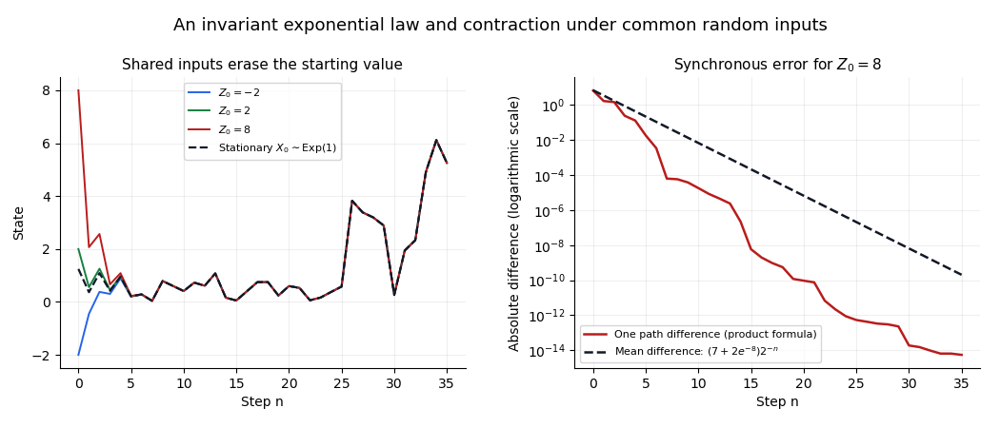

<h1 id="1/b/iii/solution">Solution</h1>

↑ **Parent:** [Iii](../iii.md)

Every $X_n$ has the same [exponential distribution](../../../../../exponential-distribution.md), so $X_n\xrightarrow d X$ for $X\sim\operatorname{Exp}(1)$. Part (ii) gives $Z_n-X_n\xrightarrow p0$. Applying [Slutsky's theorem](../../../../../slutsky-theorem.md) to $Z_n=X_n+(Z_n-X_n)$ yields

$$
\boxed{Z_n\xrightarrow d\operatorname{Exp}(1).}
$$

The limiting [probability distribution](../../../../../probability-distribution-split.md) does not depend on $c$. This is precisely the attraction to the [exponential invariant law of a random affine recursion](../../../../../exponential-invariant-law-of-a-random-affine-recursion.md).

**[Figure 1](#1/b/iii/image-common-random-inputs-make-different-initial-values-approach-the-same-stationary-trajectory). Common random inputs make different initial values approach the same stationary trajectory**. Original simulations of the affine recursion with shared inputs. The right panel compares an exactly propagated path difference with its unconditional expected value; the geometric expectation estimate, rather than the simulation, proves convergence.

## ↑ Ancestors (13)

1. [Iii](../iii.md)
2. [B](../../b.md)
3. [1](../../../1.md)
4. [2017](../../../../2017-split.md)
5. [Past exam of the probability course of the University of Oxford](../../../../split.md)
6. [Probability course of the University of Oxford](../../../../../probability-course-of-the-university-of-oxford.md)
7. [Year 2 of the mathematics course of the University of Oxford](../../../../../year-2-of-the-mathematics-course-of-the-university-of-oxford.md)
8. [Mathematics course of the University of Oxford](../../../../../mathematics-course-of-the-university-of-oxford.md)
9. [Undergraduate course of the University of Oxford](../../../../../undergraduate-course-of-the-university-of-oxford.md)
10. [Course of the University of Oxford](../../../../../course-of-the-university-of-oxford.md)
11. [University of Oxford](../../../../../university-of-oxford-split.md)
12. [List of universities](../../../../../list-of-universities.md)
13. [Codex Wiki](../../../../../split.md)
