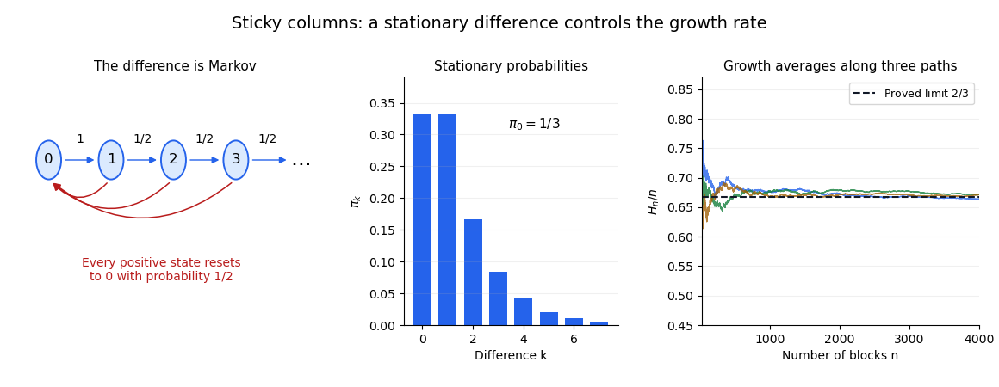

<h1 id="3/b/i/solution">Solution</h1>

↑ **Parent:** [I](../i.md)

**The difference process $D_n$ is a [Markov chain](../../../../../markov-chain-split.md).** If the columns are equal, the next block creates a height difference of one. If the difference is $k\geq1$, landing in the taller column increases it to $k+1$, while landing in the shorter column makes it zero. Therefore its only nonzero [transition probabilities](../../../../../transition-probability.md) are

$$
\boxed{P(0,1)=1,\qquad P(k,k+1)=P(k,0)=\frac12\quad(k\geq1).}
$$

These probabilities depend only on the present difference, not on the absolute heights or their history. This is the [reset-or-increment Markov chain](../../../../../reset-or-increment-markov-chain.md) with $p=1/2$.

For its [stationary distribution](../../../../../stationary-distribution.md), the incoming-flow equations give $\pi_1=\pi_0$ and $\pi_k=\pi_{k-1}/2$ for $k\geq2$. Normalization uses a [geometric series](../../../../../geometric-series.md):

$$
1=\pi_0+\sum_{k=1}^\infty\pi_0\,2^{-(k-1)}=3\pi_0.
$$

Thus

$$
\boxed{\pi_0=\frac13,\qquad\pi_k=\frac1{3\,2^{k-1}}\quad(k\geq1).}
$$

The remaining balance equation is also satisfied: the flow into zero is $(1-\pi_0)/2=1/3$. Every state can reach zero and every positive state can be reached from zero, so it is an [irreducible Markov chain](../../../../../irreducible-markov-chain.md). Its invariant probability distribution makes it [positive recurrent](../../../../../positive-recurrent-markov-chain.md), and that distribution is unique.

**The maximum-height process $H_n$ is not Markov.** Starting empty, condition first on the positive-probability history $(H_1,H_2,H_3)=(1,1,2)$. After two blocks the columns were equal, so after three their difference is one. Hence $\mathbb P(H_4=3\mid H_1=1,H_2=1,H_3=2)=1/2$.

For the history $(1,2,2)$, the first two blocks built one column and the third caught the other column up, leaving equal heights. Hence $\mathbb P(H_4=3\mid H_1=1,H_2=2,H_3=2)=1$. Both histories have the same time and present height $H_3=2$, but different predictions. This violates the [Markov property](../../../../../markov-property.md) and illustrates why [a function of a Markov chain need not be Markov](../../../../../a-function-of-a-markov-chain-need-not-be-markov.md).

**[Figure 2](#3/b/i/image-the-height-difference-has-reset-or-increment-transitions-and-a-geometric-stationary-tail). The height difference has reset-or-increment transitions and a geometric stationary tail**. Original transition diagram and stationary probabilities. Independent simulated height averages illustrate the proved limiting growth rate; the finite diagram continues indefinitely to the right.

## ↑ Ancestors (13)

1. [I](../i.md)
2. [B](../../b.md)
3. [3](../../../3.md)
4. [2017](../../../../2017-split.md)
5. [Past exam of the probability course of the University of Oxford](../../../../split.md)
6. [Probability course of the University of Oxford](../../../../../probability-course-of-the-university-of-oxford.md)
7. [Year 2 of the mathematics course of the University of Oxford](../../../../../year-2-of-the-mathematics-course-of-the-university-of-oxford.md)
8. [Mathematics course of the University of Oxford](../../../../../mathematics-course-of-the-university-of-oxford.md)
9. [Undergraduate course of the University of Oxford](../../../../../undergraduate-course-of-the-university-of-oxford.md)
10. [Course of the University of Oxford](../../../../../course-of-the-university-of-oxford.md)
11. [University of Oxford](../../../../../university-of-oxford-split.md)
12. [List of universities](../../../../../list-of-universities.md)
13. [Codex Wiki](../../../../../split.md)
