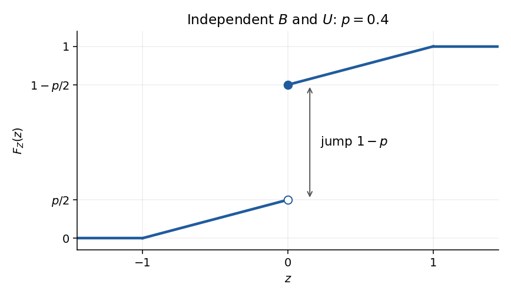

# 2023

↑ **Parent:** [Past exam of the probability course of the University of Oxford](../past-exam-of-the-probability-course-of-the-university-of-oxford.md)

Source: [Oxford's released examination PDF, pages 172–175](https://www.whatdotheyknow.com/request/bsc_mathematics_part_a_examinati/response/2820674/attach/3/FOI%20202410%20944%20Data.pdf#page=172), dated 19 June 2023; questions 1, 2 and 3 occupy pages 173, 174 and 175 respectively. The solutions below follow the paper's numbering. In 2(b), both the original PDF and its transcription omit independence between $B$ and $U$; the intended independent-case answers and the consequences of this omission are distinguished below.

**Table of contents**

- [1](#1)
  - [a](#1/a)
    - [Solution](#1/a/solution)
  - [b](#1/b)
    - [Solution](#1/b/solution)
  - [c](#1/c)
    - [i](#1/c/i)
      - [Solution](#1/c/i/solution)
    - [ii](#1/c/ii)
      - [Solution](#1/c/ii/solution)
    - [iii](#1/c/iii)
      - [Solution](#1/c/iii/solution)
  - [d](#1/d)
    - [i](#1/d/i)
      - [Solution](#1/d/i/solution)
    - [ii](#1/d/ii)
      - [Solution](#1/d/ii/solution)
- [2](#2)
  - [a](#2/a)
    - [Solution](#2/a/solution)
  - [b](#2/b)
    - [i](#2/b/i)
      - [Solution](#2/b/i/solution)
    - [ii](#2/b/ii)
      - [Solution](#2/b/ii/solution)
    - [iii](#2/b/iii)
      - [Solution](#2/b/iii/solution)
  - [c](#2/c)
    - [i](#2/c/i)
      - [Solution](#2/c/i/solution)
    - [ii](#2/c/ii)
      - [Solution](#2/c/ii/solution)
    - [iii](#2/c/iii)
      - [Solution](#2/c/iii/solution)
  - [d](#2/d)
    - [i](#2/d/i)
      - [Solution](#2/d/i/solution)
    - [ii](#2/d/ii)
      - [Solution](#2/d/ii/solution)
- [3](#3)
  - [a](#3/a)
    - [i](#3/a/i)
      - [Solution](#3/a/i/solution)
    - [ii](#3/a/ii)
      - [Solution](#3/a/ii/solution)
    - [iii](#3/a/iii)
      - [Solution](#3/a/iii/solution)
  - [b](#3/b)
    - [i](#3/b/i)
      - [Solution](#3/b/i/solution)
    - [ii](#3/b/ii)
      - [Solution](#3/b/ii/solution)
    - [iii](#3/b/iii)
      - [Solution](#3/b/iii/solution)
    - [iv](#3/b/iv)
      - [Solution](#3/b/iv/solution)
    - [v](#3/b/v)
      - [Solution](#3/b/v/solution)

## 1

↑ **Parent:** [2023](2023.md)

<h3 id="1/a">a</h3>

↑ **Parent:** [1](#1)

<h4 id="1/a/solution">Solution</h4>

↑ **Parent:** [A](#1/a)

The [strong law of large numbers](../convergence-of-random-variables.md#strong-law-of-large-numbers) states that, for [independent and identically distributed random variables](../random-variable.md#independent-and-identically-distributed-random-variables) $X_1,X_2,\ldots$ with $\mathbb E|X_1|<\infty$,

$$
\boxed{\frac1n\sum_{j=1}^nX_j\longrightarrow\mathbb E X_1\quad\text{almost surely}.}
$$

Thus, outside an event of [probability](../probability-theory.md#probability) zero, the [sample mean](../variance.md#sample-mean) converges to the common [expected value](../expected-value.md).

<h3 id="1/b">b</h3>

↑ **Parent:** [1](#1)

<h4 id="1/b/solution">Solution</h4>

↑ **Parent:** [B](#1/b)

For a [Borel set](../measure-theory.md#borel-set) $A\subseteq\mathbb R$, the [joint probability density](../continuous-probability-distribution.md#joint-probability-density) gives

$$
\mathbb P(XY\in A)=\int_{\mathbb R}\int_{\mathbb R}\mathbf1_A(xy)f(x,y)\,dy\,dx.
$$

For each $x\ne0$, substitute $z=xy$. The [change of variables for probability densities](../continuous-probability-distribution.md#change-of-variables-for-probability-densities) contributes $dy=dz/|x|$, with the absolute value accounting for the reversed orientation when $x<0$. The line $x=0$ has two-dimensional [Lebesgue measure](../measure-theory.md#lebesgue-measure) zero, so omitting it changes no [probability](../probability-theory.md#probability). By the [Tonelli theorem](../measure-theory.md#tonelli-theorem),

$$
\mathbb P(XY\in A)=\int_A\left[\int_{\mathbb R\setminus\{0\}}\frac1{|x|}f\left(x,\frac zx\right)\,dx\right]dz.
$$

The bracket is nonnegative and its [integral](../integral.md) over $\mathbb R$ is one. This proves the [probability density of a product of random variables](../continuous-probability-distribution.md#probability-density-of-a-product-of-random-variables) formula:

$$
\boxed{f_Z(z)=\int_{\mathbb R\setminus\{0\}}\frac1{|x|}f\left(x,\frac zx\right)\,dx.}
$$

As usual, a [probability density function](../continuous-probability-distribution.md#probability-density-function) is determined only almost everywhere; exceptional infinite values are harmless.

For the [independent random variables](../random-variable.md#independent-random-variables) with the specified [uniform distribution](../continuous-probability-distribution.md#continuous-uniform-distribution), $f(x,y)=b^{-2}$ on $(0,b)^2$ and zero elsewhere. When $0<z<b^2$, the conditions $0<x<b$ and $0<z/x<b$ are equivalent to $z/b<x<b$. Therefore

$$
f_Z(z)=\frac1{b^2}\int_{z/b}^{b}\frac{dx}{x}=\frac1{b^2}\log\frac{b^2}{z},
\qquad
\boxed{f_Z(z)=\begin{cases}b^{-2}\log(b^2/z),&0<z<b^2,\\0,&\text{otherwise}.\end{cases}}
$$

The value assigned at zero is arbitrary. Substitution $s=z/b^2$ checks [normalization of a probability distribution](../probability-distribution.md#normalization-of-a-probability-distribution): $\int_0^1-\log s\,ds=1$. This is the [product of independent uniform random variables](../continuous-probability-distribution.md#product-of-independent-uniform-random-variables) law.

<h3 id="1/c">c</h3>

↑ **Parent:** [1](#1)

<h4 id="1/c/i">i</h4>

↑ **Parent:** [C](#1/c)

<h5 id="1/c/i/solution">Solution</h5>

↑ **Parent:** [I](#1/c/i)

Direct integration of the [uniform distribution](../continuous-probability-distribution.md#continuous-uniform-distribution) yields $\mathbb E U_j=b/2$ and $\mathbb E U_j^2=b^2/3$. The [expectation of a product of independent random variables](../expected-value.md#expectation-of-a-product-of-independent-random-variables) gives

$$
\mathbb EW_n=\prod_{j=1}^n\mathbb E U_j=(b/2)^n,\qquad \mathbb EW_n^2=(b^2/3)^n.
$$

Subtracting the square of the [expected value](../expected-value.md) gives the [variance](../variance.md):

$$
\boxed{\mathbb EW_n=(b/2)^n,\qquad\operatorname{Var}(W_n)=(b^2/3)^n-(b^2/4)^n.}
$$

Since $W_n\geq0$, [Markov's inequality](../probability-inequality.md#markov-s-inequality) implies, for every $\varepsilon>0$,

$$
\mathbb P(W_n>\varepsilon)\leq\frac{(b/2)^n}{\varepsilon}\longrightarrow0\quad(0<b<2).
$$

Hence $\boxed{W_n\to0\text{ in probability for }0<b<2.}$ The first [moment](../expected-value.md#moment) suffices: the [variance](../variance.md) need not tend to zero throughout this range.

<h4 id="1/c/ii">ii</h4>

↑ **Parent:** [C](#1/c)

<h5 id="1/c/ii/solution">Solution</h5>

↑ **Parent:** [Ii](#1/c/ii)

If $0<b\leq1$, then $0<U_j\leq1$ [almost surely](../convergence-of-random-variables.md#almost-sure-convergence). Intersecting these events over all $j$ still gives an event of [probability](../probability-theory.md#probability) one. On it, $0\leq W_{n+1}\leq W_n$, so the products have a finite nonnegative limit $W_\infty$.

For every $\varepsilon>0$, the inclusion $\{W_\infty>\varepsilon\}\subseteq\{W_n>\varepsilon\}$ and part (c)(i) imply $\mathbb P(W_\infty>\varepsilon)=0$. Taking $\varepsilon=1/m$ for positive integers $m$ proves $W_\infty=0$ [almost surely](../convergence-of-random-variables.md#almost-sure-convergence). Thus

$$
\boxed{W_n\longrightarrow0\quad\text{almost surely for }0<b\leq1.}
$$

The monotonicity is the extra ingredient that upgrades [convergence in probability](../convergence-of-random-variables.md#convergence-in-probability) to [almost sure convergence](../convergence-of-random-variables.md#almost-sure-convergence) here.

<h4 id="1/c/iii">iii</h4>

↑ **Parent:** [C](#1/c)

<h5 id="1/c/iii/solution">Solution</h5>

↑ **Parent:** [Iii](#1/c/iii)

For $\alpha>0$, integration and [independence of random variables](../random-variable.md#independent-random-variables) give

$$
\mathbb EU_1^\alpha=\frac1b\int_0^bu^\alpha\,du=\frac{b^\alpha}{1+\alpha},\qquad \mathbb EW_n^\alpha=\left(\frac{b^\alpha}{1+\alpha}\right)^n.
$$

By the [fractional moment criterion for convergence in probability](../convergence-of-random-variables.md#fractional-moment-criterion-for-convergence-in-probability),

$$
\mathbb P(W_n>\varepsilon)\leq\varepsilon^{-\alpha}\left(\frac{b^\alpha}{1+\alpha}\right)^n.
$$

The parenthesized factor is less than one precisely when $\alpha\log b-\log(1+\alpha)<0$. This expression vanishes at $\alpha=0$ and has [derivative](../calculus.md#derivative) $\log b-1$ there. If $b<e$, the [derivative](../calculus.md#derivative) is negative, so some sufficiently small $\alpha>0$ makes the factor strictly less than one. The bound then tends to zero geometrically, proving

$$
\boxed{W_n\longrightarrow0\quad\text{in probability for every }0<b<e.}
$$

<h3 id="1/d">d</h3>

↑ **Parent:** [1](#1)

<h4 id="1/d/i">i</h4>

↑ **Parent:** [D](#1/d)

<h5 id="1/d/i/solution">Solution</h5>

↑ **Parent:** [I](#1/d/i)

The inverse [transformation of a random variable](../random-variable.md#transformation-of-a-random-variable) is $u=e^{-v}$, with absolute [derivative](../calculus.md#derivative) $e^{-v}$. The condition $0<u<b$ becomes $v>-\log b$. The [change of variables for probability densities](../continuous-probability-distribution.md#change-of-variables-for-probability-densities) gives

$$
\boxed{f_{V_n}(v)=\begin{cases}b^{-1}e^{-v},&v>-\log b,\\0,&v\leq-\log b.\end{cases}}
$$

Equivalently, $V_n+\log b$ has the [exponential distribution](../continuous-probability-distribution.md#exponential-distribution) of rate one. Applying a separate measurable [transformation of a random variable](../random-variable.md#transformation-of-a-random-variable) to each independent $U_n$ preserves [independence of random variables](../random-variable.md#independent-random-variables), so the $V_n$ are [independent and identically distributed](../random-variable.md#independent-and-identically-distributed-random-variables).

<h4 id="1/d/ii">ii</h4>

↑ **Parent:** [D](#1/d)

<h5 id="1/d/ii/solution">Solution</h5>

↑ **Parent:** [Ii](#1/d/ii)

Taking [logarithms](../calculus.md#logarithm) of the product gives

$$
\boxed{W_n=\exp\left(-\sum_{j=1}^nV_j\right).}
$$

By part (d)(i), $V_j=E_j-\log b$ in [probability distribution](../probability-distribution.md), where $E_j$ has the [exponential distribution](../continuous-probability-distribution.md#exponential-distribution) of rate one. Thus $\mathbb E|V_j|\leq1+|\log b|<\infty$ and $\mathbb EV_j=1-\log b$. The [strong law of large numbers](../convergence-of-random-variables.md#strong-law-of-large-numbers) gives

$$
\frac1n\log W_n=-\frac1n\sum_{j=1}^nV_j\longrightarrow\log b-1\quad\text{almost surely}.
$$

If $b<e$, choose $\delta=(1-\log b)/2>0$. Eventually $\log W_n\leq-\delta n$, so $W_n\leq e^{-\delta n}\to0$. If $b>e$, choose $\delta=(\log b-1)/2>0$; eventually $W_n\geq e^{\delta n}\to\infty$. Therefore

$$
\boxed{W_n\to0\text{ a.s. if }0<b<e;\qquad W_n\to\infty\text{ a.s. if }b>e.}
$$

In particular, the second range cannot have [almost sure convergence](../convergence-of-random-variables.md#almost-sure-convergence) to zero. This is the [almost-sure growth rate of independent products](../convergence-of-random-variables.md#almost-sure-growth-rate-of-independent-products). At $b=e$ the logarithmic limit is zero, which by itself decides neither behavior; that boundary case is not requested.

## 2

↑ **Parent:** [2023](2023.md)

<h3 id="2/a">a</h3>

↑ **Parent:** [2](#2)

<h4 id="2/a/solution">Solution</h4>

↑ **Parent:** [A](#2/a)

The [uniqueness theorem for moment-generating functions](../probability-distribution.md#uniqueness-theorem-for-moment-generating-functions) states that if $M_X$ and $M_Y$ are finite and equal on an open [real interval](../real-analysis.md#interval-mathematics) containing zero, then

$$
\boxed{X\overset d=Y.}
$$

For the [convergence theorem for moment-generating functions](../probability-distribution.md#convergence-theorem-for-moment-generating-functions), suppose that the [moment-generating functions](../probability-distribution.md#moment-generating-function) $M_{X_n}$ are finite on a common open [real interval](../real-analysis.md#interval-mathematics) $(-a,a)$, $a>0$, and $M_{X_n}(t)\to M_X(t)$ for every $|t|<a$, where $M_X$ is finite there. Then

$$
\boxed{X_n\overset d\longrightarrow X.}
$$

One may equivalently assume convergence to a finite function $M$ on that interval: the theorem then asserts existence of a unique limiting [probability distribution](../probability-distribution.md) with [moment-generating function](../probability-distribution.md#moment-generating-function) $M$ as well as [convergence in distribution](../convergence-of-random-variables.md#convergence-in-distribution).

<h3 id="2/b">b</h3>

↑ **Parent:** [2](#2)

The [independence of random variables](../random-variable.md#independent-random-variables) $B$ and $U$ is needed for the intended [mixture distribution](../probability-distribution.md#mixture-distribution) in (ii) and (iii). It is absent from the printed assumptions. We use independence for the main formulas, and then give the answers under the literal assumptions.

<h4 id="2/b/i">i</h4>

↑ **Parent:** [B](#2/b)

<h5 id="2/b/i/solution">Solution</h5>

↑ **Parent:** [I](#2/b/i)

The [uniform distribution](../continuous-probability-distribution.md#continuous-uniform-distribution) has [probability density function](../continuous-probability-distribution.md#probability-density-function) $1/2$ on $(-1,1)$. Therefore, for $t\ne0$,

$$
M_U(t)=\frac12\int_{-1}^1e^{tu}\,du=\frac{e^t-e^{-t}}{2t},\qquad \boxed{M_U(t)=\begin{cases}\sinh(t)/t,&t\ne0,\\1,&t=0.\end{cases}}
$$

The value at zero follows either directly from the definition of the [moment-generating function](../probability-distribution.md#moment-generating-function) or by continuity. This answer needs no assumption about $B$.

<h4 id="2/b/ii">ii</h4>

↑ **Parent:** [B](#2/b)

<h5 id="2/b/ii/solution">Solution</h5>

↑ **Parent:** [Ii](#2/b/ii)

If $B$ and $U$ are [independent random variables](../random-variable.md#independent-random-variables), conditioning on the [Bernoulli random variable](../discrete-probability-distribution.md#bernoulli-distribution) $B$ gives

$$
\boxed{M_Z(t)=(1-p)+pM_U(t)=1-p+p\frac{\sinh t}{t},}
$$

with the continuous value $M_Z(0)=1$. Indeed $Z=0$ when $B=0$, while the conditional [probability distribution](../probability-distribution.md) of $Z$ given $B=1$ is the original [uniform distribution](../continuous-probability-distribution.md#continuous-uniform-distribution).

Under the literal assumptions alone, the [law of total expectation](../measure-theory.md#law-of-total-expectation) gives only

$$
M_Z(t)=1-p+p\mathbb E[e^{tU}\mid B=1].
$$

This is not determined by $M_U$ and $p$. For an explicit counterexample, put $p=1/2$ and $B=\mathbf1_{\{U>0\}}$. Then $B$ has the required [Bernoulli distribution](../discrete-probability-distribution.md#bernoulli-distribution), but

$$
M_Z(t)=\frac12+\frac12\int_0^1e^{tu}\,du=\frac12+\frac{e^t-1}{2t}\quad(t\ne0),
$$

which differs from the independent-case formula.

<h4 id="2/b/iii">iii</h4>

↑ **Parent:** [B](#2/b)

<h5 id="2/b/iii/solution">Solution</h5>

↑ **Parent:** [Iii](#2/b/iii)

Under [independence of random variables](../random-variable.md#independent-random-variables), the [law of a random variable](../probability-distribution.md) $Z$ is the [mixed probability distribution](../probability-distribution.md#mixed-probability-distribution) $(1-p)\delta_0+p\operatorname{Unif}(-1,1)$. For negative $z$, only the uniform component can contribute to $\mathbb P(Z\leq z)$; at zero the [probability mass](../probability-distribution.md#probability-mass) $1-p$ is included. Thus its [cumulative distribution function](../probability-distribution.md#cumulative-distribution-function) is

$$
\boxed{F_Z(z)=\begin{cases}0,&z<-1,\\p(z+1)/2,&-1\leq z<0,\\1-p+p(z+1)/2,&0\leq z<1,\\1,&z\geq1.\end{cases}}
$$

The sketch consists of a horizontal segment at height zero before $-1$, a line of slope $p/2$ ending at the open point $(0,p/2)$, a jump of size $1-p$ to the closed point $(0,1-p/2)$, another line of slope $p/2$ ending at $(1,1)$, and a horizontal segment thereafter. The [cumulative distribution function](../probability-distribution.md#cumulative-distribution-function) is right-continuous at the jump.

**[Figure 1](#2/b/iii/image-cumulative-distribution-function-of-the-independent-bernoulli-uniform-product-illustrated-at-p-0-4). Cumulative distribution function of the independent Bernoulli-uniform product, illustrated at $p=0.4$**.

Under the literal assumptions, write $H(z)=\mathbb P(U\leq z\mid B=1)$. The general answer is $F_Z(z)=(1-p)\mathbf1_{\{z\geq0\}}+pH(z)$, so the continuous part of the sketch is undetermined. The jump at zero is still exactly $1-p$, because $\mathbb P(U=0)=0$. In the dependent counterexample from (ii), $F_Z(z)=0$ for $z<0$, $F_Z(z)=(1+z)/2$ for $0\leq z<1$, and $F_Z(z)=1$ for $z\geq1$.

<h3 id="2/c">c</h3>

↑ **Parent:** [2](#2)

<h4 id="2/c/i">i</h4>

↑ **Parent:** [C](#2/c)

<h5 id="2/c/i/solution">Solution</h5>

↑ **Parent:** [I](#2/c/i)

Fix $0<c<1$ and choose $R_c$, independently of $X$, with the [normal distribution](../probability-distribution.md#normal-distribution)

$$
\boxed{R_c\sim\mathcal N\bigl((1-c)\mu,(1-c^2)\sigma^2\bigr).}
$$

The [linear combination of independent normal random variables](../probability-distribution.md#linear-combination-of-independent-normal-random-variables) $cX+R_c$ is normal. Its [expected value](../expected-value.md) is $c\mu+(1-c)\mu=\mu$ and its [variance](../variance.md) is $c^2\sigma^2+(1-c^2)\sigma^2=\sigma^2$. Hence $cX+R_c\overset d=X$ for every $c$, proving that every specified [normal distribution](../probability-distribution.md#normal-distribution) is a [self-decomposable distribution](../probability-distribution.md#self-decomposable-distribution).

<h4 id="2/c/ii">ii</h4>

↑ **Parent:** [C](#2/c)

<h5 id="2/c/ii/solution">Solution</h5>

↑ **Parent:** [Ii](#2/c/ii)

Fix $|t|<t_0$. Since $|ct|<t_0$, $0<M_X(ct)<\infty$. Using [independence of random variables](../random-variable.md#independent-random-variables) and the [Tonelli theorem](../measure-theory.md#tonelli-theorem) for the positive exponential integrands gives the extended-real identity

$$
M_X(t)=M_{cX+R}(t)=M_X(ct)M_R(t).
$$

The left side is finite and the first factor is finite and strictly positive. Consequently $M_R(t)$ is finite and

$$
M_R(t)=\frac{M_X(t)}{M_X(ct)}.
$$

The same reasoning applies to $R'$, so their [moment-generating functions](../probability-distribution.md#moment-generating-function) are finite and equal throughout $(-t_0,t_0)$. The [uniqueness theorem for moment-generating functions](../probability-distribution.md#uniqueness-theorem-for-moment-generating-functions) yields

$$
\boxed{R\overset d=R'.}
$$

This proves [uniqueness of a self-decomposition remainder](../probability-distribution.md#uniqueness-of-a-self-decomposition-remainder) while also checking the required finiteness; no independence between $R$ and $R'$ is needed.

<h4 id="2/c/iii">iii</h4>

↑ **Parent:** [C](#2/c)

<h5 id="2/c/iii/solution">Solution</h5>

↑ **Parent:** [Iii](#2/c/iii)

For $X\sim\operatorname{Exp}(\lambda)$, integration gives $M_X(t)=\lambda/(\lambda-t)$ for $t<\lambda$. For $0<c<1$, the candidate remainder [moment-generating function](../probability-distribution.md#moment-generating-function) is

$$
\frac{M_X(t)}{M_X(ct)}=\frac{\lambda-ct}{\lambda-t}=c+(1-c)\frac{\lambda}{\lambda-t}.
$$

This is the [moment-generating function](../probability-distribution.md#moment-generating-function) of the [mixture distribution](../probability-distribution.md#mixture-distribution)

$$
\boxed{\mathcal L(R_c)=c\delta_0+(1-c)\operatorname{Exp}(\lambda).}
$$

Construct it by taking an [exponential random variable](../continuous-probability-distribution.md#exponential-distribution) $E$ of rate $\lambda$ and a [Bernoulli random variable](../discrete-probability-distribution.md#bernoulli-distribution) $J$ with $\mathbb P(J=1)=1-c$, with $E,J,X$ mutually independent, and setting $R_c=JE$. Then $R_c$ is independent of $X$, and

$$
M_{cX+R_c}(t)=\frac{\lambda}{\lambda-ct}\frac{\lambda-ct}{\lambda-t}=\frac{\lambda}{\lambda-t}=M_X(t)
$$

on a neighborhood of zero. By the [uniqueness theorem for moment-generating functions](../probability-distribution.md#uniqueness-theorem-for-moment-generating-functions), $cX+R_c\overset d=X$, so the [exponential distribution](../continuous-probability-distribution.md#exponential-distribution) is a [self-decomposable distribution](../probability-distribution.md#self-decomposable-distribution).

<h3 id="2/d">d</h3>

↑ **Parent:** [2](#2)

<h4 id="2/d/i">i</h4>

↑ **Parent:** [D](#2/d)

<h5 id="2/d/i/solution">Solution</h5>

↑ **Parent:** [I](#2/d/i)

For [independent and identically distributed random variables](../random-variable.md#independent-and-identically-distributed-random-variables) $X_j\sim\mathcal N(0,\sigma^2)$, the [linear combination of independent normal random variables](../probability-distribution.md#linear-combination-of-independent-normal-random-variables) $n^{-1/2}\sum_{j=1}^nX_j$ has [expected value](../expected-value.md) zero and [variance](../variance.md) $n^{-1}n\sigma^2=\sigma^2$. Thus

$$
\boxed{n^{-1/2}(X_1+\cdots+X_n)\sim\mathcal N(0,\sigma^2)\quad(n\geq1).}
$$

This is exactly the requested $2$-stability. The paper's definition is a [strictly stable distribution](../probability-distribution.md#strictly-stable-distribution), since it allows no centering term.

<h4 id="2/d/ii">ii</h4>

↑ **Parent:** [D](#2/d)

<h5 id="2/d/ii/solution">Solution</h5>

↑ **Parent:** [Ii](#2/d/ii)

First take integers $1\leq k<n$. For independent copies $X_1,\ldots,X_n$ of $X$, define

$$
A=k^{-1/\alpha}\sum_{j=1}^kX_j,\qquad B=(n-k)^{-1/\alpha}\sum_{j=k+1}^nX_j.
$$

The two blocks involve disjoint families of [independent random variables](../random-variable.md#independent-random-variables), so $A$ and $B$ are independent. The assumed [strictly stable distribution](../probability-distribution.md#strictly-stable-distribution) gives $A\overset d=X$, $B\overset d=X$, and

$$
(k/n)^{1/\alpha}A+(1-k/n)^{1/\alpha}B=n^{-1/\alpha}\sum_{j=1}^nX_j\overset d=X.
$$

Therefore, on any fixed [probability space](../probability-space.md) carrying $X$ and an independent copy $X'$, their [joint probability distribution](../probability-distribution.md#joint-probability-distribution) gives

$$
(k/n)^{1/\alpha}X+(1-k/n)^{1/\alpha}X'\overset d=X.
$$

Now fix an arbitrary $0<c<1$ and choose rationals $r_m=k_m/n_m\in(0,1)$ tending to $c^\alpha$. Continuity of the real powers gives, on that fixed [probability space](../probability-space.md),

$$
r_m^{1/\alpha}X+(1-r_m)^{1/\alpha}X'\longrightarrow cX+(1-c^\alpha)^{1/\alpha}X'\quad\text{almost surely}.
$$

The left sides all have the [probability distribution](../probability-distribution.md) of $X$. Since [almost sure convergence](../convergence-of-random-variables.md#almost-sure-convergence) implies [convergence in distribution](../convergence-of-random-variables.md#convergence-in-distribution), their limit has that same [probability distribution](../probability-distribution.md). Hence

$$
\boxed{R_c=(1-c^\alpha)^{1/\alpha}X',\qquad R_c\text{ independent of }X,\qquad cX+R_c\overset d=X.}
$$

This proves [strict stability implies self-decomposability](../probability-distribution.md#strict-stability-implies-self-decomposability). The limit argument uses no [moment-generating function](../probability-distribution.md#moment-generating-function) or finite [moments](../expected-value.md#moment), which is essential for general [stable distributions](../probability-distribution.md#stable-distribution).

## 3

↑ **Parent:** [2023](2023.md)

<h3 id="3/a">a</h3>

↑ **Parent:** [3](#3)

<h4 id="3/a/i">i</h4>

↑ **Parent:** [A](#3/a)

<h5 id="3/a/i/solution">Solution</h5>

↑ **Parent:** [I](#3/a/i)

A [probability distribution](../probability-distribution.md) on the countable [state space](../dynamical-systems.md#state-space) $\mathcal S$ is precisely a row vector satisfying

$$
\boxed{\pi_i\geq0\quad(i\in\mathcal S),\qquad\sum_{i\in\mathcal S}\pi_i=1.}
$$

A [transition matrix](../markov-chain.md#stochastic-matrix) is a [stochastic matrix](../markov-chain.md#stochastic-matrix), meaning

$$
\boxed{p_{i,j}\geq0\quad(i,j\in\mathcal S),\qquad\sum_{j\in\mathcal S}p_{i,j}=1\quad(i\in\mathcal S).}
$$

Every row therefore gives the conditional [probability distribution](../probability-distribution.md) of the next state given the present state. These conditions do not require $\pi$ to be an [invariant distribution](../markov-chain.md#stationary-distribution) of $P$.

<h4 id="3/a/ii">ii</h4>

↑ **Parent:** [A](#3/a)

<h5 id="3/a/ii/solution">Solution</h5>

↑ **Parent:** [Ii](#3/a/ii)

The assumed identities are the [detailed balance equations](../markov-chain.md#detailed-balance). Summing over $i$ and using the row sums of the [transition matrix](../markov-chain.md#stochastic-matrix) gives, for every $j$,

$$
(\pi P)_j=\sum_i\pi_ip_{i,j}=\sum_i\pi_jp_{j,i}=\pi_j\sum_ip_{j,i}=\pi_j.
$$

All summands are nonnegative, so these countable sums are justified. Thus

$$
\boxed{\pi P=\pi,}
$$

and $\pi$ is an [invariant distribution](../markov-chain.md#stationary-distribution).

<h4 id="3/a/iii">iii</h4>

↑ **Parent:** [A](#3/a)

<h5 id="3/a/iii/solution">Solution</h5>

↑ **Parent:** [Iii](#3/a/iii)

For the [countable-state Markov chain ergodic theorem](../markov-chain.md#countable-state-markov-chain-ergodic-theorem), let the [Markov chain](../markov-chain.md) be irreducible and positive recurrent, with its unique [stationary distribution](../markov-chain.md#stationary-distribution) $\pi$. From any initial state, for every real $f$ satisfying $\sum_j\pi_j|f(j)|<\infty$,

$$
\boxed{\frac1n\sum_{m=0}^{n-1}f(X_m)\longrightarrow\sum_j\pi_jf(j)\quad\text{almost surely}.}
$$

In particular, $n^{-1}\sum_{m=0}^{n-1}\mathbf1_{\{X_m=j\}}\to\pi_j$ [almost surely](../convergence-of-random-variables.md#almost-sure-convergence). This time-average conclusion requires no [aperiodicity](../markov-chain.md#aperiodic-markov-chain).

The [countable-state Markov chain convergence theorem](../markov-chain.md#countable-state-markov-chain-convergence-theorem) adds the hypothesis of an [aperiodic Markov chain](../markov-chain.md#aperiodic-markov-chain) and concludes

$$
\boxed{P^n(i,j)\longrightarrow\pi_j\quad\text{for every }i,j.}
$$

It also follows that $\mathbb P_\nu(X_n=j)\to\pi_j$ for every initial [probability distribution](../probability-distribution.md) $\nu$. For an irreducible recurrent chain, the occupation-frequency theorem can also be stated as a limit $1/\mathbb E_jT_j^+$, interpreted as zero for a [null recurrent state](../markov-chain.md#null-recurrent-state); in the positive recurrent case this equals $\pi_j$.

<h3 id="3/b">b</h3>

↑ **Parent:** [3](#3)

<h4 id="3/b/i">i</h4>

↑ **Parent:** [B](#3/b)

<h5 id="3/b/i/solution">Solution</h5>

↑ **Parent:** [I](#3/b/i)

Under the specified evolution rule, conditional on the entire history, the next event's [probability distribution](../probability-distribution.md) depends only on the current population size. This is the [time-homogeneous Markov property](../markov-chain.md#time-homogeneous-markov-property). Birth and immigration both increase the size by one, while death decreases it by one. Writing $q=1-p$, the [transition probabilities](../markov-chain.md#transition-probability) on $\mathbb Z_{\geq0}$ are

$$
\boxed{P(k,k+1)=u_k=\frac{kp+\theta}{k+\theta}\quad(k\geq0),\qquad P(k,k-1)=d_k=\frac{kq}{k+\theta}\quad(k\geq1),}
$$

and all other entries are zero. In particular $P(0,1)=1$ and $d_0=0$. The row sum is $[kp+\theta+kq]/(k+\theta)=1$. Every neighboring pair communicates, so this is an [irreducible Markov chain](../markov-chain.md#irreducible-markov-chain), specifically a [birth-death-immigration jump chain](../markov-chain.md#birth-death-immigration-jump-chain).

<h4 id="3/b/ii">ii</h4>

↑ **Parent:** [B](#3/b)

<h5 id="3/b/ii/solution">Solution</h5>

↑ **Parent:** [Ii](#3/b/ii)

We use the [stationary weights of a reflected birth-death chain](../markov-chain.md#stationary-weights-of-a-reflected-birth-death-chain), also verifying why they decide the question. If a [stationary distribution](../markov-chain.md#stationary-distribution) $\pi$ exists, its equation at zero is $\pi_0=\pi_1d_1=\pi_0u_0$. At $k\geq1$, stationarity gives

$$
\pi_ku_k-\pi_{k+1}d_{k+1}=\pi_{k-1}u_{k-1}-\pi_kd_k.
$$

Thus the edge flow is constant, and its value at the boundary is zero. Every [stationary distribution](../markov-chain.md#stationary-distribution) must therefore satisfy [detailed balance](../markov-chain.md#detailed-balance) on each edge. Since irreducibility forces $\pi_0>0$, it must be proportional to

$$
w_0=1,\qquad w_k=\prod_{j=0}^{k-1}\frac{u_j}{d_{j+1}}.
$$

Conversely, if $\sum_kw_k<\infty$, normalizing these positive weights gives a [probability distribution](../probability-distribution.md) satisfying [detailed balance](../markov-chain.md#detailed-balance), hence a [stationary distribution](../markov-chain.md#stationary-distribution). Existence of a [stationary distribution](../markov-chain.md#stationary-distribution) for an [irreducible Markov chain](../markov-chain.md#irreducible-markov-chain) on a countable [state space](../dynamical-systems.md#state-space) is equivalent to [positive recurrence](../markov-chain.md#positive-recurrent-markov-chain).

The ratio is

$$
\frac{w_{k+1}}{w_k}=\frac{(kp+\theta)(k+1+\theta)}{(k+\theta)(k+1)q}\longrightarrow\frac pq.
$$

For $p<1/2$, the limit is less than one, so the [ratio test](../sequence-and-series.md#ratio-test) gives summability. For $p\geq1/2$, observe that $u_k=p+\theta q/(k+\theta)>p\geq1/2$, whereas $d_{k+1}<q\leq1/2$. Thus $w_{k+1}/w_k>1$ for every $k$, so the weights cannot be summable. This also resolves $p=1/2$ without making an inconclusive appeal to the limiting ratio. Therefore

$$
\boxed{\text{Positive recurrence holds exactly when }0<p<\tfrac12,\quad\theta>0.}
$$

<h4 id="3/b/iii">iii</h4>

↑ **Parent:** [B](#3/b)

<h5 id="3/b/iii/solution">Solution</h5>

↑ **Parent:** [Iii](#3/b/iii)

Assume $p<1/2$, and put $a=\theta/p$ and $r=p/q\in(0,1)$. The [detailed balance equations](../markov-chain.md#detailed-balance) give

$$
\frac{\pi_{k+1}}{\pi_k}=\frac{p}{q}\frac{k+a}{k+1}\frac{k+1+\theta}{k+\theta}.
$$

Multiplying from $0$ to $k-1$, the last factor telescopes, while the product involving $a$ is evaluated by the [Gamma function](../complex-analysis.md#gamma-function):

$$
\pi_k=\pi_0\frac{k+\theta}{\theta}\frac{\Gamma(k+a)}{\Gamma(a)k!}r^k\quad(k\geq0).
$$

Consequently the requested [invariant distribution](../markov-chain.md#stationary-distribution) can be expressed using the paper's power series as

$$
\boxed{\pi_k=\frac{(k+\theta)\Gamma(k+\theta/p)}{k!\,g_{p,\theta}(p/q)}\left(\frac pq\right)^k,\quad k\geq0.}
$$

The assumed convergence of $g_{p,\theta}(r)$ ensures that this normalization is finite and positive.

For an explicit normalizing constant, the [binomial series](../sequence-and-series.md#binomial-series) gives

$$
H(r)=\sum_{k=0}^\infty\frac{\Gamma(k+a)}{k!}r^k=\Gamma(a)(1-r)^{-a}.
$$

The [termwise differentiation of a power series](../sequence-and-series.md#termwise-differentiation-of-a-power-series) is valid for $|r|<1$, so

$$
\begin{aligned}
g_{p,\theta}(r)&=rH'(r)+\theta H(r)\\
&=\Gamma(a)(1-r)^{-a-1}\bigl[ar+\theta(1-r)\bigr]\\
&=2\theta\Gamma(a)(1-r)^{-a-1}.
\end{aligned}
$$

The last equality uses $r=p/q$ and $a=\theta/p$: $ar+\theta(1-r)=\theta/q+\theta(q-p)/q=2\theta$. Therefore

$$
\boxed{\pi_k=\frac{(1-r)^{a+1}}{2\theta\Gamma(a)}\frac{(k+\theta)\Gamma(k+a)}{k!}r^k,\qquad \pi_0=\frac12(1-r)^{a+1}.}
$$

These positive terms sum to one and satisfy the [detailed balance equations](../markov-chain.md#detailed-balance), so part (a)(ii) verifies stationarity. Irreducibility makes the [invariant distribution](../markov-chain.md#stationary-distribution) unique.

<h4 id="3/b/iv">iv</h4>

↑ **Parent:** [B](#3/b)

<h5 id="3/b/iv/solution">Solution</h5>

↑ **Parent:** [Iv](#3/b/iv)

Every step changes the population by one, so $X_n$ has the parity of $n$ when $X_0=0$. Hence $\mathbb P(X_{2m+1}=0)=0$. A return in two steps has positive [probability](../probability-theory.md#probability) from every state, and all return times are even, so the [period of a state in a Markov chain](../markov-chain.md#period-of-a-state-in-a-markov-chain) is exactly two.

Each transition exchanges the even and odd classes. Since $\pi$ is an [invariant distribution](../markov-chain.md#stationary-distribution), their masses are equal: $\pi(\text{even})=\pi(\text{odd})=1/2$. The chain sampled at times $2m$, restricted to the even states, is irreducible and positive recurrent, and it is aperiodic because its diagonal entries are positive. Its [stationary distribution](../markov-chain.md#stationary-distribution) is $2\pi_k$ on even $k$. The [countable-state Markov chain convergence theorem](../markov-chain.md#countable-state-markov-chain-convergence-theorem) applied to this sampled chain yields

$$
\boxed{\mathbb P(X_{2m}=0)\longrightarrow2\pi_0=(1-r)^{a+1},\qquad \mathbb P(X_{2m+1}=0)=0.}
$$

Since $\pi_0>0$, the full sequence has no limit. Its time average nevertheless tends to $\pi_0$ by the [countable-state Markov chain ergodic theorem](../markov-chain.md#countable-state-markov-chain-ergodic-theorem).

<h4 id="3/b/v">v</h4>

↑ **Parent:** [B](#3/b)

<h5 id="3/b/v/solution">Solution</h5>

↑ **Parent:** [V](#3/b/v)

Let $I_n$ count immigration events during the first $n$ transitions, and let $A_n$ count upward steps during those transitions. Write $h(k)=\theta/(k+\theta)$ for the conditional immigration probability. If $J_m$ is the indicator that transition $m$ to $m+1$ is immigration, then $J_m-h(X_m)$ is a bounded [martingale difference](../martingale.md#martingale-difference) with respect to the history that records event types as well as population sizes. The [strong law for martingales with bounded increments](../martingale.md#strong-law-for-martingales-with-bounded-increments) implies

$$
\frac{I_n}{n}-\frac1n\sum_{m=0}^{n-1}h(X_m)\longrightarrow0\quad\text{almost surely}.
$$

Since $h$ is bounded, the [countable-state Markov chain ergodic theorem](../markov-chain.md#countable-state-markov-chain-ergodic-theorem) gives

$$
\frac{I_n}{n}\longrightarrow\sum_{k=0}^\infty\pi_k\frac{\theta}{k+\theta}\quad\text{almost surely}.
$$

Applying the same argument to upward-step indicators gives $A_n/n\to\sum_k\pi_ku_k$ [almost surely](../convergence-of-random-variables.md#almost-sure-convergence). To evaluate this denominator, sum [detailed balance](../markov-chain.md#detailed-balance) over all neighboring edges:

$$
\sum_{k=0}^\infty\pi_ku_k=\sum_{k=0}^\infty\pi_{k+1}d_{k+1}=\sum_{k=0}^\infty\pi_kd_k.
$$

Since $u_k+d_k=1$ and $\sum_k\pi_k=1$, both sums equal $1/2$. The denominator limit is positive, so division is valid and the [immigration fraction among upward steps](../markov-chain.md#immigration-fraction-among-upward-steps) is

$$
\boxed{\frac{I_n}{A_n}\longrightarrow2\sum_{k=0}^\infty\pi_k\frac{\theta}{k+\theta}\quad\text{almost surely}.}
$$

This is the requested answer in terms of $\pi$. Substituting part (iii) additionally gives $\sum_k\pi_k\theta/(k+\theta)=(1-r)/2$, so the fraction simplifies to $1-r=(1-2p)/(1-p)$.

## ↑ Ancestors (9)

1. [Past exam of the probability course of the University of Oxford](../past-exam-of-the-probability-course-of-the-university-of-oxford.md)
2. [Probability course of the University of Oxford](../university-of-oxford.md#probability-course-of-the-university-of-oxford)
3. [Year 2 of the mathematics course of the University of Oxford](../university-of-oxford.md#year-2-of-the-mathematics-course-of-the-university-of-oxford)
4. [Mathematics course of the University of Oxford](../university-of-oxford.md#mathematics-course-of-the-university-of-oxford)
5. [Undergraduate course of the University of Oxford](../university-of-oxford.md#undergraduate-course-of-the-university-of-oxford)
6. [Course of the University of Oxford](../university-of-oxford.md#course-of-the-university-of-oxford)
7. [University of Oxford](../university-of-oxford.md)
8. [List of universities](../README.md#list-of-universities)
9. [Codex Wiki](../README.md)
