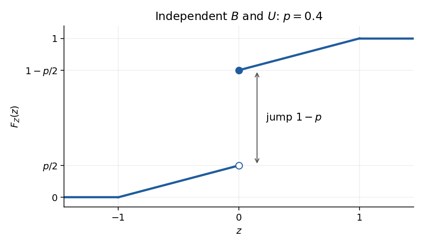

<h1 id="2/b/iii/solution">Solution</h1>

↑ **Parent:** [Iii](../iii.md)

Under [independence of random variables](../../../../../independent-random-variables.md), the [law of a random variable](../../../../../probability-distribution-split.md) $Z$ is the [mixed probability distribution](../../../../../mixed-probability-distribution.md) $(1-p)\delta_0+p\operatorname{Unif}(-1,1)$. For negative $z$, only the uniform component can contribute to $\mathbb P(Z\leq z)$; at zero the [probability mass](../../../../../probability-mass.md) $1-p$ is included. Thus its [cumulative distribution function](../../../../../cumulative-distribution-function.md) is

$$
\boxed{F_Z(z)=\begin{cases}0,&z<-1,\\p(z+1)/2,&-1\leq z<0,\\1-p+p(z+1)/2,&0\leq z<1,\\1,&z\geq1.\end{cases}}
$$

The sketch consists of a horizontal segment at height zero before $-1$, a line of slope $p/2$ ending at the open point $(0,p/2)$, a jump of size $1-p$ to the closed point $(0,1-p/2)$, another line of slope $p/2$ ending at $(1,1)$, and a horizontal segment thereafter. The [cumulative distribution function](../../../../../cumulative-distribution-function.md) is right-continuous at the jump.

**[Figure 1](#2/b/iii/image-cumulative-distribution-function-of-the-independent-bernoulli-uniform-product-illustrated-at-p-0-4). Cumulative distribution function of the independent Bernoulli-uniform product, illustrated at $p=0.4$**.

Under the literal assumptions, write $H(z)=\mathbb P(U\leq z\mid B=1)$. The general answer is $F_Z(z)=(1-p)\mathbf1_{\{z\geq0\}}+pH(z)$, so the continuous part of the sketch is undetermined. The jump at zero is still exactly $1-p$, because $\mathbb P(U=0)=0$. In the dependent counterexample from (ii), $F_Z(z)=0$ for $z<0$, $F_Z(z)=(1+z)/2$ for $0\leq z<1$, and $F_Z(z)=1$ for $z\geq1$.

## ↑ Ancestors (13)

1. [Iii](../iii.md)
2. [B](../../b.md)
3. [2](../../../2.md)
4. [2023](../../../../2023-split.md)
5. [Past exam of the probability course of the University of Oxford](../../../../split.md)
6. [Probability course of the University of Oxford](../../../../../probability-course-of-the-university-of-oxford.md)
7. [Year 2 of the mathematics course of the University of Oxford](../../../../../year-2-of-the-mathematics-course-of-the-university-of-oxford.md)
8. [Mathematics course of the University of Oxford](../../../../../mathematics-course-of-the-university-of-oxford.md)
9. [Undergraduate course of the University of Oxford](../../../../../undergraduate-course-of-the-university-of-oxford.md)
10. [Course of the University of Oxford](../../../../../course-of-the-university-of-oxford.md)
11. [University of Oxford](../../../../../university-of-oxford-split.md)
12. [List of universities](../../../../../list-of-universities.md)
13. [Codex Wiki](../../../../../split.md)
