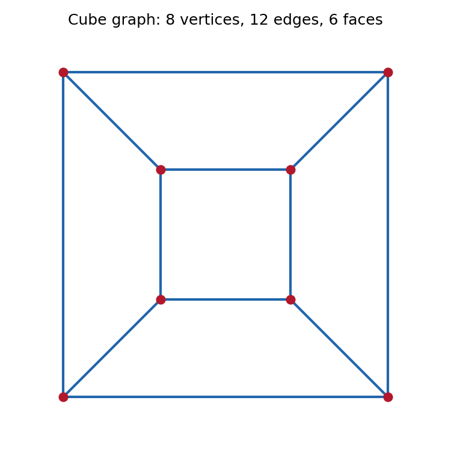
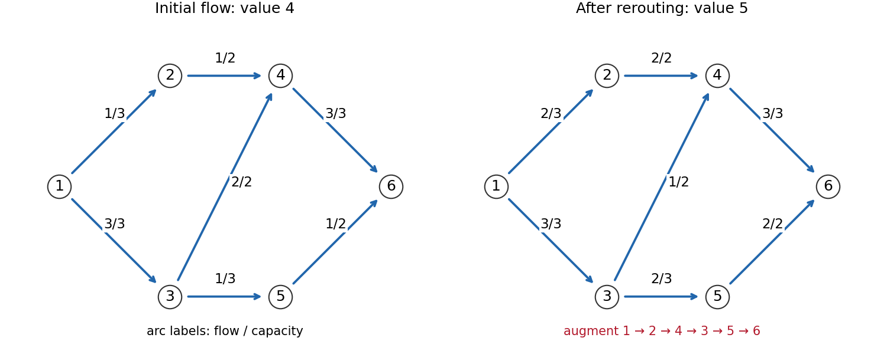
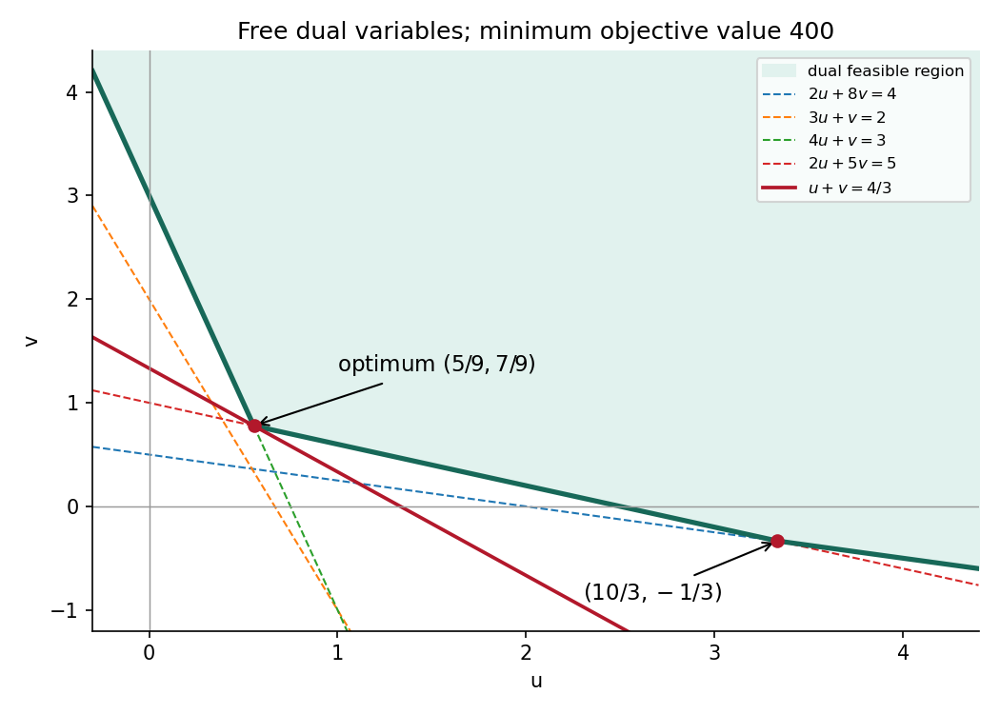

# 2007

↑ **Parent:** [Past exam of the probability, statistics and options I course of the University of Oxford](../past-exam-of-the-probability-statistics-and-options-i-course-of-the-university-of-oxford.md)

**Table of contents**

- [A](#a)
  - [1](#a/1)
    - [Solution](#a/1/solution)
- [B](#b)
  - [1](#b/1)
    - [Solution](#b/1/solution)
- [C](#c)
  - [1](#c/1)
    - [Solution](#c/1/solution)
- [D](#d)
  - [1](#d/1)
    - [i](#d/1/i)
      - [Solution](#d/1/i/solution)
    - [ii](#d/1/ii)
      - [Solution](#d/1/ii/solution)
    - [iii](#d/1/iii)
      - [Solution](#d/1/iii/solution)
  - [2](#d/2)
    - [Solution](#d/2/solution)
- [E](#e)
  - [1](#e/1)
    - [a](#e/1/a)
      - [Solution](#e/1/a/solution)
    - [b](#e/1/b)
      - [Solution](#e/1/b/solution)
  - [2](#e/2)
    - [i](#e/2/i)
      - [Solution](#e/2/i/solution)
    - [ii](#e/2/ii)
      - [Solution](#e/2/ii/solution)
    - [iii](#e/2/iii)
      - [Solution](#e/2/iii/solution)
    - [iv](#e/2/iv)
      - [Solution](#e/2/iv/solution)
- [F](#f)
  - [1](#f/1)
    - [Solution](#f/1/solution)
- [G](#g)
  - [1](#g/1)
    - [Solution](#g/1/solution)
- [H](#h)
  - [1](#h/1)
    - [Solution](#h/1/solution)
- [J](#j)
  - [1](#j/1)
    - [Solution](#j/1/solution)
- [K](#k)
  - [1](#k/1)
    - [i](#k/1/i)
      - [Solution](#k/1/i/solution)
    - [ii](#k/1/ii)
      - [Solution](#k/1/ii/solution)
  - [2](#k/2)
    - [Solution](#k/2/solution)
- [M](#m)
  - [1](#m/1)
    - [Solution](#m/1/solution)
  - [2](#m/2)
    - [Solution](#m/2/solution)
  - [3](#m/3)
    - [Solution](#m/3/solution)
- [O](#o)
  - [1](#o/1)
    - [Solution](#o/1/solution)
  - [2](#o/2)
    - [Solution](#o/2/solution)
  - [3](#o/3)
    - [Solution](#o/3/solution)
- [P](#p)
  - [1](#p/1)
    - [Solution](#p/1/solution)
  - [2](#p/2)
    - [Solution](#p/2/solution)
- [R](#r)
  - [1](#r/1)
    - [i](#r/1/i)
      - [Solution](#r/1/i/solution)
    - [ii](#r/1/ii)
      - [Solution](#r/1/ii/solution)
    - [iii](#r/1/iii)
      - [Solution](#r/1/iii/solution)
    - [iv](#r/1/iv)
      - [Solution](#r/1/iv/solution)
    - [v](#r/1/v)
      - [Solution](#r/1/v/solution)
    - [vi](#r/1/vi)
      - [Solution](#r/1/vi/solution)
    - [vii](#r/1/vii)
      - [Solution](#r/1/vii/solution)
    - [viii](#r/1/viii)
      - [Solution](#r/1/viii/solution)
    - [ix](#r/1/ix)
      - [Solution](#r/1/ix/solution)
    - [x](#r/1/x)
      - [Solution](#r/1/x/solution)
- [S](#s)
  - [1](#s/1)
    - [Solution](#s/1/solution)
  - [2](#s/2)
    - [a](#s/2/a)
      - [Solution](#s/2/a/solution)
    - [b](#s/2/b)
      - [Solution](#s/2/b/solution)
- [T](#t)
  - [1](#t/1)
    - [a](#t/1/a)
      - [Solution](#t/1/a/solution)
    - [b](#t/1/b)
      - [Solution](#t/1/b/solution)
    - [c](#t/1/c)
      - [Solution](#t/1/c/solution)

## A

↑ **Parent:** [2007](2007.md)

<h3 id="a/1">1</h3>

↑ **Parent:** [A](#a)

<h4 id="a/1/solution">Solution</h4>

↑ **Parent:** [1](#a/1)

For a [finite group](../group.md#finite-group) action, [Burnside's lemma](../representation-theory.md#burnside-s-lemma) gives

$$
|\Omega/G|=\frac1{|G|}\sum_{g\in G}|\operatorname{Fix}(g)|.
$$

Pair each vertex with its opposite face. This correspondence is equivariant under every tetrahedral symmetry. Each pair has six possible combined color states: three face colors and two vertex colors. Thus we are coloring four positions with six symbols; the two kinds of coloring must be counted together.

The group of rotations is the [alternating group](../finite-group-theory.md#alternating-group) $A_4$. The identity has four cycles and fixes $6^4$ colorings. Its three half-turns have cycle type $(2,2)$ and each fix $6^2$. Its eight third-turns have cycle type $(3,1)$ and each also fix $6^2$. Consequently the rotation count is

$$
\boxed{\frac{6^4+3\cdot6^2+8\cdot6^2}{12}=141.}
$$

Allowing mirror equivalence gives the full tetrahedral symmetry group $S_4$. Now all permutations of the four paired positions are allowed, so a coloring is determined by a [multiset](../set.md#multiset) of four symbols chosen from six. [stars and bars](../combinatorics.md#stars-and-bars-combinatorics) gives

$$
\boxed{\binom{6+4-1}{4}=\binom94=126.}
$$

For an independent Burnside check, the five cycle types of $S_4$ give numerator $6^4+6\cdot6^3+3\cdot6^2+8\cdot6^2+6\cdot6=3024$, whose quotient by 24 is 126. This is [paired face and vertex colorings of a tetrahedron](../representation-theory.md#paired-face-and-vertex-colorings-of-a-tetrahedron).

## B

↑ **Parent:** [2007](2007.md)

<h3 id="b/1">1</h3>

↑ **Parent:** [B](#b)

<h4 id="b/1/solution">Solution</h4>

↑ **Parent:** [1](#b/1)

The [degree of a field extension](../algebra.md#degree-of-a-field-extension) $[K:F]$ is the dimension of $K$ as a [vector space](../vector-space.md) over $F$. The [tower law](../algebra.md#tower-law) states that for finite extensions $F\subseteq E\subseteq K$,

$$
[K:F]=[K:E][E:F].
$$

If the left side is prime, one factor is one. Degree one forces equality of the corresponding fields, so **there is no proper intermediate field**.

Let $K$ have 32 elements. Its [prime field](../algebra.md#prime-field) is $\mathbb F_2$, and its dimension over that field is five, since a dimension-$d$ [vector space](../vector-space.md) over $\mathbb F_2$ has $2^d$ elements. Every element outside $\mathbb F_2$ has [minimal polynomial](../linear-operator-theory.md#minimal-polynomial) of degree five: its generated intermediate field has degree greater than one and dividing five.

Every element of $K$ satisfies $x^{32}=x$, by the [multiplicative group of a field](../algebra.md#multiplicative-group-of-a-field) of order 31 for nonzero elements. Hence $X^{32}-X$ splits completely over $K$ and has no repeated roots, since its derivative is minus one. Conversely any [irreducible polynomial](../polynomial.md#irreducible-polynomial) $q$ over $\mathbb F_2$ gives a [quotient ring](../commutative-algebra.md#quotient-ring) $\mathbb F_2[X]/(q)$ with 32 elements. Its defining element satisfies $X^{32}-X$, so $q$ divides that [polynomial](../polynomial.md) and therefore has all five distinct roots in $K$.

The 30 elements of $K\setminus\mathbb F_2$ are thus partitioned into disjoint five-element root sets of the [irreducible polynomials](../polynomial.md#irreducible-polynomial). Their number is

$$
\boxed{\frac{32-2}{5}=6.}
$$

No classification of the six individual [polynomials](../polynomial.md) is needed; the tower degree and separability already count them all.

## C

↑ **Parent:** [2007](2007.md)

<h3 id="c/1">1</h3>

↑ **Parent:** [C](#c)

<h4 id="c/1/solution">Solution</h4>

↑ **Parent:** [1](#c/1)

[Euler's theorem](../number-theory.md#euler-s-theorem) states that if $\gcd(a,m)=1$, then $a^{\phi(m)}\equiv1\pmod m$, where $\phi$ is [Euler's totient function](../number-theory.md#euler-totient-function). This includes [Fermat's little theorem](../number-theory.md#fermat-little-theorem) when $m$ is prime.

For each prime-power factor $p_i^{e_i}$, the integer $\phi(p_i^{e_i})$ divides the defined [least common multiple](../divisibility.md#least-common-multiple) $\lambda(m)$. [Euler's theorem](../number-theory.md#euler-s-theorem) modulo that prime power therefore gives

$$
a^{\lambda(m)}
=\left(a^{\phi(p_i^{e_i})}\right)^{\lambda(m)/\phi(p_i^{e_i})}
\equiv1\pmod{p_i^{e_i}}.
$$

The prime powers are pairwise coprime, so their product divides $a^{\lambda(m)}-1$. Equivalently the [Chinese remainder theorem](../mathematics.md#chinese-remainder-theorem) gives

$$
\boxed{a^{\lambda(m)}\equiv1\pmod m.}
$$

For the specified composite integer,

$$
\lambda(561)=\operatorname{lcm}(2,10,16)=80,
\qquad560=7\cdot80.
$$

Raising $a^{80}\equiv1\pmod{561}$ to the seventh power proves

$$
\boxed{a^{560}\equiv1\pmod{561}\quad(\gcd(a,561)=1).}
$$

Thus 561 is a [Carmichael number](../number-theory.md#carmichael-number). We use exactly the source's definition of $\lambda$ as the [least common multiple](../divisibility.md#least-common-multiple) of prime-power totients; its validity here does not require replacing it by a smaller exponent at powers of two.

## D

↑ **Parent:** [2007](2007.md)

<h3 id="d/1">1</h3>

↑ **Parent:** [D](#d)

<h4 id="d/1/i">i</h4>

↑ **Parent:** [1](#d/1)

<h5 id="d/1/i/solution">Solution</h5>

↑ **Parent:** [I](#d/1/i)

The [monotone convergence theorem](../measure-theory.md#monotone-convergence-theorem) states that if measurable functions $f_n$ are nonnegative and $f_n\uparrow f$ pointwise, then $f$ is measurable and

$$
\boxed{\int f\,d\mu=\lim_{n\to\infty}\int f_n\,d\mu,}
$$

allowing either side to be infinite. The same conclusion holds under almost-everywhere [monotone convergence](../measure-theory.md#monotone-convergence-theorem) after changing values on a null set. No assumption that the integrals stay bounded is required.

<h4 id="d/1/ii">ii</h4>

↑ **Parent:** [1](#d/1)

<h5 id="d/1/ii/solution">Solution</h5>

↑ **Parent:** [Ii](#d/1/ii)

Use the increasing nonnegative measurable functions $f_n(x)=x^{-2}\mathbf1_{[1/n,1]}(x)$. Their pointwise limit is the given function except at irrelevant endpoint choices, and the [fundamental theorem of calculus](../calculus.md#fundamental-theorem-of-calculus) on $[1/n,1]$ gives

$$
\int_{\mathbb R}f_n(x)\,dx=\int_{1/n}^1x^{-2}dx=n-1.
$$

[monotone convergence](../measure-theory.md#monotone-convergence-theorem) therefore gives $\int f=\infty$. Since $f\geq0$, this is also $\int|f|$, and **$f$ is not [Lebesgue integrable](../measure-theory.md#lebesgue-integrable-function)**. Measurability alone does not make a finite integral.

<h4 id="d/1/iii">iii</h4>

↑ **Parent:** [1](#d/1)

<h5 id="d/1/iii/solution">Solution</h5>

↑ **Parent:** [Iii](#d/1/iii)

Similarly set $g_n(x)=x^{1/2}\mathbf1_{[1/n,1]}(x)$. These nonnegative measurable functions increase to $g$ almost everywhere. The [fundamental theorem of calculus](../calculus.md#fundamental-theorem-of-calculus) gives

$$
\int g_n(x)dx=\frac23\left(1-n^{-3/2}\right).
$$

By [monotone convergence](../measure-theory.md#monotone-convergence-theorem),

$$
\boxed{\int_{\mathbb R}g(x)dx=\frac23.}
$$

The integral is finite and $g\geq0$, so $g$ is [Lebesgue integrable](../measure-theory.md#lebesgue-integrable-function). Identifying Lebesgue and ordinary integrals of continuous functions on compact intervals justifies each truncated calculation.

<h3 id="d/2">2</h3>

↑ **Parent:** [D](#d)

<h4 id="d/2/solution">Solution</h4>

↑ **Parent:** [2](#d/2)

A [dominated differentiation under the integral sign](../analysis.md#dominated-differentiation-under-the-integral-sign) suffices. Suppose $\phi(\cdot,t)$ is measurable, $\phi(\cdot,t_0)$ is integrable at one parameter value, and for almost every $x$ the map $t\mapsto\phi(x,t)$ is continuously differentiable on an interval. If $|\partial_t\phi(x,t)|\leq H(x)$ throughout that interval for an integrable $H$, then the parameter integral is differentiable, and

$$
\frac d{dt}\int\phi(x,t)dx=\int\partial_t\phi(x,t)dx.
$$

One direct sufficient version assumes $\partial_t\phi(x,t)$ is continuous in $t$ almost everywhere and has that common domination; [dominated convergence theorem](../measure-theory.md#dominated-convergence-theorem) then proves the assertion.

Here $|f(x)e^{itx}|=|f(x)|$, so the [complex-valued function](../function.md#complex-valued-function) $h$ is integrable for every real $t$. For a real increment $u\neq0$, the elementary bound $|e^{iux}-1|\leq|ux|$ gives

$$
\left|f(x)e^{itx}\frac{e^{iux}-1}{u}\right|
\leq|xf(x)|.
$$

The right side is integrable by hypothesis and the integrand converges pointwise to $ixf(x)e^{itx}$. [dominated convergence theorem](../measure-theory.md#dominated-convergence-theorem), applied to real and imaginary parts, proves

$$
\boxed{\widehat f'(t)=\int_{\mathbb R}ixf(x)e^{itx}dx.}
$$

This supplies the domination explicitly rather than merely differentiating a formal [Fourier transform](../fourier-transform.md).

## E

↑ **Parent:** [2007](2007.md)

<h3 id="e/1">1</h3>

↑ **Parent:** [E](#e)

<h4 id="e/1/a">a</h4>

↑ **Parent:** [1](#e/1)

<h5 id="e/1/a/solution">Solution</h5>

↑ **Parent:** [A](#e/1/a)

Convergence to a point $x\in X$ means

$$
\boxed{\forall\epsilon>0\ \exists N\
\forall n\geq N:\ d(x_n,x)<\epsilon.}
$$

The limit must belong to the [metric space](../topological-analysis.md#metric-space) itself. The definition is equivalent to $d(x_n,x)\to0$ as a real sequence.

<h4 id="e/1/b">b</h4>

↑ **Parent:** [1](#e/1)

<h5 id="e/1/b/solution">Solution</h5>

↑ **Parent:** [B](#e/1/b)

A [metric space](../topological-analysis.md#metric-space) is sequentially compact if every sequence in it has a [subsequence](../sequence-and-series.md#subsequence) converging to a point of the same space. The sequence $x_n=1/(n+1)$ lies in $(0,1)$, but every [subsequence](../sequence-and-series.md#subsequence) converges in $\mathbb R$ to zero. Uniqueness of limits excludes an alternative limit inside $(0,1)$, so **the open interval is not sequentially compact**.

For the product, take any sequence $(x_n,y_n)$. [sequential compactness](../geometry-and-topology.md#sequentially-compact-space) of $X$ gives a [subsequence](../sequence-and-series.md#subsequence) $x_{n_k}\to x\in X$. Apply [sequential compactness](../geometry-and-topology.md#sequentially-compact-space) of $Y$ to the corresponding sequence $y_{n_k}$ to obtain a further [subsequence](../sequence-and-series.md#subsequence) $y_{n_{k_j}}\to y\in Y$. Passing to a [subsequence](../sequence-and-series.md#subsequence) preserves the convergence of the first coordinate, and therefore

$$
d((x_{n_{k_j}},y_{n_{k_j}}),(x,y))
=d_X(x_{n_{k_j}},x)+d_Y(y_{n_{k_j}},y)\to0.
$$

Thus **$X\times Y$ is sequentially compact** with the stated sum metric. Taking the second coordinate [subsequence](../sequence-and-series.md#subsequence) inside the first one is essential; two unrelated [subsequences](../sequence-and-series.md#subsequence) would not suffice.

<h3 id="e/2">2</h3>

↑ **Parent:** [E](#e)

<h4 id="e/2/i">i</h4>

↑ **Parent:** [2](#e/2)

<h5 id="e/2/i/solution">Solution</h5>

↑ **Parent:** [I](#e/2/i)

The [subspace topology](../topology.md#subspace-topology) is $\mathcal T_A=\{A\cap U:U\in\mathcal T\}$. For every open $U\subseteq X$,

$$
i^{-1}(U)=A\cap U\in\mathcal T_A.
$$

The inverse-image definition of [continuity](../calculus.md#continuous-function) therefore gives **the inclusion is continuous** from $(A,\mathcal T_A)$ to $(X,\mathcal T)$.

<h4 id="e/2/ii">ii</h4>

↑ **Parent:** [2](#e/2)

<h5 id="e/2/ii/solution">Solution</h5>

↑ **Parent:** [Ii](#e/2/ii)

If the inclusion is continuous from $(A,\mathcal T')$, then $i^{-1}(U)=A\cap U$ belongs to $\mathcal T'$ for every $U\in\mathcal T$. These intersections are precisely all members of $\mathcal T_A$, so

$$
\boxed{\mathcal T_A\subseteq\mathcal T'.}
$$

Thus the [subspace topology](../topology.md#subspace-topology) is the coarsest [topology](../topology.md) on $A$ making the inclusion continuous.

<h4 id="e/2/iii">iii</h4>

↑ **Parent:** [2](#e/2)

<h5 id="e/2/iii/solution">Solution</h5>

↑ **Parent:** [Iii](#e/2/iii)

Every open set of the subspace is $A\cap U$ for some $U\in\mathcal T$. Since $f$ takes values in $A$,

$$
f^{-1}(A\cap U)=(i\circ f)^{-1}(U).
$$

The right side is open in $Z$ by the assumed [continuity](../calculus.md#continuous-function) of the composition. Hence [preimages](../set-theory.md#preimage) of every $\mathcal T_A$-open set are open, proving **$f:Z\to(A,\mathcal T_A)$ is continuous**.

<h4 id="e/2/iv">iv</h4>

↑ **Parent:** [2](#e/2)

<h5 id="e/2/iv/solution">Solution</h5>

↑ **Parent:** [Iv](#e/2/iv)

Choose $Z=(A,\mathcal T_A)$ and let $f$ be the identity set map $A\to A$. The composition $i\circ f$ is the inclusion and is continuous by part (i). The hypothesized universal implication therefore says that the identity map

$$
\operatorname{id}:(A,\mathcal T_A)\longrightarrow(A,\mathcal T')
$$

is continuous. Its [preimage](../set-theory.md#preimage) of a set $V\in\mathcal T'$ is $V$ itself, so every such $V$ lies in $\mathcal T_A$. Therefore

$$
\boxed{\mathcal T'\subseteq\mathcal T_A.}
$$

Combining this with part (ii), when both properties hold, characterizes the [subspace topology](../topology.md#subspace-topology) uniquely.

## F

↑ **Parent:** [2007](2007.md)

<h3 id="f/1">1</h3>

↑ **Parent:** [F](#f)

<h4 id="f/1/solution">Solution</h4>

↑ **Parent:** [1](#f/1)

The required condition is $D_2F(a,b)\neq0$. The [implicit function theorem](../multivariable-calculus.md#implicit-function-theorem) then gives a unique local differentiable branch $y=f(x)$ with $f(a)=b$ and

$$
\boxed{f'(x)=-\frac{D_1F(x,f(x))}{D_2F(x,f(x))}.}
$$

The denominator remains nonzero after shrinking the neighborhood by [continuity](../calculus.md#continuous-function).

For the specified smooth function,

$$
F_x=y+\cos(x+y),\qquad F_y=x+\cos(x+y).
$$

At $(0,0)$ both equal one, so the condition holds and $f'(0)=-1$. Differentiate $F(x,f(x))=0$ twice:

$$
F_{xx}+2F_{xy}f'+F_{yy}(f')^2+F_yf''=0.
$$

At zero, $F_{xx}=F_{yy}=0$, $F_{xy}=1$, and $F_y=1$. Consequently

$$
\boxed{f'(0)=-1,\qquad f''(0)=2.}
$$

The additional derivatives exist because this particular $F$ is smooth; the general first-derivative theorem only requires the stated continuous first [partial derivatives](../multivariable-calculus.md#partial-derivative).

## G

↑ **Parent:** [2007](2007.md)

<h3 id="g/1">1</h3>

↑ **Parent:** [G](#g)

<h4 id="g/1/solution">Solution</h4>

↑ **Parent:** [1](#g/1)

Let $\eta$ be a smooth [variation](../calculus-of-variations.md#variation) with $\eta=\eta'=0$ at both endpoints, and consider $y_\epsilon=y+\epsilon\eta$. [stationary point](../calculus-of-variations.md#stationary-point) gives the [first variation](../calculus-of-variations.md#first-variation)

$$
0=\left.\frac d{d\epsilon}J[y_\epsilon]\right|_{\epsilon=0}
=\int_{x_1}^{x_2}
\left(F_y\eta+F_{y'}\eta'+F_{y''}\eta''\right)dx.
$$

Integrate the middle term once by parts and the last term twice. All boundary terms vanish because both $\eta$ and $\eta'$ vanish there. Assuming the derivatives needed for the classical formula, the given [fundamental lemma of the calculus of variations](../calculus-of-variations.md#fundamental-lemma-of-the-calculus-of-variations) yields

$$
\boxed{F_y-\frac d{dx}F_{y'}+
\frac{d^2}{dx^2}F_{y''}=0.}
$$

Without assuming those classical derivatives initially, the same calculation with compactly supported variations states this equation weakly; sufficient regularity then gives the classical equation.

For the specific integrand, $F_y=-2y$, $F_{y'}=0$, $F_{y''}=2y''$, so the equation is $y^{(4)}-y=0$. Its [weak solutions](../partial-differential-equation.md#weak-solution) here are smooth, and its general classical solution is

$$
y=A\cos x+B\sin x+C\cosh x+D\sinh x.
$$

Put $\ell=\pi/2$, $c=\cosh\ell$, $s=\sinh\ell$. The conditions at zero give $C=-A$ and $D=1-B$. Those at $\ell$ give

$$
B-Ac+(1-B)s=0,\qquad
-A-As+(1-B)c=0.
$$

Using $c^2-s^2=1$, solve to obtain $A=c/2$, $B=(1-s)/2$, $C=-c/2$, $D=(1+s)/2$. Thus an [extremal](../calculus-of-variations.md#extremal) is

$$
\boxed{y(x)=\frac12\left[
c(\cos x-\cosh x)+(1-s)\sin x+(1+s)\sinh x
\right].}
$$

Substitution checks all four boundary values. The additive term $x^2$ in the integrand contributes no [variation](../calculus-of-variations.md#variation) in $y$, so it does not alter this equation.

## H

↑ **Parent:** [2007](2007.md)

<h3 id="h/1">1</h3>

↑ **Parent:** [H](#h)

<h4 id="h/1/solution">Solution</h4>

↑ **Parent:** [1](#h/1)

Autonomy gives conservation of [energy](../energy.md), while the [cyclic coordinate](../lagrangian-mechanics.md#cyclic-coordinate) give conserved [momenta](../momentum.md):

$$
E=\frac A2(\dot\theta^2+\dot\phi^2\sin^2\theta)
+\frac C2(\dot\psi+\dot\phi\cos\theta)^2+mga\cos\theta,
$$

$$
p_\psi=C(\dot\psi+\dot\phi\cos\theta)=Cn,\qquad
p_\phi=A\dot\phi\sin^2\theta+Cn\cos\theta=h.
$$

Here $p_\psi$ is the [angular momentum](../momentum.md#angular-momentum) along the body's symmetry axis, and $p_\phi$ is its component along the fixed vertical. The time symmetry corresponds to $E$, not to an additional angle [momentum](../momentum.md).

With $u=\cos\theta$ and $-1<u<1$, solve

$$
\dot\phi=\frac{h-Cnu}{A(1-u^2)}.
$$

Insert this and the conserved spin rate $n$ into the [energy](../energy.md) equation, multiply by $A$, and isolate $\dot\theta$:

$$
\boxed{A^2\dot\theta^2
=\frac{A(2E-Cn^2-2mgau)(1-u^2)-(h-Cnu)^2}{1-u^2}
=\frac{P(u)}{1-u^2}.}
$$

For a fixed nonvertical angle, let

$$
V_{\rm eff}(u)=\frac{(h-Cnu)^2}{2A(1-u^2)}
+\frac12Cn^2+mgau.
$$

The [energy](../energy.md) is $A\dot\theta^2/2+V_{\rm eff}(\cos\theta)$. A constant angle in $(0,\pi)$ requires both $E=V_{\rm eff}(u_0)$ and $V_{\rm eff}'(u_0)=0$, by the reduced [Euler-Lagrange equation](../analysis.md#euler-lagrange-equation) and $\sin\theta_0\neq0$. Since

$$
P(u)=2A(1-u^2)(E-V_{\rm eff}(u)),
$$

both $P(u_0)=0$ and $P'(u_0)=0$, with $u_0\in(-1,1)$.

The source's unqualified final sentence omits the nonvertical restriction. A vertical axis has $u=\pm1$, where the displayed reduction divides by zero and the common root need not be interior. For example, the stationary upright top has $n=h=0$, $E=mga$, and

$$
P(u)=2Amga(1-u)^2(1+u).
$$

Its only repeated root is $u=1$, so it has no common root with its derivative in $(-1,1)$. Thus **the interior double-root conclusion holds for nonvertical steady precession**. The vertical configurations require separate endpoint treatment. This is [nonvertical qualification in the steady-top double-root condition](../rigid-body-dynamics.md#nonvertical-qualification-in-the-steady-top-double-root-condition).

## J

↑ **Parent:** [2007](2007.md)

<h3 id="j/1">1</h3>

↑ **Parent:** [J](#j)

<h4 id="j/1/solution">Solution</h4>

↑ **Parent:** [1](#j/1)

For a consistently oriented surface and boundary, [Ampère's law](../maxwell-equations.md#ampere-s-circuital-law) is

$$
\oint_\Gamma\mathbf B\cdot d\boldsymbol\ell
=\mu_0 I_{\rm enc}
=\mu_0\int_S\mathbf J\cdot\mathbf n\,dS.
$$

[Stokes theorem](../multivariable-calculus.md#stokes-theorem) gives the left side as $\int_S(\nabla\times\mathbf B)\cdot\mathbf n\,dS$, so the given [curl](../multivariable-calculus.md#curl) equation proves the law.

On a circle of radius $r$ around the axis, the assumed azimuthal field is tangent and constant in magnitude. Thus the [circulation](../vorticity.md#circulation-physics) is $2\pi rB_\theta(r)$. For $r\leq a$, the enclosed [electric current](../electric-charge.md#electric-current) is $I r^2/a^2$; for $r\geq a$, it is $I$. Therefore

$$
\boxed{\mathbf B(r)=
\begin{cases}
\dfrac{\mu_0 I r}{2\pi a^2}\mathbf e_\theta,&0\leq r\leq a,\\[4pt]
\dfrac{\mu_0 I}{2\pi r}\mathbf e_\theta,&r\geq a.
\end{cases}}
$$

The field is continuous at $r=a$ and vanishes regularly at the axis. Its direction follows the right-hand rule for positive [electric current](../electric-charge.md#electric-current) along $\mathbf e_z$. The radial component of the [curl](../multivariable-calculus.md#curl) equation also gives $\partial_zB_\theta=0$, so the expression is valid at every height; no unmentioned axial dependence remains.

## K

↑ **Parent:** [2007](2007.md)

<h3 id="k/1">1</h3>

↑ **Parent:** [K](#k)

<h4 id="k/1/i">i</h4>

↑ **Parent:** [1](#k/1)

<h5 id="k/1/i/solution">Solution</h5>

↑ **Parent:** [I](#k/1/i)

In steady flow, the supplied [Euler equations for an inviscid fluid](../euler-equations-for-an-inviscid-fluid.md) gives

$$
\nabla H=-\rho\,\boldsymbol\omega\times\mathbf u.
$$

Taking its scalar product with $\mathbf u$ gives $\mathbf u\cdot\nabla H=0$. Along a [streamline](../fluid-mechanics.md#streamline) with tangent $\mathbf u$, this is precisely zero derivative of $H$. Hence **$H$ is constant along each [streamline](../fluid-mechanics.md#streamline)**, with possibly different constants on different [streamlines](../fluid-mechanics.md#streamline).

If the flow is also irrotational, $\boldsymbol\omega=0$ and thus $\nabla H=0$. Therefore **$H$ has one constant value throughout each connected fluid region**. The stronger conclusion uses vanishing of the entire [gradient](../multivariable-calculus.md#gradient), not just its component along the [velocity](../classical-mechanics.md#velocity).

<h4 id="k/1/ii">ii</h4>

↑ **Parent:** [1](#k/1)

<h5 id="k/1/ii/solution">Solution</h5>

↑ **Parent:** [Ii](#k/1/ii)

Take the [curl](../multivariable-calculus.md#curl) of the [Euler equations for an inviscid fluid](../euler-equations-for-an-inviscid-fluid.md). The [gradient](../multivariable-calculus.md#gradient) on the right has zero [curl](../multivariable-calculus.md#curl). Use the stated vector identity with $\mathbf F=\boldsymbol\omega$, $\mathbf G=\mathbf u$:

$$
\partial_t\boldsymbol\omega
+(\mathbf u\cdot\nabla)\boldsymbol\omega
-(\boldsymbol\omega\cdot\nabla)\mathbf u
+\boldsymbol\omega(\nabla\cdot\mathbf u)
-\mathbf u(\nabla\cdot\boldsymbol\omega)=0.
$$

[incompressible flow](../fluid-mechanics.md#incompressible-flow) gives $\nabla\cdot\mathbf u=0$, while a [curl](../multivariable-calculus.md#curl) always has zero [divergence](../multivariable-calculus.md#divergence), so $\nabla\cdot\boldsymbol\omega=0$. The remaining terms give

$$
\boxed{\frac{D\boldsymbol\omega}{Dt}
=(\boldsymbol\omega\cdot\nabla)\mathbf u.}
$$

For a two-dimensional [velocity](../classical-mechanics.md#velocity) independent of $z$, $\boldsymbol\omega=(0,0,v_x-u_y)$ and $(\boldsymbol\omega\cdot\nabla)\mathbf u=\omega_z\partial_z\mathbf u=0$. Thus **the scalar [vorticity](../vorticity.md) is conserved following each fluid particle**. It can still vary from particle to particle; this is advection, not a claim of spatially uniform [vorticity](../vorticity.md).

<h3 id="k/2">2</h3>

↑ **Parent:** [K](#k)

<h4 id="k/2/solution">Solution</h4>

↑ **Parent:** [2](#k/2)

[Milne-Thomson's circle theorem](../fluid-mechanics.md#milne-thomson-circle-theorem) states that if $f(z)$ is a [complex potential of a two-dimensional potential flow](../fluid-mechanics.md#complex-potential-of-a-two-dimensional-potential-flow) whose singularities lie outside $|z|=a$, then

$$
w(z)=f(z)+\overline{f(a^2/\bar z)}
$$

has the circle as a [streamline](../fluid-mechanics.md#streamline), with the original exterior singularities unchanged. Additive constants in the potential are immaterial.

Take $f(z)=\Gamma(2\pi i)^{-1}\log(z-z_1)$, using the convention that positive $\Gamma$ is positive [circulation](../vorticity.md#circulation-physics). Reflection in the circle gives, up to a constant,

$$
\boxed{w(z)=\frac{\Gamma}{2\pi i}
\left[\log(z-z_1)
-\log\left(z-\frac{a^2}{\bar z_1}\right)+\log z\right].}
$$

The reflected [vortex](../critical-phenomenon.md#phase-vortex) at $a^2/\bar z_1$ has strength $-\Gamma$, while the central term has strength $+\Gamma$. Their combined [circulation](../vorticity.md#circulation-physics) around the cylinder is zero; this is the [circulation](../vorticity.md#circulation-physics) normalization implicit in the requested equation.

The [vortex](../critical-phenomenon.md#phase-vortex) moves with the [velocity](../classical-mechanics.md#velocity) induced by the other singularities, excluding its own singular term. Since [complex velocity](../fluid-mechanics.md#complex-velocity) is $dw/dz=u-iv$, its value at the [vortex](../critical-phenomenon.md#phase-vortex) is $d\bar z_1/dt$. Thus

$$
\frac{d\bar z_1}{dt}
=\frac{\Gamma}{2\pi i}
\left[-\frac1{z_1-a^2/\bar z_1}+\frac1{z_1}\right]
=\boxed{\frac{i\Gamma a^2}{2\pi z_1(|z_1|^2-a^2)}.}
$$

Writing $z_1=re^{i\theta}$ and multiplying this equation by $z_1$ gives

$$
r\dot r-ir^2\dot\theta
=\frac{i\Gamma a^2}{2\pi(r^2-a^2)}.
$$

Its real part implies $\dot r=0$, and its imaginary part gives

$$
\boxed{\dot\theta=-\frac{\Gamma a^2}
{2\pi r^2(r^2-a^2)}.}
$$

The radius is constant and the angular [velocity](../classical-mechanics.md#velocity) is constant on that orbit. For positive $\Gamma$ the orbit is clockwise with this convention. Retaining the conjugate on the time derivative is essential for the sign.

## M

↑ **Parent:** [2007](2007.md)

<h3 id="m/1">1</h3>

↑ **Parent:** [M](#m)

<h4 id="m/1/solution">Solution</h4>

↑ **Parent:** [1](#m/1)

Uniform area distribution on the unit disk gives

$$
f_{X,Y}(x,y)=\pi^{-1}\mathbf1_{\{x^2+y^2\leq1\}}.
$$

The [Jacobian determinant](../multivariable-calculus.md#jacobian-determinant) has absolute [determinant](../multilinear-algebra.md#determinant) $r$, so

$$
f_{R,\Theta}(r,\theta)=\frac r\pi
\mathbf1_{\{0<r<1,\ 0\leq\theta<2\pi\}}.
$$

Integrating out the other coordinate gives

$$
\boxed{f_R(r)=2r\mathbf1_{(0,1)}(r),\qquad
f_\Theta(\theta)=\frac1{2\pi}\mathbf1_{[0,2\pi)}(\theta).}
$$

The [joint probability density function](../continuous-probability-distribution.md#joint-probability-density) factors into these two [marginal distribution](../probability-distribution.md#marginal-distribution), proving [independence](../random-variable.md#independent-random-variables) of $R$ and $\Theta$. Finally

$$
\boxed{\mathbb ER=\int_0^1r(2r)dr=\frac23.}
$$

The angle at $R=0$ can be defined arbitrarily, since that event has [probability](../probability-theory.md#probability) zero.

<h3 id="m/2">2</h3>

↑ **Parent:** [M](#m)

<h4 id="m/2/solution">Solution</h4>

↑ **Parent:** [2](#m/2)

An [absorbing state](../markov-chain.md#absorbing-state) $i$ has $p_{ii}=1$; once reached, the chain never leaves it. For a nonabsorbing initial state, condition on its first transition and use the [Markov property](../markov-chain.md#markov-property):

$$
h_i=\sum_{j\in S}
\mathbb P(X_1=j\mid X_0=i)\,
\mathbb P(\text{eventually hit }1\mid X_1=j)
=\sum_jp_{ij}h_j.
$$

Here $h_1=1$ and $h_4=0$. The other equations are

$$
h_2=\frac13+\frac23h_3,\qquad h_3=\frac14h_2.
$$

Solving gives

$$
\boxed{h_2=\frac25,\qquad h_3=\frac1{10},\qquad h_4=0.}
$$

For absorption into either state one or four, let $e_i$ be the expected number of steps, with $e_1=e_4=0$. [first-step analysis](../analysis.md#first-step-analysis) gives

$$
e_2=1+\frac23e_3,\qquad e_3=1+\frac14e_2.
$$

Hence $e_2=2$ and

$$
\boxed{e_3=\frac32.}
$$

The expectation is finite because each transient two-step cycle has [probability](../probability-theory.md#probability) at most $(2/3)(1/4)=1/6$ of remaining transient; the survival tail is geometrically bounded. This also justifies solving the expectation equations without assuming finiteness in advance.

<h3 id="m/3">3</h3>

↑ **Parent:** [M](#m)

<h4 id="m/3/solution">Solution</h4>

↑ **Parent:** [3](#m/3)

The [moment-generating function](../probability-distribution.md#moment-generating-function) is $M_X(t)=\mathbb E e^{tX}$ on the real values where this expectation is finite, normally including a neighborhood of zero. Direct substitution gives

$$
\boxed{M_{aX+b}(t)=e^{bt}M_X(at)}
$$

whenever the right side is finite.

For the given [Gamma distribution](../continuous-probability-distribution.md#gamma-distribution) and $t<\lambda$,

$$
M_X(t)=\frac{\lambda^m}{(m-1)!}
\int_0^\infty x^{m-1}e^{-(\lambda-t)x}dx
=\left(\frac\lambda{\lambda-t}\right)^m,
$$

using the [Gamma function](../complex-analysis.md#gamma-function) after the scaling $u=(\lambda-t)x$. At $t\geq\lambda$ the positive integral diverges.

[independence](../random-variable.md#independent-random-variables) multiplies [moment-generating functions](../probability-distribution.md#moment-generating-function). Thus

$$
M_{\sum_iY_i}(t)=\left(\frac\lambda{\lambda-t}\right)^{2n}.
$$

Uniqueness of a [moment-generating function](../probability-distribution.md#moment-generating-function) on a neighborhood of zero identifies

$$
\boxed{\sum_{i=1}^nY_i\sim\operatorname{Gamma}(2n,\lambda),}
$$

where $\lambda$ is the rate parameter, as in the printed [probability density function](../continuous-probability-distribution.md#probability-density-function).

## O

↑ **Parent:** [2007](2007.md)

<h3 id="o/1">1</h3>

↑ **Parent:** [O](#o)

<h4 id="o/1/solution">Solution</h4>

↑ **Parent:** [1](#o/1)

A [confidence interval](../statistical-inference.md#confidence-interval) is a pair of statistics $L(X),U(X)$ such that, for each parameter value $\mu$,

$$
\mathbb P_\mu\{L(X)\leq\mu\leq U(X)\}\geq1-\alpha.
$$

In repeated sampling, at least the stated fraction of intervals constructed by this rule cover the fixed unknown parameter. It is not a posterior [probability](../probability-theory.md#probability) statement about the parameter after one interval has been observed. Discrete exact constructions can have coverage greater than the nominal value.

For independent observations from a [Poisson distribution](../discrete-probability-distribution.md#poisson-distribution), $S=\sum_iX_i$ has a [Poisson distribution](../discrete-probability-distribution.md#poisson-distribution) with mean $\lambda=n\mu$. Invert equal-tail tests of that total mean. At an observed integer $s>0$, the lower endpoint solves

$$
\mathbb P_{\lambda_L}(S\geq s)=\alpha/2
\iff F_{\lambda_L}(s-1)=1-\alpha/2,
$$

and the upper endpoint solves

$$
\mathbb P_{\lambda_U}(S\leq s)=\alpha/2
\iff F_{\lambda_U}(s)=\alpha/2.
$$

Then divide both endpoints by $n$. If $s=0$, use lower endpoint zero. Each inversion allocates at most $\alpha/2$ noncoverage [probability](../probability-theory.md#probability) to one side, giving at least $1-\alpha$ total coverage.

Here the single total count is 39. The supplied values with the correct adjacent count indices are $F_{27.7}(38)=0.975$ for the lower endpoint and $F_{53.3}(39)=0.025$ for the upper one. Thus

$$
\boxed{\mu\in[27.7,\ 53.3]\quad\text{at the stated 95\% level}.}
$$

The values 28.6 and 52.2 use the other count index and are not the endpoints of this central interval. This is [adjacent count tails in an exact Poisson confidence interval](../statistical-inference.md#adjacent-count-tails-in-an-exact-poisson-confidence-interval).

<h3 id="o/2">2</h3>

↑ **Parent:** [O](#o)

<h4 id="o/2/solution">Solution</h4>

↑ **Parent:** [2](#o/2)

The [statistical power](../probability-and-statistics.md#statistical-power) of a test $\varphi$ is $\beta(\theta)=\mathbb E_\theta\varphi(X)$, its rejection [probability](../probability-theory.md#probability) at parameter $\theta$. Its size is $\sup_{\theta\in H_0}\beta(\theta)$; for a simple null this is just $\beta(\theta_0)$.

The [Neyman-Pearson lemma](../statistical-hypothesis-test.md#neyman-pearson-lemma) states that for testing a simple null [probability density function](../continuous-probability-distribution.md#probability-density-function) $f_0$ against a simple alternative [probability density function](../continuous-probability-distribution.md#probability-density-function) $f_1$, a test rejecting where $f_1/f_0>k$, accepting where it is below $k$, and if needed randomizing on equality to attain the desired size is most powerful among all tests of that size. It follows by integrating $(\varphi-\varphi_*)(f_1-kf_0)\leq0$ and using the size constraint.

The proposed [probability density function](../continuous-probability-distribution.md#probability-density-function) is nonnegative, and

$$
\int_0^\infty f(x;\theta)dx
=\frac{\theta^2}{\theta+1}
\left(\frac1{\theta^2}+\frac1\theta\right)=1.
$$

For an independent sample, cancellation of the factors $(x_i+1)$ in the [likelihood ratio](../statistical-hypothesis-test.md#likelihood-ratio) gives

$$
\frac{L(\theta_1)}{L(\theta_0)}
=\left[\frac{\theta_1^2/(\theta_1+1)}
{\theta_0^2/(\theta_0+1)}\right]^n
\exp\left((\theta_0-\theta_1)\sum_i x_i\right).
$$

For $\theta_1<\theta_0$ this is increasing in $S=\sum_iX_i$. The most powerful test therefore has [rejection region](../statistical-hypothesis-test.md#rejection-region)

$$
\boxed{S>c_\alpha,\qquad
\mathbb P_{\theta_0}(S>c_\alpha)=\alpha.}
$$

The sum has a continuous positive [probability density function](../continuous-probability-distribution.md#probability-density-function) on $(0,\infty)$, so no boundary randomization is required. The threshold depends on the null and chosen size, but not on which $\theta_1<\theta_0$ was specified. The same test is therefore **a [uniformly most powerful test](../statistical-hypothesis-test.md#uniformly-most-powerful-test) for the composite alternative $0<\theta<\theta_0$**.

<h3 id="o/3">3</h3>

↑ **Parent:** [O](#o)

<h4 id="o/3/solution">Solution</h4>

↑ **Parent:** [3](#o/3)

Minimizing the squared residual norm gives the [normal equations](../normal-linear-model.md#normal-equation)

$$
\boxed{X^TX\,\widehat\theta=X^TY.}
$$

Full column rank makes $X^TX$ invertible. With columns corresponding to $1,x,x^2-4$, the [design matrix](../linear-regression.md#design-matrix) is

$$
X=\begin{pmatrix}
1&-3&5\\1&-2&0\\1&-1&-3\\1&0&-4\\
1&1&-3\\1&2&0\\1&3&5
\end{pmatrix}.
$$

Symmetry gives zero cross products between the odd column and either even column, and $\sum(x^2-4)=28-28=0$ gives the remaining orthogonality. Their squared norms are seven, 28 and 84, so $X^TX=\operatorname{diag}(7,28,84)$. Therefore

$$
\boxed{\widehat\alpha=\frac17\sum_{j=1}^7y_j,}
$$

$$
\boxed{\widehat\beta=
\frac{-3y_1-2y_2-y_3+y_5+2y_6+3y_7}{28},}
$$

$$
\boxed{\widehat\gamma=
\frac{5y_1-3y_3-4y_4-3y_5+5y_7}{84}.}
$$

Since the error [covariance](../variance.md#covariance) is $\sigma^2I$, [least squares](../mathematical-optimization.md#least-squares) has [covariance](../variance.md#covariance) $\sigma^2(X^TX)^{-1}$. Thus

$$
\boxed{\operatorname{Var}\widehat\alpha=\frac{\sigma^2}7,\quad
\operatorname{Var}\widehat\beta=\frac{\sigma^2}{28},\quad
\operatorname{Var}\widehat\gamma=\frac{\sigma^2}{84}.}
$$

The estimators have zero [covariances](../variance.md#covariance). [independence](../random-variable.md#independent-random-variables) would require an additional distributional assumption such as Gaussian errors; the stated mean and [variance](../variance.md) assumptions alone give only the [covariance](../variance.md#covariance) calculation.

## P

↑ **Parent:** [2007](2007.md)

<h3 id="p/1">1</h3>

↑ **Parent:** [P](#p)

<h4 id="p/1/solution">Solution</h4>

↑ **Parent:** [1](#p/1)

A [Givens rotation](../numerical-analysis.md#givens-rotation) acts as the identity except on coordinates $i,j$, where its block can be written

$$
\begin{pmatrix}\cos\theta&\sin\theta\\
-\sin\theta&\cos\theta\end{pmatrix}.
$$

The block has orthonormal columns because $\cos^2\theta+\sin^2\theta=1$ and their inner product is zero, so $J^TJ=I$. For $r=\sqrt{v_i^2+v_j^2}>0$, choose $\cos\theta=v_i/r$, $\sin\theta=v_j/r$. The new coordinates are $(r,0)$, eliminating the $j$th entry. If both entries are zero, the identity already works.

For the specified vector, one suitable matrix is

$$
\boxed{Q=\begin{pmatrix}
4/5&0&-3/5\\3/5&0&4/5\\0&-1&0
\end{pmatrix},\qquad Qv=\begin{pmatrix}0\\5\\0\end{pmatrix}.}
$$

Its rows are orthonormal, so it is orthogonal; in fact its [determinant](../multilinear-algebra.md#determinant) is one. The positive nonzero output component must be five because an [orthogonal matrix](../linear-algebra.md#orthogonal-matrix) preserves [Euclidean norm](../normed-vector-space.md#euclidean-norm).

**The matrix is not unique.** Left multiplication by any [orthogonal matrix](../linear-algebra.md#orthogonal-matrix) fixing the second coordinate vector preserves this output. For example arbitrary rotations of the first and third coordinates provide infinitely many alternatives.

<h3 id="p/2">2</h3>

↑ **Parent:** [P](#p)

<h4 id="p/2/solution">Solution</h4>

↑ **Parent:** [2](#p/2)

[Richardson extrapolation](../numerical-analysis.md#richardson-extrapolation) combines approximations with a known leading error power to cancel that error. If $A(h)=I+ch^p+O(h^{p+q})$, then $(2^pA(h)-A(2h))/(2^p-1)$ removes $ch^p$.

Let $x_j=a+jh$ for an even number $n$ of equal subintervals, with $x_n=b$. The [composite trapezoidal rule](../runge-kutta-method.md#composite-trapezoidal-rule) is

$$
T_h=h\left[\frac{f_0+f_n}{2}+\sum_{j=1}^{n-1}f_j\right].
$$

The [Simpson's rule](../numerical-integration.md#simpson-s-rule) is

$$
S_h=\frac h3\left[f_0+f_n+
4\sum_{\substack{1\leq j<n\\j\ {\rm odd}}}f_j+
2\sum_{\substack{2\leq j<n\\j\ {\rm even}}}f_j\right].
$$

Assume an error expansion $T_h=I+c_2h^2+O(h^4)$, with the same coefficient $c_2$ on refined uniform meshes; $f\in C^4([a,b])$ is sufficient for this form. The coarser rule is $T_{2h}=h[f_0+f_n+2\sum_{\rm even}f_j]$. Direct coefficient collection gives

$$
\boxed{\frac{4T_h-T_{2h}}3=S_h.}
$$

The leading $h^2$ errors cancel, leaving $S_h=I+O(h^4)$. The identity of the [numerical integration](../numerical-integration.md) weights is exact; the error-order conclusion additionally uses the smoothness and even-power error assumptions.

## R

↑ **Parent:** [2007](2007.md)

<h3 id="r/1">1</h3>

↑ **Parent:** [R](#r)

<h4 id="r/1/i">i</h4>

↑ **Parent:** [1](#r/1)

<h5 id="r/1/i/solution">Solution</h5>

↑ **Parent:** [I](#r/1/i)

**False.** A connected graph has an [Eulerian cycle](../graph-theory.md#eulerian-cycle) exactly when every vertex has even degree. In $K_n$ every degree is $n-1$, so it has an [Eulerian cycle](../graph-theory.md#eulerian-cycle) precisely when $n$ is odd. The [complete graph](../graph-theory.md#complete-graph) $K_4$ is a counterexample to the statement for all $n\geq3$.

<h4 id="r/1/ii">ii</h4>

↑ **Parent:** [1](#r/1)

<h5 id="r/1/ii/solution">Solution</h5>

↑ **Parent:** [Ii](#r/1/ii)

**True.** Label the vertices $1,\ldots,n$. The cycle $1,2,\ldots,n,1$ uses existing edges of the [complete graph](../graph-theory.md#complete-graph) and visits every vertex once before returning. It is a [Hamiltonian cycle](../graph-theory.md#hamilton-cycle) for every $n\geq3$.

<h4 id="r/1/iii">iii</h4>

↑ **Parent:** [1](#r/1)

<h5 id="r/1/iii/solution">Solution</h5>

↑ **Parent:** [Iii](#r/1/iii)

**True.** Draw two nested squares and join corresponding corners. This is the [hypercube graph](../graph.md#hypercube-graph): each square gives one four-cycle and the four connecting edges give the remaining coordinate direction. The edges have no crossings, furnishing a [plane graph](../planar-graph.md#plane-graph).

**[Figure 1](#r/1/iii/image-two-nested-squares-give-a-crossing-free-embedding-of-the-hypercube-graph). Two nested squares give a crossing-free embedding of the hypercube graph**.

<h4 id="r/1/iv">iv</h4>

↑ **Parent:** [1](#r/1)

<h5 id="r/1/iv/solution">Solution</h5>

↑ **Parent:** [Iv](#r/1/iv)

**False.** The cube has eight vertices and twelve edges. [Euler formula for a connected planar graph](../planar-graph.md#euler-formula-for-a-connected-planar-graph) for its connected [plane graph](../planar-graph.md#plane-graph) gives $8-12+F=2$, so

$$
\boxed{F=6.}
$$

The nested-square embedding has four faces between the squares, one inside the smaller square and the unbounded exterior face.

<h4 id="r/1/v">v</h4>

↑ **Parent:** [1](#r/1)

<h5 id="r/1/v/solution">Solution</h5>

↑ **Parent:** [V](#r/1/v)

**True.** Represent a vertex of $Q_4$ by a four-bit string, with an edge changing exactly one bit. Color according to the parity of the sum of the bits. Every edge joins opposite parities, giving a proper two-coloring. Since the graph has edges, one color is impossible, so $\chi(Q_4)=2$.

<h4 id="r/1/vi">vi</h4>

↑ **Parent:** [1](#r/1)

<h5 id="r/1/vi/solution">Solution</h5>

↑ **Parent:** [Vi](#r/1/vi)

**False.** In $K_{r,s}$ the $r$ vertices in one class have degree $s$, while the $s$ vertices in the other have degree $r$. For positive $r,s$, connectedness is automatic, and Euler's criterion requires both $r$ and $s$ to be even. Evenness of their sum alone allows both to be odd. For example $K_{1,3}$ has $r+s=4$ but all four degrees are odd, so it has no [Eulerian cycle](../graph-theory.md#eulerian-cycle).

<h4 id="r/1/vii">vii</h4>

↑ **Parent:** [1](#r/1)

<h5 id="r/1/vii/solution">Solution</h5>

↑ **Parent:** [Vii](#r/1/vii)

**False.** The four-cycle $C_4=K_{2,2}$ is bipartite, with alternating color classes, but contains a cycle and therefore is not a [tree](../tree-graph-theory.md).

<h4 id="r/1/viii">viii</h4>

↑ **Parent:** [1](#r/1)

<h5 id="r/1/viii/solution">Solution</h5>

↑ **Parent:** [Viii](#r/1/viii)

**True.** Choose a root of the [tree](../tree-graph-theory.md) and color every vertex according to the parity of its graph distance from that root. The unique-path property implies that the endpoints of each edge have distances differing by one. Thus every edge crosses the two color classes, proving [bipartite graph](../bipartite-graph.md).

<h4 id="r/1/ix">ix</h4>

↑ **Parent:** [1](#r/1)

<h5 id="r/1/ix/solution">Solution</h5>

↑ **Parent:** [Ix](#r/1/ix)

**False.** In a [Prüfer code](../tree-graph-theory.md#prufer-sequence), the degree of a label is one plus its number of occurrences. Here labels $1,\ldots,n-2$ occur once and labels $n-1,n$ do not occur. Thus the former have degree two and the latter degree one. The decoded [tree](../tree-graph-theory.md) is the path

$$
(n-1),1,2,\ldots,n-2,n
$$

with the evident single-edge interpretation when $n=2$. Independently, no vertex of a simple [tree](../tree-graph-theory.md) on $n$ vertices can have degree $n$ at all. The degree claim in the statement is therefore impossible.

<h4 id="r/1/x">x</h4>

↑ **Parent:** [1](#r/1)

<h5 id="r/1/x/solution">Solution</h5>

↑ **Parent:** [X](#r/1/x)

**True.** Each [connected component](../geometry-and-topology.md#connected-component) of a [forest](../tree-graph-theory.md#forest) is a [tree](../tree-graph-theory.md). If the component sizes are $n_1,\ldots,n_k$, their edge counts are $n_1-1,\ldots,n_k-1$, including isolated vertices as size-one components. Summing gives $m=n-k$, hence

$$
\boxed{k=n-m.}
$$

## S

↑ **Parent:** [2007](2007.md)

<h3 id="s/1">1</h3>

↑ **Parent:** [S](#s)

<h4 id="s/1/solution">Solution</h4>

↑ **Parent:** [1](#s/1)

The first four jobs all have deadlines at most ten, but their total processing time is $2+4+3+2=11$. They cannot all be completed by time ten on one machine, so at least one is late in every schedule.

[Moore's algorithm](../mathematical-optimization.md#moore-hodgson-algorithm) processes jobs in nondecreasing deadline order. Whenever the [electric current](../electric-charge.md#electric-current) on-time list first misses the new job's deadline, remove from that list a job with the largest processing time and put it on the late list. Continue, then append the rejected jobs after the on-time list. The theorem for this algorithm states that it minimizes the number of late jobs when all jobs are initially available.

The source order is already deadline order. The steps are

$$
\begin{array}{c|c|c|c}
\text{job added}&\text{tentative completion}&\text{action}&
\text{on-time list afterward}\\\hline
1&2\leq3&\text{keep}&1\\
2&6\leq7&\text{keep}&1,2\\
3&9\leq9&\text{keep}&1,2,3\\
4&11>10&\text{remove }2\ (p_2=4)&1,3,4\\
5&12\leq13&\text{keep}&1,3,4,5\\
6&16>15&\text{remove }5\ (p_5=5)&1,3,4,6
\end{array}
$$

After the first removal the cumulative time is seven; after the second it is eleven. Append jobs two and five. One optimal schedule is

$$
\boxed{1,3,4,6,2,5,\qquad\text{two late jobs}.}
$$

Its completion times are $2,5,7,11,15,20$. Comparing with the corresponding deadlines verifies that precisely jobs two and five are late. Moore's theorem certifies that no schedule can improve on that number.

<h3 id="s/2">2</h3>

↑ **Parent:** [S](#s)

<h4 id="s/2/a">a</h4>

↑ **Parent:** [2](#s/2)

<h5 id="s/2/a/solution">Solution</h5>

↑ **Parent:** [A](#s/2/a)

[flow conservation](../flow-network.md#flow-conservation) determines the unspecified initial arcs:

$$
(x_{12},x_{13},x_{24},x_{34},x_{35},x_{46},x_{56})
=(1,3,1,2,1,3,1).
$$

Every entry respects capacity, and the initial value is four. In the [residual network](../flow-network.md#residual-network) take the [augmenting path](../flow-network.md#augmenting-path)

$$
1\longrightarrow2\longrightarrow4
\longrightarrow3\longrightarrow5\longrightarrow6.
$$

The step $4\to3$ is the reverse residual arc of the used arc $3\to4$. Its use cancels some existing flow rather than sending new physical flow on a nonexistent original arc. The residual capacities along the path are $2,1,2,2,1$, so augment by their minimum, one.

The resulting original-arc flows are

$$
\boxed{(x_{12},x_{13},x_{24},x_{34},x_{35},x_{46},x_{56})
=(2,3,2,1,2,3,2).}
$$

Their value is five. The cut separating the sink from all other nodes has capacity $c_{46}+c_{56}=3+2=5$. Every feasible flow is bounded by this cut capacity, so the value-five flow is optimal.

**[Figure 2](#s/2/a/image-one-unit-of-residual-rerouting-cancels-flow-on-34-and-raises-the-total-from-four-to-five). One unit of residual rerouting cancels flow on 34 and raises the total from four to five**.

<h4 id="s/2/b">b</h4>

↑ **Parent:** [2](#s/2)

<h5 id="s/2/b/solution">Solution</h5>

↑ **Parent:** [B](#s/2/b)

Start the augmenting-path algorithm from the zero flow. With integer capacities and an integer [electric current](../electric-charge.md#electric-current) flow, every residual capacity is an integer, so a path bottleneck is a positive integer. Augmenting by it preserves integrality and increases the flow value by at least one. The value is bounded by the finite total capacity leaving the source, so the process terminates. At termination there is no [augmenting path](../flow-network.md#augmenting-path), hence the flow is maximum by the [max-flow min-cut theorem](../flow-network.md#max-flow-min-cut-theorem). Its value is an integer.

Equivalently a minimum cut has capacity equal to the sum of integer arc capacities, so the [maximum flow](../flow-network.md#maximum-flow-problem) value equals an integer. Thus **integer capacities guarantee an integer optimal volume**, even though arbitrary feasible real-valued flows need not themselves have integer entries.

## T

↑ **Parent:** [2007](2007.md)

<h3 id="t/1">1</h3>

↑ **Parent:** [T](#t)

<h4 id="t/1/a">a</h4>

↑ **Parent:** [1](#t/1)

<h5 id="t/1/a/solution">Solution</h5>

↑ **Parent:** [A](#t/1/a)

The dual is

$$
\boxed{\text{minimize }b^Ty
\quad\text{subject to }A^Ty\geq c,\quad y\geq0.}
$$

[weak duality](../linear-programming.md#weak-duality) says that any feasible primal $x$ and dual $y$ satisfy $c^Tx\leq b^Ty$. Indeed,

$$
c^Tx\leq(A^Ty)^Tx=y^TAx\leq y^Tb.
$$

The first inequality uses $x\geq0$ and $A^Ty-c\geq0$, and the second uses $y\geq0$ and $b-Ax\geq0$. This proves the theorem. In particular, feasible solutions with equal [objective function](../mathematical-optimization.md#objective-function) values are optimal for both problems.

<h4 id="t/1/b">b</h4>

↑ **Parent:** [1](#t/1)

<h5 id="t/1/b/solution">Solution</h5>

↑ **Parent:** [B](#t/1/b)

With primal constraints $Ax=b$, the dual variable is unrestricted in sign:

$$
\boxed{\text{minimize }b^Ty
\quad\text{subject to }A^Ty\geq c,\quad y\in\mathbb R^m.}
$$

Membership of $x$ in the [nonnegative orthant](../convex-set.md#nonnegative-orthant) still yields $c^Tx\leq y^TAx$, but the next step is now the equality $y^TAx=y^Tb$, so no sign condition on $y$ is needed. Equivalently an equality constraint can be replaced by two opposite inequalities whose nonnegative multipliers combine into one free multiplier.

<h4 id="t/1/c">c</h4>

↑ **Parent:** [1](#t/1)

<h5 id="t/1/c/solution">Solution</h5>

↑ **Parent:** [C](#t/1/c)

The two primal constraints are equalities, so let the two dual variables $u,v$ be free. Primal feasibility restricts $x$ to the [nonnegative orthant](../convex-set.md#nonnegative-orthant), giving

$$
\text{minimize }300(u+v),\qquad
\begin{cases}
2u+8v\geq4,\\
3u+v\geq2,\\
4u+v\geq3,\\
2u+5v\geq5.
\end{cases}
$$

Thus the [feasible region](../mathematical-optimization.md#feasible-region) lies above all four lines:

$$
v\geq\max\{1/2-u/4,\ 2-3u,\ 3-4u,\ 1-2u/5\}.
$$

Its lower boundary follows the third line up to $(5/9,7/9)$, the fourth line from there to $(10/3,-1/3)$, and then the first line. The second line never determines the envelope. Along these three pieces $u+v$ respectively has slopes $-3$, $3/5$, and $3/4$, so its unique minimum is at the first corner:

$$
\boxed{u=\frac59,\qquad v=\frac79,\qquad
300(u+v)=400.}
$$

At this dual point the first two inequalities are strict, while the last two are equalities. [complementary slackness](../linear-programming.md#complementary-slackness) therefore suggests $x_1=x_2=0$. The remaining primal equations become $4x_3+2x_4=300$, $x_3+5x_4=300$, giving $x_3=x_4=50$. This is nonnegative and satisfies both equations. Its [objective function](../mathematical-optimization.md#objective-function) is $3\cdot50+5\cdot50=400$, equal to the feasible dual value. [weak duality](../linear-programming.md#weak-duality) proves

$$
\boxed{x^*=(0,0,50,50),\qquad z^*=400.}
$$

No nonnegativity restriction was imposed on the dual variables; the negative-$v$ second corner is part of the feasible boundary, even though it is not optimal.

**[Figure 3](#t/1/c/image-the-dual-lower-envelope-has-its-objective-function-minimum-at-the-intersection-of-the-third-and-fourth-constraints). The dual lower envelope has its objective function minimum at the intersection of the third and fourth constraints**.

## ↑ Ancestors (9)

1. [Past exam of the probability, statistics and options I course of the University of Oxford](../past-exam-of-the-probability-statistics-and-options-i-course-of-the-university-of-oxford.md)
2. [Probability, statistics and options I course of the University of Oxford](../university-of-oxford.md#probability-statistics-and-options-i-course-of-the-university-of-oxford)
3. [Year 2 of the mathematics and statistics course of the University of Oxford](../university-of-oxford.md#year-2-of-the-mathematics-and-statistics-course-of-the-university-of-oxford)
4. [Mathematics and statistics course of the University of Oxford](../university-of-oxford.md#mathematics-and-statistics-course-of-the-university-of-oxford)
5. [Undergraduate course of the University of Oxford](../university-of-oxford.md#undergraduate-course-of-the-university-of-oxford)
6. [Course of the University of Oxford](../university-of-oxford.md#course-of-the-university-of-oxford)
7. [University of Oxford](../university-of-oxford.md)
8. [List of universities](../README.md#list-of-universities)
9. [Codex Wiki](../README.md)
