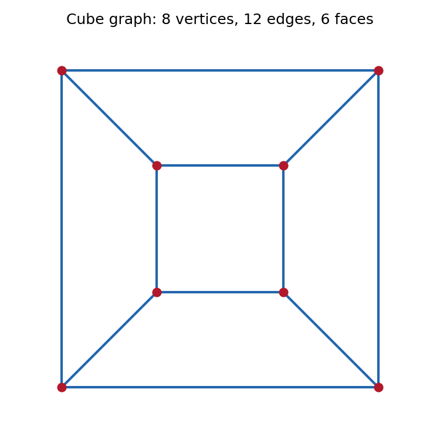

<h1 id="r/1/iii/solution">Solution</h1>

↑ **Parent:** [Iii](../iii.md)

**True.** Draw two nested squares and join corresponding corners. This is the [hypercube graph](../../../../../hypercube-graph.md): each square gives one four-cycle and the four connecting edges give the remaining coordinate direction. The edges have no crossings, furnishing a [plane graph](../../../../../plane-graph.md).

**[Figure 1](#r/1/iii/image-two-nested-squares-give-a-crossing-free-embedding-of-the-hypercube-graph). Two nested squares give a crossing-free embedding of the hypercube graph**.

## ↑ Ancestors (13)

1. [Iii](../iii.md)
2. [1](../../1.md)
3. [R](../../../r.md)
4. [2007](../../../../2007-split.md)
5. [Past exam of the probability, statistics and options I course of the University of Oxford](../../../../split.md)
6. [Probability, statistics and options I course of the University of Oxford](../../../../../probability-statistics-and-options-i-course-of-the-university-of-oxford.md)
7. [Year 2 of the mathematics and statistics course of the University of Oxford](../../../../../year-2-of-the-mathematics-and-statistics-course-of-the-university-of-oxford.md)
8. [Mathematics and statistics course of the University of Oxford](../../../../../mathematics-and-statistics-course-of-the-university-of-oxford.md)
9. [Undergraduate course of the University of Oxford](../../../../../undergraduate-course-of-the-university-of-oxford.md)
10. [Course of the University of Oxford](../../../../../course-of-the-university-of-oxford.md)
11. [University of Oxford](../../../../../university-of-oxford-split.md)
12. [List of universities](../../../../../list-of-universities.md)
13. [Codex Wiki](../../../../../split.md)
