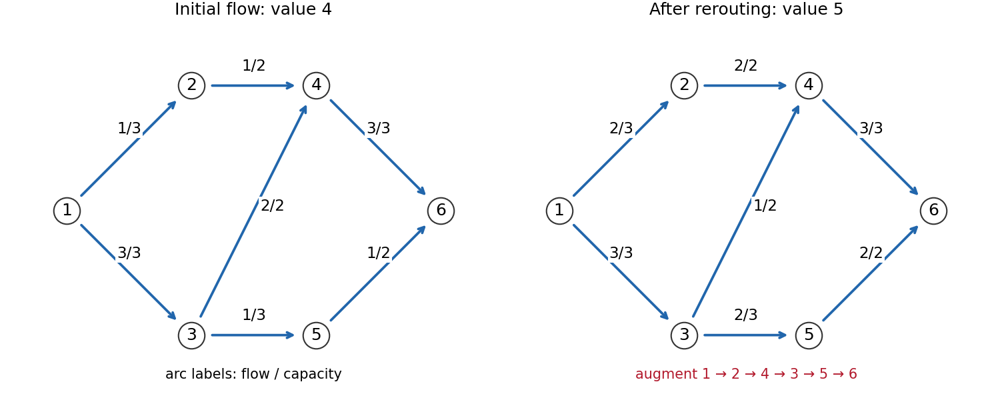

<h1 id="s/2/a/solution">Solution</h1>

↑ **Parent:** [A](../a.md)

[flow conservation](../../../../../flow-conservation.md) determines the unspecified initial arcs:

$$
(x_{12},x_{13},x_{24},x_{34},x_{35},x_{46},x_{56})
=(1,3,1,2,1,3,1).
$$

Every entry respects capacity, and the initial value is four. In the [residual network](../../../../../residual-network.md) take the [augmenting path](../../../../../augmenting-path.md)

$$
1\longrightarrow2\longrightarrow4
\longrightarrow3\longrightarrow5\longrightarrow6.
$$

The step $4\to3$ is the reverse residual arc of the used arc $3\to4$. Its use cancels some existing flow rather than sending new physical flow on a nonexistent original arc. The residual capacities along the path are $2,1,2,2,1$, so augment by their minimum, one.

The resulting original-arc flows are

$$
\boxed{(x_{12},x_{13},x_{24},x_{34},x_{35},x_{46},x_{56})
=(2,3,2,1,2,3,2).}
$$

Their value is five. The cut separating the sink from all other nodes has capacity $c_{46}+c_{56}=3+2=5$. Every feasible flow is bounded by this cut capacity, so the value-five flow is optimal.

**[Figure 2](#s/2/a/image-one-unit-of-residual-rerouting-cancels-flow-on-34-and-raises-the-total-from-four-to-five). One unit of residual rerouting cancels flow on 34 and raises the total from four to five**.

## ↑ Ancestors (13)

1. [A](../a.md)
2. [2](../../2.md)
3. [S](../../../s.md)
4. [2007](../../../../2007-split.md)
5. [Past exam of the probability, statistics and options I course of the University of Oxford](../../../../split.md)
6. [Probability, statistics and options I course of the University of Oxford](../../../../../probability-statistics-and-options-i-course-of-the-university-of-oxford.md)
7. [Year 2 of the mathematics and statistics course of the University of Oxford](../../../../../year-2-of-the-mathematics-and-statistics-course-of-the-university-of-oxford.md)
8. [Mathematics and statistics course of the University of Oxford](../../../../../mathematics-and-statistics-course-of-the-university-of-oxford.md)
9. [Undergraduate course of the University of Oxford](../../../../../undergraduate-course-of-the-university-of-oxford.md)
10. [Course of the University of Oxford](../../../../../course-of-the-university-of-oxford.md)
11. [University of Oxford](../../../../../university-of-oxford-split.md)
12. [List of universities](../../../../../list-of-universities.md)
13. [Codex Wiki](../../../../../split.md)
