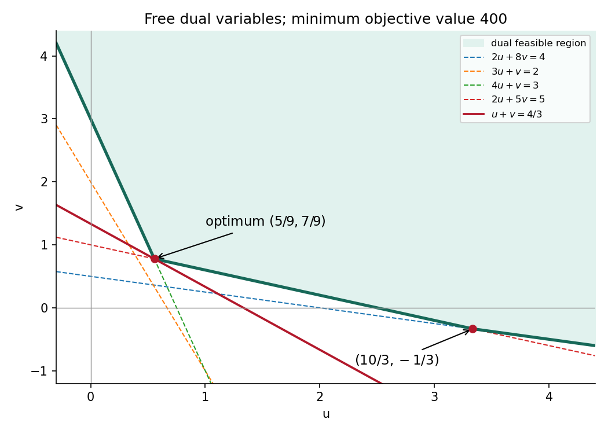

<h1 id="t/1/c/solution">Solution</h1>

↑ **Parent:** [C](../c.md)

The two primal constraints are equalities, so let the two dual variables $u,v$ be free. Primal feasibility restricts $x$ to the [nonnegative orthant](../../../../../nonnegative-orthant.md), giving

$$
\text{minimize }300(u+v),\qquad
\begin{cases}
2u+8v\geq4,\\
3u+v\geq2,\\
4u+v\geq3,\\
2u+5v\geq5.
\end{cases}
$$

Thus the [feasible region](../../../../../feasible-region.md) lies above all four lines:

$$
v\geq\max\{1/2-u/4,\ 2-3u,\ 3-4u,\ 1-2u/5\}.
$$

Its lower boundary follows the third line up to $(5/9,7/9)$, the fourth line from there to $(10/3,-1/3)$, and then the first line. The second line never determines the envelope. Along these three pieces $u+v$ respectively has slopes $-3$, $3/5$, and $3/4$, so its unique minimum is at the first corner:

$$
\boxed{u=\frac59,\qquad v=\frac79,\qquad
300(u+v)=400.}
$$

At this dual point the first two inequalities are strict, while the last two are equalities. [complementary slackness](../../../../../complementary-slackness.md) therefore suggests $x_1=x_2=0$. The remaining primal equations become $4x_3+2x_4=300$, $x_3+5x_4=300$, giving $x_3=x_4=50$. This is nonnegative and satisfies both equations. Its [objective function](../../../../../objective-function.md) is $3\cdot50+5\cdot50=400$, equal to the feasible dual value. [weak duality](../../../../../weak-duality.md) proves

$$
\boxed{x^*=(0,0,50,50),\qquad z^*=400.}
$$

No nonnegativity restriction was imposed on the dual variables; the negative-$v$ second corner is part of the feasible boundary, even though it is not optimal.

**[Figure 3](#t/1/c/image-the-dual-lower-envelope-has-its-objective-function-minimum-at-the-intersection-of-the-third-and-fourth-constraints). The dual lower envelope has its objective function minimum at the intersection of the third and fourth constraints**.

## ↑ Ancestors (13)

1. [C](../c.md)
2. [1](../../1.md)
3. [T](../../../t.md)
4. [2007](../../../../2007-split.md)
5. [Past exam of the probability, statistics and options I course of the University of Oxford](../../../../split.md)
6. [Probability, statistics and options I course of the University of Oxford](../../../../../probability-statistics-and-options-i-course-of-the-university-of-oxford.md)
7. [Year 2 of the mathematics and statistics course of the University of Oxford](../../../../../year-2-of-the-mathematics-and-statistics-course-of-the-university-of-oxford.md)
8. [Mathematics and statistics course of the University of Oxford](../../../../../mathematics-and-statistics-course-of-the-university-of-oxford.md)
9. [Undergraduate course of the University of Oxford](../../../../../undergraduate-course-of-the-university-of-oxford.md)
10. [Course of the University of Oxford](../../../../../course-of-the-university-of-oxford.md)
11. [University of Oxford](../../../../../university-of-oxford-split.md)
12. [List of universities](../../../../../list-of-universities.md)
13. [Codex Wiki](../../../../../split.md)
