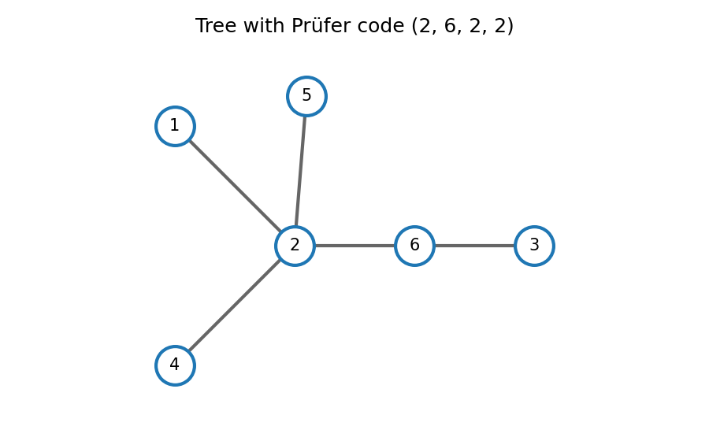
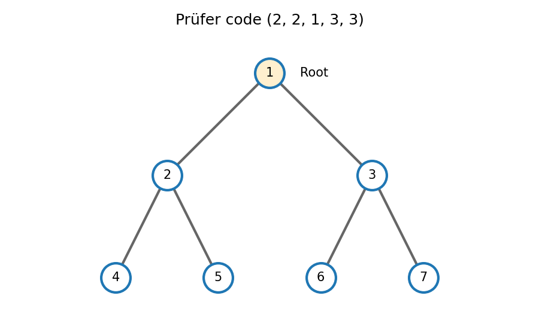

# 2008

↑ **Parent:** [Past exam of the probability, statistics and options I course of the University of Oxford](../past-exam-of-the-probability-statistics-and-options-i-course-of-the-university-of-oxford.md)

**Table of contents**

- [A](#a)
  - [1](#a/1)
    - [Solution](#a/1/solution)
- [B](#b)
  - [1](#b/1)
    - [Solution](#b/1/solution)
- [C](#c)
  - [1](#c/1)
    - [Solution](#c/1/solution)
- [D](#d)
  - [1](#d/1)
    - [a](#d/1/a)
      - [Solution](#d/1/a/solution)
    - [b](#d/1/b)
      - [Solution](#d/1/b/solution)
  - [2](#d/2)
    - [a](#d/2/a)
      - [Solution](#d/2/a/solution)
    - [b](#d/2/b)
      - [i](#d/2/b/i)
        - [Solution](#d/2/b/i/solution)
      - [ii](#d/2/b/ii)
        - [Solution](#d/2/b/ii/solution)
- [E](#e)
  - [1](#e/1)
    - [a](#e/1/a)
      - [i](#e/1/a/i)
        - [Solution](#e/1/a/i/solution)
      - [ii](#e/1/a/ii)
        - [Solution](#e/1/a/ii/solution)
    - [b](#e/1/b)
      - [Solution](#e/1/b/solution)
    - [c](#e/1/c)
      - [i](#e/1/c/i)
        - [Solution](#e/1/c/i/solution)
      - [ii](#e/1/c/ii)
        - [Solution](#e/1/c/ii/solution)
  - [2](#e/2)
    - [i](#e/2/i)
      - [Solution](#e/2/i/solution)
    - [ii](#e/2/ii)
      - [Solution](#e/2/ii/solution)
    - [iii](#e/2/iii)
      - [Solution](#e/2/iii/solution)
- [F](#f)
  - [1](#f/1)
    - [a](#f/1/a)
      - [Solution](#f/1/a/solution)
    - [b](#f/1/b)
      - [Solution](#f/1/b/solution)
- [G](#g)
  - [1](#g/1)
    - [Solution](#g/1/solution)
- [H](#h)
  - [1](#h/1)
    - [Solution](#h/1/solution)
- [J](#j)
  - [1](#j/1)
    - [Solution](#j/1/solution)
- [K](#k)
  - [1](#k/1)
    - [i](#k/1/i)
      - [Solution](#k/1/i/solution)
    - [ii](#k/1/ii)
      - [Solution](#k/1/ii/solution)
    - [iii](#k/1/iii)
      - [Solution](#k/1/iii/solution)
    - [iv](#k/1/iv)
      - [Solution](#k/1/iv/solution)
  - [2](#k/2)
    - [i](#k/2/i)
      - [Solution](#k/2/i/solution)
    - [ii](#k/2/ii)
      - [Solution](#k/2/ii/solution)
    - [iii](#k/2/iii)
      - [Solution](#k/2/iii/solution)
- [M](#m)
  - [1](#m/1)
    - [Solution](#m/1/solution)
  - [2](#m/2)
    - [Solution](#m/2/solution)
  - [3](#m/3)
    - [Solution](#m/3/solution)
- [O](#o)
  - [1](#o/1)
    - [i](#o/1/i)
      - [Solution](#o/1/i/solution)
    - [ii](#o/1/ii)
      - [Solution](#o/1/ii/solution)
    - [iii](#o/1/iii)
      - [Solution](#o/1/iii/solution)
    - [iv](#o/1/iv)
      - [Solution](#o/1/iv/solution)
    - [v](#o/1/v)
      - [Solution](#o/1/v/solution)
  - [2](#o/2)
    - [Solution](#o/2/solution)
  - [3](#o/3)
    - [Solution](#o/3/solution)
- [P](#p)
  - [1](#p/1)
    - [Solution](#p/1/solution)
  - [2](#p/2)
    - [Solution](#p/2/solution)
- [R](#r)
  - [1](#r/1)
    - [i](#r/1/i)
      - [Solution](#r/1/i/solution)
    - [ii](#r/1/ii)
      - [Solution](#r/1/ii/solution)
    - [iii](#r/1/iii)
      - [Solution](#r/1/iii/solution)
    - [iv](#r/1/iv)
      - [Solution](#r/1/iv/solution)
- [S](#s)
  - [1](#s/1)
    - [a](#s/1/a)
      - [Solution](#s/1/a/solution)
    - [b](#s/1/b)
      - [Solution](#s/1/b/solution)
    - [c](#s/1/c)
      - [Solution](#s/1/c/solution)
    - [d](#s/1/d)
      - [Solution](#s/1/d/solution)
- [T](#t)
  - [1](#t/1)
    - [a](#t/1/a)
      - [Solution](#t/1/a/solution)
    - [b](#t/1/b)
      - [Solution](#t/1/b/solution)

## A

↑ **Parent:** [2008](2008.md)

<h3 id="a/1">1</h3>

↑ **Parent:** [A](#a)

<h4 id="a/1/solution">Solution</h4>

↑ **Parent:** [1](#a/1)

The hypothesis is a [two-transitive group action](../group-action.md#two-transitive-group-action). Given $\alpha,\beta\ne\omega_1$, apply it to $(\omega_1,\alpha)$ and $(\omega_1,\beta)$. The resulting element fixes $\omega_1$ and sends $\alpha$ to $\beta$, so the [stabilizer subgroup](../group-action.md#stabilizer-subgroup) acts transitively on the remaining $n-1$ points.

The action on all of $\Omega$ is also transitive. By the [orbit-stabilizer theorem](../group-action.md#orbit-stabilizer-theorem),

$$
|G|=n|\operatorname{Stab}_G(\omega_1)|,\qquad
|\operatorname{Stab}_G(\omega_1)|=(n-1)|\operatorname{Stab}_G(\omega_1,\omega_2)|.
$$

Thus $\boxed{n(n-1)\mid |G|}$. The diagonal pairs form one orbit, while two-transitivity makes all ordered unequal pairs a second orbit. Equality is preserved by a group action, so these cannot mix. There are **exactly two orbits on $\Omega\times\Omega$**.

## B

↑ **Parent:** [2008](2008.md)

<h3 id="b/1">1</h3>

↑ **Parent:** [B](#b)

<h4 id="b/1/solution">Solution</h4>

↑ **Parent:** [1](#b/1)

[Eisenstein's criterion](../commutative-algebra.md#eisenstein-criterion) says that an integer polynomial with leading coefficient not divisible by a prime $\ell$, all other coefficients divisible by $\ell$, and constant coefficient not divisible by $\ell^2$ is irreducible over the rationals, provided it is primitive; the usual [Gauss's lemma](../riemannian-geometry.md#gauss-s-lemma-riemannian-geometry) supplies the passage from integer to rational factors.

Apply it with $\ell=2$ to

$$
(x+1)^8+1=x^8+8x^7+28x^6+56x^5+70x^4+56x^3+28x^2+8x+2.
$$

All nonleading coefficients are even and the constant is not divisible by four. A translation of the variable preserves reducibility, so **$x^8+1$ is irreducible over $\mathbb Q$**.

Let $\zeta=e^{i\pi/8}$ and $c=\cos(\pi/8)$. The minimal polynomial of $\zeta$ is $x^8+1$, so $[\mathbb Q(\zeta):\mathbb Q]=8$. Since $2c=\zeta+\zeta^{-1}$, the number $\zeta$ satisfies $t^2-2ct+1=0$ over $\mathbb Q(c)$. This real field cannot contain the nonreal $\zeta$, so that extension has degree exactly two. The [tower law for field extensions](../galois-theory.md#tower-law-for-field-extensions) gives

$$
\boxed{[\mathbb Q(\zeta):\mathbb Q(c)]=2,\qquad
[\mathbb Q(c):\mathbb Q]=4.}
$$

## C

↑ **Parent:** [2008](2008.md)

<h3 id="c/1">1</h3>

↑ **Parent:** [C](#c)

<h4 id="c/1/solution">Solution</h4>

↑ **Parent:** [1](#c/1)

The [quadratic reciprocity](../number-theory.md#quadratic-reciprocity) states that for distinct odd primes $a,b$,

$$
\left(\frac ab\right)\left(\frac ba\right)
=(-1)^{(a-1)(b-1)/4}.
$$

For fixed odd prime $r$, first suppose that $p,q\ne r$. The congruence $p\equiv q\pmod{4r}$ gives the same residues modulo $r$ and modulo four. Reciprocity yields

$$
\left(\frac rp\right)
=\left(\frac pr\right)(-1)^{(r-1)(p-1)/4}
=\left(\frac qr\right)(-1)^{(r-1)(q-1)/4}
=\left(\frac rq\right).
$$

If $p=r$, the congruence forces $r\mid q$, so $q=r$ and both symbols are zero; the same handles $q=r$.

For $n=\prod_jr_j^{a_j}$, where all $r_j$ are odd primes, $4r_j$ divides $4n$. Thus $p\equiv q\pmod{4n}$ implies equality of each prime-numerator [Legendre symbol](../quadratic-residue.md#legendre-symbol). Multiplicativity gives

$$
\boxed{\left(\frac np\right)
=\prod_j\left(\frac{r_j}p\right)^{a_j}
=\prod_j\left(\frac{r_j}q\right)^{a_j}
=\left(\frac nq\right).}
$$

This also covers symbols that vanish; for $n=1$ both sides are one.

## D

↑ **Parent:** [2008](2008.md)

<h3 id="d/1">1</h3>

↑ **Parent:** [D](#d)

<h4 id="d/1/a">a</h4>

↑ **Parent:** [1](#d/1)

<h5 id="d/1/a/solution">Solution</h5>

↑ **Parent:** [A](#d/1/a)

A [Lebesgue null set](../measure-theory.md#lebesgue-null-set) $E\subset\mathbb R$ can, for every $\epsilon>0$, be covered by countably many open intervals whose total length is less than $\epsilon$. Equivalently, its Lebesgue outer measure is zero.

If $E_j$ is null, choose for it such a cover of total length below $\epsilon 2^{-j}$, $j\geq1$. The union of these countably many countable covers covers $\bigcup_jE_j$ and has total length below $\epsilon$. Since $\epsilon$ is arbitrary, **a countable union of null sets is null**.

<h4 id="d/1/b">b</h4>

↑ **Parent:** [1](#d/1)

<h5 id="d/1/b/solution">Solution</h5>

↑ **Parent:** [B](#d/1/b)

For positive integers $n,m$, let $E_{n,m}=\{x:f(x)\geq1/n\}\cap[-m,m]$. This measurable set has finite measure, and $f\geq n^{-1}1_{E_{n,m}}$. Monotonicity of the [Lebesgue integral](../measure-theory.md#lebesgue-integral) gives

$$
0=\int_{\mathbb R}f\geq\frac1n\,\operatorname{meas}(E_{n,m}),
$$

so every $E_{n,m}$ is a [Lebesgue null set](../measure-theory.md#lebesgue-null-set). The set where $f>0$ is the countable union of these sets over $n,m$. Part (a) makes it null, hence

$$
\boxed{f=0\quad\text{almost everywhere}.}
$$

The bounded truncation ensures that only integrable indicator functions are used with the stated comparison rule.

<h3 id="d/2">2</h3>

↑ **Parent:** [D](#d)

<h4 id="d/2/a">a</h4>

↑ **Parent:** [2](#d/2)

<h5 id="d/2/a/solution">Solution</h5>

↑ **Parent:** [A](#d/2/a)

There is no singularity at the lower endpoint one. Put $t=\log(1+x)$, so $dx=e^t\,dt$. The nonnegative integral becomes

$$
\int_{\log2}^\infty\frac{e^{(1-\alpha)t}}{t^2}\,dt.
$$

For $\alpha=1$, it converges as a reciprocal-square integral. For $\alpha>1$, exponential decay makes it converge. For $\alpha<1$, its integrand eventually grows without bound, so its integral diverges. Thus

$$
\boxed{\alpha\geq1.}
$$

This is the logarithmic borderline in a power-tail [integrability](../measure-theory.md#integrability) test.

<h4 id="d/2/b">b</h4>

↑ **Parent:** [2](#d/2)

<h5 id="d/2/b/i">i</h5>

↑ **Parent:** [B](#d/2/b)

<h6 id="d/2/b/i/solution">Solution</h6>

↑ **Parent:** [I](#d/2/b/i)

The function is measurable and $0\leq\cos^2(1/x)\leq1$. Since $(0,1)$ has finite [Lebesgue measure](../measure-theory.md#lebesgue-measure), comparison gives $\int_0^1g\leq1$. Therefore **$g$ is integrable on $(0,1)$**, despite oscillating infinitely often near zero.

<h5 id="d/2/b/ii">ii</h5>

↑ **Parent:** [B](#d/2/b)

<h6 id="d/2/b/ii/solution">Solution</h6>

↑ **Parent:** [Ii](#d/2/b/ii)

For $x>1$, $1/x\in(0,1)$ and $\cos^2(1/x)\geq\cos^2(1)>0$. Its integral over the infinite interval is bounded below by the integral of a positive constant. Therefore **$g$ is not integrable on $(1,\infty)$**. In fact it tends to one at infinity.

## E

↑ **Parent:** [2008](2008.md)

<h3 id="e/1">1</h3>

↑ **Parent:** [E](#e)

<h4 id="e/1/a">a</h4>

↑ **Parent:** [1](#e/1)

<h5 id="e/1/a/i">i</h5>

↑ **Parent:** [A](#e/1/a)

<h6 id="e/1/a/i/solution">Solution</h6>

↑ **Parent:** [I](#e/1/a/i)

A [continuous map](../topology.md#continuous-map) $f:X\to Y$ is one for which $f^{-1}(U)$ is open in $X$ whenever $U$ is open in $Y$. This defines continuity using the two [topologies](../topology.md), without a metric or a coordinate description.

<h5 id="e/1/a/ii">ii</h5>

↑ **Parent:** [A](#e/1/a)

<h6 id="e/1/a/ii/solution">Solution</h6>

↑ **Parent:** [Ii](#e/1/a/ii)

For [metric spaces](../topological-analysis.md#metric-space), continuity at $x_0$ means that for every $\epsilon>0$ there is $\delta>0$ such that

$$
\boxed{\operatorname{dist}_X(x,x_0)<\delta
\ \Longrightarrow\
\operatorname{dist}_Y(f(x),f(x_0))<\epsilon.}
$$

The choice of $\delta$ may depend on both $\epsilon$ and $x_0$.

<h4 id="e/1/b">b</h4>

↑ **Parent:** [1](#e/1)

<h5 id="e/1/b/solution">Solution</h5>

↑ **Parent:** [B](#e/1/b)

A [basis of a topology](../topology.md#basis-of-a-topology) is a collection $\mathcal B$ of open sets such that every open set is a union of members of $\mathcal B$. Equivalently, for every open $U$ and $y\in U$ there is $B\in\mathcal B$ with $y\in B\subseteq U$.

A map $f:X\to Y$ is continuous exactly when $f^{-1}(B)$ is open in $X$ for every basic set $B$ of $Y$. Necessity follows from the definition of a [continuous map](../topology.md#continuous-map). For sufficiency, express an arbitrary open set as a union of basic sets and use preservation of unions by inverse images.

<h4 id="e/1/c">c</h4>

↑ **Parent:** [1](#e/1)

<h5 id="e/1/c/i">i</h5>

↑ **Parent:** [C](#e/1/c)

<h6 id="e/1/c/i/solution">Solution</h6>

↑ **Parent:** [I](#e/1/c/i)

Every open interval is open in the usual metric topology. Conversely, if $U\subset\mathbb R$ is open and $x\in U$, there exists $\epsilon_x>0$ with $(x-\epsilon_x,x+\epsilon_x)\subseteq U$. Taking the union of these intervals over all $x\in U$ recovers $U$. Thus **open intervals form a basis** of the usual topology.

<h5 id="e/1/c/ii">ii</h5>

↑ **Parent:** [C](#e/1/c)

<h6 id="e/1/c/ii/solution">Solution</h6>

↑ **Parent:** [Ii](#e/1/c/ii)

If $f$ is continuous, the two sets are inverse images of the open rays $(-\infty,\lambda)$ and $(\lambda,\infty)$, so they are open. Conversely, suppose both families of inverse images are open. For any interval $(a,b)$,

$$
f^{-1}((a,b))=\{f>a\}\cap\{f<b\},
$$

which is open. By part (c)(i) and the [basis of a topology](../topology.md#basis-of-a-topology) criterion from part (b), all inverse images of open sets are open. Hence **$f$ is continuous**.

<h3 id="e/2">2</h3>

↑ **Parent:** [E](#e)

<h4 id="e/2/i">i</h4>

↑ **Parent:** [2](#e/2)

<h5 id="e/2/i/solution">Solution</h5>

↑ **Parent:** [I](#e/2/i)

A [connected set](../geometry-and-topology.md#connected-set) is one whose relative topology admits no decomposition into two disjoint nonempty open sets. A [path-connected](../geometry-and-topology.md#path-connected-space) set permits, between any two points, a continuous map $\gamma:[0,1]\to A$ with the prescribed endpoints.

Path connectedness implies connectedness, because a continuous image of an interval is connected. The converse can fail, for example for the [topologist's sine curve](../geometry-and-topology.md#topologist-s-sine-curve). On open subsets of Euclidean spaces $\mathbb R^n$, the two properties are equivalent; more generally this holds in locally path-connected spaces.

<h4 id="e/2/ii">ii</h4>

↑ **Parent:** [2](#e/2)

<h5 id="e/2/ii/solution">Solution</h5>

↑ **Parent:** [Ii](#e/2/ii)

If $f(A)$ had a separation into two nonempty relatively open disjoint pieces, their inverse images under the restriction $f|_A$ would be two nonempty relatively open disjoint subsets covering $A$. This would contradict connectedness of $A$. Thus **a continuous image of a connected set is connected**.

<h4 id="e/2/iii">iii</h4>

↑ **Parent:** [2](#e/2)

<h5 id="e/2/iii/solution">Solution</h5>

↑ **Parent:** [Iii](#e/2/iii)

The unit circle is [path-connected](../geometry-and-topology.md#path-connected-space), since it is the continuous image of the interval $[0,2\pi]$ under $\theta\mapsto(\cos\theta,\sin\theta)$. It is therefore connected, and part (ii) makes $f(C)$ connected. A connected subset of $\mathbb R$ is an interval: omission of a point lying between two of its points would separate it by the two open rays about that point.

Moreover, the circle is compact, so the [continuous image of a compact space](../topology.md#continuous-image-of-a-compact-space) is compact. Hence here the image is **a closed bounded interval, possibly a singleton**.

## F

↑ **Parent:** [2008](2008.md)

<h3 id="f/1">1</h3>

↑ **Parent:** [F](#f)

<h4 id="f/1/a">a</h4>

↑ **Parent:** [1](#f/1)

<h5 id="f/1/a/solution">Solution</h5>

↑ **Parent:** [A](#f/1/a)

For a differentiable map $f:\Omega\subset\mathbb R^n\to\mathbb R^k$, the [Jacobian matrix](../multivariable-calculus.md#jacobian-matrix) represents its derivative and has entries $(Df)_{ij}=\partial f_i/\partial x_j$. Differentiating the two components gives

$$
\boxed{Df(x,y)=
\begin{pmatrix}
e^x\sin y&e^x\cos y\\
-e^{-y}\sin x&-e^{-y}\cos x
\end{pmatrix}.}
$$

<h4 id="f/1/b">b</h4>

↑ **Parent:** [1](#f/1)

<h5 id="f/1/b/solution">Solution</h5>

↑ **Parent:** [B](#f/1/b)

The [inverse function theorem](../multivariable-calculus.md#inverse-function-theorem) states that if $f$ is continuously differentiable near $a\in\mathbb R^n$ and $Df(a)$ is invertible, then neighborhoods of $a$ and $f(a)$ exist on which $f$ is a bijection with a continuously differentiable inverse, satisfying $D(f^{-1})(f(a))=Df(a)^{-1}$.

Here $a=(\pi/2,\pi)$, $f(a)=(0,0)$, and

$$
Df(a)=\begin{pmatrix}0&-e^{\pi/2}\\-e^{-\pi}&0\end{pmatrix},
\qquad\det Df(a)=-e^{-\pi/2}\ne0.
$$

The hypotheses hold because both components are smooth. Inverting the matrix yields

$$
\boxed{D(f^{-1})(0,0)=
\begin{pmatrix}0&-e^\pi\\-e^{-\pi/2}&0\end{pmatrix}.}
$$

## G

↑ **Parent:** [2008](2008.md)

<h3 id="g/1">1</h3>

↑ **Parent:** [G](#g)

<h4 id="g/1/solution">Solution</h4>

↑ **Parent:** [1](#g/1)

With fixed endpoint values, the [Euler-Lagrange equation](../analysis.md#euler-lagrange-equation) is $F_y-\frac d{dx}F_{y'}=0$. If $F$ has no explicit $x$ dependence, differentiation gives

$$
\frac d{dx}(F-y'F_{y'})
=F_x+y'(F_y-\tfrac d{dx}F_{y'})=0.
$$

Thus the [Beltrami identity](../analysis.md#beltrami-identity) is $F-y'F_{y'}=\text{constant}$.

For this integrand, $F_y=2y$ and $F_{y'}=1+2y'$, so $y''=y$. The extremals are

$$
\boxed{y(x)=Ae^x+Be^{-x},}
$$

where the two fixed endpoint values determine $A,B$. The Beltrami constant is $y^2-y'^2$, consistent with this solution.

For a nonzero smooth perturbation $\eta$ vanishing at the endpoints, expand the quadratic functional. The first variation vanishes at an extremal, while

$$
J[y+\epsilon\eta]-J[y]
=\epsilon^2\int_{x_1}^{x_2}(\eta^2+\eta'^2)\,dx>0.
$$

The linear term $\int y'$ depends only on the fixed endpoints. Consequently the extremal is a strict minimum and **cannot be a maximum**.

## H

↑ **Parent:** [2008](2008.md)

<h3 id="h/1">1</h3>

↑ **Parent:** [H](#h)

<h4 id="h/1/solution">Solution</h4>

↑ **Parent:** [1](#h/1)

If $L$ is independent of $q_1$, the [Euler-Lagrange equation](../analysis.md#euler-lagrange-equation) makes the generalized momentum $p_1=\partial L/\partial\dot q_1$ constant. If $L$ is independent of time, the [energy function](../energy.md#energy-function) $E=\sum_a\dot q_a(\partial L/\partial\dot q_a)-L$ is constant; differentiating it gives $\dot E=-L_t$ along solutions.

Set $A(r)=r^2/(r-2m)^2$ and $B(r)=r^3/(r-2m)$. Their derivatives are $A'=-4mr/(r-2m)^3$ and $B'=2r^2(r-3m)/(r-2m)^2$. The radial and angular equations are

$$
2A\ddot r+A'\dot r^2-B'\dot\phi^2=0,\qquad
\frac d{dt}(2B\dot\phi)=0.
$$

Equivalently,

$$
\ddot r-\frac{2m}{r(r-2m)}\dot r^2-(r-3m)\dot\phi^2=0.
$$

Two conserved quantities are

$$
\boxed{\ell=2B\dot\phi,\qquad E=A\dot r^2+B\dot\phi^2.}
$$

The second equals $L$ here because the Lagrangian is homogeneous quadratic in velocities. For a constant-radius orbit with nonzero angular motion, the radial equation requires $r-3m=0$. Thus

$$
\boxed{r_*=3m.}
$$

It lies outside $2m$ and is the circular photon orbit. If both velocities were zero, the differential equations would also admit static constant configurations at any radius; these are degenerate zero-energy paths rather than the intended moving photon trajectory.

## J

↑ **Parent:** [2008](2008.md)

<h3 id="j/1">1</h3>

↑ **Parent:** [J](#j)

<h4 id="j/1/solution">Solution</h4>

↑ **Parent:** [1](#j/1)

The integral [Gauss's law](../maxwell-equations.md#gauss-s-law) is

$$
\int_{\partial V}\mathbf E\cdot\mathbf n\,dS
=\frac{Q(V)}{\epsilon_0}
=\frac1{\epsilon_0}\int_V\rho\,dV.
$$

The [divergence theorem](../multivariable-calculus.md#divergence-theorem) makes the left side $\int_V\nabla\cdot\mathbf E\,dV$. If the differential relation $\nabla\cdot\mathbf E=\rho/\epsilon_0$ holds, this proves the integral law. Conversely, if the integral identity holds for every suitable volume and the fields are sufficiently regular, a nonzero value of $\nabla\cdot\mathbf E-\rho/\epsilon_0$ would persist in sign on a small neighborhood and contradict its zero integral. The differential law follows.

For a sphere of radius $r$, spherical symmetry makes the flux $4\pi r^2E(r)$ and the enclosed charge $4\pi\int_0^rs^2\rho(s)\,ds$. Hence

$$
\boxed{E(r)=\frac1{\epsilon_0r^2}\int_0^rs^2\rho(s)\,ds.}
$$

There is no extra point charge at the origin in the stipulated density distribution. Outside the charge support,

$$
Q=4\pi\int_0^as^2\rho(s)\,ds,\qquad
\boxed{E(r)=\frac{Q}{4\pi\epsilon_0r^2}\quad(r>a).}
$$

## K

↑ **Parent:** [2008](2008.md)

<h3 id="k/1">1</h3>

↑ **Parent:** [K](#k)

<h4 id="k/1/i">i</h4>

↑ **Parent:** [1](#k/1)

<h5 id="k/1/i/solution">Solution</h5>

↑ **Parent:** [I](#k/1/i)

Use the two-dimensional [streamfunction](../fluid-mechanics.md#stream-function) convention $u=\psi_y$, $v=-\psi_x$. Here

$$
u=-\sin x\sin y,\qquad v=-\cos x\cos y.
$$

The [divergence](../multivariable-calculus.md#divergence) is $u_x+v_y=-\cos x\sin y+\cos x\sin y=0$, so **the flow is incompressible**.

<h4 id="k/1/ii">ii</h4>

↑ **Parent:** [1](#k/1)

<h5 id="k/1/ii/solution">Solution</h5>

↑ **Parent:** [Ii](#k/1/ii)

The [vorticity](../vorticity.md) is perpendicular to the plane:

$$
\boxed{\boldsymbol\omega=(0,0,v_x-u_y)
=(0,0,2\sin x\cos y)=(0,0,2\psi).}
$$

It is generally nonzero, so this is a rotational flow even though it has a streamfunction.

<h4 id="k/1/iii">iii</h4>

↑ **Parent:** [1](#k/1)

<h5 id="k/1/iii/solution">Solution</h5>

↑ **Parent:** [Iii](#k/1/iii)

For steady [inviscid flow](../fluid-mechanics.md#inviscid-flow) of constant density without a body-force potential, [Bernoulli's theorem](../euler-equations-for-an-inviscid-fluid.md#bernoulli-equation) gives

$$
\boxed{\frac p\rho+\frac12|\mathbf u|^2
=\text{constant along each streamline}.}
$$

The constant can differ between streamlines, because this flow has nonzero [vorticity](../vorticity.md). Dotting the steady Euler equation with $\mathbf u$ gives $\mathbf u\cdot\nabla(p/\rho+|\mathbf u|^2/2)=0$, which proves precisely the along-streamline form.

<h4 id="k/1/iv">iv</h4>

↑ **Parent:** [1](#k/1)

<h5 id="k/1/iv/solution">Solution</h5>

↑ **Parent:** [Iv](#k/1/iv)

Direct differentiation gives the convective acceleration

$$
(\mathbf u\cdot\nabla)\mathbf u
=(\sin x\cos x,-\sin y\cos y).
$$

The steady [Euler equations](../euler-equations-for-an-inviscid-fluid.md) therefore require $p_x=-\rho\sin x\cos x$ and $p_y=\rho\sin y\cos y$. Integrating both derivatives consistently gives

$$
\boxed{p=C+\frac\rho4(\cos2x-\cos2y).}
$$

The additive constant is arbitrary. With a corresponding redefinition of this constant, the Bernoulli function is $p/\rho+|\mathbf u|^2/2=C_0-\psi^2$, making its constancy along streamlines explicit.

<h3 id="k/2">2</h3>

↑ **Parent:** [K](#k)

<h4 id="k/2/i">i</h4>

↑ **Parent:** [2](#k/2)

<h5 id="k/2/i/solution">Solution</h5>

↑ **Parent:** [I](#k/2/i)

Condition (1b) is the [kinematic boundary condition](../fluid-mechanics.md#kinematic-boundary-condition): surface particles remain on the moving free-surface graph. Condition (1c) is the [dynamic boundary condition for an inviscid interface](../fluid-mechanics.md#dynamic-boundary-condition-for-an-inviscid-interface) from unsteady [Bernoulli's equation](../euler-equations-for-an-inviscid-fluid.md#bernoulli-equation), with the surface pressure fixed at the atmospheric value and absorbed into the potential's time gauge. Condition (1d) is impermeability of the fixed horizontal bed, so its normal velocity vanishes.

<h4 id="k/2/ii">ii</h4>

↑ **Parent:** [2](#k/2)

<h5 id="k/2/ii/solution">Solution</h5>

↑ **Parent:** [Ii](#k/2/ii)

Take the undisturbed surface to be $y=0$ and treat $\eta$, $\phi$, and their induced velocities as first order in wave amplitude. Products of first-order quantities are second order and are discarded. Evaluating surface conditions at $y=\eta$ differs from evaluation at zero only by second-order terms. Thus the linearized [surface gravity wave](../fluid-mechanics.md#surface-gravity-wave) problem is

$$
\boxed{\phi_{xx}+\phi_{yy}=0\quad(-H<y<0),}
$$

$$
\boxed{\eta_t=\phi_y,\quad \phi_t+g\eta=0\quad(y=0),\qquad
\phi_y=0\quad(y=-H).}
$$

Here $u=\phi_x$, $v=\phi_y$. The linear free-surface conditions can also be combined into $\phi_{tt}+g\phi_y=0$ at zero.

<h4 id="k/2/iii">iii</h4>

↑ **Parent:** [2](#k/2)

<h5 id="k/2/iii/solution">Solution</h5>

↑ **Parent:** [Iii](#k/2/iii)

For $k>0$, [phase velocity](../dispersion-relation.md#phase-velocity) is the speed of a fixed phase, $c_p=\omega/k$. The [group velocity](../dispersion-relation.md#group-velocity) $c_g=d\omega/dk$ transports a narrow-band wave envelope. With $q=kH$,

$$
\boxed{c_p=\sqrt{\frac{g\tanh q}{k}},\qquad
c_g=\frac g{2\omega}(\tanh q+q\,\operatorname{sech}^2q)
=\frac{c_p}{2}\left(1+\frac{2q}{\sinh2q}\right).}
$$

As $H\to0$ with $k$ fixed, $\tanh(kH)/(kH)\to1$. Therefore

$$
\boxed{\lim_{H\to0}\frac{c_p^2}{H}=g.}
$$

Both velocities tend to the shallow-water speed $\sqrt{gH}$ at leading order.

## M

↑ **Parent:** [2008](2008.md)

<h3 id="m/1">1</h3>

↑ **Parent:** [M](#m)

<h4 id="m/1/solution">Solution</h4>

↑ **Parent:** [1](#m/1)

The inverse change of variables is $x=2u+v$, $y=v$, with absolute [Jacobian determinant](../multivariable-calculus.md#jacobian-determinant) two. Positivity of $x,y$ gives

$$
A=\{(u,v):v>0,\ 2u+v>0\}.
$$

The [change of variables for probability densities](../continuous-probability-distribution.md#change-of-variables-for-probability-densities) gives

$$
f_{U,V}(u,v)=\tfrac14e^{-(2u+2v)/2}\cdot2
=\tfrac12e^{-u-v}\quad((u,v)\in A).
$$

For fixed $u$, integrate over $v>\max(0,-2u)$:

$$
f_U(u)=\tfrac12e^{-u}\int_{\max(0,-2u)}^\infty e^{-v}\,dv
=\begin{cases}\tfrac12e^{-u},&u\geq0,\\
\tfrac12e^u,&u<0.\end{cases}
$$

Thus $\boxed{f_U(u)=\tfrac12e^{-|u|}}$, the standard [Laplace distribution](../continuous-probability-distribution.md#laplace-distribution).

<h3 id="m/2">2</h3>

↑ **Parent:** [M](#m)

<h4 id="m/2/solution">Solution</h4>

↑ **Parent:** [2](#m/2)

The [Markov property](../markov-chain.md#markov-property) says that, conditional on the present state, the next state is independent of the earlier history:

$$
\mathbb P(X_{n+1}=j\mid X_0,\ldots,X_n)=p_{X_n,j}.
$$

Two states communicate if each is reachable from the other with positive probability in finitely many steps. The equivalence classes are [communicating classes](../markov-chain.md#communicating-class); a class is closed if no positive-probability transition leaves it.

The displayed probabilities require $0\leq p\leq1/2$; negative values allowed by the printed one-sided inequality are not transition probabilities. For $p=0$, every state is an absorbing singleton, so all singleton classes are closed. For $0<p\leq1/2$, neighboring states communicate in both directions, so there is one closed irreducible class $S$ and no open classes.

For $m=3$, the [detailed balance](../markov-chain.md#detailed-balance) relations give $2\pi_0=\pi_1=\pi_2=2\pi_3$. Normalization yields

$$
\boxed{\pi=(1/6,1/3,1/3,1/6).}
$$

For $0<p<1/2$, positive holding probabilities make the finite irreducible chain aperiodic, so its transition probabilities converge to $\pi_j$ from every initial state. At $p=1/2$, every step changes parity and the period is two; convergence from a fixed initial state fails. A stationary initial mixture still has distribution $\pi$ at every time, but this does not give convergence of the transition probabilities asked for.

<h3 id="m/3">3</h3>

↑ **Parent:** [M](#m)

<h4 id="m/3/solution">Solution</h4>

↑ **Parent:** [3](#m/3)

A [Poisson process](../poisson-process.md) of rate $\lambda>0$ starts from zero, has independent stationary increments, has unit jumps, and satisfies $N_t-N_s\sim\operatorname{Poisson}(\lambda(t-s))$ for $t>s$. Its inter-arrival times are independent with the [exponential distribution](../continuous-probability-distribution.md#exponential-distribution) of rate $\lambda$: any finite joint density is $\prod_i\lambda e^{-\lambda x_i}$ on positive coordinates.

The second arrival is a sum of two such variables. Convolution gives

$$
f_{T_2}(t)=\int_0^t\lambda e^{-\lambda s}\lambda e^{-\lambda(t-s)}\,ds
=\boxed{\lambda^2t e^{-\lambda t}\quad(t>0).}
$$

This is a gamma distribution of shape two and rate $\lambda$. If $S$ is the first arrival of the independent rate-$\mu$ process, exponential independence gives

$$
\boxed{\mathbb P(S<T_1)=\int_0^\infty\mu e^{-\mu s}e^{-\lambda s}\,ds
=\frac{\mu}{\lambda+\mu}.}
$$

## O

↑ **Parent:** [2008](2008.md)

<h3 id="o/1">1</h3>

↑ **Parent:** [O](#o)

<h4 id="o/1/i">i</h4>

↑ **Parent:** [1](#o/1)

<h5 id="o/1/i/solution">Solution</h5>

↑ **Parent:** [I](#o/1/i)

For observed counts $O_{ij}$ in an $r$ by $c$ [contingency table](../statistical-modelling.md#contingency-table), Pearson's [chi-squared test](../statistical-inference.md#chi-squared-test) statistic for independence is

$$
\boxed{X^2=\sum_{i,j}\frac{(O_{ij}-E_{ij})^2}{E_{ij}},
\qquad E_{ij}=\frac{O_{i+}O_{+j}}{O_{++}}.}
$$

Under the null model and the usual large-expected-count conditions, its reference distribution is $\chi^2$ with $(r-1)(c-1)$ degrees of freedom.

<h4 id="o/1/ii">ii</h4>

↑ **Parent:** [1](#o/1)

<h5 id="o/1/ii/solution">Solution</h5>

↑ **Parent:** [Ii](#o/1/ii)

The pooled CC count is $83+50=133$, the case total is 1939, and the grand total is 3874. Under the null, the common estimated CC proportion is $133/3874$. Multiplication by the fixed case total gives

$$
\boxed{E_{\mathrm{CC,case}}=\frac{1939\cdot133}{3874}
=66.5687\ldots\approx66.6.}
$$

This is the fitted expected count, rather than a separate observation.

<h4 id="o/1/iii">iii</h4>

↑ **Parent:** [1](#o/1)

<h5 id="o/1/iii/solution">Solution</h5>

↑ **Parent:** [Iii](#o/1/iii)

Under the null, the two groups share one vector of three category probabilities. The sum-to-one constraint leaves **two free parameters**. Under the unrestricted alternative, each group has its own such probability vector, leaving **four free parameters**. The fixed case and control totals introduce no further parameters; the difference is two, giving the chi-squared reference degrees of freedom.

<h4 id="o/1/iv">iv</h4>

↑ **Parent:** [1](#o/1)

<h5 id="o/1/iv/solution">Solution</h5>

↑ **Parent:** [Iv](#o/1/iv)

The null reference is $\chi^2_2$, because the alternative has two additional parameters. The supplied statistic satisfies $8.42>5.99$, so **reject no association at the 5% level**. For two degrees of freedom the upper-tail probability is $e^{-8.42/2}\approx0.0148$.

The result is evidence that genotype proportions differ between cases and controls. It is a statistical association test; it does not by itself identify a causal mechanism.

<h4 id="o/1/v">v</h4>

↑ **Parent:** [1](#o/1)

<h5 id="o/1/v/solution">Solution</h5>

↑ **Parent:** [V](#o/1/v)

Under the recessive alternative, CT and TT have the same status as non-CC individuals, so their separate labels do not distinguish the proposed risk groups. Pooling them makes the intended comparison CC versus non-CC. The table becomes

$$
\begin{array}{c|rr}
&\text{cases}&\text{controls}\\ \hline
\text{CC}&83&50\\
\text{non-CC}&1856&1885
\end{array}.
$$

The independence test on this two-by-two table has **one degree of freedom**. Since $8.41>3.84$, reject no association at the 5% level; its chi-squared upper-tail probability is approximately $0.0037$. CC is more frequent among cases, consistent with the stated directional alternative. The supplied Pearson statistic is conventionally compared with its one-degree-of-freedom chi-squared reference.

<h3 id="o/2">2</h3>

↑ **Parent:** [O](#o)

<h4 id="o/2/solution">Solution</h4>

↑ **Parent:** [2](#o/2)

Differentiating the least-squares residual norm gives the [normal equations](../normal-linear-model.md#normal-equation)

$$
X^TX\hat\theta=X^TY.
$$

If $X$ has full column rank, $\hat\theta=(X^TX)^{-1}X^TY$, and therefore

$$
\operatorname{Var}(\hat\theta)
=(X^TX)^{-1}X^T(\sigma^2I)X(X^TX)^{-1}
=\sigma^2(X^TX)^{-1}.
$$

Here $\bar x=0$ and $\bar z=2$, so the [design matrix](../linear-regression.md#design-matrix) and its Gram matrix are

$$
X=\begin{pmatrix}
1&-3&1\\1&-2&0\\1&-1&-1\\
1&1&-1\\1&2&0\\1&3&1
\end{pmatrix},\qquad
X^TX=\operatorname{diag}(6,28,4).
$$

The centered predictor columns are perpendicular, giving

$$
\boxed{\operatorname{Cov}(\hat\beta,\hat\gamma)=0,\qquad
\operatorname{Var}(\hat\beta)=\sigma^2/28,\quad
\operatorname{Var}(\hat\gamma)=\sigma^2/4.}
$$

Both estimates are linear combinations of the jointly normal errors, hence jointly normal. Zero covariance therefore also gives **independence**. The normality assumption is what permits this last step; orthogonality alone would only prove uncorrelatedness.

<h3 id="o/3">3</h3>

↑ **Parent:** [O](#o)

<h4 id="o/3/solution">Solution</h4>

↑ **Parent:** [3](#o/3)

The [Neyman-Pearson lemma](../statistical-hypothesis-test.md#neyman-pearson-lemma) says that for testing a simple null density $f_0$ against a simple alternative $f_1$, a size-$\alpha$ test that rejects for the largest values of $f_1/f_0$ is most powerful. Randomization on a likelihood-ratio boundary can be used to achieve the exact size.

The source writes the same $\lambda_0$ in both hypotheses but immediately introduces $\lambda_1>\lambda_0$. Use the intended alternative $\lambda=\lambda_1$. If read literally as two identical hypotheses, there is no such distinct alternative to test.

For Weibull shape two, the sample likelihood is proportional to

$$
\lambda^{-2n}\exp\left(-\frac1{\lambda^2}\sum_iX_i^2\right).
$$

Thus

$$
\frac{L(\lambda_1)}{L(\lambda_0)}
=\left(\frac{\lambda_0}{\lambda_1}\right)^{2n}
\exp\left[\left(\lambda_0^{-2}-\lambda_1^{-2}\right)\sum_iX_i^2\right],
$$

which is increasing in $S=\sum_iX_i^2$. The most powerful critical region is therefore

$$
\boxed{S\geq C,\qquad
\mathbb P_{\lambda_0}(S\geq C)=\alpha.}
$$

Indeed, $2S/\lambda_0^2\sim\chi^2_{2n}$, so $C=(\lambda_0^2/2)q_{2n,1-\alpha}$. The critical value depends only on the null and size, not on the chosen larger alternative. Hence the same test is **uniformly most powerful for $\lambda>\lambda_0$**, and in particular for the printed restricted range $\lambda>\lambda_1$.

## P

↑ **Parent:** [2008](2008.md)

<h3 id="p/1">1</h3>

↑ **Parent:** [P](#p)

<h4 id="p/1/solution">Solution</h4>

↑ **Parent:** [1](#p/1)

Use [Gaussian elimination](../numerical-linear-algebra.md#gaussian-elimination) with [partial pivoting](../numerical-linear-algebra.md#columnwise-partial-pivoting), choosing the largest absolute available entry in the current pivot column. The first pivot is 2, with multipliers $1/2,1/2,1/5$. After eliminating that column, the augmented system is

$$
\left(\begin{array}{rrrr|r}
2&-1&4&2&3\\0&-1&3&2&1\\
0&0&-3/4&-3/2&0\\0&-2/5&21/5&-6/5&2/5
\end{array}\right).
$$

The second pivot is $-1$, already largest in its remaining column. Its multipliers are zero and $2/5$, giving row four $(0,0,3,-2\mid0)$. In column three, partial pivoting now requires exchanging rows three and four, since $3>3/4$. The final elimination multiplier is $-1/4$. Thus

$$
U=\begin{pmatrix}
2&-1&4&2\\0&-1&3&2\\0&0&3&-2\\0&0&0&-2
\end{pmatrix},\qquad
b_{\rm elim}=(3,1,0,0)^T.
$$

Back substitution gives $\boxed{(w,x,y,z)=(1,-1,0,0)}$.

The permutation and recorded multipliers, with the earlier multiplier rows swapped at the third pivot, are

$$
P=\begin{pmatrix}1&0&0&0\\0&1&0&0\\0&0&0&1\\0&0&1&0\end{pmatrix},\qquad
L=\begin{pmatrix}
1&0&0&0\\1/2&1&0&0\\1/5&2/5&1&0\\1/2&0&-1/4&1
\end{pmatrix}.
$$

Direct multiplication verifies $PA=LU$. Since $U$ is invertible and $A=P^TLU$,

$$
UP^TL=UAU^{-1}.
$$

The two matrices are similar, and similar matrices have the same characteristic polynomial and eigenvalues.

<h3 id="p/2">2</h3>

↑ **Parent:** [P](#p)

<h4 id="p/2/solution">Solution</h4>

↑ **Parent:** [2](#p/2)

Let $M_j=s''(j)$. A [natural cubic spline](../uniform-approximation.md#natural-cubic-spline) has $M_0=M_2=0$. The interior spline equation on equal unit intervals is

$$
M_0+4M_1+M_2=6[(4-0)-(0-0)]=24,
$$

so $M_1=6$. The standard second-derivative interpolation formula, or direct integration of the linear second derivative, gives

$$
\boxed{s(x)=
\begin{cases}
x^3-x,&0\leq x\leq1,\\
-x^3+6x^2-7x+2,&1\leq x\leq2.
\end{cases}}
$$

The two pieces have equal value, first derivative, and second derivative at one, and $s''$ vanishes at zero and two.

Adding the linear function $x$ changes the nodal data by $(0,1,2)$ without affecting second derivatives. By uniqueness, the second requested natural cubic spline is **$s(x)+x$**, with pieces $x^3$ and $-x^3+6x^2-6x+2$ respectively.

## R

↑ **Parent:** [2008](2008.md)

<h3 id="r/1">1</h3>

↑ **Parent:** [R](#r)

<h4 id="r/1/i">i</h4>

↑ **Parent:** [1](#r/1)

<h5 id="r/1/i/solution">Solution</h5>

↑ **Parent:** [I](#r/1/i)

Decode the [Prüfer code](../tree-graph-theory.md#prufer-sequence) by repeatedly attaching the smallest label absent from the remaining code to its first entry. This produces the successive edges $1\!-\!2$, $3\!-\!6$, $4\!-\!2$, $5\!-\!2$, followed by the final edge $2\!-\!6$. Thus

$$
\boxed{E=\{\{1,2\},\{3,6\},\{2,4\},\{2,5\},\{2,6\}\}.}
$$

**[Figure 1](#r/1/i/image-decoding-the-prufer-sequence-gives-the-five-displayed-edges). Decoding the Prüfer sequence gives the five displayed edges**.

<h4 id="r/1/ii">ii</h4>

↑ **Parent:** [1](#r/1)

<h5 id="r/1/ii/solution">Solution</h5>

↑ **Parent:** [Ii](#r/1/ii)

Take root one, its children two and three, the children of two to be four and five, and those of three to be six and seven. Its edge set is $\{12,13,24,25,36,37\}$. The root has degree two, vertices two and three have degree three, and the remaining vertices have degree one.

Removing the smallest available leaves in order gives $4,5,2,1,6$, with recorded neighbors $2,2,1,3,3$. Therefore its [Prüfer code](../tree-graph-theory.md#prufer-sequence) is

$$
\boxed{(2,2,1,3,3).}
$$

**[Figure 2](#r/1/ii/image-a-labelled-seven-vertex-rooted-binary-tree-with-root-one). A labelled seven-vertex rooted binary tree with root one**.

<h4 id="r/1/iii">iii</h4>

↑ **Parent:** [1](#r/1)

<h5 id="r/1/iii/solution">Solution</h5>

↑ **Parent:** [Iii](#r/1/iii)

If there are $i$ nonroot interior vertices and $\ell$ leaves, then $1+i+\ell=7$ and the tree degree sum is $2+3i+\ell=12$. Hence $i=2$ and $\ell=4$. Distribute these two nonroot interior vertices among the root's two descendant branches.

Either each branch contains one interior vertex, producing the balanced tree with two cherries, or both are in one branch while the other branch is a leaf. The latter gives a single unbalanced shape, because left and right children are not ordered. Thus there are **two unlabelled rooted binary trees**. A plane ordering of children would be additional structure not present in the question.

<h4 id="r/1/iv">iv</h4>

↑ **Parent:** [1](#r/1)

<h5 id="r/1/iv/solution">Solution</h5>

↑ **Parent:** [Iv](#r/1/iv)

In a [Prüfer code](../tree-graph-theory.md#prufer-sequence), a vertex label occurs exactly its degree minus one times. A rooted binary tree with $2m+1$ vertices has one root of degree two, $m-1$ other interior vertices of degree three, and $m+1$ leaves. Its code of length $2m-1$ therefore has **one label occurring once, $m-1$ labels occurring twice, and all other labels absent**.

Conversely, these multiplicities force exactly those degrees in the tree decoded from the sequence. The unique once-occurring label is its root. This is the complete characterization.

## S

↑ **Parent:** [2008](2008.md)

<h3 id="s/1">1</h3>

↑ **Parent:** [S](#s)

<h4 id="s/1/a">a</h4>

↑ **Parent:** [1](#s/1)

<h5 id="s/1/a/solution">Solution</h5>

↑ **Parent:** [A](#s/1/a)

Assume the necessary [support condition for importance sampling](../monte-carlo-method.md#support-condition-for-importance-sampling), $p\ll q$; the source's density assumptions alone do not ensure it. Put $\mu=E_p f$ and $w=p/q=(Z_q/Z_p)\tilde p/\tilde q$. The [importance sampling](../monte-carlo-method.md#importance-sampling) estimator is

$$
\boxed{\hat\mu_N=\frac1N\sum_{i=1}^Nw(X_i)f(X_i).}
$$

Integration under $q$ gives $E_q[wf]=\int pf=\mu$, proving unbiasedness. Independence gives

$$
\boxed{\operatorname{Var}(\hat\mu_N)=\frac1N
\left(\int\frac{p(x)^2f(x)^2}{q(x)}\,dx-\mu^2\right).}
$$

This variance is finite precisely when the first integral is finite. The assumption $E_pf^2<\infty$ ensures target square integrability, but need not ensure square integrability after importance reweighting; the variance can be infinite.

<h4 id="s/1/b">b</h4>

↑ **Parent:** [1](#s/1)

<h5 id="s/1/b/solution">Solution</h5>

↑ **Parent:** [B](#s/1/b)

For unknown normalization constants, use [self-normalized importance sampling](../monte-carlo-method.md#self-normalized-importance-sampling) with $\tilde w=\tilde p/\tilde q$:

$$
\boxed{\tilde\mu_N=
\frac{\sum_i\tilde w(X_i)f(X_i)}{\sum_i\tilde w(X_i)}.}
$$

Under the same support condition, $E_q\tilde w=Z_p/Z_q>0$ and $E_q[\tilde w f]=(Z_p/Z_q)\mu$. Moreover $E_q|\tilde w f|=(Z_p/Z_q)E_p|f|<\infty$, by [Cauchy-Schwarz inequality](../probability-and-statistics.md#cauchy-schwarz-inequality) and the supplied $E_pf^2<\infty$. The [strong law of large numbers](../convergence-of-random-variables.md#strong-law-of-large-numbers) applies to numerator and denominator sample averages. Their ratio tends almost surely, hence in probability, to $\mu$. If a finite sample happens to give zero denominator, it can be assigned an arbitrary value; this does not affect the eventual almost sure limit. The ratio estimator is generally biased at finite $N$.

<h4 id="s/1/c">c</h4>

↑ **Parent:** [1](#s/1)

<h5 id="s/1/c/solution">Solution</h5>

↑ **Parent:** [C](#s/1/c)

The [importance weight](../monte-carlo-method.md#importance-weight) for the two normal densities is

$$
w_\sigma(x)=\frac1\sigma
\exp\left[\frac12(1-\sigma^{-2})x^2\right].
$$

Use $\hat\mu_N=N^{-1}\sum_iw_\sigma(X_i)f(X_i)$ with $X_i\sim N(0,1)$. Its second moment before averaging is

$$
E_q(w_\sigma^2f^2)=\frac1{\sigma^2\sqrt{2\pi}}
\int_{\mathbb R}f(x)^2
e^{-(\sigma^{-2}-1/2)x^2}\,dx.
$$

For the source's general assumption $E_pf^2<\infty$, a guaranteed range is

$$
\boxed{0<\sigma\leq1.}
$$

Indeed $w_\sigma\leq1/\sigma$ there, so $E_q(w_\sigma^2f^2)=E_p(w_\sigma f^2)\leq\sigma^{-1}E_pf^2<\infty$.

This range cannot be enlarged uniformly over all such $f$. If $\sigma>1$, choose $f^2=e^{ax^2}$ with

$$
\max(0,\sigma^{-2}-1/2)<a<\frac1{2\sigma^2}.
$$

Then $E_pf^2<\infty$ but the displayed weighted second-moment integral diverges. Thus no variance range depending only on $\sigma$ can characterize every individual integrand beyond the guaranteed range.

If an additional boundedness assumption on $f$ is intended, the familiar sufficient range becomes $0<\sigma<\sqrt2$. For $f=1$ this condition is also necessary, but a compactly supported $f$ can have finite weighted variance for every $\sigma$. Distinguishing these assumptions prevents imposing an unstated restriction on the source integrand.

<h4 id="s/1/d">d</h4>

↑ **Parent:** [1](#s/1)

<h5 id="s/1/d/solution">Solution</h5>

↑ **Parent:** [D](#s/1/d)

For the shifted normal proposal, $w(x)=e^{-\mu x+\mu^2/2}$ and the estimator is

$$
\hat p_N=\frac1N\sum_i1_{\{X_i>z\}}e^{-\mu X_i+\mu^2/2},
\qquad X_i\sim N(\mu,1).
$$

Let $\bar\Phi=1-\Phi$. Completing the square gives its unaveraged second moment

$$
I(\mu)=\int_z^\infty\frac{p(x)^2}{q_\mu(x)}\,dx
=e^{\mu^2}\bar\Phi(z+\mu).
$$

The variance is $[I(\mu)-\bar\Phi(z)^2]/N$, so only $I$ needs minimization. It tends to infinity at both ends of the real $\mu$ axis and has a finite minimizer. Differentiation at a minimizer yields

$$
2\mu\,\bar\Phi(z+\mu)=\varphi(z+\mu).
$$

For a standard normal variable, integration of $x\varphi(x)=-\varphi'(x)$ shows $E_p[X\mid X>a]=\varphi(a)/\bar\Phi(a)$. Consequently

$$
\boxed{2\mu=E_p[X\mid X>z+\mu].}
$$

The shift is chosen to reduce the second moment of the weighted rare-event indicator, rather than merely to increase the proposal's tail probability.

## T

↑ **Parent:** [2008](2008.md)

<h3 id="t/1">1</h3>

↑ **Parent:** [T](#t)

<h4 id="t/1/a">a</h4>

↑ **Parent:** [1](#t/1)

<h5 id="t/1/a/solution">Solution</h5>

↑ **Parent:** [A](#t/1/a)

The [dual linear program](../linear-programming.md#dual-linear-program) is

$$
\boxed{D:\quad\text{minimize }g(y)=b^Ty,\qquad
A^Ty\geq c,\quad y\geq0.}
$$

For feasible $x,y$, nonnegativity and the two constraint inequalities imply [weak duality](../linear-programming.md#weak-duality):

$$
c^Tx\leq y^TAx\leq y^Tb.
$$

If a feasible pair has equal objectives, every primal feasible objective is at most that common value and every dual feasible objective at least it. Thus **both feasible solutions are optimal**. Strong duality is not needed for this certificate.

<h4 id="t/1/b">b</h4>

↑ **Parent:** [1](#t/1)

<h5 id="t/1/b/solution">Solution</h5>

↑ **Parent:** [B](#t/1/b)

The identity columns in the final tableau correspond to basic variables $x_2,x_3$. Their original basis matrix is

$$
B=\begin{pmatrix}2&1\\2&2\end{pmatrix},\qquad
B^{-1}=\begin{pmatrix}1&-1/2\\-1&1\end{pmatrix},
$$

also visible directly in the two slack columns. Multiply the original constraint tableau and right side by $B^{-1}$ to obtain the missing entries. Subtract four times the first row and three times the second from the initial objective row, using the basic costs. The completed [simplex tableau](../linear-programming.md#simplex-tableau) is

$$
\boxed{\begin{array}{rrrrr|r}
3/2&1&0&1&-1/2&1\\
-1&0&1&-1&1&2\\ \hline
-2&0&0&-1&-1&-10
\end{array}.}
$$

The last row uses the supplied convention of reduced costs $c_j-c_B^TB^{-1}A_j$, so its final right side is minus the objective. Setting the nonbasic variables to zero gives

$$
\boxed{(x_1,x_2,x_3)=(0,1,2),\qquad f_{\max}=10.}
$$

The dual feasible vector $y=(1,1)$ has $A^Ty=(3,4,3)^T\geq(1,4,3)^T$ and objective $4+6=10$. Part (a) independently certifies the optimum and confirms the objective-row sign.

## ↑ Ancestors (9)

1. [Past exam of the probability, statistics and options I course of the University of Oxford](../past-exam-of-the-probability-statistics-and-options-i-course-of-the-university-of-oxford.md)
2. [Probability, statistics and options I course of the University of Oxford](../university-of-oxford.md#probability-statistics-and-options-i-course-of-the-university-of-oxford)
3. [Year 2 of the mathematics and statistics course of the University of Oxford](../university-of-oxford.md#year-2-of-the-mathematics-and-statistics-course-of-the-university-of-oxford)
4. [Mathematics and statistics course of the University of Oxford](../university-of-oxford.md#mathematics-and-statistics-course-of-the-university-of-oxford)
5. [Undergraduate course of the University of Oxford](../university-of-oxford.md#undergraduate-course-of-the-university-of-oxford)
6. [Course of the University of Oxford](../university-of-oxford.md#course-of-the-university-of-oxford)
7. [University of Oxford](../university-of-oxford.md)
8. [List of universities](../README.md#list-of-universities)
9. [Codex Wiki](../README.md)
