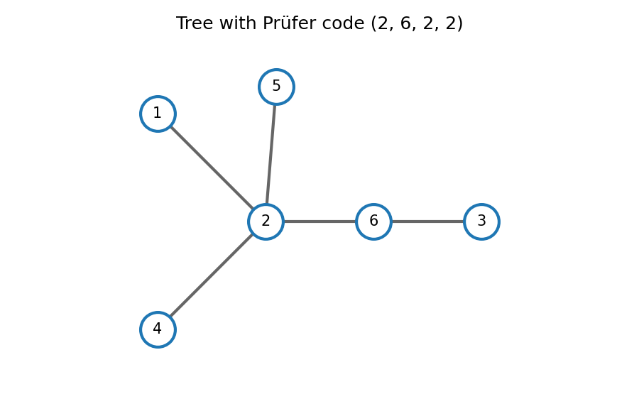

<h1 id="r/1/i/solution">Solution</h1>

↑ **Parent:** [I](../i.md)

Decode the [Prüfer code](../../../../../prufer-sequence.md) by repeatedly attaching the smallest label absent from the remaining code to its first entry. This produces the successive edges $1\!-\!2$, $3\!-\!6$, $4\!-\!2$, $5\!-\!2$, followed by the final edge $2\!-\!6$. Thus

$$
\boxed{E=\{\{1,2\},\{3,6\},\{2,4\},\{2,5\},\{2,6\}\}.}
$$

**[Figure 1](#r/1/i/image-decoding-the-prufer-sequence-gives-the-five-displayed-edges). Decoding the Prüfer sequence gives the five displayed edges**.

## ↑ Ancestors (13)

1. [I](../i.md)
2. [1](../../1.md)
3. [R](../../../r.md)
4. [2008](../../../../2008-split.md)
5. [Past exam of the probability, statistics and options I course of the University of Oxford](../../../../split.md)
6. [Probability, statistics and options I course of the University of Oxford](../../../../../probability-statistics-and-options-i-course-of-the-university-of-oxford.md)
7. [Year 2 of the mathematics and statistics course of the University of Oxford](../../../../../year-2-of-the-mathematics-and-statistics-course-of-the-university-of-oxford.md)
8. [Mathematics and statistics course of the University of Oxford](../../../../../mathematics-and-statistics-course-of-the-university-of-oxford.md)
9. [Undergraduate course of the University of Oxford](../../../../../undergraduate-course-of-the-university-of-oxford.md)
10. [Course of the University of Oxford](../../../../../course-of-the-university-of-oxford.md)
11. [University of Oxford](../../../../../university-of-oxford-split.md)
12. [List of universities](../../../../../list-of-universities.md)
13. [Codex Wiki](../../../../../split.md)
