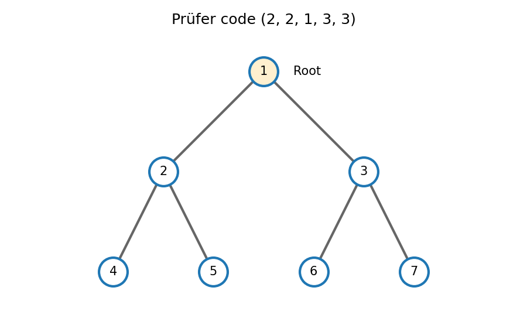

<h1 id="r/1/ii/solution">Solution</h1>

↑ **Parent:** [Ii](../ii.md)

Take root one, its children two and three, the children of two to be four and five, and those of three to be six and seven. Its edge set is $\{12,13,24,25,36,37\}$. The root has degree two, vertices two and three have degree three, and the remaining vertices have degree one.

Removing the smallest available leaves in order gives $4,5,2,1,6$, with recorded neighbors $2,2,1,3,3$. Therefore its [Prüfer code](../../../../../prufer-sequence.md) is

$$
\boxed{(2,2,1,3,3).}
$$

**[Figure 2](#r/1/ii/image-a-labelled-seven-vertex-rooted-binary-tree-with-root-one). A labelled seven-vertex rooted binary tree with root one**.

## ↑ Ancestors (13)

1. [Ii](../ii.md)
2. [1](../../1.md)
3. [R](../../../r.md)
4. [2008](../../../../2008-split.md)
5. [Past exam of the probability, statistics and options I course of the University of Oxford](../../../../split.md)
6. [Probability, statistics and options I course of the University of Oxford](../../../../../probability-statistics-and-options-i-course-of-the-university-of-oxford.md)
7. [Year 2 of the mathematics and statistics course of the University of Oxford](../../../../../year-2-of-the-mathematics-and-statistics-course-of-the-university-of-oxford.md)
8. [Mathematics and statistics course of the University of Oxford](../../../../../mathematics-and-statistics-course-of-the-university-of-oxford.md)
9. [Undergraduate course of the University of Oxford](../../../../../undergraduate-course-of-the-university-of-oxford.md)
10. [Course of the University of Oxford](../../../../../course-of-the-university-of-oxford.md)
11. [University of Oxford](../../../../../university-of-oxford-split.md)
12. [List of universities](../../../../../list-of-universities.md)
13. [Codex Wiki](../../../../../split.md)
