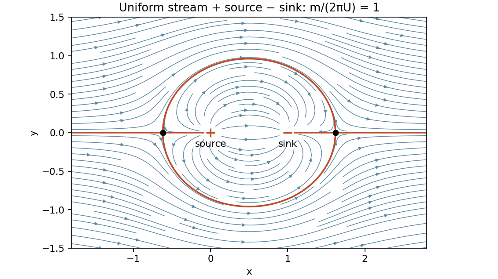
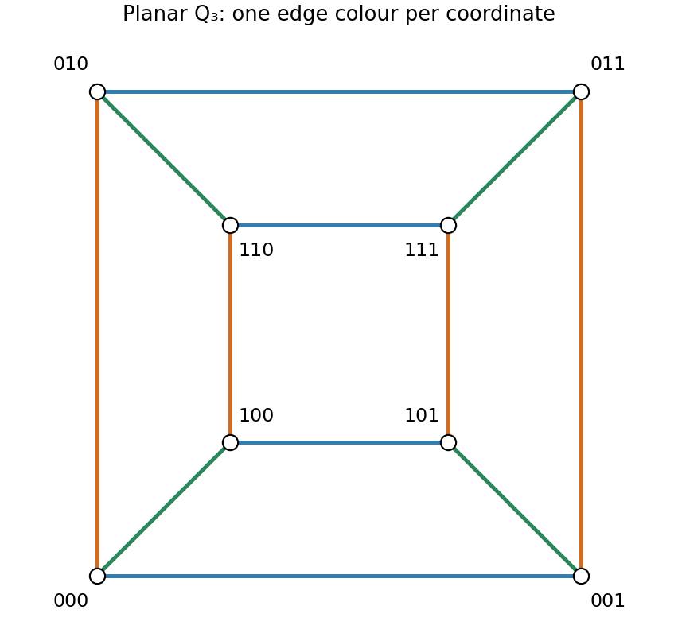

# 2009

↑ **Parent:** [Past exam of the probability, statistics and options I course of the University of Oxford](../past-exam-of-the-probability-statistics-and-options-i-course-of-the-university-of-oxford.md)

Source: [released examination bundle](https://www.whatdotheyknow.com/request/maths_past_papers_3), `Part A 2007 11-1.pdf`, pages 158–170. All questions in every printed section are covered. No mark allocations are printed.

**Table of contents**

- [A](#a)
  - [1](#a/1)
    - [i](#a/1/i)
      - [Solution](#a/1/i/solution)
    - [ii](#a/1/ii)
      - [Solution](#a/1/ii/solution)
- [B](#b)
  - [1](#b/1)
    - [Solution](#b/1/solution)
- [C](#c)
  - [1](#c/1)
    - [i](#c/1/i)
      - [Solution](#c/1/i/solution)
    - [ii](#c/1/ii)
      - [Solution](#c/1/ii/solution)
    - [iii](#c/1/iii)
      - [Solution](#c/1/iii/solution)
    - [iv](#c/1/iv)
      - [Solution](#c/1/iv/solution)
- [D](#d)
  - [1](#d/1)
    - [Solution](#d/1/solution)
  - [2](#d/2)
    - [Solution](#d/2/solution)
- [E](#e)
  - [1](#e/1)
    - [a](#e/1/a)
      - [i](#e/1/a/i)
        - [Solution](#e/1/a/i/solution)
      - [ii](#e/1/a/ii)
        - [Solution](#e/1/a/ii/solution)
      - [iii](#e/1/a/iii)
        - [Solution](#e/1/a/iii/solution)
    - [b](#e/1/b)
      - [i](#e/1/b/i)
        - [Solution](#e/1/b/i/solution)
      - [ii](#e/1/b/ii)
        - [Solution](#e/1/b/ii/solution)
      - [iii](#e/1/b/iii)
        - [Solution](#e/1/b/iii/solution)
  - [2](#e/2)
    - [a](#e/2/a)
      - [i](#e/2/a/i)
        - [Solution](#e/2/a/i/solution)
      - [ii](#e/2/a/ii)
        - [Solution](#e/2/a/ii/solution)
    - [b](#e/2/b)
      - [i](#e/2/b/i)
        - [Solution](#e/2/b/i/solution)
      - [ii](#e/2/b/ii)
        - [Solution](#e/2/b/ii/solution)
- [F](#f)
  - [1](#f/1)
    - [a](#f/1/a)
      - [Solution](#f/1/a/solution)
    - [b](#f/1/b)
      - [Solution](#f/1/b/solution)
- [G](#g)
  - [1](#g/1)
    - [Solution](#g/1/solution)
- [H](#h)
  - [1](#h/1)
    - [i](#h/1/i)
      - [Solution](#h/1/i/solution)
    - [ii](#h/1/ii)
      - [Solution](#h/1/ii/solution)
    - [iii](#h/1/iii)
      - [Solution](#h/1/iii/solution)
- [J](#j)
  - [1](#j/1)
    - [Solution](#j/1/solution)
- [K](#k)
  - [1](#k/1)
    - [Solution](#k/1/solution)
  - [2](#k/2)
    - [Solution](#k/2/solution)
- [M](#m)
  - [1](#m/1)
    - [a](#m/1/a)
      - [Solution](#m/1/a/solution)
    - [b](#m/1/b)
      - [Solution](#m/1/b/solution)
    - [c](#m/1/c)
      - [Solution](#m/1/c/solution)
  - [2](#m/2)
    - [a](#m/2/a)
      - [Solution](#m/2/a/solution)
    - [b](#m/2/b)
      - [Solution](#m/2/b/solution)
    - [c](#m/2/c)
      - [i](#m/2/c/i)
        - [Solution](#m/2/c/i/solution)
      - [ii](#m/2/c/ii)
        - [Solution](#m/2/c/ii/solution)
  - [3](#m/3)
    - [a](#m/3/a)
      - [Solution](#m/3/a/solution)
    - [b](#m/3/b)
      - [i](#m/3/b/i)
        - [Solution](#m/3/b/i/solution)
      - [ii](#m/3/b/ii)
        - [Solution](#m/3/b/ii/solution)
    - [c](#m/3/c)
      - [Solution](#m/3/c/solution)
- [O](#o)
  - [1](#o/1)
    - [Solution](#o/1/solution)
  - [2](#o/2)
    - [i](#o/2/i)
      - [Solution](#o/2/i/solution)
    - [ii](#o/2/ii)
      - [Solution](#o/2/ii/solution)
    - [iii](#o/2/iii)
      - [Solution](#o/2/iii/solution)
  - [3](#o/3)
    - [Solution](#o/3/solution)
- [P](#p)
  - [1](#p/1)
    - [Solution](#p/1/solution)
  - [2](#p/2)
    - [Solution](#p/2/solution)
- [R](#r)
  - [1](#r/1)
    - [i](#r/1/i)
      - [Solution](#r/1/i/solution)
    - [ii](#r/1/ii)
      - [a](#r/1/ii/a)
        - [Solution](#r/1/ii/a/solution)
      - [b](#r/1/ii/b)
        - [Solution](#r/1/ii/b/solution)
      - [c](#r/1/ii/c)
        - [Solution](#r/1/ii/c/solution)
    - [iii](#r/1/iii)
      - [Solution](#r/1/iii/solution)
    - [iv](#r/1/iv)
      - [Solution](#r/1/iv/solution)
    - [v](#r/1/v)
      - [Solution](#r/1/v/solution)
    - [vi](#r/1/vi)
      - [Solution](#r/1/vi/solution)
- [S](#s)
  - [1](#s/1)
    - [a](#s/1/a)
      - [Solution](#s/1/a/solution)
    - [b](#s/1/b)
      - [Solution](#s/1/b/solution)
- [T](#t)
  - [1](#t/1)
    - [a](#t/1/a)
      - [i](#t/1/a/i)
        - [Solution](#t/1/a/i/solution)
      - [ii](#t/1/a/ii)
        - [Solution](#t/1/a/ii/solution)
    - [b](#t/1/b)
      - [i](#t/1/b/i)
        - [Solution](#t/1/b/i/solution)
      - [ii](#t/1/b/ii)
        - [Solution](#t/1/b/ii/solution)
    - [c](#t/1/c)
      - [Solution](#t/1/c/solution)

## A

↑ **Parent:** [2009](2009.md)

<h3 id="a/1">1</h3>

↑ **Parent:** [A](#a)

<h4 id="a/1/i">i</h4>

↑ **Parent:** [1](#a/1)

<h5 id="a/1/i/solution">Solution</h5>

↑ **Parent:** [I](#a/1/i)

The [splitting field](../galois-theory.md#splitting-field) in $\mathbb C$ is the smallest subfield containing $\mathbb Q$ and every [root](../semisimple-lie-algebra.md#root-of-a-root-system) of the [polynomial](../polynomial.md). The sixth roots of unity are powers of $\zeta_6=e^{i\pi/3}$, so the [splitting field](../galois-theory.md#splitting-field) of $x^6-1$ is $\mathbb Q(\zeta_6)=\mathbb Q(\sqrt{-3})$.

For $x^6+x^3+1=(x^9-1)/(x^3-1)$, the roots are exactly the primitive ninth roots of unity, all powers of $\zeta_9=e^{2\pi i/9}$. Thus its [splitting field](../galois-theory.md#splitting-field) is $\mathbb Q(\zeta_9)$. The supplied irreducibility makes the displayed degree-six [polynomial](../polynomial.md) the [minimal polynomial](../linear-operator-theory.md#minimal-polynomial) of $\zeta_9$, giving

$$
\boxed{[\mathbb Q(\zeta_9):\mathbb Q]=6.}
$$

<h4 id="a/1/ii">ii</h4>

↑ **Parent:** [1](#a/1)

<h5 id="a/1/ii/solution">Solution</h5>

↑ **Parent:** [Ii](#a/1/ii)

Replacing $x$ by $-x$ in the irreducible [polynomial](../polynomial.md) from part (i) gives $x^6-x^3+1$. This substitution is an invertible automorphism of $\mathbb Q[x]$, so it preserves irreducibility. The roots are the primitive eighteenth roots, and the [splitting field](../galois-theory.md#splitting-field) is $\mathbb Q(\zeta_{18})$. They are all powers of one such [root](../semisimple-lie-algebra.md#root-of-a-root-system), so its irreducible degree-six [polynomial](../polynomial.md) gives

$$
\boxed{[\mathbb Q(\zeta_{18}):\mathbb Q]=6.}
$$

In fact this is the same [field](../algebra.md#field) as in part (i): $\zeta_9=\zeta_{18}^2$ and $\zeta_{18}=-\zeta_9^5$.

## B

↑ **Parent:** [2009](2009.md)

<h3 id="b/1">1</h3>

↑ **Parent:** [B](#b)

<h4 id="b/1/solution">Solution</h4>

↑ **Parent:** [1](#b/1)

A finite [soluble group](../group-theory.md#solvable-group) is one whose [derived series](../group-theory.md#derived-series) $G^{(0)}=G$, $G^{(j+1)}=[G^{(j)},G^{(j)}]$ reaches the trivial group. Equivalently it has a finite normal series with abelian factors. If $H\leq G$, induction using [commutator](../lie-algebra.md#commutator) containment gives $H^{(j)}\leq G^{(j)}$ for every $j$. Thus termination for $G$ implies termination for $H$, proving **every [subgroup](../group.md#subgroup) of a [soluble group](../group-theory.md#solvable-group) is soluble**.

For $S_4$, the chain

$$
\{1\}\triangleleft V_4\triangleleft A_4\triangleleft S_4
$$

has abelian factors $V_4$, $C_3$ and $C_2$. Here $V_4$ consists of the identity and the three double transpositions. It is normal because conjugation permutes those double transpositions. Hence **$S_4$ is soluble**.

An example neither soluble nor simple is **$S_5$**. Its [subgroup](../group.md#subgroup) $A_5$ is proper, nontrivial and normal, so $S_5$ is not simple. The group $A_5$ is nontrivial and perfect: its generating three-cycles are commutators of double transpositions, using two additional symbols, so $[A_5,A_5]=A_5$. For example the [commutator](../lie-algebra.md#commutator) of $(12)(45)$ and $(23)(45)$ is a three-cycle, and conjugation and inversion give all three-cycles. Thus $A_5$ is not soluble, and [subgroup](../group.md#subgroup) inheritance then proves $S_5$ is not soluble either.

## C

↑ **Parent:** [2009](2009.md)

<h3 id="c/1">1</h3>

↑ **Parent:** [C](#c)

<h4 id="c/1/i">i</h4>

↑ **Parent:** [1](#c/1)

<h5 id="c/1/i/solution">Solution</h5>

↑ **Parent:** [I](#c/1/i)

[Fermat's little theorem](../number-theory.md#fermat-little-theorem) states that for a prime $p$ and any integer $a$,

$$
\boxed{a^p\equiv a\pmod p.}
$$

If $p\nmid a$, the equivalent multiplicative form is $a^{p-1}\equiv1\pmod p$.

<h4 id="c/1/ii">ii</h4>

↑ **Parent:** [1](#c/1)

<h5 id="c/1/ii/solution">Solution</h5>

↑ **Parent:** [Ii](#c/1/ii)

[Wilson's theorem](../modular-arithmetic.md#wilson-s-theorem) states that an integer $p>1$ is prime if and only if

$$
\boxed{(p-1)!\equiv-1\pmod p.}
$$

In particular the congruence holds for every prime $p$, including two.

<h4 id="c/1/iii">iii</h4>

↑ **Parent:** [1](#c/1)

<h5 id="c/1/iii/solution">Solution</h5>

↑ **Parent:** [Iii](#c/1/iii)

Combine the preceding congruences: $a^p\equiv a$ and $(p-1)!\equiv-1\pmod p$. Therefore $a^p+(p-1)!a\equiv a-a=0$, and $(p-1)!a^p+a\equiv-a+a=0$. This proves **both stated divisibilities for every integer $a$**, with no assumption that $a$ is coprime to $p$.

<h4 id="c/1/iv">iv</h4>

↑ **Parent:** [1](#c/1)

<h5 id="c/1/iv/solution">Solution</h5>

↑ **Parent:** [Iv](#c/1/iv)

Modulo $p$, the term $p^{q-1}$ is zero and [Fermat's little theorem](../number-theory.md#fermat-little-theorem) gives $q^{p-1}\equiv1$, since $q\ne p$. Modulo $q$, the roles reverse. Hence the sum minus one is divisible by both distinct primes. Their coprimality gives

$$
\boxed{p^{q-1}+q^{p-1}\equiv1\pmod{pq}.}
$$

## D

↑ **Parent:** [2009](2009.md)

<h3 id="d/1">1</h3>

↑ **Parent:** [D](#d)

<h4 id="d/1/solution">Solution</h4>

↑ **Parent:** [1](#d/1)

The [Lebesgue outer measure](../measure-theory.md#lebesgue-outer-measure) of $E$ is the infimum of $\sum_j|I_j|$ over countable coverings by open intervals. A set is a [null set](../measure-theory.md#null-set) when this infimum is zero, equivalently when it has such a cover of total length less than every prescribed positive number.

The [Cantor set](../geometry-and-topology.md#cantor-set) is obtained from $[0,1]$ by deleting the open middle third of every remaining interval at each stage. After $n$ stages it lies inside $2^n$ closed intervals of length $3^{-n}$. Slightly enlarging these finitely many intervals to open intervals shows its [outer measure](../measure-theory.md#outer-measure) is at most $(2/3)^n$ for every $n$, hence zero.

For the modified construction, let $L_n$ be the total length of the $2^n$ intervals in $K_n$. The removed fraction at stage $n$ is exactly $1/(2^n+2)$, so

$$
L_{n+1}=L_n\frac{2^n+1}{2^n+2},\qquad L_0=1.
$$

The product telescopes because $2^n+2=2(2^{n-1}+1)$, giving

$$
L_n=\frac13+\frac{2}{3\cdot2^n}.
$$

Since $K\subseteq K_n$, the same finite interval-cover argument gives $m^*(K)\leq L_n$ for every $n$. Taking the infimum proves

$$
\boxed{m^*(K)\leq1/3.}
$$

Only interval lengths and the definition of [outer measure](../measure-theory.md#outer-measure) were used; the three numbered clauses in the source describe the construction rather than separate requests to prove additional statements.

<h3 id="d/2">2</h3>

↑ **Parent:** [D](#d)

<h4 id="d/2/solution">Solution</h4>

↑ **Parent:** [2](#d/2)

A useful [differentiation under the integral sign](../analysis.md#differentiation-under-the-integral-sign) theorem is this: if $f(\cdot,y)$ is integrable, $f$ is differentiable in $y$ almost everywhere, and on every [compact](../topology.md#compact-space) parameter interval $|\partial_yf(x,y)|$ is bounded by an [integrable function](../measure-theory.md#lebesgue-integrable-function) of $x$, then $F'(y)=\int_I\partial_yf(x,y)dx$, under the usual pointwise [continuity](../calculus.md#continuous-function) hypotheses. It follows by applying [dominated convergence](../measure-theory.md#dominated-convergence-theorem) to difference quotients. The theorem can be iterated when a corresponding bound holds for the second derivative.

On a [compact](../topology.md#compact-space) interval $0<a\leq y\leq b$, the original integrand is bounded by $b/(1+x^4)$, using $|\sin(x^2y)|\leq bx^2$. Its first and second parameter derivatives are

$$
\frac{\cos(x^2y)}{1+x^4},\qquad-\frac{x^2\sin(x^2y)}{1+x^4},
$$

with integrable bounds $(1+x^4)^{-1}$ and $x^2/(1+x^4)$. Thus $F$ is twice differentiable. Subtracting the integrals gives

$$
F''(y)-F(y)=-\int_0^\infty\frac{\sin(x^2y)}{x^2}dx
=-\sqrt y\int_0^\infty\frac{\sin t^2}{t^2}dt.
$$

The final integral is finite: its integrand tends to one at zero and is absolutely bounded by $t^{-2}$ at infinity. Consequently

$$
\boxed{F''(y)-F(y)=c\sqrt y,\quad c=-\int_0^\infty\frac{\sin t^2}{t^2}dt,}
$$

which establishes the required parameter-independent constant without needing an explicit Fresnel integral evaluation.

## E

↑ **Parent:** [2009](2009.md)

<h3 id="e/1">1</h3>

↑ **Parent:** [E](#e)

<h4 id="e/1/a">a</h4>

↑ **Parent:** [1](#e/1)

<h5 id="e/1/a/i">i</h5>

↑ **Parent:** [A](#e/1/a)

<h6 id="e/1/a/i/solution">Solution</h6>

↑ **Parent:** [I](#e/1/a/i)

The [closed sets](../topology.md#closed-set) contain the empty set and the whole space, are closed under arbitrary intersections, and are closed under finite unions. These conditions are equivalent, by complements, to the open-set axioms of a [topology](../topology.md).

<h5 id="e/1/a/ii">ii</h5>

↑ **Parent:** [A](#e/1/a)

<h6 id="e/1/a/ii/solution">Solution</h6>

↑ **Parent:** [Ii](#e/1/a/ii)

A map is [continuous](../calculus.md#continuous-function) when the inverse image of every [open set](../topology.md#open-set) is open. Equivalently, the inverse image of every [closed set](../topology.md#closed-set) is closed.

<h5 id="e/1/a/iii">iii</h5>

↑ **Parent:** [A](#e/1/a)

<h6 id="e/1/a/iii/solution">Solution</h6>

↑ **Parent:** [Iii](#e/1/a/iii)

The definition of [convergence of a sequence in a topological space](../topology.md#convergence-of-a-sequence-in-a-topological-space) to $\ell$ is that every open neighborhood $U$ of $\ell$ contains all sufficiently late terms: there exists $N$ such that $x_n\in U$ for every $n\geq N$.

<h4 id="e/1/b">b</h4>

↑ **Parent:** [1](#e/1)

<h5 id="e/1/b/i">i</h5>

↑ **Parent:** [B](#e/1/b)

<h6 id="e/1/b/i/solution">Solution</h6>

↑ **Parent:** [I](#e/1/b/i)

The empty set is countable, and the whole space contains $a$, so both belong to the proposed closed family. A finite union contains $a$ if any member does; otherwise it is a finite union of countable sets and remains countable. For an arbitrary intersection, if every member contains $a$, so does the intersection. Otherwise some member excludes $a$ and is countable, and the intersection is a subset of it, hence countable. Thus **all closed-set [topology](../topology.md) axioms hold**.

<h5 id="e/1/b/ii">ii</h5>

↑ **Parent:** [B](#e/1/b)

<h6 id="e/1/b/ii/solution">Solution</h6>

↑ **Parent:** [Ii](#e/1/b/ii)

Let $E=\{x:f(x)\ne f(a)\}$ be countable. For a closed subset $C$ of the real line, if $f(a)\in C$, its inverse image contains $a$ and is closed by definition. If $f(a)\notin C$, its inverse image lies inside $E$ and is countable, hence is again closed. Every closed inverse image is therefore closed, proving **$f$ is continuous**.

<h5 id="e/1/b/iii">iii</h5>

↑ **Parent:** [B](#e/1/b)

<h6 id="e/1/b/iii/solution">Solution</h6>

↑ **Parent:** [Iii](#e/1/b/iii)

The set $S=\{x_n:x_n\ne\ell\}$ is countable, hence closed, and does not contain $\ell$. Its complement is an open neighborhood of $\ell$. Convergence therefore places every sufficiently late term outside $S$, which is possible only if those terms equal $\ell$. Thus **the [sequence](../sequence-and-series.md#sequence) is eventually constant at its limit**, and the set of exceptional indices is finite. This conclusion concerns repeated indices as well as distinct values.

<h3 id="e/2">2</h3>

↑ **Parent:** [E](#e)

<h4 id="e/2/a">a</h4>

↑ **Parent:** [2](#e/2)

<h5 id="e/2/a/i">i</h5>

↑ **Parent:** [A](#e/2/a)

<h6 id="e/2/a/i/solution">Solution</h6>

↑ **Parent:** [I](#e/2/a/i)

A subset is [compact](../topology.md#compact-space) if every family of open sets covering it has a finite subfamily still covering it. Equivalently, its subspace [topology](../topology.md) has the finite-subcover property.

<h5 id="e/2/a/ii">ii</h5>

↑ **Parent:** [A](#e/2/a)

<h6 id="e/2/a/ii/solution">Solution</h6>

↑ **Parent:** [Ii](#e/2/a/ii)

Let $\{U_i\}$ be an open cover of $f(X)$. By [continuity](../calculus.md#continuous-function) the inverse images $f^{-1}(U_i)$ are open and cover $X$. Compactness provides finitely many of them covering $X$, and the corresponding $U_i$ then cover $f(X)$. Thus **a continuous image of a [compact](../topology.md#compact-space) space is [compact](../topology.md#compact-space)**.

<h4 id="e/2/b">b</h4>

↑ **Parent:** [2](#e/2)

<h5 id="e/2/b/i">i</h5>

↑ **Parent:** [B](#e/2/b)

<h6 id="e/2/b/i/solution">Solution</h6>

↑ **Parent:** [I](#e/2/b/i)

The family contains the whole space and the empty set. A finite intersection of nontrivial members is $(\max_j a_j,\infty)$. A nonempty union of rays is $(\inf_j a_j,\infty)$ when the infimum is finite, and is the whole line when the infimum is $-\infty$. Empty unions and unions involving the whole space are already included. Hence **$\tau$ is a [topology](../topology.md)**. This is the [upper-ray topology on the real line](../topology.md#upper-ray-topology-on-the-real-line).

<h5 id="e/2/b/ii">ii</h5>

↑ **Parent:** [B](#e/2/b)

<h6 id="e/2/b/ii/solution">Solution</h6>

↑ **Parent:** [Ii](#e/2/b/ii)

If $A$ has a smallest element $a_0$, any open cover has a member containing $a_0$. This member is either the whole line or a ray $(c,\infty)$ with $c<a_0$, so it already contains all of $A$. Thus a single member suffices and $A$ is [compact](../topology.md#compact-space).

If $A$ has no smallest element, the family $\{(a,\infty):a\in A\}$ covers $A$: each point has another point of $A$ below it. A finite subfamily has union $(\min_j a_j,\infty)$, which misses its smallest listed endpoint, itself a point of $A$. No finite subcover exists. Therefore **a nonempty subset is [compact](../topology.md#compact-space) exactly when it has a smallest element** in this [topology](../topology.md).

## F

↑ **Parent:** [2009](2009.md)

<h3 id="f/1">1</h3>

↑ **Parent:** [F](#f)

<h4 id="f/1/a">a</h4>

↑ **Parent:** [1](#f/1)

<h5 id="f/1/a/solution">Solution</h5>

↑ **Parent:** [A](#f/1/a)

The full-[rank](../quadratic-form.md#rank-one-quadratic-form) [constraint qualification](../mathematical-optimization.md#constraint-qualification) gives a multiplier vector $\lambda\in\mathbb R^2$ such that

$$
\boxed{\nabla g(x_0)=Df(x_0)^T\lambda.}
$$

Equivalently the [gradient](../multivariable-calculus.md#gradient) of the objective lies in the span of the two constraint gradients. The point also satisfies $f(x_0)=0$.

<h4 id="f/1/b">b</h4>

↑ **Parent:** [1](#f/1)

<h5 id="f/1/b/solution">Solution</h5>

↑ **Parent:** [B](#f/1/b)

The constraint intersection is nonempty, closed and bounded, hence [compact](../topology.md#compact-space), so extrema exist. The two constraint gradients are $(x/2,2y,2z)$ and $(1,1,-1)$. If the first were $t$ times the second, the plane condition would give $2t+t/2+t/2=0$, so $t=0$ and all coordinates would vanish, contradicting the ellipsoid equation. Their [rank](../quadratic-form.md#rank-one-quadratic-form) is therefore two at every feasible point, justifying the [Lagrange multiplier](../mathematical-optimization.md#lagrange-multiplier) equations.

These equations are

$$
(1,2,0)=\lambda(x/2,2y,2z)+\mu(1,1,-1),\quad z=x+y.
$$

Eliminating $\mu$ gives $1=\lambda(5x/2+2y)$ and $2=\lambda(2x+4y)$. The first equation makes $\lambda\ne0$; subtracting twice the first from the second forces $x=0$. Hence $z=y$, and the ellipsoid gives $y=z=\pm1/\sqrt2$. Thus

$$
\boxed{g_{\max}=\sqrt2\text{ at }(0,1/\sqrt2,1/\sqrt2),\qquad
 g_{\min}=-\sqrt2\text{ at }(0,-1/\sqrt2,-1/\sqrt2).}
$$

All candidates were found, and [compactness](../topology.md#compact-space) ensures they include the extrema.

## G

↑ **Parent:** [2009](2009.md)

<h3 id="g/1">1</h3>

↑ **Parent:** [G](#g)

<h4 id="g/1/solution">Solution</h4>

↑ **Parent:** [1](#g/1)

Take an admissible variation $u+\epsilon\eta$ with $\eta=0$ on the boundary. Differentiating the functional at an extremum gives

$$
0=\int_V(F_u\eta+F_{u_x}\eta_x+F_{u_y}\eta_y+F_{u_z}\eta_z)dV.
$$

Integration by parts removes the derivatives from $\eta$; the boundary term vanishes. The [fundamental lemma of the calculus of variations](../calculus-of-variations.md#fundamental-lemma-of-the-calculus-of-variations) yields

$$
\boxed{\partial_xF_{u_x}+\partial_yF_{u_y}+\partial_zF_{u_z}-F_u=0.}
$$

For the specified squared-[gradient](../multivariable-calculus.md#gradient) energy this is $2\Delta u=0$, so $u$ is harmonic. The affine function $\ell=ax+by+cz$ is harmonic and satisfies the boundary data.

To verify a global minimum, write $u=\ell+v$ with zero boundary trace. Then

$$
I[u]=I[\ell]+2\int_V\nabla\ell\cdot\nabla v\,dV+\int_V|\nabla v|^2dV.
$$

The middle term vanishes by integration by parts, since $\Delta\ell=0$ and $v=0$ at the boundary. Hence $I[u]\geq I[\ell]$, and

$$
\boxed{\min I=(a^2+b^2+c^2)\operatorname{vol}V.}
$$

This proves minimality directly, rather than relying only on a necessary Euler-Lagrange equation.

## H

↑ **Parent:** [2009](2009.md)

<h3 id="h/1">1</h3>

↑ **Parent:** [H](#h)

<h4 id="h/1/i">i</h4>

↑ **Parent:** [1](#h/1)

<h5 id="h/1/i/solution">Solution</h5>

↑ **Parent:** [I](#h/1/i)

The [Lagrangian](../calculus-of-variations.md#lagrangian) is $L=\sum_i m_i|\dot q_i|^2/2-f(r)$. Away from a collision, its equations of motion are

$$
m_1\ddot q_1=-\frac{f'(r)}r(q_1-q_2)=:F,\qquad
m_2\ddot q_2=-F,\qquad m_3\ddot q_3=0.
$$

Summing forces proves conservation of total [linear momentum](../momentum.md). The total [mechanical energy](../energy.md#mechanical-energy) $E=\sum_i m_i|\dot q_i|^2/2+f(r)$ is also conserved: its derivative is $F\cdot(\dot q_1-\dot q_2)+f'(r)\dot r=0$, because $\dot r=(q_1-q_2)\cdot(\dot q_1-\dot q_2)/r$.

For the first proposed [angular momentum](../momentum.md#angular-momentum),

$$
\frac d{dt}(m_1q_1\times\dot q_1)=q_1\times F
=\frac{f'(r)}r q_1\times q_2,
$$

which need not vanish. Thus **particle one's [angular momentum](../momentum.md#angular-momentum) about the fixed origin is not generally conserved**. Its force is central relative to particle two, not necessarily relative to that origin.

<h4 id="h/1/ii">ii</h4>

↑ **Parent:** [1](#h/1)

<h5 id="h/1/ii/solution">Solution</h5>

↑ **Parent:** [Ii](#h/1/ii)

The third particle is free, so

$$
\frac d{dt}(m_3q_3\times\dot q_3)=q_3\times m_3\ddot q_3=0.
$$

Thus **particle three's [angular momentum](../momentum.md#angular-momentum) is conserved**.

<h4 id="h/1/iii">iii</h4>

↑ **Parent:** [1](#h/1)

<h5 id="h/1/iii/solution">Solution</h5>

↑ **Parent:** [Iii](#h/1/iii)

The derivative of the pair's total [angular momentum](../momentum.md#angular-momentum) is $q_1\times F-q_2\times F=(q_1-q_2)\times F=0$, since $F$ is parallel to the separation vector. Therefore **the combined [angular momentum](../momentum.md#angular-momentum) of particles one and two is conserved**, despite the possible exchange between them individually.

## J

↑ **Parent:** [2009](2009.md)

<h3 id="j/1">1</h3>

↑ **Parent:** [J](#j)

<h4 id="j/1/solution">Solution</h4>

↑ **Parent:** [1](#j/1)

For an observation point in the wire's plane, both $d\mathbf s$ and $\mathbf r-\mathbf s$ lie in that plane. Their cross product is normal to it, and the [Biot-Savart law](../electromagnetism.md#biot-savart-law) integrates only such normal vectors. Thus the [field](../algebra.md#field) is perpendicular to the plane at every point off the wire.

At the centre, all four sides contribute in the same normal direction by the right-hand rule. A single side is distance $a$ from the centre, so its contribution is

$$
\frac{\mu_0I}{4\pi}\int_{-a}^a\frac{a\,ds}{(a^2+s^2)^{3/2}}
=\frac{\mu_0I\sqrt2}{4\pi a}.
$$

Multiplying by four gives

$$
\boxed{\mathbf B_{\rm centre}=\frac{\mu_0I\sqrt2}{\pi a}\,\mathbf n,}
$$

where $\mathbf n$ is the oriented normal fixed by the current.

## K

↑ **Parent:** [2009](2009.md)

<h3 id="k/1">1</h3>

↑ **Parent:** [K](#k)

<h4 id="k/1/solution">Solution</h4>

↑ **Parent:** [1](#k/1)

For incompressible planar flow define the [streamfunction](../fluid-mechanics.md#stream-function) by $u=\psi_y$, $v=-\psi_x$. A [velocity potential](../fluid-mechanics.md#velocity-potential) satisfies $u=\phi_x$, $v=\phi_y$ when the flow is irrotational; the differential condition is $v_x-u_y=0$. The [complex potential of a two-dimensional potential flow](../fluid-mechanics.md#complex-potential-of-a-two-dimensional-potential-flow) is $w=\phi+i\psi$, with derivative $w'=u-iv$.

For $w=m\log(z-z_0)/(2\pi)$, its derivative is $m/[2\pi(z-z_0)]$. This gives outward radial velocity $m/(2\pi r)$, whose flux across a circle is $2\pi r\cdot m/(2\pi r)=m$. It is therefore the stated line source.

Superposition gives

$$
w(z)=Uz+\frac m{2\pi}[\log z-\log(z-1)],\qquad
w'(z)=U-\frac m{2\pi z(z-1)}.
$$

For positive $U,m$, the stagnation points are

$$
\boxed{z_\pm=\frac{1\pm\sqrt{1+2m/(\pi U)}}2.}
$$

They lie on the real axis, one upstream of the source and the other downstream of the sink. Streamlines are level sets of $\psi=Uy+(m/2\pi)[\arg z-\arg(z-1)]$. The dividing [streamline](../fluid-mechanics.md#streamline) passes through both stagnation points and forms a [Rankine oval](../fluid-mechanics.md#rankine-oval) enclosing the source and sink; outside, streamlines tend to uniform horizontal flow.

**[Figure 1](#k/1/image-a-representative-source-sink-pair-in-a-uniform-stream-with-two-stagnation-points-and-a-dividing-rankine-oval). A representative source-sink pair in a uniform stream, with two stagnation points and a dividing Rankine oval**.

<h3 id="k/2">2</h3>

↑ **Parent:** [K](#k)

<h4 id="k/2/solution">Solution</h4>

↑ **Parent:** [2](#k/2)

Writing $z=re^{i\theta}$ gives $\phi=\Gamma\theta/(2\pi)$ and $\psi=-\Gamma\log r/(2\pi)$. Constant [streamfunction](../fluid-mechanics.md#stream-function) means constant radius, so streamlines are circles. The tangential velocity is $v_\theta=\Gamma/(2\pi r)$, and its anticlockwise [circulation](../vorticity.md#circulation-physics) is $\int_0^{2\pi}v_\theta r\,d\theta=\Gamma$.

Use an opposite vortex at $z=-1$ as the image of the vortex at one:

$$
\boxed{w(z)=-\frac{i\Gamma}{2\pi}[\log(z-1)-\log(z+1)].}
$$

On $z=iy$ the two distances are equal, so $\psi=0$ and the wall is a [streamline](../fluid-mechanics.md#streamline). Its velocity follows from $w'=-i\Gamma/[\pi(z^2-1)]$: at the wall $u=0$ and $v=-\Gamma/[\pi(1+y^2)]$.

The [Bernoulli equation](../euler-equations-for-an-inviscid-fluid.md#bernoulli-equation) gives $p-p_\infty=-\rho\Gamma^2/[2\pi^2(1+y^2)^2]$. Relative to the ambient pressure force, the fluid's excess force on the wall is $-\int(p-p_\infty)dy$ in the positive $x$ direction. Using the supplied integral,

$$
\boxed{\mathbf F_{\rm vortex}=\frac{\rho\Gamma^2}{4\pi}\,\mathbf e_x\quad\text{per unit width}.}
$$

Thus the wall is attracted toward the fluid and vortex. Subtracting the uniform ambient pressure isolates the finite force due to the vortex.

## M

↑ **Parent:** [2009](2009.md)

<h3 id="m/1">1</h3>

↑ **Parent:** [M](#m)

<h4 id="m/1/a">a</h4>

↑ **Parent:** [1](#m/1)

<h5 id="m/1/a/solution">Solution</h5>

↑ **Parent:** [A](#m/1/a)

Pointwise $Z^2\geq a^2\mathbf1_{\{|Z|\geq a\}}$. Taking expectations and dividing by $a^2>0$ proves the [Markov inequality](../probability-inequality.md#markov-s-inequality)

$$
\boxed{\mathbb P(|Z|\geq a)\leq\mathbb EZ^2/a^2.}
$$

<h4 id="m/1/b">b</h4>

↑ **Parent:** [1](#m/1)

<h5 id="m/1/b/solution">Solution</h5>

↑ **Parent:** [B](#m/1/b)

The [joint density](../continuous-probability-distribution.md#joint-probability-density) of $X,Y$ is $\lambda^2e^{-\lambda(x+y)}$ for positive $x,y$. Inverting the transformation gives $x=uv$, $y=u(1-v)$, with absolute [Jacobian determinant](../multivariable-calculus.md#jacobian-determinant) $u$ and domain $u>0$, $0<v<1$. The [change of variables for probability densities](../continuous-probability-distribution.md#change-of-variables-for-probability-densities) gives

$$
\boxed{f_{U,V}(u,v)=\lambda^2u e^{-\lambda u}\mathbf1_{\{u>0,\ 0<v<1\}},\qquad
f_U(u)=\lambda^2u e^{-\lambda u}\mathbf1_{\{u>0\}}.}
$$

The [joint density](../continuous-probability-distribution.md#joint-probability-density) factors into the gamma density of $U$ and the uniform density of $V$ on $(0,1)$, so these two transformed variables are independent.

<h4 id="m/1/c">c</h4>

↑ **Parent:** [1](#m/1)

<h5 id="m/1/c/solution">Solution</h5>

↑ **Parent:** [C](#m/1/c)

Part (b) gives $V_i\sim U(0,1)$, so $\mathbb EV_i=1/2$ and $\operatorname{Var}(V_i)=1/12$. Independence yields $\mathbb E(S_n/n)=1/2$ and $\operatorname{Var}(S_n/n)=1/(12n)$. Apply part (a) to $Z=S_n/n-1/2$:

$$
\boxed{\mathbb P\left(\left|S_n/n-1/2\right|\geq a\right)\leq\frac1{12na^2}.}
$$

This is a direct [Chebyshev inequality](../probability-inequality.md#chebyshev-s-inequality) for the sample [mean](../expected-value.md).

<h3 id="m/2">2</h3>

↑ **Parent:** [M](#m)

<h4 id="m/2/a">a</h4>

↑ **Parent:** [2](#m/2)

<h5 id="m/2/a/solution">Solution</h5>

↑ **Parent:** [A](#m/2/a)

For $n=0$, the identity [matrix](../vector-space.md#matrix) gives the assertion. Suppose it holds at $n$. Conditioning on the state at time $n$ and using the [Markov property](../markov-chain.md#markov-property) gives

$$
\mathbb P(X_{n+1}=j\mid X_0=i)
=\sum_k\mathbb P(X_n=k\mid X_0=i)P_{kj}
=\sum_k(P^n)_{ik}P_{kj}=(P^{n+1})_{ij}.
$$

The nonnegative countable sum is justified by the law of total probability. Induction proves **the $n$-step [transition matrix](../markov-chain.md#stochastic-matrix) is $P^n$**.

<h4 id="m/2/b">b</h4>

↑ **Parent:** [2](#m/2)

<h5 id="m/2/b/solution">Solution</h5>

↑ **Parent:** [B](#m/2/b)

Let $p_n=\mathbb P(X_n=1\mid X_0=1)$. Conditioning on the previous state gives $p_{n+1}=(1-a)p_n+b(1-p_n)=b+(1-a-b)p_n$, with $p_0=1$. Its fixed point is $b/(a+b)$; subtracting it leaves a geometric recursion. Therefore

$$
\boxed{p_n=\frac b{a+b}+\frac a{a+b}(1-a-b)^n.}
$$

<h4 id="m/2/c">c</h4>

↑ **Parent:** [2](#m/2)

<h5 id="m/2/c/i">i</h5>

↑ **Parent:** [C](#m/2/c)

<h6 id="m/2/c/i/solution">Solution</h6>

↑ **Parent:** [I](#m/2/c/i)

After the first step, a chain starting at one enters the closed class $\{2,3\}$ with probability $p$, starting at two, or enters $\{4,5\}$ with probability $1-p$ and can never reach three. Within the first class, the probability of going from its first state to its second in $n-1$ steps is the complement of the formula in part (b). Thus

$$
\boxed{\mathbb P(X_n=3\mid X_0=1)
=p\frac a{a+b}\left[1-(1-a-b)^{n-1}\right],\qquad n\geq1.}
$$

At $n=1$ this correctly gives zero.

<h5 id="m/2/c/ii">ii</h5>

↑ **Parent:** [C](#m/2/c)

<h6 id="m/2/c/ii/solution">Solution</h6>

↑ **Parent:** [Ii](#m/2/c/ii)

The total eventual mass of the closed class $\{4,5\}$ is $\lambda_4+\lambda_5+(1-p)\lambda_1$. The other closed class cannot contribute to state five. Since $|1-a-b|<1$, the two-state chain within the last class converges to its [stationary distribution](../markov-chain.md#stationary-distribution), with state-five mass $a/(a+b)$. Therefore

$$
\boxed{\lim_{n\to\infty}\mathbb P(X_n=5)
=\frac a{a+b}\bigl[\lambda_4+\lambda_5+(1-p)\lambda_1\bigr].}
$$

<h3 id="m/3">3</h3>

↑ **Parent:** [M](#m)

<h4 id="m/3/a">a</h4>

↑ **Parent:** [3](#m/3)

<h5 id="m/3/a/solution">Solution</h5>

↑ **Parent:** [A](#m/3/a)

The iid [central limit theorem](../convergence-of-random-variables.md#central-limit-theorem) states that if $Y_1,Y_2,\ldots$ are independent and identically distributed with finite [mean](../expected-value.md) $\mu$ and [variance](../variance.md) $0<\sigma^2<\infty$, then

$$
\boxed{\frac{\sum_{i=1}^nY_i-n\mu}{\sigma\sqrt n}\xrightarrow{\mathrm d}N(0,1).}
$$

Equivalently, its cumulative distribution functions converge at every real argument to the standard normal cumulative distribution function.

<h4 id="m/3/b">b</h4>

↑ **Parent:** [3](#m/3)

<h5 id="m/3/b/i">i</h5>

↑ **Parent:** [B](#m/3/b)

<h6 id="m/3/b/i/solution">Solution</h6>

↑ **Parent:** [I](#m/3/b/i)

The [joint density](../continuous-probability-distribution.md#joint-probability-density) of $X,Y$ is $(2\pi)^{-1}e^{-(x^2+y^2)/2}$. The polar-coordinate Jacobian is $r$, so

$$
\boxed{f_{R,\Theta}(r,\theta)=\frac r{2\pi}e^{-r^2/2},\quad r>0,\ 0\leq\theta<2\pi.}
$$

Integration over the angular coordinate gives $f_R(r)=r e^{-r^2/2}$ for $r\geq0$ and zero otherwise. Thus $R$ has the [Rayleigh distribution](../continuous-probability-distribution.md#rayleigh-distribution), while $\Theta$ is uniform and independent of $R$.

<h5 id="m/3/b/ii">ii</h5>

↑ **Parent:** [B](#m/3/b)

<h6 id="m/3/b/ii/solution">Solution</h6>

↑ **Parent:** [Ii](#m/3/b/ii)

For $w\geq0$, $\mathbb P(W\leq w)=\mathbb P(R\leq\sqrt w)=1-e^{-w/2}$. Differentiation gives

$$
\boxed{f_W(w)=\tfrac12e^{-w/2}\mathbf1_{\{w\geq0\}}.}
$$

This is an [exponential distribution](../continuous-probability-distribution.md#exponential-distribution) of rate $1/2$, with [mean](../expected-value.md) two and [variance](../variance.md) four.

<h4 id="m/3/c">c</h4>

↑ **Parent:** [3](#m/3)

<h5 id="m/3/c/solution">Solution</h5>

↑ **Parent:** [C](#m/3/c)

The independent variables $W_i$ have [mean](../expected-value.md) two and [variance](../variance.md) four by part (b). Their standardization is

$$
\frac{\sum_iW_i-2n}{2\sqrt n}
=\frac1{2\sqrt n}\sum_iW_i-\sqrt n.
$$

The [central limit theorem](../convergence-of-random-variables.md#central-limit-theorem) therefore proves the claimed convergence to the standard normal law, whose continuous cumulative distribution function is $(2\pi)^{-1/2}\int_{-\infty}^x e^{-u^2/2}du$ at every real $x$.

## O

↑ **Parent:** [2009](2009.md)

<h3 id="o/1">1</h3>

↑ **Parent:** [O](#o)

<h4 id="o/1/solution">Solution</h4>

↑ **Parent:** [1](#o/1)

For the continuous distribution in the question, $F$ maps the support monotonically from zero to one. For $0<t<1$, strict monotonicity gives

$$
\mathbb P(F(X)\leq t)=\mathbb P(X\leq F^{-1}(t))=t.
$$

Thus **$F(X)$ is uniform on $(0,1)$**, the [probability integral transform](../probability-distribution.md#probability-integral-transform).

The [order statistics](../probability-theory.md#order-statistic) are the sample values sorted increasingly, $X_{(1)}\leq\cdots\leq X_{(n)}$. Monotonicity of $F$ makes $F(X_{(i)})$ the $i$th [order statistic](../probability-theory.md#order-statistic) of independent uniforms. Its density is $n!t^{i-1}(1-t)^{n-i}/[(i-1)!(n-i)!]$, giving

$$
\boxed{\mathbb E F(X_{(i)})=\frac{i}{n+1},\qquad i=1,\ldots,n.}
$$

This follows either by beta integrals or by the equal expected lengths of the $n+1$ uniform spacings.

For the stated log-logistic cumulative distribution,

$$
\log\frac{F(x)}{1-F(x)}=(\beta-1)\log x-(\beta-1)\log\alpha.
$$

Therefore plot $\log[p_i/(1-p_i)]$ vertically against $\log X_{(i)}$ horizontally, with plotting positions $p_i=i/(n+1)$. A plausible model gives an approximately straight line, with **slope $\beta-1$ and intercept $-(\beta-1)\log\alpha$**. This specifies the axes explicitly, since reversing them would invert the slope.

<h3 id="o/2">2</h3>

↑ **Parent:** [O](#o)

<h4 id="o/2/i">i</h4>

↑ **Parent:** [2](#o/2)

<h5 id="o/2/i/solution">Solution</h5>

↑ **Parent:** [I](#o/2/i)

With immediate replacement and uniform mixing, each capture is a Bernoulli trial with tagged probability $p=k/N$. Counting failures before the $r$th tagged capture gives the stated [negative binomial distribution](../discrete-probability-distribution.md#negative-binomial-distribution). Independent runs on the successive days give the sample model.

Writing $S=\sum_i x_i$, the log-[likelihood](../maximum-likelihood-estimation.md#likelihood-function) is $\ell(p)=nr\log p+S\log(1-p)+\text{constant}$. Its derivative vanishes at

$$
\boxed{\widehat p=\frac{nr}{nr+S}=\frac r{r+\overline x}.}
$$

The second derivative is negative. If $S=0$, this formula gives the boundary maximum $p=1$; on the strict physical parameter space $p<1$, it is a supremum rather than an attained interior maximum.

Using the supplied negative-binomial [mean](../expected-value.md), $\mathbb ES=nr(1-p)/p$. Thus total [Fisher information](../statistical-modelling.md#fisher-information-matrix) for the sample is

$$
\boxed{I_n(p)=-\mathbb E\ell''(p)=\frac{nr}{p^2}+\frac{nr}{p(1-p)}=\frac{nr}{p^2(1-p)}.}
$$

<h4 id="o/2/ii">ii</h4>

↑ **Parent:** [2](#o/2)

<h5 id="o/2/ii/solution">Solution</h5>

↑ **Parent:** [Ii](#o/2/ii)

For an interior true parameter and large $n$, standard [asymptotic normality of a maximum likelihood estimator](../maximum-likelihood-estimation.md#asymptotic-normality-of-a-maximum-likelihood-estimator) gives

$$
\boxed{\widehat p\ \dot\sim\ N\left(p,\frac{p^2(1-p)}{nr}\right).}
$$

Estimate its standard error by $s_e=\widehat p\sqrt{(1-\widehat p)/(nr)}$. A two-sided approximate [Wald confidence interval](../statistical-inference.md#wald-confidence-interval) is $(L,U)=(\widehat p-z_{1-\alpha/2}s_e,\widehat p+z_{1-\alpha/2}s_e)$, intersected with the parameter range $(0,1)$. The normal quantile is chosen so a standard normal lies between its positive and negative values with probability $1-\alpha$.

<h4 id="o/2/iii">iii</h4>

↑ **Parent:** [2](#o/2)

<h5 id="o/2/iii/solution">Solution</h5>

↑ **Parent:** [Iii](#o/2/iii)

The relation $N=k/p$ is strictly decreasing. Thus an interval $0<L<U<1$ transforms by reversing endpoints:

$$
\boxed{N\in(k/U,k/L).}
$$

Keep integer population sizes satisfying $N>k$. If the clipped lower confidence endpoint for $p$ is zero, the transformed upper endpoint for $N$ is infinite. This monotone transformation preserves the approximate coverage probability supplied by the interval for $p$.

<h3 id="o/3">3</h3>

↑ **Parent:** [O](#o)

<h4 id="o/3/solution">Solution</h4>

↑ **Parent:** [3](#o/3)

An independent sum of normal variables is normal, with the means and variances added. Therefore $\overline X\sim N(\mu,\sigma^2/n)$ and **$Z\sim N(0,1)$** exactly.

Under the null, $Z_0=\sqrt n(\overline X-\mu_0)/\sigma$ is standard normal. Reject for $Z_0>w$, where $w=\Phi^{-1}(1-\alpha)$, giving size $\alpha$. For $\alpha=0.05$, the supplied table gives **the critical region $\overline X>\mu_0+1.64\sigma/\sqrt n$**, using its rounded quantile.

The [power function](../statistical-hypothesis-test.md#power-function-of-a-statistical-test) is the probability of rejection when the true parameter is $\mu$. Recenter by that true [mean](../expected-value.md):

$$
Q(\mu)=\mathbb P_\mu\left(\frac{\sqrt n(\overline X-\mu)}\sigma>w-\frac{\sqrt n(\mu-\mu_0)}\sigma\right)
=1-\Phi\left(w-\frac{\sqrt n(\mu-\mu_0)}\sigma\right).
$$

For $n=100$, $\sigma=2$, power at least $0.70$ means $w-5(\mu-\mu_0)\leq-0.52$. Hence, with the supplied rounding,

$$
\boxed{\mu\geq\mu_0+0.432.}
$$

The exact unrounded threshold is $\mu_0+(\Phi^{-1}(0.95)-\Phi^{-1}(0.30))/5$.

## P

↑ **Parent:** [2009](2009.md)

<h3 id="p/1">1</h3>

↑ **Parent:** [P](#p)

<h4 id="p/1/solution">Solution</h4>

↑ **Parent:** [1](#p/1)

[Gershgorin circle theorem](../numerical-analysis.md#gershgorin-circle-theorem) places every complex [eigenvalue](../linear-operator-theory.md#eigenvalue) of $A$ in at least one disk $D_i=\{z:|z-a_{ii}|\leq\sum_{j\ne i}|a_{ij}|\}$. To prove it, take a nonzero [eigenvector](../linear-operator-theory.md#eigenvector) $v$ and choose $i$ with $|v_i|=\max_j|v_j|>0$. The $i$th [eigenvector](../linear-operator-theory.md#eigenvector) equation gives

$$
|\lambda-a_{ii}|\,|v_i|=\left|\sum_{j\ne i}a_{ij}v_j\right|
\leq\sum_{j\ne i}|a_{ij}|\,|v_i|.
$$

Division by $|v_i|$ proves the disk bound.

Here $C=I$, and the three disks for $B+\mu I$ have real centres $2+\mu$, $3+\mu$, $4+\mu$ and radii $2,3,4$ respectively. Every point in every disk has real part at least $\mu>0$. Hence zero cannot be an [eigenvalue](../linear-operator-theory.md#eigenvalue), proving **$B+\mu C$ is nonsingular for every $\mu>0$**.

<h3 id="p/2">2</h3>

↑ **Parent:** [P](#p)

<h4 id="p/2/solution">Solution</h4>

↑ **Parent:** [2](#p/2)

For any $q\in\Pi_n$, the difference $p-q$ lies in $\Pi_n$ and is orthogonal to $f-p$. The [Pythagorean theorem for inner product spaces](../inner-product.md#pythagorean-theorem-in-an-inner-product-space) gives

$$
\|f-q\|^2=\|(f-p)+(p-q)\|^2=\|f-p\|^2+\|p-q\|^2\geq\|f-p\|^2.
$$

Thus the [orthogonality](../inner-product.md#orthogonal-vectors) condition proves minimality, and equality forces $q=p$.

Write the requested linear [polynomial](../polynomial.md) as $p=a+bx$. Orthogonality to one and $x$ gives

$$
\int_{-1}^1x^2(x^2-a-bx)dx=0,\qquad
\int_{-1}^1x^3(x^2-a-bx)dx=0.
$$

Odd integrals vanish, leaving $2/5-2a/3=0$ and $-2b/5=0$. Consequently

$$
\boxed{p(x)=3/5.}
$$

The weight's single zero does not destroy positive definiteness on continuous functions: a nonzero continuous function is nonzero on an interval containing points where $x^2>0$. The preceding projection argument therefore applies to this [inner product](../inner-product.md).

## R

↑ **Parent:** [2009](2009.md)

<h3 id="r/1">1</h3>

↑ **Parent:** [R](#r)

<h4 id="r/1/i">i</h4>

↑ **Parent:** [1](#r/1)

<h5 id="r/1/i/solution">Solution</h5>

↑ **Parent:** [I](#r/1/i)

Label the outer square $000,001,011,010$ in cyclic order and the inner square $100,101,111,110$ in corresponding order. Join corresponding vertices radially. Each edge changes exactly one bit, so this gives every edge of $Q_3$, with no crossings.

**[Figure 2](#r/1/i/image-a-labelled-planar-cube-with-edge-colours-determined-by-the-coordinate-that-changes). A labelled planar cube with edge colours determined by the coordinate that changes**.

<h4 id="r/1/ii">ii</h4>

↑ **Parent:** [1](#r/1)

<h5 id="r/1/ii/a">a</h5>

↑ **Parent:** [Ii](#r/1/ii)

<h6 id="r/1/ii/a/solution">Solution</h6>

↑ **Parent:** [A](#r/1/ii/a)

Partition the vertices by the parity of the number of one-bits. Every edge reverses that parity, giving a two-colouring; at least two colours are needed because an edge exists. Therefore **the vertex [chromatic number](../graph-coloring.md#chromatic-number) is two**.

<h5 id="r/1/ii/b">b</h5>

↑ **Parent:** [Ii](#r/1/ii)

<h6 id="r/1/ii/b/solution">Solution</h6>

↑ **Parent:** [B](#r/1/ii/b)

Every vertex has degree three, so its incident edges require three distinct colours. Three suffice by colouring an edge according to which of the three coordinates changes; every vertex has exactly one edge of each coordinate type. Thus **the [edge chromatic number](../graph-coloring.md#edge-chromatic-number) is three**.

<h5 id="r/1/ii/c">c</h5>

↑ **Parent:** [Ii](#r/1/ii)

<h6 id="r/1/ii/c/solution">Solution</h6>

↑ **Parent:** [C](#r/1/ii/c)

The three faces incident to any cube vertex are pairwise adjacent along edges, forcing three colours. Three suffice by giving each pair of opposite faces a common colour, using a different colour for each of the three pairs. Hence **the face [chromatic number](../graph-coloring.md#chromatic-number) is three**.

<h4 id="r/1/iii">iii</h4>

↑ **Parent:** [1](#r/1)

<h5 id="r/1/iii/solution">Solution</h5>

↑ **Parent:** [Iii](#r/1/iii)

A vertex is a bit string of length $k$, and adjacent vertices differ in one coordinate. Therefore the parity of the number of one-bits changes along every edge. The even-parity and odd-parity strings are a [bipartition](../bipartite-graph.md#bipartition-of-a-graph), proving **$Q_k$ is bipartite** for every $k\geq1$, in particular for the requested range.

<h4 id="r/1/iv">iv</h4>

↑ **Parent:** [1](#r/1)

<h5 id="r/1/iv/solution">Solution</h5>

↑ **Parent:** [Iv](#r/1/iv)

The hypercube is connected: successive coordinate flips reach any target bit string. Every vertex has degree $k$. A finite connected graph has an [Euler circuit](../graph-theory.md#euler-circuit) exactly when all vertex degrees are even. Therefore

$$
\boxed{Q_k\text{ is Eulerian exactly when }k\text{ is even}.}
$$

<h4 id="r/1/v">v</h4>

↑ **Parent:** [1](#r/1)

<h5 id="r/1/v/solution">Solution</h5>

↑ **Parent:** [V](#r/1/v)

If the printed $K_{33}$ means an ordinary $K_{3,3}$ subgraph, the claim is false. Any two distinct hypercube vertices have exactly two common neighbors when their Hamming distance is two, and no common neighbors otherwise. Three common neighbors, required by any pair of vertices on one side of $K_{3,3}$, are therefore impossible.

The valid intended statement is a [graph subdivision](../graph-theory.md#graph-subdivision) of $K_{3,3}$. An explicit one in $Q_4$ has branch sets $A=\{0000,0011,1100\}$ and $B=\{0001,0010,0100\}$. Six of the nine branch-to-branch connections are direct edges: $0000$ joins all three vertices of $B$, $0011$ joins $0001,0010$, and $1100$ joins $0100$. The other three paths are

$$
\begin{aligned}
0011&\to0111\to0110\to0100,\\
1100&\to1101\to0101\to0001,\\
1100&\to1110\to1010\to0010.
\end{aligned}
$$

Every step changes one bit and the six internal vertices are distinct and are not branch vertices. Thus these paths and direct edges form the required topological subgraph. For $k>4$, append $k-4$ zeros to every label, embedding the construction in $Q_k$.

<h4 id="r/1/vi">vi</h4>

↑ **Parent:** [1](#r/1)

<h5 id="r/1/vi/solution">Solution</h5>

↑ **Parent:** [Vi](#r/1/vi)

The square $Q_2$ and the drawn cube $Q_3$ are planar. For $k\geq4$, the subdivision in part (v) prevents planarity by [Kuratowski's theorem](../planar-graph.md#kuratowski-s-theorem). One can also check the edge count directly: a triangle-free simple [planar graph](../planar-graph.md) with $n\geq3$ vertices has at most $2n-4$ edges, whereas $Q_k$ has $n=2^k$ and $m=k2^{k-1}\geq2n$. Thus

$$
\boxed{Q_k\text{ is planar exactly for }k=2,3\text{ in the requested range }k\geq2.}
$$

## S

↑ **Parent:** [2009](2009.md)

<h3 id="s/1">1</h3>

↑ **Parent:** [S](#s)

<h4 id="s/1/a">a</h4>

↑ **Parent:** [1](#s/1)

<h5 id="s/1/a/solution">Solution</h5>

↑ **Parent:** [A](#s/1/a)

For $0<r<1$, start at any $x\in\{0,\ldots,n\}$. Propose $Y$ uniformly from this same finite set and accept it with probability

$$
\boxed{\min\left\{1,\frac{\binom nY}{\binom nx}\left(\frac r{1-r}\right)^{Y-x}\right\}.}
$$

Otherwise retain $x$. The uniform proposal is symmetric, so this is the [Metropolis–Hastings algorithm](../bayesian-statistics.md#metropolis-hastings-algorithm) with target $\pi(\cdot\mid r)$. Detailed balance follows because accepted probability flow is proportional to $\min\{\pi(x),\pi(Y)\}$. The chain is irreducible and has positive self-transition probability, hence converges to that binomial equilibrium law. At the degenerate parameters zero or one, the target is simply a point mass and can be simulated as a constant chain.

<h4 id="s/1/b">b</h4>

↑ **Parent:** [1](#s/1)

<h5 id="s/1/b/solution">Solution</h5>

↑ **Parent:** [B](#s/1/b)

Use the prior itself as an [independence](../random-variable.md#independent-random-variables) proposal: draw $J\geq1$ with $\mathbb P(J=j)=2^{-j}$ and propose $s=2^{-J}$. This indeed samples $p(s)=s$, since the geometric series sums to one. Starting from any allowed current value $r$, accept the proposal with probability

$$
\boxed{\min\left\{1,\left(\frac sr\right)^x
\left(\frac{1-s}{1-r}\right)^{n-x}\right\}.}
$$

The Hastings proposal ratio cancels the prior ratio in the posterior, leaving exactly the binomial [likelihood](../maximum-likelihood-estimation.md#likelihood-function) ratio; its binomial coefficient also cancels. All allowed states communicate, and proposing the current state gives a self-loop. Detailed balance therefore gives the specified posterior as the stationary law, and the chain converges to it. Its normalizing constant is finite and positive because it is a prior average of a nonnegative, nonzero [likelihood](../maximum-likelihood-estimation.md#likelihood-function).

## T

↑ **Parent:** [2009](2009.md)

<h3 id="t/1">1</h3>

↑ **Parent:** [T](#t)

<h4 id="t/1/a">a</h4>

↑ **Parent:** [1](#t/1)

<h5 id="t/1/a/i">i</h5>

↑ **Parent:** [A](#t/1/a)

<h6 id="t/1/a/i/solution">Solution</h6>

↑ **Parent:** [I](#t/1/a/i)

The entries in the two slack columns give the inverse basis [matrix](../vector-space.md#matrix)

$$
B^{-1}=\begin{pmatrix}1/3&-1/3\\1/3&2/3\end{pmatrix},\qquad
B=\begin{pmatrix}2&1\\-1&1\end{pmatrix}.
$$

Thus the ordered basic variables are $x_3,x_1$. Multiplying the original coefficient [matrix](../vector-space.md#matrix) and right-hand side by $B^{-1}$ gives the completed constraint rows. With the bottom row defined as reduced costs $c^T-c_B^TB^{-1}A$ and right-hand entry $-c_B^TB^{-1}b$, the complete tableau is

$$
\boxed{\begin{array}{rrrrr|r}
0&-1&1&1/3&-1/3&2/3\\
1&3&0&1/3&2/3&14/3\\\hline
0&-6&0&-1/3&-5/3&-26/3
\end{array}.}
$$

This bottom-right entry is the negative of the optimal objective under this row-operation convention. If a tableau records the positive objective value separately in that position, it is $26/3$; the completed constraint rows and reduced costs are the same.

<h5 id="t/1/a/ii">ii</h5>

↑ **Parent:** [A](#t/1/a)

<h6 id="t/1/a/ii/solution">Solution</h6>

↑ **Parent:** [Ii](#t/1/a/ii)

Set the nonbasic variables $x_2,x_4,x_5$ to zero. The two constraint rows give

$$
\boxed{(x_1,x_2,x_3,x_4,x_5)=(14/3,0,2/3,0,0),\qquad z_{\max}=26/3.}
$$

All nonbasic reduced costs are negative, so increasing any of them would decrease the objective. The basic solution is feasible and therefore optimal.

<h4 id="t/1/b">b</h4>

↑ **Parent:** [1](#t/1)

<h5 id="t/1/b/i">i</h5>

↑ **Parent:** [B](#t/1/b)

<h6 id="t/1/b/i/solution">Solution</h6>

↑ **Parent:** [I](#t/1/b/i)

The basis and reduced costs stay unchanged when only the right-hand side changes. Its new basic values are

$$
\begin{pmatrix}x_3\\x_1\end{pmatrix}
=B^{-1}\begin{pmatrix}6\\4+\alpha\end{pmatrix}
=\begin{pmatrix}(2-\alpha)/3\\(14+2\alpha)/3\end{pmatrix}.
$$

Thus for small $|\alpha|$,

$$
\boxed{x_1=(14+2\alpha)/3,\quad x_3=(2-\alpha)/3,\quad x_2=x_4=x_5=0,\quad
z_{\max}=(26+5\alpha)/3.}
$$

<h5 id="t/1/b/ii">ii</h5>

↑ **Parent:** [B](#t/1/b)

<h6 id="t/1/b/ii/solution">Solution</h6>

↑ **Parent:** [Ii](#t/1/b/ii)

The unchanged reduced costs remain optimal for a maximization problem. The new basic solution is feasible exactly when $2-\alpha\geq0$ and $14+2\alpha\geq0$. Therefore

$$
\boxed{-7\leq\alpha\leq2.}
$$

The endpoints are included: one basic variable then vanishes, but feasibility and the reduced-cost certificate remain valid.

<h4 id="t/1/c">c</h4>

↑ **Parent:** [1](#t/1)

<h5 id="t/1/c/solution">Solution</h5>

↑ **Parent:** [C](#t/1/c)

Suppose the unique optimum $x^*$ were $(1-t)u+tv$ for distinct feasible points $u,v$ and $0<t<1$. Feasibility is preserved by convex combinations. Optimality gives $c^Tu\leq c^Tx^*$ and $c^Tv\leq c^Tx^*$, while linearity gives their strictly weighted average equal to $c^Tx^*$. Both inequalities must therefore be equalities. Then $u$ and $v$ are also optimal, contradicting uniqueness. Hence **the unique optimum is an [extreme point](../convex-set.md#extreme-point) of the feasible set**.

## ↑ Ancestors (9)

1. [Past exam of the probability, statistics and options I course of the University of Oxford](../past-exam-of-the-probability-statistics-and-options-i-course-of-the-university-of-oxford.md)
2. [Probability, statistics and options I course of the University of Oxford](../university-of-oxford.md#probability-statistics-and-options-i-course-of-the-university-of-oxford)
3. [Year 2 of the mathematics and statistics course of the University of Oxford](../university-of-oxford.md#year-2-of-the-mathematics-and-statistics-course-of-the-university-of-oxford)
4. [Mathematics and statistics course of the University of Oxford](../university-of-oxford.md#mathematics-and-statistics-course-of-the-university-of-oxford)
5. [Undergraduate course of the University of Oxford](../university-of-oxford.md#undergraduate-course-of-the-university-of-oxford)
6. [Course of the University of Oxford](../university-of-oxford.md#course-of-the-university-of-oxford)
7. [University of Oxford](../university-of-oxford.md)
8. [List of universities](../README.md#list-of-universities)
9. [Codex Wiki](../README.md)
