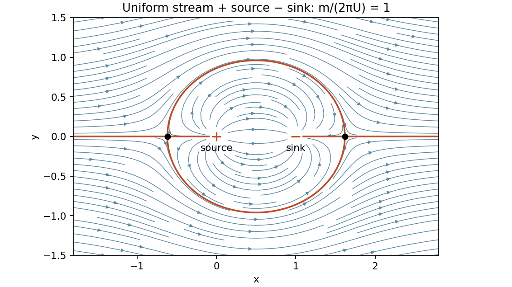

<h1 id="k/1/solution">Solution</h1>

↑ **Parent:** [1](../1.md)

For incompressible planar flow define the [streamfunction](../../../../stream-function.md) by $u=\psi_y$, $v=-\psi_x$. A [velocity potential](../../../../velocity-potential.md) satisfies $u=\phi_x$, $v=\phi_y$ when the flow is irrotational; the differential condition is $v_x-u_y=0$. The [complex potential of a two-dimensional potential flow](../../../../complex-potential-of-a-two-dimensional-potential-flow.md) is $w=\phi+i\psi$, with derivative $w'=u-iv$.

For $w=m\log(z-z_0)/(2\pi)$, its derivative is $m/[2\pi(z-z_0)]$. This gives outward radial velocity $m/(2\pi r)$, whose flux across a circle is $2\pi r\cdot m/(2\pi r)=m$. It is therefore the stated line source.

Superposition gives

$$
w(z)=Uz+\frac m{2\pi}[\log z-\log(z-1)],\qquad
w'(z)=U-\frac m{2\pi z(z-1)}.
$$

For positive $U,m$, the stagnation points are

$$
\boxed{z_\pm=\frac{1\pm\sqrt{1+2m/(\pi U)}}2.}
$$

They lie on the real axis, one upstream of the source and the other downstream of the sink. Streamlines are level sets of $\psi=Uy+(m/2\pi)[\arg z-\arg(z-1)]$. The dividing [streamline](../../../../streamline.md) passes through both stagnation points and forms a [Rankine oval](../../../../rankine-oval.md) enclosing the source and sink; outside, streamlines tend to uniform horizontal flow.

**[Figure 1](#k/1/image-a-representative-source-sink-pair-in-a-uniform-stream-with-two-stagnation-points-and-a-dividing-rankine-oval). A representative source-sink pair in a uniform stream, with two stagnation points and a dividing Rankine oval**.

## ↑ Ancestors (12)

1. [1](../1.md)
2. [K](../../k.md)
3. [2009](../../../2009-split.md)
4. [Past exam of the probability, statistics and options I course of the University of Oxford](../../../split.md)
5. [Probability, statistics and options I course of the University of Oxford](../../../../probability-statistics-and-options-i-course-of-the-university-of-oxford.md)
6. [Year 2 of the mathematics and statistics course of the University of Oxford](../../../../year-2-of-the-mathematics-and-statistics-course-of-the-university-of-oxford.md)
7. [Mathematics and statistics course of the University of Oxford](../../../../mathematics-and-statistics-course-of-the-university-of-oxford.md)
8. [Undergraduate course of the University of Oxford](../../../../undergraduate-course-of-the-university-of-oxford.md)
9. [Course of the University of Oxford](../../../../course-of-the-university-of-oxford.md)
10. [University of Oxford](../../../../university-of-oxford-split.md)
11. [List of universities](../../../../list-of-universities.md)
12. [Codex Wiki](../../../../split.md)
