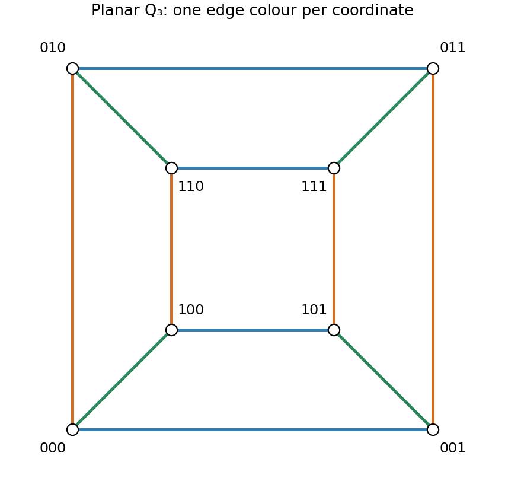

<h1 id="r/1/i/solution">Solution</h1>

↑ **Parent:** [I](../i.md)

Label the outer square $000,001,011,010$ in cyclic order and the inner square $100,101,111,110$ in corresponding order. Join corresponding vertices radially. Each edge changes exactly one bit, so this gives every edge of $Q_3$, with no crossings.

**[Figure 2](#r/1/i/image-a-labelled-planar-cube-with-edge-colours-determined-by-the-coordinate-that-changes). A labelled planar cube with edge colours determined by the coordinate that changes**.

## ↑ Ancestors (13)

1. [I](../i.md)
2. [1](../../1.md)
3. [R](../../../r.md)
4. [2009](../../../../2009-split.md)
5. [Past exam of the probability, statistics and options I course of the University of Oxford](../../../../split.md)
6. [Probability, statistics and options I course of the University of Oxford](../../../../../probability-statistics-and-options-i-course-of-the-university-of-oxford.md)
7. [Year 2 of the mathematics and statistics course of the University of Oxford](../../../../../year-2-of-the-mathematics-and-statistics-course-of-the-university-of-oxford.md)
8. [Mathematics and statistics course of the University of Oxford](../../../../../mathematics-and-statistics-course-of-the-university-of-oxford.md)
9. [Undergraduate course of the University of Oxford](../../../../../undergraduate-course-of-the-university-of-oxford.md)
10. [Course of the University of Oxford](../../../../../course-of-the-university-of-oxford.md)
11. [University of Oxford](../../../../../university-of-oxford-split.md)
12. [List of universities](../../../../../list-of-universities.md)
13. [Codex Wiki](../../../../../split.md)
