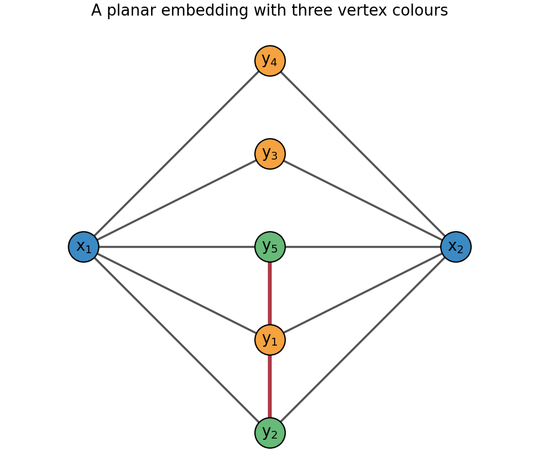

# 2010

↑ **Parent:** [Past exam of the probability, statistics and options I course of the University of Oxford](../past-exam-of-the-probability-statistics-and-options-i-course-of-the-university-of-oxford.md)

Source: [released examination bundle](https://www.whatdotheyknow.com/request/maths_past_papers_3), `Part A 2007 11-1.pdf`, pages 228–240. The printed title is Probability, Statistics and Options I, for mathematics and statistics. Every question in every printed section is covered. No mark allocations are printed.

**Table of contents**

- [A](#a)
  - [1](#a/1)
    - [1](#a/1/1)
      - [Solution](#a/1/1/solution)
    - [2](#a/1/2)
      - [Solution](#a/1/2/solution)
    - [3](#a/1/3)
      - [Solution](#a/1/3/solution)
- [B](#b)
  - [1](#b/1)
    - [Solution](#b/1/solution)
- [C](#c)
  - [1](#c/1)
    - [i](#c/1/i)
      - [Solution](#c/1/i/solution)
    - [ii](#c/1/ii)
      - [Solution](#c/1/ii/solution)
    - [iii](#c/1/iii)
      - [Solution](#c/1/iii/solution)
    - [iv](#c/1/iv)
      - [Solution](#c/1/iv/solution)
- [D](#d)
  - [1](#d/1)
    - [1](#d/1/1)
      - [Solution](#d/1/1/solution)
    - [2](#d/1/2)
      - [Solution](#d/1/2/solution)
    - [3](#d/1/3)
      - [Solution](#d/1/3/solution)
    - [4](#d/1/4)
      - [Solution](#d/1/4/solution)
  - [2](#d/2)
    - [1](#d/2/1)
      - [Solution](#d/2/1/solution)
    - [2](#d/2/2)
      - [Solution](#d/2/2/solution)
- [E](#e)
  - [1](#e/1)
    - [a](#e/1/a)
      - [i](#e/1/a/i)
        - [Solution](#e/1/a/i/solution)
      - [ii](#e/1/a/ii)
        - [Solution](#e/1/a/ii/solution)
      - [iii](#e/1/a/iii)
        - [Solution](#e/1/a/iii/solution)
    - [b](#e/1/b)
      - [i](#e/1/b/i)
        - [Solution](#e/1/b/i/solution)
      - [ii](#e/1/b/ii)
        - [Solution](#e/1/b/ii/solution)
      - [iii](#e/1/b/iii)
        - [Solution](#e/1/b/iii/solution)
  - [2](#e/2)
    - [a](#e/2/a)
      - [i](#e/2/a/i)
        - [Solution](#e/2/a/i/solution)
      - [ii](#e/2/a/ii)
        - [Solution](#e/2/a/ii/solution)
      - [iii](#e/2/a/iii)
        - [Solution](#e/2/a/iii/solution)
    - [b](#e/2/b)
      - [i](#e/2/b/i)
        - [Solution](#e/2/b/i/solution)
      - [ii](#e/2/b/ii)
        - [Solution](#e/2/b/ii/solution)
      - [iii](#e/2/b/iii)
        - [Solution](#e/2/b/iii/solution)
- [F](#f)
  - [1](#f/1)
    - [a](#f/1/a)
      - [Solution](#f/1/a/solution)
    - [b](#f/1/b)
      - [Solution](#f/1/b/solution)
- [G](#g)
  - [1](#g/1)
    - [Solution](#g/1/solution)
- [H](#h)
  - [1](#h/1)
    - [Solution](#h/1/solution)
- [J](#j)
  - [1](#j/1)
    - [Solution](#j/1/solution)
- [K](#k)
  - [1](#k/1)
    - [Solution](#k/1/solution)
  - [2](#k/2)
    - [Solution](#k/2/solution)
- [M](#m)
  - [1](#m/1)
    - [a](#m/1/a)
      - [Solution](#m/1/a/solution)
    - [b](#m/1/b)
      - [i](#m/1/b/i)
        - [Solution](#m/1/b/i/solution)
      - [ii](#m/1/b/ii)
        - [Solution](#m/1/b/ii/solution)
      - [iii](#m/1/b/iii)
        - [Solution](#m/1/b/iii/solution)
      - [iv](#m/1/b/iv)
        - [Solution](#m/1/b/iv/solution)
    - [c](#m/1/c)
      - [Solution](#m/1/c/solution)
  - [2](#m/2)
    - [a](#m/2/a)
      - [Solution](#m/2/a/solution)
    - [b](#m/2/b)
      - [Solution](#m/2/b/solution)
    - [c](#m/2/c)
      - [i](#m/2/c/i)
        - [Solution](#m/2/c/i/solution)
      - [ii](#m/2/c/ii)
        - [Solution](#m/2/c/ii/solution)
      - [iii](#m/2/c/iii)
        - [Solution](#m/2/c/iii/solution)
  - [3](#m/3)
    - [a](#m/3/a)
      - [Solution](#m/3/a/solution)
    - [b](#m/3/b)
      - [Solution](#m/3/b/solution)
    - [c](#m/3/c)
      - [Solution](#m/3/c/solution)
    - [d](#m/3/d)
      - [Solution](#m/3/d/solution)
- [O](#o)
  - [1](#o/1)
    - [a](#o/1/a)
      - [Solution](#o/1/a/solution)
    - [b](#o/1/b)
      - [Solution](#o/1/b/solution)
  - [2](#o/2)
    - [a](#o/2/a)
      - [Solution](#o/2/a/solution)
    - [b](#o/2/b)
      - [i](#o/2/b/i)
        - [Solution](#o/2/b/i/solution)
      - [ii](#o/2/b/ii)
        - [Solution](#o/2/b/ii/solution)
      - [iii](#o/2/b/iii)
        - [Solution](#o/2/b/iii/solution)
  - [3](#o/3)
    - [a](#o/3/a)
      - [Solution](#o/3/a/solution)
    - [b](#o/3/b)
      - [Solution](#o/3/b/solution)
    - [c](#o/3/c)
      - [Solution](#o/3/c/solution)
- [P](#p)
  - [1](#p/1)
    - [Solution](#p/1/solution)
  - [2](#p/2)
    - [Solution](#p/2/solution)
- [R](#r)
  - [1](#r/1)
    - [i](#r/1/i)
      - [Solution](#r/1/i/solution)
    - [ii](#r/1/ii)
      - [a](#r/1/ii/a)
        - [Solution](#r/1/ii/a/solution)
      - [b](#r/1/ii/b)
        - [Solution](#r/1/ii/b/solution)
      - [c](#r/1/ii/c)
        - [Solution](#r/1/ii/c/solution)
- [S](#s)
  - [1](#s/1)
    - [a](#s/1/a)
      - [Solution](#s/1/a/solution)
    - [b](#s/1/b)
      - [Solution](#s/1/b/solution)
- [T](#t)
  - [1](#t/1)
    - [a](#t/1/a)
      - [Solution](#t/1/a/solution)
    - [b](#t/1/b)
      - [Solution](#t/1/b/solution)
    - [c](#t/1/c)
      - [Solution](#t/1/c/solution)
    - [d](#t/1/d)
      - [Solution](#t/1/d/solution)
- [U](#u)
  - [1](#u/1)
    - [a](#u/1/a)
      - [Solution](#u/1/a/solution)
    - [b](#u/1/b)
      - [Solution](#u/1/b/solution)
    - [c](#u/1/c)
      - [Solution](#u/1/c/solution)

## A

↑ **Parent:** [2010](2010.md)

<h3 id="a/1">1</h3>

↑ **Parent:** [A](#a)

<h4 id="a/1/1">1</h4>

↑ **Parent:** [1](#a/1)

<h5 id="a/1/1/solution">Solution</h5>

↑ **Parent:** [1](#a/1/1)

In [field characteristic](../algebra.md#characteristic-of-a-field) $p$, the intermediate binomial coefficients in the $p$th power vanish. Hence

$$
(\alpha+1)^p-(\alpha+1)-a=\alpha^p+1-\alpha-1-a=0.
$$

Repeated translation gives all $p$ roots $\alpha+j$, $j\in\mathbb F_p$. They are distinct because the prime [field](../algebra.md#field) embeds in $F$. They exhaust the roots by [degree](../polynomial.md#degree-of-a-polynomial); also the formal derivative of $X^p-X-a$ is $-1$, so this is a [separable polynomial](../galois-theory.md#separable-polynomial). If one [root](../semisimple-lie-algebra.md#root-of-a-root-system) belongs to $F$, they all do, and

$$
\boxed{X^p-X-a=\prod_{j\in\mathbb F_p}(X-\alpha-j).}
$$

This is the [root](../semisimple-lie-algebra.md#root-of-a-root-system)-translation property of an [Artin–Schreier polynomial](../galois-theory.md#artin-schreier-polynomial).

<h4 id="a/1/2">2</h4>

↑ **Parent:** [1](#a/1)

<h5 id="a/1/2/solution">Solution</h5>

↑ **Parent:** [2](#a/1/2)

The intended hypothesis must be a proper monic factor, with $1\leq r\leq p-1$. Without that restriction the printed deduction is false: every [polynomial](../polynomial.md) has the displayed trivial factorization with $r=p$, even when it has no [root](../semisimple-lie-algebra.md#root-of-a-root-system) in $F$.

By part 1, the roots in a [splitting field](../galois-theory.md#splitting-field) are distinct and have the form $\alpha+j$. The [degree](../polynomial.md#degree-of-a-polynomial)-$r$ monic factor is the product of $r$ corresponding linear factors. Comparing the coefficient of $X^{r-1}$ using [Vieta's formulas](../polynomial.md#vieta-s-formulas) gives

$$
-a_1=\sum_{j\in J}(\alpha+j)=r\alpha+\sum_{j\in J}j,\qquad |J|=r.
$$

Both $a_1$ and the sum of prime-[field](../algebra.md#field) elements lie in $F$. Since $1\leq r<p$, the scalar $r$ is nonzero and invertible in $F$. Therefore $\alpha=(-a_1-\sum_{j\in J}j)/r\in F$, and part 1 proves **the [polynomial](../polynomial.md) splits into distinct linear factors over $F$**. In particular an [Artin–Schreier polynomial](../galois-theory.md#artin-schreier-polynomial) of prime [degree](../polynomial.md#degree-of-a-polynomial) is either [irreducible](../representation-theory.md#irreducible-representation) or splits completely.

<h4 id="a/1/3">3</h4>

↑ **Parent:** [1](#a/1)

<h5 id="a/1/3/solution">Solution</h5>

↑ **Parent:** [3](#a/1/3)

Reduce the monic integer [polynomial](../polynomial.md) modulo $p$. Every $u\in\mathbb F_p$ satisfies $u^p=u$, so $u^p-u-1=-1\ne0$. Thus the reduction has no [root](../semisimple-lie-algebra.md#root-of-a-root-system) in $\mathbb F_p$. If it had a proper factor, part 2 would force such a [root](../semisimple-lie-algebra.md#root-of-a-root-system), a contradiction. Hence it is [irreducible](../representation-theory.md#irreducible-representation) over $\mathbb F_p$.

The criterion of [irreducibility by degree-preserving reduction modulo a prime](../polynomial.md#irreducibility-by-degree-preserving-reduction-modulo-a-prime), which follows from [Gauss's lemma](../riemannian-geometry.md#gauss-s-lemma-riemannian-geometry), now applies because the [polynomial](../polynomial.md) is monic and its [degree](../polynomial.md#degree-of-a-polynomial) is preserved on reduction. Consequently **$X^p-X-1$ is [irreducible](../representation-theory.md#irreducible-representation) in $\mathbb Q[X]$**.

## B

↑ **Parent:** [2010](2010.md)

<h3 id="b/1">1</h3>

↑ **Parent:** [B](#b)

<h4 id="b/1/solution">Solution</h4>

↑ **Parent:** [1](#b/1)

The [Burnside lemma](../representation-theory.md#burnside-s-lemma) states that the number of [orbits](../dynamical-systems.md#orbit-dynamical-system) of a finite [group action](../group-action.md) is

$$
|G|^{-1}\sum_{g\in G}|\operatorname{Fix}(g)|.
$$

For $m=2n-1\geq3$, the [dihedral group](../finite-group-theory.md#dihedral-group) consists of $m$ rotations $r^j$ by $2\pi j/m$, and $m$ reflections $r^js$, each across the line through one vertex and the midpoint of the opposite edge. Thus $|G|=2m=4n-2$.

For the pentagon, the identity fixes $v^5e^5$ colourings. Each of the four nonidentity rotations has a single cycle on [vertices](../graph.md#vertex-graph-theory) and a single cycle on [edges](../graph-theory.md#edge-of-a-graph), fixing $ve$ colourings. Each of the five reflections has one fixed vertex and two vertex pairs, and one fixed edge and two edge pairs, fixing $v^3e^3$ colourings. Applying the [Burnside lemma](../representation-theory.md#burnside-s-lemma) to simultaneous vertex and edge colourings gives

$$
\boxed{\frac{v^5e^5+4ve+5v^3e^3}{10}.}
$$

Vertex colours and edge colours may be chosen independently; each symmetry must preserve both assignments.

## C

↑ **Parent:** [2010](2010.md)

<h3 id="c/1">1</h3>

↑ **Parent:** [C](#c)

<h4 id="c/1/i">i</h4>

↑ **Parent:** [1](#c/1)

<h5 id="c/1/i/solution">Solution</h5>

↑ **Parent:** [I](#c/1/i)

The [Legendre symbol](../quadratic-residue.md#legendre-symbol) is

$$
\boxed{\left(\frac ap\right)=\begin{cases}0,&p\mid a,\\1,&a\text{ is a nonzero square modulo }p,\\-1,&a\text{ is not a square modulo }p.\end{cases}}
$$

It depends only on the residue class of $a$ modulo the odd prime $p$.

<h4 id="c/1/ii">ii</h4>

↑ **Parent:** [1](#c/1)

<h5 id="c/1/ii/solution">Solution</h5>

↑ **Parent:** [Ii](#c/1/ii)

[Euler's criterion](../quadratic-residue.md#euler-s-criterion) states

$$
\boxed{a^{(p-1)/2}\equiv\left(\frac ap\right)\pmod p.}
$$

For $p\nmid a$, the sign is $+1$ precisely for a quadratic residue and $-1$ for a quadratic nonresidue. For $p\mid a$, both sides are zero.

<h4 id="c/1/iii">iii</h4>

↑ **Parent:** [1](#c/1)

<h5 id="c/1/iii/solution">Solution</h5>

↑ **Parent:** [Iii](#c/1/iii)

Write $s=(a/p)$. If $p\mid a$, both sides of the proposed identity are zero. Otherwise $s=\pm1$. The [multiplicativity of the Legendre symbol](../quadratic-residue.md#multiplicativity-of-the-legendre-symbol) and [Euler's criterion](../quadratic-residue.md#euler-s-criterion) give

$$
\left(\frac{sa}p\right)=\left(\frac sp\right)\left(\frac ap\right)
=s^{(p-1)/2}s=\boxed{s^{(p+1)/2}.}
$$

For the middle equality, Euler's congruence determines the sign exactly, since both the symbol and $s^{(p-1)/2}$ are in $\{1,-1\}$ and $p$ is odd.

<h4 id="c/1/iv">iv</h4>

↑ **Parent:** [1](#c/1)

<h5 id="c/1/iv/solution">Solution</h5>

↑ **Parent:** [Iv](#c/1/iv)

Again $s=(a/p)\in\{1,-1\}$. By [Euler's criterion](../quadratic-residue.md#euler-s-criterion), $(s/p)=s^{(p-1)/2}$. If $p\equiv1\pmod4$, the exponent is even and the answer is one. If $p\equiv3\pmod4$, it is odd and the answer is $s$. Hence

$$
\boxed{\left(\frac{(a/p)}p\right)=\begin{cases}1,&p\equiv1\pmod4,\\(a/p),&p\equiv3\pmod4.\end{cases}}
$$

## D

↑ **Parent:** [2010](2010.md)

<h3 id="d/1">1</h3>

↑ **Parent:** [D](#d)

<h4 id="d/1/1">1</h4>

↑ **Parent:** [1](#d/1)

<h5 id="d/1/1/solution">Solution</h5>

↑ **Parent:** [1](#d/1/1)

Use the countable identity

$$
f^{-1}((b,\infty))=\bigcup_{n\geq1}f^{-1}([b+1/n,\infty)).
$$

If $f(x)>b$, some $n$ has $1/n\leq f(x)-b$, proving the nontrivial inclusion. Each preimage on the right is measurable by [statistical hypothesis](../statistical-hypothesis-test.md#statistical-hypothesis), so closure of a [sigma-algebra](../measure-theory.md#sigma-algebra) under countable unions proves **the strict-superlevel preimage is measurable**.

<h4 id="d/1/2">2</h4>

↑ **Parent:** [1](#d/1)

<h5 id="d/1/2/solution">Solution</h5>

↑ **Parent:** [2](#d/1/2)

For each real $a$,

$$
\{x:-g(x)\geq a\}=\{x:g(x)\leq-a\}
=E\setminus\{x:g(x)>-a\}.
$$

The final strict-superlevel set is measurable by part 1 and the given criterion for [measurable functions](../measure-theory.md#measurable-function). A complement relative to the measurable domain is measurable, so **$-g$ is measurable**.

<h4 id="d/1/3">3</h4>

↑ **Parent:** [1](#d/1)

<h5 id="d/1/3/solution">Solution</h5>

↑ **Parent:** [3](#d/1/3)

If $f$ is measurable, then for $a\leq0$, $\{f^+\geq a\}=E$, and for $a>0$, $\{f^+\geq a\}=\{f\geq a\}$. Thus the given superlevel criterion proves $f^+$ measurable. Part 2 makes $-f$ measurable, and the same argument applied to $(-f)^+$ proves $f^-$ measurable.

Conversely $f=f^+-f^-$. If both parts are measurable, part 2 and the permitted closure under addition prove $f$ measurable. Therefore **$f$ is measurable exactly when its positive and negative parts are measurable**.

<h4 id="d/1/4">4</h4>

↑ **Parent:** [1](#d/1)

<h5 id="d/1/4/solution">Solution</h5>

↑ **Parent:** [4](#d/1/4)

Since $|f|=f^++f^-$, the previous part and closure under addition prove measurability of the [absolute value](../real-analysis.md#absolute-value).

The converse fails. Choose a nonmeasurable subset $N$ of $[0,1]$ and define $f=1$ on $N$, $f=-1$ on its complement. Then $|f|\equiv1$ is measurable, whereas $f^{-1}([0,\infty))=N$ is not. Thus **measurability of $|f|$ does not imply measurability of $f$**.

<h3 id="d/2">2</h3>

↑ **Parent:** [D](#d)

<h4 id="d/2/1">1</h4>

↑ **Parent:** [2](#d/2)

<h5 id="d/2/1/solution">Solution</h5>

↑ **Parent:** [1](#d/2/1)

On $(0,1)$, $|g(x)|\leq1$, so $\int_0^1|g|\leq1$. For the second function,

$$
\int_0^1h(x)dx=\int_0^1\frac{dx}{\sqrt{1-x^2}}=\frac\pi2<\infty.
$$

Both functions are measurable, and therefore **both restrictions are Lebesgue integrable**. The oscillation of $g$ near zero does not affect absolute integrability on this finite interval.

<h4 id="d/2/2">2</h4>

↑ **Parent:** [2](#d/2)

<h5 id="d/2/2/solution">Solution</h5>

↑ **Parent:** [2](#d/2/2)

For $x\geq1$, the bound $|\sin u|\leq|u|$ gives $|g(x)|\leq x^{-3/2}$, whose tail integral is finite. Thus **$g\mathbf1_{[1,\infty)}$ is integrable**.

Near one, $h(x)=[(x-1)(x+1)]^{-1/2}$ has an integrable inverse-square-[root](../semisimple-lie-algebra.md#root-of-a-root-system) singularity. At infinity, however, $h(x)\geq1/x$ for $x>1$, and the harmonic tail diverges. Thus **$h\mathbf1_{[1,\infty)}$ is not integrable**. Assigning $h(1)=0$ changes neither conclusion, since one point has [Lebesgue measure](../measure-theory.md#lebesgue-measure) zero.

## E

↑ **Parent:** [2010](2010.md)

<h3 id="e/1">1</h3>

↑ **Parent:** [E](#e)

<h4 id="e/1/a">a</h4>

↑ **Parent:** [1](#e/1)

<h5 id="e/1/a/i">i</h5>

↑ **Parent:** [A](#e/1/a)

<h6 id="e/1/a/i/solution">Solution</h6>

↑ **Parent:** [I](#e/1/a/i)

A [topology](../topology.md) $\mathcal T$ on $X$ contains $\varnothing$ and $X$, is closed under arbitrary unions, and is closed under finite intersections. Its members are the [open sets](../topology.md#open-set). A subset $F\subseteq X$ is [closed](../topology.md#closed-set) precisely when $X\setminus F$ is open.

<h5 id="e/1/a/ii">ii</h5>

↑ **Parent:** [A](#e/1/a)

<h6 id="e/1/a/ii/solution">Solution</h6>

↑ **Parent:** [Ii](#e/1/a/ii)

The [subspace topology](../topology.md#subspace-topology) on $Y$ is

$$
\mathcal T_Y=\{Y\cap U:U\in\mathcal T\}.
$$

If $Y$ is open in $X$, each such intersection is open in $X$. Conversely, an open subset of $X$ contained in $Y$ is its own intersection with $Y$. Thus **the open sets of $Y$ are exactly the open subsets of $X$ contained in $Y$** in this case.

<h5 id="e/1/a/iii">iii</h5>

↑ **Parent:** [A](#e/1/a)

<h6 id="e/1/a/iii/solution">Solution</h6>

↑ **Parent:** [Iii](#e/1/a/iii)

The [closure](../topology.md#closure-topology) $\overline A$ is the intersection of all closed subsets of $X$ containing $A$. It is the smallest such closed subset. Equivalently, $x\in\overline A$ exactly when every [open neighborhood](../topology.md#open-neighbourhood) of $x$ meets $A$.

<h4 id="e/1/b">b</h4>

↑ **Parent:** [1](#e/1)

<h5 id="e/1/b/i">i</h5>

↑ **Parent:** [B](#e/1/b)

<h6 id="e/1/b/i/solution">Solution</h6>

↑ **Parent:** [I](#e/1/b/i)

We prove (i)$\Rightarrow$(ii). If $B=U\cap F$ with $U$ open and $F$ closed, then $\overline B\subseteq F$. Hence

$$
B\subseteq U\cap\overline B\subseteq U\cap F=B,
$$

so $B=U\cap\overline B$. By the [subspace topology](../topology.md#subspace-topology) definition this makes **$B$ open in its closure**.

<h5 id="e/1/b/ii">ii</h5>

↑ **Parent:** [B](#e/1/b)

<h6 id="e/1/b/ii/solution">Solution</h6>

↑ **Parent:** [Ii](#e/1/b/ii)

We prove (ii)$\Rightarrow$(iii). If $B$ is open in $\overline B$, its complement $\overline B\setminus B$ is closed in the subspace $\overline B$. A relatively closed subset of a closed subset of $X$ is closed in $X$: it is the intersection of that closed subset with another closed subset of $X$. Since a [closure](../topology.md#closure-topology) is closed, **$\overline B\setminus B$ is closed in $X$**.

<h5 id="e/1/b/iii">iii</h5>

↑ **Parent:** [B](#e/1/b)

<h6 id="e/1/b/iii/solution">Solution</h6>

↑ **Parent:** [Iii](#e/1/b/iii)

We prove (iii)$\Rightarrow$(i). If $C=\overline B\setminus B$ is closed in $X$, set $U=X\setminus C$ and $F=\overline B$. Then $U$ is open, $F$ is closed, and

$$
\boxed{U\cap F=(X\setminus(\overline B\setminus B))\cap\overline B=B.}
$$

Together the three implications prove the equivalence. These are the standard characterizations of a [locally closed subset](../topology.md#locally-closed-subset).

<h3 id="e/2">2</h3>

↑ **Parent:** [E](#e)

<h4 id="e/2/a">a</h4>

↑ **Parent:** [2](#e/2)

<h5 id="e/2/a/i">i</h5>

↑ **Parent:** [A](#e/2/a)

<h6 id="e/2/a/i/solution">Solution</h6>

↑ **Parent:** [I](#e/2/a/i)

A [Hausdorff space](../topology.md#hausdorff-space) is one in which any distinct points $x,y$ have disjoint open neighborhoods: there exist open sets $U,V$ with $x\in U$, $y\in V$ and $U\cap V=\varnothing$.

<h5 id="e/2/a/ii">ii</h5>

↑ **Parent:** [A](#e/2/a)

<h6 id="e/2/a/ii/solution">Solution</h6>

↑ **Parent:** [Ii](#e/2/a/ii)

A map $f:X\to Y$ is [continuous](../calculus.md#continuous-function) if the inverse image of every open subset of $Y$ is open in $X$:

$$
V\in\mathcal T_Y\quad\Longrightarrow\quad f^{-1}(V)\in\mathcal T_X.
$$

<h5 id="e/2/a/iii">iii</h5>

↑ **Parent:** [A](#e/2/a)

<h6 id="e/2/a/iii/solution">Solution</h6>

↑ **Parent:** [Iii](#e/2/a/iii)

For the natural projection $p:X\to X/R$, the [quotient topology](../topology.md#quotient-topology) declares $U\subseteq X/R$ open exactly when $p^{-1}(U)$ is open in $X$. It is the finest topology on the quotient making $p$ continuous.

<h4 id="e/2/b">b</h4>

↑ **Parent:** [2](#e/2)

<h5 id="e/2/b/i">i</h5>

↑ **Parent:** [B](#e/2/b)

<h6 id="e/2/b/i/solution">Solution</h6>

↑ **Parent:** [I](#e/2/b/i)

Every map has $f(x)=f(x)$, so the relation is reflexive. Equality is symmetric, so $f(x)=f(y)$ for all the specified maps is equivalent to $f(y)=f(x)$; the relation is symmetric. If $x\mathcal Ry$ and $y\mathcal Rz$, every continuous map to every [Hausdorff space](../topology.md#hausdorff-space) has $f(x)=f(y)=f(z)$, proving $x\mathcal Rz$. Thus **$\mathcal R$ is an equivalence relation**.

<h5 id="e/2/b/ii">ii</h5>

↑ **Parent:** [B](#e/2/b)

<h6 id="e/2/b/ii/solution">Solution</h6>

↑ **Parent:** [Ii](#e/2/b/ii)

If $x\in A=g^{-1}(B)$ and $y\mathcal Rx$, the definition of the relation applies in particular to the fixed continuous map $g$ into the fixed Hausdorff space $Y$. It gives $g(y)=g(x)\in B$, hence $y\in A$. Thus $A$ is a union of whole equivalence classes, also called a [saturation of a subset](../topology.md#saturation-of-a-subset).

Always $A\subseteq p^{-1}(p(A))$. Conversely, a point in $p^{-1}(p(A))$ shares its class with some $x\in A$, and the preceding argument places it in $A$. Hence

$$
\boxed{p^{-1}(p(A))=A.}
$$

<h5 id="e/2/b/iii">iii</h5>

↑ **Parent:** [B](#e/2/b)

<h6 id="e/2/b/iii/solution">Solution</h6>

↑ **Parent:** [Iii](#e/2/b/iii)

Take distinct classes $p(x)\ne p(y)$. The failure of $x\mathcal Ry$ supplies a Hausdorff space $Y$ and a continuous map $g:X\to Y$ with $g(x)\ne g(y)$. Choose disjoint open neighborhoods $V,W$ of these two images. Their inverse images $A=g^{-1}(V)$ and $B=g^{-1}(W)$ are disjoint open subsets of $X$, and part (ii) says both are saturated.

The [quotient topology](../topology.md#quotient-topology) therefore makes $p(A)$ and $p(B)$ open, since their inverse images are precisely $A,B$. They are disjoint as well: an equivalence class meeting both would, by saturation, be contained in both. They contain $p(x)$ and $p(y)$ respectively. Thus **$X/\mathcal R$ is Hausdorff**. This construction is the [Hausdorff reflection by continuous maps](../topology.md#hausdorff-reflection-by-continuous-maps).

## F

↑ **Parent:** [2010](2010.md)

<h3 id="f/1">1</h3>

↑ **Parent:** [F](#f)

<h4 id="f/1/a">a</h4>

↑ **Parent:** [1](#f/1)

<h5 id="f/1/a/solution">Solution</h5>

↑ **Parent:** [A](#f/1/a)

The [inverse function theorem](../multivariable-calculus.md#inverse-function-theorem) says that a continuously differentiable map on an open set, with invertible derivative at a point, restricts to a $C^1$ diffeomorphism between neighborhoods of that point and its image. The inverse derivative is the inverse [matrix](../vector-space.md#matrix) of the original derivative at the corresponding preimage.

Put $s=1+x+y\ne0$. Differentiating each coordinate gives

$$
\boxed{Df(x,y)=s^{-2}\begin{pmatrix}1+y&-x\\-y&1+x\end{pmatrix},\qquad\det Df=s^{-3}.}
$$

The determinant never vanishes on $\Omega$, so the theorem applies at every point. The image point $(1/3,1/3)$ has preimage $(1,1)$: the equations $x/s=y/s=1/3$ imply $x=y=1$. Therefore

$$
\boxed{Df^{-1}(1/3,1/3)=\left[\frac19\begin{pmatrix}2&-1\\-1&2\end{pmatrix}\right]^{-1}
=\begin{pmatrix}6&3\\3&6\end{pmatrix}.}
$$

<h4 id="f/1/b">b</h4>

↑ **Parent:** [1](#f/1)

<h5 id="f/1/b/solution">Solution</h5>

↑ **Parent:** [B](#f/1/b)

For fixed $x,y$, the map $z\mapsto z^3+z+xy-1$ is strictly increasing because its derivative is $3z^2+1>0$, and it tends to opposite infinities at the two ends of the real line. The [intermediate value theorem](../calculus.md#intermediate-value-theorem) gives exactly one [root](../semisimple-lie-algebra.md#root-of-a-root-system), defining $g(x,y)$.

For $F(x,y,z)=z^3+z+xy-1$, $F_z=3z^2+1$ never vanishes. The [implicit function theorem](../multivariable-calculus.md#implicit-function-theorem) supplies a $C^1$ solution locally around every $(x,y)$. Uniqueness makes all these local functions agree on overlaps, proving $g\in C^1(\mathbb R^2)$. Implicit differentiation gives

$$
Dg(x,y)=-\frac{(y,x)}{3g(x,y)^2+1}.
$$

At $(1,1)$ the [root](../semisimple-lie-algebra.md#root-of-a-root-system) is zero, so **$Dg(1,1)=(-1,-1)$**.

## G

↑ **Parent:** [2010](2010.md)

<h3 id="g/1">1</h3>

↑ **Parent:** [G](#g)

<h4 id="g/1/solution">Solution</h4>

↑ **Parent:** [1](#g/1)

Independent endpoint-fixed variations of the two coordinates give the [Euler-Lagrange equations](../analysis.md#euler-lagrange-equation)

$$
\frac d{dt}F_{\dot u}-F_u=0,\qquad
\frac d{dt}F_{\dot v}-F_v=0.
$$

Differentiating the sphere parametrization gives the [Riemannian metric](../riemannian-metric.md) $ds^2=a^2(d\theta^2+\sin^2\theta\,d\phi^2)$. Its energy functional is the stated $I$. Its stationary paths are [geodesics](../riemannian-geometry.md#geodesic) with affine, constant-speed parametrization; conversely a geodesic can be so parametrized. This explains the use of energy rather than arc length.

For $F=a^2(\dot\theta^2+\sin^2\theta\dot\phi^2)/2$, the equations are

$$
\boxed{\ddot\theta-\sin\theta\cos\theta\,\dot\phi^2=0,\qquad
\frac d{dt}(\sin^2\theta\,\dot\phi)=0.}
$$

The second gives the conserved [generalized momentum](../lagrangian-mechanics.md#generalized-momentum) $\sin^2\theta\dot\phi=h$. Since $F$ has no explicit time dependence, its [Beltrami identity](../analysis.md#beltrami-identity) gives constant $\dot\theta F_{\dot\theta}+\dot\phi F_{\dot\phi}-F=F$. Dividing by $a^2/2$ gives the second first integral,

$$
\boxed{\dot\theta^2+\sin^2\theta\dot\phi^2=E.}
$$

Thus $E$ is the squared speed divided by $a^2$, while $h$ records the rotational symmetry about the polar axis. The coordinate equations apply away from the polar coordinate singularities.

## H

↑ **Parent:** [2010](2010.md)

<h3 id="h/1">1</h3>

↑ **Parent:** [H](#h)

<h4 id="h/1/solution">Solution</h4>

↑ **Parent:** [1](#h/1)

For [small oscillations](../lagrangian-mechanics.md#small-oscillation) about equilibrium, put $M_{ij}=T_{ij}(0)$ and $K_{ij}=\partial_i\partial_jV(0)$. The potential has no linear term at equilibrium; to quadratic order the [Lagrangian](../calculus-of-variations.md#lagrangian) is $L_2=\dot x^{\mathsf T}M\dot x/2-x^{\mathsf T}Kx/2$. Its equations are $M\ddot x+Kx=0$. A [normal mode](../wave-equation.md#normal-mode) $x=v e^{i\omega t}$ satisfies the generalized [eigenvalue problem](../linear-operator-theory.md#eigenvalue-problem) $(K-\omega^2M)v=0$. For a positive-definite mass [matrix](../vector-space.md#matrix), [diagonalization](../linear-operator-theory.md#diagonalization-of-a-matrix) $M^{-1/2}KM^{-1/2}$ gives the squared frequencies and independent normal coordinates. A strictly positive Hessian gives positive frequencies; zero [eigenvalues](../linear-operator-theory.md#eigenvalue) require separate higher-order stability analysis.

Here the spring extensions are $x_1$, $x_2-x_1$, and $-x_2$. Thus

$$
\boxed{T=\tfrac m2(\dot x_1^2+\dot x_2^2),\qquad
V=\tfrac k2[x_1^2+(x_2-x_1)^2+x_2^2].}
$$

The stiffness [matrix](../vector-space.md#matrix) is $k\left(\begin{smallmatrix}2&-1\\-1&2\end{smallmatrix}\right)$ and $M=mI$. Its eigenvectors $(1,1)$ and $(1,-1)$ have stiffness [eigenvalues](../linear-operator-theory.md#eigenvalue) $k$ and $3k$, giving

$$
\boxed{\omega_1=\sqrt{k/m},\quad v_1=(1,1);\qquad
\omega_2=\sqrt{3k/m},\quad v_2=(1,-1).}
$$

In the first mode the masses move together with equal displacements and the middle spring keeps its length. In the second they move oppositely with equal amplitudes, stretching and compressing the middle spring twice as much as either end spring.

## J

↑ **Parent:** [2010](2010.md)

<h3 id="j/1">1</h3>

↑ **Parent:** [J](#j)

<h4 id="j/1/solution">Solution</h4>

↑ **Parent:** [1](#j/1)

For a real potential, the [Time-dependent Schrödinger equation](../mathematical-physics.md#time-dependent-schrodinger-equation) is

$$
i\hbar\partial_t\psi=-\frac{\hbar^2}{2m}\nabla^2\psi+V\psi.
$$

Multiply this equation by $\psi^*$, multiply its conjugate by $\psi$, and subtract. The potential terms cancel and the product rule converts the remaining terms into a divergence. Consequently

$$
\boxed{\partial_t|\psi|^2+\nabla\cdot\mathbf j=0,\qquad
\mathbf j=\frac{\hbar}{2mi}(\psi^*\nabla\psi-\psi\nabla\psi^*)
=\frac\hbar m\operatorname{Im}(\psi^*\nabla\psi).}
$$

This is the [probability current](../wave-function.md#probability-current) and its [continuity equation](../mathematical-physics.md#continuity-equation).

Put $R(r)=\sin(kr)/r$. The supplied radial [Laplacian](../multivariable-calculus.md#laplacian) formula gives $\nabla^2R=-k^2R$ for $r>0$. Also $i\hbar\partial_t\psi=E\psi$. Therefore the free-particle equation is satisfied when

$$
\boxed{k=\sqrt{2mE}/\hbar.}
$$

The apparent singularity at zero is removable: $R(r)=k-k^3r^2/6+\cdots$ extends smoothly there and satisfies the same equation. Since $R$ is real and the time dependence is only a common phase, $\psi^*\nabla\psi=R\nabla R$ is real, so $\mathbf j=0$. The [density](../fluid-mechanics.md#density) $R^2$ is time-independent, proving the continuity equation explicitly. This is a standing spherical wave with zero net radial current.

## K

↑ **Parent:** [2010](2010.md)

<h3 id="k/1">1</h3>

↑ **Parent:** [K](#k)

<h4 id="k/1/solution">Solution</h4>

↑ **Parent:** [1](#k/1)

The momentum of a [material volume](../continuum-mechanics.md#material-volume) $V(t)$ is $\int_{V(t)}\rho\mathbf u\,dV$. [Newton's second law](../force.md#newton-s-second-law) equates its time derivative to the [pressure](../pressure.md) force and [gravity](../physics.md#gravity):

$$
\frac d{dt}\int_{V(t)}\rho\mathbf u\,dV
=-\int_{\partial V(t)}p\mathbf n\,dS+\int_{V(t)}\rho\mathbf g\,dV.
$$

Apply the given [Reynolds transport theorem](../continuum-mechanics.md#reynolds-transport-theorem) componentwise to the left side, and the [divergence theorem](../multivariable-calculus.md#divergence-theorem) to the [pressure](../pressure.md) term. Then

$$
\int_{V(t)}\left[\rho(\partial_t\mathbf u+(\mathbf u\cdot\nabla)\mathbf u)+\nabla p-\rho\mathbf g\right]dV=0.
$$

Since this holds for arbitrary material volumes and the fields are continuous, the integrand vanishes pointwise. Dividing by positive [density](../fluid-mechanics.md#density) gives the [Euler equations for an inviscid fluid](../euler-equations-for-an-inviscid-fluid.md)

$$
\boxed{\partial_t\mathbf u+(\mathbf u\cdot\nabla)\mathbf u=-\rho^{-1}\nabla p+\mathbf g.}
$$

At a fixed physical time $t_0$, a [streamline](../fluid-mechanics.md#streamline) is a curve tangent to $\mathbf u(\cdot,t_0)$, which may be parametrized by $d\mathbf x/ds=\mathbf u(\mathbf x(s),t_0)$. The [chain rule](../calculus.md#chain-rule) gives $d f(\mathbf x(s),t_0)/ds=\mathbf u\cdot\nabla f=0$, proving constancy along it. The time is held fixed; a time-dependent streamline statement does not by itself assert material conservation along particle trajectories.

<h3 id="k/2">2</h3>

↑ **Parent:** [K](#k)

<h4 id="k/2/solution">Solution</h4>

↑ **Parent:** [2](#k/2)

Seek nonzero [time-harmonic waves](../wave.md#time-harmonic-wave) of the form $\phi=\operatorname{Re}[F(y)e^{i(kx-\omega t)}]$ and $\eta=\operatorname{Re}[A e^{i(kx-\omega t)}]$, taking $k>0$. [Laplace's equation](../partial-differential-equation.md#laplace-equation) reduces to $F''-k^2F=0$. The impermeable-bed condition $F'(-h)=0$ gives $F(y)=C\cosh(k(y+h))$.

The linearized kinematic and dynamic [linearized free-surface boundary conditions](../fluid-mechanics.md#linearized-free-surface-boundary-conditions) at zero become

$$
Ck\sinh(kh)=-i\omega A,\qquad
-i\omega C\cosh(kh)+gA=0.
$$

Eliminating $A$ and the nonzero amplitude $C$ gives

$$
\boxed{\omega^2=gk\tanh(kh).}
$$

Conversely, if this [dispersion relation](../dispersion-relation.md) holds, either amplitude can be chosen nonzero and the other set by the second boundary equation, producing a wave satisfying every condition. The expression also holds for negative $k$ because $k\tanh(kh)$ is even.

## M

↑ **Parent:** [2010](2010.md)

<h3 id="m/1">1</h3>

↑ **Parent:** [M](#m)

<h4 id="m/1/a">a</h4>

↑ **Parent:** [1](#m/1)

<h5 id="m/1/a/solution">Solution</h5>

↑ **Parent:** [A](#m/1/a)

For an [exponential distribution](../continuous-probability-distribution.md#exponential-distribution) with rate $\lambda>0$, direct integration gives the [moment-generating function](../probability-distribution.md#moment-generating-function)

$$
M_X(t)=\int_0^\infty e^{tx}\lambda e^{-\lambda x}dx
=\boxed{\frac\lambda{\lambda-t},\quad t<\lambda.}
$$

It is finite in a neighborhood of zero, so its derivatives there give moments. Differentiating three times gives $M_X^{(3)}(t)=6\lambda/(\lambda-t)^4$, hence

$$
\boxed{\mathbb EX^3=M_X^{(3)}(0)=6/\lambda^3.}
$$

<h4 id="m/1/b">b</h4>

↑ **Parent:** [1](#m/1)

<h5 id="m/1/b/i">i</h5>

↑ **Parent:** [B](#m/1/b)

<h6 id="m/1/b/i/solution">Solution</h6>

↑ **Parent:** [I](#m/1/b/i)

Take **$Y=aX_1+b$**. From the definition of a [moment-generating function](../probability-distribution.md#moment-generating-function), $\mathbb Ee^{tY}=e^{bt}\mathbb Ee^{atX_1}=e^{bt}M_1(at)$, for $t$ where the expectation is finite.

<h5 id="m/1/b/ii">ii</h5>

↑ **Parent:** [B](#m/1/b)

<h6 id="m/1/b/ii/solution">Solution</h6>

↑ **Parent:** [Ii](#m/1/b/ii)

Take **$Y=X_1+X_2$**. Independence makes the joint exponential expectation factor:

$$
\mathbb Ee^{t(X_1+X_2)}=\mathbb E(e^{tX_1}e^{tX_2})=M_1(t)M_2(t).
$$

This is the product rule for the [moment-generating function](../probability-distribution.md#moment-generating-function) of an independent sum.

<h5 id="m/1/b/iii">iii</h5>

↑ **Parent:** [B](#m/1/b)

<h6 id="m/1/b/iii/solution">Solution</h6>

↑ **Parent:** [Iii](#m/1/b/iii)

Take **$Y=X_1+X_1'$**, where $X_1'$ is an independent copy of $X_1$. The preceding factorization gives $\mathbb Ee^{tY}=M_1(t)^2$. Using $2X_1$ would instead give $M_1(2t)$, so an independent copy is required.

<h5 id="m/1/b/iv">iv</h5>

↑ **Parent:** [B](#m/1/b)

<h6 id="m/1/b/iv/solution">Solution</h6>

↑ **Parent:** [Iv](#m/1/b/iv)

Take **$Y=UX_1$**, where $U$ is uniform on $(0,1)$ and independent of $X_1$. Conditioning on $U$ gives

$$
\mathbb Ee^{tUX_1}=\int_0^1\mathbb E(e^{tuX_1})du=\int_0^1M_1(ut)du.
$$

For $t$ near zero this is finite because the [moment-generating function](../probability-distribution.md#moment-generating-function) of $X_1$ is finite on a neighborhood of zero; [Tonelli's theorem](../measure-theory.md#tonelli-theorem) justifies the conditioning integral for the nonnegative exponential.

<h4 id="m/1/c">c</h4>

↑ **Parent:** [1](#m/1)

<h5 id="m/1/c/solution">Solution</h5>

↑ **Parent:** [C](#m/1/c)

Recognize the [mixture distribution](../probability-distribution.md#mixture-distribution)

$$
M_Y(t)=\tfrac12\frac1{1-t}+\tfrac12\frac2{2-t}.
$$

It is a half-and-half mixture of [exponential distributions](../continuous-probability-distribution.md#exponential-distribution) with rates one and two. Uniqueness of a [moment-generating function](../probability-distribution.md#moment-generating-function) finite near zero identifies the law. Therefore

$$
\boxed{\mathbb P(Y\leq1)=\tfrac12(1-e^{-1})+\tfrac12(1-e^{-2})
=1-\tfrac12(e^{-1}+e^{-2}).}
$$

<h3 id="m/2">2</h3>

↑ **Parent:** [M](#m)

<h4 id="m/2/a">a</h4>

↑ **Parent:** [2](#m/2)

<h5 id="m/2/a/solution">Solution</h5>

↑ **Parent:** [A](#m/2/a)

A [stationary distribution](../markov-chain.md#stationary-distribution) $\pi=(\pi_1,\pi_2)$ satisfies $\pi P=\pi$ and $\pi_1+\pi_2=1$. The first equation reduces to the balance relation $a\pi_1=b\pi_2$. Since $a,b>0$, normalization gives the unique solution

$$
\boxed{\pi=\left(\frac b{a+b},\frac a{a+b}\right).}
$$

<h4 id="m/2/b">b</h4>

↑ **Parent:** [2](#m/2)

<h5 id="m/2/b/solution">Solution</h5>

↑ **Parent:** [B](#m/2/b)

Condition on the full sampled history through time $n$. The [Markov property](../markov-chain.md#markov-property) of $X$ implies that its future after $2n$ depends on that history only through $X_{2n}=Y_n$. Summing over the intermediate state gives

$$
\mathbb P(Y_{n+1}=j\mid Y_0,\ldots,Y_n=i)
=\sum_kP_{ik}P_{kj}=(P^2)_{ij}.
$$

Thus **$Y$ is a Markov chain with transition [matrix](../vector-space.md#matrix) $P^2$**. This is a deterministic-time sampled [Markov chain](../markov-chain.md).

<h4 id="m/2/c">c</h4>

↑ **Parent:** [2](#m/2)

<h5 id="m/2/c/i">i</h5>

↑ **Parent:** [C](#m/2/c)

<h6 id="m/2/c/i/solution">Solution</h6>

↑ **Parent:** [I](#m/2/c/i)

The chain alternates between the classes $\{1,2\}$ and $\{3,4\}$. It is [irreducible](../representation-theory.md#irreducible-representation) and has period two, since no odd return is possible and each state has a positive two-step return [probability](../probability-theory.md#probability). Matrix multiplication gives

$$
\boxed{P^2=\begin{pmatrix}5/9&4/9&0&0\\4/9&5/9&0&0\\0&0&5/9&4/9\\0&0&4/9&5/9\end{pmatrix}.}
$$

The even-time sampled chain stays in its initial class and moves between its two states with [probability](../probability-theory.md#probability) $4/9$ at each sampled step.

<h5 id="m/2/c/ii">ii</h5>

↑ **Parent:** [C](#m/2/c)

<h6 id="m/2/c/ii/solution">Solution</h6>

↑ **Parent:** [Ii](#m/2/c/ii)

Starting at one, state two can first be reached only after an even number of steps. At every even time before that hit, the chain is again at one. By the [Markov property](../markov-chain.md#markov-property) and part (i), each successive two-step block hits two with [probability](../probability-theory.md#probability) $4/9$, while a failure returns to one with [probability](../probability-theory.md#probability) $5/9$. Therefore, for the first hitting time $H$,

$$
\boxed{\mathbb P(H=2k)=\left(\frac59\right)^{k-1}\frac49\quad(k\geq1),\qquad\mathbb P(H\text{ odd})=0.}
$$

Equivalently $H/2$ has the [geometric distribution](../discrete-probability-distribution.md#geometric-distribution) on the positive integers with success [probability](../probability-theory.md#probability) $4/9$.

<h5 id="m/2/c/iii">iii</h5>

↑ **Parent:** [C](#m/2/c)

<h6 id="m/2/c/iii/solution">Solution</h6>

↑ **Parent:** [Iii](#m/2/c/iii)

Within the class $\{1,2\}$, the two-step [matrix](../vector-space.md#matrix) has [eigenvalues](../linear-operator-theory.md#eigenvalue) one and $1/9$, with stationary distribution $(1/2,1/2)$. Diagonalizing this symmetric [matrix](../vector-space.md#matrix), or solving the recursion $p_{n+1}=4/9+p_n/9$ from $p_0=0$, gives

$$
\mathbb P(X_{2n}=2\mid X_0=1)=\frac12\left[1-\left(\frac19\right)^n\right].
$$

Consequently **the limit is $1/2$**. Restriction to even times is essential because the original chain has period two.

<h3 id="m/3">3</h3>

↑ **Parent:** [M](#m)

<h4 id="m/3/a">a</h4>

↑ **Parent:** [3](#m/3)

<h5 id="m/3/a/solution">Solution</h5>

↑ **Parent:** [A](#m/3/a)

The definition of [convergence in probability](../convergence-of-random-variables.md#convergence-in-probability) is

$$
\boxed{\text{for every }\varepsilon>0,\quad
\mathbb P(|Z_n-Z|>\varepsilon)\longrightarrow0\quad(n\to\infty).}
$$

The variables are defined on a common [probability](../probability-theory.md#probability) space so that these difference events make sense.

<h4 id="m/3/b">b</h4>

↑ **Parent:** [3](#m/3)

<h5 id="m/3/b/solution">Solution</h5>

↑ **Parent:** [B](#m/3/b)

Pointwise, $X\geq a\mathbf1_{\{X\geq a\}}$, since $X$ is nonnegative. Taking expectations and dividing by $a>0$ proves the [Markov inequality](../probability-inequality.md#markov-s-inequality)

$$
\boxed{\mathbb P(X\geq a)\leq\mathbb EX/a.}
$$

If the expectation is infinite, the inequality remains true in the extended-real sense.

<h4 id="m/3/c">c</h4>

↑ **Parent:** [3](#m/3)

<h5 id="m/3/c/solution">Solution</h5>

↑ **Parent:** [C](#m/3/c)

Let $\overline X_n=n^{-1}\sum_iX_i$ and write $\sigma^2=\operatorname{Var}(X_1)<\infty$. Independence gives $\mathbb E\overline X_n=\mu$ and $\operatorname{Var}(\overline X_n)=\sigma^2/n$. Apply part (b) to the nonnegative variable $(\overline X_n-\mu)^2$, which is the [Chebyshev inequality](../probability-inequality.md#chebyshev-s-inequality):

$$
\mathbb P(|\overline X_n-\mu|>\varepsilon)
\leq\frac{\sigma^2}{n\varepsilon^2}\longrightarrow0.
$$

Thus **$\overline X_n\to\mu$ in [probability](../probability-theory.md#probability)**, proving the finite-[variance](../variance.md) [weak law of large numbers](../convergence-of-random-variables.md#weak-law-of-large-numbers).

<h4 id="m/3/d">d</h4>

↑ **Parent:** [3](#m/3)

<h5 id="m/3/d/solution">Solution</h5>

↑ **Parent:** [D](#m/3/d)

Equality forces $\mathbb EX<\infty$ because its proposed value is at most $a$. The random variable $Y=X-a\mathbf1_{\{X\geq a\}}$ is nonnegative and has expectation zero, so $Y=0$ almost surely. On $\{X<a\}$ it equals the strictly positive variable $X$, making that event null. On $\{X\geq a\}$ it equals $X-a$, forcing $X=a$ there. Hence

$$
\boxed{\mathbb P(X=a)=1.}
$$

This is the [equality in Markov's inequality](../probability-inequality.md#equality-in-markov-s-inequality) under strict positivity. The reasoning even works without the discreteness assumption.

## O

↑ **Parent:** [2010](2010.md)

<h3 id="o/1">1</h3>

↑ **Parent:** [O](#o)

<h4 id="o/1/a">a</h4>

↑ **Parent:** [1](#o/1)

<h5 id="o/1/a/solution">Solution</h5>

↑ **Parent:** [A](#o/1/a)

Each before-and-after observation belongs to the same individual, so pairing removes individual baseline variation and allows dependence within a person's two readings. Under the stated independent normal model for the differences,

$$
\overline D\sim N(\mu,\sigma^2/n),\qquad
S_D^2=\frac1{n-1}\sum_{i=1}^n(D_i-\overline D)^2.
$$

The [independence of the normal sample mean and sample variance](../statistical-inference.md#independence-of-the-normal-sample-mean-and-sample-variance) theorem gives [independence](../random-variable.md#independent-random-variables) of $\overline D$ and $S_D^2$, and

$$
\boxed{c=\frac{n-1}{\sigma^2},\qquad cS_D^2\sim\chi^2_{n-1}.}
$$

Also $(\overline D-\mu)/(\sigma/\sqrt n)$ is standard normal. Dividing it by the square [root](../semisimple-lie-algebra.md#root-of-a-root-system) of the independent $\chi^2_{n-1}/(n-1)$ variable gives

$$
\boxed{Z=\frac{\overline D-\mu}{S_D/\sqrt n}\sim t_{n-1}.}
$$

Its law contains neither unknown parameter, providing the [pivotal quantity](../probability-and-statistics.md#pivotal-quantity) for a [paired t-test](../statistical-hypothesis-test.md#paired-t-test).

<h4 id="o/1/b">b</h4>

↑ **Parent:** [1](#o/1)

<h5 id="o/1/b/solution">Solution</h5>

↑ **Parent:** [B](#o/1/b)

Write $s_e=S_D/\sqrt{17}$. By symmetry of the $t_{16}$ distribution, $\mathbb P(Z>-1.746)=0.95$. Rearranging $Z=(\overline D-\mu)/s_e>-1.746$ gives $\mu<\overline D+1.746s_e$. Thus the interval printed in the question has endpoint

$$
\boxed{b=\overline D+1.746S_D/\sqrt{17}.}
$$

There is a direction mismatch in the question. Since $D_i=X_i-Y_i$ is before minus after, a reduction corresponds to $H_1:\mu>0$. The upper interval $(-\infty,b)$ excludes zero when $b<0$, which instead tests against a negative [mean](../expected-value.md) difference.

For the stated reduction alternative, use the lower 95% interval $(\overline D-1.746s_e,\infty)$. It excludes zero exactly when

$$
\boxed{\frac{\overline D}{S_D/\sqrt{17}}>1.746.}
$$

This is the level-$0.05$ one-sided [paired t-test](../statistical-hypothesis-test.md#paired-t-test) of $H_0:\mu=0$ against $H_1:\mu>0$. Both the requested upper endpoint and the correctly directed test are thus determined without silently reversing the difference convention.

<h3 id="o/2">2</h3>

↑ **Parent:** [O](#o)

<h4 id="o/2/a">a</h4>

↑ **Parent:** [2](#o/2)

<h5 id="o/2/a/solution">Solution</h5>

↑ **Parent:** [A](#o/2/a)

The full column rank makes $X^{\mathsf T}X$ invertible. The [least-squares normal equations](../linear-regression.md#normal-equations-for-linear-least-squares) from minimizing squared residuals give

$$
\boxed{\widehat\theta=(X^{\mathsf T}X)^{-1}X^{\mathsf T}Y.}
$$

The errors have [covariance matrix](../variance.md#covariance-matrix) $\sigma^2I_n$ by [independence](../random-variable.md#independent-random-variables) and equal [variance](../variance.md). Applying the [covariance](../variance.md#covariance) transformation rule to this linear estimator yields

$$
\operatorname{Var}(\widehat\theta)
=(X^{\mathsf T}X)^{-1}X^{\mathsf T}(\sigma^2I)X(X^{\mathsf T}X)^{-1}
=\boxed{\sigma^2(X^{\mathsf T}X)^{-1}.}
$$

The parameter estimator is unbiased because $\mathbb EY=X\theta$.

<h4 id="o/2/b">b</h4>

↑ **Parent:** [2](#o/2)

<h5 id="o/2/b/i">i</h5>

↑ **Parent:** [B](#o/2/b)

<h6 id="o/2/b/i/solution">Solution</h6>

↑ **Parent:** [I](#o/2/b/i)

Put $z_i=e^{-t_i}-c$. Assume the measurement errors are independent and centered, so $Y_i=\alpha+\beta z_i+\epsilon_i$ with independent $\epsilon_i\sim N(0,\sigma^2)$. Treat the observation times as fixed. The [design matrix](../linear-regression.md#design-matrix) has rows $(1,z_i)$ and parameter vector $(\alpha,\beta)^{\mathsf T}$. Require at least two distinct times so its columns are independent, equivalently $\sum_i z_i^2>0$. This gives the required Gaussian [linear regression model](../linear-regression.md#linear-regression-model).

<h5 id="o/2/b/ii">ii</h5>

↑ **Parent:** [B](#o/2/b)

<h6 id="o/2/b/ii/solution">Solution</h6>

↑ **Parent:** [Ii](#o/2/b/ii)

Centering gives $\sum_i z_i=0$, and hence

$$
X^{\mathsf T}X=\begin{pmatrix}n&0\\0&\sum_i z_i^2\end{pmatrix}.
$$

The least-squares [covariance](../variance.md#covariance) formula from part (a) therefore gives

$$
\boxed{\operatorname{Var}\begin{pmatrix}\widehat\alpha\\\widehat\beta\end{pmatrix}
=\sigma^2\begin{pmatrix}1/n&0\\0&1/\sum_i(e^{-t_i}-c)^2\end{pmatrix}.}
$$

Explicitly $\widehat\alpha=\overline Y$ and $\widehat\beta=\sum_i z_iY_i/\sum_i z_i^2$. Their zero [covariance](../variance.md#covariance) follows directly from the centered predictor, and their joint normality additionally makes them independent.

<h5 id="o/2/b/iii">iii</h5>

↑ **Parent:** [B](#o/2/b)

<h6 id="o/2/b/iii/solution">Solution</h6>

↑ **Parent:** [Iii](#o/2/b/iii)

With independent Gaussian errors, maximizing the [likelihood](../maximum-likelihood-estimation.md#likelihood-function) over $\alpha,\beta$ minimizes the residual sum of squares, so the [maximum-likelihood estimators](../maximum-likelihood-estimation.md#maximum-likelihood-estimator) are the same as least squares. The [invariance property of maximum likelihood estimation](../maximum-likelihood-estimation.md#invariance-property-of-maximum-likelihood-estimation) gives

$$
\widehat E_t=\widehat\alpha+(e^{-t}-c)\widehat\beta.
$$

The two estimates have zero [covariance](../variance.md#covariance) by part (ii). Therefore

$$
\boxed{\operatorname{Var}(\widehat E_t)=\sigma^2\left[\frac1n+
\frac{(e^{-t}-c)^2}{\sum_i(e^{-t_i}-c)^2}\right].}
$$

This is the uncertainty in the estimated expected response. Estimating an additional noisy observation would add its own error [variance](../variance.md), but the quantity requested is the [mean](../expected-value.md) response $E_t$.

<h3 id="o/3">3</h3>

↑ **Parent:** [O](#o)

<h4 id="o/3/a">a</h4>

↑ **Parent:** [3](#o/3)

<h5 id="o/3/a/solution">Solution</h5>

↑ **Parent:** [A](#o/3/a)

Under the [independence log-linear model for a two-way contingency table](../statistical-modelling.md#independence-log-linear-model-for-a-two-way-contingency-table), the six cell probabilities factor as

$$
H_0:\quad\theta_{ij}=r_i c_j,\qquad
\sum_{i=1}^2r_i=\sum_{j=1}^3c_j=1.
$$

The row distribution has one free parameter and the column distribution two, giving **three free parameters under $H_0$**. Under the unrestricted alternative, six cell probabilities sum to one, giving **five free parameters under $H_1$**. The difference is two, which is the degrees of freedom of the resulting chi-squared test.

<h4 id="o/3/b">b</h4>

↑ **Parent:** [3](#o/3)

<h5 id="o/3/b/solution">Solution</h5>

↑ **Parent:** [B](#o/3/b)

Let $N_{ij}$ be the observed cell counts, $N_{i+}$ the row totals, $N_{+j}$ the column totals and $N=33009$. The fitted [expected frequencies](../probability-and-statistics.md#expected-frequency) under [independence](../random-variable.md#independent-random-variables) are $E_{ij}=N_{i+}N_{+j}/N$. For example the three-child, one-boy cell has expected count $7541\cdot16472/33009=3763.1$.

The [Pearson chi-squared statistic](../generalized-linear-model.md#pearson-chi-squared-statistic) is

$$
\boxed{X^2=\sum_{i=1}^2\sum_{j=1}^3\frac{(N_{ij}-E_{ij})^2}{E_{ij}}.}
$$

Under $H_0$ it has asymptotically a [chi-squared distribution](../probability-distribution.md#chi-squared-distribution) with $(2-1)(3-1)=2$ degrees of freedom, assuming the multinomial sampling model and sufficiently large expected counts. All expected counts here are large. The distribution is an asymptotic approximation, rather than an exact finite-sample identity.

<h4 id="o/3/c">c</h4>

↑ **Parent:** [3](#o/3)

<h5 id="o/3/c/solution">Solution</h5>

↑ **Parent:** [C](#o/3/c)

The observed statistic $94.34$ exceeds the supplied $0.999$ quantile $13.82$ for two degrees of freedom. Thus **reject [independence](../random-variable.md#independent-random-variables), with $p<0.001$**.

For one child of each sex among the first two, the three-child count is $3393$, below its [independence](../random-variable.md#independent-random-variables) expectation $3763.1$. Equivalently, the two-child count is $13079$, above its expectation $16472-3763.1=12708.9$. These departures have exactly the direction predicted by the suggestion. Thus **the data support the proposed association**: mixed-sex first pairs are associated with a greater tendency to stop at two children.

## P

↑ **Parent:** [2010](2010.md)

<h3 id="p/1">1</h3>

↑ **Parent:** [P](#p)

<h4 id="p/1/solution">Solution</h4>

↑ **Parent:** [1](#p/1)

Eliminate the first column with multipliers $\ell_{21}=2$ and $\ell_{31}=-1$. The new second and third rows are $(0,2,4)$ and $(0,-1,3)$. The next multiplier is $\ell_{32}=-1/2$, giving final row $(0,0,5)$. Recording these multipliers gives the [LU decomposition](../numerical-linear-algebra.md#lu-decomposition)

$$
\boxed{L=\begin{pmatrix}1&0&0\\2&1&0\\-1&-1/2&1\end{pmatrix},\qquad
U=\begin{pmatrix}1&2&2\\0&2&4\\0&0&5\end{pmatrix},\qquad A=LU.}
$$

For an upper-triangular [matrix](../vector-space.md#matrix) with nonzero diagonal, the [back substitution](../linear-algebra.md#back-substitution) algorithm works from bottom to top:

$$
x_i=\frac{b_i-\sum_{j=i+1}^n u_{ij}x_j}{u_{ii}},\qquad i=n,n-1,\ldots,1.
$$

In the separate triangular system printed in the question, $5x_3=10$, $2x_2+4x_3=6$, and $x_1+2x_2+2x_3=3$. Hence

$$
\boxed{x=(1,-1,2)^{\mathsf T}.}
$$

<h3 id="p/2">2</h3>

↑ **Parent:** [P](#p)

<h4 id="p/2/solution">Solution</h4>

↑ **Parent:** [2](#p/2)

A [QR decomposition](../inner-product.md#qr-decomposition) is $A=QR$, with $Q$ orthogonal and $R$ upper triangular. Orthogonality gives $Q^{\mathsf T}Q=I$, and therefore $\|Qx\|^2=x^{\mathsf T}Q^{\mathsf T}Qx=x^{\mathsf T}x=\|x\|^2$, proving invariance of the [Euclidean norm](../normed-vector-space.md#euclidean-norm).

The unshifted [QR algorithm](../numerical-analysis.md#qr-algorithm) starts with $A_0=A$. At step $k$, factor $A_k=Q_kR_k$ and set $A_{k+1}=R_kQ_k$. Then

$$
\boxed{A_{k+1}=Q_k^{\mathsf T}A_kQ_k.}
$$

Thus consecutive matrices are related by [orthogonal similarity](../linear-algebra.md#orthogonal-similarity), so they have the same [characteristic polynomial](../linear-operator-theory.md#characteristic-polynomial) and [eigenvalues](../linear-operator-theory.md#eigenvalue). Induction proves every iterate has the original [eigenvalues](../linear-operator-theory.md#eigenvalue). Symmetry is also preserved. When the iteration converges to diagonal form, its diagonal entries are the [eigenvalues](../linear-operator-theory.md#eigenvalue); practical implementations use shifts and deflation to improve convergence.

## R

↑ **Parent:** [2010](2010.md)

<h3 id="r/1">1</h3>

↑ **Parent:** [R](#r)

<h4 id="r/1/i">i</h4>

↑ **Parent:** [1](#r/1)

<h5 id="r/1/i/solution">Solution</h5>

↑ **Parent:** [I](#r/1/i)

Count [facial boundary walks](../planar-graph.md#facial-boundary-walk) with each edge-side counted once. Their total length is $2m$. Every face walk has length at least four: simplicity excludes loops and parallel-edge two-cycles, absence of triangles excludes length three, and a length-two face walk consisting solely of a bridge traversed twice could be the whole boundary only for the excluded connected graph on two [vertices](../graph.md#vertex-graph-theory). Bridges may occur twice in a longer boundary walk and are still correctly counted. Thus $4f\leq2m$.

The [Euler formula for a connected planar graph](../planar-graph.md#euler-formula-for-a-connected-planar-graph) gives $2=n-m+f\leq n-m+m/2=n-m/2$. Rearranging yields

$$
\boxed{m\leq2n-4.}
$$

<h4 id="r/1/ii">ii</h4>

↑ **Parent:** [1](#r/1)

<h5 id="r/1/ii/a">a</h5>

↑ **Parent:** [Ii](#r/1/ii)

<h6 id="r/1/ii/a/solution">Solution</h6>

↑ **Parent:** [A](#r/1/ii/a)

The [complete bipartite graph](../bipartite-graph.md#complete-bipartite-graph) $K_{3,3}$ is connected, simple, and has no triangles because all its cycles have even length. It has $n=6$ [vertices](../graph.md#vertex-graph-theory) and $m=9$ [edges](../graph-theory.md#edge-of-a-graph). A planar drawing would require $9\leq2\cdot6-4=8$ by part (i), a contradiction. Therefore **$K_{3,3}$ is nonplanar**.

<h5 id="r/1/ii/b">b</h5>

↑ **Parent:** [Ii](#r/1/ii)

<h6 id="r/1/ii/b/solution">Solution</h6>

↑ **Parent:** [B](#r/1/ii/b)

The modified graph is **planar**. Place $x_1=(-2,0)$ and $x_2=(2,0)$, and place the other [vertices](../graph.md#vertex-graph-theory) on the vertical line between them in the bottom-to-top order $y_2,y_1,y_5,y_3,y_4$. Draw each edge $x_i y_j$ as a straight segment. Each half of the drawing is a fan sharing one endpoint, so its [edges](../graph-theory.md#edge-of-a-graph) do not cross. The added [edges](../graph-theory.md#edge-of-a-graph) $y_2y_1$ and $y_1y_5$ are consecutive vertical segments, meeting other [edges](../graph-theory.md#edge-of-a-graph) only at their endpoints. The following original drawing exhibits the embedding.

<a id="r/1/ii/b/image-a-planar-embedding-and-a-three-colouring-of-the-modified-complete-bipartite-graph"></a>


**[Figure 1](#r/1/ii/b/image-a-planar-embedding-and-a-three-colouring-of-the-modified-complete-bipartite-graph). A planar embedding and a three-colouring of the modified complete bipartite graph**.

<h5 id="r/1/ii/c">c</h5>

↑ **Parent:** [Ii](#r/1/ii)

<h6 id="r/1/ii/c/solution">Solution</h6>

↑ **Parent:** [C](#r/1/ii/c)

A triangle $x_1y_1y_2$ forces at least three vertex colours. Three suffice: colour $x_1,x_2$ blue; $y_1,y_3,y_4$ orange; and $y_2,y_5$ green, as in the drawing. Hence **the [chromatic number](../graph-coloring.md#chromatic-number) is three**.

The five [edges](../graph-theory.md#edge-of-a-graph) incident to $x_1$ force at least five edge colours. An explicit proper five-edge-colouring is

$$
\begin{array}{c|ccccc}
 &y_1&y_2&y_3&y_4&y_5\\\hline
x_1y_j&1&2&3&4&5\\
x_2y_j&2&3&4&5&1
\end{array}
$$

Give $y_1y_2$ colour 5 and $y_1y_5$ colour 3. At $y_1$ the incident colours are $1,2,5,3$; at $y_2$ they are $2,3,5$; at $y_5$ they are $5,1,3$; all are distinct. The two remaining [vertices](../graph.md#vertex-graph-theory) each have two distinct incident colours. Thus **the [edge chromatic number](../graph-coloring.md#edge-chromatic-number) is five**.

## S

↑ **Parent:** [2010](2010.md)

<h3 id="s/1">1</h3>

↑ **Parent:** [S](#s)

<h4 id="s/1/a">a</h4>

↑ **Parent:** [1](#s/1)

<h5 id="s/1/a/solution">Solution</h5>

↑ **Parent:** [A](#s/1/a)

For the [Metropolis–Hastings algorithm](../bayesian-statistics.md#metropolis-hastings-algorithm), choose a proposal transition $q(x,y)$ and initialize at a state with $\pi(x)>0$. From current $x$, propose $Y\sim q(x,\cdot)$ and accept it with [probability](../probability-theory.md#probability)

$$
\boxed{\alpha(x,Y)=\min\left\{1,\frac{\pi(Y)q(Y,x)}{\pi(x)q(x,Y)}\right\}.}
$$

Otherwise stay at $x$. The accepted off-diagonal transition satisfies [detailed balance](../markov-chain.md#detailed-balance), since $\pi(x)q(x,y)\alpha(x,y)=\min\{\pi(x)q(x,y),\pi(y)q(y,x)\}$ is symmetric in $x,y$. Thus $\pi$ is stationary. For convergence from arbitrary starting states in the support, choose the proposal so the resulting chain is [irreducible](../representation-theory.md#irreducible-representation) and aperiodic. Only ratios of target probabilities are needed, so an unknown normalizing constant cancels.

<h4 id="s/1/b">b</h4>

↑ **Parent:** [1](#s/1)

<h5 id="s/1/b/solution">Solution</h5>

↑ **Parent:** [B](#s/1/b)

Start at any integer $x\geq2$, for example two. Propose $x+1$ or $x-1$ with [probability](../probability-theory.md#probability) $1/2$ each; if the proposal is one, reject it immediately. Between distinct valid neighboring states the proposal is symmetric. The [Metropolis–Hastings acceptance probability](../bayesian-statistics.md#metropolis-hastings-acceptance-probability) for an upward proposal is

$$
\boxed{\alpha_+(x)=\min\{1,\tfrac{x}{x-1}(1-p)\}.}
$$

For a downward proposal from $x\geq3$, it is

$$
\boxed{\alpha_-(x)=\min\{1,\tfrac{x-2}{(x-1)(1-p)}\}.}
$$

These are exactly the ratios of the supplied [negative binomial distribution](../discrete-probability-distribution.md#negative-binomial-distribution) probabilities; the factor $p^2$ cancels. The rejection at the boundary supplies a self-loop at two. All neighboring positive states communicate, so the chain is [irreducible](../representation-theory.md#irreducible-representation) and aperiodic. Detailed balance gives the desired stationary law. Rejecting the invalid move, rather than forcing an upward move at two, preserves the proposal symmetry used in these ratios.

## T

↑ **Parent:** [2010](2010.md)

<h3 id="t/1">1</h3>

↑ **Parent:** [T](#t)

<h4 id="t/1/a">a</h4>

↑ **Parent:** [1](#t/1)

<h5 id="t/1/a/solution">Solution</h5>

↑ **Parent:** [A](#t/1/a)

A [mixed strategy](../game-theory.md#mixed-strategy) for Player II is a [probability](../probability-theory.md#probability) vector $q=(q_1,\ldots,q_n)$, with $q_j\geq0$ and $\sum_jq_j=1$. The player chooses pure strategy $j$ with [probability](../probability-theory.md#probability) $q_j$, independently of the opponent's randomization.

<h4 id="t/1/b">b</h4>

↑ **Parent:** [1](#t/1)

<h5 id="t/1/b/solution">Solution</h5>

↑ **Parent:** [B](#t/1/b)

Against $q$, choosing row $i$ gives Player I expected payoff $(Aq)_i=\sum_ja_{ij}q_j$. The best response maximizes this number; randomizing among rows cannot exceed the largest row payoff. Player II therefore minimizes that maximum, exactly the printed optimization problem.

The [minimax theorem](../game-theory.md#minimax-theorem) for a finite [zero-sum game](../game-theory.md#zero-sum-game) states

$$
\boxed{v=\min_{q\in\Delta_n}\max_i(Aq)_i
=\max_{p\in\Delta_m}\min_j(p^{\mathsf T}A)_j.}
$$

This common number is the [value of a zero-sum game](../game-theory.md#value-of-a-zero-sum-game): Player I can guarantee an expected payoff of at least $v$, and Player II can hold it to at most $v$. At optimal mixed strategies their expected transfer is $v$.

<h4 id="t/1/c">c</h4>

↑ **Parent:** [1](#t/1)

<h5 id="t/1/c/solution">Solution</h5>

↑ **Parent:** [C](#t/1/c)

Player I can choose each row with [probability](../probability-theory.md#probability) $1/m$. Against column $j$ the expected payoff is $m^{-1}\sum_i a_{ij}$. Nonnegativity and a strictly positive entry in each column make every one of these finitely many numbers strictly positive. Their minimum

$$
\delta=\min_j\frac1m\sum_i a_{ij}>0
$$

is therefore a guaranteed payoff against every mixture of columns. By the [minimax theorem](../game-theory.md#minimax-theorem), **$v\geq\delta>0$**.

<h4 id="t/1/d">d</h4>

↑ **Parent:** [1](#t/1)

<h5 id="t/1/d/solution">Solution</h5>

↑ **Parent:** [D](#t/1/d)

For the minimizing player, column one weakly dominates column three, since its payoff is no greater in every row. We may therefore choose an optimum with $q_3=0$. Write $q=(x,1-x,0)$, $0\leq x\leq1$. The three row payoffs are $6-5x$, $5-3x$, and $1+2x$.

The maximum of the decreasing line $5-3x$ and the increasing line $1+2x$ is minimized where they meet: $x=4/5$, with value $13/5$. At this point the first line is only $2$, so it does not increase the maximum. Hence the candidate is

$$
\boxed{q_*=(4/5,1/5,0),\qquad v=13/5.}
$$

A dual certificate establishes optimality against every possible three-column mixture. Player I's strategy $p_*=(0,2/5,3/5)$ gives column payoffs $(13/5,13/5,16/5)$, guaranteeing at least $13/5$. The displayed $q_*$ holds every row payoff to at most $13/5$. These matching guarantees prove the claimed value and optimality.

## U

↑ **Parent:** [2010](2010.md)

<h3 id="u/1">1</h3>

↑ **Parent:** [U](#u)

<h4 id="u/1/a">a</h4>

↑ **Parent:** [1](#u/1)

<h5 id="u/1/a/solution">Solution</h5>

↑ **Parent:** [A](#u/1/a)

R fills matrices columnwise by default. Specifying rowwise filling gives the requested order:

```
A <- matrix(c(1/3, 2/3, 0,
              1/4, 1/2, 1/4,
              0,   1/4, 3/4), nrow = 3, byrow = TRUE)
```

The result is a [transition matrix](../markov-chain.md#stochastic-matrix), with nonnegative entries and every row summing to one.

<h4 id="u/1/b">b</h4>

↑ **Parent:** [1](#u/1)

<h5 id="u/1/b/solution">Solution</h5>

↑ **Parent:** [B](#u/1/b)

Use [inverse transform sampling](../probability-distribution.md#inverse-transform-sampling) for the categorical draw. Validate a finite nonnegative [probability](../probability-theory.md#probability) vector, allowing only a small rounding tolerance in its total, then compare a single uniform draw with the cumulative probabilities:

```
sim1 <- function(p) {
  if (!is.numeric(p) || length(p) == 0L ||
      any(!is.finite(p)) || any(p < 0) ||
      abs(sum(p) - 1) > 1e-12) {
    stop("p must be a nonempty finite probability vector")
  }
  p <- p / sum(p)
  cumulative <- cumsum(p)
  cumulative[length(p)] <- 1
  u <- runif(1)
  as.integer(which(u < cumulative)[1L])
}
```

The returned value is $j$ when $u$ falls in the interval between the previous cumulative sum and the $j$th one. That interval has length $p_j$, so the output has the required probabilities. Strict comparison skips zero-[probability](../probability-theory.md#probability) categories even if a simulated uniform value equals an interval boundary. Exactly one call to `runif(1)` is made.

<h4 id="u/1/c">c</h4>

↑ **Parent:** [1](#u/1)

<h5 id="u/1/c/solution">Solution</h5>

↑ **Parent:** [C](#u/1/c)

The function below counts the initial uniformly chosen state as the first of the $n$ visited states, and then generates $n-1$ transitions using the appropriate row of $P$:

```
simchain <- function(n, P) {
  if (!is.numeric(n) || length(n) != 1L || !is.finite(n) ||
      n < 1 || n != floor(n)) stop("n must be a positive integer")
  if (!is.matrix(P) || !is.numeric(P) || nrow(P) == 0L ||
      nrow(P) != ncol(P) || any(!is.finite(P)) ||
      any(P < 0) || any(abs(rowSums(P) - 1) > 1e-12)) {
    stop("P must be a finite square stochastic matrix")
  }
  k <- nrow(P)
  state <- sim1(rep(1/k, k))
  counts <- numeric(k)
  counts[state] <- 1
  if (n > 1) {
    for (step in seq_len(n - 1)) {
      state <- sim1(P[state, ])
      counts[state] <- counts[state] + 1
    }
  }
  counts / n
}
```

Conditional on the current state $i$, `sim1(P[i, ])` selects $j$ with [probability](../probability-theory.md#probability) $P_{ij}$, proving the [Markov property](../markov-chain.md#markov-property) with the desired [transition matrix](../markov-chain.md#stochastic-matrix). Initialization is uniform by the same sampler. Dividing the visit counts by $n$ gives the requested [Empirical occupation proportions of a finite Markov chain](../markov-chain.md#empirical-occupation-proportions-of-a-finite-markov-chain), including a valid result when $n=1$.

## ↑ Ancestors (9)

1. [Past exam of the probability, statistics and options I course of the University of Oxford](../past-exam-of-the-probability-statistics-and-options-i-course-of-the-university-of-oxford.md)
2. [Probability, statistics and options I course of the University of Oxford](../university-of-oxford.md#probability-statistics-and-options-i-course-of-the-university-of-oxford)
3. [Year 2 of the mathematics and statistics course of the University of Oxford](../university-of-oxford.md#year-2-of-the-mathematics-and-statistics-course-of-the-university-of-oxford)
4. [Mathematics and statistics course of the University of Oxford](../university-of-oxford.md#mathematics-and-statistics-course-of-the-university-of-oxford)
5. [Undergraduate course of the University of Oxford](../university-of-oxford.md#undergraduate-course-of-the-university-of-oxford)
6. [Course of the University of Oxford](../university-of-oxford.md#course-of-the-university-of-oxford)
7. [University of Oxford](../university-of-oxford.md)
8. [List of universities](../README.md#list-of-universities)
9. [Codex Wiki](../README.md)
