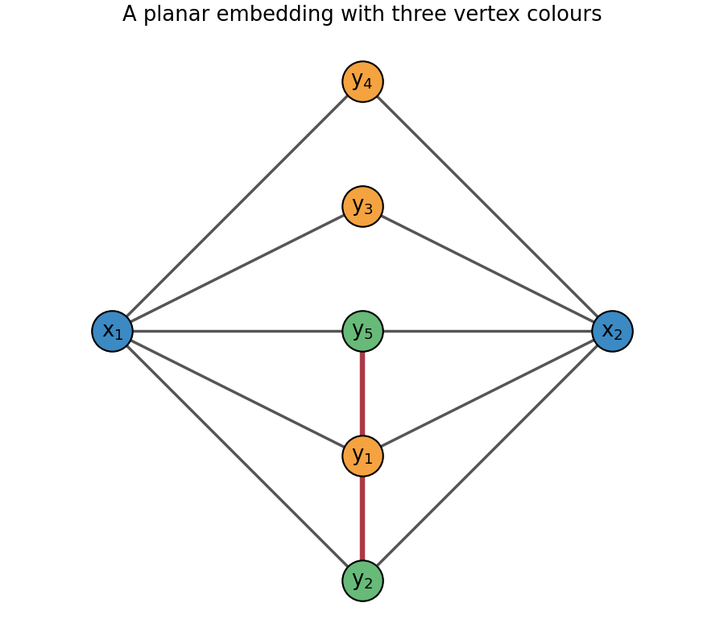

<h1 id="r/1/ii/b/solution">Solution</h1>

↑ **Parent:** [B](../b.md)

The modified graph is **planar**. Place $x_1=(-2,0)$ and $x_2=(2,0)$, and place the other [vertices](../../../../../../vertex-graph-theory.md) on the vertical line between them in the bottom-to-top order $y_2,y_1,y_5,y_3,y_4$. Draw each edge $x_i y_j$ as a straight segment. Each half of the drawing is a fan sharing one endpoint, so its [edges](../../../../../../edge-of-a-graph.md) do not cross. The added [edges](../../../../../../edge-of-a-graph.md) $y_2y_1$ and $y_1y_5$ are consecutive vertical segments, meeting other [edges](../../../../../../edge-of-a-graph.md) only at their endpoints. The following original drawing exhibits the embedding.

**[Figure 1](#r/1/ii/b/image-a-planar-embedding-and-a-three-colouring-of-the-modified-complete-bipartite-graph). A planar embedding and a three-colouring of the modified complete bipartite graph**.

## ↑ Ancestors (14)

1. [B](../b.md)
2. [Ii](../../ii.md)
3. [1](../../../1.md)
4. [R](../../../../r.md)
5. [2010](../../../../../2010-split.md)
6. [Past exam of the probability, statistics and options I course of the University of Oxford](../../../../../split.md)
7. [Probability, statistics and options I course of the University of Oxford](../../../../../../probability-statistics-and-options-i-course-of-the-university-of-oxford.md)
8. [Year 2 of the mathematics and statistics course of the University of Oxford](../../../../../../year-2-of-the-mathematics-and-statistics-course-of-the-university-of-oxford.md)
9. [Mathematics and statistics course of the University of Oxford](../../../../../../mathematics-and-statistics-course-of-the-university-of-oxford.md)
10. [Undergraduate course of the University of Oxford](../../../../../../undergraduate-course-of-the-university-of-oxford.md)
11. [Course of the University of Oxford](../../../../../../course-of-the-university-of-oxford.md)
12. [University of Oxford](../../../../../../university-of-oxford-split.md)
13. [List of universities](../../../../../../list-of-universities.md)
14. [Codex Wiki](../../../../../../split.md)
