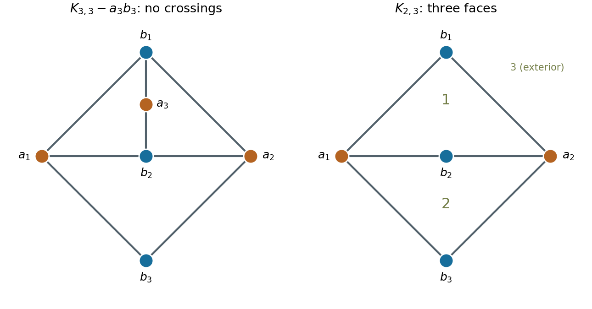

# 2011

↑ **Parent:** [Past exam of the probability, statistics and options I course of the University of Oxford](../past-exam-of-the-probability-statistics-and-options-i-course-of-the-university-of-oxford.md)

Source: [released examination bundle](https://www.whatdotheyknow.com/request/maths_past_papers_3), `Part A 2007 11-1.pdf`, pages 298–308. The printed title is Probability, Statistics and Options I; this paper belongs to mathematics and statistics. All 25 questions are covered, including the nineteen questions also printed in AO1. No mark allocations are printed.

**Table of contents**

- [A](#a)
  - [1](#a/1)
    - [a](#a/1/a)
      - [Solution](#a/1/a/solution)
    - [b](#a/1/b)
      - [Solution](#a/1/b/solution)
    - [c](#a/1/c)
      - [Solution](#a/1/c/solution)
- [B](#b)
  - [1](#b/1)
    - [a](#b/1/a)
      - [Solution](#b/1/a/solution)
    - [b](#b/1/b)
      - [Solution](#b/1/b/solution)
    - [c](#b/1/c)
      - [Solution](#b/1/c/solution)
- [C](#c)
  - [1](#c/1)
    - [a](#c/1/a)
      - [i](#c/1/a/i)
        - [Solution](#c/1/a/i/solution)
      - [ii](#c/1/a/ii)
        - [Solution](#c/1/a/ii/solution)
      - [iii](#c/1/a/iii)
        - [Solution](#c/1/a/iii/solution)
    - [b](#c/1/b)
      - [i](#c/1/b/i)
        - [Solution](#c/1/b/i/solution)
      - [ii](#c/1/b/ii)
        - [Solution](#c/1/b/ii/solution)
- [D](#d)
  - [1](#d/1)
    - [a](#d/1/a)
      - [Solution](#d/1/a/solution)
    - [b](#d/1/b)
      - [Solution](#d/1/b/solution)
    - [c](#d/1/c)
      - [Solution](#d/1/c/solution)
    - [d](#d/1/d)
      - [Solution](#d/1/d/solution)
    - [e](#d/1/e)
      - [Solution](#d/1/e/solution)
    - [f](#d/1/f)
      - [Solution](#d/1/f/solution)
  - [2](#d/2)
    - [Solution](#d/2/solution)
- [E](#e)
  - [1](#e/1)
    - [Solution](#e/1/solution)
  - [2](#e/2)
    - [a](#e/2/a)
      - [Solution](#e/2/a/solution)
    - [b](#e/2/b)
      - [Solution](#e/2/b/solution)
    - [c](#e/2/c)
      - [Solution](#e/2/c/solution)
- [F](#f)
  - [1](#f/1)
    - [a](#f/1/a)
      - [i](#f/1/a/i)
        - [Solution](#f/1/a/i/solution)
      - [ii](#f/1/a/ii)
        - [Solution](#f/1/a/ii/solution)
    - [b](#f/1/b)
      - [i](#f/1/b/i)
        - [Solution](#f/1/b/i/solution)
      - [ii](#f/1/b/ii)
        - [Solution](#f/1/b/ii/solution)
      - [iii](#f/1/b/iii)
        - [Solution](#f/1/b/iii/solution)
- [G](#g)
  - [1](#g/1)
    - [Solution](#g/1/solution)
- [H](#h)
  - [1](#h/1)
    - [Solution](#h/1/solution)
- [J](#j)
  - [1](#j/1)
    - [Solution](#j/1/solution)
- [K](#k)
  - [1](#k/1)
    - [Solution](#k/1/solution)
  - [2](#k/2)
    - [Solution](#k/2/solution)
- [M](#m)
  - [1](#m/1)
    - [a](#m/1/a)
      - [Solution](#m/1/a/solution)
    - [b](#m/1/b)
      - [Solution](#m/1/b/solution)
    - [c](#m/1/c)
      - [Solution](#m/1/c/solution)
    - [d](#m/1/d)
      - [i](#m/1/d/i)
        - [Solution](#m/1/d/i/solution)
      - [ii](#m/1/d/ii)
        - [Solution](#m/1/d/ii/solution)
      - [iii](#m/1/d/iii)
        - [Solution](#m/1/d/iii/solution)
  - [2](#m/2)
    - [a](#m/2/a)
      - [Solution](#m/2/a/solution)
    - [b](#m/2/b)
      - [Solution](#m/2/b/solution)
    - [c](#m/2/c)
      - [Solution](#m/2/c/solution)
    - [d](#m/2/d)
      - [Solution](#m/2/d/solution)
  - [3](#m/3)
    - [a](#m/3/a)
      - [Solution](#m/3/a/solution)
    - [b](#m/3/b)
      - [i](#m/3/b/i)
        - [Solution](#m/3/b/i/solution)
      - [ii](#m/3/b/ii)
        - [Solution](#m/3/b/ii/solution)
    - [c](#m/3/c)
      - [i](#m/3/c/i)
        - [Solution](#m/3/c/i/solution)
      - [ii](#m/3/c/ii)
        - [Solution](#m/3/c/ii/solution)
      - [iii](#m/3/c/iii)
        - [Solution](#m/3/c/iii/solution)
- [O](#o)
  - [1](#o/1)
    - [a](#o/1/a)
      - [i](#o/1/a/i)
        - [Solution](#o/1/a/i/solution)
      - [ii](#o/1/a/ii)
        - [Solution](#o/1/a/ii/solution)
    - [b](#o/1/b)
      - [Solution](#o/1/b/solution)
    - [c](#o/1/c)
      - [Solution](#o/1/c/solution)
  - [2](#o/2)
    - [a](#o/2/a)
      - [Solution](#o/2/a/solution)
    - [b](#o/2/b)
      - [Solution](#o/2/b/solution)
    - [c](#o/2/c)
      - [Solution](#o/2/c/solution)
  - [3](#o/3)
    - [a](#o/3/a)
      - [Solution](#o/3/a/solution)
    - [b](#o/3/b)
      - [Solution](#o/3/b/solution)
    - [c](#o/3/c)
      - [Solution](#o/3/c/solution)
    - [d](#o/3/d)
      - [Solution](#o/3/d/solution)
- [P](#p)
  - [1](#p/1)
    - [a](#p/1/a)
      - [Solution](#p/1/a/solution)
    - [b](#p/1/b)
      - [Solution](#p/1/b/solution)
  - [2](#p/2)
    - [a](#p/2/a)
      - [Solution](#p/2/a/solution)
    - [b](#p/2/b)
      - [Solution](#p/2/b/solution)
    - [c](#p/2/c)
      - [Solution](#p/2/c/solution)
- [R](#r)
  - [1](#r/1)
    - [a](#r/1/a)
      - [Solution](#r/1/a/solution)
    - [b](#r/1/b)
      - [Solution](#r/1/b/solution)
    - [c](#r/1/c)
      - [Solution](#r/1/c/solution)
    - [d](#r/1/d)
      - [Solution](#r/1/d/solution)
- [S](#s)
  - [1](#s/1)
    - [a](#s/1/a)
      - [Solution](#s/1/a/solution)
    - [b](#s/1/b)
      - [Solution](#s/1/b/solution)
    - [c](#s/1/c)
      - [Solution](#s/1/c/solution)
- [T](#t)
  - [1](#t/1)
    - [a](#t/1/a)
      - [Solution](#t/1/a/solution)
    - [b](#t/1/b)
      - [Solution](#t/1/b/solution)
- [U](#u)
  - [1](#u/1)
    - [a](#u/1/a)
      - [i](#u/1/a/i)
        - [Solution](#u/1/a/i/solution)
      - [ii](#u/1/a/ii)
        - [Solution](#u/1/a/ii/solution)
    - [b](#u/1/b)
      - [Solution](#u/1/b/solution)
    - [c](#u/1/c)
      - [Solution](#u/1/c/solution)

## A

↑ **Parent:** [2011](2011.md)

<h3 id="a/1">1</h3>

↑ **Parent:** [A](#a)

<h4 id="a/1/a">a</h4>

↑ **Parent:** [1](#a/1)

<h5 id="a/1/a/solution">Solution</h5>

↑ **Parent:** [A](#a/1/a)

In [field characteristic](../algebra.md#characteristic-of-a-field) $p$, the [binomial theorem](../binomial-coefficient.md#binomial-theorem) gives $(X-b)^p=X^p-b^p$, since the intermediate [binomial coefficients](../binomial-coefficient.md) are divisible by the [prime number](../prime-number.md) $p$. If $b\in F$ is a [root](../semisimple-lie-algebra.md#root-of-a-root-system) of $X^p-a$, then $b^p=a$, and hence

$$
\boxed{X^p-a=(X-b)^p\quad\text{in }F[X].}
$$

<h4 id="a/1/b">b</h4>

↑ **Parent:** [1](#a/1)

<h5 id="a/1/b/solution">Solution</h5>

↑ **Parent:** [B](#a/1/b)

Let $\alpha$ be a [root](../semisimple-lie-algebra.md#root-of-a-root-system) in a [splitting field](../galois-theory.md#splitting-field). The preceding characteristic-$p$ identity gives $X^p-a=(X-\alpha)^p$, so there is only one distinct [root](../semisimple-lie-algebra.md#root-of-a-root-system). If the [polynomial](../polynomial.md) were reducible over $F$, choose a monic proper factor $g\in F[X]$ of [degree](../polynomial.md#degree-of-a-polynomial) $d$, with $1\leq d<p$. In the splitting field it must be $g=(X-\alpha)^d$. Its coefficient of $X^{d-1}$ is $-d\alpha$, which belongs to $F$. Since $d$ is nonzero and thus invertible in the [field](../algebra.md#field) $F$, this forces $\alpha\in F$, contradicting the absence of a [root](../semisimple-lie-algebra.md#root-of-a-root-system) there. Therefore **$X^p-a$ is irreducible over $F$**.

<h4 id="a/1/c">c</h4>

↑ **Parent:** [1](#a/1)

<h5 id="a/1/c/solution">Solution</h5>

↑ **Parent:** [C](#a/1/c)

Suppose a [rational function](../isolated-singularity.md#rational-function) $P(t)/Q(t)\in\mathbb F_p(t)$, with nonzero [polynomials](../polynomial.md) $P,Q$, had $p$th power $t$. Then $P(t)^p=tQ(t)^p$, so comparison of [degrees](../polynomial.md#degree-of-a-polynomial) would give $p\deg P=1+p\deg Q$, impossible modulo $p$. Thus $X^p-t$ has no [root](../semisimple-lie-algebra.md#root-of-a-root-system) in $K$, and part (b) proves it is [irreducible](../representation-theory.md#irreducible-representation).

In a [splitting field](../galois-theory.md#splitting-field) containing $\alpha$ with $\alpha^p=t$,

$$
\boxed{X^p-t=(X-\alpha)^p.}
$$

It has one distinct [root](../semisimple-lie-algebra.md#root-of-a-root-system) with multiplicity $p$, so it is inseparable. This is the [purely inseparable polynomial over a rational function field](../galois-theory.md#purely-inseparable-polynomial-over-a-rational-function-field).

<h2 id="b">B</h2>

↑ **Parent:** [2011](2011.md)

<h3 id="b/1">1</h3>

↑ **Parent:** [B](#b)

<h4 id="b/1/a">a</h4>

↑ **Parent:** [1](#b/1)

<h5 id="b/1/a/solution">Solution</h5>

↑ **Parent:** [A](#b/1/a)

For a [group action](../group-action.md), the [orbit](../dynamical-systems.md#orbit-dynamical-system) and [stabilizer](../group-action.md#stabilizer-subgroup) are

$$
Gx=\{gx:g\in G\},\qquad G_x=\{g\in G:gx=x\}.
$$

The [orbit-stabilizer theorem](../group-action.md#orbit-stabilizer-theorem) for a [finite group](../group.md#finite-group) states

$$
\boxed{|G|=|Gx|\,|G_x|.}
$$

<h4 id="b/1/b">b</h4>

↑ **Parent:** [1](#b/1)

<h5 id="b/1/b/solution">Solution</h5>

↑ **Parent:** [B](#b/1/b)

For a [regular tetrahedron](../euclidean-geometry.md#regular-tetrahedron), rotations fixing a vertex rotate about the line from that vertex through the opposite face centre. Their angles are $0,2\pi/3,4\pi/3$, so the [stabilizer](../group-action.md#stabilizer-subgroup) is a [cyclic group](../group.md#cyclic-group) of order three. Rotations act transitively on the four [vertices](../graph.md#vertex-graph-theory), giving $|G_1|=4\cdot3=12$ by the [orbit-stabilizer theorem](../group-action.md#orbit-stabilizer-theorem).

For a [cube](../euclidean-geometry.md#cube), the corresponding axis is the body diagonal through the fixed vertex and its opposite. The three incident edges can be cyclically permuted by the same three angles, so again the [stabilizer](../group-action.md#stabilizer-subgroup) is cyclic of order three. The [orbit](../dynamical-systems.md#orbit-dynamical-system) has eight vertices. Hence

$$
\boxed{|G_1|=12,\qquad |G_2|=24.}
$$

<h4 id="b/1/c">c</h4>

↑ **Parent:** [1](#b/1)

<h5 id="b/1/c/solution">Solution</h5>

↑ **Parent:** [C](#b/1/c)

Realize the cube's vertices as $(\pm1,\pm1,\pm1)$ and take the four with coordinate product $+1$. They form a [regular tetrahedron](../euclidean-geometry.md#regular-tetrahedron), and their negatives form the other one. Every proper rotation of the first tetrahedron also permutes the negatives, hence is a cube rotation. This embeds $G_1$ as a [subgroup](../group.md#subgroup) of $G_2$.

The embedded [group](../group.md) preserves each of these two four-vertex sets and acts transitively on each. Thus the resulting action on all eight cube vertices has **two orbits, each of size four**.

<h2 id="c">C</h2>

↑ **Parent:** [2011](2011.md)

<h3 id="c/1">1</h3>

↑ **Parent:** [C](#c)

<h4 id="c/1/a">a</h4>

↑ **Parent:** [1](#c/1)

<h5 id="c/1/a/i">i</h5>

↑ **Parent:** [A](#c/1/a)

<h6 id="c/1/a/i/solution">Solution</h6>

↑ **Parent:** [I](#c/1/a/i)

A [prime number](../prime-number.md) is an integer $p>1$ whose only positive divisors are $1$ and $p$. The restriction $p>1$ excludes the unit $1$.

<h5 id="c/1/a/ii">ii</h5>

↑ **Parent:** [A](#c/1/a)

<h6 id="c/1/a/ii/solution">Solution</h6>

↑ **Parent:** [Ii](#c/1/a/ii)

The [fundamental theorem of arithmetic](../prime-number.md#fundamental-theorem-of-arithmetic) says that every integer $n>1$ is a product of [prime numbers](../prime-number.md), uniquely up to reordering. Equivalently, $n=\prod_p p^{a_p}$ for a unique family of nonnegative integer exponents, only finitely many of which are nonzero.

<h5 id="c/1/a/iii">iii</h5>

↑ **Parent:** [A](#c/1/a)

<h6 id="c/1/a/iii/solution">Solution</h6>

↑ **Parent:** [Iii](#c/1/a/iii)

If the complete list of [prime numbers](../prime-number.md) were $p_1,\ldots,p_k$, then $N=p_1\cdots p_k+1>1$ would have a prime divisor by the [fundamental theorem of arithmetic](../prime-number.md#fundamental-theorem-of-arithmetic). No $p_i$ divides it, since $N\equiv1\pmod{p_i}$. This contradicts completeness of the list. Hence **there are infinitely many prime numbers**.

<h4 id="c/1/b">b</h4>

↑ **Parent:** [1](#c/1)

<h5 id="c/1/b/i">i</h5>

↑ **Parent:** [B](#c/1/b)

<h6 id="c/1/b/i/solution">Solution</h6>

↑ **Parent:** [I](#c/1/b/i)

Every integer has one of the six residues $0,1,2,3,4,5$ modulo $6$. A [prime number](../prime-number.md) other than $2$ or $3$ is divisible by neither $2$ nor $3$, eliminating residues $0,2,3,4$. Thus

$$
\boxed{p\equiv1\text{ or }-1\pmod6.}
$$

<h5 id="c/1/b/ii">ii</h5>

↑ **Parent:** [B](#c/1/b)

<h6 id="c/1/b/ii/solution">Solution</h6>

↑ **Parent:** [Ii](#c/1/b/ii)

Suppose there were only finitely many [prime numbers](../prime-number.md) congruent to $5$ modulo $6$, and list them as $p_1,\ldots,p_k$. The list is nonempty since it contains $5$. Let $N=6p_1\cdots p_k-1$. It is greater than one and divisible by neither $2$ nor $3$. Every prime factor therefore has residue $1$ or $-1$ modulo $6$. Since $N\equiv-1\pmod6$, at least one prime factor $q$ must have residue $-1$. But $N\equiv-1\pmod{p_i}$ for every listed prime, so $q$ is not on the list. This contradiction proves **there are infinitely many primes congruent to $5$ modulo $6$**.

## D

↑ **Parent:** [2011](2011.md)

<h3 id="d/1">1</h3>

↑ **Parent:** [D](#d)

<h4 id="d/1/a">a</h4>

↑ **Parent:** [1](#d/1)

<h5 id="d/1/a/solution">Solution</h5>

↑ **Parent:** [A](#d/1/a)

The [Lebesgue outer measure](../measure-theory.md#lebesgue-outer-measure) is

$$
m^*(E)=\inf\left\{\sum_j|I_j|:E\subseteq\bigcup_j I_j,\ I_j\text{ open intervals}\right\}.
$$

The [Lebesgue inner measure](../measure-theory.md#lebesgue-inner-measure) is $m_*(E)=\sup\{m(K):K\subseteq E,\ K\text{ compact}\}$, with $m_*(\varnothing)=0$. For a bounded set inside a finite interval $I$, this is equivalently $|I|-m^*(I\setminus E)$.

A set is [Lebesgue measurable](../measure-theory.md#lebesgue-measurable-set) if it satisfies [Carathéodory's criterion](../measure-theory.md#caratheodory-s-criterion):

$$
\boxed{m^*(A)=m^*(A\cap E)+m^*(A\setminus E)\quad\text{for every }A\subseteq\mathbb R.}
$$

For finite outer measure this is equivalent to equality of inner and outer measure. For a general unbounded set, an equivalent local criterion is $m_*(E\cap[-n,n])=m^*(E\cap[-n,n])$ for every positive integer $n$. Merely writing $m_*(E)=m^*(E)=\infty$ would not establish measurability.

<h4 id="d/1/b">b</h4>

↑ **Parent:** [1](#d/1)

<h5 id="d/1/b/solution">Solution</h5>

↑ **Parent:** [B](#d/1/b)

A [null set](../measure-theory.md#null-set) has [Lebesgue outer measure](../measure-theory.md#lebesgue-outer-measure) zero. Equivalently, for every $\varepsilon>0$ it can be covered by countably many open [intervals](../real-analysis.md#interval-mathematics) whose total length is less than $\varepsilon$. Such a set is automatically [Lebesgue measurable](../measure-theory.md#lebesgue-measurable-set) and has [Lebesgue measure](../measure-theory.md#lebesgue-measure) zero.

<h4 id="d/1/c">c</h4>

↑ **Parent:** [1](#d/1)

<h5 id="d/1/c/solution">Solution</h5>

↑ **Parent:** [C](#d/1/c)

If $A\subseteq E$ and $E$ is a [null set](../measure-theory.md#null-set), every interval cover of $E$ also covers $A$. Thus [monotonicity of Lebesgue outer measure](../measure-theory.md#monotonicity-of-lebesgue-outer-measure) gives $0\leq m^*(A)\leq m^*(E)=0$. Hence **every subset of a null set is null**, and in particular is [Lebesgue measurable](../measure-theory.md#lebesgue-measurable-set).

<h4 id="d/1/d">d</h4>

↑ **Parent:** [1](#d/1)

<h5 id="d/1/d/solution">Solution</h5>

↑ **Parent:** [D](#d/1/d)

A real [measurable function](../measure-theory.md#measurable-function) is one whose inverse image of every open subset of $\mathbb R$ is [Lebesgue measurable](../measure-theory.md#lebesgue-measurable-set). Equivalently,

$$
\boxed{\{x:f(x)>a\}\text{ is Lebesgue measurable for every real }a.}
$$

These upper rays generate the [Borel sigma-algebra](../measure-theory.md#borel-sigma-algebra), making this equivalent to requiring measurable inverse images of all [Borel sets](../measure-theory.md#borel-set).

<h4 id="d/1/e">e</h4>

↑ **Parent:** [1](#d/1)

<h5 id="d/1/e/solution">Solution</h5>

↑ **Parent:** [E](#d/1/e)

If $a\geq0$, the set $\{f>a\}$ is contained in $E$, since $f=0$ outside $E$. It is therefore a [null set](../measure-theory.md#null-set) and is [Lebesgue measurable](../measure-theory.md#lebesgue-measurable-set). If $a<0$, its complement $\{f\leq a\}$ is contained in $E$ and is measurable for the same reason. Complements of measurable sets are measurable. Thus every upper level set is measurable, proving **$f$ is a measurable function**.

<h4 id="d/1/f">f</h4>

↑ **Parent:** [1](#d/1)

<h5 id="d/1/f/solution">Solution</h5>

↑ **Parent:** [F](#d/1/f)

Let $d=h-g$. It vanishes outside the [null set](../measure-theory.md#null-set) $E$, so part (e) proves $d$ is a [measurable function](../measure-theory.md#measurable-function), regardless of its values on $E$. Since the sum of two [measurable functions](../measure-theory.md#measurable-function) is measurable, $h=g+d$ is measurable. This is the completeness of [Lebesgue measure](../measure-theory.md#lebesgue-measure) under changes on [null sets](../measure-theory.md#null-set).

<h3 id="d/2">2</h3>

↑ **Parent:** [D](#d)

<h4 id="d/2/solution">Solution</h4>

↑ **Parent:** [2](#d/2)

For [sigma-finite measures](../measure.md#sigma-finite-measure), [Tonelli's theorem](../measure-theory.md#tonelli-theorem) states that the double [integral](../integral.md) of a nonnegative measurable function equals either iterated integral, allowing $+\infty$. [Fubini's theorem](../measure-theory.md#fubini-s-theorem) states that if a measurable function is absolutely integrable, its sections are integrable almost everywhere, both iterated integrals exist, and they equal the double integral.

Assign any value at $(0,0)$, which does not affect [Lebesgue integrability](../measure-theory.md#integrability). Near that corner set $s=x+y$ and $t=(x-y)/(x+y)$. Then $x=s(1+t)/2$, $y=s(1-t)/2$, and the absolute [Jacobian determinant](../multivariable-calculus.md#jacobian-determinant) is $s/2$. On $0<s<1$, the full range is $-1<t<1$, so

$$
\iint_{x+y<1}|F(x,y)|\,dx\,dy
=\frac12\int_0^1 s^{2-\alpha}\,ds\int_{-1}^1|t|\,dt
=\frac12\int_0^1s^{2-\alpha}\,ds.
$$

The remaining part of the unit square has $x+y\geq1$ and is harmless. The [improper power integral](../real-analysis.md#improper-power-integral) is finite precisely when $\alpha<3$. Under the given restriction,

$$
\boxed{F\text{ is Lebesgue integrable exactly for }2<\alpha<3.}
$$

For those values, the change $(x,y)\mapsto(y,x)$ preserves the square and changes the sign of $F$. Absolute integrability justifies this change of variables, giving

$$
\boxed{\iint_{\mathbb R^2}F(x,y)\,dx\,dy=0.}
$$

For $\alpha\geq3$ the positive and negative parts each diverge, so symmetry does not define a Lebesgue integral.

<h2 id="e">E</h2>

↑ **Parent:** [2011](2011.md)

<h3 id="e/1">1</h3>

↑ **Parent:** [E](#e)

<h4 id="e/1/solution">Solution</h4>

↑ **Parent:** [1](#e/1)

An [open cover](../topology.md#open-cover) of a [topological space](../topology.md#topological-space) is a collection of open subsets whose union is the whole space. A [compact space](../topology.md#compact-space) is one for which every [open cover](../topology.md#open-cover) admits a finite [subcover](../topology.md#subcover). The [subspace topology](../topology.md#subspace-topology) on $A\subseteq Y$ consists of sets $A\cap O$ with $O$ open in $Y$.

Let $\{U_j\}$ cover $f(X)$ by relatively open sets, and write $U_j=f(X)\cap O_j$ with $O_j$ open in $Y$. By [continuity](../calculus.md#continuous-function), $\{f^{-1}(O_j)\}$ is an open cover of $X$. A finite subcollection covers $X$ by [compactness](../topology.md#compact-space), and its corresponding $U_j$ cover $f(X)$. Thus **a continuous image of a compact space is compact**.

For an image that is not closed, take $X$ to be a singleton and $Y=\{0,1\}$ with the [indiscrete topology](../topology.md#indiscrete-topology). Send the sole point to $0$. This map is continuous and $X$ is compact, while $f(X)=\{0\}$ is not closed in $Y$, whose only closed sets are $\varnothing$ and $Y$. A [Hausdorff](../topology.md#hausdorff-space) hypothesis on the target would exclude this example.

<h3 id="e/2">2</h3>

↑ **Parent:** [E](#e)

<h4 id="e/2/a">a</h4>

↑ **Parent:** [2](#e/2)

<h5 id="e/2/a/solution">Solution</h5>

↑ **Parent:** [A](#e/2/a)

A [sequence](../sequence-and-series.md#sequence) $x_n$ converges to $x$ if every open [neighbourhood](../topology.md#neighbourhood-mathematics) of $x$ contains all sufficiently late terms. A [Hausdorff space](../topology.md#hausdorff-space) separates any two distinct points by disjoint open neighbourhoods.

If a sequence had distinct limits $x,y$ in a [Hausdorff space](../topology.md#hausdorff-space), choose disjoint open neighbourhoods $U$ of $x$ and $V$ of $y$. Convergence to each limit implies that all sufficiently late terms lie in both $U$ and $V$, contradicting $U\cap V=\varnothing$. Hence **a convergent sequence in a Hausdorff space has a unique limit**.

<h4 id="e/2/b">b</h4>

↑ **Parent:** [2](#e/2)

<h5 id="e/2/b/solution">Solution</h5>

↑ **Parent:** [B](#e/2/b)

The [product topology](../geometry-and-topology.md#product-topology) on $X\times Y$ has as a [basis of a topology](../topology.md#basis-of-a-topology) the rectangles $U\times V$ with $U$ open in $X$ and $V$ open in $Y$; arbitrary unions of such rectangles are its open sets.

For distinct points $(x_1,y_1),(x_2,y_2)$, at least one coordinate differs. If $x_1\ne x_2$, disjoint open neighbourhoods $U_1,U_2$ in the [Hausdorff space](../topology.md#hausdorff-space) $X$ give disjoint open neighbourhoods $U_1\times Y,U_2\times Y$ of the two points. If the second coordinates differ instead, use $X\times V_1,X\times V_2$. Thus **a product of two Hausdorff spaces is Hausdorff**.

<h4 id="e/2/c">c</h4>

↑ **Parent:** [2](#e/2)

<h5 id="e/2/c/solution">Solution</h5>

↑ **Parent:** [C](#e/2/c)

For the quotient map $q:X\to X/{\sim}$, the [quotient topology](../topology.md#quotient-topology) is defined by

$$
U\subseteq X/{\sim}\text{ open}\iff q^{-1}(U)\text{ open in }X.
$$

Take the [Hausdorff space](../topology.md#hausdorff-space) $X=\mathbb R$ and identify two numbers precisely when they are both rational or both irrational. The quotient has two points. The inverse images of its singleton subsets are $\mathbb Q$ and $\mathbb R\setminus\mathbb Q$, neither of which is open in $\mathbb R$, since each is dense and has dense complement. Hence the quotient has the [indiscrete topology](../topology.md#indiscrete-topology) and is not [Hausdorff](../topology.md#hausdorff-space).

<h2 id="f">F</h2>

↑ **Parent:** [2011](2011.md)

<h3 id="f/1">1</h3>

↑ **Parent:** [F](#f)

<h4 id="f/1/a">a</h4>

↑ **Parent:** [1](#f/1)

<h5 id="f/1/a/i">i</h5>

↑ **Parent:** [A](#f/1/a)

<h6 id="f/1/a/i/solution">Solution</h6>

↑ **Parent:** [I](#f/1/a/i)

A $k$-dimensional embedded [submanifold](../differential-geometry.md#submanifold) of $\mathbb R^n$ is a subset $M$ such that near each $p\in M$ there is a smooth [diffeomorphism](../geometry-and-topology.md#diffeomorphism) of ambient open neighbourhoods that sends $M$ to the coordinate plane $\mathbb R^k\times\{0\}^{n-k}$. More precisely, for some open $U\ni p$ and diffeomorphism $\Phi:U\to V\subseteq\mathbb R^n$,

$$
\Phi(M\cap U)=V\cap(\mathbb R^k\times\{0\}^{n-k}).
$$

Thus locally the subset has $k$ freely varying smooth coordinates.

<h5 id="f/1/a/ii">ii</h5>

↑ **Parent:** [A](#f/1/a)

<h6 id="f/1/a/ii/solution">Solution</h6>

↑ **Parent:** [Ii](#f/1/a/ii)

A [tangent vector](../tangent-vector.md) to $M$ at $p$ is a velocity $\gamma'(0)$ of a smooth curve $\gamma:(-\varepsilon,\varepsilon)\to M$ with $\gamma(0)=p$. The [tangent space](../tangent-vector.md#tangent-space) is the set of all such velocities:

$$
\boxed{T_pM=\{\gamma'(0):\gamma(0)=p,\ \gamma\text{ a smooth curve in }M\}.}
$$

It is a $k$-dimensional linear subspace of $\mathbb R^n$; for a local parametrization $\phi$, it is the image of the injective [derivative](../calculus.md#derivative) $D\phi$ at the corresponding parameter point.

<h4 id="f/1/b">b</h4>

↑ **Parent:** [1](#f/1)

<h5 id="f/1/b/i">i</h5>

↑ **Parent:** [B](#f/1/b)

<h6 id="f/1/b/i/solution">Solution</h6>

↑ **Parent:** [I](#f/1/b/i)

Let $g(x,y,z)=x^2+y^2-z^2$. The upper cone away from the apex is the part of $g^{-1}(0)$ with $z>0$. There

$$
\nabla g=(2x,2y,-2z)\ne0.
$$

The [regular level set theorem](../differential-geometry.md#regular-level-set-theorem) says that a level set of a smooth scalar function with nonzero [gradient](../multivariable-calculus.md#gradient) is an embedded [submanifold](../differential-geometry.md#submanifold) of codimension one. Intersecting it with the open half-space $z>0$ preserves this local property. Thus **$M$ is a two-dimensional submanifold of $\mathbb R^3$**.

<h5 id="f/1/b/ii">ii</h5>

↑ **Parent:** [B](#f/1/b)

<h6 id="f/1/b/ii/solution">Solution</h6>

↑ **Parent:** [Ii](#f/1/b/ii)

The [tangent space](../tangent-vector.md#tangent-space) to a regular level set is the kernel of its [derivative](../calculus.md#derivative). Writing $z_0=\sqrt{x_0^2+y_0^2}$ gives

$$
\boxed{T_{v_0}M=\{(\xi,\eta,\zeta):x_0\xi+y_0\eta-z_0\zeta=0\}.}
$$

If an affine tangent plane through $v_0$ is intended, its equation is $x_0(x-x_0)+y_0(y-y_0)-z_0(z-z_0)=0$. Since $x_0^2+y_0^2=z_0^2$, this simplifies to the same plane $x_0x+y_0y-z_0z=0$, which passes through the apex.

<h5 id="f/1/b/iii">iii</h5>

↑ **Parent:** [B](#f/1/b)

<h6 id="f/1/b/iii/solution">Solution</h6>

↑ **Parent:** [Iii](#f/1/b/iii)

Every point of the indicated ray has the form $w_0=(r,2r,\sqrt5\,r)$ with $r>0$; the apex is excluded. Substitution into the preceding [tangent space](../tangent-vector.md#tangent-space) formula gives

$$
\boxed{T_{w_0}M=\{(\xi,\eta,\zeta):\xi+2\eta-\sqrt5\,\zeta=0\},}
$$

independent of $r$. The affine tangent plane has the same equation, since the ray lies in this plane. Thus both interpretations of the requested tangent plane are constant along this generator of the [cone](../euclidean-geometry.md#cone-geometry).

## G

↑ **Parent:** [2011](2011.md)

<h3 id="g/1">1</h3>

↑ **Parent:** [G](#g)

<h4 id="g/1/solution">Solution</h4>

↑ **Parent:** [1](#g/1)

Let $P=F_{y'}$ and $Q=F_{y''}$. For a smooth [variation](../calculus-of-variations.md#variation) $y+\varepsilon\eta$, the [first variation](../calculus-of-variations.md#first-variation) is

$$
\delta J=\int_a^b(F_y\eta+P\eta'+Q\eta'')\,dx
=\int_a^b(F_y-P'+Q'')\eta\,dx+[(P-Q')\eta+Q\eta']_a^b.
$$

Here the last expression follows by two integrations by parts. Taking variations supported in the interior and applying the [fundamental lemma of the calculus of variations](../calculus-of-variations.md#fundamental-lemma-of-the-calculus-of-variations) gives the [Euler-Lagrange equation for a second-derivative functional](../calculus-of-variations.md#euler-lagrange-equation-for-a-second-derivative-functional):

$$
\boxed{F_y-\frac{d}{dx}F_{y'}+\frac{d^2}{dx^2}F_{y''}=0.}
$$

If both endpoint values and slopes are free, their independent variations force the [natural boundary conditions for second-derivative functionals](../calculus-of-variations.md#natural-boundary-conditions-for-second-derivative-functionals)

$$
\boxed{Q=0,\qquad P-Q'=0\quad\text{at }a,b.}
$$

If an endpoint value or slope is fixed instead, its corresponding variation vanishes and the associated natural condition is not required.

For $H=y''Q-y'(Q'-P)-F$, differentiate using the [chain rule](../calculus.md#chain-rule):

$$
H'=y'(P'-Q''-F_y)-F_x.
$$

The [Euler-Lagrange equation](../analysis.md#euler-lagrange-equation) cancels the first term. Consequently $H'=-F_x$, and if there is no explicit $x$ dependence,

$$
\boxed{H=y''F_{y''}+y'\bigl(F_{y'}-(F_{y''})'\bigr)-F\text{ is constant}.}
$$

This is a [Beltrami identity for a second-derivative functional](../calculus-of-variations.md#beltrami-identity-for-a-second-derivative-functional).

## H

↑ **Parent:** [2011](2011.md)

<h3 id="h/1">1</h3>

↑ **Parent:** [H](#h)

<h4 id="h/1/solution">Solution</h4>

↑ **Parent:** [1](#h/1)

The [inertia tensor](../rigid-body-dynamics.md#inertia-tensor) about the centroid has entries $J_{ij}=\int_B\rho(r^2\delta_{ij}-x_ix_j)\,dV$. Reflection symmetry makes every off-diagonal entry zero. Under $x=a\xi$, $y=a\eta$, $z=c\zeta$, the ellipsoid becomes the unit ball. Its three coordinate second moments are equal, and

$$
\int_{\text{ball}}\xi^2\,dV=\frac13\int_{\text{ball}}r^2\,dV=\frac{4\pi}{15}.
$$

Using the stated mass gives $\int_B\rho x^2\,dV=Ma^2/5$, the same for $y$, and $\int_B\rho z^2\,dV=Mc^2/5$. Therefore

$$
\boxed{J^{(G)}=\frac M5\operatorname{diag}(a^2+c^2,\ a^2+c^2,\ 2a^2).}
$$

For the parallel coordinate axes based at $P=(0,0,c)$, the [parallel axis theorem](../rigid-body-dynamics.md#parallel-axis-theorem) in tensor form is $J^{(P)}=J^{(G)}+M(|d|^2I-dd^T)$, where $d=P-G$. Thus

$$
\boxed{J^{(P)}=\frac M5\operatorname{diag}(a^2+6c^2,\ a^2+6c^2,\ 2a^2).}
$$

## J

↑ **Parent:** [2011](2011.md)

<h3 id="j/1">1</h3>

↑ **Parent:** [J](#j)

<h4 id="j/1/solution">Solution</h4>

↑ **Parent:** [1](#j/1)

The one-dimensional [time-independent Schrödinger equation](../mathematical-physics.md#time-independent-schrodinger-equation) is

$$
-\frac{\hbar^2}{2m}\psi''(x)+V(x)\psi(x)=E\psi(x).
$$

For the [infinite square well](../quantum-mechanics.md#infinite-square-well) on $[0,a]$, $V=0$ inside and the [wave function](../wave-function.md) is zero outside. The boundary conditions are $\psi(0)=\psi(a)=0$. For positive integer $n$, $\psi_n=A\sin(n\pi x/a)$ satisfies them, and $\psi_n''=-(n\pi/a)^2\psi_n$. Substitution gives the [energy levels](../quantum-mechanics.md#energy-level)

$$
\boxed{E_n=\frac{n^2\pi^2\hbar^2}{2ma^2}.}
$$

Normalization requires $1=\int_0^a|\psi_n|^2dx=A^2a/2$. The requested real positive constant is therefore

$$
\boxed{A=\sqrt{\frac2a}.}
$$

## K

↑ **Parent:** [2011](2011.md)

<h3 id="k/1">1</h3>

↑ **Parent:** [K](#k)

<h4 id="k/1/solution">Solution</h4>

↑ **Parent:** [1](#k/1)

A [streamline](../fluid-mechanics.md#streamline) is a curve whose tangent is parallel to the instantaneous fluid [velocity field](../fluid-mechanics.md#velocity-field). In steady flow one may parametrize it by $d\mathbf r/ds=\mathbf u(\mathbf r)$. Dotting the steady [Euler equations](../euler-equations-for-an-inviscid-fluid.md) with $\mathbf u$ eliminates the cross-product term, since $\mathbf u\cdot((\nabla\times\mathbf u)\times\mathbf u)=0$. Hence

$$
\boxed{\mathbf u\cdot\nabla\left(p+\tfrac12\rho|\mathbf u|^2\right)=0,}
$$

which is [Bernoulli's principle](../euler-equations-for-an-inviscid-fluid.md#bernoulli-s-principle) along each streamline.

For the supplied field, $xu+yv=0$, so along a streamline

$$
\frac{d}{ds}(x^2+y^2)=2xu+2yv=0.
$$

Writing $r^2=x^2+y^2$, the tangential speed is $v_\theta=-br+c/r$ and the radial speed is zero. Both $r$ and $|\mathbf u|^2=(-br+c/r)^2$ are constant around each nonstagnant circular streamline. The Bernoulli quantity is constant there, so **the pressure is constant on every such circle**.

If a circle is wholly stagnant, the same conclusion follows directly from the steady [Euler equations](../euler-equations-for-an-inviscid-fluid.md): on it $\mathbf u=0$ and $\nabla|\mathbf u|^2=0$, hence $\nabla p=0$. Equivalently the radial momentum equation gives $\nabla p=\rho(-br+c/r)^2\mathbf e_r/r$ and no angular pressure variation, including at zero tangential speed. Thus **$p$ is constant on $x^2+y^2=a^2$ for every nonzero $a$**, with no exception for a stagnation circle.

<h3 id="k/2">2</h3>

↑ **Parent:** [K](#k)

<h4 id="k/2/solution">Solution</h4>

↑ **Parent:** [2](#k/2)

Use the convention that positive vortex strength is counterclockwise and complex velocity is $u-iv$. A [complex potential of a two-dimensional potential flow](../fluid-mechanics.md#complex-potential-of-a-two-dimensional-potential-flow) for the superposed [uniform flow](../fluid-mechanics.md#uniform-flow) and two [point vortices](../vorticity.md#line-vortex) is

$$
\boxed{W(z)=Uz+\frac{\Gamma}{2\pi i}\log(z-a)-\frac{\Gamma}{2\pi i}\log(z+a).}
$$

Local choices of logarithm branch change no velocity. Differentiation gives

$$
W'(z)=U-\frac{i\Gamma a}{\pi(z^2-a^2)}.
$$

For nonzero vortex strength and $U>0$, its two zeros are

$$
\boxed{z_\pm=\pm\sqrt{a^2+\frac{i\Gamma a}{\pi U}}.}
$$

The number under the square root is nonzero, so these are distinct [stagnation points](../fluid-mechanics.md#stagnation-point), neither at a vortex.

A free [point vortex](../vorticity.md#line-vortex) moves with the velocity induced by the other vortex and the background, omitting its own singular field. At either vortex, the other induces vertical velocity $-\Gamma/(4\pi a)$, while the background contributes $(U,0)$. Their velocities are therefore equal. Their separation stays $(2a,0)$, making this induced velocity constant for all time. Both travel along parallel straight lines with

$$
\boxed{\mathbf V=\left(U,-\frac{\Gamma}{4\pi a}\right),\qquad
|\mathbf V|=\sqrt{U^2+\frac{\Gamma^2}{16\pi^2a^2}}.}
$$

## M

↑ **Parent:** [2011](2011.md)

<h3 id="m/1">1</h3>

↑ **Parent:** [M](#m)

<h4 id="m/1/a">a</h4>

↑ **Parent:** [1](#m/1)

<h5 id="m/1/a/solution">Solution</h5>

↑ **Parent:** [A](#m/1/a)

A [Poisson distribution](../discrete-probability-distribution.md#poisson-distribution) with parameter $\lambda\geq0$ has

$$
\boxed{\mathbb P(X=k)=e^{-\lambda}\frac{\lambda^k}{k!},\quad k=0,1,2,\ldots;\qquad
\mathbb E[X]=\operatorname{Var}X=\lambda.}
$$

For $\lambda=0$ it is concentrated at zero. For $\lambda>0$, shifting the index in the defining series gives $\mathbb E[X]=\lambda$ and $\mathbb E[X(X-1)]=\lambda^2$, so $\operatorname{Var}X=\lambda^2+\lambda-\lambda^2=\lambda$.

<h4 id="m/1/b">b</h4>

↑ **Parent:** [1](#m/1)

<h5 id="m/1/b/solution">Solution</h5>

↑ **Parent:** [B](#m/1/b)

Independence and convolution give

$$
\mathbb P(X+Y=k)=e^{-(\mu+\lambda)}\sum_{j=0}^k\frac{\mu^j\lambda^{k-j}}{j!(k-j)!}
=e^{-(\mu+\lambda)}\frac{(\mu+\lambda)^k}{k!},
$$

by the [binomial theorem](../binomial-coefficient.md#binomial-theorem). Thus

$$
\boxed{X+Y\sim\operatorname{Poisson}(\mu+\lambda).}
$$

<h4 id="m/1/c">c</h4>

↑ **Parent:** [1](#m/1)

<h5 id="m/1/c/solution">Solution</h5>

↑ **Parent:** [C](#m/1/c)

By the addition rule for independent [Poisson random variables](../discrete-probability-distribution.md#poisson-distribution), $X_n$ has the same distribution as a sum of $n$ independent variables $Z_j\sim\operatorname{Poisson}(\lambda)$. Each has [expectation](../expected-value.md) and [variance](../variance.md) $\lambda$. The [central limit theorem](../convergence-of-random-variables.md#central-limit-theorem) therefore gives

$$
\boxed{\frac{X_n-n\lambda}{\sqrt n}\ \xrightarrow{d}\ N(0,\lambda).}
$$

For $\lambda=0$, every variable is zero, and the conclusion is the degenerate normal law with zero variance.

<h4 id="m/1/d">d</h4>

↑ **Parent:** [1](#m/1)

<h5 id="m/1/d/i">i</h5>

↑ **Parent:** [D](#m/1/d)

<h6 id="m/1/d/i/solution">Solution</h6>

↑ **Parent:** [I](#m/1/d/i)

A rate-two [Poisson process](../poisson-process.md) starts at $N_0=0$, has independent increments and stationary increments, and has $N_{t+h}-N_t\sim\operatorname{Poisson}(2h)$ for $h\geq0$ when time is measured in minutes. Equivalently it is a counting process with independent stationary increments satisfying, uniformly in the start time,

$$
\mathbb P(\Delta N=1)=2h+o(h),\qquad \mathbb P(\Delta N\geq2)=o(h)
$$

as $h\downarrow0$. Thus an average rate alone is insufficient; the independence and increment assumptions are part of the model.

<h5 id="m/1/d/ii">ii</h5>

↑ **Parent:** [D](#m/1/d)

<h6 id="m/1/d/ii/solution">Solution</h6>

↑ **Parent:** [Ii](#m/1/d/ii)

The one-minute increment has [Poisson distribution](../discrete-probability-distribution.md#poisson-distribution) with parameter two, independently of where that interval occurs. Hence

$$
\boxed{\mathbb P(N_{11:01}-N_{11:00}=0)=e^{-2}\approx0.1353.}
$$

<h5 id="m/1/d/iii">iii</h5>

↑ **Parent:** [D](#m/1/d)

<h6 id="m/1/d/iii/solution">Solution</h6>

↑ **Parent:** [Iii](#m/1/d/iii)

The full-day count has [Poisson distribution](../discrete-probability-distribution.md#poisson-distribution) with mean and variance $2\cdot450=900$. Its [normal approximation](../convergence-of-random-variables.md#normal-approximation) is $N(900,900)$, with standard deviation $30$. With the usual [continuity correction](../convergence-of-random-variables.md#continuity-correction),

$$
\boxed{\mathbb P(N_{450}\geq930)\approx1-\Phi\left(\frac{929.5-900}{30}\right)\approx0.163.}
$$

Without the half-unit correction the central-limit approximation gives $1-\Phi(1)\approx0.159$.

<h3 id="m/2">2</h3>

↑ **Parent:** [M](#m)

<h4 id="m/2/a">a</h4>

↑ **Parent:** [2](#m/2)

<h5 id="m/2/a/solution">Solution</h5>

↑ **Parent:** [A](#m/2/a)

Condition on the intermediate state. Starting at $+1$, a return to $+1$ after two transitions occurs through $-1$ with probability $q(1-p)$ or through $+1$ with probability $(1-q)^2$. These alternatives are disjoint, so

$$
\boxed{\mathbb P(X_3=+1\mid X_1=+1)=q(1-p)+(1-q)^2.}
$$

<h4 id="m/2/b">b</h4>

↑ **Parent:** [2](#m/2)

<h5 id="m/2/b/solution">Solution</h5>

↑ **Parent:** [B](#m/2/b)

A [stationary distribution](../markov-chain.md#stationary-distribution) is a probability row vector $\pi$ satisfying $\pi P=\pi$. Its coordinates obey $\pi_-(1-p)=\pi_+q$ and $\pi_-+\pi_+=1$. Thus

$$
\boxed{\pi_-=\frac q{1-p+q},\qquad\pi_+=\frac{1-p}{1-p+q}.}
$$

Because both transitions between distinct states have positive probability, the finite [Markov chain](../markov-chain.md) is irreducible; its positive self-transition probabilities also make it aperiodic.

<h4 id="m/2/c">c</h4>

↑ **Parent:** [2](#m/2)

<h5 id="m/2/c/solution">Solution</h5>

↑ **Parent:** [C](#m/2/c)

The finite irreducible aperiodic [Markov chain](../markov-chain.md) converges to its [stationary distribution](../markov-chain.md#stationary-distribution), regardless of its initial law. Therefore $\mathbb E[X_j]\to\pi_+-\pi_-$. Taking the arithmetic means of this convergent sequence gives

$$
\boxed{\lim_{n\to\infty}\frac1n\mathbb E[S_n]=\frac{1-p-q}{1-p+q}.}
$$

This uses [linearity of expectation](../expected-value.md#linearity-of-expectation) and convergence of Cesàro means; it does not require the variables $X_j$ to be independent.

<h4 id="m/2/d">d</h4>

↑ **Parent:** [2](#m/2)

<h5 id="m/2/d/solution">Solution</h5>

↑ **Parent:** [D](#m/2/d)

With probability $2/3$, the chain starts at $+1$ and $T=1$. Conditional on starting at $-1$, it takes a geometric number $G$ of transitions to first reach $+1$, with success probability $1-p$, so $T=1+G$. The [probability generating function](../probability-distribution.md#probability-generating-function) is therefore

$$
\boxed{\mathbb E[s^T]=\frac23s+\frac13s\frac{(1-p)s}{1-ps}
=\frac23s+\frac{(1-p)s^2}{3(1-ps)}.}
$$

The parameter $q$ is absent because the process stops at its first visit to $+1$. At $s=1$ the expression equals one, confirming eventual hitting with probability one.

<h3 id="m/3">3</h3>

↑ **Parent:** [M](#m)

<h4 id="m/3/a">a</h4>

↑ **Parent:** [3](#m/3)

<h5 id="m/3/a/solution">Solution</h5>

↑ **Parent:** [A](#m/3/a)

The marginal [probability density function](../continuous-probability-distribution.md#probability-density-function) is $f_Y(y)=\int_{\mathbb R}f_{X,Y}(x,y)\,dx$. For $y$ with $f_Y(y)>0$, the [conditional density](../probability-theory.md#conditional-density) is

$$
\boxed{f_{X\mid Y=y}(x)=\frac{f_{X,Y}(x,y)}{f_Y(y)}.}
$$

If the conditional first absolute moment is finite, the [conditional expectation](../measure-theory.md#conditional-expectation) is

$$
\boxed{\mathbb E[X\mid Y=y]=\int_{\mathbb R}x\,\frac{f_{X,Y}(x,y)}{f_Y(y)}\,dx.}
$$

Conditioning here uses a density, since the individual event $Y=y$ normally has probability zero; a conditional law is specified only up to marginal-null values of $y$.

<h4 id="m/3/b">b</h4>

↑ **Parent:** [3](#m/3)

<h5 id="m/3/b/i">i</h5>

↑ **Parent:** [B](#m/3/b)

<h6 id="m/3/b/i/solution">Solution</h6>

↑ **Parent:** [I](#m/3/b/i)

Normalization of the [probability density function](../continuous-probability-distribution.md#probability-density-function) requires

$$
1=k\int_{-\pi/2}^{\pi/2}\cos^2x\,dx=k\frac\pi2,
$$

using $\cos^2x=(1+\cos2x)/2$. Therefore

$$
\boxed{k=\frac2\pi.}
$$

<h5 id="m/3/b/ii">ii</h5>

↑ **Parent:** [B](#m/3/b)

<h6 id="m/3/b/ii/solution">Solution</h6>

↑ **Parent:** [Ii](#m/3/b/ii)

The density is an even function on a symmetric interval, so the integrand $x f(x)$ is odd. Its [integral](../integral.md) vanishes:

$$
\boxed{\mathbb E[X]=\frac2\pi\int_{-\pi/2}^{\pi/2}x\cos^2x\,dx=0.}
$$

<h4 id="m/3/c">c</h4>

↑ **Parent:** [3](#m/3)

<h5 id="m/3/c/i">i</h5>

↑ **Parent:** [C](#m/3/c)

<h6 id="m/3/c/i/solution">Solution</h6>

↑ **Parent:** [I](#m/3/c/i)

A linear combination of independent [normal random variables](../probability-distribution.md#gaussian-random-variable) is normal. Its mean is $2\cdot0+0=0$, and independence removes the cross-covariance term in its variance:

$$
\boxed{X=2Z_1+Z_2\sim N(0,2^2+1^2)=N(0,5).}
$$

<h5 id="m/3/c/ii">ii</h5>

↑ **Parent:** [C](#m/3/c)

<h6 id="m/3/c/ii/solution">Solution</h6>

↑ **Parent:** [Ii](#m/3/c/ii)

The identity $Y=aX+W$ forces $b=1-2a$ and $c=1-a$. Independence will follow from zero [covariance](../variance.md#covariance), because $X,W$ are jointly [Gaussian random variables](../probability-distribution.md#gaussian-random-variable). That covariance is

$$
\operatorname{Cov}(X,W)=2b+c=3-5a.
$$

Thus

$$
\boxed{a=\frac35,\qquad b=-\frac15,\qquad c=\frac25.}
$$

These values give $W=(-Z_1+2Z_2)/5$ with variance $1/5$ and zero covariance with $X$. Joint normality then proves the requested independence.

<h5 id="m/3/c/iii">iii</h5>

↑ **Parent:** [C](#m/3/c)

<h6 id="m/3/c/iii/solution">Solution</h6>

↑ **Parent:** [Iii](#m/3/c/iii)

From the preceding decomposition, $Y=(3/5)X+W$, where $W$ is independent of $X$ and has mean zero. Taking [conditional expectation](../measure-theory.md#conditional-expectation) gives $\mathbb E[Y\mid X]=(3/5)X$. The corresponding continuous version at $X=5$ is

$$
\boxed{\mathbb E[Y\mid X=5]=3.}
$$

## O

↑ **Parent:** [2011](2011.md)

<h3 id="o/1">1</h3>

↑ **Parent:** [O](#o)

<h4 id="o/1/a">a</h4>

↑ **Parent:** [1](#o/1)

<h5 id="o/1/a/i">i</h5>

↑ **Parent:** [A](#o/1/a)

<h6 id="o/1/a/i/solution">Solution</h6>

↑ **Parent:** [I](#o/1/a/i)

For the sample [likelihood function](../maximum-likelihood-estimation.md#likelihood-function) $L(\theta)=\prod_i f(X_i;\theta)$ and log-likelihood $\ell=\log L$, the expected [Fisher information](../statistical-modelling.md#fisher-information-matrix) is

$$
\boxed{I_n(\theta)=\mathbb E_\theta[(\ell'(\theta))^2]=-\mathbb E_\theta[\ell''(\theta)].}
$$

The second equality uses the usual regularity assumptions permitting differentiation under the integral and a parameter-independent support. Independent identically distributed observations give $I_n(\theta)=nI_1(\theta)$.

<h5 id="o/1/a/ii">ii</h5>

↑ **Parent:** [A](#o/1/a)

<h6 id="o/1/a/ii/solution">Solution</h6>

↑ **Parent:** [Ii](#o/1/a/ii)

Under the standard consistency and regularity hypotheses for the [maximum-likelihood estimator](../maximum-likelihood-estimation.md#maximum-likelihood-estimator),

$$
\boxed{\sqrt n(\widehat\theta-\theta)\xrightarrow{d}N\bigl(0,I_1(\theta)^{-1}\bigr).}
$$

Equivalently, for large samples $\widehat\theta$ is approximately $N(\theta,I_n(\theta)^{-1})$. In a standard-error estimate, the unknown parameter in the information may be replaced by the consistent estimate $\widehat\theta$.

<h4 id="o/1/b">b</h4>

↑ **Parent:** [1](#o/1)

<h5 id="o/1/b/solution">Solution</h5>

↑ **Parent:** [B](#o/1/b)

Put $Q=\sum_iX_i^2$. For $\theta>0$, the [log-likelihood](../maximum-likelihood-estimation.md#log-likelihood) is $\ell(\theta)=\text{constant}-(n/2)\log\theta-Q/(2\theta)$. Its derivative is $-n/(2\theta)+Q/(2\theta^2)$, changing from positive to negative at $Q/n$. Thus

$$
\boxed{\widehat\theta=\frac1n\sum_iX_i^2.}
$$

The known mean is zero, so no centring at the sample mean is needed. Taking the expected negative second derivative gives $I_n(\theta)=n/(2\theta^2)$. The large-sample variance is consequently $2\theta^2/n$. With $z_{1-\alpha/2}$ the indicated standard-normal [quantile](../probability-distribution.md#quantile-function), a [Wald confidence interval](../statistical-inference.md#wald-confidence-interval) is

$$
\boxed{\widehat\theta\ \pm\ z_{1-\alpha/2}\widehat\theta\sqrt{2/n}.}
$$

The interval may be restricted to the parameter space $\theta>0$. The parameter is the variance itself, so the standard error is proportional to $\widehat\theta$, not to its square root.

<h4 id="o/1/c">c</h4>

↑ **Parent:** [1](#o/1)

<h5 id="o/1/c/solution">Solution</h5>

↑ **Parent:** [C](#o/1/c)

Since the true mean is known to be zero, the [chi-squared distribution](../probability-distribution.md#chi-squared-distribution) gives $Q/\theta\sim\chi_n^2$. Let $q_\beta$ be the $\beta$ quantile of this law. The probability

$$
\mathbb P\left(q_{\alpha/2}\leq Q/\theta\leq q_{1-\alpha/2}\right)=1-\alpha
$$

rearranges, using positivity, to the exact [confidence interval](../statistical-inference.md#confidence-interval)

$$
\boxed{\left[\frac{\sum_iX_i^2}{q_{1-\alpha/2}},\ \frac{\sum_iX_i^2}{q_{\alpha/2}}\right].}
$$

There are $n$ degrees of freedom, because no unknown mean was fitted.

<h3 id="o/2">2</h3>

↑ **Parent:** [O](#o)

<h4 id="o/2/a">a</h4>

↑ **Parent:** [2](#o/2)

<h5 id="o/2/a/solution">Solution</h5>

↑ **Parent:** [A](#o/2/a)

The [Neyman-Pearson lemma](../statistical-hypothesis-test.md#neyman-pearson-lemma) concerns testing a simple null density $f_0$ against a simple alternative $f_1$. A test that rejects where $f_1/f_0>c$, accepts where the ratio is below $c$, and if necessary randomizes on the boundary to have null rejection probability $\alpha$, is a [most powerful test](../statistical-hypothesis-test.md#most-powerful-test) among tests of size at most $\alpha$. Thus a likelihood-ratio threshold maximizes power at the specified simple alternative. The boundary randomization is relevant for discrete distributions.

<h4 id="o/2/b">b</h4>

↑ **Parent:** [2](#o/2)

<h5 id="o/2/b/solution">Solution</h5>

↑ **Parent:** [B](#o/2/b)

For $S=\sum_iX_i$, the ratio of the two sample [likelihood functions](../maximum-likelihood-estimation.md#likelihood-function) is

$$
\frac{L(\mu_1)}{L(\mu_0)}
=e^{-n(\mu_1-\mu_0)}\left(\frac{\mu_1}{\mu_0}\right)^S.
$$

For $0<\mu_0<\mu_1$ it is strictly increasing in $S$. The [Neyman-Pearson lemma](../statistical-hypothesis-test.md#neyman-pearson-lemma) therefore selects an upper tail:

$$
\boxed{C=\{\mathbf x:\textstyle\sum_i x_i\geq k\}.}
$$

Under the null, $S\sim\operatorname{Poisson}(n\mu_0)$, so choose $k$ with this upper-tail probability at most $\alpha$. If exact size $\alpha$ is required, randomize at the adjacent boundary value as needed. The rejection rule is the same for every $\mu_1>\mu_0$, giving a [uniformly most powerful test](../statistical-hypothesis-test.md#uniformly-most-powerful-test) for the one-sided alternative.

<h4 id="o/2/c">c</h4>

↑ **Parent:** [2](#o/2)

<h5 id="o/2/c/solution">Solution</h5>

↑ **Parent:** [C](#o/2/c)

The total $S$ under $H_0$ has [Poisson distribution](../discrete-probability-distribution.md#poisson-distribution) with mean $12$, and the observed total is $16$. Its one-sided [p-value](../statistical-hypothesis-test.md#p-value) is therefore

$$
\boxed{\mathbb P_{H_0}(S\geq16)=\sum_{k=16}^\infty e^{-12}\frac{12^k}{k!}\approx0.1556.}
$$

The supplied $\phi_{12}(17)\approx0.1$ also shows that the observed count does not enter the approximate 10% upper-tail rejection region. Thus **there is insufficient evidence to reject $\mu=1$ at either the 10% or 5% level**. The question specifies no testing level, so the p-value gives the general conclusion: rejection is justified only at levels at least about $0.1556$.

The printed $\phi_1(16)\approx0$ concerns a Poisson variable with mean one, not the twelve-month total. It is therefore not the null tail for this data; substituting it would incorrectly treat the yearly count as one month's count.

<h3 id="o/3">3</h3>

↑ **Parent:** [O](#o)

<h4 id="o/3/a">a</h4>

↑ **Parent:** [3](#o/3)

<h5 id="o/3/a/solution">Solution</h5>

↑ **Parent:** [A](#o/3/a)

For a normal sample with unknown mean and variance, the sample mean and sample variance are independent, with $\sqrt n(\overline X-\mu)/\sigma\sim N(0,1)$ and $(n-1)S^2/\sigma^2\sim\chi_{n-1}^2$. Therefore the ratio defining the [Studentized normal sample mean](../continuous-probability-distribution.md#studentized-normal-sample-mean) has

$$
\boxed{Y\sim t_{n-1},}
$$

using $S^2=(n-1)^{-1}\sum_i(X_i-\overline X)^2$.

<h4 id="o/3/b">b</h4>

↑ **Parent:** [3](#o/3)

<h5 id="o/3/b/solution">Solution</h5>

↑ **Parent:** [B](#o/3/b)

Let $t_{\nu,\beta}$ denote a quantile of the [Student t-distribution](../continuous-probability-distribution.md#student-s-t-distribution) with $\nu=n-1$ degrees of freedom. Symmetry gives $\mathbb P(|Y|\leq t_{n-1,1-\alpha/2})=1-\alpha$. Solving for $\mu$ gives the exact central [confidence interval](../statistical-inference.md#confidence-interval)

$$
\boxed{\left[\overline X-t_{n-1,1-\alpha/2}\frac S{\sqrt n},\ 
\overline X+t_{n-1,1-\alpha/2}\frac S{\sqrt n}\right].}
$$

<h4 id="o/3/c">c</h4>

↑ **Parent:** [3](#o/3)

<h5 id="o/3/c/solution">Solution</h5>

↑ **Parent:** [C](#o/3/c)

Under $H_0:\mu=0$, the statistic $T=\sqrt n\,\overline X/S$ has [Student t-distribution](../continuous-probability-distribution.md#student-s-t-distribution) with $n-1$ degrees of freedom. Reject in either tail, splitting the null error probability equally. Thus the [critical region](../statistical-hypothesis-test.md#rejection-region) is

$$
\boxed{C=\left\{\mathbf x:\left|\frac{\sqrt n\,\overline x}{s}\right|\geq k\right\},\qquad k=t_{n-1,1-\alpha/2}.}
$$

The distribution is continuous, so the boundary convention does not change the size $\alpha$.

<h4 id="o/3/d">d</h4>

↑ **Parent:** [3](#o/3)

<h5 id="o/3/d/solution">Solution</h5>

↑ **Parent:** [D](#o/3/d)

Let $F_{n-1}$ be the [cumulative distribution function](../probability-distribution.md#cumulative-distribution-function) of the [Student t-distribution](../continuous-probability-distribution.md#student-s-t-distribution). The two-sided [p-value](../statistical-hypothesis-test.md#p-value) is $2[1-F_{n-1}(|t_0|)]$. If it is less than $\alpha$, strict monotonicity gives $|t_0|>t_{n-1,1-\alpha/2}$, hence

$$
|\overline x|>t_{n-1,1-\alpha/2}\frac s{\sqrt n}.
$$

The magnitude of the interval's centre is larger than its half-width, so **zero lies outside the confidence interval**. This is the [duality between confidence intervals and hypothesis tests](../statistical-inference.md#duality-between-confidence-intervals-and-hypothesis-tests).

## P

↑ **Parent:** [2011](2011.md)

<h3 id="p/1">1</h3>

↑ **Parent:** [P](#p)

<h4 id="p/1/a">a</h4>

↑ **Parent:** [1](#p/1)

<h5 id="p/1/a/solution">Solution</h5>

↑ **Parent:** [A](#p/1/a)

The [Gershgorin circle theorem](../numerical-analysis.md#gershgorin-circle-theorem) states that every [eigenvalue](../linear-operator-theory.md#eigenvalue) of $A$ lies in at least one disc

$$
D_i=\left\{z\in\mathbb C:|z-a_{ii}|\leq\sum_{j\ne i}|a_{ij}|\right\}.
$$

For a nonzero complex [eigenvector](../linear-operator-theory.md#eigenvector) $v$, choose an index $i$ with $|v_i|=\max_j|v_j|>0$. The $i$th row of $Av=\lambda v$ gives

$$
|\lambda-a_{ii}|\,|v_i|\leq\sum_{j\ne i}|a_{ij}|\,|v_j|
\leq\left(\sum_{j\ne i}|a_{ij}|\right)|v_i|.
$$

Dividing by $|v_i|$ proves membership in $D_i$. This is valid for real matrices even when the eigenvalues are complex.

<h4 id="p/1/b">b</h4>

↑ **Parent:** [1](#p/1)

<h5 id="p/1/b/solution">Solution</h5>

↑ **Parent:** [B](#p/1/b)

For $A+\gamma B$ with $\gamma\geq0$, the three [Gershgorin discs](../numerical-analysis.md#gershgorin-disc) have positive real centres $a+\gamma$, $2c+2\gamma$, $6b+6\gamma$, and radii $b+c$, $a+b+\gamma$, $a+c+\gamma$. Centre minus radius is respectively

$$
a-b-c+\gamma>0,\qquad2c-a-b+\gamma>0,\qquad6b-a-c+5\gamma>0.
$$

Thus none of the discs contains zero. By the [Gershgorin circle theorem](../numerical-analysis.md#gershgorin-circle-theorem), zero is not an [eigenvalue](../linear-operator-theory.md#eigenvalue), so $A+\gamma B$ is nonsingular for every $\gamma\geq0$. Consequently

$$
\boxed{\Gamma=\varnothing.}
$$

<h3 id="p/2">2</h3>

↑ **Parent:** [P](#p)

<h4 id="p/2/a">a</h4>

↑ **Parent:** [2](#p/2)

<h5 id="p/2/a/solution">Solution</h5>

↑ **Parent:** [A](#p/2/a)

Set $x=\cos\theta$ with $0\leq\theta\leq\pi$. The cosine addition identity gives

$$
\cos((n+1)\theta)+\cos((n-1)\theta)=2\cos\theta\cos(n\theta),
$$

hence $T_0=1$, $T_1=x$, and $T_{n+1}=2xT_n-T_{n-1}$. By [mathematical induction](../foundations-of-mathematics.md#mathematical-induction), $T_n$ is a [polynomial](../polynomial.md) of degree $n$: the initial cases hold, and the leading term of $2xT_n$ has degree $n+1$ while the subtraction has lower degree. Its leading coefficient is $2^{n-1}$ for $n\geq1$.

The same change of variables gives the weighted [integral](../integral.md)

$$
\int_{-1}^1\frac{T_n(x)}{\sqrt{1-x^2}}\,dx=\int_0^\pi\cos(n\theta)\,d\theta
=\boxed{\begin{cases}\pi,&n=0,\\0,&n\geq1.\end{cases}}
$$

<h4 id="p/2/b">b</h4>

↑ **Parent:** [2](#p/2)

<h5 id="p/2/b/solution">Solution</h5>

↑ **Parent:** [B](#p/2/b)

Since $T_2=2x^2-1$, take $x_1=-1/\sqrt2$, $x_2=1/\sqrt2$. Exactness for $T_0$ and $T_1$ requires $A+B=\pi$ and $(-A+B)/\sqrt2=0$. Thus

$$
\boxed{x_{1,2}=\mp\frac1{\sqrt2},\qquad A=B=\frac\pi2.}
$$

For $T_2$, both node values and its weighted integral vanish. For $T_3=4x^3-3x$, oddness and symmetric nodes likewise give zero on both sides. Therefore $R(T_j)=0$ for $j=0,1,2,3$. These four [Chebyshev polynomials](../numerical-analysis.md#chebyshev-polynomial) have successive degrees zero through three and form a [basis](../vector-space.md#basis) of the degree-at-most-three polynomial space. By [linearity](../vector-space.md#linearity), the rule is exact on that whole space: this is two-node [Gauss–Chebyshev quadrature](../numerical-analysis.md#chebyshev-gauss-quadrature).

<h4 id="p/2/c">c</h4>

↑ **Parent:** [2](#p/2)

<h5 id="p/2/c/solution">Solution</h5>

↑ **Parent:** [C](#p/2/c)

At either quadrature node, $2x_j^2=1$, so $u(x_j)=\arctan1=\pi/4$. Thus the [Gaussian quadrature](../numerical-analysis.md#gaussian-quadrature) approximation is

$$
\boxed{\frac\pi2\frac\pi4+\frac\pi2\frac\pi4=\frac{\pi^2}{4}.}
$$

This is the requested quadrature value; the integrand is not a cubic polynomial, so the degree-three exactness established in part (b) does not make this the exact integral.

## R

↑ **Parent:** [2011](2011.md)

<h3 id="r/1">1</h3>

↑ **Parent:** [R](#r)

<h4 id="r/1/a">a</h4>

↑ **Parent:** [1](#r/1)

<h5 id="r/1/a/solution">Solution</h5>

↑ **Parent:** [A](#r/1/a)

The [complete bipartite graph](../bipartite-graph.md#complete-bipartite-graph) $K_{3,3}$ is not a [planar graph](../planar-graph.md). For example, a simple connected triangle-free planar graph with six vertices has at most $2\cdot6-4=8$ edges, by [Euler formula for a connected planar graph](../planar-graph.md#euler-formula-for-a-connected-planar-graph) and the fact that every face has boundary length at least four; $K_{3,3}$ has nine edges. At least one edge must therefore be deleted.

Delete $a_3b_3$ from the bipartition $\{a_1,a_2,a_3\}\sqcup\{b_1,b_2,b_3\}$. The left drawing below is a planar embedding of all eight remaining edges. It proves that **the minimum is one edge**.

<a id="r/1/a/image-left-a-planar-embedding-of-k3-3-with-edge-a3b3-removed-right-k2-3-whose-two-bounded-faces-and-exterior-give-three-faces-in-total"></a>


**[Figure 1](#r/1/a/image-left-a-planar-embedding-of-k3-3-with-edge-a3b3-removed-right-k2-3-whose-two-bounded-faces-and-exterior-give-three-faces-in-total). Left: a planar embedding of K3,3 with edge a3b3 removed. Right: K2,3, whose two bounded faces and exterior give three faces in total.**

<h4 id="r/1/b">b</h4>

↑ **Parent:** [1](#r/1)

<h5 id="r/1/b/solution">Solution</h5>

↑ **Parent:** [B](#r/1/b)

The [complete bipartite graph](../bipartite-graph.md#complete-bipartite-graph) $K_{2,3}$ is connected and has five vertices and six edges. It is a [planar graph](../planar-graph.md), as in the right drawing above. [Euler formula for a connected planar graph](../planar-graph.md#euler-formula-for-a-connected-planar-graph) therefore gives

$$
\boxed{f=2-v+e=2-5+6=3.}
$$

This includes the unbounded exterior face.

<h4 id="r/1/c">c</h4>

↑ **Parent:** [1](#r/1)

<h5 id="r/1/c/solution">Solution</h5>

↑ **Parent:** [C](#r/1/c)

Within each connected component with $n_i$ vertices, grow a tree by starting at one vertex and repeatedly adding an edge to an unreached vertex. Connectedness guarantees such an edge until every vertex has been reached. Exactly $n_i-1$ edges are added, so the component contains at least that many edges. Summing over the $k$ components gives

$$
\boxed{m\geq\sum_{i=1}^k(n_i-1)=n-k.}
$$

The selected trees form a [spanning forest](../graph-theory.md#spanning-forest), and equality holds precisely when the original graph itself is a forest.

<h4 id="r/1/d">d</h4>

↑ **Parent:** [1](#r/1)

<h5 id="r/1/d/solution">Solution</h5>

↑ **Parent:** [D](#r/1/d)

Use the convention that $W_n$ is the [wheel graph](../graph-theory.md#wheel-graph) with rim $C_n$ and one additional hub; the assumption $n\geq3$ gives the rim at least three vertices. The rim needs two colours for even $n$ and three for odd $n$. Since the hub is adjacent to every rim vertex, its colour must be a new one. These lower bounds are attained by properly colouring the rim and adding that extra colour. Thus

$$
\boxed{\chi(W_n)=\begin{cases}3,&n\text{ even},\\4,&n\text{ odd}.\end{cases}}
$$

If a convention indexes a wheel by its total number of vertices instead, replace the rim size $n$ by $n-1$ in this formula.

## S

↑ **Parent:** [2011](2011.md)

<h3 id="s/1">1</h3>

↑ **Parent:** [S](#s)

<h4 id="s/1/a">a</h4>

↑ **Parent:** [1](#s/1)

<h5 id="s/1/a/solution">Solution</h5>

↑ **Parent:** [A](#s/1/a)

The affine transformation

$$
\boxed{T(u)=2u-1}
$$

maps the [uniform distribution](../continuous-probability-distribution.md#continuous-uniform-distribution) on $(0,1)$ to the uniform distribution on $(-1,1)$. Indeed for $-1<v<1$, $\mathbb P(2U-1\leq v)=(v+1)/2$, whose derivative is the constant density $1/2$.

<h4 id="s/1/b">b</h4>

↑ **Parent:** [1](#s/1)

<h5 id="s/1/b/solution">Solution</h5>

↑ **Parent:** [B](#s/1/b)

Draw independent uniforms $U_1,U_2$ on $(0,1)$, put $V=2U_1-1$, and accept $V$ if $U_2\leq\sqrt{1-V^2}$; otherwise repeat independently. This is [rejection sampling](../monte-carlo-method.md#rejection-sampling) from the uniform proposal $q(v)=1/2$. Its accepted unnormalized density is $q(v)\sqrt{1-v^2}$, and the acceptance probability is

$$
a=\frac12\int_{-1}^1\sqrt{1-v^2}\,dv=\frac\pi4.
$$

Dividing by $a$ gives the target [Wigner semicircle distribution](../continuous-probability-distribution.md#wigner-semicircle-distribution). The number of trials up to and including the first acceptance has a [geometric distribution](../discrete-probability-distribution.md#geometric-distribution) with success probability $\pi/4$, so

$$
\boxed{\mathbb E[N]=\frac4\pi.}
$$

The expected number of rejected trials alone is $4/\pi-1$.

<h4 id="s/1/c">c</h4>

↑ **Parent:** [1](#s/1)

<h5 id="s/1/c/solution">Solution</h5>

↑ **Parent:** [C](#s/1/c)

Let $r=1-\pi/4$ be the rejection probability. The [rejected-proposal distribution](../monte-carlo-method.md#rejected-proposal-distribution) has density

$$
g_R(v)=\frac{q(v)(1-\sqrt{1-v^2})}{r}
=\frac{1-\sqrt{1-v^2}}{2r},\qquad -1<v<1.
$$

If any of the first $n$ trials accepts, the returned value has target density $f$. If all $n$ reject, which has probability $r^n$, the forced return is the final rejected proposal and has density $g_R$. Thus the capped algorithm has density

$$
\boxed{f_n=(1-r^n)f+r^n g_R.}
$$

It is biased toward the ends of the interval, where rejection is most likely, and has too little mass near the centre. The bias disappears geometrically as the trial cap increases. This is [bias from returning a rejected proposal after a rejection-sampling cap](../monte-carlo-method.md#bias-from-returning-a-rejected-proposal-after-a-rejection-sampling-cap).

Conditional on acceptance before the $n$th trial, however, **the returned value has exactly the semicircle law**. For each possible first successful trial its value has density $f$, independently of the number of previous failures; a mixture of these identical conditional laws remains $f$.

## T

↑ **Parent:** [2011](2011.md)

<h3 id="t/1">1</h3>

↑ **Parent:** [T](#t)

<h4 id="t/1/a">a</h4>

↑ **Parent:** [1](#t/1)

<h5 id="t/1/a/solution">Solution</h5>

↑ **Parent:** [A](#t/1/a)

For the primal equality-form [linear program](../linear-programming.md), the [dual linear program](../linear-programming.md#dual-linear-program) is

$$
\boxed{\text{minimize }b^Ty\quad\text{subject to }A^Ty\geq c,\quad y\text{ unrestricted in sign}.}
$$

If $x\geq0$ is primal feasible and $y$ dual feasible, then

$$
c^Tx\leq (A^Ty)^Tx=y^TAx=b^Ty.
$$

This proves [weak duality](../linear-programming.md#weak-duality). Their objective gap is $\sum_j x_j((A^Ty)_j-c_j)$, a sum of nonnegative terms. The [complementary slackness](../linear-programming.md#complementary-slackness) theorem states that a feasible pair is optimal for the two programmes exactly when

$$
\boxed{x_j((A^Ty)_j-c_j)=0\quad\text{for every }j.}
$$

These conditions make the gap zero, which by weak duality certifies optimality; necessity follows from [strong duality](../linear-programming.md#strong-duality).

<h4 id="t/1/b">b</h4>

↑ **Parent:** [1](#t/1)

<h5 id="t/1/b/solution">Solution</h5>

↑ **Parent:** [B](#t/1/b)

Let $x^*=(0,3,4,0,5)^T$. By [strong duality](../linear-programming.md#strong-duality), an optimal dual vector $y^*$ exists. [Complementary slackness](../linear-programming.md#complementary-slackness) at $x^*$ makes the dual constraints equalities at indices $2,3,5$, where $x_j^*>0$. The vector $\widehat x=(0,1,2,0,3)^T$ has exactly that same support. It is nonnegative and satisfies $A\widehat x=\widehat b$, while $y^*$ remains dual feasible because dual feasibility depends on $A,c$, not on the right-hand side. Hence

$$
c^T\widehat x=(A^Ty^*)^T\widehat x=\widehat b^Ty^*.
$$

The objective gap is zero, so **$\widehat x$ is optimal for the modified programme**. This is [support-preserving right-hand-side changes in linear programming](../linear-programming.md#support-preserving-right-hand-side-changes-in-linear-programming).

## U

↑ **Parent:** [2011](2011.md)

<h3 id="u/1">1</h3>

↑ **Parent:** [U](#u)

<h4 id="u/1/a">a</h4>

↑ **Parent:** [1](#u/1)

<h5 id="u/1/a/i">i</h5>

↑ **Parent:** [A](#u/1/a)

<h6 id="u/1/a/i/solution">Solution</h6>

↑ **Parent:** [I](#u/1/a/i)

The [bisection method](../numerical-analysis.md#bisection-method) begins with a finite interval $[a,b]$ on which the continuous function has opposite signs at its endpoints. The [intermediate value theorem](../calculus.md#intermediate-value-theorem) guarantees a root inside. Evaluate at the midpoint $m=(a+b)/2$. If $f(m)=0$, stop. Otherwise retain the half whose endpoints have opposite signs and repeat. An endpoint that is already a root is returned immediately. The nested intervals retain a root and their lengths halve, so their midpoints converge to a root.

<h5 id="u/1/a/ii">ii</h5>

↑ **Parent:** [A](#u/1/a)

<h6 id="u/1/a/ii/solution">Solution</h6>

↑ **Parent:** [Ii](#u/1/a/ii)

If the starting length is $L=b-a$, then after $k$ interval halvings the current midpoint is at most $L/2^{k+1}$ from some root remaining in the bracket. Thus, with the midpoint returned after those halvings, it suffices to take

$$
\boxed{k\geq\max\left(0,\left\lceil\log_2\frac{L}{2\epsilon}\right\rceil\right).}
$$

If iterations instead count midpoint evaluations starting with the initial midpoint as evaluation one, the usual bound is $n\geq\lceil\log_2(L/\epsilon)\rceil$, with at least one evaluation unless an endpoint root has already been found. Stating the counting convention avoids an apparent one-step discrepancy.

<h4 id="u/1/b">b</h4>

↑ **Parent:** [1](#u/1)

<h5 id="u/1/b/solution">Solution</h5>

↑ **Parent:** [B](#u/1/b)

The following [R](../programming-language.md#r-programming-language) function uses the factored polynomial for evaluation, handles endpoint and midpoint roots, and returns a midpoint only once its error bound is at most `eps`:

```
bisect <- function(a, b, eps = 1e-8, maxiter = 1000L) {
  f <- function(x) x * (x - 1) * (x - 2) * (x - 5)
  stopifnot(length(a) == 1L, length(b) == 1L,
            is.finite(a), is.finite(b), a < b,
            length(eps) == 1L, is.finite(eps), eps > 0)
  fa <- f(a)
  fb <- f(b)
  if (fa == 0) return(a)
  if (fb == 0) return(b)
  if (sign(fa) == sign(fb)) stop("Endpoints must bracket a sign change")
  for (i in seq_len(maxiter)) {
    m <- a + (b - a) / 2
    fm <- f(m)
    if (fm == 0 || (b - a) / 2 <= eps) return(m)
    if (sign(fm) == sign(fa)) {
      a <- m
      fa <- fm
    } else {
      b <- m
    }
  }
  stop("Iteration limit reached")
}
```

Each update preserves the sign-changing bracket, and the stopping bound is the half-width of that bracket. Thus [continuity](../calculus.md#continuous-function) and the [intermediate value theorem](../calculus.md#intermediate-value-theorem) justify the returned root approximation.

<h4 id="u/1/c">c</h4>

↑ **Parent:** [1](#u/1)

<h5 id="u/1/c/solution">Solution</h5>

↑ **Parent:** [C](#u/1/c)

At the left endpoint $f(-1)=36>0$. If $b=2$, the endpoint is exactly a root and the function above immediately returns $2$. For $2<b\leq4$, $f(b)<0$, so the first midpoint is $m=(b-1)/2$.

If $2<b<3$, then $1/2<m<1$ and $f(m)<0$. The first retained bracket is $[-1,m]$, containing only the root zero, so the iterates converge to zero. If $b=3$, the first midpoint is exactly the root one and is returned. If $3<b\leq4$, then $1<m\leq3/2$ and $f(m)>0$. The retained bracket is $[m,b]$, containing only the root two, so the iterates converge to two. Hence

$$
\boxed{\text{returned root}=\begin{cases}
2,&b=2,\\0,&2<b<3,\\1,&b=3,\\2,&3<b\leq4.
\end{cases}}
$$

This illustrates [root selection by bisection with multiple roots in the initial bracket](../numerical-analysis.md#root-selection-by-bisection-with-multiple-roots-in-the-initial-bracket): bisection guarantees a root, but which root it chooses depends discontinuously on the starting endpoint.

## ↑ Ancestors (9)

1. [Past exam of the probability, statistics and options I course of the University of Oxford](../past-exam-of-the-probability-statistics-and-options-i-course-of-the-university-of-oxford.md)
2. [Probability, statistics and options I course of the University of Oxford](../university-of-oxford.md#probability-statistics-and-options-i-course-of-the-university-of-oxford)
3. [Year 2 of the mathematics and statistics course of the University of Oxford](../university-of-oxford.md#year-2-of-the-mathematics-and-statistics-course-of-the-university-of-oxford)
4. [Mathematics and statistics course of the University of Oxford](../university-of-oxford.md#mathematics-and-statistics-course-of-the-university-of-oxford)
5. [Undergraduate course of the University of Oxford](../university-of-oxford.md#undergraduate-course-of-the-university-of-oxford)
6. [Course of the University of Oxford](../university-of-oxford.md#course-of-the-university-of-oxford)
7. [University of Oxford](../university-of-oxford.md)
8. [List of universities](../README.md#list-of-universities)
9. [Codex Wiki](../README.md)
