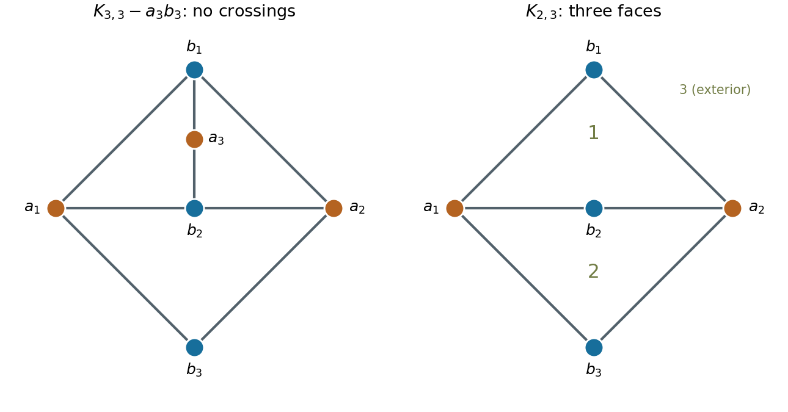

<h1 id="r/1/a/solution">Solution</h1>

↑ **Parent:** [A](../a.md)

The [complete bipartite graph](../../../../../complete-bipartite-graph.md) $K_{3,3}$ is not a [planar graph](../../../../../planar-graph-split.md). For example, a simple connected triangle-free planar graph with six vertices has at most $2\cdot6-4=8$ edges, by [Euler formula for a connected planar graph](../../../../../euler-formula-for-a-connected-planar-graph.md) and the fact that every face has boundary length at least four; $K_{3,3}$ has nine edges. At least one edge must therefore be deleted.

Delete $a_3b_3$ from the bipartition $\{a_1,a_2,a_3\}\sqcup\{b_1,b_2,b_3\}$. The left drawing below is a planar embedding of all eight remaining edges. It proves that **the minimum is one edge**.

**[Figure 1](#r/1/a/image-left-a-planar-embedding-of-k3-3-with-edge-a3b3-removed-right-k2-3-whose-two-bounded-faces-and-exterior-give-three-faces-in-total). Left: a planar embedding of K3,3 with edge a3b3 removed. Right: K2,3, whose two bounded faces and exterior give three faces in total.**

## ↑ Ancestors (13)

1. [A](../a.md)
2. [1](../../1.md)
3. [R](../../../r.md)
4. [2011](../../../../2011-split.md)
5. [Past exam of the probability, statistics and options I course of the University of Oxford](../../../../split.md)
6. [Probability, statistics and options I course of the University of Oxford](../../../../../probability-statistics-and-options-i-course-of-the-university-of-oxford.md)
7. [Year 2 of the mathematics and statistics course of the University of Oxford](../../../../../year-2-of-the-mathematics-and-statistics-course-of-the-university-of-oxford.md)
8. [Mathematics and statistics course of the University of Oxford](../../../../../mathematics-and-statistics-course-of-the-university-of-oxford.md)
9. [Undergraduate course of the University of Oxford](../../../../../undergraduate-course-of-the-university-of-oxford.md)
10. [Course of the University of Oxford](../../../../../course-of-the-university-of-oxford.md)
11. [University of Oxford](../../../../../university-of-oxford-split.md)
12. [List of universities](../../../../../list-of-universities.md)
13. [Codex Wiki](../../../../../split.md)
