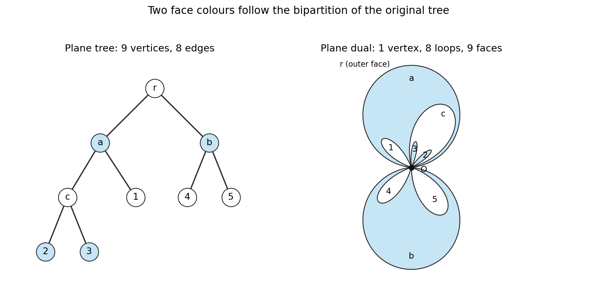

<h1 id="r/2/iv/solution">Solution</h1>

↑ **Parent:** [Iv](../iv.md)

Take a root $r$ with children $a,b$. Give $a$ the children $c,1$, give $c$ the children $2,3$, and give $b$ the children $4,5$. The [root of a tree](../../../../../root-of-a-tree.md) has degree two, the three [vertices](../../../../../vertex-graph-theory.md) $a,b,c$ have degree three, and $1,\ldots,5$ are the five [leaves of a graph](../../../../../leaf-of-a-graph.md). There are nine [vertices](../../../../../vertex-graph-theory.md) and eight [edges](../../../../../edge-of-a-graph.md), as required by the [handshaking lemma](../../../../../degree-sum-formula.md) and the [edge](../../../../../edge-of-a-graph.md) count for a [tree](../../../../../tree-graph-theory-split.md).

**[Figure 1](#r/2/iv/image-a-plane-tree-and-its-one-vertex-dual-graph-with-two-alternating-face-colours). A plane tree and its one-vertex dual graph, with two alternating face colours**.

## ↑ Ancestors (13)

1. [Iv](../iv.md)
2. [2](../../2.md)
3. [R](../../../r.md)
4. [2007](../../../../2007-split.md)
5. [Past exam of the Probability, statistics and options II course of the University of Oxford](../../../../split.md)
6. [Probability, statistics and options II course of the University of Oxford](../../../../../probability-statistics-and-options-ii-course-of-the-university-of-oxford.md)
7. [Year 2 of the mathematics and statistics course of the University of Oxford](../../../../../year-2-of-the-mathematics-and-statistics-course-of-the-university-of-oxford.md)
8. [Mathematics and statistics course of the University of Oxford](../../../../../mathematics-and-statistics-course-of-the-university-of-oxford.md)
9. [Undergraduate course of the University of Oxford](../../../../../undergraduate-course-of-the-university-of-oxford.md)
10. [Course of the University of Oxford](../../../../../course-of-the-university-of-oxford.md)
11. [University of Oxford](../../../../../university-of-oxford-split.md)
12. [List of universities](../../../../../list-of-universities.md)
13. [Codex Wiki](../../../../../split.md)
