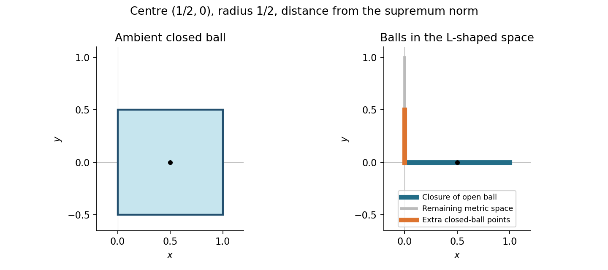
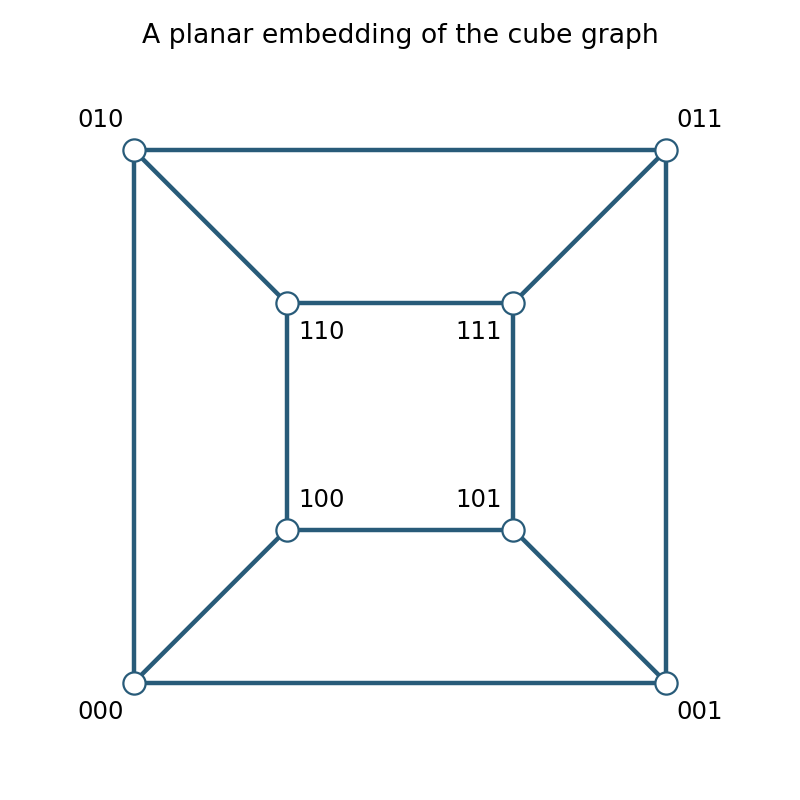

# 2008

↑ **Parent:** [Past exam of the Probability, statistics and options II course of the University of Oxford](../past-exam-of-the-probability-statistics-and-options-ii-course-of-the-university-of-oxford.md)

Source: [Mathematics release](https://www.whatdotheyknow.com/request/maths_past_papers_3), bundle `Part A 2007 11-1.pdf`, pages 105–120. This sixteen-page paper is for Mathematics & Statistics, dated 19 June 2008; the contemporary scheme is Part A.

Bounded exact-paper checks found no matching advertisement of worked answers. All printed sections and their common unnumbered tasks are covered; the source-exact editable transcription remains in the private archive.

**Table of contents**

- [A](#a)
  - [2](#a/2)
    - [a](#a/2/a)
      - [Solution](#a/2/a/solution)
    - [b](#a/2/b)
      - [i](#a/2/b/i)
        - [Solution](#a/2/b/i/solution)
      - [ii](#a/2/b/ii)
        - [Solution](#a/2/b/ii/solution)
      - [iii](#a/2/b/iii)
        - [Solution](#a/2/b/iii/solution)
- [B](#b)
  - [2](#b/2)
    - [Solution](#b/2/solution)
- [C](#c)
  - [2](#c/2)
    - [Solution](#c/2/solution)
- [D](#d)
  - [3](#d/3)
    - [a](#d/3/a)
      - [i](#d/3/a/i)
        - [Solution](#d/3/a/i/solution)
      - [ii](#d/3/a/ii)
        - [Solution](#d/3/a/ii/solution)
    - [b](#d/3/b)
      - [Solution](#d/3/b/solution)
    - [c](#d/3/c)
      - [i](#d/3/c/i)
        - [Solution](#d/3/c/i/solution)
      - [ii](#d/3/c/ii)
        - [Solution](#d/3/c/ii/solution)
  - [4](#d/4)
    - [a](#d/4/a)
      - [Solution](#d/4/a/solution)
    - [b](#d/4/b)
      - [i](#d/4/b/i)
        - [Solution](#d/4/b/i/solution)
      - [ii](#d/4/b/ii)
        - [Solution](#d/4/b/ii/solution)
- [E](#e)
  - [3](#e/3)
    - [a](#e/3/a)
      - [Solution](#e/3/a/solution)
    - [b](#e/3/b)
      - [Solution](#e/3/b/solution)
    - [c](#e/3/c)
      - [Solution](#e/3/c/solution)
    - [d](#e/3/d)
      - [Solution](#e/3/d/solution)
  - [4](#e/4)
    - [a](#e/4/a)
      - [Solution](#e/4/a/solution)
    - [b](#e/4/b)
      - [i](#e/4/b/i)
        - [Solution](#e/4/b/i/solution)
      - [ii](#e/4/b/ii)
        - [Solution](#e/4/b/ii/solution)
    - [c](#e/4/c)
      - [Solution](#e/4/c/solution)
- [F](#f)
  - [2](#f/2)
    - [a](#f/2/a)
      - [Solution](#f/2/a/solution)
    - [b](#f/2/b)
      - [Solution](#f/2/b/solution)
    - [c](#f/2/c)
      - [Solution](#f/2/c/solution)
- [G](#g)
  - [2](#g/2)
    - [Solution](#g/2/solution)
- [H](#h)
  - [2](#h/2)
    - [a](#h/2/a)
      - [Solution](#h/2/a/solution)
    - [b](#h/2/b)
      - [i](#h/2/b/i)
        - [Solution](#h/2/b/i/solution)
      - [ii](#h/2/b/ii)
        - [Solution](#h/2/b/ii/solution)
- [J](#j)
  - [2](#j/2)
    - [Solution](#j/2/solution)
- [K](#k)
  - [3](#k/3)
    - [a](#k/3/a)
      - [Solution](#k/3/a/solution)
    - [b](#k/3/b)
      - [Solution](#k/3/b/solution)
    - [c](#k/3/c)
      - [Solution](#k/3/c/solution)
    - [Solution](#k/3/solution)
  - [4](#k/4)
    - [Solution](#k/4/solution)
- [M](#m)
  - [4](#m/4)
    - [Solution](#m/4/solution)
  - [5](#m/5)
    - [a](#m/5/a)
      - [Solution](#m/5/a/solution)
    - [b](#m/5/b)
      - [Solution](#m/5/b/solution)
- [O](#o)
  - [4](#o/4)
    - [Solution](#o/4/solution)
  - [5](#o/5)
    - [Solution](#o/5/solution)
    - [i](#o/5/i)
      - [Solution](#o/5/i/solution)
    - [ii](#o/5/ii)
      - [Solution](#o/5/ii/solution)
- [P](#p)
  - [3](#p/3)
    - [a](#p/3/a)
      - [Solution](#p/3/a/solution)
    - [b](#p/3/b)
      - [Solution](#p/3/b/solution)
    - [c](#p/3/c)
      - [Solution](#p/3/c/solution)
    - [d](#p/3/d)
      - [Solution](#p/3/d/solution)
    - [e](#p/3/e)
      - [Solution](#p/3/e/solution)
  - [4](#p/4)
    - [a](#p/4/a)
      - [Solution](#p/4/a/solution)
    - [b](#p/4/b)
      - [Solution](#p/4/b/solution)
    - [c](#p/4/c)
      - [Solution](#p/4/c/solution)
- [R](#r)
  - [2](#r/2)
    - [i](#r/2/i)
      - [a](#r/2/i/a)
        - [Solution](#r/2/i/a/solution)
      - [b](#r/2/i/b)
        - [Solution](#r/2/i/b/solution)
    - [ii](#r/2/ii)
      - [Solution](#r/2/ii/solution)
    - [iii](#r/2/iii)
      - [Solution](#r/2/iii/solution)
    - [iv](#r/2/iv)
      - [a](#r/2/iv/a)
        - [Solution](#r/2/iv/a/solution)
      - [b](#r/2/iv/b)
        - [Solution](#r/2/iv/b/solution)
      - [c](#r/2/iv/c)
        - [Solution](#r/2/iv/c/solution)
      - [d](#r/2/iv/d)
        - [Solution](#r/2/iv/d/solution)
      - [e](#r/2/iv/e)
        - [Solution](#r/2/iv/e/solution)
    - [v](#r/2/v)
      - [Solution](#r/2/v/solution)
- [S](#s)
  - [2](#s/2)
    - [a](#s/2/a)
      - [Solution](#s/2/a/solution)
    - [b](#s/2/b)
      - [Solution](#s/2/b/solution)
    - [c](#s/2/c)
      - [Solution](#s/2/c/solution)
- [T](#t)
  - [2](#t/2)
    - [a](#t/2/a)
      - [i](#t/2/a/i)
        - [Solution](#t/2/a/i/solution)
      - [ii](#t/2/a/ii)
        - [Solution](#t/2/a/ii/solution)
      - [iii](#t/2/a/iii)
        - [Solution](#t/2/a/iii/solution)
    - [b](#t/2/b)
      - [i](#t/2/b/i)
        - [Solution](#t/2/b/i/solution)
      - [ii](#t/2/b/ii)
        - [Solution](#t/2/b/ii/solution)
      - [iii](#t/2/b/iii)
        - [Solution](#t/2/b/iii/solution)

## A

↑ **Parent:** [2008](2008.md)

<h3 id="a/2">2</h3>

↑ **Parent:** [A](#a)

<h4 id="a/2/a">a</h4>

↑ **Parent:** [2](#a/2)

<h5 id="a/2/a/solution">Solution</h5>

↑ **Parent:** [A](#a/2/a)

An [invertible matrix](../linear-algebra.md#invertible-matrix) is exactly an ordered [basis](../vector-space.md#basis) of its column space. The first column has $q^n-1$ choices. After $j$ [independent](../random-variable.md#independent-random-variables) columns have been chosen, their span has $q^j$ elements, so the next column has $q^n-q^j$ choices. Therefore

$$
\boxed{|\operatorname{GL}(n,q)|=\prod_{j=0}^{n-1}(q^n-q^j).}
$$

<h4 id="a/2/b">b</h4>

↑ **Parent:** [2](#a/2)

<h5 id="a/2/b/i">i</h5>

↑ **Parent:** [B](#a/2/b)

<h6 id="a/2/b/i/solution">Solution</h6>

↑ **Parent:** [I](#a/2/b/i)

Choose a [basis](../vector-space.md#basis) for the first subspace of a [flag](../vector-space.md#flag-linear-algebra), extend it to a [basis](../vector-space.md#basis) for the second, and continue until obtaining a [basis](../vector-space.md#basis) of the whole [vector space](../vector-space.md). Do the same for the target [flag](../vector-space.md#flag-linear-algebra). The unique [linear map](../vector-space.md#linear-map) sending the first adapted [basis](../vector-space.md#basis) to the second is invertible and sends every flagged subspace to its counterpart. Hence the action is **[transitive](../group-action.md#transitive-group-action)**.

<h5 id="a/2/b/ii">ii</h5>

↑ **Parent:** [B](#a/2/b)

<h6 id="a/2/b/ii/solution">Solution</h6>

↑ **Parent:** [Ii](#a/2/b/ii)

**Yes.** Let $g$ send the first [flag](../vector-space.md#flag-linear-algebra) to the second and write $d=\det g\ne0$. In an adapted [basis](../vector-space.md#basis) of the target [flag](../vector-space.md#flag-linear-algebra), scale its first vector by $d^{-1}$ and fix the others. This defines a [flag](../vector-space.md#flag-linear-algebra)-preserving map $h$ with determinant $d^{-1}$. Then $hg$ still sends the first [flag](../vector-space.md#flag-linear-algebra) to the second and has determinant one. Thus $\operatorname{SL}(n,K)$ is [transitive](../group-action.md#transitive-group-action) as well.

<h5 id="a/2/b/iii">iii</h5>

↑ **Parent:** [B](#a/2/b)

<h6 id="a/2/b/iii/solution">Solution</h6>

↑ **Parent:** [Iii](#a/2/b/iii)

Relative to the three successive blocks of sizes $1,2,2$, the stabilizer consists of the block upper triangular [matrices](../vector-space.md#matrix)

$$
\begin{pmatrix}a&B&C\\0&D&E\\0&0&F\end{pmatrix},\qquad a\in K^\times,\quad D,F\in\operatorname{GL}(2,K).
$$

The off-diagonal blocks contain $2+2+4=8$ arbitrary [field](../algebra.md#field) entries. Thus its order is $(q-1)|\operatorname{GL}(2,q)|^2q^8$. By [orbit-stabilizer theorem](../group-action.md#orbit-stabilizer-theorem),

$$
\boxed{|\Omega|=\frac{\prod_{j=0}^4(q^5-q^j)}{q^8(q-1)(q^2-1)^2(q^2-q)^2}.}
$$

Equivalently, choose the line first and then a two-dimensional subspace of the four-dimensional quotient:

$$
|\Omega|=\frac{q^5-1}{q-1}\frac{(q^4-1)(q^4-q)}{(q^2-1)(q^2-q)}.
$$

This also checks the stabilizer count independently.

<h2 id="b">B</h2>

↑ **Parent:** [2008](2008.md)

<h3 id="b/2">2</h3>

↑ **Parent:** [B](#b)

<h4 id="b/2/solution">Solution</h4>

↑ **Parent:** [2](#b/2)

The [characteristic](../algebra.md#characteristic-of-a-field) is the smallest positive integer $p$ with $p1_F=0$. Such an integer exists because the additive [group](../group.md) is finite. If it factored as $p=ab$ with $1<a,b<p$, then $(a1_F)(b1_F)=0$ with both factors nonzero, contradicting the absence of zero divisors. Hence it is [prime](../prime-number.md). The elements generated by $1_F$ form a subfield isomorphic to $\mathbb F_p$. The finite set $F$ is a [finite-dimensional vector space](../vector-space.md#finite-dimensional-vector-space) of some [dimension](../vector-space.md#dimension-vector-space) $a\ge1$ over that subfield, so $\boxed{|F|=p^a}$.

A nonzero [polynomial](../polynomial.md) of [polynomial degree](../polynomial.md#degree-of-a-polynomial) $n$ over a [field](../algebra.md#field) has at most $n$ distinct roots. This follows by [induction](../foundations-of-mathematics.md#mathematical-induction): a root $r$ gives a factor $X-r$, and every different root must be a root of the remaining factor by cancellation. Thus $X^n-1$ has at most $n$ roots. In the finite multiplicative [group](../group.md), the elements whose order divides $n$ are exactly those satisfying $x^n=1$. The supplied cyclicity criterion therefore proves that **the multiplicative [group](../group.md) is cyclic**.

For the [prime](../prime-number.md) of the specified form write $m=2^r s$ with $s$ odd. If $s>1$, then $2^{2^r}+1$ is a proper factor of $(2^{2^r})^s+1$, impossible. Thus $m$ is a [power of two](../integer.md#power-of-two). Since $2^m\equiv-1\pmod p$, the order of two divides $2m$ but does not divide $m$. All divisors of the [power of two](../integer.md#power-of-two) $2m$ other than $2m$ itself divide $m$. Consequently

$$
\boxed{\operatorname{ord}_p(2)=2m.}
$$

It generates the multiplicative [group](../group.md) precisely when $2m=p-1=2^m$. For positive integers $m$ this holds exactly at $m=1,2$: from $m=3$ onward $2^m>2m$, and the inequality persists on increasing $m$. These give $\boxed{p=3\text{ or }5}$, equivalently the stated range among Fermat [primes](../prime-number.md).

## C

↑ **Parent:** [2008](2008.md)

<h3 id="c/2">2</h3>

↑ **Parent:** [C](#c)

<h4 id="c/2/solution">Solution</h4>

↑ **Parent:** [2](#c/2)

The $d$ distinct powers $1,a,\ldots,a^{d-1}$ all satisfy $X^d=1$. The supplied root bound says they exhaust those roots. Thus every element of order $d$ has the form $a^n$. If $g=\gcd(n,d)$, the least positive $k$ with $a^{nk}=1$ is $d/g$, so

$$
\boxed{\operatorname{ord}_p(a^n)=\frac d{\gcd(n,d)}.}
$$

This proves both directions of the first assertion.

For existence of a [primitive root](../number-theory.md#primitive-root-modulo-n) one may apply the finite-[field](../algebra.md#field) cyclicity criterion proved in the preceding section. There is also a direct counting proof: for each divisor $d$ of $p-1$, either no elements have order $d$, or the preceding argument shows there are exactly $\phi(d)$. [Lagrange's theorem](../group-theory.md#lagrange-s-theorem) partitions all $p-1$ nonzero [residue](../analysis.md#residue) classes by such orders, while $\sum_{d\mid p-1}\phi(d)=p-1$. Every count is at most its corresponding $\phi(d)$, so equality of the totals forces equality at every divisor. In particular there are $\boxed{\phi(p-1)}$ [primitive roots](../number-theory.md#primitive-root-modulo-n).

Put $t=g^{(p-1)/8}$. It has order eight, so $t^4=-1$ and $t^8=1$. The specified element is $k=t+t^7=t+t^{-1}$. Since $t^{-2}=-t^2$, squaring gives $\boxed{k^2=t^2+2+t^{-2}=2\pmod p}$.

## D

↑ **Parent:** [2008](2008.md)

<h3 id="d/3">3</h3>

↑ **Parent:** [D](#d)

<h4 id="d/3/a">a</h4>

↑ **Parent:** [3](#d/3)

<h5 id="d/3/a/i">i</h5>

↑ **Parent:** [A](#d/3/a)

<h6 id="d/3/a/i/solution">Solution</h6>

↑ **Parent:** [I](#d/3/a/i)

The [monotone convergence](../measure-theory.md#monotone-convergence-theorem) theorem states that if $f_n$ are measurable, nonnegative functions on a measure space with $f_n\le f_{n+1}$ [almost everywhere](../measure-theory.md#almost-everywhere) and $f_n\uparrow f$ [almost everywhere](../measure-theory.md#almost-everywhere), then

$$
\boxed{\int f\,d\mu=\lim_{n\to\infty}\int f_n\,d\mu.}
$$

The equality is valid in $[0,\infty]$, so finiteness is not required. Changes on null sets do not affect the conclusion.

<h5 id="d/3/a/ii">ii</h5>

↑ **Parent:** [A](#d/3/a)

<h6 id="d/3/a/ii/solution">Solution</h6>

↑ **Parent:** [Ii](#d/3/a/ii)

**No.** Take $f_n=\mathbf1_{[n,n+1]}$ on the [real line](../real-analysis.md#real-line). At every fixed point it eventually vanishes, so $f=0$, while $\int f_n=1$ for every $n$. Thus the limit of the integrals is one and the integral of the pointwise limit is zero. Nonnegativity alone cannot replace monotonicity or an [integrable](../measure-theory.md#integrability) domination hypothesis.

<h4 id="d/3/b">b</h4>

↑ **Parent:** [3](#d/3)

<h5 id="d/3/b/solution">Solution</h5>

↑ **Parent:** [B](#d/3/b)

Let $S_N=\sum_{k=0}^N a_k$. These are nonnegative measurable functions increasing to the extended-valued sum $S$. [Monotone convergence](../measure-theory.md#monotone-convergence-theorem) gives

$$
\boxed{\int S=\sum_{k=0}^\infty\int a_k<\infty.}
$$

A [nonnegative function](../function.md#nonnegative-function) with finite integral cannot be infinite on a set of positive measure. Hence $S(x)<\infty$ [almost everywhere](../measure-theory.md#almost-everywhere), which is exactly almost-everywhere convergence of the nonnegative series. One may redefine the sum arbitrarily on the exceptional [null set](../measure-theory.md#null-set) to obtain an ordinary [integrable](../measure-theory.md#integrability) representative.

<h4 id="d/3/c">c</h4>

↑ **Parent:** [3](#d/3)

<h5 id="d/3/c/i">i</h5>

↑ **Parent:** [C](#d/3/c)

<h6 id="d/3/c/i/solution">Solution</h6>

↑ **Parent:** [I](#d/3/c/i)

Substitute $u=\log x$, giving $dx=e^u\,du$. The nonnegative integral becomes

$$
\int_0^\infty u e^{-(\alpha-1)u}\,du.
$$

For $\alpha>1$ an [integration by parts](../calculus.md#integration-by-parts) gives $1/(\alpha-1)^2$; its boundary term vanishes because exponential decay dominates $u$. Hence it is finite, proving integrability and

$$
\boxed{\int_1^\infty x^{-\alpha}\log x\,dx=(\alpha-1)^{-2}.}
$$

<h5 id="d/3/c/ii">ii</h5>

↑ **Parent:** [C](#d/3/c)

<h6 id="d/3/c/ii/solution">Solution</h6>

↑ **Parent:** [Ii](#d/3/c/ii)

For $x>1$ the geometric expansion gives

$$
\frac{\log x}{x^p(x-1)}=\sum_{k=0}^\infty x^{-(p+k+1)}\log x.
$$

Every summand is nonnegative, so [monotone convergence](../measure-theory.md#monotone-convergence-theorem) permits integration term by term without a prior integrability assumption. The preceding part applies with $\alpha=p+k+1>1$, yielding

$$
\boxed{\int_1^\infty\frac{\log x}{x^p(x-1)}\,dx=\sum_{k=0}^\infty\frac1{(p+k)^2}.}
$$

The series is finite for every fixed $p>0$, by comparison of its tail with $\sum k^{-2}$. This also proves integrability of the original function.

<h3 id="d/4">4</h3>

↑ **Parent:** [D](#d)

<h4 id="d/4/a">a</h4>

↑ **Parent:** [4](#d/4)

<h5 id="d/4/a/solution">Solution</h5>

↑ **Parent:** [A](#d/4/a)

On the product of two sigma-finite measure spaces, [Tonelli's theorem](../measure-theory.md#tonelli-theorem) states that a nonnegative [measurable function](../measure-theory.md#measurable-function) has measurable iterated-integral functions and

$$
\int_{X\times Y}f\,d(\mu\times\nu)=\int_X\int_Yf\,d\nu\,d\mu=\int_Y\int_Xf\,d\mu\,d\nu,
$$

with values allowed to be infinite. Fubini's theorem states that if $f$ is measurable and $\int_{X\times Y}|f|<\infty$, then its sections are [integrable](../measure-theory.md#integrability) [almost everywhere](../measure-theory.md#almost-everywhere), both iterated integrals exist as finite integrals, and the same equality holds, also for real or complex signed functions. Tonelli applied to $|f|$ can first be used to verify the absolute-integrability hypothesis of Fubini.

<h4 id="d/4/b">b</h4>

↑ **Parent:** [4](#d/4)

<h5 id="d/4/b/i">i</h5>

↑ **Parent:** [B](#d/4/b)

<h6 id="d/4/b/i/solution">Solution</h6>

↑ **Parent:** [I](#d/4/b/i)

For fixed $n>0$, Tonelli gives

$$
\int_0^n\int_0^\infty |\sin x|e^{-tx}\,dt\,dx=\int_0^n\frac{|\sin x|}{x}\,dx<\infty,
$$

because the quotient is [bounded](../topological-analysis.md#boundedness) near zero. Fubini therefore permits reversing the order for this finite $x$ [interval](../real-analysis.md#interval-mathematics). Direct integration in $x$ yields

$$
\int_0^n e^{-tx}\sin x\,dx=\frac{1-e^{-nt}(t\sin n+\cos n)}{1+t^2}.
$$

Thus the desired integral equals $\pi/2$ minus the integral of the exponential remainder. Its absolute value is at most

$$
\int_0^\infty e^{-nt}(t+1)\,dt=\frac1{n^2}+\frac1n\longrightarrow0.
$$

Consequently $\boxed{\lim_{n\to\infty}\int_0^n\sin x/x\,dx=\pi/2}$. The truncation is essential: Fubini is not being applied to an absolutely [integrable function](../measure-theory.md#lebesgue-integrable-function) over the whole infinite rectangle.

<h5 id="d/4/b/ii">ii</h5>

↑ **Parent:** [B](#d/4/b)

<h6 id="d/4/b/ii/solution">Solution</h6>

↑ **Parent:** [Ii](#d/4/b/ii)

**No.** On each [interval](../real-analysis.md#interval-mathematics) $[k\pi,(k+1)\pi]$, for $k\ge1$,

$$
\int_{k\pi}^{(k+1)\pi}\frac{|\sin x|}{x}\,dx\ge\frac1{(k+1)\pi}\int_{k\pi}^{(k+1)\pi}|\sin x|\,dx=\frac2{(k+1)\pi}.
$$

The resulting harmonic lower bound diverges. Therefore $\sin x/x\notin L^1(0,\infty)$. Its convergent improper integral does not make it [Lebesgue integrable](../measure-theory.md#lebesgue-integrable-function); its positive and negative parts both have infinite integral.

## E

↑ **Parent:** [2008](2008.md)

<h3 id="e/3">3</h3>

↑ **Parent:** [E](#e)

<h4 id="e/3/a">a</h4>

↑ **Parent:** [3](#e/3)

<h5 id="e/3/a/solution">Solution</h5>

↑ **Parent:** [A](#e/3/a)

The distance function $x\mapsto d(x,c)$ is [continuous](../calculus.md#continuous-function) because the triangle inequality gives $|d(x,c)-d(y,c)|\le d(x,y)$. Hence $\overline B(c,r)=\{x:d(x,c)\le r\}$ is the [inverse image](../set-theory.md#preimage) of the closed [interval](../real-analysis.md#interval-mathematics) $(-\infty,r]$, so is closed. Since it contains $B(c,r)$, it also contains the [closure](../topology.md#closure-topology) of that [open ball](../topology.md#open-ball):

$$
\boxed{\operatorname{cl}B(c,r)\subseteq\overline B(c,r).}
$$

<h4 id="e/3/b">b</h4>

↑ **Parent:** [3](#e/3)

<h5 id="e/3/b/solution">Solution</h5>

↑ **Parent:** [B](#e/3/b)

The condition is $\max(|x-1/2|,|y|)\le1/2$. Therefore the ball is the **closed square**

$$
\boxed{[0,1]\times[-1/2,1/2].}
$$

Its four [vertices](../graph.md#vertex-graph-theory) are $(0,\pm1/2)$ and $(1,\pm1/2)$.

**[Figure 1](#e/3/b/image-closed-supremum-norm-ball-and-its-restriction-to-the-l-shaped-metric-space). Closed supremum-norm ball and its restriction to the L-shaped metric space**.

<h4 id="e/3/c">c</h4>

↑ **Parent:** [3](#e/3)

<h5 id="e/3/c/solution">Solution</h5>

↑ **Parent:** [C](#e/3/c)

The induced-[metric](../topological-analysis.md#metric) balls are intersections with the corresponding ambient balls. On the horizontal arm the distance from the centre is $|x-1/2|$; on the vertical arm it is $\max(1/2,y)$. Consequently

$$
\boxed{B_E=((0,1)\times\{0\}),\qquad\overline B_E=([0,1]\times\{0\})\cup(\{0\}\times[0,1/2]).}
$$

The [closure](../topology.md#closure-topology) relative to $E$ of the [open ball](../topology.md#open-ball) is $[0,1]\times\{0\}$. Every point $(0,y)$ with $y>0$ has positive distance $y$ from that horizontal arm, so none of those points is in the [closure](../topology.md#closure-topology). In particular $(0,1/4)$ lies in the [closed ball](../topological-analysis.md#closed-ball) but not in the [closure](../topology.md#closure-topology) of the [open ball](../topology.md#open-ball), proving **strict inclusion**.

<h4 id="e/3/d">d</h4>

↑ **Parent:** [3](#e/3)

<h5 id="e/3/d/solution">Solution</h5>

↑ **Parent:** [D](#e/3/d)

Let the radius be $r>0$. One inclusion follows from (a). For the reverse, if $\|x-c\|\le r$, set $x_n=c+(1-1/n)(x-c)$ for $n\ge2$. Then $\|x_n-c\|<r$ and $x_n\to x$, so every closed-ball point is in the [closure](../topology.md#closure-topology) of the [open ball](../topology.md#open-ball). Hence

$$
\boxed{\operatorname{cl}B(c,r)=\overline B(c,r)\quad(r>0).}
$$

The positive-radius convention matters: if radius zero is allowed, the [open ball](../topology.md#open-ball) is empty whereas the [closed ball](../topological-analysis.md#closed-ball) is $\{c\}$, so the asserted equality fails at that degenerate radius.

<h3 id="e/4">4</h3>

↑ **Parent:** [E](#e)

<h4 id="e/4/a">a</h4>

↑ **Parent:** [4](#e/4)

<h5 id="e/4/a/solution">Solution</h5>

↑ **Parent:** [A](#e/4/a)

In the usual [real line](../real-analysis.md#real-line) take $\boxed{F_n=[n,\infty)}$. Each set is nonempty and closed, and $F_{n+1}\subseteq F_n$. No real number lies in them all, because the positive integers are unbounded. Thus their intersection is empty. These sets are not [compact](../topology.md#compact-space).

<h4 id="e/4/b">b</h4>

↑ **Parent:** [4](#e/4)

<h5 id="e/4/b/i">i</h5>

↑ **Parent:** [B](#e/4/b)

<h6 id="e/4/b/i/solution">Solution</h6>

↑ **Parent:** [I](#e/4/b/i)

[Compact](../topology.md#compact-space) subsets of a [Hausdorff space](../topology.md#hausdorff-space) are closed. Regard every $K_n$ as a closed subset of the [compact](../topology.md#compact-space) set $K_1$. Any finite intersection equals the member with largest index and is therefore nonempty. The [finite intersection property](../topology.md#finite-intersection-property) for closed subsets of a [compact](../topology.md#compact-space) space implies

$$
\boxed{\bigcap_{n\ge1}K_n\ne\varnothing.}
$$

Equivalently, an empty intersection would give an open cover of $K_1$ by their complements, with a finite subcover contradicting nested nonemptiness.

<h5 id="e/4/b/ii">ii</h5>

↑ **Parent:** [B](#e/4/b)

<h6 id="e/4/b/ii/solution">Solution</h6>

↑ **Parent:** [Ii](#e/4/b/ii)

Suppose no such $n_0$ exists. Nestedness then makes every $K_n\setminus U$ nonempty. These are nested [compact](../topology.md#compact-space) sets: $X\setminus U$ is closed and $K_n$ is [compact](../topology.md#compact-space). By (i) their intersection is nonempty. But that intersection is $(\bigcap_nK_n)\setminus U$, contrary to the hypothesis. Thus $K_{n_0}\subseteq U$ for some $n_0$, and nestedness gives $\boxed{K_n\subseteq U\text{ for all }n\ge n_0}$ immediately.

<h4 id="e/4/c">c</h4>

↑ **Parent:** [4](#e/4)

<h5 id="e/4/c/solution">Solution</h5>

↑ **Parent:** [C](#e/4/c)

The inclusion $f(\bigcap_nK_n)\subseteq\bigcap_nf(K_n)$ holds for every map. For the reverse choose $y\in\bigcap_nf(K_n)$ and let $L_n=K_n\cap f^{-1}(\{y\})$. These sets are nonempty and nested. A [Hausdorff space](../topology.md#hausdorff-space) has closed singletons, and [continuity](../calculus.md#continuous-function) makes the fibre closed, so each $L_n$ is [compact](../topology.md#compact-space). Part (b)(i) gives a point $x\in\bigcap_nL_n$. Then $x\in\bigcap_nK_n$ and $f(x)=y$. Hence

$$
\boxed{f\left(\bigcap_nK_n\right)=\bigcap_nf(K_n).}
$$

## F

↑ **Parent:** [2008](2008.md)

<h3 id="f/2">2</h3>

↑ **Parent:** [F](#f)

<h4 id="f/2/a">a</h4>

↑ **Parent:** [2](#f/2)

<h5 id="f/2/a/solution">Solution</h5>

↑ **Parent:** [A](#f/2/a)

A two-dimensional [embedded submanifold](../smooth-manifold.md#embedded-submanifold) is a subset which near every point can be straightened by a smooth local coordinate change in the ambient space to an open piece of the coordinate plane $\mathbb R^2\times\{0\}$. Equivalently locally it has a regular smooth parametrization of rank two, with the induced local topology.

A [tangent vector](../tangent-vector.md) at $x$ is the [derivative](../calculus.md#derivative) $\gamma'(0)$ of a smooth curve in the [submanifold](../differential-geometry.md#submanifold) with $\gamma(0)=x$. These [derivatives](../calculus.md#derivative) form the two-dimensional [tangent space](../tangent-vector.md#tangent-space) $T_xM$. A [normal vector](../differential-geometry.md#normal-vector) is a vector [orthogonal](../inner-product.md#orthogonal-vectors) to every [tangent vector](../tangent-vector.md). Its space is $(T_xM)^\perp$, which has $\boxed{\dim (T_xM)^\perp=1}$ in the three-dimensional ambient Euclidean space.

<h4 id="f/2/b">b</h4>

↑ **Parent:** [2](#f/2)

<h5 id="f/2/b/solution">Solution</h5>

↑ **Parent:** [B](#f/2/b)

Define $F(x)=x_1^2/a^2+x_2^2/b^2+x_3^2/c^2-1$. Its [gradient](../multivariable-calculus.md#gradient) is $2(x_1/a^2,x_2/b^2,x_3/c^2)$. It cannot vanish on $F^{-1}(0)$, because the only possible zero is the origin and that point has $F=-1$. The regular level-set theorem therefore makes the ellipsoid a two-dimensional [embedded submanifold](../smooth-manifold.md#embedded-submanifold). Its [normal space](../topology.md#normal-space) is

$$
\boxed{N_xM=\mathbb R\,(x_1/a^2,x_2/b^2,x_3/c^2),}
$$

and the [tangent space](../tangent-vector.md#tangent-space) is the [orthogonal](../inner-product.md#orthogonal-vectors) complement of that line.

<h4 id="f/2/c">c</h4>

↑ **Parent:** [2](#f/2)

<h5 id="f/2/c/solution">Solution</h5>

↑ **Parent:** [C](#f/2/c)

If a [differentiable](../analysis.md#differentiable-function) function has a constrained local extremum at a point of a smooth surface, its [derivative](../calculus.md#derivative) vanishes in every tangent direction; equivalently its [gradient](../multivariable-calculus.md#gradient) is normal to the surface. For a regular equation $F=0$ this means $\nabla V=\lambda\nabla F$ for some real multiplier.

First the box is centred at the origin: holding the other coordinates of a [vertex of a polyhedron](../euclidean-geometry.md#vertex-of-a-polyhedron) fixed and comparing the two possible coordinates $u,v$ in the first direction gives $u^2=v^2$, so the distinct extremes are opposites; the other two directions give the same conclusion. Write its positive half-lengths as $a r,b s,c t$, with $r^2+s^2+t^2=1$. Its volume is $8abc\,rst$. A degenerate box has zero volume, so a positive [maximum](../set.md#maximum-of-a-subset-of-a-total-order) is interior in $r,s,t>0$. [Lagrange multipliers](../mathematical-optimization.md#lagrange-multiplier) applied to $\log(rst)$ give $1/r=2\lambda r$, and the analogous equations imply $r=s=t=1/\sqrt3$. Alternatively the arithmetic–geometric mean inequality applied to $r^2,s^2,t^2$ proves global maximality. Thus

$$
\boxed{\text{side lengths }\frac{2a}{\sqrt3},\frac{2b}{\sqrt3},\frac{2c}{\sqrt3},\qquad V_{\max}=\frac{8abc}{3\sqrt3}.}
$$

## G

↑ **Parent:** [2008](2008.md)

<h3 id="g/2">2</h3>

↑ **Parent:** [G](#g)

<h4 id="g/2/solution">Solution</h4>

↑ **Parent:** [2](#g/2)

Assume the regular Sturm–Liouville setting: real coefficients with $p>0$, $w>0$ and sufficient [continuity](../calculus.md#continuous-function) and [differentiability](../analysis.md#differentiability) for the integrations below. Apply a multiplier to $J[y]-\lambda(\int_a^bwy^2-1)$. Its [first variation](../calculus-of-variations.md#first-variation) in the direction $\eta$ is

$$
2[p y'\eta]_a^b-2\int_a^b\big((p y')'+qy+\lambda wy\big)\eta\,dx.
$$

Variations vanishing at both endpoints and the supplied fundamental lemma give

$$
\boxed{-(p y')'-qy=\lambda wy.}
$$

At a free endpoint the value of $\eta$ is arbitrary, so the natural condition is $p y'=0$ there. At a fixed endpoint $\eta=0$, so no such [derivative](../calculus.md#derivative) condition is imposed; the prescribed endpoint value is imposed instead. This distinction also allows one endpoint of each type.

For [eigenfunctions](../linear-operator-theory.md#eigenfunction) $u,v$ of distinct [eigenvalues](../linear-operator-theory.md#eigenvalue) $\lambda,\mu$ under the same homogeneous self-adjoint endpoint conditions, multiply their equations by $v,u$ and subtract. Integration gives

$$
(\lambda-\mu)\int_a^b wuv\,dx=[p(uv'-u'v)]_a^b=0.
$$

The boundary expression vanishes for both natural conditions and homogeneous fixed-value conditions. Thus $\boxed{\int_a^b wuv=0}$ for different [eigenvalues](../linear-operator-theory.md#eigenvalue).

In the specified fixed-endpoint case the eigenproblem is $-y''-y=\lambda y$, $y(0)=y(1)=0$. There are no nonzero solutions when $\lambda+1\le0$; the elementary exponential or affine solutions and the two endpoint conditions prove this. For $\lambda+1>0$, the first condition [leaves](../graph-theory.md#leaf-of-a-graph) a sine and the second requires frequency $n\pi$. The normalized stationary functions and [eigenvalues](../linear-operator-theory.md#eigenvalue) are

$$
\boxed{y_n(x)=\pm\sqrt2\sin(n\pi x),\qquad\lambda_n=n^2\pi^2-1,\quad n\ge1.}
$$

Distinct sine modes are [orthogonal](../inner-product.md#orthogonal-vectors) by the [product-to-sum formula](../geometry-and-topology.md#product-to-sum-formula), or by the preceding [Green second identity](../partial-differential-equation.md#green-second-identity). Although they need not satisfy the natural [derivative](../calculus.md#derivative) conditions, their fixed zero values also annihilate the boundary expression, so [orthogonality](../inner-product.md#orthogonal-vectors) is expected.

The [Wirtinger inequality](../calculus-of-variations.md#wirtinger-inequality) $\int_0^1y'^2\ge\pi^2\int_0^1y^2$ gives $J[y]\ge\pi^2-1$. For completeness it follows by writing $y=v\sin\pi x$ for a smooth function supported away from the endpoints and integrating the cross term: $\int(y'^2-\pi^2y^2)=\int\sin^2(\pi x)v'^2\ge0$. Approximation extends it to the Dirichlet Sobolev class. Equality is attained by the first sine mode; the eigenproblem or equality condition gives only its scalar multiples. Hence the two normalized minimizers are $\boxed{y=\pm\sqrt2\sin\pi x}$ and the [minimum](../set.md#minimum-of-a-subset-of-a-total-order) is $\boxed{\pi^2-1=\lambda_1}$.

There is a wording distinction in the source: the two sign choices of the [minimum](../set.md#minimum-of-a-subset-of-a-total-order) are not [orthogonal](../inner-product.md#orthogonal-vectors) to each other, since their [inner product](../inner-product.md) is $-1$. [Orthogonality](../inner-product.md#orthogonal-vectors) applies to the stationary modes with different [eigenvalues](../linear-operator-theory.md#eigenvalue), not to both signs of the same minimizer.

## H

↑ **Parent:** [2008](2008.md)

<h3 id="h/2">2</h3>

↑ **Parent:** [H](#h)

<h4 id="h/2/a">a</h4>

↑ **Parent:** [2](#h/2)

<h5 id="h/2/a/solution">Solution</h5>

↑ **Parent:** [A](#h/2/a)

Measure the axial coordinate $z$ from the [vertex](../graph.md#vertex-graph-theory). The slice radius is $z\tan\alpha$ and its [mass](../classical-mechanics.md#mass) is $dm=3mz^2H^{-3}\,dz$, since cross-sectional area is proportional to $z^2$. Its axial moment is $\tfrac12(z\tan\alpha)^2dm$. Therefore

$$
\boxed{C_O=\frac{3mH^2}{10}\tan^2\alpha.}
$$

For an axis through the [vertex](../graph.md#vertex-graph-theory) perpendicular to the [cone](../euclidean-geometry.md#cone-geometry) axis, a thin disc contributes $[z^2+\tfrac14z^2\tan^2\alpha]dm$: the second term is its diametral moment. Integration gives the two equal transverse principal moments

$$
\boxed{A_O=B_O=\frac{3mH^2}{5}\left(1+\frac{\tan^2\alpha}{4}\right).}
$$

Rotational symmetry eliminates the mixed moments and makes these the principal axes. The [centre of mass](../classical-mechanics.md#center-of-mass) is at $3H/4$, so the parallel-axis theorem would give $A_G=3mH^2/80+3mH^2\tan^2\alpha/20$ and $C_G=C_O$.

<h4 id="h/2/b">b</h4>

↑ **Parent:** [2](#h/2)

<h5 id="h/2/b/i">i</h5>

↑ **Parent:** [B](#h/2/b)

<h6 id="h/2/b/i/solution">Solution</h6>

↑ **Parent:** [I](#h/2/b/i)

The centre-of-[mass](../classical-mechanics.md#mass) coordinates are

$$
a=h\sin\theta\cos\phi,\qquad b=h\sin\theta\sin\phi,\qquad c=z+h\cos\theta.
$$

Differentiation and cancellation of cross terms gives

$$
\dot a^2+\dot b^2+\dot c^2=\dot z^2+h^2(\dot\theta^2+\dot\phi^2\sin^2\theta)-2h\sin\theta\,\dot z\dot\theta.
$$

Insert this into the supplied [kinetic energy](../energy.md#kinetic-energy) and subtract the gravitational potential $mgc$. Thus

$$
\boxed{L=\frac{A+mh^2}{2}(\dot\theta^2+\dot\phi^2\sin^2\theta)+\frac C2(\dot\psi+\dot\phi\cos\theta)^2+\frac m2(\dot z^2-2h\sin\theta\dot z\dot\theta)-mg(z+h\cos\theta).}
$$

<h5 id="h/2/b/ii">ii</h5>

↑ **Parent:** [B](#h/2/b)

<h6 id="h/2/b/ii/solution">Solution</h6>

↑ **Parent:** [Ii](#h/2/b/ii)

The coordinate $\psi$ is cyclic, so $p_\psi=C(\dot\psi+\dot\phi\cos\theta)$ is conserved. Initially the spin is zero, hence $\boxed{\dot\psi+\dot\phi\cos\theta=0}$ throughout. The coordinate $\phi$ is also cyclic. After imposing this zero spin, its conserved momentum becomes $(A+mh^2)\dot\phi\sin^2\theta$. Initially $\theta=\pi/2$ and $\dot\phi=\omega$, so $\boxed{\dot\phi\sin^2\theta=\omega}$.

The equation for $z$ is

$$
\frac d{dt}\left[m(\dot z-h\sin\theta\dot\theta)\right]=-mg.
$$

The quantity in parentheses is the vertical velocity of the [centre of mass](../classical-mechanics.md#center-of-mass). Initially that velocity and its height are both zero: the initial [rotation](../riemannian-geometry.md#rotation-mathematics) is horizontal and the [vertex](../graph.md#vertex-graph-theory) starts at rest at the reference height. Twice integrating gives

$$
\boxed{z+h\cos\theta=-\frac12gt^2.}
$$

Independently, the frictionless vertical wire exerts only horizontal force. [Gravity](../physics.md#gravity) is therefore the only vertical external force on the body, and the [centre of mass](../classical-mechanics.md#center-of-mass) undergoes vertical free fall. This gives the same equation without the angular equations.

## J

↑ **Parent:** [2008](2008.md)

<h3 id="j/2">2</h3>

↑ **Parent:** [J](#j)

<h4 id="j/2/solution">Solution</h4>

↑ **Parent:** [2](#j/2)

In vacuum the source-free equations are

$$
\nabla\cdot\mathbf E=\nabla\cdot\mathbf B=0,\qquad\nabla\times\mathbf E=-\mathbf B_t,\qquad\nabla\times\mathbf B=c^{-2}\mathbf E_t.
$$

Adding the divergence equations with weights $1,ic$ gives the complex divergence equation. Adding the curl equations in the same way gives $\nabla\times\mathbf W=(i/c)\mathbf W_t$. Conversely real and imaginary parts of these two complex equations recover all four real equations.

For the cosine ansatz, differentiation yields divergence $(\boldsymbol\Omega\cdot\mathbf K)\sin(\omega t-\mathbf K\cdot\mathbf x)$ and curl $-(\boldsymbol\Omega\times\mathbf K)\sin(\omega t-\mathbf K\cdot\mathbf x)$. The time [derivative](../calculus.md#derivative) is $-\omega\boldsymbol\Omega\sin(\omega t-\mathbf K\cdot\mathbf x)$. Since that sine is not identically zero, the required conditions are precisely

$$
\boxed{\boldsymbol\Omega\cdot\mathbf K=0,\qquad\boldsymbol\Omega\times\mathbf K=(i\omega/c)\boldsymbol\Omega.}
$$

Dotting the second equation with $\boldsymbol\Omega$ gives $\boldsymbol\Omega\cdot\boldsymbol\Omega=0$ because $\omega\ne0$. This dot product is complex bilinear, not Hermitian. Taking the [cross product](../vector-space.md#cross-product) again with $\mathbf K$ and using transversality gives $-|\mathbf K|^2\boldsymbol\Omega=-\omega^2\boldsymbol\Omega/c^2$. Nonzero amplitude therefore requires $\boxed{|\mathbf K|^2=\omega^2/c^2}$.

Taking real and imaginary parts yields the full conditions

$$
\boxed{\mathbf e\cdot\mathbf K=\mathbf b\cdot\mathbf K=0,\quad\mathbf K\times\mathbf e=\omega\mathbf b,\quad\mathbf b\times\mathbf K=(\omega/c^2)\mathbf e.}
$$

They imply $\mathbf e\cdot\mathbf b=0$ and $|\mathbf e|=c|\mathbf b|$, together with the dispersion relation. Conversely a nonzero transverse $\mathbf e$, this dispersion relation and $\mathbf b=\mathbf K\times\mathbf e/\omega$ satisfy all the conditions.

The physical [fields](../algebra.md#field) are $\mathbf E=\mathbf e\cos(\omega t-\mathbf K\cdot\mathbf x)$ and $\mathbf B=\mathbf b\cos(\omega t-\mathbf K\cdot\mathbf x)$. Each oscillates along one fixed real direction, so **both [fields](../algebra.md#field) are linearly polarized**. Complex encoding of the two [fields](../algebra.md#field) here does not mean either real [field](../algebra.md#field) is circularly polarized.

## K

↑ **Parent:** [2008](2008.md)

<h3 id="k/3">3</h3>

↑ **Parent:** [K](#k)

<h4 id="k/3/a">a</h4>

↑ **Parent:** [3](#k/3)

<h5 id="k/3/a/solution">Solution</h5>

↑ **Parent:** [A](#k/3/a)

For an analytic complex potential $f$ whose singularities lie outside $|z|=a$, the [circle](../topology.md#circle) theorem adds the reflected potential

$$
F(z)=f(z)+\overline{f(a^2/\bar z)}.
$$

The added term is analytic outside the [circle](../topology.md#circle) wherever the reflected original is regular; in particular no new exterior singularities occur when $f$ is regular inside the [circle](../topology.md#circle). On $|z|=a$, the relation $a^2/\bar z=z$ makes $F=f+\bar f$ real. Thus its imaginary part, the stream function, is constant on the [circle](../topology.md#circle) and the normal velocity vanishes. This proves the theorem, with any harmless additive constant left free. Its usual decay condition at infinity selects the surrounding flow inherited from $f$.

Write $a_1=z_1$ for the [dipole](../fluid-mechanics.md#planar-potential-dipole) position to distinguish it from the [circle](../topology.md#circle) radius, now one. Substitution gives

$$
\boxed{F(z)=\frac m{z-a_1}+\frac{\bar m\,z}{1-\bar a_1z},\qquad|a_1|>1.}
$$

The image singularity is at $1/\bar a_1$, strictly inside the solid [circle](../topology.md#circle). This exterior potential has the original [dipole](../fluid-mechanics.md#planar-potential-dipole) and an impermeable [cylinder](../geometry-and-topology.md#cylinder-geometry) boundary.

<h4 id="k/3/b">b</h4>

↑ **Parent:** [3](#k/3)

<h5 id="k/3/b/solution">Solution</h5>

↑ **Parent:** [B](#k/3/b)

Across a straight impermeable wall the reflected potential is obtained by conjugating the potential after reflecting its argument. For the real axis the operation is $f(z)\mapsto\overline{f(\bar z)}$; the sum is real on that axis. For the imaginary axis it is $f(z)\mapsto\overline{f(-\bar z)}$. Applying both commuting reflections to the [dipole](../fluid-mechanics.md#planar-potential-dipole) produces

$$
\boxed{F(z)=\frac m{z-a}+\frac{\bar m}{z-\bar a}-\frac{\bar m}{z+\bar a}-\frac m{z+a},\qquad a=z_1.}
$$

The other three poles are outside the first quadrant. The sum is invariant under each reflected-[conjugation](../group-action.md#conjugation) operation, hence real on each boundary axis. Both walls are therefore streamlines.

<h4 id="k/3/c">c</h4>

↑ **Parent:** [3](#k/3)

<h5 id="k/3/c/solution">Solution</h5>

↑ **Parent:** [C](#k/3/c)

On the line $y=-x$ one has $\overline{iz}=z$. Hence the reflected term in the printed formula is $\overline{w(z)}$, and the total is real on the line. This proves that its stream function is constant there. The nested [conjugation](../group-action.md#conjugation) is important: it makes the added term analytic as a function of $z$.

For the [planar potential dipole](../fluid-mechanics.md#planar-potential-dipole) its image contribution is

$$
\overline{\frac m{\overline{iz}-a}}=\frac{\bar m}{iz-\bar a}=-\frac{i\bar m}{z+i\bar a}.
$$

Thus

$$
\boxed{F(z)=\frac m{z-a}-\frac{i\bar m}{z+i\bar a}.}
$$

The image is the reflected point $-i\bar a$, which lies in the opposite half-plane when the original [dipole](../fluid-mechanics.md#planar-potential-dipole) lies strictly inside the fluid half-plane. The wall itself is a limiting boundary, not an admissible position for the singularity.

<h4 id="k/3/solution">Solution</h4>

↑ **Parent:** [3](#k/3)

For [wall-induced motion of a planar potential dipole](../fluid-mechanics.md#wall-induced-motion-of-a-planar-potential-dipole), the [complex velocity](../fluid-mechanics.md#complex-velocity) convention is $F'(z)=v_x-iv_y$. A singularity transported by the surrounding flow therefore satisfies $\dot{\bar a}=F'_{\mathrm{reg}}(a)$, where its own term $m/(z-a)$ is removed before differentiating. The images at a given instant depend on that instantaneous position, but the spatial [derivative](../calculus.md#derivative) treats their parameters as fixed.

For the circular wall, the [derivative](../calculus.md#derivative) of the regular image is $\bar m/(1-\bar a z)^2$. For the quadrant, differentiate its three image terms. For the sloping wall, differentiate its single image term. This gives respectively

$$
\boxed{\begin{aligned}
\text{(a)}\quad\dot{\bar a}&=\frac{\bar m}{(1-|a|^2)^2},\\
\text{(b)}\quad\dot{\bar a}&=-\frac{\bar m}{(a-\bar a)^2}+\frac{\bar m}{(a+\bar a)^2}+\frac m{4a^2},\\
\text{(c)}\quad\dot{\bar a}&=\frac{i\bar m}{(a+i\bar a)^2}.
\end{aligned}}
$$

These are equations for $d\bar z_1/dt$, as printed. Conjugating gives equations for $dz_1/dt$ if desired; no self-induced singular velocity is included.

<h3 id="k/4">4</h3>

↑ **Parent:** [K](#k)

<h4 id="k/4/solution">Solution</h4>

↑ **Parent:** [4](#k/4)

Take source strength $Q$ to mean total two-dimensional flux, so an isolated source has potential $Q\log(z-a)/(2\pi)$. Let $a=1+i$, $b=1/\bar a=(1+i)/2$, and put $c_Q=Q/(2\pi)$. The [circle](../topology.md#circle) theorem gives, up to an additive constant,

$$
w(z)=c_Q[\log(z-a)+\log(z-b)-\log z],\qquad q(z)=w'(z)=c_Q\left[\frac1{z-a}+\frac1{z-b}-\frac1z\right].
$$

The [derivative](../calculus.md#derivative) is single valued, which is what the force integrals require. With a positively oriented contour around the [cylinder](../geometry-and-topology.md#cylinder-geometry), the force form of Blasius' theorem is

$$
F_x-iF_y=\frac{i\rho}{2}\oint_C q(z)^2\,dz.
$$

Only the poles at zero and $b$ are enclosed; the physical source at $a$ lies outside. The [residues](../analysis.md#residue) of $q^2/c_Q^2$ are $2(1/a+1/b)$ at zero and $2[1/(b-a)-1/b]$ at $b$. Their sum is $2[1/a+1/(b-a)]=-2/a=-(1-i)$. Therefore

$$
\boxed{F_x-iF_y=\frac{\rho Q^2}{4\pi}(1-i),\qquad F_x=F_y=\frac{\rho Q^2}{4\pi}.}
$$

For the second integral, the [residue](../analysis.md#residue) of $zq^2/c_Q^2$ at zero is one. At $b$ it is $1+2b[1/(b-a)-1/b]=-3$. Their sum is $-2$. Using precisely the supplied complex-moment convention gives

$$
M-iN=-\frac\rho2(2\pi i)(-2c_Q^2)=\frac{i\rho Q^2}{2\pi},\qquad\boxed{M=0,\quad N=-\frac{\rho Q^2}{2\pi}.}
$$

The vanishing physical moment $M$ is also consistent with [pressure](../pressure.md) acting normally to a [circle](../topology.md#circle), hence radially about its centre. If strength is instead defined as the coefficient of $\log(z-a)$, replace $c_Q$ by that strength throughout; stating the flux convention fixes all factors of $2\pi$.

## M

↑ **Parent:** [2008](2008.md)

<h3 id="m/4">4</h3>

↑ **Parent:** [M](#m)

<h4 id="m/4/solution">Solution</h4>

↑ **Parent:** [4](#m/4)

The moment generating function is $M_X(t)=\mathbb E(e^{tX})$ wherever that [expectation](../expected-value.md) is finite. A useful [continuity](../calculus.md#continuous-function) theorem says that if the moment generating functions $M_n$ are finite on a common [open interval](../topology.md#open-interval) containing zero and converge pointwise there to the moment generating function of a probability distribution, then the corresponding variables converge in distribution to that law. Equivalently one may assume a finite limiting function on such a neighborhood, with the usual [continuity](../calculus.md#continuous-function) at zero, and obtain the uniquely determined limiting law.

For the gamma density, integrating the exponential against the density and changing variable to $(\lambda-t)x$ gives

$$
\boxed{M_X(t)=\left(\frac\lambda{\lambda-t}\right)^\alpha,\qquad t<\lambda.}
$$

For the waiting time to one head, [independence](../random-variable.md#independent-random-variables) of successive tosses gives $\Pr(Y=j)=p(1-p)^{j-1}$ for $j\ge1$. Summing the [geometric series](../sequence-and-series.md#geometric-series) gives

$$
\boxed{M_Y(t)=\frac{pe^t}{1-(1-p)e^t},\qquad (1-p)e^t<1.}
$$

The waiting times between consecutive heads are [independent](../random-variable.md#independent-random-variables) copies of $Y$, so their sum $N$ has moment generating function $M_Y(t)^k$. Consequently

$$
M_{2pN}(t)=\left[\frac{pe^{2pt}}{1-(1-p)e^{2pt}}\right]^k\longrightarrow(1-2t)^{-k}.
$$

For fixed $t<1/2$, numerator and denominator have leading terms $p$ and $p(1-2t)$ as $p\downarrow0$. A fixed neighborhood of zero is inside the convergence domain for all sufficiently small $p$, so the [continuity](../calculus.md#continuous-function) theorem applies. The limiting distribution is

$$
\boxed{\operatorname{Gamma}(\text{shape }k,\ \text{rate }1/2),}
$$

equivalently a [chi-squared distribution](../probability-distribution.md#chi-squared-distribution) with $2k$ [degrees of freedom](../classical-mechanics.md#degree-of-freedom).

<h3 id="m/5">5</h3>

↑ **Parent:** [M](#m)

<h4 id="m/5/a">a</h4>

↑ **Parent:** [5](#m/5)

<h5 id="m/5/a/solution">Solution</h5>

↑ **Parent:** [A](#m/5/a)

Condition on the intermediate state at time $m$. The [Markov property](../markov-chain.md#markov-property) and time homogeneity give

$$
p_{ij}(m+n)=\sum_k\Pr(X_m=k\mid X_0=i)\Pr(X_{m+n}=j\mid X_m=k)=\sum_kp_{ik}(m)p_{kj}(n).
$$

These nonnegative sums are valid on a countable state space. Starting from $P(0)=I$, $P(1)=P$, [induction](../foundations-of-mathematics.md#mathematical-induction) gives $\boxed{P(n)=P^n}$. Conditioning on the initial state now yields $\boxed{\Pr(X_n=i)=(\mu P^n)_i}$. If $\mu P=\mu$, [induction](../foundations-of-mathematics.md#mathematical-induction) gives $\mu P^n=\mu$ for every $n$, so all one-time distributions equal the stationary initial distribution.

<h4 id="m/5/b">b</h4>

↑ **Parent:** [5](#m/5)

<h5 id="m/5/b/solution">Solution</h5>

↑ **Parent:** [B](#m/5/b)

A state is recurrent if, starting there, the probability of returning at some strictly positive time is one. It is transient if that return probability is strictly less than one. Suppose $i,j$ communicate. Choose $r,s$ with $p_{ji}(r)>0$ and $p_{ij}(s)>0$. Chapman–Kolmogorov gives

$$
p_{jj}(r+n+s)\ge p_{ji}(r)p_{ii}(n)p_{ij}(s).
$$

If $i$ is recurrent, summing over $n$ and using the supplied return-series criterion makes the return series for $j$ diverge, so $j$ is recurrent. Interchanging the states proves equivalence; therefore transience is also constant on a [communicating class](../markov-chain.md#communicating-class).

For the nearest-neighbor walk, return in an odd number of steps is impossible. A return in $2n$ steps requires exactly $n$ steps each way, so

$$
p_{ii}(2n)=\binom{2n}{n}[p(1-p)]^n\sim\frac{[4p(1-p)]^n}{\sqrt{\pi n}}.
$$

At $p=1/2$, the return series diverges like $\sum n^{-1/2}$. If $0<p<1$ and $p\ne1/2$, then $4p(1-p)<1$, so it converges by exponential decay. At $p=0$ or one the walk never returns. Hence $\boxed{\text{recurrence occurs exactly at }p=1/2}$.

## O

↑ **Parent:** [2008](2008.md)

<h3 id="o/4">4</h3>

↑ **Parent:** [O](#o)

<h4 id="o/4/solution">Solution</h4>

↑ **Parent:** [4](#o/4)

Assume [independent](../random-variable.md#independent-random-variables) survival times and positive rate $\lambda$. With $S=\sum_it_i$, the [likelihood](../maximum-likelihood-estimation.md#likelihood-function) is $L(\lambda)=\lambda^n e^{-\lambda S}$ on the observed nonnegative data. The score and negative expected second [derivative](../calculus.md#derivative) are $n/\lambda-S$ and $n/\lambda^2$. For $S>0$, which holds almost surely under the model,

$$
\boxed{\widehat\lambda=\frac nS,\qquad I_{\mathrm{full}}(\lambda)=\frac n{\lambda^2}.}
$$

The usual [independent](../random-variable.md#independent-random-variables)-sample [likelihood](../maximum-likelihood-estimation.md#likelihood-function) asymptotics give $\sqrt n(\widehat\lambda-\lambda)\Rightarrow N(0,\lambda^2)$. Thus an approximate Wald [interval](../real-analysis.md#interval-mathematics) is

$$
\boxed{\widehat\lambda\pm z_{1-\alpha/2}\frac{\widehat\lambda}{\sqrt n}.}
$$

For a positive [interval](../real-analysis.md#interval-mathematics) with the same first-order justification, apply the [delta method](../statistical-inference.md#delta-method) to $\log\widehat\lambda$, obtaining endpoints $\widehat\lambda\exp(\pm z_{1-\alpha/2}/\sqrt n)$.

A single individual survives until $T$ with probability $s=e^{-\lambda T}$. Thus $N_T\sim\operatorname{Bin}(n,s)$ and the new [likelihood](../maximum-likelihood-estimation.md#likelihood-function) is $\binom n{n_T}e^{-\lambda Tn_T}(1-e^{-\lambda T})^{n-n_T}$. For $0<n_T<n$, its [maximum](../set.md#maximum-of-a-subset-of-a-total-order) occurs at $s=n_T/n$, giving

$$
\boxed{\widetilde\lambda=-\frac1T\log\frac{n_T}n.}
$$

If $n_T=0$, the supremum occurs as $\lambda\to\infty$ and there is no finite [maximum](../set.md#maximum-of-a-subset-of-a-total-order). If $n_T=n$, it occurs at the boundary $\lambda=0$ of the extended parameter space, or is only a supremum when the rate is required to be strictly positive.

A binomial experiment has information $n/[s(1-s)]$ for $s$. Since $ds/d\lambda=-Ts$, parameter transformation gives

$$
\boxed{I_T(\lambda)=\frac{nT^2s}{1-s}=\frac{nT^2}{e^{\lambda T}-1}.}
$$

As quantified by [Fisher information in an exponential survival snapshot](../statistical-modelling.md#fisher-information-in-an-exponential-survival-snapshot), the ratio of this information to the [complete](../topological-analysis.md#completeness)-data information is $z^2/(e^z-1)$ with $z=\lambda T>0$, strictly less than one by the supplied inequality. Hence every fixed survival snapshot loses information. Under regular large-sample conditions its efficient rate estimator has larger asymptotic [variance](../variance.md), and correspondingly wider uncertainty [intervals](../real-analysis.md#interval-mathematics), than the estimator based on all individual survival times. This comparison concerns information and asymptotic uncertainty, not a claim that every realized [interval](../real-analysis.md#interval-mathematics) in one experiment is wider.

<h3 id="o/5">5</h3>

↑ **Parent:** [O](#o)

<h4 id="o/5/solution">Solution</h4>

↑ **Parent:** [5](#o/5)

For a sample size $m\ge2$ define $\overline X=m^{-1}\sum_iX_i$ and $S_X^2=(m-1)^{-1}\sum_i(X_i-\overline X)^2$. The normal-sample theorem gives

$$
\boxed{\overline X\sim N(\mu_X,\sigma^2/m),\qquad\frac{(m-1)S_X^2}{\sigma^2}\sim\chi^2_{m-1},\qquad c=\frac{m-1}{\sigma^2}.}
$$

It also states that the mean and [sample variance](../statistical-inference.md#sample-variance) are [independent](../random-variable.md#independent-random-variables). Combining (i) and (ii), and the [independence](../random-variable.md#independent-random-variables) across samples, the correctly centred pivot is

$$
\boxed{T_0=\frac{\overline X-\overline Y-(\mu_X-\mu_Y)}{S\sqrt{1/m+1/n}}\sim t_{m+n-2}.}
$$

The source reverses the mean difference inside the subtraction. Its literal statistic is generally noncentral when $\mu_X\ne\mu_Y$, rather than having a central Student distribution. Under the [null hypothesis](../statistical-hypothesis-test.md#null-hypothesis) both differences are zero, so this misprint does not change the requested null test.

For a two-sided level-$\alpha$ test reject when $|T|>t_{m+n-2,1-\alpha/2}$. In the numerical example the pooled [variance](../variance.md) is $0.038$, the standard error is $\sqrt{0.038(2/5)}\approx0.12329$, and $T\approx-2.190$. There are eight [degrees of freedom](../classical-mechanics.md#degree-of-freedom) and the supplied critical value is $2.31$. Thus **do not reject equal mean cell volume at the 5% level**. This does not establish equality of the means; it states that the observed difference does not cross this test's two-sided threshold.

Age [matching](../matching-graph-theory.md) introduces a shared block factor: the two observations in a pair can be associated, and their age-dependent means also undermine the simple unblocked [independent](../random-variable.md#independent-random-variables)-samples model. A **[paired t-test](../statistical-hypothesis-test.md#paired-t-test)** on the within-pair drug-minus-placebo differences accounts for that design, assuming [independent](../random-variable.md#independent-random-variables) pairs and the corresponding normal-difference model. Shared age [variation](../calculus-of-variations.md#variation) cancels in those differences; positive within-pair association reduces their [variance](../variance.md) and can increase [power](../statistical-hypothesis-test.md#power-function-of-a-statistical-test), although the reduction in [degrees of freedom](../classical-mechanics.md#degree-of-freedom) means improvement is not automatic. The paired test cannot be computed from the two marginal means and [variances](../variance.md) alone: the within-pair differences or [covariance](../variance.md#covariance) are needed.

<h4 id="o/5/i">i</h4>

↑ **Parent:** [5](#o/5)

<h5 id="o/5/i/solution">Solution</h5>

↑ **Parent:** [I](#o/5/i)

[Independence](../random-variable.md#independent-random-variables) makes a difference of the two normal sample means normal, with means subtracting and [variances](../variance.md) adding. Therefore

$$
\boxed{\overline X-\overline Y\sim N\left(\mu_X-\mu_Y,\ \sigma^2\left(\frac1m+\frac1n\right)\right).}
$$

<h4 id="o/5/ii">ii</h4>

↑ **Parent:** [5](#o/5)

<h5 id="o/5/ii/solution">Solution</h5>

↑ **Parent:** [Ii](#o/5/ii)

The variables $(m-1)S_X^2/\sigma^2$ and $(n-1)S_Y^2/\sigma^2$ are [independent](../random-variable.md#independent-random-variables) chi-squared variables with $m-1$ and $n-1$ [degrees of freedom](../classical-mechanics.md#degree-of-freedom). [Independence](../random-variable.md#independent-random-variables) follows because the two whole samples are [independent](../random-variable.md#independent-random-variables). Their sum is chi-squared with the sum of the [degrees of freedom](../classical-mechanics.md#degree-of-freedom), so

$$
\boxed{\frac{(m+n-2)S^2}{\sigma^2}\sim\chi^2_{m+n-2},\qquad d=\frac{m+n-2}{\sigma^2}.}
$$

Within each normal sample the [sample mean](../variance.md#sample-mean) is [independent](../random-variable.md#independent-random-variables) of its [sample variance](../statistical-inference.md#sample-variance), and [independence](../random-variable.md#independent-random-variables) of the samples makes the pair of means jointly [independent](../random-variable.md#independent-random-variables) of the pair of [variances](../variance.md). Hence this pooled chi-squared variable is [independent](../random-variable.md#independent-random-variables) of the standardized mean difference, which is the [independence](../random-variable.md#independent-random-variables) required for the Student pivot.

## P

↑ **Parent:** [2008](2008.md)

<h3 id="p/3">3</h3>

↑ **Parent:** [P](#p)

<h4 id="p/3/a">a</h4>

↑ **Parent:** [3](#p/3)

<h5 id="p/3/a/solution">Solution</h5>

↑ **Parent:** [A](#p/3/a)

Define $\boxed{\|v\|=\sqrt{\langle v,v\rangle}}$. Positive definiteness gives nonnegativity and separation of zero, and bilinearity gives absolute homogeneity. [Cauchy](../sequence-and-series.md#cauchy-sequence)–Schwarz follows by minimizing the nonnegative quadratic $\|u-tv\|^2$ in real $t$. It then gives $\|u+v\|^2\le(\|u\|+\|v\|)^2$, establishing the triangle inequality. Thus this is a norm.

<h4 id="p/3/b">b</h4>

↑ **Parent:** [3](#p/3)

<h5 id="p/3/b/solution">Solution</h5>

↑ **Parent:** [B](#p/3/b)

Interpret the weighted function space as measurable functions modulo equality [almost everywhere](../measure-theory.md#almost-everywhere), so the integral form is a genuine [inner product](../inner-product.md). Assume $q\in\Pi_k\subseteq V$. If the residual is [orthogonal](../inner-product.md#orthogonal-vectors) to $\Pi_k$, then for $p\in\Pi_k$,

$$
\|f-p\|^2=\|(f-q)+(q-p)\|^2=\|f-q\|^2+\|q-p\|^2\ge\|f-q\|^2.
$$

Thus $q$ is a [best approximation](../normed-vector-space.md#best-approximation-in-a-normed-space). Conversely, if it is best, take any $r\in\Pi_k$ and vary through $q+tr$. The [polynomial](../polynomial.md)

$$
\|f-q-tr\|^2=\|f-q\|^2-2t\langle f-q,r\rangle+t^2\|r\|^2
$$

has a [minimum](../set.md#minimum-of-a-subset-of-a-total-order) at $t=0$, so its [derivative](../calculus.md#derivative) there vanishes. Hence $\boxed{\langle f-q,r\rangle=0}$ for every $r\in\Pi_k$. The same [Pythagorean identity](../inner-product.md#pythagorean-theorem-in-an-inner-product-space) proves uniqueness of the [best approximation](../normed-vector-space.md#best-approximation-in-a-normed-space).

<h4 id="p/3/c">c</h4>

↑ **Parent:** [3](#p/3)

<h5 id="p/3/c/solution">Solution</h5>

↑ **Parent:** [C](#p/3/c)

Write $q(x)=a+bx$. [Orthogonality](../inner-product.md#orthogonal-vectors) of $x^2-q$ to $1,x$ gives

$$
\begin{pmatrix}\log3&2\\2&4\end{pmatrix}\binom ab=\binom4{26/3}.
$$

The entries are obtained by integrating $1/x,1,x,x^2$ over the given [interval](../real-analysis.md#interval-mathematics). Subtracting the second equation divided by two from the first gives $(\log3-1)a=-1/3$. Thus

$$
\boxed{q(x)=-\frac1{3(\log3-1)}+\left(\frac{13}6+\frac1{6(\log3-1)}\right)x.}
$$

The [Gram matrix](../inner-product.md#gram-matrix) is positive definite, with determinant $4(\log3-1)>0$, so this [orthogonal projection](../hilbert-space.md#orthogonal-projection) is the unique [best approximation](../normed-vector-space.md#best-approximation-in-a-normed-space).

<h4 id="p/3/d">d</h4>

↑ **Parent:** [3](#p/3)

<h5 id="p/3/d/solution">Solution</h5>

↑ **Parent:** [D](#p/3/d)

As explained by [admissible polynomials for a singular inverse-linear weight](../normal-linear-model.md#admissible-polynomials-for-a-singular-inverse-linear-weight), there is a domain issue: the constant [polynomial](../polynomial.md) does not belong to the weighted space, because $\int_0^1x^{-1}dx=\infty$. Hence the full space $\Pi_{n-1}$ is not a subspace of $V$, and the preceding inner-product projection theorem cannot be applied to it as stated.

Nevertheless a meaningful finite-error [best approximation](../normed-vector-space.md#best-approximation-in-a-normed-space) does exist after restricting to admissible [polynomials](../polynomial.md). The target $x^n$ lies in $V$ for every $n\ge1$, since its squared integrand near zero is $x^{2n-1}$. A [polynomial](../polynomial.md) $p\in\Pi_{n-1}$ has finite error exactly when $p(0)=0$: otherwise the residual tends to a nonzero constant and its weighted squared integral diverges; if $p(0)=0$, it has at least a simple zero and is [integrable](../measure-theory.md#integrability) in the required norm. Thus the admissible approximation space is

$$
\boxed{\Pi_{n-1}\cap V=\operatorname{span}\{x,x^2,\ldots,x^{n-1}\}.}
$$

For $n=1$ it is $\{0\}$, giving [best approximation](../normed-vector-space.md#best-approximation-in-a-normed-space) zero. For $n\ge2$ it is a finite-dimensional inner-product subspace with positive definite [Gram matrix](../inner-product.md#gram-matrix), so it has a unique [orthogonal projection](../hilbert-space.md#orthogonal-projection) of $x^n$. Therefore **the full [polynomial](../polynomial.md)-space formulation is not defined inside $V$, but the finite-error interpretation has a unique [best approximation](../normed-vector-space.md#best-approximation-in-a-normed-space)**. Declaring that no [best approximation](../normed-vector-space.md#best-approximation-in-a-normed-space) can exist under any interpretation would miss this admissible subspace.

<h4 id="p/3/e">e</h4>

↑ **Parent:** [3](#p/3)

<h5 id="p/3/e/solution">Solution</h5>

↑ **Parent:** [E](#p/3/e)

The best-approximation characterization gives $\langle f-q,q\rangle=0$, since $q\in\Pi_k$. Consequently

$$
\|f\|^2=\|(f-q)+q\|^2=\|f-q\|^2+\|q\|^2\ge\|q\|^2.
$$

Taking nonnegative square roots proves $\boxed{\|q\|\le\|f\|}$. Thus an [orthogonal projection](../hilbert-space.md#orthogonal-projection) cannot increase the norm.

<h3 id="p/4">4</h3>

↑ **Parent:** [P](#p)

<h4 id="p/4/a">a</h4>

↑ **Parent:** [4](#p/4)

<h5 id="p/4/a/solution">Solution</h5>

↑ **Parent:** [A](#p/4/a)

A real square [QR factorization](../inner-product.md#qr-decomposition) is $A=QR$ with $Q^\mathsf TQ=I$ and $R$ upper triangular. For an [invertible matrix](../linear-algebra.md#invertible-matrix) it can be made unique by requiring positive diagonal entries of $R$.

If $A$ is [orthogonal](../inner-product.md#orthogonal-vectors), then $R=Q^\mathsf TA$ is [orthogonal](../inner-product.md#orthogonal-vectors) as well. An [orthogonal](../inner-product.md#orthogonal-vectors) [upper triangular matrix](../linear-algebra.md#upper-triangular-matrix) is diagonal with entries $\pm1$: its first column has just its first entry, which must have modulus one, and [orthogonality](../inner-product.md#orthogonal-vectors) then zeros the rest of the first row; repeat inductively on the lower block. Thus

$$
\boxed{R=\operatorname{diag}(\pm1,\ldots,\pm1),}
$$

and under the positive-diagonal convention $\boxed{R=I}$, $Q=A$.

<h4 id="p/4/b">b</h4>

↑ **Parent:** [4](#p/4)

<h5 id="p/4/b/solution">Solution</h5>

↑ **Parent:** [B](#p/4/b)

The first column is five times $(4,0,3,0)^\mathsf T/5$. Its [orthogonal](../inner-product.md#orthogonal-vectors) companion in the first-and-third-coordinate plane is $(3,0,-4,0)^\mathsf T/5$, and the second column has positive residual seven times that vector. The remaining coordinate directions can therefore be read off immediately rather than performing a general four-dimensional orthogonalization. One obtains

$$
\boxed{Q=\begin{pmatrix}4/5&3/5&0&0\\0&0&1&0\\3/5&-4/5&0&0\\0&0&0&1\end{pmatrix},\qquad R=\begin{pmatrix}5&1&5&2\\0&7&10&-11\\0&0&9&6\\0&0&0&1\end{pmatrix}.}
$$

The columns of $Q$ are visibly [orthonormal](../inner-product.md#orthonormal-set). Taking their inner products with each column of the given [matrix](../vector-space.md#matrix) gives the displayed $R$, which also verifies $QR=A$ and positive diagonal entries.

<h4 id="p/4/c">c</h4>

↑ **Parent:** [4](#p/4)

<h5 id="p/4/c/solution">Solution</h5>

↑ **Parent:** [C](#p/4/c)

At step $k$, choose a real shift $\mu_k$, factor $A_k-\mu_kI=Q_kR_k$, and set

$$
A_{k+1}=R_kQ_k+\mu_kI=Q_k^\mathsf TA_kQ_k.
$$

The last equality proves [orthogonal](../inner-product.md#orthogonal-vectors) similarity at every step. Thus all iterates have the same [eigenvalues](../linear-operator-theory.md#eigenvalue); if $A_k$ is symmetric, the last expression is symmetric, proving symmetry by [induction](../foundations-of-mathematics.md#mathematical-induction).

For the specified [matrix](../vector-space.md#matrix), let $e=(1,\ldots,1)^\mathsf T$. Then $A=I-2ee^\mathsf T/n$ and $e^\mathsf Te=n$, so $A^\mathsf T=A$ and $A^2=I$. It is a [Householder reflection](../linear-algebra.md#householder-transformation), hence [orthogonal](../inner-product.md#orthogonal-vectors). With the standard positive-diagonal QR convention, part (a) gives $Q=A$, $R=I$ at the first unshifted step, and therefore $A_1=RQ=A$. The same repeats forever: **the unshifted [algorithm](../algorithm.md) is stationary**.

If arbitrary diagonal signs in QR are allowed, $R=D$, $Q=AD$ for a sign [matrix](../vector-space.md#matrix) $D$, and the next iterate is $DAD$. Its off-diagonal magnitudes are unchanged, so even then only sign changes occur, not progress toward a diagonal form. This explains the role of the usual convention in the literal stationary-iterate statement.

## R

↑ **Parent:** [2008](2008.md)

<h3 id="r/2">2</h3>

↑ **Parent:** [R](#r)

<h4 id="r/2/i">i</h4>

↑ **Parent:** [2](#r/2)

<h5 id="r/2/i/a">a</h5>

↑ **Parent:** [I](#r/2/i)

<h6 id="r/2/i/a/solution">Solution</h6>

↑ **Parent:** [A](#r/2/i/a)

For a finite [graph](../graph.md) choose a simple path of [maximum](../set.md#maximum-of-a-subset-of-a-total-order) length. Every neighbor of its final [vertex](../graph.md#vertex-graph-theory) must already lie on the path, since otherwise that [vertex](../graph.md#vertex-graph-theory) could be appended. The final [vertex](../graph.md#vertex-graph-theory) has [degree](../graph-theory.md#degree-graph-theory) at least two, so besides its predecessor it has another neighbor earlier on the path. That [edge](../graph-theory.md#edge-of-a-graph) together with the intervening path segment makes a [cycle in a graph](../graph-theory.md#cycle-in-a-graph).

Finiteness is needed for this assertion in general: the two-sided infinite path has [degree](../graph-theory.md#degree-graph-theory) two at every [vertex](../graph.md#vertex-graph-theory) and no [cycle in a graph](../graph-theory.md#cycle-in-a-graph). The customary finite-[graph](../graph.md) convention is used here and in the subsequent cube questions.

<h5 id="r/2/i/b">b</h5>

↑ **Parent:** [I](#r/2/i)

<h6 id="r/2/i/b/solution">Solution</h6>

↑ **Parent:** [B](#r/2/i/b)

For a closed [Eulerian trail](../graph-theory.md#eulerian-trail), every visit to a [vertex](../graph.md#vertex-graph-theory) pairs one entering [edge](../graph-theory.md#edge-of-a-graph) with one departing [edge](../graph-theory.md#edge-of-a-graph), including the initial/final [vertex](../graph.md#vertex-graph-theory). Thus every [degree](../graph-theory.md#degree-graph-theory) is even.

Conversely, in a finite [connected graph](../graph.md#connected-graph) with all degrees even, start at a [vertex](../graph.md#vertex-graph-theory) and follow unused [edges](../graph-theory.md#edge-of-a-graph) until no extension is possible. The walk cannot stop away from its starting point: at a different endpoint an odd number of its incident [edges](../graph-theory.md#edge-of-a-graph) would have been used, leaving at least one unused [edge](../graph-theory.md#edge-of-a-graph) because its total [degree](../graph-theory.md#degree-graph-theory) is even. Thus it closes. If any [edge](../graph-theory.md#edge-of-a-graph) remains unused, [connectedness](../geometry-and-topology.md#connected-space) gives a [vertex](../graph.md#vertex-graph-theory) of the current closed trail incident with an unused [edge](../graph-theory.md#edge-of-a-graph). Repeat the construction from that [vertex](../graph.md#vertex-graph-theory) in the unused-[edge](../graph-theory.md#edge-of-a-graph) subgraph and splice the resulting closed trail into the first one. Finitely many [edges](../graph-theory.md#edge-of-a-graph) make the procedure terminate in a closed trail using every [edge](../graph-theory.md#edge-of-a-graph) exactly once.

Hence **a [connected](../geometry-and-topology.md#connected-space) finite [graph](../graph.md) has an Eulerian circuit exactly when all degrees are even**. If “trail” is allowed to be open, the printed equivalence needs correction: a [connected graph](../graph.md#connected-graph) has an [Eulerian trail](../graph-theory.md#eulerian-trail) when it has zero or two odd-[degree](../graph-theory.md#degree-graph-theory) [vertices](../graph.md#vertex-graph-theory). A single [edge](../graph-theory.md#edge-of-a-graph) is an immediate counterexample to the unqualified printed statement.

<h4 id="r/2/ii">ii</h4>

↑ **Parent:** [2](#r/2)

<h5 id="r/2/ii/solution">Solution</h5>

↑ **Parent:** [Ii](#r/2/ii)

Label [vertices](../graph.md#vertex-graph-theory) by triples of bits and join pairs differing in exactly one bit. Draw the four [vertices](../graph.md#vertex-graph-theory) with first bit zero as an outer square, and the four with first bit one as an inner square, in the same cyclic order $00,01,11,10$ for the last two bits. Connect corresponding corners by four nonintersecting spokes. Every cube [edge](../graph-theory.md#edge-of-a-graph) is present and there are no crossings, giving the required planar embedding.

**[Figure 2](#r/2/ii/image-planar-embedding-of-the-cube-graph-with-binary-vertex-labels). Planar embedding of the cube graph with binary vertex labels**.

<h4 id="r/2/iii">iii</h4>

↑ **Parent:** [2](#r/2)

<h5 id="r/2/iii/solution">Solution</h5>

↑ **Parent:** [Iii](#r/2/iii)

Opposite [vertices](../graph.md#vertex-graph-theory) differ in all three bits. Thus the four added [edges](../graph-theory.md#edge-of-a-graph) are

$$
\boxed{000\!-!111,\quad001\!-!110,\quad010\!-!101,\quad011\!-!100.}
$$

They form a [perfect matching](../matching-graph-theory.md#perfect-matching) and raise the [degree](../graph-theory.md#degree-graph-theory) of every [vertex](../graph.md#vertex-graph-theory) by one.

<h4 id="r/2/iv">iv</h4>

↑ **Parent:** [2](#r/2)

<h5 id="r/2/iv/a">a</h5>

↑ **Parent:** [Iv](#r/2/iv)

<h6 id="r/2/iv/a/solution">Solution</h6>

↑ **Parent:** [A](#r/2/iv/a)

Every cube [vertex](../graph.md#vertex-graph-theory) has [degree](../graph-theory.md#degree-graph-theory) three, so $Q_3$ is **not Eulerian**; it even has eight odd-[degree](../graph-theory.md#degree-graph-theory) [vertices](../graph.md#vertex-graph-theory), so has no open [Eulerian trail](../graph-theory.md#eulerian-trail). After the four diagonals are added every [vertex](../graph.md#vertex-graph-theory) has [degree](../graph-theory.md#degree-graph-theory) four, and the [graph](../graph.md) remains [connected](../geometry-and-topology.md#connected-space). Thus $Q'_3$ **is Eulerian**, by the circuit criterion proved above.

<h5 id="r/2/iv/b">b</h5>

↑ **Parent:** [Iv](#r/2/iv)

<h6 id="r/2/iv/b/solution">Solution</h6>

↑ **Parent:** [B](#r/2/iv/b)

**Both are Hamiltonian.** A [Hamiltonian cycle](../graph-theory.md#hamilton-cycle) already in the cube is

$$
000,001,011,010,110,111,101,100,000.
$$

Successive triples differ in exactly one bit, and each of the eight [vertices](../graph.md#vertex-graph-theory) occurs exactly once before returning. Adding [edges](../graph-theory.md#edge-of-a-graph) preserves this [cycle in a graph](../graph-theory.md#cycle-in-a-graph).

<h5 id="r/2/iv/c">c</h5>

↑ **Parent:** [Iv](#r/2/iv)

<h6 id="r/2/iv/c/solution">Solution</h6>

↑ **Parent:** [C](#r/2/iv/c)

**Both are bipartite.** Partition the [vertices](../graph.md#vertex-graph-theory) by [parity](../quantum-mechanics.md#parity) of the number of one bits. A cube [edge](../graph-theory.md#edge-of-a-graph) changes one bit and an interior diagonal changes three bits, so both types join opposite [parity](../quantum-mechanics.md#parity) classes. In fact $Q'_3$ is $K_{4,4}$: from any [vertex](../graph.md#vertex-graph-theory) its three cube neighbors and its opposite [vertex](../graph.md#vertex-graph-theory) exhaust the four [vertices](../graph.md#vertex-graph-theory) of opposite [parity](../quantum-mechanics.md#parity).

<h5 id="r/2/iv/d">d</h5>

↑ **Parent:** [Iv](#r/2/iv)

<h6 id="r/2/iv/d/solution">Solution</h6>

↑ **Parent:** [D](#r/2/iv/d)

**Yes.** Colour an even-[parity](../quantum-mechanics.md#parity) [vertex](../graph.md#vertex-graph-theory) one colour and an odd-[parity](../quantum-mechanics.md#parity) [vertex](../graph.md#vertex-graph-theory) the other. Every cube [edge](../graph-theory.md#edge-of-a-graph) changes [parity](../quantum-mechanics.md#parity), so this is a proper two-colouring. At least two colours are needed because [edges](../graph-theory.md#edge-of-a-graph) exist.

<h5 id="r/2/iv/e">e</h5>

↑ **Parent:** [Iv](#r/2/iv)

<h6 id="r/2/iv/e/solution">Solution</h6>

↑ **Parent:** [E](#r/2/iv/e)

**No.** At any cube [vertex](../graph.md#vertex-graph-theory) its three incident faces are pairwise adjacent along the three incident [edges](../graph-theory.md#edge-of-a-graph). They would therefore require three different colours. Equivalently the dual of the planar cube embedding contains a triangle, which obstructs a face two-colouring.

<h4 id="r/2/v">v</h4>

↑ **Parent:** [2](#r/2)

<h5 id="r/2/v/solution">Solution</h5>

↑ **Parent:** [V](#r/2/v)

As established above, $Q'_3\cong K_{4,4}$. Select any three [vertices](../graph.md#vertex-graph-theory) in each [parity](../quantum-mechanics.md#parity) class; all nine [edges](../graph-theory.md#edge-of-a-graph) between the two triples are present, giving a $K_{3,3}$ subgraph. A [planar graph](../planar-graph.md) has only planar subgraphs, whereas $K_{3,3}$ is nonplanar by the permitted result. Therefore $\boxed{Q'_3\text{ is nonplanar}}$.

## S

↑ **Parent:** [2008](2008.md)

<h3 id="s/2">2</h3>

↑ **Parent:** [S](#s)

<h4 id="s/2/a">a</h4>

↑ **Parent:** [2](#s/2)

<h5 id="s/2/a/solution">Solution</h5>

↑ **Parent:** [A](#s/2/a)

Assume the fixed margins are compatible, so the finite state space is nonempty. At state $X$, draw an index table $Y$ from the stipulated uniform proposal law. If $X+Y$ has any negative entry, reject and stay at $X$; otherwise accept and set the next state to $X+Y$. The margins stay fixed because the proposal has zero row and column sums.

The proposal set is invariant under $Y\mapsto-Y$. Hence proposals between two feasible distinct states are symmetric. The target density is constant, so the Metropolis–Hastings acceptance probability for a feasible proposal is one. The explicit rejection of infeasible proposals is essential: fixed margins by themselves do not guarantee nonnegative entries.

<h4 id="s/2/b">b</h4>

↑ **Parent:** [2](#s/2)

<h5 id="s/2/b/solution">Solution</h5>

↑ **Parent:** [B](#s/2/b)

Let $L$ be the number of index tables, including the zero table. If distinct feasible states $A,B$ differ by an index table, then $P(A,B)=1/L=P(B,A)$, using the sign-reversal [bijection](../function.md#bijection) for the reverse move. If they do not differ by an index table, both probabilities are zero. Since $\pi$ is uniform,

$$
\boxed{\pi(A)P(A,B)=\pi(B)P(B,A).}
$$

For equal states [detailed balance](../markov-chain.md#detailed-balance) is tautological. Thus the chain is reversible and its [uniform distribution](../continuous-probability-distribution.md#continuous-uniform-distribution) is stationary.

<h4 id="s/2/c">c</h4>

↑ **Parent:** [2](#s/2)

<h5 id="s/2/c/solution">Solution</h5>

↑ **Parent:** [C](#s/2/c)

A finite [irreducible](../markov-chain.md#irreducible-markov-chain) [aperiodic Markov chain](../markov-chain.md#aperiodic-markov-chain) converges to its unique [stationary distribution](../markov-chain.md#stationary-distribution) from every initial state. Finiteness holds because nonnegative entries with fixed finite row sums are [bounded](../topological-analysis.md#boundedness). The given connecting-sequence property makes the chain [irreducible](../markov-chain.md#irreducible-markov-chain): each feasible step in such a sequence has positive proposal probability and is accepted. The all-zero index table occurs with probability $1/L>0$ and gives a self-loop at every state, establishing [aperiodicity](../markov-chain.md#aperiodic-markov-chain). Reversibility supplied the stationary uniform law in (b). Consequently

$$
\boxed{\Pr(X_t=x)\longrightarrow\pi(x)\quad\text{for every state }x.}
$$

The conclusion also holds when the feasible state space is a singleton.

## T

↑ **Parent:** [2008](2008.md)

<h3 id="t/2">2</h3>

↑ **Parent:** [T](#t)

<h4 id="t/2/a">a</h4>

↑ **Parent:** [2](#t/2)

<h5 id="t/2/a/i">i</h5>

↑ **Parent:** [A](#t/2/a)

<h6 id="t/2/a/i/solution">Solution</h6>

↑ **Parent:** [I](#t/2/a/i)

A [mixed strategy](../game-theory.md#mixed-strategy) for Player II is a probability vector $q\ge0$ with $\sum_jq_j=1$, specifying the random choice of a column. If Player I chooses row $i$, the expected payment is $(Aq)_i$. A mixture of rows cannot exceed the [maximum](../set.md#maximum-of-a-subset-of-a-total-order) of these row expectations, so the smallest payment Player II can guarantee is

$$
\boxed{v=\min_{q\ge0,\ \mathbf1^\mathsf Tq=1}\max_i(Aq)_i.}
$$

An optimal strategy is a vector attaining that [minimum](../set.md#minimum-of-a-subset-of-a-total-order), which exists by [compactness](../topology.md#compact-space) of the [probability simplex](../algebraic-topology.md#probability-simplex) and [continuity](../calculus.md#continuous-function). The [minimax theorem](../game-theory.md#minimax-theorem) identifies this guaranteed loss with Player I's maximal guaranteed gain, the value of the finite [zero-sum game](../game-theory.md#zero-sum-game).

<h5 id="t/2/a/ii">ii</h5>

↑ **Parent:** [A](#t/2/a)

<h6 id="t/2/a/ii/solution">Solution</h6>

↑ **Parent:** [Ii](#t/2/a/ii)

Strictly positive entries imply $v>0$. If $q$ is an optimal strategy, set $x=q/v$. Then $Ax\le\mathbf1$ and $\mathbf1^\mathsf Tx=1/v$. Conversely, a nonzero feasible $x$ with $s=\mathbf1^\mathsf Tx$ gives a strategy $q=x/s$ satisfying $\max_i(Aq)_i\le1/s$. Thus $v\le1/s$, or $s\le1/v$. The optimal objective is therefore $s_*=1/v$, and

$$
\boxed{v=1/s_*,\qquad q_*=x_*/s_*.}
$$

A nonzero feasible point exists by taking a sufficiently small positive multiple of a probability vector, and positivity of $A$ bounds the feasible objective, so the optimum is attained.

For general entries choose a constant $c$ so that $A'=A+c\mathbf1\mathbf1^\mathsf T$ is strictly positive. Every pair of strategies has its payoff increased by exactly $c$, so optimal strategies are unchanged. Solve the positive problem for $A'$, recover $v'=1/s_*'$, and then $\boxed{v=v'-c}$ for the original game.

<h5 id="t/2/a/iii">iii</h5>

↑ **Parent:** [A](#t/2/a)

<h6 id="t/2/a/iii/solution">Solution</h6>

↑ **Parent:** [Iii](#t/2/a/iii)

The dual is

$$
\boxed{D:\ \min_{y\ge0}\mathbf1^\mathsf Ty\quad\text{subject to }A^\mathsf Ty\ge\mathbf1.}
$$

For positive payoffs and an optimal solution $y_*$, [strong duality](../linear-programming.md#strong-duality) gives $\mathbf1^\mathsf Ty_*=1/v$. Normalizing gives Player I's optimal row strategy $p_*=y_*/(\mathbf1^\mathsf Ty_*)$. Its expected payoff against every column is at least $v$. Thus the primal represents Player II's minimization of worst loss and the dual represents Player I's maximization of guaranteed gain.

<h4 id="t/2/b">b</h4>

↑ **Parent:** [2](#t/2)

<h5 id="t/2/b/i">i</h5>

↑ **Parent:** [B](#t/2/b)

<h6 id="t/2/b/i/solution">Solution</h6>

↑ **Parent:** [I](#t/2/b/i)

The proposed vectors are nonnegative, and direct multiplication gives

$$
\boxed{Ax=\binom11,\qquad A^\mathsf Ty=\begin{pmatrix}1\\5/4\\1\end{pmatrix}.}
$$

Thus $Ax\le\mathbf1$ and $A^\mathsf Ty\ge\mathbf1$, proving primal and [dual feasibility](../linear-programming.md#dual-feasibility).

<h5 id="t/2/b/ii">ii</h5>

↑ **Parent:** [B](#t/2/b)

<h6 id="t/2/b/ii/solution">Solution</h6>

↑ **Parent:** [Ii](#t/2/b/ii)

Both objectives equal $1/4$: $\mathbf1^\mathsf Tx=1/12+1/6=1/4$ and $\mathbf1^\mathsf Ty=1/6+1/12=1/4$. [Weak duality](../linear-programming.md#weak-duality) bounds the value of every primal feasible point above by every dual feasible objective. Equality for this feasible pair therefore proves **both are optimal**, without needing to solve either problem further.

<h5 id="t/2/b/iii">iii</h5>

↑ **Parent:** [B](#t/2/b)

<h6 id="t/2/b/iii/solution">Solution</h6>

↑ **Parent:** [Iii](#t/2/b/iii)

Normalize each optimal vector by its sum $1/4$. Player I's row strategy and Player II's column strategy are respectively

$$
\boxed{p=(2/3,1/3),\qquad q=(1/3,0,2/3),\qquad v=4.}
$$

As a direct check $Aq=(4,4)^\mathsf T$ and $p^\mathsf TA=(4,5,4)$, so Player II guarantees a loss of at most four and Player I guarantees a gain of at least four.

## ↑ Ancestors (9)

1. [Past exam of the Probability, statistics and options II course of the University of Oxford](../past-exam-of-the-probability-statistics-and-options-ii-course-of-the-university-of-oxford.md)
2. [Probability, statistics and options II course of the University of Oxford](../university-of-oxford.md#probability-statistics-and-options-ii-course-of-the-university-of-oxford)
3. [Year 2 of the mathematics and statistics course of the University of Oxford](../university-of-oxford.md#year-2-of-the-mathematics-and-statistics-course-of-the-university-of-oxford)
4. [Mathematics and statistics course of the University of Oxford](../university-of-oxford.md#mathematics-and-statistics-course-of-the-university-of-oxford)
5. [Undergraduate course of the University of Oxford](../university-of-oxford.md#undergraduate-course-of-the-university-of-oxford)
6. [Course of the University of Oxford](../university-of-oxford.md#course-of-the-university-of-oxford)
7. [University of Oxford](../university-of-oxford.md)
8. [List of universities](../README.md#list-of-universities)
9. [Codex Wiki](../README.md)
