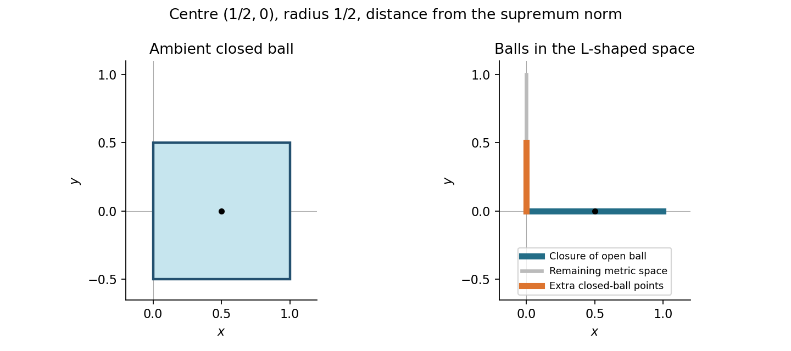

<h1 id="e/3/b/solution">Solution</h1>

↑ **Parent:** [B](../b.md)

The condition is $\max(|x-1/2|,|y|)\le1/2$. Therefore the ball is the **closed square**

$$
\boxed{[0,1]\times[-1/2,1/2].}
$$

Its four [vertices](../../../../../vertex-graph-theory.md) are $(0,\pm1/2)$ and $(1,\pm1/2)$.

**[Figure 1](#e/3/b/image-closed-supremum-norm-ball-and-its-restriction-to-the-l-shaped-metric-space). Closed supremum-norm ball and its restriction to the L-shaped metric space**.

## ↑ Ancestors (13)

1. [B](../b.md)
2. [3](../../3.md)
3. [E](../../../e.md)
4. [2008](../../../../2008-split.md)
5. [Past exam of the Probability, statistics and options II course of the University of Oxford](../../../../split.md)
6. [Probability, statistics and options II course of the University of Oxford](../../../../../probability-statistics-and-options-ii-course-of-the-university-of-oxford.md)
7. [Year 2 of the mathematics and statistics course of the University of Oxford](../../../../../year-2-of-the-mathematics-and-statistics-course-of-the-university-of-oxford.md)
8. [Mathematics and statistics course of the University of Oxford](../../../../../mathematics-and-statistics-course-of-the-university-of-oxford.md)
9. [Undergraduate course of the University of Oxford](../../../../../undergraduate-course-of-the-university-of-oxford.md)
10. [Course of the University of Oxford](../../../../../course-of-the-university-of-oxford.md)
11. [University of Oxford](../../../../../university-of-oxford-split.md)
12. [List of universities](../../../../../list-of-universities.md)
13. [Codex Wiki](../../../../../split.md)
