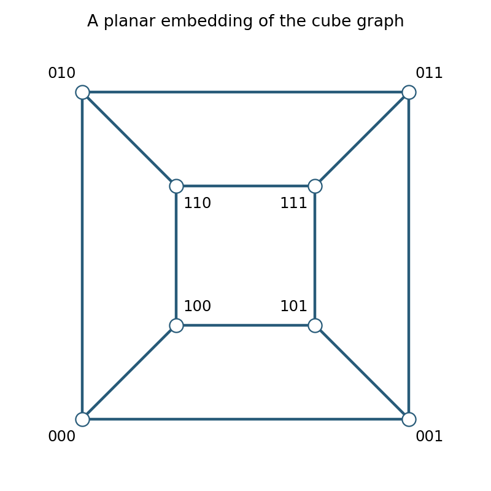

<h1 id="r/2/ii/solution">Solution</h1>

↑ **Parent:** [Ii](../ii.md)

Label [vertices](../../../../../vertex-graph-theory.md) by triples of bits and join pairs differing in exactly one bit. Draw the four [vertices](../../../../../vertex-graph-theory.md) with first bit zero as an outer square, and the four with first bit one as an inner square, in the same cyclic order $00,01,11,10$ for the last two bits. Connect corresponding corners by four nonintersecting spokes. Every cube [edge](../../../../../edge-of-a-graph.md) is present and there are no crossings, giving the required planar embedding.

**[Figure 2](#r/2/ii/image-planar-embedding-of-the-cube-graph-with-binary-vertex-labels). Planar embedding of the cube graph with binary vertex labels**.

## ↑ Ancestors (13)

1. [Ii](../ii.md)
2. [2](../../2.md)
3. [R](../../../r.md)
4. [2008](../../../../2008-split.md)
5. [Past exam of the Probability, statistics and options II course of the University of Oxford](../../../../split.md)
6. [Probability, statistics and options II course of the University of Oxford](../../../../../probability-statistics-and-options-ii-course-of-the-university-of-oxford.md)
7. [Year 2 of the mathematics and statistics course of the University of Oxford](../../../../../year-2-of-the-mathematics-and-statistics-course-of-the-university-of-oxford.md)
8. [Mathematics and statistics course of the University of Oxford](../../../../../mathematics-and-statistics-course-of-the-university-of-oxford.md)
9. [Undergraduate course of the University of Oxford](../../../../../undergraduate-course-of-the-university-of-oxford.md)
10. [Course of the University of Oxford](../../../../../course-of-the-university-of-oxford.md)
11. [University of Oxford](../../../../../university-of-oxford-split.md)
12. [List of universities](../../../../../list-of-universities.md)
13. [Codex Wiki](../../../../../split.md)
