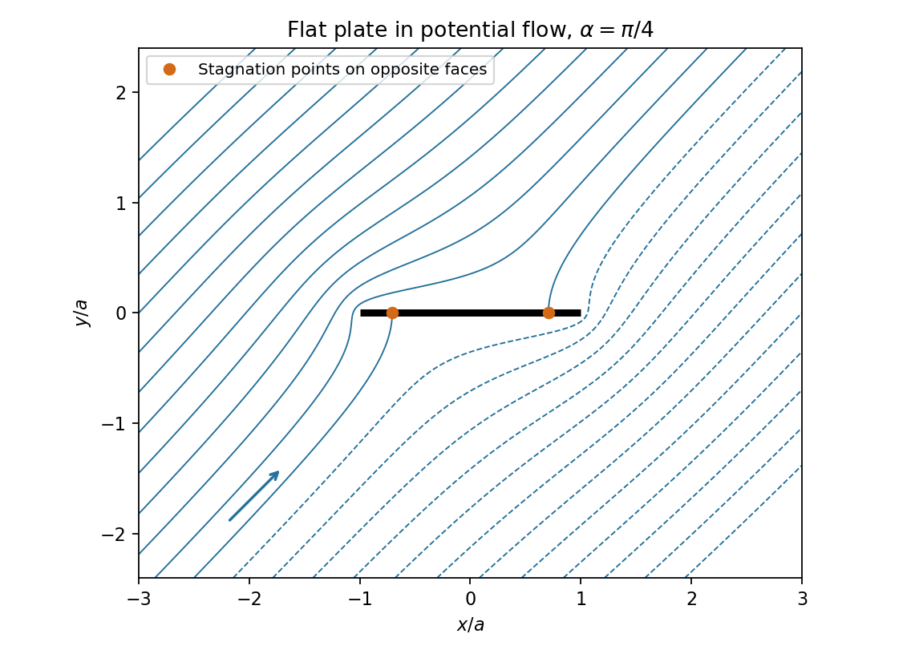

# 2009

↑ **Parent:** [Past exam of the Probability, statistics and options II course of the University of Oxford](../past-exam-of-the-probability-statistics-and-options-ii-course-of-the-university-of-oxford.md)

Source: [Mathematics release](https://www.whatdotheyknow.com/request/maths_past_papers_3), supplied bundle `Part A 2007 11-1.pdf`. This nineteen-page Mathematics and Statistics paper is dated 25 June 2009. Complete source statements and numerical tables are retained in the private editable transcription.

Bounded exact-paper checks found no matching advertisement of worked answers. All printed tasks and surrounding requests are answered, including explicit distinctions between the full-data and grouped-data likelihoods in O5.

**Table of contents**

- [A](#a)
  - [A2](#a/a2)
    - [a](#a/a2/a)
      - [Solution](#a/a2/a/solution)
    - [b](#a/a2/b)
      - [Solution](#a/a2/b/solution)
    - [i](#a/a2/i)
      - [Solution](#a/a2/i/solution)
    - [ii](#a/a2/ii)
      - [Solution](#a/a2/ii/solution)
    - [iii](#a/a2/iii)
      - [Solution](#a/a2/iii/solution)
    - [iv](#a/a2/iv)
      - [Solution](#a/a2/iv/solution)
- [B](#b)
  - [B2](#b/b2)
    - [i](#b/b2/i)
      - [Solution](#b/b2/i/solution)
    - [ii](#b/b2/ii)
      - [Solution](#b/b2/ii/solution)
    - [iii](#b/b2/iii)
      - [Solution](#b/b2/iii/solution)
- [C](#c)
  - [C2](#c/c2)
    - [i](#c/c2/i)
      - [Solution](#c/c2/i/solution)
    - [ii](#c/c2/ii)
      - [Solution](#c/c2/ii/solution)
    - [iii](#c/c2/iii)
      - [Solution](#c/c2/iii/solution)
    - [iv](#c/c2/iv)
      - [Solution](#c/c2/iv/solution)
    - [v](#c/c2/v)
      - [Solution](#c/c2/v/solution)
    - [vi](#c/c2/vi)
      - [Solution](#c/c2/vi/solution)
- [D](#d)
  - [D3](#d/d3)
    - [i](#d/d3/i)
      - [a](#d/d3/i/a)
        - [Solution](#d/d3/i/a/solution)
      - [b](#d/d3/i/b)
        - [Solution](#d/d3/i/b/solution)
    - [ii](#d/d3/ii)
      - [a](#d/d3/ii/a)
        - [Solution](#d/d3/ii/a/solution)
      - [b](#d/d3/ii/b)
        - [Solution](#d/d3/ii/b/solution)
    - [iii](#d/d3/iii)
      - [Solution](#d/d3/iii/solution)
  - [D4](#d/d4)
    - [i](#d/d4/i)
      - [Solution](#d/d4/i/solution)
    - [ii](#d/d4/ii)
      - [Solution](#d/d4/ii/solution)
    - [iii](#d/d4/iii)
      - [Solution](#d/d4/iii/solution)
- [E](#e)
  - [E3](#e/e3)
    - [a](#e/e3/a)
      - [i](#e/e3/a/i)
        - [Solution](#e/e3/a/i/solution)
      - [ii](#e/e3/a/ii)
        - [Solution](#e/e3/a/ii/solution)
      - [iii](#e/e3/a/iii)
        - [Solution](#e/e3/a/iii/solution)
    - [b](#e/e3/b)
      - [i](#e/e3/b/i)
        - [Solution](#e/e3/b/i/solution)
      - [ii](#e/e3/b/ii)
        - [Solution](#e/e3/b/ii/solution)
      - [iii](#e/e3/b/iii)
        - [α](#e/e3/b/iii/alpha)
          - [Solution](#e/e3/b/iii/alpha/solution)
        - [β](#e/e3/b/iii/beta)
          - [Solution](#e/e3/b/iii/beta/solution)
        - [γ](#e/e3/b/iii/gamma)
          - [Solution](#e/e3/b/iii/gamma/solution)
      - [iv](#e/e3/b/iv)
        - [α](#e/e3/b/iv/alpha)
          - [Solution](#e/e3/b/iv/alpha/solution)
        - [β](#e/e3/b/iv/beta)
          - [Solution](#e/e3/b/iv/beta/solution)
      - [v](#e/e3/b/v)
        - [Solution](#e/e3/b/v/solution)
  - [E4](#e/e4)
    - [a](#e/e4/a)
      - [i](#e/e4/a/i)
        - [Solution](#e/e4/a/i/solution)
      - [ii](#e/e4/a/ii)
        - [Solution](#e/e4/a/ii/solution)
      - [iii](#e/e4/a/iii)
        - [Solution](#e/e4/a/iii/solution)
    - [b](#e/e4/b)
      - [i](#e/e4/b/i)
        - [Solution](#e/e4/b/i/solution)
      - [ii](#e/e4/b/ii)
        - [Solution](#e/e4/b/ii/solution)
    - [c](#e/e4/c)
      - [Solution](#e/e4/c/solution)
- [F](#f)
  - [F2](#f/f2)
    - [a](#f/f2/a)
      - [Solution](#f/f2/a/solution)
    - [b](#f/f2/b)
      - [Solution](#f/f2/b/solution)
- [G](#g)
  - [G2](#g/g2)
    - [Solution](#g/g2/solution)
- [H](#h)
  - [H2](#h/h2)
    - [Solution](#h/h2/solution)
- [J](#j)
  - [J2](#j/j2)
    - [Solution](#j/j2/solution)
- [K](#k)
  - [K3](#k/k3)
    - [Solution](#k/k3/solution)
  - [K4](#k/k4)
    - [Solution](#k/k4/solution)
- [M](#m)
  - [M4](#m/m4)
    - [a](#m/m4/a)
      - [Solution](#m/m4/a/solution)
    - [b](#m/m4/b)
      - [Solution](#m/m4/b/solution)
    - [c](#m/m4/c)
      - [Solution](#m/m4/c/solution)
    - [d](#m/m4/d)
      - [i](#m/m4/d/i)
        - [Solution](#m/m4/d/i/solution)
      - [ii](#m/m4/d/ii)
        - [Solution](#m/m4/d/ii/solution)
    - [e](#m/m4/e)
      - [i](#m/m4/e/i)
        - [Solution](#m/m4/e/i/solution)
      - [ii](#m/m4/e/ii)
        - [Solution](#m/m4/e/ii/solution)
  - [M5](#m/m5)
    - [a](#m/m5/a)
      - [i](#m/m5/a/i)
        - [Solution](#m/m5/a/i/solution)
      - [ii](#m/m5/a/ii)
        - [Solution](#m/m5/a/ii/solution)
      - [iii](#m/m5/a/iii)
        - [Solution](#m/m5/a/iii/solution)
    - [b](#m/m5/b)
      - [i](#m/m5/b/i)
        - [Solution](#m/m5/b/i/solution)
      - [ii](#m/m5/b/ii)
        - [Solution](#m/m5/b/ii/solution)
- [O](#o)
  - [O4](#o/o4)
    - [i](#o/o4/i)
      - [Solution](#o/o4/i/solution)
    - [ii](#o/o4/ii)
      - [Solution](#o/o4/ii/solution)
  - [O5](#o/o5)
    - [i](#o/o5/i)
      - [Solution](#o/o5/i/solution)
    - [ii](#o/o5/ii)
      - [Solution](#o/o5/ii/solution)
- [P](#p)
  - [P3](#p/p3)
    - [a](#p/p3/a)
      - [Solution](#p/p3/a/solution)
    - [b](#p/p3/b)
      - [Solution](#p/p3/b/solution)
    - [c](#p/p3/c)
      - [Solution](#p/p3/c/solution)
    - [d](#p/p3/d)
      - [Solution](#p/p3/d/solution)
  - [P4](#p/p4)
    - [a](#p/p4/a)
      - [Solution](#p/p4/a/solution)
    - [b](#p/p4/b)
      - [Solution](#p/p4/b/solution)
    - [c](#p/p4/c)
      - [Solution](#p/p4/c/solution)
    - [d](#p/p4/d)
      - [Solution](#p/p4/d/solution)
- [R](#r)
  - [R2](#r/r2)
    - [i](#r/r2/i)
      - [Solution](#r/r2/i/solution)
    - [ii](#r/r2/ii)
      - [Solution](#r/r2/ii/solution)
    - [iii](#r/r2/iii)
      - [Solution](#r/r2/iii/solution)
    - [iv](#r/r2/iv)
      - [Solution](#r/r2/iv/solution)
    - [v](#r/r2/v)
      - [Solution](#r/r2/v/solution)
- [S](#s)
  - [S2](#s/s2)
    - [a](#s/s2/a)
      - [Solution](#s/s2/a/solution)
    - [b](#s/s2/b)
      - [Solution](#s/s2/b/solution)
    - [c](#s/s2/c)
      - [Solution](#s/s2/c/solution)
    - [d](#s/s2/d)
      - [Solution](#s/s2/d/solution)
    - [e](#s/s2/e)
      - [Solution](#s/s2/e/solution)
- [T](#t)
  - [T2](#t/t2)
    - [a](#t/t2/a)
      - [i](#t/t2/a/i)
        - [Solution](#t/t2/a/i/solution)
      - [ii](#t/t2/a/ii)
        - [Solution](#t/t2/a/ii/solution)
      - [iii](#t/t2/a/iii)
        - [Solution](#t/t2/a/iii/solution)
    - [b](#t/t2/b)
      - [i](#t/t2/b/i)
        - [Solution](#t/t2/b/i/solution)
      - [ii](#t/t2/b/ii)
        - [Solution](#t/t2/b/ii/solution)

## A

↑ **Parent:** [2009](2009.md)

<h3 id="a/a2">A2</h3>

↑ **Parent:** [A](#a)

The [characteristic](../algebra.md#characteristic-of-a-field) is the least positive integer $r$ with $r1_K=0$, if it exists, and zero otherwise. The [prime](../prime-number.md) subfield is the smallest subfield containing $1_K$; in [characteristic](../algebra.md#characteristic-of-a-field) $p$ it is $F=\{0,1,\ldots,(p-1)1_K\}\cong\mathbb F_p$. Every [field automorphism](../galois-theory.md#field-automorphism) fixes $1_K$ and addition, so it fixes every element of this [prime](../prime-number.md) subfield.

<h4 id="a/a2/a">a</h4>

↑ **Parent:** [A2](#a/a2)

<h5 id="a/a2/a/solution">Solution</h5>

↑ **Parent:** [A](#a/a2/a)

The additive sequence $0,1,2\cdot1,\ldots$ must repeat because $K$ is finite, so the [characteristic](../algebra.md#characteristic-of-a-field) is positive. If its least positive value were composite, $r=ab$ with $1<a,b<r$, then $(a1_K)(b1_K)=r1_K=0$ while neither factor would be zero. A [field](../algebra.md#field) has no zero divisors, giving a contradiction. Hence $\boxed{\operatorname{char}K=p\text{ is prime}}$.

<h4 id="a/a2/b">b</h4>

↑ **Parent:** [A2](#a/a2)

<h5 id="a/a2/b/solution">Solution</h5>

↑ **Parent:** [B](#a/a2/b)

The [finite field](../algebra.md#finite-field) $K$ is a finite-dimensional [vector space](../vector-space.md) over its [prime](../prime-number.md) subfield $F$ of size $p$. A [basis](../vector-space.md#basis) has some positive length $n$, and every element is uniquely specified by $n$ coefficients in $F$. There are $p$ choices per coefficient, so $\boxed{|K|=p^n}$ and $[K:F]=n$.

<h4 id="a/a2/i">i</h4>

↑ **Parent:** [A2](#a/a2)

<h5 id="a/a2/i/solution">Solution</h5>

↑ **Parent:** [I](#a/a2/i)

Since $K=F(\lambda)$ and the extension is finite, the element $\lambda$ is algebraic. Its [minimal polynomial](../linear-operator-theory.md#minimal-polynomial) is [irreducible](../polynomial.md#irreducible-polynomial), and evaluation gives an isomorphism $F[X]/(m_\lambda)\cong F[\lambda]=F(\lambda)=K$. If its [degree](../polynomial.md#degree-of-a-polynomial) is $d$, the powers $1,\lambda,\ldots,\lambda^{d-1}$ form a [basis](../vector-space.md#basis). Comparing with $[K:F]=n$ gives $\boxed{\deg m_\lambda=n}$.

<h4 id="a/a2/ii">ii</h4>

↑ **Parent:** [A2](#a/a2)

<h5 id="a/a2/ii/solution">Solution</h5>

↑ **Parent:** [Ii](#a/a2/ii)

Define $\vartheta(x)=x^p$ on all of $K$. The binomial coefficients between the endpoints are divisible by $p$, so $(x+y)^p=x^p+y^p$; also $(xy)^p=x^py^p$ and $1^p=1$. Thus this is a [field](../algebra.md#field) homomorphism. Its kernel is zero, and an [injective](../algebra.md#injective-function) self-map of the finite set $K$ is [surjective](../algebra.md#surjective-function). Hence $\boxed{\vartheta\text{ is an automorphism}}$, the [Frobenius automorphism](../non-archimedean-analysis.md#frobenius-automorphism), with the required image of $\lambda$. It fixes $F$ by the preceding [prime](../prime-number.md)-subfield argument.

<h4 id="a/a2/iii">iii</h4>

↑ **Parent:** [A2](#a/a2)

<h5 id="a/a2/iii/solution">Solution</h5>

↑ **Parent:** [Iii](#a/a2/iii)

Take $0<m<n$, the intended positive-exponent range. If $\vartheta^m(\lambda)=\lambda$, then $\vartheta^m$ fixes both $F$ and its [field](../algebra.md#field) generator, so it fixes every element of $K=F(\lambda)$. Every element would then be a root of $X^{p^m}-X$. But that [polynomial](../polynomial.md) has [degree](../polynomial.md#degree-of-a-polynomial) $p^m<p^n=|K|$, impossible for a nonzero [polynomial](../polynomial.md) over a [field](../algebra.md#field). Thus $\boxed{\vartheta^m(\lambda)\ne\lambda\quad(0<m<n)}$. The source writes only $m<n$; zero must be excluded, since $\vartheta^0(\lambda)=\lambda$.

<h4 id="a/a2/iv">iv</h4>

↑ **Parent:** [A2](#a/a2)

<h5 id="a/a2/iv/solution">Solution</h5>

↑ **Parent:** [Iv](#a/a2/iv)

For nonzero $x\in K$, [Lagrange's theorem](../group-theory.md#lagrange-s-theorem) in $K^\times$ gives $x^{p^n-1}=1$; zero satisfies $x^{p^n}=x$ too. Thus $\vartheta^n$ is the [identity](../algebraic-operation.md#identity-element), and (iii) excludes every smaller positive order. Hence $\boxed{|\langle\vartheta\rangle|=n}$.

Any [field automorphism](../galois-theory.md#field-automorphism) of $K$ fixes $F$ and is determined by its value on $\lambda$. That value must be a root of the [degree](../polynomial.md#degree-of-a-polynomial)-$n$ minimal [polynomial](../polynomial.md), so there are at most $n$ automorphisms. The $n$ powers of $\vartheta$ already attain this bound. Consequently $\boxed{\operatorname{Aut}(K)=\langle\vartheta\rangle\cong C_n}$.

<h2 id="b">B</h2>

↑ **Parent:** [2009](2009.md)

<h3 id="b/b2">B2</h3>

↑ **Parent:** [B](#b)

<h4 id="b/b2/i">i</h4>

↑ **Parent:** [B2](#b/b2)

<h5 id="b/b2/i/solution">Solution</h5>

↑ **Parent:** [I](#b/b2/i)

A left action is a map $(g,\omega)\mapsto g\omega$ satisfying $1\omega=\omega$ and $(gh)\omega=g(h\omega)$. The [orbit](../dynamical-systems.md#orbit-dynamical-system) of $\omega$ is $G\omega=\{g\omega:g\in G\}$. The action is [transitive](../set-theory.md#transitive-relation) when there is exactly one [orbit](../dynamical-systems.md#orbit-dynamical-system) on the nonempty acted-on set, equivalently when any point can be moved to any other by a [group](../group.md) element. An action is equivalently a homomorphism from $G$ to the permutation [group](../group.md) of the set.

<h4 id="b/b2/ii">ii</h4>

↑ **Parent:** [B2](#b/b2)

<h5 id="b/b2/ii/solution">Solution</h5>

↑ **Parent:** [Ii](#b/b2/ii)

Act by left multiplication on the five [cosets](../group-theory.md#coset) of $H$. The kernel is the core $\bigcap_{g\in G}gHg^{-1}$, a [normal subgroup](../group-theory.md#normal-subgroup) contained in $H$, so the hypothesis makes it trivial. Thus $G$ embeds in $S_5$, and its image has order $60$ and index two. An index-two [subgroup](../group.md#subgroup) is normal, so the quotient is of order two. Every three-cycle maps trivially to that quotient, since its order divides three. Three-cycles generate $A_5$, so the image contains $A_5$; their equal order gives $\boxed{G\cong A_5}$.

For [completeness](../topological-analysis.md#completeness), prove simplicity rather than merely invoking it. The nonidentity even cycle types in $S_5$ are three-cycles, products of two disjoint transpositions and five-cycles. In $A_5$, a three-cycle has [centralizer](../group-action.md#centralizer) of order three, so its [conjugacy class](../group-action.md#conjugacy-class) has size $20$. A double transposition has [centralizer](../group-action.md#centralizer) of order four in $A_5$, giving class size $15$. A five-cycle has [centralizer](../group-action.md#centralizer) its cyclic [subgroup](../group.md#subgroup) of order five, giving class size $12$; the $24$ such elements therefore split into two classes of size $12$. These account for all $60$ elements with the [identity](../algebraic-operation.md#identity-element).

A [normal subgroup](../group-theory.md#normal-subgroup) is a union of whole [conjugacy classes](../group-action.md#conjugacy-class), containing the [identity](../algebraic-operation.md#identity-element), and its order must divide $60$. No nonempty proper sum of the class sizes $15,20,12,12$, plus one, is a divisor of $60$ greater than one: the possible proper nontrivial sums are $13,16,21,25,28,33,36,40,45,48$. Only the full union has order $60$. Hence $\boxed{A_5\text{ is simple}}$, and so is $G$.

<h4 id="b/b2/iii">iii</h4>

↑ **Parent:** [B2](#b/b2)

<h5 id="b/b2/iii/solution">Solution</h5>

↑ **Parent:** [Iii](#b/b2/iii)

Choose one regular [tetrahedron](../euclidean-geometry.md#tetrahedron) inscribed in the [dodecahedron](../euclidean-geometry.md#dodecahedron) and let $H$ be its stabilizer among [rotations](../riemannian-geometry.md#rotation-mathematics) of the [dodecahedron](../euclidean-geometry.md#dodecahedron). The twelve [rotations](../riemannian-geometry.md#rotation-mathematics) of that [tetrahedron](../euclidean-geometry.md#tetrahedron) preserve the [dodecahedron](../euclidean-geometry.md#dodecahedron); geometrically these are its [identity](../algebraic-operation.md#identity-element), eight [rotations](../riemannian-geometry.md#rotation-mathematics) by $\pm2\pi/3$ about tetrahedral [vertex](../graph.md#vertex-graph-theory) axes and three half-turns about opposite tetrahedral [edge](../graph-theory.md#edge-of-a-graph) axes. They act faithfully on its four [vertices](../graph.md#vertex-graph-theory) and give the twelve even permutations. Thus $\boxed{H\cong A_4,\quad|H|=12}$ without using part (ii).

To check the core condition geometrically, the fifteen half-turns of the [dodecahedron](../euclidean-geometry.md#dodecahedron), about opposite-[edge](../graph-theory.md#edge-of-a-graph)-midpoint axes, are conjugate under its [rotations](../riemannian-geometry.md#rotation-mathematics). A [normal subgroup](../group-theory.md#normal-subgroup) contained in $H$ cannot contain even one of these half-turns, because normality would then force all fifteen into a [group](../group.md) of order twelve. On the other hand every nontrivial [normal subgroup](../group-theory.md#normal-subgroup) of $A_4$ contains a half-turn: if it contains a three-cycle, its conjugates and their inverses generate $A_4$; otherwise its nonidentity elements are among the three double transpositions, which are conjugate in $A_4$. Apply this observation to any [normal subgroup](../group-theory.md#normal-subgroup) of the full [rotation](../riemannian-geometry.md#rotation-mathematics) [group](../group.md) lying inside $H$. It must be trivial, proving exactly the required condition.

## C

↑ **Parent:** [2009](2009.md)

<h3 id="c/c2">C2</h3>

↑ **Parent:** [C](#c)

<h4 id="c/c2/i">i</h4>

↑ **Parent:** [C2](#c/c2)

<h5 id="c/c2/i/solution">Solution</h5>

↑ **Parent:** [I](#c/c2/i)

For an odd [prime](../prime-number.md) $p$, the [Legendre symbol](../quadratic-residue.md#legendre-symbol) is $\boxed{(a/p)=0}$ if $p\mid a$, $\boxed{(a/p)=1}$ if $a$ is a nonzero square modulo $p$, and $\boxed{(a/p)=-1}$ otherwise. It depends only on the [residue](../analysis.md#residue) class of $a$.

<h4 id="c/c2/ii">ii</h4>

↑ **Parent:** [C2](#c/c2)

<h5 id="c/c2/ii/solution">Solution</h5>

↑ **Parent:** [Ii](#c/c2/ii)

[Euler's criterion](../quadratic-residue.md#euler-s-criterion) states that for $p\nmid a$,

$$
\boxed{a^{(p-1)/2}\equiv\left(\frac ap\right)\pmod p.}
$$

For a multiple of $p$, both the [Legendre symbol](../quadratic-residue.md#legendre-symbol) and that positive [power](../statistical-hypothesis-test.md#power-function-of-a-statistical-test) vanish modulo $p$, so the congruence extends to that case as well.

<h4 id="c/c2/iii">iii</h4>

↑ **Parent:** [C2](#c/c2)

<h5 id="c/c2/iii/solution">Solution</h5>

↑ **Parent:** [Iii](#c/c2/iii)

[Gauss's lemma](../quadratic-residue.md#gauss-s-lemma-number-theory) for [quadratic residues](../quadratic-residue.md) states: if $p\nmid a$ and $m$ is the number of least positive [residue classes](../modular-arithmetic.md#residue-class) among $a,2a,\ldots,((p-1)/2)a$ that exceed $p/2$, then $\boxed{(a/p)=(-1)^m}$.

<h4 id="c/c2/iv">iv</h4>

↑ **Parent:** [C2](#c/c2)

<h5 id="c/c2/iv/solution">Solution</h5>

↑ **Parent:** [Iv](#c/c2/iv)

For $a=2$ the displayed multiples are $2,4,\ldots,p-1$, already least positive [residue classes](../modular-arithmetic.md#residue-class). Those greater than $p/2$ correspond to $j>p/4$. Thus their number is $m=(p-1)/2-\lfloor p/4\rfloor$. For $p\equiv1,3,5,7\pmod8$, its [parity](../quantum-mechanics.md#parity) is respectively even, odd, odd, even. [Gauss's lemma](../quadratic-residue.md#gauss-s-lemma-number-theory) therefore gives

$$
\boxed{\left(\frac2p\right)=\begin{cases}1,&p\equiv1,7\pmod8,\\-1,&p\equiv3,5\pmod8.\end{cases}}
$$

<h4 id="c/c2/v">v</h4>

↑ **Parent:** [C2](#c/c2)

<h5 id="c/c2/v/solution">Solution</h5>

↑ **Parent:** [V](#c/c2/v)

[Euler's criterion](../quadratic-residue.md#euler-s-criterion) gives $(-1/p)=(-1)^{(p-1)/2}$. The [Legendre symbol](../quadratic-residue.md#legendre-symbol) is multiplicative, so multiplying this sign by the result of (iv) yields

$$
\boxed{\left(\frac{-2}p\right)=\begin{cases}1,&p\equiv1,3\pmod8,\\-1,&p\equiv5,7\pmod8.\end{cases}}
$$

<h4 id="c/c2/vi">vi</h4>

↑ **Parent:** [C2](#c/c2)

<h5 id="c/c2/vi/solution">Solution</h5>

↑ **Parent:** [Vi](#c/c2/vi)

Suppose there are only finitely many [primes](../prime-number.md) $p_1,\ldots,p_r\equiv3\pmod8$, and let $N$ be their product. This is odd, so $N^2+2\equiv3\pmod8$. No listed [prime](../prime-number.md) divides this number, since reduction modulo any $p_i$ gives two. Every [prime](../prime-number.md) divisor $q$ is odd and does not divide $N$, and satisfies $N^2\equiv-2\pmod q$. Thus $(-2/q)=1$, forcing $q\equiv1$ or $3\pmod8$ by (v).

A product of [prime](../prime-number.md) factors all congruent to one modulo eight could not be three modulo eight. More precisely, the product of factors congruent to three is three modulo eight exactly when their total exponent is odd. Thus at least one [prime](../prime-number.md) divisor $q\equiv3\pmod8$ occurs. It is not in the alleged [complete](../topological-analysis.md#completeness) list, a contradiction. Hence **there are infinitely many [primes](../prime-number.md) congruent to three modulo eight**.

## D

↑ **Parent:** [2009](2009.md)

<h3 id="d/d3">D3</h3>

↑ **Parent:** [D](#d)

<h4 id="d/d3/i">i</h4>

↑ **Parent:** [D3](#d/d3)

<h5 id="d/d3/i/a">a</h5>

↑ **Parent:** [I](#d/d3/i)

<h6 id="d/d3/i/a/solution">Solution</h6>

↑ **Parent:** [A](#d/d3/i/a)

The function is nonnegative and measurable. For $\alpha\ne-1$, integrate from $\varepsilon$ to one to get $(1-\varepsilon^{\alpha+1})/(\alpha+1)$. The limit is finite exactly when $\alpha+1>0$. At $\alpha=-1$ the integral is $-\log\varepsilon\to\infty$. Thus $\boxed{x^\alpha\in L^1(0,1)\iff\alpha>-1}$.

<h5 id="d/d3/i/b">b</h5>

↑ **Parent:** [I](#d/d3/i)

<h6 id="d/d3/i/b/solution">Solution</h6>

↑ **Parent:** [B](#d/d3/i/b)

Integrating from one to $R$ gives $(R^{\alpha+1}-1)/(\alpha+1)$ for $\alpha\ne-1$. It has a finite limit as $R\to\infty$ exactly when $\alpha+1<0$, while at $\alpha=-1$ the logarithm diverges. Nonnegativity equates finiteness of this integral with Lebesgue integrability. Hence $\boxed{x^\alpha\in L^1(1,\infty)\iff\alpha<-1}$.

<h4 id="d/d3/ii">ii</h4>

↑ **Parent:** [D3](#d/d3)

<h5 id="d/d3/ii/a">a</h5>

↑ **Parent:** [Ii](#d/d3/ii)

<h6 id="d/d3/ii/a/solution">Solution</h6>

↑ **Parent:** [A](#d/d3/ii/a)

On $(0,1)$ its absolute value is at most $x|\log x|$, which has integral $1/4$, by [integration by parts](../calculus.md#integration-by-parts) or the substitution $x=e^{-t}$. The function is measurable and this majorant is [integrable](../measure-theory.md#integrability), so $\boxed{x\log x/(1+x)^2\text{ is integrable on }(0,1)}$.

<h5 id="d/d3/ii/b">b</h5>

↑ **Parent:** [Ii](#d/d3/ii)

<h6 id="d/d3/ii/b/solution">Solution</h6>

↑ **Parent:** [B](#d/d3/ii/b)

For $x\ge1$, $(1+x)^2\le4x^2$, so $x\log x/(1+x)^2\ge(\log x)/(4x)\ge0$. The latter integral diverges because its primitive is $(\log x)^2/8$. Thus the absolute integral diverges and the answer is $\boxed{\text{not integrable on }(1,\infty)}$.

<h4 id="d/d3/iii">iii</h4>

↑ **Parent:** [D3](#d/d3)

<h5 id="d/d3/iii/solution">Solution</h5>

↑ **Parent:** [Iii](#d/d3/iii)

The integrand is nonnegative and measurable. It is [bounded](../topological-analysis.md#boundedness) by $x$ near zero and by $xe^{-x}$ for $x>0$, so its integral is finite. For every $x>0$ the geometric expansion gives $x/(e^x+1)=\sum_{n\ge1}(-1)^{n-1}xe^{-nx}$. To justify termwise integration, note that

$$
\sum_{n\ge1}\int_0^\infty|(-1)^{n-1}xe^{-nx}|dx=\sum_{n\ge1}\frac1{n^2}<\infty.
$$

Tonelli gives an [integrable](../measure-theory.md#integrability) sum of absolute values; [dominated convergence](../measure-theory.md#dominated-convergence-theorem) then applies to the signed partial sums. Consequently

$$
\boxed{\int_0^\infty\frac{x}{e^x+1}dx=\sum_{n\ge1}\frac{(-1)^{n-1}}{n^2}.}
$$

If evaluated further, this is $(1-2^{-1})\zeta(2)=\pi^2/12$.

<h3 id="d/d4">D4</h3>

↑ **Parent:** [D](#d)

<h4 id="d/d4/i">i</h4>

↑ **Parent:** [D4](#d/d4)

<h5 id="d/d4/i/solution">Solution</h5>

↑ **Parent:** [I](#d/d4/i)

For product measure spaces, [Tonelli's theorem](../measure-theory.md#tonelli-theorem) states that for a nonnegative [measurable function](../measure-theory.md#measurable-function) the product-space integral equals either iterated integral, allowing the value $+\infty$. Fubini's theorem states that if a [measurable function](../measure-theory.md#measurable-function) has finite integral of its absolute value, then its sections are [integrable](../measure-theory.md#integrability) [almost everywhere](../measure-theory.md#almost-everywhere), both iterated integrals exist and equal the product-space integral. The absolute-integrability hypothesis is what permits this conclusion for a signed function. These statements apply to the Lebesgue product spaces used here, which are sigma-finite.

<h4 id="d/d4/ii">ii</h4>

↑ **Parent:** [D4](#d/d4)

<h5 id="d/d4/ii/solution">Solution</h5>

↑ **Parent:** [Ii](#d/d4/ii)

The function $g$ is measurable, and for fixed positive $y$ both terms are [integrable](../measure-theory.md#integrability) over $0<x<1$ by linear substitution and integrability of $f$. Those substitutions give

$$
\int_0^1g(x,y)dx=\frac1y\left(\int_0^y f(t)dt-\int_0^{ay}f(t)dt\right)=-\frac1y\int_y^{ay}f(t)dt<0.
$$

The strict sign follows from positivity of $f$ on a nonempty [interval](../real-analysis.md#interval-mathematics), since $a>1$. Similarly each section in $y$ is absolutely [integrable](../measure-theory.md#integrability) for fixed $x>0$, and

$$
\int_1^\infty g(x,y)dy=\frac1x\left(\int_x^\infty f(t)dt-\int_{ax}^\infty f(t)dt\right)=\frac1x\int_x^{ax}f(t)dt>0.
$$

If $g$ were absolutely [integrable](../measure-theory.md#integrability) on the stated rectangle, Fubini would make the two finite iterated integrals equal. The first would be strictly negative and the second strictly positive, which is impossible. Therefore $\boxed{g\notin L^1((0,1)\times(1,\infty))}$. The one-dimensional section integrability does not rescue the missing product-space hypothesis.

<h4 id="d/d4/iii">iii</h4>

↑ **Parent:** [D4](#d/d4)

<h5 id="d/d4/iii/solution">Solution</h5>

↑ **Parent:** [Iii](#d/d4/iii)

The function $h$ is measurable and nonnegative. In first-quadrant polar coordinates, including the Jacobian, its integral is

$$
\left(\int_0^\infty e^{-r^2}r^3dr\right)\left(\int_0^{\pi/2}(\cos\theta)^{3/2}(\sin\theta)^{1/2}d\theta\right).
$$

The radial factor is $1/2$ by the supplied fact and the angular integrand is at most one, giving finiteness. The nonnegative change-of-variables formula is valid before finiteness is known, and this bound proves $h\in L^1$.

Fubini may now factor the Cartesian integral. Substituting $u=x^2$, $v=y^2$ in the respective factors gives

$$
\iint h\,dxdy=\frac14\left(\int_0^\infty e^{-u}u^{1/4}du\right)\left(\int_0^\infty e^{-v}v^{-1/4}dv\right).
$$

Both are finite: their powers at zero exceed $-1$, and the exponential controls infinity. Comparing with the polar expression proves

$$
\boxed{\int_0^{\pi/2}(\cos\theta)^{3/2}(\sin\theta)^{1/2}d\theta=\frac12\Gamma(5/4)\Gamma(3/4),}
$$

which is exactly the product of integrals requested.

## E

↑ **Parent:** [2009](2009.md)

<h3 id="e/e3">E3</h3>

↑ **Parent:** [E](#e)

<h4 id="e/e3/a">a</h4>

↑ **Parent:** [E3](#e/e3)

<h5 id="e/e3/a/i">i</h5>

↑ **Parent:** [A](#e/e3/a)

<h6 id="e/e3/a/i/solution">Solution</h6>

↑ **Parent:** [I](#e/e3/a/i)

A subset $U$ of a [metric space](../topological-analysis.md#metric-space) is open if for every $x\in U$ there exists $r>0$ with $B_d(x,r)\subseteq U$, where $B_d(x,r)=\{y:d(x,y)<r\}$. The radius may depend on the point. The empty set is open vacuously.

<h5 id="e/e3/a/ii">ii</h5>

↑ **Parent:** [A](#e/e3/a)

<h6 id="e/e3/a/ii/solution">Solution</h6>

↑ **Parent:** [Ii](#e/e3/a/ii)

[Continuity](../calculus.md#continuous-function) at $x$ means that for every $\varepsilon>0$ there is $\delta>0$ such that $d_X(x,y)<\delta$ implies $d_Y(f(x),f(y))<\varepsilon$ for every $y\in X$. Equivalently, the [inverse](../algebraic-operation.md#inverse-element) image of each neighborhood of $f(x)$ is a neighborhood of $x$.

<h5 id="e/e3/a/iii">iii</h5>

↑ **Parent:** [A](#e/e3/a)

<h6 id="e/e3/a/iii/solution">Solution</h6>

↑ **Parent:** [Iii](#e/e3/a/iii)

The map is [continuous](../calculus.md#continuous-function) if it is [continuous](../calculus.md#continuous-function) at every point of its domain. Equivalently the [inverse](../algebraic-operation.md#inverse-element) image of every open subset of $Y$ is open in $X$. These equivalent formulations use the given metrics' induced topologies.

<h4 id="e/e3/b">b</h4>

↑ **Parent:** [E3](#e/e3)

<h5 id="e/e3/b/i">i</h5>

↑ **Parent:** [B](#e/e3/b)

<h6 id="e/e3/b/i/solution">Solution</h6>

↑ **Parent:** [I](#e/e3/b/i)

Write $r_x=d(x,a)$. The prescribed function is symmetric and nonnegative. If $x\ne y$, both $r_x,r_y$ could be zero only if $x=y=a$, so $d_a(x,y)>0$. For the triangle inequality, if any two of $x,y,z$ coincide it is immediate. If all three are distinct,

$$
d_a(x,z)=r_x+r_z\le(r_x+r_y)+(r_y+r_z)=d_a(x,y)+d_a(y,z).
$$

Thus $\boxed{d_a\text{ is a metric}}$. Also $d_a(a,x)=d(a,x)$, a fact useful in the following parts.

<h5 id="e/e3/b/ii">ii</h5>

↑ **Parent:** [B](#e/e3/b)

<h6 id="e/e3/b/ii/solution">Solution</h6>

↑ **Parent:** [Ii](#e/e3/b/ii)

If $x\ne b$, then $d_a(b,x)=d(b,a)+d(a,x)\ge d(b,a)$. The strict open-ball inequality therefore excludes every such $x$, while including $b$. Hence $\boxed{B_{d_a}(b,d(b,a))=\{b\}}$. Every point other than $a$ is isolated in this metric.

<h5 id="e/e3/b/iii">iii</h5>

↑ **Parent:** [B](#e/e3/b)

<h6 id="e/e3/b/iii/alpha">α</h6>

↑ **Parent:** [Iii](#e/e3/b/iii)

<h6 id="e/e3/b/iii/alpha/solution">Solution</h6>

↑ **Parent:** [Α](#e/e3/b/iii/alpha)

If [continuity](../calculus.md#continuous-function) holds everywhere, it holds at $a$. Conversely, if it holds at $a$, it holds at every other point automatically: the singleton neighborhood from (ii) maps entirely to the single value at that point. Thus [continuity](../calculus.md#continuous-function) everywhere in $d_a$ is equivalent to [continuity](../calculus.md#continuous-function) at $a$ in $d_a$.

<h6 id="e/e3/b/iii/beta">β</h6>

↑ **Parent:** [Iii](#e/e3/b/iii)

<h6 id="e/e3/b/iii/beta/solution">Solution</h6>

↑ **Parent:** [Β](#e/e3/b/iii/beta)

For every $r>0$ one has $B_{d_a}(a,r)=B_d(a,r)$ because $d_a(a,x)=d(a,x)$. The epsilon–delta definition at $a$ is therefore identical for the two domain metrics. In particular [continuity](../calculus.md#continuous-function) at $a$ in $d_a$ implies [continuity](../calculus.md#continuous-function) there in $d$.

<h6 id="e/e3/b/iii/gamma">γ</h6>

↑ **Parent:** [Iii](#e/e3/b/iii)

<h6 id="e/e3/b/iii/gamma/solution">Solution</h6>

↑ **Parent:** [Γ](#e/e3/b/iii/gamma)

The same equality of balls gives the reverse implication: [continuity](../calculus.md#continuous-function) at $a$ in $d$ implies [continuity](../calculus.md#continuous-function) at $a$ in $d_a$. The latter implies [continuity](../calculus.md#continuous-function) everywhere by the first part. These implications [complete](../topological-analysis.md#completeness) the equivalence of all three printed conditions.

<h5 id="e/e3/b/iv">iv</h5>

↑ **Parent:** [B](#e/e3/b)

<h6 id="e/e3/b/iv/alpha">α</h6>

↑ **Parent:** [Iv](#e/e3/b/iv)

<h6 id="e/e3/b/iv/alpha/solution">Solution</h6>

↑ **Parent:** [Α](#e/e3/b/iv/alpha)

If $a\notin A$, every point of $A$ is isolated by (ii). The set $A$ is the union of these open singletons, so $\boxed{A\text{ is open in }(X,d_a)}$, including the empty case.

<h6 id="e/e3/b/iv/beta">β</h6>

↑ **Parent:** [Iv](#e/e3/b/iv)

<h6 id="e/e3/b/iv/beta/solution">Solution</h6>

↑ **Parent:** [Β](#e/e3/b/iv/beta)

If $A$ is open and contains $a$, there is an epsilon ball at $a$ contained in it. This ball is exactly $B_d(a,\varepsilon)$ by the equality of balls proved above. Conversely such a ball supplies a neighborhood at $a$, and all other points of $A$ have their singleton neighborhoods inside $A$. Thus the stated ball condition is necessary and sufficient.

<h5 id="e/e3/b/v">v</h5>

↑ **Parent:** [B](#e/e3/b)

<h6 id="e/e3/b/v/solution">Solution</h6>

↑ **Parent:** [V](#e/e3/b/v)

An isolated point outside $B$ cannot belong to its closure. Thus the only possible extra closure point is $a$. The balls at $a$ meet $B$ exactly when arbitrarily small original-metric balls at $a$ do so. Consequently

$$
\boxed{\overline B^{\,d_a}=\begin{cases}B,&a\in B,\\B,&a\notin B,\ d(a,B)>0,\\B\cup\{a\},&a\notin B,\ d(a,B)=0.\end{cases}}
$$

In the first case $a$ is already included. In the second case a ball smaller than the positive distance separates it from $B$; in the last case every ball meets $B$. If $B$ is empty its closure is empty, with distance convention $d(a,\varnothing)=+\infty$.

<h3 id="e/e4">E4</h3>

↑ **Parent:** [E](#e)

<h4 id="e/e4/a">a</h4>

↑ **Parent:** [E4](#e/e4)

<h5 id="e/e4/a/i">i</h5>

↑ **Parent:** [A](#e/e4/a)

<h6 id="e/e4/a/i/solution">Solution</h6>

↑ **Parent:** [I](#e/e4/a/i)

A subset is [connected](../geometry-and-topology.md#connected-space) if it has no decomposition into two disjoint nonempty sets both relatively open in it. Equivalently its only relatively [clopen](../topology.md#clopen-set) subsets are itself and the empty set. [Connectedness](../geometry-and-topology.md#connected-space) here refers to the subset's induced topology.

<h5 id="e/e4/a/ii">ii</h5>

↑ **Parent:** [A](#e/e4/a)

<h6 id="e/e4/a/ii/solution">Solution</h6>

↑ **Parent:** [Ii](#e/e4/a/ii)

Suppose $f(X)=U\cup V$ were a separation into two disjoint nonempty relatively [open sets](../topology.md#open-set). [Continuity](../calculus.md#continuous-function) makes $f^{-1}(U)$ and $f^{-1}(V)$ open in $X$, and they are disjoint, nonempty and cover $X$. This contradicts [connectedness](../geometry-and-topology.md#connected-space) of $X$. Hence $\boxed{f(X)\text{ is connected}}$.

<h5 id="e/e4/a/iii">iii</h5>

↑ **Parent:** [A](#e/e4/a)

<h6 id="e/e4/a/iii/solution">Solution</h6>

↑ **Parent:** [Iii](#e/e4/a/iii)

The set $X/R$ consists of the [equivalence classes](../set-theory.md#equivalence-class), with canonical surjection $q:x\mapsto[x]$. The [quotient topology](../topology.md#quotient-topology) declares $V\subseteq X/R$ open exactly when $q^{-1}(V)$ is open in $X$. This makes $q$ [continuous](../calculus.md#continuous-function) and is the finest topology on the quotient set doing so.

<h4 id="e/e4/b">b</h4>

↑ **Parent:** [E4](#e/e4)

<h5 id="e/e4/b/i">i</h5>

↑ **Parent:** [B](#e/e4/b)

<h6 id="e/e4/b/i/solution">Solution</h6>

↑ **Parent:** [I](#e/e4/b/i)

Let $A$ be [clopen](../topology.md#clopen-set) and $C$ an [equivalence class](../set-theory.md#equivalence-class). The intersections $C\cap A$ and $C\setminus A$ are complementary relatively open subsets of $C$. [Connectedness](../geometry-and-topology.md#connected-space) of $C$ means one must be empty. Thus every [equivalence class](../set-theory.md#equivalence-class) is entirely in $A$ or entirely outside it, proving $\boxed{q^{-1}(q(A))=A}$. This is precisely saturation.

<h5 id="e/e4/b/ii">ii</h5>

↑ **Parent:** [B](#e/e4/b)

<h6 id="e/e4/b/ii/solution">Solution</h6>

↑ **Parent:** [Ii](#e/e4/b/ii)

If $X$ is [connected](../geometry-and-topology.md#connected-space), its [continuous](../calculus.md#continuous-function) [surjective](../algebra.md#surjective-function) image under $q$ is [connected](../geometry-and-topology.md#connected-space) by (a)(ii). Conversely suppose $X/R$ is [connected](../geometry-and-topology.md#connected-space) and $A\subseteq X$ is [clopen](../topology.md#clopen-set). By (i) both $A$ and its complement are saturated. The quotient definition then makes $q(A)$ open, and its complement $q(X\setminus A)$ open too. Thus $q(A)$ is [clopen](../topology.md#clopen-set) in the [connected](../geometry-and-topology.md#connected-space) quotient, so is empty or the whole quotient. Pulling back gives $A=\varnothing$ or $X$. By the [clopen](../topology.md#clopen-set) criterion $X$ is [connected](../geometry-and-topology.md#connected-space). Hence $\boxed{X\text{ connected}\iff X/R\text{ connected}}$.

<h4 id="e/e4/c">c</h4>

↑ **Parent:** [E4](#e/e4)

<h5 id="e/e4/c/solution">Solution</h5>

↑ **Parent:** [C](#e/e4/c)

The difference map $(z,w)\mapsto z-w$ is [continuous](../calculus.md#continuous-function) and $X$ is its [inverse](../algebraic-operation.md#inverse-element) image of the [open set](../topology.md#open-set) $\mathbb C\setminus\{0\}$, so $X$ is open in $\mathbb C^2$. For fixed $z$, the [equivalence class](../set-theory.md#equivalence-class) is $\{z\}\times(\mathbb C\setminus\{z\})$, [homeomorphic](../topology.md#homeomorphism) to a punctured plane. It is [path-connected](../geometry-and-topology.md#path-connected-space): two points can be joined by a polygonal path avoiding the missing point. Thus all [equivalence classes](../set-theory.md#equivalence-class) are [connected](../geometry-and-topology.md#connected-space).

The projection $\pi$ is [continuous](../calculus.md#continuous-function) and onto, since $(z,z+1)\in X$. If $U$ is open in $X$, it is open in $\mathbb C^2$ because $X$ is open. Product-coordinate projection is open: around any $(z,w)\in U$ there is a product of open disks contained in $U$, whose first disk is a neighborhood inside $\pi(U)$. Hence $\pi(U)$ is open.

Its fibers are precisely the [equivalence classes](../set-theory.md#equivalence-class), so it induces a [bijection](../function.md#bijection) $\bar\pi:X/R\to\mathbb C$. [Continuity](../calculus.md#continuous-function) follows from the [quotient topology](../topology.md#quotient-topology) and $\pi=\bar\pi\circ q$. If $V$ is open in $X/R$, then $q^{-1}(V)$ is open in $X$ and $\bar\pi(V)=\pi(q^{-1}(V))$ is open. Thus the [inverse](../algebraic-operation.md#inverse-element) is [continuous](../calculus.md#continuous-function) too, proving $\boxed{X/R\cong\mathbb C}$ as [topological spaces](../topology.md#topological-space). The plane is [connected](../geometry-and-topology.md#connected-space), so the [connected](../geometry-and-topology.md#connected-space)-fiber equivalence in (b)(ii) gives $\boxed{X\text{ is connected}}$.

## F

↑ **Parent:** [2009](2009.md)

<h3 id="f/f2">F2</h3>

↑ **Parent:** [F](#f)

<h4 id="f/f2/a">a</h4>

↑ **Parent:** [F2](#f/f2)

<h5 id="f/f2/a/solution">Solution</h5>

↑ **Parent:** [A](#f/f2/a)

The $i$th [partial derivative](../multivariable-calculus.md#partial-derivative) is the limit $\partial_if(x_0)=\lim_{t\to0}[f(x_0+te_i)-f(x_0)]/t$. For a nonzero vector $v$, use the directional convention $\partial_vf(x_0)=\lim_{t\to0}[f(x_0+tv)-f(x_0)]/t$, without normalizing $v$. [Differentiability](../analysis.md#differentiability) means $f(x_0+h)=f(x_0)+Lh+o(\|h\|)$ for a [linear map](../vector-space.md#linear-map) $L=df(x_0)$.

For the given example take $v=(v_1,v_2)$. If $v_1\ne0$, then $f(tv)=t^2v_2^3/v_1$, so its directional difference quotient tends to zero. If $v_1=0$, the function vanishes along that line. Thus $\boxed{\partial_vf(0)=0\text{ for every }v\ne0}$. However along $(x,y)=(t^3,t)$ with $t\ne0$, one has $f(x,y)=1$, while $f(0,0)=0$. Hence **the function is neither [continuous](../calculus.md#continuous-function) nor [differentiable](../analysis.md#differentiable-function) at zero**. Existence of all [directional derivatives](../multivariable-calculus.md#directional-derivative), even with a linear dependence on the direction, does not by itself imply total [differentiability](../analysis.md#differentiability).

<h4 id="f/f2/b">b</h4>

↑ **Parent:** [F2](#f/f2)

<h5 id="f/f2/b/solution">Solution</h5>

↑ **Parent:** [B](#f/f2/b)

Define the scalar function $H(s)=\langle f(x+s(y-x)),z\rangle$ on $[0,1]$. It is [continuous](../calculus.md#continuous-function) there and [differentiable](../analysis.md#differentiable-function) inside, with [derivative](../calculus.md#derivative) $\langle df(x+s(y-x))(y-x),z\rangle$ by the chain rule. The one-dimensional [mean value theorem](../calculus.md#mean-value-theorem) gives $H(1)-H(0)=H'(\theta)$ for some $0<\theta<1$, proving the displayed vector-paired version. No claim of a single intermediate point giving a vector equality without pairing is required.

For the final assertion, use the scalar [mean value theorem](../calculus.md#mean-value-theorem) directly on $s\mapsto g(sh)$: it is [continuous](../calculus.md#continuous-function) at $s=0$ and [differentiable](../analysis.md#differentiable-function) for $s>0$. Thus

$$
g(h)-g(0)=\nabla g(\theta_hh)\cdot h
$$

for some $0<\theta_h<1$. The assumed limits of all partial [derivatives](../calculus.md#derivative) imply $\|\nabla g(x)\|\to0$ as $x\to0$, $x\ne0$. Consequently $|g(h)-g(0)|/\|h\|\le\|\nabla g(\theta_hh)\|\to0$. Hence $\boxed{dg(0)=0}$ and $g$ is [differentiable](../analysis.md#differentiable-function) there. This argument uses only [differentiability](../analysis.md#differentiability) on the interior of the line segment, so it does not assume the conclusion at its endpoint.

## G

↑ **Parent:** [2009](2009.md)

<h3 id="g/g2">G2</h3>

↑ **Parent:** [G](#g)

<h4 id="g/g2/solution">Solution</h4>

↑ **Parent:** [G2](#g/g2)

At a regular constrained stationary curve, choose a constant multiplier $\lambda$ and make the augmented functional $I-\lambda J$ stationary under endpoint-fixed variations. Its integrand is $H=F-\lambda G$ and the equation is $dH_{y'}/dx-H_y=0$. This normal multiplier formulation requires the [first variation](../calculus-of-variations.md#first-variation) of the constraint not to vanish identically; the usual abnormal case would require two multipliers. When $H_x=0$,

$$
\frac d{dx}(y'H_{y'}-H)=y'\left(\frac d{dx}H_{y'}-H_y\right)-H_x=0,
$$

so $\boxed{y'H_{y'}-H=c_0}$ is constant, proving the requested first integral.

For the chain, $ds=\sqrt{1+(y')^2}dx$, so the fixed physical length is exactly $J[y]$. Its gravitational potential, apart from the constant factor $\rho g$, is $I[y]=\int_{-a}^ay\sqrt{1+(y')^2}dx$. Thus $H=(y-\lambda)\sqrt{1+(y')^2}$, and the Euler–Lagrange equation is

$$
\boxed{\frac d{dx}\left(\frac{(y-\lambda)y'}{\sqrt{1+(y')^2}}\right)-\sqrt{1+(y')^2}=0.}
$$

The first integral becomes $(y-\lambda)/\sqrt{1+(y')^2}=c$, after renaming the constant with the opposite sign. The differential equation also gives $(y-\lambda)y''=1+(y')^2$, so the nondegenerate solution integrates to $y=\lambda+c\cosh((x-x_0)/c)$. Equal endpoint heights force $x_0=0$: the two cosh values agree only when their arguments are equal or opposite, and $a>0$ excludes the former. Hence

$$
\boxed{y(x)=\lambda+c\cosh(x/c).}
$$

For the hanging energy [minimum](../analysis.md#local-minimum) take $c>0$. Since $\sqrt{1+(y')^2}=\cosh(x/c)$,

$$
\boxed{L=2c\sinh(a/c),\qquad\lambda=b-c\cosh(a/c).}
$$

For $L>2a$ the length equation has exactly one positive solution: its right side decreases from infinity to $2a$ as $c$ increases from zero to infinity. For $L=2a$ the only feasible shape is the straight segment, obtained as a limiting case; for $L<2a$ no chain can span the endpoints. A negative $c$ gives the inverted stationary [catenary](../analysis.md#catenary), rather than the physically hanging [minimum](../analysis.md#local-minimum).

## H

↑ **Parent:** [2009](2009.md)

<h3 id="h/h2">H2</h3>

↑ **Parent:** [H](#h)

<h4 id="h/h2/solution">Solution</h4>

↑ **Parent:** [H2](#h/h2)

The lower [mass](../classical-mechanics.md#mass) has coordinates $(x+l\sin\theta,-l\cos\theta)$. Its squared speed is $\dot x^2+2l\cos\theta\,\dot x\dot\theta+l^2\dot\theta^2$. Adding the bead's [kinetic energy](../energy.md#kinetic-energy) gives the kinetic part of the supplied [Lagrangian](../calculus-of-variations.md#lagrangian). Equal [spring](../elasticity-physics.md#spring) prestresses give [spring](../elasticity-physics.md#spring) energy $kx^2$ up to a constant: the two squared extensions are proportional to $(a+x-\ell_0)^2+(a-x-\ell_0)^2$. The gravitational potential is $-m_2gl\cos\theta$. Thus $L=T-V$ has exactly the stated form, with constant energy offsets discarded.

Since $L$ has no explicit time dependence, the conserved energy is

$$
\boxed{E=\tfrac12(m_1+m_2)\dot x^2+m_2l\cos\theta\,\dot x\dot\theta+\tfrac12m_2l^2\dot\theta^2+kx^2-m_2gl\cos\theta.}
$$

The two Euler–Lagrange equations are

$$
\begin{aligned}
(m_1+m_2)\ddot x+m_2l\cos\theta\,\ddot\theta-m_2l\sin\theta\,\dot\theta^2+2kx&=0,\\
m_2l\cos\theta\,\ddot x+m_2l^2\ddot\theta+m_2gl\sin\theta&=0.
\end{aligned}
$$

At equilibrium, $x=0$ and $\sin\theta=0$. There are two geometrically distinct positions, $\boxed{(x,\theta)=(0,0),(0,\pi)}$ modulo $2\pi$. The downward one has positive potential Hessian $\operatorname{diag}(2k,m_2gl)$ and is stable; the inverted one has a negative angular [curvature](../calculus.md#second-derivative) and is unstable.

Keeping only quadratic terms about the downward equilibrium gives

$$
L_2=\tfrac12(m_1+m_2)\dot x^2+m_2l\dot x\dot\theta+\tfrac12m_2l^2\dot\theta^2-kx^2-\tfrac12m_2gl\theta^2.
$$

For unit parameters, the [mass](../classical-mechanics.md#mass) and stiffness [matrices](../vector-space.md#matrix) are $M=\begin{pmatrix}2&1\\1&1\end{pmatrix}$ and $K=\begin{pmatrix}2&0\\0&1\end{pmatrix}$. The equation $\det(K-\omega^2M)=0$ is $\omega^4-4\omega^2+2=0$. Therefore the normal angular frequencies are

$$
\boxed{\omega_-=\sqrt{2-\sqrt2},\qquad\omega_+=\sqrt{2+\sqrt2}.}
$$

## J

↑ **Parent:** [2009](2009.md)

<h3 id="j/j2">J2</h3>

↑ **Parent:** [J](#j)

<h4 id="j/j2/solution">Solution</h4>

↑ **Parent:** [J2](#j/j2)

In SI units [Maxwell's equations](../maxwell-equations.md) are

$$
\nabla\cdot E=\rho_e/\epsilon_0,\quad\nabla\cdot B=0,\quad\nabla\times E=-\partial_tB,\quad\nabla\times B=\mu_0J+\mu_0\epsilon_0\partial_tE.
$$

The given vector [identity](../algebraic-operation.md#identity-element) yields

$$
\nabla\cdot(E\times B)=B\cdot(\nabla\times E)-E\cdot(\nabla\times B)=-B\cdot\partial_tB-\mu_0E\cdot J-\mu_0\epsilon_0E\cdot\partial_tE.
$$

Divide by $\mu_0$ and collect the two energy [derivatives](../calculus.md#derivative) to obtain the local [identity](../algebraic-operation.md#identity-element) $\partial_t\mathcal U+\nabla\cdot P+E\cdot J=0$. Integration over the fixed region and the [divergence theorem](../multivariable-calculus.md#divergence-theorem) give the required integral conservation law. Its terms are, respectively, the rate of change of stored [electromagnetic energy](../electromagnetic-wave.md#electromagnetic-energy), the outward [electromagnetic energy](../electromagnetic-wave.md#electromagnetic-energy) flux through the boundary, and work per unit time done by the [field](../algebra.md#field) on charges. The last term transfers energy from the [field](../algebra.md#field) to matter when positive.

In vacuum put $\rho_e=0$, $J=0$ and write $\phi=kz-\omega t$. [Faraday's law](../maxwell-equations.md#faraday-s-law-of-induction) gives the plane-wave [magnetic field](../magnetic-field.md)

$$
\boxed{B=(0,\alpha k\cos\phi/\omega,0).}
$$

Both divergence equations are satisfied, and the remaining curl equation gives $k^2=\mu_0\epsilon_0\omega^2$. Hence $\boxed{\omega=ck,\quad c=(\mu_0\epsilon_0)^{-1/2}}$, with $B_y=E_x/c$. Here the corresponding [field](../algebra.md#field) is the pure wave, with no added static background.

Its electric and magnetic energy densities are equal. Explicitly,

$$
\boxed{\mathcal U=\epsilon_0\alpha^2\cos^2\phi,\qquad P=\epsilon_0c\alpha^2\cos^2\phi\,\hat z,\qquad|P|=c\mathcal U.}
$$

The energy flux points in the propagation direction, toward increasing $z$.

## K

↑ **Parent:** [2009](2009.md)

<h3 id="k/k3">K3</h3>

↑ **Parent:** [K](#k)

<h4 id="k/k3/solution">Solution</h4>

↑ **Parent:** [K3](#k/k3)

Orient the body contour counterclockwise. The outward normal from the body satisfies $(n_x,n_y)ds=(dy,-dx)$, so pressure produces complex force $F_x-iF_y=-i\oint p\,d\bar z$. [Bernoulli's theorem](../euler-equations-for-an-inviscid-fluid.md#bernoulli-equation) gives $p=p_\infty-\rho|w'|^2/2$; the constant term integrates to zero. On an impermeable boundary the velocity is tangent, so $w' dz$ is real, equivalently $w'dz=\overline{w'}d\bar z$. Consequently $|w'|^2d\bar z=(w')^2dz$ and

$$
\boxed{F_x-iF_y=\frac{i\rho}2\oint_{\partial B}(w'(z))^2dz.}
$$

Choose the square-root branch analytic off the slit $[-a,a]$ with $\sqrt{z^2-a^2}\sim z$ at infinity. Continuation from $x>a$ through the upper half-plane gives the upper-face value $+i\sqrt{a^2-x^2}$; continuation through the lower half-plane gives the lower-face value $-i\sqrt{a^2-x^2}$. Both have the required square and the sign is fixed by the branch normalization.

Differentiate the potential:

$$
w'(z)=\cos\alpha-i\sin\alpha\,\frac z{\sqrt{z^2-a^2}}.
$$

At infinity, $z/\sqrt{z^2-a^2}=1+a^2/(2z^2)+O(z^{-4})$, so $w'(z)^2=e^{-2i\alpha}+O(z^{-2})$ has no $z^{-1}$ term. Deforming a contour around the plate to a large circle in its analytic exterior therefore gives zero integral. The force is $\boxed{F_x=F_y=0}$. The contour formulation includes the endpoint behavior and avoids assigning separate divergent endpoint pressure contributions.

For $0<\alpha<\pi/2$, use the two face values of the square root. The upper tangential velocity is $\cos\alpha-x\sin\alpha/\sqrt{a^2-x^2}$, vanishing at $\boxed{x=a\cos\alpha}$ on the upper face. The lower value is $\cos\alpha+x\sin\alpha/\sqrt{a^2-x^2}$, vanishing at $\boxed{x=-a\cos\alpha}$ on the lower face. Squaring the equation $w'=0$ gives only these candidates, and the branch signs locate the correct faces. At $\alpha=\pi/2$ both face [stagnation points](../fluid-mechanics.md#stagnation-point) have coordinate zero. At $\alpha=0$ the exterior velocity is identically one, so there is no finite [stagnation point](../fluid-mechanics.md#stagnation-point); the endpoints are merely limits of the two locations as the angle tends to zero.

**[Figure 1](#k/k3/image-potential-flow-streamlines-around-the-plate-at-angle-pi-over-four). Potential-flow streamlines around the plate at angle pi over four**.

The plotted streamlines are contours of the imaginary part of the potential, with the two boundary [stagnation points](../fluid-mechanics.md#stagnation-point) marked. The far-[field](../algebra.md#field) velocity is $(\cos\alpha,\sin\alpha)$, giving a flow from the lower left toward the upper right at the plotted angle.

<h3 id="k/k4">K4</h3>

↑ **Parent:** [K](#k)

<h4 id="k/k4/solution">Solution</h4>

↑ **Parent:** [K4](#k/k4)

Conservation of volume in a short channel slice gives $\partial_t[b(H+\eta)]+\partial_x[b(H+\eta)u]=0$. Keeping first-order terms in $u,\eta$ gives $\boxed{\eta_t+(H/b)(bu)_x=0}$.

Euler's momentum equation is $\partial_tv+(v\cdot\nabla)v=-\nabla p/\rho-g\hat z$. For irrotational flow $v=\nabla\phi$, integration gives the [Unsteady Bernoulli equation](../euler-equations-for-an-inviscid-fluid.md#unsteady-bernoulli-equation) $\phi_t+|\nabla\phi|^2/2+p/\rho+gz=C(t)$. On the zero-pressure surface $z=\eta$, linearization gives $\phi_t+g\eta=C(t)$. Differentiate with respect to $x$ to remove the spatially constant term, giving $\boxed{u_t+g\eta_x=0}$. These are the cross-sectionally averaged shallow-water approximations encoded in the stated assumptions.

Differentiate the [mass](../classical-mechanics.md#mass) equation in time and use the momentum equation to get

$$
\boxed{\eta_{tt}=\frac{gH}b(b\eta_x)_x.}
$$

For $b=b_0e^{\mu x}$ this is $\eta_{tt}=gH(\eta_{xx}+\mu\eta_x)$. A time-harmonic amplitude $N(x)$ satisfies $N''+\mu N'+\omega^2N/(gH)=0$. Write $N=e^{-\mu x/2}W$ to obtain

$$
W''+\left(\frac{\omega^2}{gH}-\frac{\mu^2}4\right)W=0.
$$

Spatially oscillating waves therefore occur exactly when the coefficient is positive:

$$
\boxed{\omega>\frac\mu2\sqrt{gH}.}
$$

Below threshold the solutions have real exponential spatial factors and are evanescent rather than propagating; equality gives the zero-[wavenumber](../wave-equation.md#wavenumber) threshold. For a concrete outgoing wave let $\kappa=\sqrt{\omega^2/(gH)-\mu^2/4}>0$. Then $U(x)=u_0e^{-\mu x/2}e^{-i\kappa x}$ obeys the oscillating boundary condition, and $N(x)=H(\kappa+i\mu/2)U(x)/\omega$ follows from [mass](../classical-mechanics.md#mass) conservation. The phase $\omega t-\kappa x$ moves into $x>0$.

## M

↑ **Parent:** [2009](2009.md)

<h3 id="m/m4">M4</h3>

↑ **Parent:** [M](#m)

<h4 id="m/m4/a">a</h4>

↑ **Parent:** [M4](#m/m4)

<h5 id="m/m4/a/solution">Solution</h5>

↑ **Parent:** [A](#m/m4/a)

The moment generating function is $\boxed{M_X(\theta)=\mathbb E[e^{\theta X}]}$ for real $\theta$ where this [expectation](../expected-value.md) is finite. Existence on an [open interval](../topology.md#open-interval) about zero determines the distribution and permits differentiation there to obtain moments, when the usual local integrability conditions hold.

<h4 id="m/m4/b">b</h4>

↑ **Parent:** [M4](#m/m4)

<h5 id="m/m4/b/solution">Solution</h5>

↑ **Parent:** [B](#m/m4/b)

A [Poisson process](../poisson-process.md) of rate $\lambda>0$ is a counting process with $N_0=0$, [independent](../random-variable.md#independent-random-variables) stationary increments, and $N_t-N_s\sim\operatorname{Poisson}(\lambda(t-s))$ for $0\le s<t$. It has nondecreasing right-[continuous](../calculus.md#continuous-function) integer-valued paths with [unit jumps](../stochastic-process.md#counting-process) almost surely. The [independent](../random-variable.md#independent-random-variables) increment requirement distinguishes the process from merely having Poisson marginals.

<h4 id="m/m4/c">c</h4>

↑ **Parent:** [M4](#m/m4)

<h5 id="m/m4/c/solution">Solution</h5>

↑ **Parent:** [C](#m/m4/c)

The interarrival times are [independent](../random-variable.md#independent-random-variables) and identically distributed with law $\operatorname{Exponential}(\lambda)$. In particular any finite subcollection of the first $r$ has [joint density](../continuous-probability-distribution.md#joint-probability-density) $\lambda^r\exp(-\lambda\sum_{j=1}^rx_j)$ on $x_j>0$. Direct integration gives

$$
\boxed{M_{X_1}(\theta)=\int_0^\infty\lambda e^{-(\lambda-\theta)x}dx=\frac\lambda{\lambda-\theta}\quad(\theta<\lambda).}
$$

<h4 id="m/m4/d">d</h4>

↑ **Parent:** [M4](#m/m4)

<h5 id="m/m4/d/i">i</h5>

↑ **Parent:** [D](#m/m4/d)

<h6 id="m/m4/d/i/solution">Solution</h6>

↑ **Parent:** [I](#m/m4/d/i)

Under the intended [independent](../random-variable.md#independent-random-variables)-marking interpretation, the coach colors are [independent](../random-variable.md#independent-random-variables) also of the arrival process. Let $K$ be the index of the first white coach. Then $P(K=k)=p(1-p)^{k-1}$, $k\ge1$, independently of the exponential interarrival times. For $p>0$, $T=\sum_{j=1}^KX_j$, so conditioning on $K$ gives

$$
M_T(\theta)=\sum_{k\ge1}p(1-p)^{k-1}\left(\frac\lambda{\lambda-\theta}\right)^k=\frac{\lambda p}{\lambda p-\theta}\quad(\theta<\lambda p).
$$

Thus $\boxed{T\sim\operatorname{Exponential}(\lambda p)}$, the waiting time in the thinned [Poisson process](../poisson-process.md). If $p=0$, no white coach arrives and $T=+\infty$. [Independence](../random-variable.md#independent-random-variables) of colors from arrival times is needed for this distribution; mutual [independence](../random-variable.md#independent-random-variables) of colors alone would not rule out marks chosen using the interarrival durations.

<h5 id="m/m4/d/ii">ii</h5>

↑ **Parent:** [D](#m/m4/d)

<h6 id="m/m4/d/ii/solution">Solution</h6>

↑ **Parent:** [Ii](#m/m4/d/ii)

The total is the [independent](../random-variable.md#independent-random-variables) random sum $Z_t=\sum_{j=1}^{N_t}Y_j$, with the empty sum zero. Conditional on $N_t=n$, its moment generating function is $M_Y(\theta)^n$. The Poisson probability generating function therefore gives

$$
\boxed{M_{Z_t}(\theta)=\exp\{\lambda t(M_Y(\theta)-1)\}.}
$$

Assuming a moment generating function in a neighborhood of zero, write $\mu=\mathbb E[Y]$ and $s^2=\operatorname{Var}(Y)$. Conditional [expectation](../expected-value.md) and [variance](../variance.md) yield

$$
\boxed{\mathbb E[Z_t]=\lambda t\mu,\qquad\operatorname{Var}(Z_t)=\lambda t(s^2+\mu^2)=\lambda t\mathbb E[Y^2].}
$$

The second contribution to the [variance](../variance.md) is due to randomness in the number of arriving coaches, not just randomness in the occupancy of each coach.

<h4 id="m/m4/e">e</h4>

↑ **Parent:** [M4](#m/m4)

<h5 id="m/m4/e/i">i</h5>

↑ **Parent:** [E](#m/m4/e)

<h6 id="m/m4/e/i/solution">Solution</h6>

↑ **Parent:** [I](#m/m4/e/i)

Since a Poisson count has mean and [variance](../variance.md) $\lambda t$, substitute the centering and scaling into its moment generating function:

$$
\boxed{M_{U_t}(\theta)=\exp\left\{\lambda t\left(e^{\theta/\sqrt{\lambda t}}-1-\frac\theta{\sqrt{\lambda t}}\right)\right\}.}
$$

This is finite for every real $\theta$ when $t>0$.

<h5 id="m/m4/e/ii">ii</h5>

↑ **Parent:** [E](#m/m4/e)

<h6 id="m/m4/e/ii/solution">Solution</h6>

↑ **Parent:** [Ii](#m/m4/e/ii)

For fixed $\theta$, [Taylor expansion](../calculus.md#taylor-expansion) at zero gives $e^h-1-h=h^2/2+O(h^3)$. With $h=\theta/\sqrt{\lambda t}$, the logarithm of the moment generating function tends to $\theta^2/2$. Thus $M_{U_t}(\theta)\to e^{\theta^2/2}$ on a neighborhood of zero. The [continuity](../calculus.md#continuous-function) theorem for moment generating functions identifies the limit as

$$
\boxed{U_t\Rightarrow N(0,1)\quad(t\to\infty).}
$$

This is the centered Poisson normal limit with its exact [variance](../variance.md) scaling.

<h3 id="m/m5">M5</h3>

↑ **Parent:** [M](#m)

<h4 id="m/m5/a">a</h4>

↑ **Parent:** [M5](#m/m5)

<h5 id="m/m5/a/i">i</h5>

↑ **Parent:** [A](#m/m5/a)

<h6 id="m/m5/a/i/solution">Solution</h6>

↑ **Parent:** [I](#m/m5/a/i)

For $i\notin A$, condition on the first step. The [Markov property](../markov-chain.md#markov-property) makes the chance of eventual entry after reaching $j$ equal to $h_j$, including $h_j=1$ when $j\in A$. Total probability gives

$$
\boxed{h_i=\sum_{j\in S}p_{ij}h_j\quad(i\notin A).}
$$

The countable sum is justified by its nonnegative terms. This first-step [identity](../algebraic-operation.md#identity-element) alone need not uniquely determine a [hitting probability](../markov-chain.md#hitting-probability) on an infinite state space; one must choose the minimal nonnegative solution or supply the appropriate boundary behavior.

<h5 id="m/m5/a/ii">ii</h5>

↑ **Parent:** [A](#m/m5/a)

<h6 id="m/m5/a/ii/solution">Solution</h6>

↑ **Parent:** [Ii](#m/m5/a/ii)

For a finite upper barrier $L>i$, let $h_i^{(L)}$ be the probability of hitting zero before $L$. It satisfies $h_0^{(L)}=1$, $h_L^{(L)}=0$, and $h_i^{(L)}=ph_{i+1}^{(L)}+qh_{i-1}^{(L)}$. For $0<q<p$, solving the second-order recurrence with roots $1$ and $r=q/p$ gives

$$
h_i^{(L)}=\frac{r^i-r^L}{1-r^L}.
$$

As $L\to\infty$, the events increase to eventual hitting of zero: any finite path reaching zero has a finite maximal height. Since $r<1$, this yields $\boxed{h_i=(q/p)^i}$, with $h_0=1$. In the endpoint case $q=0$, a positive initial state only moves upward and the [hitting probability](../markov-chain.md#hitting-probability) is zero, agreeing with the positive-state formula. The finite-barrier argument selects the correct solution rather than the also-harmonic constant one.

<h5 id="m/m5/a/iii">iii</h5>

↑ **Parent:** [A](#m/m5/a)

<h6 id="m/m5/a/iii/solution">Solution</h6>

↑ **Parent:** [Iii](#m/m5/a/iii)

After the first step to $+1$, the right-hand walk moves away with probability $3/4$ and toward zero with probability $1/4$. Part (ii) therefore gives return probability $1/3$ from that side. After a first step to $-1$, reverse the sign of the coordinate: movement away from zero has probability $2/3$ and toward it probability $1/3$, giving return probability $1/2$. Weight by the probabilities of the first step from zero:

$$
\boxed{P_0(T_0^+<\infty)=\frac13\frac13+\frac23\frac12=\frac49.}
$$

There is no holding step at zero, so every positive-time return is included by this decomposition.

<h4 id="m/m5/b">b</h4>

↑ **Parent:** [M5](#m/m5)

The necessary parameter range is $0<\lambda\le1$: the transition probability from zero to one is $\lambda$, and this restriction also bounds all later upward transition probabilities by one.

<h5 id="m/m5/b/i">i</h5>

↑ **Parent:** [B](#m/m5/b)

<h6 id="m/m5/b/i/solution">Solution</h6>

↑ **Parent:** [I](#m/m5/b/i)

Every upward transition has positive probability. From any positive state the transition directly to zero has positive probability, since $1-\lambda/(i+1)>0$. Thus any state can reach zero and then reach any other state by successive upward steps, proving irreducibility.

If $\lambda<1$, the holding probability at zero is positive, so its period and hence the common period of the [irreducible](../representation-theory.md#irreducible-representation) chain is one. At $\lambda=1$ that holding probability vanishes, but zero has positive-probability return paths $0\to1\to0$ of length two and $0\to1\to2\to0$ of length three. Their lengths have greatest common divisor one. Thus $\boxed{\text{the chain is irreducible and aperiodic for all }0<\lambda\le1}$.

<h5 id="m/m5/b/ii">ii</h5>

↑ **Parent:** [B](#m/m5/b)

<h6 id="m/m5/b/ii/solution">Solution</h6>

↑ **Parent:** [Ii](#m/m5/b/ii)

For $j\ge1$ the only entrance is from $j-1$, so stationarity requires $\pi_j=\pi_{j-1}\lambda/j$. [Induction](../foundations-of-mathematics.md#mathematical-induction) gives $\pi_j=\pi_0\lambda^j/j!$, and normalization using the exponential series gives $\pi_0=e^{-\lambda}$. Hence

$$
\boxed{\pi_j=e^{-\lambda}\frac{\lambda^j}{j!},\qquad j=0,1,\ldots.}
$$

The remaining zero-state equation also holds: $\sum_i\pi_i\lambda/(i+1)=e^{-\lambda}(e^\lambda-1)=1-\pi_0$, so $\sum_i\pi_i(1-\lambda/(i+1))=\pi_0$. Thus this normalized [Poisson law](../discrete-probability-distribution.md#poisson-distribution) really is stationary, not just a solution of the positive-state equations. Irreducibility makes the stationary probability law unique.

## O

↑ **Parent:** [2009](2009.md)

<h3 id="o/o4">O4</h3>

↑ **Parent:** [O](#o)

Minimizing $\|Y-X\theta\|^2$ gives the normal equations $X^TX\hat\theta=X^TY$. Since $X$ has [full column rank](../vector-space.md#matrix-rank), $X^TX$ is positive definite and invertible, and the objective has a unique [minimum](../analysis.md#local-minimum). Set $A=(X^TX)^{-1}X^T$; then $\hat\theta=AY$ and $AX=I_p$. The model gives $\mathbb E[Y]=X\theta$ and $\operatorname{Var}(Y)=\sigma^2I_n$, so $\mathbb E[\hat\theta]=\theta$ and $\operatorname{Var}(\hat\theta)=\sigma^2AA^T=\sigma^2(X^TX)^{-1}$. For the alternative estimator the corresponding general formulas are $\mathbb E[\tilde\theta]=DX\theta$ and $\operatorname{Var}(\tilde\theta)=\sigma^2DD^T$.

<h4 id="o/o4/i">i</h4>

↑ **Parent:** [O4](#o/o4)

<h5 id="o/o4/i/solution">Solution</h5>

↑ **Parent:** [I](#o/o4/i)

Unbiasedness as an estimator of the parameter means $DX\theta=\theta$ for every $\theta\in\mathbb R^p$, rather than just one particular value. Thus $(DX-I_p)\theta=0$ for every vector, forcing $\boxed{DX=I_p}$. Conversely that [identity](../algebraic-operation.md#identity-element) plainly suffices for unbiasedness.

<h4 id="o/o4/ii">ii</h4>

↑ **Parent:** [O4](#o/o4)

<h5 id="o/o4/ii/solution">Solution</h5>

↑ **Parent:** [Ii](#o/o4/ii)

Put $D^*=D-A$. By (i), $D^*X=0$. Thus $D^*A^T=D^*X(X^TX)^{-1}=0$, and its transpose vanishes too. Expanding $DD^T=(D^*+A)(D^*+A)^T$ yields

$$
\boxed{\operatorname{Var}(\tilde\theta)=\sigma^2\left(D^*D^{*T}+(X^TX)^{-1}\right).}
$$

The [covariance](../variance.md#covariance) difference is [positive semidefinite](../quadratic-form.md#positive-semidefinite-matrix). In particular its $i$th diagonal entry is $\sigma^2\sum_j(D^*_{ij})^2\ge0$, proving the requested componentwise [variance](../variance.md) inequalities. Prefer $\boxed{\hat\theta_1}$ within the class of linear unbiased estimators, since it has the least [variance](../variance.md) and the same [expectation](../expected-value.md). A tie is possible if the first row of $D^*$ is zero. This is the [Gauss-Markov theorem](../normal-linear-model.md#gauss-markov-theorem) conclusion; no normal-distribution assumption on the errors is required.

<h3 id="o/o5">O5</h3>

↑ **Parent:** [O](#o)

The multinomial [likelihood](../maximum-likelihood-estimation.md#likelihood-function) is a parameter-[independent](../random-variable.md#independent-random-variables) factor times $\prod_i\pi_i^{n_i}$. Maximize its logarithm subject to $\sum\pi_i=1$: the multiplier equations give $n_i/\pi_i=c$, and summation makes $c=n$. Thus $\hat\pi_i=n_i/n$. Positivity of all counts makes this the unique interior [maximum](../set.md#maximum-of-a-subset-of-a-total-order) by strict concavity.

The [likelihood ratio](../statistical-hypothesis-test.md#likelihood-ratio) compares the fitted null [likelihood](../maximum-likelihood-estimation.md#likelihood-function) with this saturated [likelihood](../maximum-likelihood-estimation.md#likelihood-function). Taking minus twice its logarithm gives $\Lambda(\hat\theta)=2\sum_i n_i\log[n_i/(n\pi_i(\hat\theta))]$. Under regularity and large expected counts, compare it to $\chi^2_{k-2}$ for one fitted parameter: the saturated probabilities have $k-1$ free coordinates and the null has one. If the parameter is fixed at $\theta_0$, use $\Lambda(\theta_0)$ and $\chi^2_{k-1}$. Reject for a value above the chosen upper [quantile](../probability-distribution.md#quantile-function).

For the ungrouped [logarithmic-series](../discrete-probability-distribution.md#logarithmic-distribution) observations write $n=1188$ and $S=\sum_rX_r=6968$. The log [likelihood](../maximum-likelihood-estimation.md#likelihood-function) is

$$
\ell(\theta)=-n\log[-\log(1-\theta)]+S\log\theta-\sum_r\log X_r,\qquad0<\theta<1.
$$

Setting its [derivative](../calculus.md#derivative) to zero gives

$$
\boxed{\frac{-\hat\theta_{\rm full}}{(1-\hat\theta_{\rm full})\log(1-\hat\theta_{\rm full})}=\frac{6968}{1188}.}
$$

Bisection of this monotone mean equation, or [Newton's method](../numerical-analysis.md#newton-root-finding-iteration) with a valid bracket, obtains $\hat\theta_{\rm full}\approx0.9442280$.

The supplied table instead uses ten grouped cells, with the last probability $\pi_{\ge10}(\theta)=1-\sum_{i=1}^9\pi_i(\theta)$. Its [likelihood](../maximum-likelihood-estimation.md#likelihood-function) is determined by the cell counts and is not the ungrouped [likelihood](../maximum-likelihood-estimation.md#likelihood-function) just differentiated. From its listed values, the [minimum](../analysis.md#local-minimum) deviance occurs near $\boxed{\hat\theta_{\rm grouped}\approx0.93}$; direct minimization of this grouped deviance gives about $0.9333714$. The supplied two forms of the estimate therefore concern different likelihoods. They must not be identified: the full-data score equation gives about $0.94423$, while the grouped table points near $0.93$. The following requested tests use the table's grouped [likelihood](../maximum-likelihood-estimation.md#likelihood-function), with ten cells. The source values and totals are preserved unchanged in TeX.

<h4 id="o/o5/i">i</h4>

↑ **Parent:** [O5](#o/o5)

<h5 id="o/o5/i/solution">Solution</h5>

↑ **Parent:** [I](#o/o5/i)

For the specified parameter there is no fitted parameter, so the null reference has $10-1=9$ [degrees of freedom](../classical-mechanics.md#degree-of-freedom). The given deviance is $15.59$, below the supplied five-percent critical value $16.92$. Hence **do not reject the fixed log-series model at level five percent**. The parameter is fixed in this test, so subtracting an additional [degree of freedom](../classical-mechanics.md#degree-of-freedom) would be inappropriate.

<h4 id="o/o5/ii">ii</h4>

↑ **Parent:** [O5](#o/o5)

<h5 id="o/o5/ii/solution">Solution</h5>

↑ **Parent:** [Ii](#o/o5/ii)

With one parameter fitted to the grouped cells, the reference [degrees of freedom](../classical-mechanics.md#degree-of-freedom) are $10-1-1=8$. The table already gives a deviance of $8.29$ at $0.93$, so the minimized deviance is no larger than that; its direct grouped [minimum](../analysis.md#local-minimum) is about $7.76$. Either is below the supplied critical value $15.51$. Therefore **do not reject the fitted grouped log-series model at level five percent**. The estimate being profiled in this test is the grouped-[likelihood](../maximum-likelihood-estimation.md#likelihood-function) estimate described above, not the different full-data score estimate.

## P

↑ **Parent:** [2009](2009.md)

<h3 id="p/p3">P3</h3>

↑ **Parent:** [P](#p)

<h4 id="p/p3/a">a</h4>

↑ **Parent:** [P3](#p/p3)

<h5 id="p/p3/a/solution">Solution</h5>

↑ **Parent:** [A](#p/p3/a)

Interpolation means $p_n(x_i)=f(x_i)$ for every node. Define the cardinal [polynomials](../polynomial.md) $\ell_i(x)=\prod_{j\ne i}(x-x_j)/(x_i-x_j)$, which are well defined because the nodes are distinct. They have [degree](../polynomial.md#degree-of-a-polynomial) $n$ and satisfy $\ell_i(x_j)=\delta_{ij}$. Hence

$$
\boxed{p_n(x)=\sum_{i=0}^nf(x_i)\ell_i(x)}
$$

belongs to $\Pi_n$ and interpolates. If two [polynomials](../polynomial.md) in $\Pi_n$ interpolate the same data, their difference has $n+1$ distinct zeros but [degree](../polynomial.md#degree-of-a-polynomial) at most $n$, so it is zero. This proves uniqueness. The phrase “of [degree](../polynomial.md#degree-of-a-polynomial) $n$” denotes membership in $\Pi_n$ here: the actual [degree](../polynomial.md#degree-of-a-polynomial) may be smaller, for example for constant data.

<h4 id="p/p3/b">b</h4>

↑ **Parent:** [P3](#p/p3)

<h5 id="p/p3/b/solution">Solution</h5>

↑ **Parent:** [B](#p/p3/b)

Multiplying the [Vandermonde matrix](../galois-theory.md#vandermonde-matrix) $A_n$ by a coefficient vector $(c_0,\ldots,c_n)^T$ evaluates the [polynomial](../polynomial.md) $\sum_jc_jx^j$ at all nodes. If the result is zero, part (a)'s uniqueness for the zero interpolation data forces every coefficient to be zero. Thus the square [matrix](../vector-space.md#matrix) has trivial kernel and is invertible. Equivalently the interpolation map is a linear [bijection](../function.md#bijection) between two spaces of [dimension](../vector-space.md#dimension-vector-space) $n+1$.

<h4 id="p/p3/c">c</h4>

↑ **Parent:** [P3](#p/p3)

<h5 id="p/p3/c/solution">Solution</h5>

↑ **Parent:** [C](#p/p3/c)

If $x$ is a node, both sides vanish and any $\xi\in(a,b)$ works. Otherwise put $\omega(t)=\prod_i(t-x_i)$ and $C=(f(x)-p_n(x))/\omega(x)$. The function $H(t)=f(t)-p_n(t)-C\omega(t)$ has $n+2$ distinct zeros, at the nodes and at $x$. Repeated application of [Rolle's theorem](../calculus.md#rolle-theorem) gives an interior point $\xi$ where $H^{(n+1)}(\xi)=0$. As $p_n^{(n+1)}=0$ and $\omega^{(n+1)}=(n+1)!$, this gives $C=f^{(n+1)}(\xi)/(n+1)!$. Therefore

$$
\boxed{f(x)-p_n(x)=\frac{f^{(n+1)}(\xi)}{(n+1)!}\prod_{i=0}^n(x-x_i).}
$$

The distinct nodes and $n\ge1$ ensure $a<b$, so the interior point is meaningful.

<h4 id="p/p3/d">d</h4>

↑ **Parent:** [P3](#p/p3)

<h5 id="p/p3/d/solution">Solution</h5>

↑ **Parent:** [D](#p/p3/d)

Every [derivative](../calculus.md#derivative) of order $n+1$ of $\sin2x$ has magnitude at most $2^{n+1}$. Pair the [symmetric nodes](../interpolation.md#symmetric-node-pairing-bound-for-interpolation-on-the-unit-interval) $a=i/n$ and $1-a$. For $0\le x,a\le1$,

$$
|(x-a)(x-(1-a))|=|(x-1/2)^2-(a-1/2)^2|\le1/4.
$$

If there is an unpaired middle node, its factor has magnitude at most $1/2$. Thus the full nodal product is at most $2^{-(n+1)}$, giving the stronger bound $\|f-p_n\|_\infty\le1/(n+1)!$. In particular this implies the requested

$$
\boxed{\|f-p_n\|_\infty\le\frac{2^{\lfloor(n+1)/2\rfloor}}{(n+1)!}.}
$$

The bound tends to zero by factorial growth, so $\boxed{p_n\to f\text{ uniformly on }[0,1]}$. This conclusion uses smoothness of this particular function and does not assert [uniform convergence](../sequence-and-series.md#uniform-convergence) of equispaced interpolation for arbitrary [continuous](../calculus.md#continuous-function) data.

<h3 id="p/p4">P4</h3>

↑ **Parent:** [P](#p)

<h4 id="p/p4/a">a</h4>

↑ **Parent:** [P4](#p/p4)

<h5 id="p/p4/a/solution">Solution</h5>

↑ **Parent:** [A](#p/p4/a)

Set $P=vv^T/(v^Tv)$. Since $v\ne0$, it is well defined, symmetric and idempotent: $P^T=P$, $P^2=P$. Therefore $H_{v,\alpha}=I-\alpha P$ is symmetric, and

$$
H_{v,\alpha}^TH_{v,\alpha}=I+(\alpha^2-2\alpha)P.
$$

Because $P\ne0$, this equals $I$ exactly when $\alpha(\alpha-2)=0$. Hence $\boxed{H_{v,\alpha}\text{ orthogonal}\iff\alpha\in\{0,2\}}$.

<h4 id="p/p4/b">b</h4>

↑ **Parent:** [P4](#p/p4)

<h5 id="p/p4/b/solution">Solution</h5>

↑ **Parent:** [B](#p/p4/b)

If $x\in S_v$, then $v^Tx=0$ and $Px=0$, so $\boxed{H_vx=x}$. For arbitrary $x$, $v^TP=v^T$, giving

$$
\boxed{v^TH_vx=v^Tx-2v^TPx=-v^Tx.}
$$

Thus the Householder map fixes the hyperplane [orthogonal](../inner-product.md#orthogonal-vectors) to $v$ and reverses the component in its normal direction: it is a reflection, not merely an arbitrary [orthogonal](../inner-product.md#orthogonal-vectors) map.

<h4 id="p/p4/c">c</h4>

↑ **Parent:** [P4](#p/p4)

<h5 id="p/p4/c/solution">Solution</h5>

↑ **Parent:** [C](#p/p4/c)

Choose $c=-\operatorname{sgn}_+(x_1)\|x\|$, with $\operatorname{sgn}_+(0)=1$, and put $v=x-ce_1$. The opposite sign choice guarantees $v\ne0$, even if $x$ is already parallel to $e_1$. Since $c^2=\|x\|^2$,

$$
v^Tv=2(\|x\|^2-cx_1)=2v^Tx.
$$

Consequently $H_vx=x-2v(v^Tx)/(v^Tv)=x-v$, yielding

$$
\boxed{H_vx=ce_1,\qquad c\ne0.}
$$

The sign choice also avoids cancellation in constructing $v$ numerically.

<h4 id="p/p4/d">d</h4>

↑ **Parent:** [P4](#p/p4)

<h5 id="p/p4/d/solution">Solution</h5>

↑ **Parent:** [D](#p/p4/d)

Proceed column by column. At stage $j=1,\ldots,n-2$, consider the entries below the diagonal in column $j$, indexed $j+1,\ldots,n$. If this tail is nonzero, part (c) provides a [Householder matrix](../linear-algebra.md#householder-transformation) sending it to a multiple of its first coordinate vector. Embed this [matrix](../vector-space.md#matrix) as an [orthogonal](../inner-product.md#orthogonal-vectors) [matrix](../vector-space.md#matrix) acting identically on coordinates $1,\ldots,j$, and apply the similarity transformation $A\mapsto Q_j^TAQ_j$. The tail's entries below row $j+1$ become zero. Symmetry is preserved, so the corresponding entries in row $j$ vanish too. If the tail is already zero, use the [identity](../algebraic-operation.md#identity-element) transformation.

Earlier reduced columns remain unchanged in their required zero positions: all their entries in the newly mixed tail coordinates were already zero, and the first $j$ coordinates are fixed. Thus each stage preserves the previous zeros while creating the next ones. After $n-2$ stages, all entries at distance greater than one from the diagonal vanish. With the product $Q=Q_1\cdots Q_{n-2}$ one has $Q^TQ=I$ and

$$
\boxed{Q^TAQ\text{ is symmetric tridiagonal}.}
$$

This constructive reduction uses only reflections on successive trailing subspaces.

## R

↑ **Parent:** [2009](2009.md)

<h3 id="r/r2">R2</h3>

↑ **Parent:** [R](#r)

<h4 id="r/r2/i">i</h4>

↑ **Parent:** [R2](#r/r2)

<h5 id="r/r2/i/solution">Solution</h5>

↑ **Parent:** [I](#r/r2/i)

Use the equivalent bipartite formulation: the left set has $m$ [vertices](../graph.md#vertex-graph-theory) and a [matching](../matching-graph-theory.md) must cover it. Necessity is immediate, since distinct matched partners for any left subset must all lie in its neighborhood.

For sufficiency, induct on $m$. The cases zero and one are immediate from the neighborhood condition. If a nonempty proper left subset $A$ satisfies $|N(A)|=|A|$, [induction](../foundations-of-mathematics.md#mathematical-induction) matches $A$ into $N(A)$. For the remaining left [vertices](../graph.md#vertex-graph-theory) and remaining right [vertices](../graph.md#vertex-graph-theory), any subset $B$ has at least $|B|$ available neighbors: applying Hall's inequality to $A\cup B$ and removing the $|A|$ possible neighbors in $N(A)$ proves this. [Induction](../foundations-of-mathematics.md#mathematical-induction) supplies the second [matching](../matching-graph-theory.md), and the two combine.

If no nonempty proper subset has equality, all such subsets have at least one extra neighbor. Choose any left [vertex](../graph.md#vertex-graph-theory) and one of its neighbors and match them. After deleting the pair, each nonempty subset of the remaining left side originally was proper and had at least $|B|+1$ neighbors; losing the chosen right [vertex](../graph.md#vertex-graph-theory) [leaves](../graph-theory.md#leaf-of-a-graph) at least $|B|$. [Induction](../foundations-of-mathematics.md#mathematical-induction) completes the [matching](../matching-graph-theory.md). Thus

$$
\boxed{|N(A)|\ge|A|\text{ for every left subset }A}
$$

is sufficient as well as necessary. If the right set is infinite, any subset with infinitely many neighbors automatically meets the finite inequalities, and the same finite-left [induction](../foundations-of-mathematics.md#mathematical-induction) applies.

<h4 id="r/r2/ii">ii</h4>

↑ **Parent:** [R2](#r/r2)

<h5 id="r/r2/ii/solution">Solution</h5>

↑ **Parent:** [Ii](#r/r2/ii)

A [complete](../topological-analysis.md#completeness) [matching](../matching-graph-theory.md) from $V_1$ to $V_2$ is a set of [edges](../graph-theory.md#edge-of-a-graph) with no shared endpoints that contains an [edge](../graph-theory.md#edge-of-a-graph) incident to every [vertex](../graph.md#vertex-graph-theory) of $V_1$. The theorem in (i) gives the necessary and sufficient condition

$$
\boxed{|N(A)|\ge|A|\quad\text{for every }A\subseteq V_1.}
$$

The intended setting is a finite left [vertex](../graph.md#vertex-graph-theory) set; no condition that every [vertex](../graph.md#vertex-graph-theory) of $V_2$ be used is imposed.

<h4 id="r/r2/iii">iii</h4>

↑ **Parent:** [R2](#r/r2)

<h5 id="r/r2/iii/solution">Solution</h5>

↑ **Parent:** [Iii](#r/r2/iii)

Form a [bipartite graph](../bipartite-graph.md) with left labels $1,\ldots,m$, right set $E$, and an [edge](../graph-theory.md#edge-of-a-graph) $i\!\mathbin{-}\!e$ exactly when $e\in S_i$. A [matching](../matching-graph-theory.md) covering all left labels is precisely a choice of distinct representatives. Its neighborhood condition is

$$
\boxed{\left|\bigcup_{i\in I}S_i\right|\ge|I|\quad\text{for every }I\subseteq\{1,\ldots,m\}.}
$$

Thus this is necessary and sufficient. The underlying set $E$ may be infinite; only the number of sets to be represented is finite.

<h4 id="r/r2/iv">iv</h4>

↑ **Parent:** [R2](#r/r2)

<h5 id="r/r2/iv/solution">Solution</h5>

↑ **Parent:** [Iv](#r/r2/iv)

The missing sets in the five columns are $\{4,5\}$, $\{1,3\}$, $\{4,5\}$, $\{2,3\}$ and $\{1,2\}$. One choice of distinct representatives is $(4,1,5,3,2)$, giving the fourth row. Each column then has exactly one missing number, producing the fifth row $(5,3,4,2,1)$. A completed square is

$$
\boxed{\begin{pmatrix}1&2&3&4&5\\2&4&1&5&3\\3&5&2&1&4\\4&1&5&3&2\\5&3&4&2&1\end{pmatrix}.}
$$

Every row and column contains each number from one to five once. The construction explicitly chooses from the missing sets, so it preserves all entries of the given rectangle.

<h4 id="r/r2/v">v</h4>

↑ **Parent:** [R2](#r/r2)

<h5 id="r/r2/v/solution">Solution</h5>

↑ **Parent:** [V](#r/r2/v)

For an $m\times n$ rectangle, let $S_j$ be the symbols absent from column $j$. Each has size $n-m$. Across all columns, each symbol is absent exactly $n-m$ times, because it appears once in each existing row. For any set $J$ of columns, count incidences between those columns and their missing symbols. There are $|J|(n-m)$ incidences, while each distinct symbol in the union contributes at most $n-m$. Therefore $|\bigcup_{j\in J}S_j|\ge|J|$.

Hall's theorem supplies distinct representatives, one per column, forming an additional row with all $n$ symbols. This extends the rectangle without any column repetition. Repeat with $m+1$ rows, then successively until there are $n$ rows. Hence **every finite latin rectangle extends to a [Latin square](../design-of-experiments.md#latin-square)** by adding the required rows.

## S

↑ **Parent:** [2009](2009.md)

<h3 id="s/s2">S2</h3>

↑ **Parent:** [S](#s)

<h4 id="s/s2/a">a</h4>

↑ **Parent:** [S2](#s/s2)

<h5 id="s/s2/a/solution">Solution</h5>

↑ **Parent:** [A](#s/s2/a)

Let $Z_p=\sum_x\tilde p(x)$ and $Z_q=\sum_x\tilde q(x)$, both finite and positive as required for normalization. A sufficient envelope condition is $\boxed{M\ge\sup_{x\in\Omega}\tilde p(x)/\tilde q(x)}$ with finite $M>0$. Use [independent](../random-variable.md#independent-random-variables) proposals and [independent](../random-variable.md#independent-random-variables) uniforms on each trial. This guarantees an acceptance probability in $[0,1]$ for every state. Choose the smallest certified upper bound on that ratio, since increasing $M$ decreases the overall acceptance rate. The ratio must be [bounded](../topological-analysis.md#boundedness) for this particular proposal to admit such an envelope.

<h4 id="s/s2/b">b</h4>

↑ **Parent:** [S2](#s/s2)

<h5 id="s/s2/b/solution">Solution</h5>

↑ **Parent:** [B](#s/s2/b)

For one proposal, $P(Y=x,\text{accept})=q(x)\tilde p(x)/(M\tilde q(x))=\tilde p(x)/(MZ_q)$. Summing gives total acceptance probability $a=Z_p/(MZ_q)>0$. Conditioning on acceptance therefore gives $P(Y=x\mid\text{accept})=\tilde p(x)/Z_p=p(x)$.

The first accepted result has this law too: the probability of $k-1$ failures followed by acceptance at $x$ is $(1-a)^{k-1}\tilde p(x)/(MZ_q)$. Sum the [geometric series](../sequence-and-series.md#geometric-series) over $k\ge1$ to obtain $\boxed{P(X=x)=p(x)}$. Positive acceptance probability also proves almost-sure termination.

<h4 id="s/s2/c">c</h4>

↑ **Parent:** [S2](#s/s2)

<h5 id="s/s2/c/solution">Solution</h5>

↑ **Parent:** [C](#s/s2/c)

Each $N_i$ is geometric on $\{1,2,\ldots\}$ with success probability $a=Z_p/(MZ_q)$. Hence

$$
\boxed{\mathbb E[N_i]=\frac{MZ_q}{Z_p},\qquad\widehat{Z_q/Z_p}=\frac1{MN}\sum_{i=1}^Nn_i.}
$$

Linearity of [expectation](../expected-value.md) proves the estimator is unbiased. Moreover the joint probability factors:

$$
P(N_i=k,X_i=x)=(1-a)^{k-1}\frac{\tilde p(x)}{MZ_q}=[(1-a)^{k-1}a]p(x).
$$

Thus $\boxed{N_i\text{ and }X_i\text{ are independent}}$, not merely uncorrelated. Fresh [independent](../random-variable.md#independent-random-variables) trials make the simulated cycles [independent](../random-variable.md#independent-random-variables) as well.

<h4 id="s/s2/d">d</h4>

↑ **Parent:** [S2](#s/s2)

<h5 id="s/s2/d/solution">Solution</h5>

↑ **Parent:** [D](#s/s2/d)

**A fixed proposal-count budget does not [bias](../statistical-modelling.md#bias-of-an-estimator) the accepted values.** For each trial, acceptance has probability $a$, and conditional on acceptance its label has law $p$ independently of the other trials. Conditional on the full accept/reject pattern among the first $N^*$ proposals, the successful labels are [independent](../random-variable.md#independent-random-variables) with common law $p$. Therefore $K\sim\operatorname{Binomial}(N^*,a)$, and conditional on $K=k$, the $k$ retained samples are [independent](../random-variable.md#independent-random-variables) draws from $p$. When $K=0$ there is simply no sample. This concerns a budget fixed independently of the proposal values; it does not assert that an empirical average is defined on an empty output.

<h4 id="s/s2/e">e</h4>

↑ **Parent:** [S2](#s/s2)

<h5 id="s/s2/e/solution">Solution</h5>

↑ **Parent:** [E](#s/s2/e)

**State-dependent execution times can [bias](../statistical-modelling.md#bias-of-an-estimator) the finite set of completed outputs.** A simple counterexample takes $p=q$ uniform on two states and $M=1$, so every proposal is accepted. Suppose processing the first state takes one unit of time and processing the second takes two. Stop at a [deadline](../monte-carlo-method.md#deadline-truncation-bias-in-rejection-sampling) between one and two units, discarding any unfinished computation. The only possible completed output is the first state; conditional on obtaining a sample, its law is concentrated there rather than uniform.

This demonstrates that a wall-clock cutoff can select outputs according to their processing cost, unlike the fixed proposal budget in (d). It does not imply a permanent asymptotic [bias](../statistical-modelling.md#bias-of-an-estimator) of averages over an indefinitely growing completed sequence: the finite-horizon stopping and censoring are the issue. Without assumptions relating runtime to states, exact finite-sample unbiasedness cannot be guaranteed.

## T

↑ **Parent:** [2009](2009.md)

<h3 id="t/t2">T2</h3>

↑ **Parent:** [T](#t)

<h4 id="t/t2/a">a</h4>

↑ **Parent:** [T2](#t/t2)

<h5 id="t/t2/a/i">i</h5>

↑ **Parent:** [A](#t/t2/a)

<h6 id="t/t2/a/i/solution">Solution</h6>

↑ **Parent:** [I](#t/t2/a/i)

The dual is $\boxed{D:\ \min b^Ty\text{ subject to }A^Ty\ge c,\ y\ge0}$. For feasible points $c^Tx\le y^TAx\le y^Tb$, so its feasible objectives bound the primal objective from above. This is [weak duality](../linear-programming.md#weak-duality) with the given maximization convention.

<h5 id="t/t2/a/ii">ii</h5>

↑ **Parent:** [A](#t/t2/a)

<h6 id="t/t2/a/ii/solution">Solution</h6>

↑ **Parent:** [Ii](#t/t2/a/ii)

Feasibility makes both sums $x^T(A^Ty-c)$ and $y^T(b-Ax)$ nonnegative. Their sum is the gap $b^Ty-c^Tx$. At optimal points the assumed equal optimal values make that gap zero, forcing each nonnegative sum to vanish. Hence

$$
\boxed{(y^TA-c^T)x=0,\qquad y^T(Ax-b)=0.}
$$

In fact every individual nonnegative product in the two sums vanishes, giving the componentwise [complementary slackness](../linear-programming.md#complementary-slackness) conditions too.

<h5 id="t/t2/a/iii">iii</h5>

↑ **Parent:** [A](#t/t2/a)

<h6 id="t/t2/a/iii/solution">Solution</h6>

↑ **Parent:** [Iii](#t/t2/a/iii)

Take the dual vector $y=(8/17,45/17)^T$. Its column constraints have values $5,12,53/17,233/17$, exceeding or equaling $c=(5,12,2,5)^T$; its entries are positive. Thus it is dual feasible. The first two constraints are equalities while the last two have strictly positive slack, suggesting $x_3=x_4=0$. Solve the two primal equalities to get $x_1=5/17$, $x_2=3/17$, both positive.

The resulting feasible objectives agree:

$$
\boxed{x_*=(5/17,3/17,0,0)^T,\quad y_*=(8/17,45/17)^T,\quad\text{optimal value }61/17.}
$$

[Weak duality](../linear-programming.md#weak-duality) proves optimality. Strict dual slack in columns three and four and positive dual entries force the two primal equalities, proving primal uniqueness; positive first two primal coordinates force the two [independent](../random-variable.md#independent-random-variables) dual equalities, proving dual uniqueness.

<h4 id="t/t2/b">b</h4>

↑ **Parent:** [T2](#t/t2)

<h5 id="t/t2/b/i">i</h5>

↑ **Parent:** [B](#t/t2/b)

<h6 id="t/t2/b/i/solution">Solution</h6>

↑ **Parent:** [I](#t/t2/b/i)

Write each unrestricted coordinate as $x_j=u_j-v_j$ with $u_j,v_j\ge0$. Then the primal has nonnegative variables $(u,v)$, constraint [matrix](../vector-space.md#matrix) $[A,-A]$, and objective coefficients $(c,-c)$. Its dual constraints are $A^Ty\ge c$ and $-A^Ty\ge-c$, hence equality. Therefore

$$
\boxed{D^*:\ \min b^Ty\text{ subject to }A^Ty=c,\ y\ge0.}
$$

The removed sign restriction on the primal variables becomes equality of the dual column constraints.

<h5 id="t/t2/b/ii">ii</h5>

↑ **Parent:** [B](#t/t2/b)

<h6 id="t/t2/b/ii/solution">Solution</h6>

↑ **Parent:** [Ii](#t/t2/b/ii)

The first two active constraints give $x_1+2x_2=4$, $3x_1+2x_2=6$, hence $x=(1,3/2)^T$. The remaining left side is $4+3/2=11/2<6$, so it is feasible, with objective $5/2$. The associated dual has $y\ge0$ and equalities $y_1+3y_2+4y_3=1$, $2y_1+2y_2+y_3=1$. The vector $y=(1/4,1/4,0)^T$ is feasible and has value $4/4+6/4=5/2$. Thus

$$
\boxed{x_*=(1,3/2)^T,\qquad y_*=(1/4,1/4,0)^T,\qquad\text{optimal value }5/2.}
$$

Equal objectives certify both optima even with unrestricted primal variables. The positive first two dual entries force both active constraints at any primal optimum, so that optimum is unique. The positive slack in the third primal constraint forces $y_3=0$ at any dual optimum, and the two dual equalities then determine its unique value.

## ↑ Ancestors (9)

1. [Past exam of the Probability, statistics and options II course of the University of Oxford](../past-exam-of-the-probability-statistics-and-options-ii-course-of-the-university-of-oxford.md)
2. [Probability, statistics and options II course of the University of Oxford](../university-of-oxford.md#probability-statistics-and-options-ii-course-of-the-university-of-oxford)
3. [Year 2 of the mathematics and statistics course of the University of Oxford](../university-of-oxford.md#year-2-of-the-mathematics-and-statistics-course-of-the-university-of-oxford)
4. [Mathematics and statistics course of the University of Oxford](../university-of-oxford.md#mathematics-and-statistics-course-of-the-university-of-oxford)
5. [Undergraduate course of the University of Oxford](../university-of-oxford.md#undergraduate-course-of-the-university-of-oxford)
6. [Course of the University of Oxford](../university-of-oxford.md#course-of-the-university-of-oxford)
7. [University of Oxford](../university-of-oxford.md)
8. [List of universities](../README.md#list-of-universities)
9. [Codex Wiki](../README.md)
