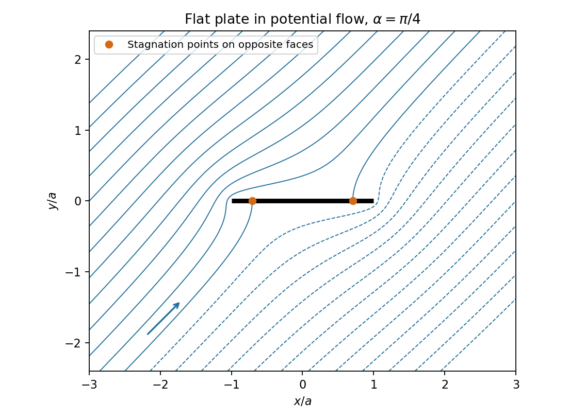

<h1 id="k/k3/solution">Solution</h1>

↑ **Parent:** [K3](../k3.md)

Orient the body contour counterclockwise. The outward normal from the body satisfies $(n_x,n_y)ds=(dy,-dx)$, so pressure produces complex force $F_x-iF_y=-i\oint p\,d\bar z$. [Bernoulli's theorem](../../../../bernoulli-equation.md) gives $p=p_\infty-\rho|w'|^2/2$; the constant term integrates to zero. On an impermeable boundary the velocity is tangent, so $w' dz$ is real, equivalently $w'dz=\overline{w'}d\bar z$. Consequently $|w'|^2d\bar z=(w')^2dz$ and

$$
\boxed{F_x-iF_y=\frac{i\rho}2\oint_{\partial B}(w'(z))^2dz.}
$$

Choose the square-root branch analytic off the slit $[-a,a]$ with $\sqrt{z^2-a^2}\sim z$ at infinity. Continuation from $x>a$ through the upper half-plane gives the upper-face value $+i\sqrt{a^2-x^2}$; continuation through the lower half-plane gives the lower-face value $-i\sqrt{a^2-x^2}$. Both have the required square and the sign is fixed by the branch normalization.

Differentiate the potential:

$$
w'(z)=\cos\alpha-i\sin\alpha\,\frac z{\sqrt{z^2-a^2}}.
$$

At infinity, $z/\sqrt{z^2-a^2}=1+a^2/(2z^2)+O(z^{-4})$, so $w'(z)^2=e^{-2i\alpha}+O(z^{-2})$ has no $z^{-1}$ term. Deforming a contour around the plate to a large circle in its analytic exterior therefore gives zero integral. The force is $\boxed{F_x=F_y=0}$. The contour formulation includes the endpoint behavior and avoids assigning separate divergent endpoint pressure contributions.

For $0<\alpha<\pi/2$, use the two face values of the square root. The upper tangential velocity is $\cos\alpha-x\sin\alpha/\sqrt{a^2-x^2}$, vanishing at $\boxed{x=a\cos\alpha}$ on the upper face. The lower value is $\cos\alpha+x\sin\alpha/\sqrt{a^2-x^2}$, vanishing at $\boxed{x=-a\cos\alpha}$ on the lower face. Squaring the equation $w'=0$ gives only these candidates, and the branch signs locate the correct faces. At $\alpha=\pi/2$ both face [stagnation points](../../../../stagnation-point.md) have coordinate zero. At $\alpha=0$ the exterior velocity is identically one, so there is no finite [stagnation point](../../../../stagnation-point.md); the endpoints are merely limits of the two locations as the angle tends to zero.

**[Figure 1](#k/k3/image-potential-flow-streamlines-around-the-plate-at-angle-pi-over-four). Potential-flow streamlines around the plate at angle pi over four**.

The plotted streamlines are contours of the imaginary part of the potential, with the two boundary [stagnation points](../../../../stagnation-point.md) marked. The far-[field](../../../../field.md) velocity is $(\cos\alpha,\sin\alpha)$, giving a flow from the lower left toward the upper right at the plotted angle.

## ↑ Ancestors (12)

1. [K3](../k3.md)
2. [K](../../k.md)
3. [2009](../../../2009-split.md)
4. [Past exam of the Probability, statistics and options II course of the University of Oxford](../../../split.md)
5. [Probability, statistics and options II course of the University of Oxford](../../../../probability-statistics-and-options-ii-course-of-the-university-of-oxford.md)
6. [Year 2 of the mathematics and statistics course of the University of Oxford](../../../../year-2-of-the-mathematics-and-statistics-course-of-the-university-of-oxford.md)
7. [Mathematics and statistics course of the University of Oxford](../../../../mathematics-and-statistics-course-of-the-university-of-oxford.md)
8. [Undergraduate course of the University of Oxford](../../../../undergraduate-course-of-the-university-of-oxford.md)
9. [Course of the University of Oxford](../../../../course-of-the-university-of-oxford.md)
10. [University of Oxford](../../../../university-of-oxford-split.md)
11. [List of universities](../../../../list-of-universities.md)
12. [Codex Wiki](../../../../split.md)
