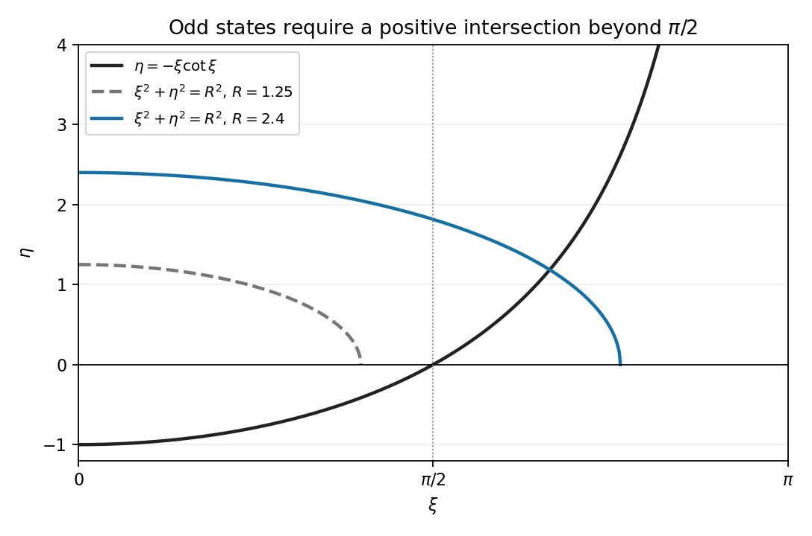

# 2010

↑ **Parent:** [Past exam of the Probability, statistics and options II course of the University of Oxford](../past-exam-of-the-probability-statistics-and-options-ii-course-of-the-university-of-oxford.md)

Source: [Mathematics release](https://www.whatdotheyknow.com/request/maths_past_papers_3), supplied bundle `Part A 2007 11-1.pdf`, pages 241–258. The eighteen-page Mathematics and Statistics paper is dated 24 June 2010. Its editable source transcription is retained privately.

Bounded exact-paper answer checks found no matching advertisement. Every source section and printed part is addressed below, including surrounding unnumbered requests and explicit qualifications of incorrect source assertions.

**Table of contents**

- [A](#a)
  - [A2](#a/a2)
    - [1](#a/a2/1)
      - [Solution](#a/a2/1/solution)
    - [2](#a/a2/2)
      - [Solution](#a/a2/2/solution)
    - [3](#a/a2/3)
      - [Solution](#a/a2/3/solution)
    - [4](#a/a2/4)
      - [Solution](#a/a2/4/solution)
- [B](#b)
  - [B2](#b/b2)
    - [a](#b/b2/a)
      - [Solution](#b/b2/a/solution)
    - [b](#b/b2/b)
      - [Solution](#b/b2/b/solution)
    - [c](#b/b2/c)
      - [Solution](#b/b2/c/solution)
    - [d](#b/b2/d)
      - [Solution](#b/b2/d/solution)
    - [e](#b/b2/e)
      - [Solution](#b/b2/e/solution)
- [C](#c)
  - [C2](#c/c2)
    - [i](#c/c2/i)
      - [Solution](#c/c2/i/solution)
    - [ii](#c/c2/ii)
      - [Solution](#c/c2/ii/solution)
    - [iii](#c/c2/iii)
      - [Solution](#c/c2/iii/solution)
    - [iv](#c/c2/iv)
      - [Solution](#c/c2/iv/solution)
    - [v](#c/c2/v)
      - [Solution](#c/c2/v/solution)
- [D](#d)
  - [D3](#d/d3)
    - [1](#d/d3/1)
      - [Solution](#d/d3/1/solution)
    - [2](#d/d3/2)
      - [Solution](#d/d3/2/solution)
  - [D4](#d/d4)
    - [1](#d/d4/1)
      - [a](#d/d4/1/a)
        - [Solution](#d/d4/1/a/solution)
      - [b](#d/d4/1/b)
        - [Solution](#d/d4/1/b/solution)
    - [2](#d/d4/2)
      - [Solution](#d/d4/2/solution)
- [E](#e)
  - [E3](#e/e3)
    - [a](#e/e3/a)
      - [i](#e/e3/a/i)
        - [Solution](#e/e3/a/i/solution)
      - [ii](#e/e3/a/ii)
        - [Solution](#e/e3/a/ii/solution)
      - [iii](#e/e3/a/iii)
        - [Solution](#e/e3/a/iii/solution)
    - [b](#e/e3/b)
      - [i](#e/e3/b/i)
        - [Solution](#e/e3/b/i/solution)
      - [ii](#e/e3/b/ii)
        - [Solution](#e/e3/b/ii/solution)
      - [iii](#e/e3/b/iii)
        - [Solution](#e/e3/b/iii/solution)
      - [iv](#e/e3/b/iv)
        - [Solution](#e/e3/b/iv/solution)
  - [E4](#e/e4)
    - [a](#e/e4/a)
      - [i](#e/e4/a/i)
        - [Solution](#e/e4/a/i/solution)
      - [ii](#e/e4/a/ii)
        - [Solution](#e/e4/a/ii/solution)
      - [iii](#e/e4/a/iii)
        - [Solution](#e/e4/a/iii/solution)
      - [iv](#e/e4/a/iv)
        - [Solution](#e/e4/a/iv/solution)
      - [v](#e/e4/a/v)
        - [Solution](#e/e4/a/v/solution)
    - [b](#e/e4/b)
      - [i](#e/e4/b/i)
        - [Solution](#e/e4/b/i/solution)
      - [ii](#e/e4/b/ii)
        - [Solution](#e/e4/b/ii/solution)
    - [c](#e/e4/c)
      - [i](#e/e4/c/i)
        - [Solution](#e/e4/c/i/solution)
      - [ii](#e/e4/c/ii)
        - [Solution](#e/e4/c/ii/solution)
- [F](#f)
  - [F2](#f/f2)
    - [a](#f/f2/a)
      - [Solution](#f/f2/a/solution)
    - [b](#f/f2/b)
      - [Solution](#f/f2/b/solution)
    - [c](#f/f2/c)
      - [1](#f/f2/c/1)
        - [Solution](#f/f2/c/1/solution)
      - [2](#f/f2/c/2)
        - [Solution](#f/f2/c/2/solution)
- [G](#g)
  - [G2](#g/g2)
    - [Solution](#g/g2/solution)
- [H](#h)
  - [H2](#h/h2)
    - [Solution](#h/h2/solution)
- [J](#j)
  - [J2](#j/j2)
    - [Solution](#j/j2/solution)
- [K](#k)
  - [K3](#k/k3)
    - [Solution](#k/k3/solution)
  - [K4](#k/k4)
    - [Solution](#k/k4/solution)
- [M](#m)
  - [M4](#m/m4)
    - [a](#m/m4/a)
      - [i](#m/m4/a/i)
        - [Solution](#m/m4/a/i/solution)
      - [ii](#m/m4/a/ii)
        - [Solution](#m/m4/a/ii/solution)
      - [iii](#m/m4/a/iii)
        - [Solution](#m/m4/a/iii/solution)
    - [b](#m/m4/b)
      - [Solution](#m/m4/b/solution)
  - [M5](#m/m5)
    - [a](#m/m5/a)
      - [i](#m/m5/a/i)
        - [Solution](#m/m5/a/i/solution)
      - [ii](#m/m5/a/ii)
        - [Solution](#m/m5/a/ii/solution)
    - [b](#m/m5/b)
      - [Solution](#m/m5/b/solution)
    - [c](#m/m5/c)
      - [Solution](#m/m5/c/solution)
    - [d](#m/m5/d)
      - [Solution](#m/m5/d/solution)
    - [e](#m/m5/e)
      - [i](#m/m5/e/i)
        - [Solution](#m/m5/e/i/solution)
      - [ii](#m/m5/e/ii)
        - [Solution](#m/m5/e/ii/solution)
- [O](#o)
  - [O4](#o/o4)
    - [a](#o/o4/a)
      - [Solution](#o/o4/a/solution)
    - [b](#o/o4/b)
      - [i](#o/o4/b/i)
        - [Solution](#o/o4/b/i/solution)
      - [ii](#o/o4/b/ii)
        - [Solution](#o/o4/b/ii/solution)
      - [iii](#o/o4/b/iii)
        - [Solution](#o/o4/b/iii/solution)
      - [iv](#o/o4/b/iv)
        - [Solution](#o/o4/b/iv/solution)
  - [O5](#o/o5)
    - [a](#o/o5/a)
      - [Solution](#o/o5/a/solution)
    - [b](#o/o5/b)
      - [Solution](#o/o5/b/solution)
- [P](#p)
  - [P3](#p/p3)
    - [a](#p/p3/a)
      - [Solution](#p/p3/a/solution)
    - [b](#p/p3/b)
      - [Solution](#p/p3/b/solution)
    - [c](#p/p3/c)
      - [Solution](#p/p3/c/solution)
    - [d](#p/p3/d)
      - [i](#p/p3/d/i)
        - [Solution](#p/p3/d/i/solution)
      - [ii](#p/p3/d/ii)
        - [Solution](#p/p3/d/ii/solution)
      - [iii](#p/p3/d/iii)
        - [Solution](#p/p3/d/iii/solution)
  - [P4](#p/p4)
    - [a](#p/p4/a)
      - [Solution](#p/p4/a/solution)
    - [b](#p/p4/b)
      - [Solution](#p/p4/b/solution)
    - [c](#p/p4/c)
      - [Solution](#p/p4/c/solution)
- [R](#r)
  - [R2](#r/r2)
    - [i](#r/r2/i)
      - [Solution](#r/r2/i/solution)
    - [ii](#r/r2/ii)
      - [Solution](#r/r2/ii/solution)
    - [iii](#r/r2/iii)
      - [Solution](#r/r2/iii/solution)
    - [iv](#r/r2/iv)
      - [Solution](#r/r2/iv/solution)
    - [v](#r/r2/v)
      - [a](#r/r2/v/a)
        - [Solution](#r/r2/v/a/solution)
      - [b](#r/r2/v/b)
        - [Solution](#r/r2/v/b/solution)
- [S](#s)
  - [S2](#s/s2)
    - [a](#s/s2/a)
      - [i](#s/s2/a/i)
        - [Solution](#s/s2/a/i/solution)
      - [ii](#s/s2/a/ii)
        - [Solution](#s/s2/a/ii/solution)
    - [b](#s/s2/b)
      - [i](#s/s2/b/i)
        - [Solution](#s/s2/b/i/solution)
      - [ii](#s/s2/b/ii)
        - [Solution](#s/s2/b/ii/solution)
- [T](#t)
  - [T2](#t/t2)
    - [a](#t/t2/a)
      - [i](#t/t2/a/i)
        - [Solution](#t/t2/a/i/solution)
      - [ii](#t/t2/a/ii)
        - [Solution](#t/t2/a/ii/solution)
      - [iii](#t/t2/a/iii)
        - [Solution](#t/t2/a/iii/solution)
    - [b](#t/t2/b)
      - [i](#t/t2/b/i)
        - [Solution](#t/t2/b/i/solution)
      - [ii](#t/t2/b/ii)
        - [Solution](#t/t2/b/ii/solution)
- [U](#u)
  - [U2](#u/u2)
    - [a](#u/u2/a)
      - [Solution](#u/u2/a/solution)
    - [b](#u/u2/b)
      - [i](#u/u2/b/i)
        - [Solution](#u/u2/b/i/solution)
      - [ii](#u/u2/b/ii)
        - [Solution](#u/u2/b/ii/solution)
      - [iii](#u/u2/b/iii)
        - [Solution](#u/u2/b/iii/solution)
      - [iv](#u/u2/b/iv)
        - [Solution](#u/u2/b/iv/solution)

## A

↑ **Parent:** [2010](2010.md)

<h3 id="a/a2">A2</h3>

↑ **Parent:** [A](#a)

<h4 id="a/a2/1">1</h4>

↑ **Parent:** [A2](#a/a2)

<h5 id="a/a2/1/solution">Solution</h5>

↑ **Parent:** [1](#a/a2/1)

Regard $K$ as a [vector space](../vector-space.md) over $F$. Since $K$ is finite, a maximal [linearly independent](../vector-space.md#linear-independence) list has finite length $d$ and is a [basis](../vector-space.md#basis). Every element is uniquely a [linear combination](../vector-space.md#linear-combination) of its $d$ [basis vectors](../vector-space.md#basis-vector), with $q$ choices for each coefficient. Hence $\boxed{|K|=q^d}$, with $d=[K:F]$. This includes $d=1$ when the extension is trivial.

<h4 id="a/a2/2">2</h4>

↑ **Parent:** [A2](#a/a2)

<h5 id="a/a2/2/solution">Solution</h5>

↑ **Parent:** [2](#a/a2/2)

Write $q=p^r$, where $p$ is the [characteristic](../algebra.md#characteristic-of-a-field). In a [splitting field](../galois-theory.md#splitting-field) of $X^{q^m}-X$ over $F$, let $K$ be its set of roots. The [derivative](../calculus.md#derivative) of this [polynomial](../polynomial.md) is $-1$, so all $q^m$ roots are distinct. The [Frobenius](../galois-theory.md#frobenius-endomorphism) [power](../statistical-hypothesis-test.md#power-function-of-a-statistical-test) is additive and multiplicative: $(x+y)^{q^m}=x^{q^m}+y^{q^m}$ and $(xy)^{q^m}=x^{q^m}y^{q^m}$. Thus roots are closed under addition, negatives and multiplication; for a nonzero root, $(x^{-1})^{q^m}=x^{-1}$. They include $0,1$ and form a [field](../algebra.md#field).

Every $a\in F$ satisfies $a^q=a$, by [Lagrange's theorem](../group-theory.md#lagrange-s-theorem) on $F^\times$ and separately at zero. Iterating gives $a^{q^m}=a$, so $F\subseteq K$. The constructed [field](../algebra.md#field) therefore contains $F$ and has exactly $\boxed{q^m\text{ elements}}$.

<h4 id="a/a2/3">3</h4>

↑ **Parent:** [A2](#a/a2)

<h5 id="a/a2/3/solution">Solution</h5>

↑ **Parent:** [3](#a/a2/3)

By the allowed cyclicity theorem, $K^\times$ has a generator $z$. Every nonzero element of $K$ is a [power](../statistical-hypothesis-test.md#power-function-of-a-statistical-test) of $z$, and zero also belongs to $F(z)$. Thus $K\subseteq F(z)\subseteq K$, giving $\boxed{K=F(z)}$. This is a primitive element argument for [finite fields](../algebra.md#finite-field) using the multiplicative [group](../group.md), not a claim that the additive [group](../group.md) is cyclic.

<h4 id="a/a2/4">4</h4>

↑ **Parent:** [A2](#a/a2)

<h5 id="a/a2/4/solution">Solution</h5>

↑ **Parent:** [4](#a/a2/4)

For $\alpha\ne0$, [Lagrange's theorem](../group-theory.md#lagrange-s-theorem) in the multiplicative [group](../group.md) of order $q^m-1$ gives $\alpha^{q^m-1}=1$; at zero the desired [identity](../algebraic-operation.md#identity-element) is immediate. Thus all elements satisfy $\alpha^{q^m}-\alpha=0$.

For an irreducible [degree](../graph-theory.md#degree-graph-theory)-$m$ [polynomial](../polynomial.md) $f\in F[X]$, the quotient $L=F[X]/(f)$ is a [field](../algebra.md#field) of [dimension](../vector-space.md#dimension-vector-space) $m$, hence has $q^m$ elements by part 1. Its element $\alpha=[X]$ therefore satisfies $\alpha^{q^m}-\alpha=0$. The evaluation homomorphism $F[X]\to L$ has kernel $(f)$, so

$$
\boxed{f(X)\mid X^{q^m}-X.}
$$

## B

↑ **Parent:** [2010](2010.md)

<h3 id="b/b2">B2</h3>

↑ **Parent:** [B](#b)

<h4 id="b/b2/a">a</h4>

↑ **Parent:** [B2](#b/b2)

<h5 id="b/b2/a/solution">Solution</h5>

↑ **Parent:** [A](#b/b2/a)

Given $N\trianglelefteq G$ and $H\le G$, the conditions are $\boxed{G=NH,\quad N\cap H=\{1\}}$. Every element then has a unique expression $nh$. The extra datum is the action $\alpha:H\to\operatorname{Aut}(N)$ given by [conjugation](../group-action.md#conjugation), $\alpha_h(n)=hnh^{-1}$. On pairs $(n,h)$ the reconstructed multiplication is

$$
(n,h)(n',h')=(n\alpha_h(n'),hh').
$$

For example $S_3=\langle(123)\rangle\rtimes\langle(12)\rangle$. The order-three [subgroup](../group.md#subgroup) is normal, the intersection is trivial, and their sizes multiply to six. [Conjugation](../group-action.md#conjugation) by $(12)$ inverts $(123)$, so the action is nontrivial. Consequently this is not the direct product of these [subgroups](../group.md#subgroup): $C_3\times C_2$ is [Abelian](../group.md#abelian-group), whereas $S_3$ is not.

<h4 id="b/b2/b">b</h4>

↑ **Parent:** [B2](#b/b2)

<h5 id="b/b2/b/solution">Solution</h5>

↑ **Parent:** [B](#b/b2/b)

Compose the second map first. Direct substitution gives

$$
\boxed{(A,b)(A',b')=(AA',Ab'+b).}
$$

The result is affine because the product [matrix](../vector-space.md#matrix) is invertible. The [identity](../algebraic-operation.md#identity-element) is $(I,0)$ and the [inverse](../algebraic-operation.md#inverse-element) is $(A^{-1},-A^{-1}b)$. [Associativity](../algebraic-operation.md#associative-property) follows from composition of maps, or by expanding this product three times. Distinct pairs give distinct maps, since evaluating at zero gives $b$ and evaluating the difference on [basis vectors](../vector-space.md#basis-vector) gives all columns of $A$. Thus these pairs faithfully describe a [group](../group.md).

<h4 id="b/b2/c">c</h4>

↑ **Parent:** [B2](#b/b2)

<h5 id="b/b2/c/solution">Solution</h5>

↑ **Parent:** [C](#b/b2/c)

The map $A\mapsto(A,0)$ is an [injective](../algebra.md#injective-function) [group homomorphism](../group-theory.md#group-homomorphism), so its image is the required copy of $\operatorname{GL}_n(F)$. Translations are the [subgroup](../group.md#subgroup) $N=\{(I,b):b\in F^n\}$, isomorphic to the additive [group](../group.md) of $F^n$. For any affine map,

$$
\boxed{(A,b)(I,t)(A,b)^{-1}=(I,At).}
$$

Thus [conjugation](../group-action.md#conjugation) preserves translations, proving $N\trianglelefteq G$.

<h4 id="b/b2/d">d</h4>

↑ **Parent:** [B2](#b/b2)

<h5 id="b/b2/d/solution">Solution</h5>

↑ **Parent:** [D](#b/b2/d)

Every pair factors as $(A,b)=(I,b)(A,0)$, and a [linear map](../vector-space.md#linear-map) which is also a translation fixes zero and has linear part $I$, hence is the [identity](../algebraic-operation.md#identity-element). Thus $G=NH$ and $N\cap H=\{1\}$. The [conjugation](../group-action.md#conjugation) formula in (c) says that the action needed for reconstruction is simply the usual [matrix](../vector-space.md#matrix) action $A:t\mapsto At$ on the additive [group](../group.md) $F^n$. Therefore

$$
\boxed{G\cong F^n\rtimes\operatorname{GL}_n(F).}
$$

<h4 id="b/b2/e">e</h4>

↑ **Parent:** [B2](#b/b2)

<h5 id="b/b2/e/solution">Solution</h5>

↑ **Parent:** [E](#b/b2/e)

There are $p^n$ choices for the translation. Choose the columns of an [invertible matrix](../linear-algebra.md#invertible-matrix) successively: the first is any nonzero column, the second avoids its span, and at stage $j+1$ one avoids a $j$-dimensional span of size $p^j$. Consequently

$$
\boxed{|G|=p^n\prod_{j=0}^{n-1}(p^n-p^j).}
$$

The successive [linear independence](../vector-space.md#linear-independence) conditions are exactly the criterion that the columns form a [basis](../vector-space.md#basis).

<h2 id="c">C</h2>

↑ **Parent:** [2010](2010.md)

<h3 id="c/c2">C2</h3>

↑ **Parent:** [C](#c)

<h4 id="c/c2/i">i</h4>

↑ **Parent:** [C2](#c/c2)

<h5 id="c/c2/i/solution">Solution</h5>

↑ **Parent:** [I](#c/c2/i)

A [primitive root](../number-theory.md#primitive-root-modulo-n) modulo $p$ is a generator of the cyclic multiplicative [group](../group.md) $(\mathbb Z/p\mathbb Z)^\times$, so it has order $p-1$. If $g$ is one generator, the generators are exactly $g^k$ with $\gcd(k,p-1)=1$. Hence there are $\boxed{\phi(p-1)}$. For $p=2$ the [group](../group.md) is trivial and its unique element is its generator, consistently with $\phi(1)=1$.

<h4 id="c/c2/ii">ii</h4>

↑ **Parent:** [C2](#c/c2)

<h5 id="c/c2/ii/solution">Solution</h5>

↑ **Parent:** [Ii](#c/c2/ii)

For $n\ge1$, the zero [residue](../analysis.md#residue) contributes zero. Multiplication by any nonzero $\alpha$ permutes the nonzero [residues](../analysis.md#residue), so the sum $S$ satisfies $S=\alpha^nS$ in $\mathbb F_p$. If $p-1\nmid n$, choose a [primitive root](../number-theory.md#primitive-root-modulo-n) $\alpha$; then $\alpha^n\ne1$, forcing $S=0$. If $p-1\mid n$, every nonzero term equals one, so $S=p-1=-1$ in the [field](../algebra.md#field).

The printed display also mentions $n=0$, although its introductory assumption is $n\ge1$. For that extra case the sum of the $p$ integer values $x^0$ for $1\le x\le p$ is $p\equiv0$, so that branch is consistent too. The result is

$$
\boxed{\sum_{x=1}^p x^n\equiv-1\pmod p\ \text{exactly when }n>0,\ (p-1)\mid n;\quad0\text{ otherwise}.}
$$

<h4 id="c/c2/iii">iii</h4>

↑ **Parent:** [C2](#c/c2)

<h5 id="c/c2/iii/solution">Solution</h5>

↑ **Parent:** [Iii](#c/c2/iii)

The [Legendre symbol](../quadratic-residue.md#legendre-symbol) being one means $a$ is nonzero and a square modulo $p$. Take one root $r\ne0$. Factoring $x^2-r^2=(x-r)(x+r)$ in the [field](../algebra.md#field) shows that any root is $r$ or $-r$. Since $p$ is odd these are distinct. Thus there are exactly $\boxed{2}$ solutions.

<h4 id="c/c2/iv">iv</h4>

↑ **Parent:** [C2](#c/c2)

<h5 id="c/c2/iv/solution">Solution</h5>

↑ **Parent:** [Iv](#c/c2/iv)

Each nonzero [quadratic residue](../quadratic-residue.md) is attained twice as $x^2$ for $1\le x\le p-1$. Therefore twice the sum of those [residues](../analysis.md#residue) is $\sum_{x=1}^{p-1}x^2$, which is zero modulo $p$ by (ii), since $p-1>2$. As two is invertible modulo $p$, the sum of the [residues](../analysis.md#residue) is zero. The sum of all nonzero [residues](../analysis.md#residue) is $p(p-1)/2\equiv0$, so subtracting gives the same result for the nonresidues. Hence $\boxed{\text{both indicated sums are }0\pmod p}$.

<h4 id="c/c2/v">v</h4>

↑ **Parent:** [C2](#c/c2)

<h5 id="c/c2/v/solution">Solution</h5>

↑ **Parent:** [V](#c/c2/v)

By (ii), failure of divisibility is equivalent to $q-1\mid30$. The positive divisors of $30$ are $1,2,3,5,6,10,15,30$; adding one gives $2,3,4,6,7,11,16,31$. Retaining only [primes](../prime-number.md) yields

$$
\boxed{q\in\{2,3,7,11,31\}.}
$$

<h2 id="d">D</h2>

↑ **Parent:** [2010](2010.md)

<h3 id="d/d3">D3</h3>

↑ **Parent:** [D](#d)

The [monotone convergence theorem](../measure-theory.md#monotone-convergence-theorem) states that if nonnegative measurable functions $h_n$ increase [almost everywhere](../measure-theory.md#almost-everywhere) to $h$, then $\int h=\lim_n\int h_n$, allowing infinity. The [dominated convergence theorem](../measure-theory.md#dominated-convergence-theorem) states that if measurable $h_n\to h$ [almost everywhere](../measure-theory.md#almost-everywhere) and $|h_n|\le g$ for an [integrable](../measure-theory.md#integrability) $g$, then $h$ is [integrable](../measure-theory.md#integrability) and $\int h_n\to\int h$.

<h4 id="d/d3/1">1</h4>

↑ **Parent:** [D3](#d/d3)

<h5 id="d/d3/1/solution">Solution</h5>

↑ **Parent:** [1](#d/d3/1)

Apply [monotone convergence](../measure-theory.md#monotone-convergence-theorem) to $A_n=\sum_{k=1}^n|a_k|$. Its limit $A=\sum_{k\ge1}|a_k|$ has integral $\sum_k\int|a_k|<\infty$, so $A<\infty$ [almost everywhere](../measure-theory.md#almost-everywhere). Thus the original series converges absolutely [almost everywhere](../measure-theory.md#almost-everywhere). Its partial sums are [bounded](../topological-analysis.md#boundedness) in absolute value by the [integrable function](../measure-theory.md#lebesgue-integrable-function) $A$, and their limit $s$ satisfies $|s|\le A$. [Dominated convergence](../measure-theory.md#dominated-convergence-theorem) gives

$$
\boxed{\int s=\lim_n\sum_{k=1}^n\int a_k=\sum_{k=1}^{\infty}\int a_k.}
$$

Assigning any value on the null exceptional set defines an [integrable](../measure-theory.md#integrability) representative of $s$.

<h4 id="d/d3/2">2</h4>

↑ **Parent:** [D3](#d/d3)

<h5 id="d/d3/2/solution">Solution</h5>

↑ **Parent:** [2](#d/d3/2)

For $0<x<1$, expand $(1-x)^{-2}=\sum_{k\ge1}kx^{k-1}$. All terms after multiplication by $(\log x)^2$ are nonnegative, so [monotone convergence](../measure-theory.md#monotone-convergence-theorem) permits integration term by term. Substituting $x=e^{-t}$ and integrating by parts twice gives

$$
\int_0^1x^{k-1}(\log x)^2dx=\int_0^\infty e^{-kt}t^2dt=\frac2{k^3}.
$$

Consequently the integral is $\sum_{k\ge1}2/k^2$, and the supplied sum gives $\boxed{\pi^2/3}$.

<h3 id="d/d4">D4</h3>

↑ **Parent:** [D](#d)

A sufficient differentiation theorem is the following local version. Suppose $u(t,\cdot)$ is [integrable](../measure-theory.md#integrability), $u(\cdot,x)$ is continuously [differentiable](../analysis.md#differentiable-function) for almost every $x$, and for each [compact](../topology.md#compact-space) parameter [interval](../real-analysis.md#interval-mathematics) there is an [integrable](../measure-theory.md#integrability) $g(x)$ bounding $|\partial_tu(t,x)|$ uniformly there. Then $I'(t)=\int_E\partial_tu(t,x)\,dx$. The [mean value theorem](../calculus.md#mean-value-theorem) bounds the difference quotients by $g$, and [dominated convergence](../measure-theory.md#dominated-convergence-theorem) proves the formula. Integrability at one parameter value together with the [derivative](../calculus.md#derivative) bound also suffices locally.

<h4 id="d/d4/1">1</h4>

↑ **Parent:** [D4](#d/d4)

<h5 id="d/d4/1/a">a</h5>

↑ **Parent:** [1](#d/d4/1)

<h6 id="d/d4/1/a/solution">Solution</h6>

↑ **Parent:** [A](#d/d4/1/a)

The $k$th [derivative](../calculus.md#derivative) of the integrand is $(\cos x)^k\cos(t\cos x+k\pi/2)$, whose absolute value is at most one. The integration [interval](../real-analysis.md#interval-mathematics) has finite measure. Repeated application of the differentiation theorem therefore gives

$$
\boxed{J_0^{(k)}(t)=\frac2\pi\int_0^{\pi/2}(\cos x)^k\cos(t\cos x+k\pi/2)\,dx\quad(k\ge0).}
$$

[Dominated convergence](../measure-theory.md#dominated-convergence-theorem) also gives [continuity](../calculus.md#continuous-function) of every [derivative](../calculus.md#derivative), proving infinite [differentiability](../analysis.md#differentiability).

<h5 id="d/d4/1/b">b</h5>

↑ **Parent:** [1](#d/d4/1)

<h6 id="d/d4/1/b/solution">Solution</h6>

↑ **Parent:** [B](#d/d4/1/b)

From (a), combine the three [derivative](../calculus.md#derivative) integrals:

$$
tJ_0''+J_0'+tJ_0=\frac2\pi\int_0^{\pi/2}\bigl(t\sin^2x\cos(t\cos x)-\cos x\sin(t\cos x)\bigr)dx.
$$

The integrand is $-\frac d{dx}[\sin x\sin(t\cos x)]$. This bracket vanishes at both endpoints, so the integral is zero. Hence $\boxed{tJ_0''+J_0'+tJ_0=0}$, also at $t=0$ by the same formula.

<h4 id="d/d4/2">2</h4>

↑ **Parent:** [D4](#d/d4)

<h5 id="d/d4/2/solution">Solution</h5>

↑ **Parent:** [2](#d/d4/2)

A direct [derivative](../calculus.md#derivative) bound by $1/x$ would not be [integrable](../measure-theory.md#integrability), so the earlier theorem cannot be applied that way. Instead, for $t>0$ make the legitimate substitution $s=tx$ in the [absolutely convergent](../sequence-and-series.md#absolute-convergence) integral:

$$
K(t)=t\int_t^\infty\frac{\cos s}{s^2}\,ds.
$$

The tail integral has [continuous](../calculus.md#continuous-function) integrand away from zero and converges absolutely. The [fundamental theorem of calculus](../calculus.md#fundamental-theorem-of-calculus) therefore gives [derivative](../calculus.md#derivative) $-\cos t/t^2$ with respect to its lower endpoint. The [product rule](../calculus.md#product-rule) yields

$$
\boxed{K'(t)=\int_t^\infty\frac{\cos s}{s^2}\,ds-\frac{\cos t}t=\frac{K(t)-\cos t}t.}
$$

This establishes [differentiability](../analysis.md#differentiability) carefully without an invalid domination argument.

<h2 id="e">E</h2>

↑ **Parent:** [2010](2010.md)

<h3 id="e/e3">E3</h3>

↑ **Parent:** [E](#e)

<h4 id="e/e3/a">a</h4>

↑ **Parent:** [E3](#e/e3)

<h5 id="e/e3/a/i">i</h5>

↑ **Parent:** [A](#e/e3/a)

<h6 id="e/e3/a/i/solution">Solution</h6>

↑ **Parent:** [I](#e/e3/a/i)

A subset $A$ is [connected](../geometry-and-topology.md#connected-space) if, with its [subspace topology](../topology.md#subspace-topology), it cannot be written as $A=U\cup V$ with $U,V$ disjoint nonempty relatively [open sets](../topology.md#open-set). Equivalently its only subsets both open and closed relative to $A$ are $\varnothing,A$. This definition includes the empty set and singletons as [connected](../geometry-and-topology.md#connected-space) sets.

<h5 id="e/e3/a/ii">ii</h5>

↑ **Parent:** [A](#e/e3/a)

<h6 id="e/e3/a/ii/solution">Solution</h6>

↑ **Parent:** [Ii](#e/e3/a/ii)

The [connected subsets](../geometry-and-topology.md#connected-subset) of the [real line](../real-analysis.md#real-line) are exactly the [intervals](../real-analysis.md#interval-mathematics), including singletons, unbounded [intervals](../real-analysis.md#interval-mathematics) and the empty set. Equivalently, whenever $x<y$ belong to the set, every $z$ with $x<z<y$ also belongs to it. Endpoints may or may not be included.

<h5 id="e/e3/a/iii">iii</h5>

↑ **Parent:** [A](#e/e3/a)

<h6 id="e/e3/a/iii/solution">Solution</h6>

↑ **Parent:** [Iii](#e/e3/a/iii)

Use the separation definition in (i). If $A=\bigcup_i A_i$ had a separation $A=U\cup V$, the intersections with each [connected](../geometry-and-topology.md#connected-space) $A_i$ show that $A_i$ lies wholly in one side. Choose one nonempty $A_{i_0}$; every other $A_i$ intersects it and must lie on that same side. Thus the other side is empty, a contradiction. If the union is empty it is [connected](../geometry-and-topology.md#connected-space) by definition. Therefore $\boxed{\bigcup_iA_i\text{ is connected}}$.

<h4 id="e/e3/b">b</h4>

↑ **Parent:** [E3](#e/e3)

<h5 id="e/e3/b/i">i</h5>

↑ **Parent:** [B](#e/e3/b)

<h6 id="e/e3/b/i/solution">Solution</h6>

↑ **Parent:** [I](#e/e3/b/i)

Let $K_a$ be the union of all [connected subsets](../geometry-and-topology.md#connected-subset) containing $a$. This collection is nonempty because it includes $\{a\}$. Any two of its members meet at $a$, so (a)(iii) makes their full union [connected](../geometry-and-topology.md#connected-space). It contains $a$ and by its definition contains every [connected subset](../geometry-and-topology.md#connected-subset) through $a$. Thus

$$
\boxed{K_a=\bigcup\{S\subseteq X:S\text{ connected},\ a\in S\}}
$$

has exactly the required largest-set property.

<h5 id="e/e3/b/ii">ii</h5>

↑ **Parent:** [B](#e/e3/b)

<h6 id="e/e3/b/ii/solution">Solution</h6>

↑ **Parent:** [Ii](#e/e3/b/ii)

If $K_a\cap K_b\ne\varnothing$, their union is [connected](../geometry-and-topology.md#connected-space) by (a)(iii). It contains $a$, so maximality gives $K_a\cup K_b\subseteq K_a$ and hence $K_b\subseteq K_a$. Interchanging the roles gives the reverse inclusion. Thus the two components coincide; otherwise they are disjoint.

<h5 id="e/e3/b/iii">iii</h5>

↑ **Parent:** [B](#e/e3/b)

<h6 id="e/e3/b/iii/solution">Solution</h6>

↑ **Parent:** [Iii](#e/e3/b/iii)

The inclusion of $X$ into $\mathbb R$ is [continuous](../calculus.md#continuous-function), so a [connected component](../geometry-and-topology.md#connected-component) $K$ of $X$ is an [interval](../real-analysis.md#interval-mathematics) in $\mathbb R$. For $x\in K$, openness of $X$ gives $\varepsilon>0$ with $(x-\varepsilon,x+\varepsilon)\subseteq X$. This [interval](../real-analysis.md#interval-mathematics) is [connected](../geometry-and-topology.md#connected-space) and meets $K$, so their union is [connected](../geometry-and-topology.md#connected-space) and maximality forces the [interval](../real-analysis.md#interval-mathematics) into $K$. Thus $K$ is open in $\mathbb R$. A nonempty open [connected subset](../geometry-and-topology.md#connected-subset) of the line is an [open interval](../topology.md#open-interval), allowing an infinite endpoint or the whole line. Hence **every component is an [open interval](../topology.md#open-interval)**.

<h5 id="e/e3/b/iv">iv</h5>

↑ **Parent:** [B](#e/e3/b)

<h6 id="e/e3/b/iv/solution">Solution</h6>

↑ **Parent:** [Iv](#e/e3/b/iv)

The components cover $X$ and are pairwise disjoint by (b)(ii); by (iii) they are [open intervals](../topology.md#open-interval). Each nonempty [interval](../real-analysis.md#interval-mathematics) contains a [rational number](../number-theory.md#rational-number). Enumerate the rationals and assign to each [interval](../real-analysis.md#interval-mathematics) the first rational it contains. Disjointness makes these assigned rationals distinct, giving an injection from the set of components into $\mathbb N$. Thus $\boxed{X\text{ is a countable union of pairwise disjoint open intervals}}$, with the empty union for $X=\varnothing$.

<h3 id="e/e4">E4</h3>

↑ **Parent:** [E](#e)

<h4 id="e/e4/a">a</h4>

↑ **Parent:** [E4](#e/e4)

<h5 id="e/e4/a/i">i</h5>

↑ **Parent:** [A](#e/e4/a)

<h6 id="e/e4/a/i/solution">Solution</h6>

↑ **Parent:** [I](#e/e4/a/i)

A subset $K$ is [compact](../topology.md#compact-space) if every cover of $K$ by sets open in the ambient space has a finite subcover. Equivalently, every relatively open cover of the subspace $K$ has a finite subcover. These agree because relatively [open sets](../topology.md#open-set) are intersections with ambient [open sets](../topology.md#open-set).

<h5 id="e/e4/a/ii">ii</h5>

↑ **Parent:** [A](#e/e4/a)

<h6 id="e/e4/a/ii/solution">Solution</h6>

↑ **Parent:** [Ii](#e/e4/a/ii)

A subset $B$ of a [metric space](../topological-analysis.md#metric-space) is [bounded](../topological-analysis.md#boundedness) if it lies in a ball of finite radius: there exist a point $x_0$ and $R<\infty$ such that $d(x,x_0)\le R$ for every $x\in B$. Equivalently its [diameter](../topological-analysis.md#diameter) $\sup_{x,y\in B}d(x,y)$ is finite, with the empty set [bounded](../topological-analysis.md#boundedness) by convention.

<h5 id="e/e4/a/iii">iii</h5>

↑ **Parent:** [A](#e/e4/a)

<h6 id="e/e4/a/iii/solution">Solution</h6>

↑ **Parent:** [Iii](#e/e4/a/iii)

In any [topological space](../topology.md#topological-space) a closed subset of a [compact](../topology.md#compact-space) set is [compact](../topology.md#compact-space): add its open complement to an open cover and take a finite subcover of the [compact](../topology.md#compact-space) set. However, [compact](../topology.md#compact-space) subsets need not be closed in a general space. In the indiscrete two-point space a singleton is [compact](../topology.md#compact-space) but not closed. Conversely a closed subset need not be [compact](../topology.md#compact-space): $\mathbb R$ itself is closed in $\mathbb R$ but the cover $\{(-n,n):n\ge1\}$ has no finite subcover.

In a [Hausdorff space](../topology.md#hausdorff-space) every [compact subset](../topology.md#compact-space) $K$ is closed. Given $x\notin K$, separate $x$ and each $k\in K$ by disjoint neighborhoods; [compactness](../topology.md#compact-space) selects finitely many neighborhoods covering $K$, and the intersection of their companion neighborhoods of $x$ misses $K$. Thus the complement is open. Closedness still need not imply [compactness](../topology.md#compact-space), as the same real-line example shows. It does imply [compactness](../topology.md#compact-space) if the ambient space is [compact](../topology.md#compact-space).

In a [metric space](../topological-analysis.md#metric-space) [compactness](../topology.md#compact-space) implies [boundedness](../topological-analysis.md#boundedness): finitely many radius-one balls cover the set, so their centers have a finite maximal distance from any fixed center and the triangle inequality gives a global bound. The converse is false. An infinite set with discrete metric $d(x,y)=1$ for $x\ne y$ is [bounded](../topological-analysis.md#boundedness), but its singleton cover has no finite subcover. It is even closed and [complete](../topological-analysis.md#completeness), so closedness plus [boundedness](../topological-analysis.md#boundedness) alone does not suffice in general [metric spaces](../topological-analysis.md#metric-space).

<h5 id="e/e4/a/iv">iv</h5>

↑ **Parent:** [A](#e/e4/a)

<h6 id="e/e4/a/iv/solution">Solution</h6>

↑ **Parent:** [Iv](#e/e4/a/iv)

By the Heine–Borel theorem a subset of $\mathbb R$ is [compact](../topology.md#compact-space) exactly when it is closed and [bounded](../topological-analysis.md#boundedness). Consequently the nonempty [compact](../topology.md#compact-space) [intervals](../real-analysis.md#interval-mathematics) are exactly $\boxed{[a,b]\quad(-\infty<a\le b<\infty)}$. This includes the degenerate [interval](../real-analysis.md#interval-mathematics) $[a,a]$. The empty [interval](../real-analysis.md#interval-mathematics) is [compact](../topology.md#compact-space) as well; nonclosed [bounded](../topological-analysis.md#boundedness) [intervals](../real-analysis.md#interval-mathematics) and all unbounded [intervals](../real-analysis.md#interval-mathematics) fail the criterion.

<h5 id="e/e4/a/v">v</h5>

↑ **Parent:** [A](#e/e4/a)

<h6 id="e/e4/a/v/solution">Solution</h6>

↑ **Parent:** [V](#e/e4/a/v)

The image $f(K)$ is [compact](../topology.md#compact-space): pull any open cover back by the [continuous map](../topology.md#continuous-map), use a finite subcover of $K$, then map forward. For a general topological target, closedness is not guaranteed; a [continuous](../calculus.md#continuous-function) image into the indiscrete two-point space can be a nonclosed singleton. No [connectedness](../geometry-and-topology.md#connected-space) assertion follows merely from [compactness](../topology.md#compact-space) of $K$.

If $Y$ is metric, $f(K)$ is [compact](../topology.md#compact-space), therefore closed in $Y$, [bounded](../topological-analysis.md#boundedness) and [totally bounded](../topological-analysis.md#totally-bounded-space). It is also [complete](../topological-analysis.md#completeness) in its induced metric and [sequentially compact](../geometry-and-topology.md#sequentially-compact-space). For the latter properties, [compact](../topology.md#compact-space) [metric spaces](../topological-analysis.md#metric-space) have a convergent subsequence of every sequence; a [Cauchy sequence](../sequence-and-series.md#cauchy-sequence) with one convergent subsequence converges to that same limit. Total [boundedness](../topological-analysis.md#boundedness) follows by selecting finitely many balls of each prescribed radius. These are properties of the image itself, irrespective of whether $Y$ is [complete](../topological-analysis.md#completeness).

<h4 id="e/e4/b">b</h4>

↑ **Parent:** [E4](#e/e4)

<h5 id="e/e4/b/i">i</h5>

↑ **Parent:** [B](#e/e4/b)

<h6 id="e/e4/b/i/solution">Solution</h6>

↑ **Parent:** [I](#e/e4/b/i)

A sequence is [Cauchy](../sequence-and-series.md#cauchy-sequence) if

$$
\boxed{\forall\varepsilon>0\ \exists N\ \forall m,n\ge N:\ d(x_m,x_n)<\varepsilon.}
$$

The comparison is between sufficiently late terms, without presupposing a limiting point in the space.

<h5 id="e/e4/b/ii">ii</h5>

↑ **Parent:** [B](#e/e4/b)

<h6 id="e/e4/b/ii/solution">Solution</h6>

↑ **Parent:** [Ii](#e/e4/b/ii)

A [metric space](../topological-analysis.md#metric-space) is [complete](../topological-analysis.md#completeness) if every [Cauchy sequence](../sequence-and-series.md#cauchy-sequence) of its points converges to a point of that same space. The requirement on the location of the limit distinguishes, for example, $\mathbb R$ from its incomplete subspace $\mathbb Q$.

<h4 id="e/e4/c">c</h4>

↑ **Parent:** [E4](#e/e4)

<h5 id="e/e4/c/i">i</h5>

↑ **Parent:** [C](#e/e4/c)

<h6 id="e/e4/c/i/solution">Solution</h6>

↑ **Parent:** [I](#e/e4/c/i)

**Yes.** A [Cauchy sequence](../sequence-and-series.md#cauchy-sequence) of [continuous functions](../calculus.md#continuous-function) in the [supremum norm](../normed-vector-space.md#supremum-norm) is [Cauchy](../sequence-and-series.md#cauchy-sequence) in the given [complete](../topological-analysis.md#completeness) space of [bounded](../topological-analysis.md#boundedness) functions, so it has a [uniform limit](../sequence-and-series.md#uniform-limit) there. A [uniform limit](../sequence-and-series.md#uniform-limit) of [continuous functions](../calculus.md#continuous-function) is [continuous](../calculus.md#continuous-function): at a point, use two uniform errors smaller than $\varepsilon/3$ and [continuity](../calculus.md#continuous-function) of one sufficiently late term for the remaining error. Thus the limit is in $C([0,1])$, proving [completeness](../topological-analysis.md#completeness). Equivalently this is a [closed subspace](../topology.md#closed-subspace) of the given [complete](../topological-analysis.md#completeness) space.

<h5 id="e/e4/c/ii">ii</h5>

↑ **Parent:** [C](#e/e4/c)

<h6 id="e/e4/c/ii/solution">Solution</h6>

↑ **Parent:** [Ii](#e/e4/c/ii)

[Continuity](../calculus.md#continuous-function) and nonvanishing on the [compact](../topology.md#compact-space) [interval](../real-analysis.md#interval-mathematics) imply

$$
0<m:=\min_{[0,1]}|\alpha|\le\max_{[0,1]}|\alpha|=:M<\infty.
$$

Hence $m\|f-g\|_\infty\le d_\alpha(f,g)\le M\|f-g\|_\infty$. A $d_\alpha$-[Cauchy sequence](../sequence-and-series.md#cauchy-sequence) is therefore uniformly [Cauchy](../sequence-and-series.md#cauchy-sequence), so (i) gives a [continuous](../calculus.md#continuous-function) [uniform limit](../sequence-and-series.md#uniform-limit); the upper bound then gives convergence in $d_\alpha$. Thus $\boxed{(C([0,1]),d_\alpha)\text{ is complete}}$. The positive lower bound is what makes the argument work.

## F

↑ **Parent:** [2010](2010.md)

<h3 id="f/f2">F2</h3>

↑ **Parent:** [F](#f)

<h4 id="f/f2/a">a</h4>

↑ **Parent:** [F2](#f/f2)

<h5 id="f/f2/a/solution">Solution</h5>

↑ **Parent:** [A](#f/f2/a)

[Differentiability](../analysis.md#differentiability) at $x_0$ means that a [linear map](../vector-space.md#linear-map) $L:\mathbb R^n\to\mathbb R^m$ exists such that $f(x_0+h)=f(x_0)+Lh+o(\|h\|)$. Since finite-dimensional [linear maps](../vector-space.md#linear-map) are [bounded](../topological-analysis.md#boundedness), the right side tends to $f(x_0)$ as $h\to0$, proving [continuity](../calculus.md#continuous-function).

For the specified scalar function, $0\le f(x,y)\le x^2\le x^2+y^2$. Dividing by $\sqrt{x^2+y^2}$ gives a bound tending to zero at the origin. Consequently $\boxed{df(0,0)=0}$ and the function is [differentiable](../analysis.md#differentiable-function) there.

For the final product assertion, write $f(x_0+h)=Lh+r(h)$, where $r(h)=o(\|h\|)$, and $g(x_0+h)=g(x_0)+s(h)$ with $s(h)=o(1)$. Since $f(x_0)=0$,

$$
F(x_0+h)-F(x_0)-\langle Lh,g(x_0)\rangle=\langle Lh,s(h)\rangle+\langle r(h),g(x_0)+s(h)\rangle=o(\|h\|).
$$

[Cauchy](../sequence-and-series.md#cauchy-sequence)–Schwarz and [boundedness](../topological-analysis.md#boundedness) of $g$ near $x_0$ justify the last estimate. Thus $\boxed{dF(x_0)h=\langle df(x_0)h,g(x_0)\rangle}$; [differentiability](../analysis.md#differentiability) of $g$ is unnecessary because $f(x_0)=0$.

<h4 id="f/f2/b">b</h4>

↑ **Parent:** [F2](#f/f2)

<h5 id="f/f2/b/solution">Solution</h5>

↑ **Parent:** [B](#f/f2/b)

A $C^1$ embedded [hypersurface](../smooth-manifold.md#hypersurface) $M\subseteq\mathbb R^n$ is locally carried by a $C^1$ coordinate diffeomorphism to an open subset of $\mathbb R^{n-1}\times\{0\}$. Equivalently, near each of its points it has the form $F^{-1}(0)$ for a $C^1$ function with nonzero [gradient](../multivariable-calculus.md#gradient) there.

The [Lagrange multiplier](../mathematical-optimization.md#lagrange-multiplier) theorem states that if a [differentiable](../analysis.md#differentiable-function) function $g$ has a local extremum on such a [hypersurface](../smooth-manifold.md#hypersurface) at $x_0$, then $dg(x_0)$ annihilates the [tangent space](../tangent-vector.md#tangent-space). In a regular local level-set description this is

$$
\boxed{\nabla g(x_0)=\lambda\nabla F(x_0)}
$$

for some real $\lambda$. The regularity condition $\nabla F(x_0)\ne0$ is essential; it is what identifies the [normal line](../differential-geometry.md#normal-line) and permits the local constraint chart.

<h4 id="f/f2/c">c</h4>

↑ **Parent:** [F2](#f/f2)

<h5 id="f/f2/c/1">1</h5>

↑ **Parent:** [C](#f/f2/c)

<h6 id="f/f2/c/1/solution">Solution</h6>

↑ **Parent:** [1](#f/f2/c/1)

Work on the positive orthant, where the real powers defining $g$ are smooth. Its closure under the constraint is the [compact](../topology.md#compact-space) weighted simplex $\overline M=\{x_i\ge0,\sum p_ix_i=1\}$, since $0\le x_i\le1/p_i$. The product extends continuously there, is zero on its boundary when $n>1$, and is one at $(1,\ldots,1)$. Thus a [maximum](../set.md#maximum-of-a-subset-of-a-total-order) is attained in the positive interior.

At an interior maximizer the constraint [gradient](../multivariable-calculus.md#gradient) $(p_1,\ldots,p_n)$ is nonzero. The multiplier equations give

$$
p_i\frac{g(x)}{x_i}=\lambda p_i\quad\Longrightarrow\quad x_i=g(x)/\lambda\text{ for every }i.
$$

All coordinates are equal, and the weighted constraint forces each to equal one. Therefore the [maximum](../set.md#maximum-of-a-subset-of-a-total-order) is one and $\boxed{g(x)\le1}$ on $M$. For $n=1$ the constraint itself gives $x_1=1$, so the same conclusion holds directly. Equality occurs exactly at the all-ones point.

<h5 id="f/f2/c/2">2</h5>

↑ **Parent:** [C](#f/f2/c)

<h6 id="f/f2/c/2/solution">Solution</h6>

↑ **Parent:** [2](#f/f2/c/2)

Set $A=\sum_i p_i a_i>0$ and $x_i=a_i/A$. Then $\sum_i p_ix_i=1$, so part 1 gives $\prod_i(a_i/A)^{p_i}\le1$. Since $\sum_i p_i=1$, this becomes

$$
\boxed{\prod_i a_i^{p_i}\le\sum_i p_i a_i.}
$$

Equality holds exactly when $x_i=1$ for all $i$, equivalently all the $a_i$ are equal. This is the weighted arithmetic–geometric mean inequality.

## G

↑ **Parent:** [2010](2010.md)

<h3 id="g/g2">G2</h3>

↑ **Parent:** [G](#g)

<h4 id="g/g2/solution">Solution</h4>

↑ **Parent:** [G2](#g/g2)

At a regular constrained extremum, choose an admissible [variation](../calculus-of-variations.md#variation) $k$ with $\delta J[k]\ne0$. The [implicit function theorem](../multivariable-calculus.md#implicit-function-theorem) applied to $J[y+\varepsilon h+s k]$ permits a compensating $s(\varepsilon)$ keeping $J$ fixed. Differentiation at zero gives $\delta I[h]=\lambda\delta J[h]$ for every $h$, where $\lambda=\delta I[k]/\delta J[k]$. Integrating the [first variation](../calculus-of-variations.md#first-variation) of $I-\lambda J$ by parts and using arbitrary compactly supported $h$ gives

$$
\boxed{\frac d{dx}(F_{y'}-\lambda G_{y'})-(F_y-\lambda G_y)=0.}
$$

Smoothness alone does not exclude an abnormal constraint: if $\delta J$ vanishes identically, one needs the general multiplier form with two multipliers rather than automatically setting the coefficient of $I$ to one. The displayed normal form uses the usual regular-constraint hypothesis.

For the given quadratic functionals, the equation is $\boxed{(py')'+qy+\lambda ry=0}$. If the endpoint values of $y$ are free, the boundary [variation](../calculus-of-variations.md#variation) $[py'h]_a^b$ gives the natural conditions $\boxed{p(a)y'(a)=p(b)y'(b)=0}$, interpreted by limits at singular endpoints. Multiply the equation by $y$ and integrate. These boundary terms vanish, leaving

$$
\int_a^b(p(y')^2-qy^2)dx=\lambda\int_a^b ry^2dx,\qquad\boxed{I=\lambda J}.
$$

For two eigenfunctions, multiply their equations by the other function and subtract. Integration gives

$$
[p(y_ny_m'-y_my_n')]_a^b+(\lambda_m-\lambda_n)\int_a^b ry_my_n\,dx=0.
$$

The natural conditions remove the bracket, so distinct eigenvalues imply $\boxed{\int_a^b ry_my_n\,dx=0}$.

In the Legendre case, comparison of leading [polynomial](../polynomial.md) coefficients gives $\lambda_n=n(n+1)$, so the degrees correspond to distinct eigenvalues. A [degree](../graph-theory.md#degree-graph-theory)-zero [polynomial](../polynomial.md) is $y_0=C_0$. Write $y_1=Ax+B$; [orthogonality](../inner-product.md#orthogonal-vectors) to $1$ on $[-1,1]$ gives $B=0$. Write $y_2=Ax^2+Bx+C$. [Orthogonality](../inner-product.md#orthogonal-vectors) to $x$ gives $B=0$, and [orthogonality](../inner-product.md#orthogonal-vectors) to $1$ gives $2A/3+2C=0$. Thus

$$
\boxed{y_0=C_0,\quad y_1=C_1x,\quad y_2=C_2(3x^2-1)/2.}
$$

These [polynomials](../polynomial.md) satisfy the natural endpoint limits because $1-x^2$ vanishes at both endpoints.

## H

↑ **Parent:** [2010](2010.md)

<h3 id="h/h2">H2</h3>

↑ **Parent:** [H](#h)

<h4 id="h/h2/solution">Solution</h4>

↑ **Parent:** [H2](#h/h2)

By reflection symmetry, $G$ is the midpoint of the [cylinder](../geometry-and-topology.md#cylinder-geometry) axis. With position $r$ measured from $G$, define $J^G_{ij}=\int(|r|^2\delta_{ij}-r_ir_j)\,dm$. Symmetry makes the off-diagonal entries zero. Uniform [density](../continuous-probability-distribution.md#probability-density-function) gives $\langle x^2\rangle=\langle y^2\rangle=a^2/4$ and $\langle z^2\rangle=b^2/3$, by integrating over a disk and the [interval](../real-analysis.md#interval-mathematics) $[-b,b]$. Hence

$$
\boxed{J^G=M\operatorname{diag}(a^2/4+b^2/3,\ a^2/4+b^2/3,\ a^2/2).}
$$

For parallel axes based at $P$, the tensor form of the parallel-axis theorem is $J^P=J^G+M(|d|^2I-dd^T)$, where $d=\overrightarrow{PG}$. This follows by substituting $r+d$ in the defining integral and using $\int r\,dm=0$. Here $d$ is an axial vector of length $b$, so

$$
\boxed{A=M(a^2/4+4b^2/3),\quad C=Ma^2/2,\qquad J^P=\operatorname{diag}(A,A,C).}
$$

The [Euler angles](../rigid-body-dynamics.md#euler-angles) $\psi,\phi$ are [cyclic coordinates](../lagrangian-mechanics.md#cyclic-coordinate). Their conserved conjugate momenta are $p_\psi=C(\dot\psi+\dot\phi\cos\theta)=Cn$ and $p_\phi=A\dot\phi\sin^2\theta+Cn\cos\theta=h$. The [Lagrangian](../calculus-of-variations.md#lagrangian) has no explicit time dependence, so the conserved energy is kinetic plus gravitational potential, namely the expression given with constant $E$.

Eliminate the angular velocities using $\dot\phi=(h-Cn\cos\theta)/(A\sin^2\theta)$ and $\dot\psi+\dot\phi\cos\theta=n$. The energy equation becomes

$$
A\dot\theta^2=2E-Cn^2+2Mgb\cos\theta-\frac{(h-Cn\cos\theta)^2}{A\sin^2\theta}.
$$

Thus

$$
\boxed{F(\theta)=A\sin^2\theta(2E-Cn^2+2Mgb\cos\theta)-(h-Cn\cos\theta)^2.}
$$

The elimination is valid away from the coordinate poles; the multiplied equation extends by [continuity](../calculus.md#continuous-function) to any pole reached by a regular motion.

## J

↑ **Parent:** [2010](2010.md)

<h3 id="j/j2">J2</h3>

↑ **Parent:** [J](#j)

<h4 id="j/j2/solution">Solution</h4>

↑ **Parent:** [J2](#j/j2)

The stationary [Schrödinger equation](../mathematical-physics.md#schrodinger-equation) is $-\hbar^2\psi''/(2m)+V\psi=E\psi$. A nonzero bound-state function is [square-integrable](../measure-theory.md#square-integrable-function) on the [real line](../real-analysis.md#real-line) and can be scaled to $\int_{\mathbb R}|\psi|^2dx=1$. Odd [parity](../quantum-mechanics.md#parity-operator) means $\psi(-x)=-\psi(x)$.

Set $k=\sqrt{2m(V_0+E)}/\hbar$ and $\kappa=\sqrt{-2mE}/\hbar$, both positive. [Oddness](../quantum-mechanics.md#parity-operator) and decay give

$$
\psi(x)=\begin{cases}-B e^{\kappa(x+a)},&x\le-a,\\A\sin(kx),&|x|<a,\\B e^{-\kappa(x-a)},&x\ge a.\end{cases}
$$

[Continuity](../calculus.md#continuous-function) at $a$ gives $B=A\sin(ka)$, and [derivative](../calculus.md#derivative) [continuity](../calculus.md#continuous-function) gives $-\kappa B=Ak\cos(ka)$. A nonzero solution cannot have $\sin(ka)=0$, since that would force both the value and [derivative](../calculus.md#derivative) there to vanish. Dividing therefore yields $\kappa=-k\cot(ka)$. With $\eta=\kappa a$ and $\xi=ka$,

$$
\boxed{\eta=-\xi\cot\xi,\qquad\eta^2+\xi^2=2mV_0a^2/\hbar^2.}
$$

The matching at $-a$ follows automatically by odd [parity](../quantum-mechanics.md#parity-operator).

In the required sketch, the second equation is a first-quadrant circle arc of radius $R=\sqrt{2mV_0a^2}/\hbar$. The curve $-\xi\cot\xi$ starts with limiting value $-1$ at zero, rises to zero at $\pi/2$, and then rises to $+\infty$ as $\xi\uparrow\pi$. Thus a positive-$\eta$ intersection in this range must have $\xi>\pi/2$. The accompanying plot shows the circle below threshold and one above it.

<a id="j/j2/image-odd-bound-state-condition-and-the-threshold-circle"></a>


**[Figure 1](#j/j2/image-odd-bound-state-condition-and-the-threshold-circle). Odd bound-state condition and the threshold circle**.

Consequently $R<\pi/2$ rules out all odd states: the first positive branch already requires that radius, and later branches require still larger $\xi$. This is precisely $\boxed{2mV_0<(\pi\hbar/(2a))^2}$. At equality the intersection has $\eta=0$ and would not decay at infinity, so it too is not a [normalizable](../wave-function.md#normalizable-wavefunction) [bound state](../quantum-system.md#bound-state). An odd state first appears only for a strict increase beyond threshold.

## K

↑ **Parent:** [2010](2010.md)

<h3 id="k/k3">K3</h3>

↑ **Parent:** [K](#k)

<h4 id="k/k3/solution">Solution</h4>

↑ **Parent:** [K3](#k/k3)

The [circle theorem](../fluid-mechanics.md#milne-thomson-circle-theorem) says that if a [complex potential](../fluid-mechanics.md#complex-potential-of-a-two-dimensional-potential-flow) $f$ has no singularities on or inside $|z|=a$ (and has the required analytic continuation there), then

$$
w(z)=f(z)+\overline{f(a^2/\bar z)}
$$

adds image singularities inside the circle and makes it a [streamline](../fluid-mechanics.md#streamline). On the circle $a^2/\bar z=z$, so $w=f(z)+\overline{f(z)}$ is real and its imaginary part is constant. This gives zero normal velocity. The reflected term is holomorphic where defined, as follows from its [power](../statistical-hypothesis-test.md#power-function-of-a-statistical-test) series in $1/z$, and its singularities are precisely the reflected ones; the external original singularities are retained. This proves the construction, with an additive constant and any independently prescribed [circulation](../vorticity.md#circulation-physics) handled separately.

For the [fluid vortex](../vorticity.md#vortex-fluid-mechanics) use $f(z)=-i\Gamma\log(z-b)/(2\pi)$. Reflecting gives an opposite image at $d=a^2/b$ and also a term $-i\Gamma\log z/(2\pi)$, up to constants. The zero-[circulation](../vorticity.md#circulation-physics) circle-theorem construction has both these terms. To impose the specified [circulation](../vorticity.md#circulation-physics) $-\Gamma$ about the obstacle, add $+i\Gamma\log z/(2\pi)$, canceling the central term. Thus

$$
\boxed{w(z)=\frac{i\Gamma}{2\pi}\bigl(\log(z-d)-\log(z-b)\bigr)+\text{constant}.}
$$

It has the stated [circulation](../vorticity.md#circulation-physics) and the same impermeable boundary, since the added central-[fluid vortex](../vorticity.md#vortex-fluid-mechanics) [streamfunction](../fluid-mechanics.md#stream-function) is constant on the circle.

For the given [Blasius integral](../fluid-mechanics.md#blasius-force-theorem) take the obstacle contour counterclockwise. Inside it the sole singularity of

$$
w'(z)^2=-\frac{\Gamma^2}{4\pi^2}\left(\frac1{z-d}-\frac1{z-b}\right)^2
$$

is at $d$. Its [residue](../analysis.md#residue) is $\Gamma^2/[2\pi^2(d-b)]$, from the cross term. The [residue theorem](../analysis.md#residue-theorem) then gives

$$
F_x-iF_y=-\rho\pi\operatorname{Res}_{z=d}w'^2=\frac{\rho\Gamma^2}{2\pi(b-d)}.
$$

Therefore $\boxed{F_x=\rho\Gamma^2b/[2\pi(b^2-a^2)],\quad F_y=0}$. The force on the obstacle points toward the external [fluid vortex](../vorticity.md#vortex-fluid-mechanics).

<h3 id="k/k4">K4</h3>

↑ **Parent:** [K](#k)

<h4 id="k/k4/solution">Solution</h4>

↑ **Parent:** [K4](#k/k4)

The [conformal map](../geometry-and-topology.md#conformal-map) $\zeta=z^3$ sends the wedge to the upper half-plane. A [fluid vortex](../vorticity.md#vortex-fluid-mechanics) at $c^3$ there has an opposite image at $\bar c^3$, so the pulled-back potential is

$$
w(z)=\frac{i\Gamma}{2\pi}\bigl(-\log(z^3-c^3)+\log(z^3-\bar c^3)\bigr).
$$

The two boundary rays map to the real axis, where the imaginary part is constant, giving the required impermeability. Factoring $z^3-c^3=(z-c)(z^2+cz+c^2)$ gives the printed form up to branch constants.

The [fluid vortex](../vorticity.md#vortex-fluid-mechanics) moves with the regular part of the [complex velocity](../fluid-mechanics.md#complex-velocity), excluding its own singular term. Since $w'=u-iv$, its motion is the conjugated [derivative](../calculus.md#derivative). Differentiating the remaining terms and setting $z=c$ gives

$$
\boxed{\frac{d\bar c}{dt}=\frac{i\Gamma}{2\pi}\left(-\frac1c+\frac{3c^2}{c^3-\bar c^3}\right).}
$$

The overbar on the time [derivative](../calculus.md#derivative) is essential.

Write $c=re^{i\theta}$. Using $c^3-\bar c^3=2ir^3\sin3\theta$ and multiplying the velocity equation by $e^{i\theta}$ gives

$$
\dot r-ir\dot\theta=\frac{\Gamma}{4\pi r}(3\cot3\theta+i).
$$

Thus $\dot r=3\Gamma\cot3\theta/(4\pi r)$ and $\dot\theta=-\Gamma/(4\pi r^2)$. Direct differentiation now yields

$$
\frac d{dt}(r\sin3\theta)=\dot r\sin3\theta+3r\dot\theta\cos3\theta=0.
$$

Hence $\boxed{r\sin(3\theta)=\text{constant}}$ along the trajectory while it stays inside the wedge.

## M

↑ **Parent:** [2010](2010.md)

<h3 id="m/m4">M4</h3>

↑ **Parent:** [M](#m)

<h4 id="m/m4/a">a</h4>

↑ **Parent:** [M4](#m/m4)

<h5 id="m/m4/a/i">i</h5>

↑ **Parent:** [A](#m/m4/a)

<h6 id="m/m4/a/i/solution">Solution</h6>

↑ **Parent:** [I](#m/m4/a/i)

The [inverse](../algebraic-operation.md#inverse-element) change of variables is $x=u$, $y=uv$, whose [Jacobian determinant](../multivariable-calculus.md#jacobian-determinant) is $u$. Since $X,Y$ are [independent](../random-variable.md#independent-random-variables), the original [joint density](../continuous-probability-distribution.md#joint-probability-density) is $f(x)g(y)$. Thus

$$
\boxed{f_{U,V}(u,v)=|u|f(u)g(uv)\quad(u,v\in\mathbb R).}
$$

The transformation is nonsingular away from $u=0$; this line has probability zero because $X$ has a [density](../continuous-probability-distribution.md#probability-density-function), so no extra mass is omitted.

<h5 id="m/m4/a/ii">ii</h5>

↑ **Parent:** [A](#m/m4/a)

<h6 id="m/m4/a/ii/solution">Solution</h6>

↑ **Parent:** [Ii](#m/m4/a/ii)

Integrate the [joint density](../continuous-probability-distribution.md#joint-probability-density) in $u$. Symmetry gives $f(-u)g(-uv)=f(u)g(uv)$, so the integrand $|u|f(u)g(uv)$ is even. Hence

$$
\boxed{f_V(v)=\int_{\mathbb R}|u|f(u)g(uv)du=2\int_0^\infty uf(u)g(uv)du.}
$$

[Tonelli's theorem](../measure-theory.md#tonelli-theorem) justifies marginalization for these nonnegative [densities](../continuous-probability-distribution.md#probability-density-function).

<h5 id="m/m4/a/iii">iii</h5>

↑ **Parent:** [A](#m/m4/a)

<h6 id="m/m4/a/iii/solution">Solution</h6>

↑ **Parent:** [Iii](#m/m4/a/iii)

Assume $a,b>0$, the [standard deviations](../variance.md#standard-deviation). Substitute the two [normal densities](../probability-distribution.md#normal-density) into (ii):

$$
f_V(v)=\frac1{\pi ab}\int_0^\infty u\exp\left[-\frac{u^2}2\left(\frac1{a^2}+\frac{v^2}{b^2}\right)\right]du=\frac{ab}{\pi(b^2+a^2v^2)}.
$$

The last step uses $\int_0^\infty ue^{-Au^2/2}du=1/A$. With $c=b/a$ this is $\boxed{f_V(v)=c/[\pi(c^2+v^2)]}$, the centered [Cauchy](../sequence-and-series.md#cauchy-sequence) [density](../continuous-probability-distribution.md#probability-density-function) of scale $c$.

The desired event is $|V|<1$, outside the null event $X=0$. Integrating the [density](../continuous-probability-distribution.md#probability-density-function) gives

$$
\boxed{P(|Y|<|X|)=\frac2\pi\arctan(1/c)=\frac2\pi\arctan(a/b).}
$$

<h4 id="m/m4/b">b</h4>

↑ **Parent:** [M4](#m/m4)

<h5 id="m/m4/b/solution">Solution</h5>

↑ **Parent:** [B](#m/m4/b)

Use $U=Y$, $V=XY^2$, with [inverse](../algebraic-operation.md#inverse-element) $y=u$, $x=v/u^2$. The Jacobian is $u^{-2}$, and the transformed support is $0<u<1$, $0<v<u^2$. Thus, for $0<v<1$,

$$
f_V(v)=\int_{\sqrt v}^1u^{-2}du=\frac1{\sqrt v}-1.
$$

Therefore $\boxed{f_V(v)=(v^{-1/2}-1)\mathbf1_{(0,1)}(v)}$. The integral over its support is $2-1=1$, checking normalization; there are no endpoint atoms.

<h3 id="m/m5">M5</h3>

↑ **Parent:** [M](#m)

<h4 id="m/m5/a">a</h4>

↑ **Parent:** [M5](#m/m5)

<h5 id="m/m5/a/i">i</h5>

↑ **Parent:** [A](#m/m5/a)

<h6 id="m/m5/a/i/solution">Solution</h6>

↑ **Parent:** [I](#m/m5/a/i)

A time-homogeneous [Markov chain](../markov-chain.md) on a countable state space satisfies, whenever the conditioning event has positive probability,

$$
P(X_{n+1}=j\mid X_0=i_0,\ldots,X_n=i)=P(X_{n+1}=j\mid X_n=i)=p_{ij},
$$

where the last probabilities do not depend on $n$. Thus the present state contains all the past information relevant to the next transition. Time homogeneity is the convention used here, since the problem specifies a single [transition matrix](../markov-chain.md#stochastic-matrix).

<h5 id="m/m5/a/ii">ii</h5>

↑ **Parent:** [A](#m/m5/a)

<h6 id="m/m5/a/ii/solution">Solution</h6>

↑ **Parent:** [Ii](#m/m5/a/ii)

The [transition matrix](../markov-chain.md#stochastic-matrix) is $P=(p_{ij})_{i,j\in S}$, where $p_{ij}=P(X_{n+1}=j\mid X_n=i)$. It is [row-stochastic](../markov-chain.md#stochastic-matrix): $p_{ij}\ge0$ and $\sum_jp_{ij}=1$ for each $i$. Initial states of zero probability can be specified by the chain's transition mechanism, so the [matrix](../vector-space.md#matrix) describes the chain from any starting state.

<h4 id="m/m5/b">b</h4>

↑ **Parent:** [M5](#m/m5)

<h5 id="m/m5/b/solution">Solution</h5>

↑ **Parent:** [B](#m/m5/b)

At $n=0$ the transition probability is $\delta_{ij}=(P^0)_{ij}$. If the assertion holds at $n$, condition on $X_n=k$ and use the [Markov property](../markov-chain.md#markov-property):

$$
P(X_{n+1}=j\mid X_0=i)=\sum_k P(X_n=k\mid X_0=i)p_{kj}=\sum_k(P^n)_{ik}p_{kj}=(P^{n+1})_{ij}.
$$

[Induction](../foundations-of-mathematics.md#mathematical-induction) proves $\boxed{P(X_n=j\mid X_0=i)=(P^n)_{ij}}$. These countable sums contain nonnegative terms and are justified by total probability.

<h4 id="m/m5/c">c</h4>

↑ **Parent:** [M5](#m/m5)

<h5 id="m/m5/c/solution">Solution</h5>

↑ **Parent:** [C](#m/m5/c)

Conditioning on the initial state gives

$$
\boxed{P(X_n=i)=\sum_{j\in S}\lambda_j(P^n)_{ji}=(\lambda P^n)_i.}
$$

The row-vector convention is important: the initial distribution multiplies the [transition matrix](../markov-chain.md#stochastic-matrix) on the left.

<h4 id="m/m5/d">d</h4>

↑ **Parent:** [M5](#m/m5)

<h5 id="m/m5/d/solution">Solution</h5>

↑ **Parent:** [D](#m/m5/d)

If $\lambda P=\lambda$, [induction](../foundations-of-mathematics.md#mathematical-induction) gives $\lambda P^n=\lambda$ for all $n\ge0$. By (c), the marginal distribution at time $n$ is consequently $\boxed{\lambda}$. Such a probability vector is a [stationary distribution](../markov-chain.md#stationary-distribution).

<h4 id="m/m5/e">e</h4>

↑ **Parent:** [M5](#m/m5)

<h5 id="m/m5/e/i">i</h5>

↑ **Parent:** [E](#m/m5/e)

<h6 id="m/m5/e/i/solution">Solution</h6>

↑ **Parent:** [I](#m/m5/e/i)

The stationarity equation at an interior state collects arrivals from its two neighbors and itself:

$$
\pi_i=a\pi_{i-1}+(1-a-b)\pi_i+b\pi_{i+1}.
$$

This rearranges to the required recurrence. At zero, stationarity gives $\pi_0=(1-a)\pi_0+b\pi_1$, hence $\boxed{b\pi_1=a\pi_0}$.

The recurrence says the flux $a\pi_{i-1}-b\pi_i$ equals $a\pi_i-b\pi_{i+1}$. The boundary equation makes that flux zero, so $\pi_i=(a/b)^i\pi_0$. Since $0\le a/b<1$, normalization gives

$$
\boxed{\pi_i=(1-a/b)(a/b)^i\quad(i\ge0).}
$$

When $a=0$ this means $\pi_0=1$ and $\pi_i=0$ for $i>0$. The probability assumptions also require $a,b\ge0$, $a+b\le1$, as implicit in the transition rules.

<h5 id="m/m5/e/ii">ii</h5>

↑ **Parent:** [E](#m/m5/e)

<h6 id="m/m5/e/ii/solution">Solution</h6>

↑ **Parent:** [Ii](#m/m5/e/ii)

For $a>0$ the chain is irreducible, and the normalized [stationary distribution](../markov-chain.md#stationary-distribution) in (i) makes it [positive recurrent](../markov-chain.md#positive-recurrent-markov-chain). The [mean-return-time formula](../markov-chain.md#mean-recurrence-time) gives

$$
\boxed{\mathbb E_0[T_0^+]=\frac1{\pi_0}=\frac b{b-a}.}
$$

Here $T_0^+=\inf\{n\ge1:X_n=0\}$ includes a return at time one when the chain stays at zero. This convention is essential. Equivalently the mean hitting time of zero from one is $1/(b-a)$, so a first-step decomposition gives $1+a/(b-a)$, the same result. For $a=0$ the population remains zero and the next zero is at time one, also agreeing with the formula.

## O

↑ **Parent:** [2010](2010.md)

<h3 id="o/o4">O4</h3>

↑ **Parent:** [O](#o)

<h4 id="o/o4/a">a</h4>

↑ **Parent:** [O4](#o/o4)

<h5 id="o/o4/a/solution">Solution</h5>

↑ **Parent:** [A](#o/o4/a)

The [likelihood](../maximum-likelihood-estimation.md#likelihood-function) is $L(\theta;x)=\prod_{i=1}^nf(x_i;\theta)$, and a [maximum](../set.md#maximum-of-a-subset-of-a-total-order) [likelihood](../maximum-likelihood-estimation.md#likelihood-function) estimator is any maximizer $\hat\theta\in\arg\max_\theta L(\theta;X)$. Write $\ell=\log L$ and score $U=\nabla_\theta\ell$. [Fisher information](../statistical-modelling.md#fisher-information-matrix) for the sample is

$$
I_n(\theta)=\mathbb E_\theta[UU^T]=-\mathbb E_\theta[\nabla_\theta^2\ell],
$$

where the equality uses the usual [differentiability](../analysis.md#differentiability) and interchange assumptions. For [independent](../random-variable.md#independent-random-variables) identically distributed observations $I_n=nI_1$. Under standard interior, identifiability and regularity assumptions,

$$
\boxed{\sqrt n(\hat\theta-\theta)\Rightarrow N_d(0,I_1(\theta)^{-1}),\quad\hat\theta\approx N_d(\theta,I_n(\theta)^{-1}).}
$$

Without those assumptions the large-sample normal assertion need not hold, for example at a boundary parameter.

<h4 id="o/o4/b">b</h4>

↑ **Parent:** [O4](#o/o4)

<h5 id="o/o4/b/i">i</h5>

↑ **Parent:** [B](#o/o4/b)

<h6 id="o/o4/b/i/solution">Solution</h6>

↑ **Parent:** [I](#o/o4/b/i)

The totals are [independent](../random-variable.md#independent-random-variables) binomials, $n\sim\operatorname{Bin}(2N,q)$ and $m\sim\operatorname{Bin}(2M,p)$. Thus

$$
L(p,q)=\binom{2N}n\binom{2M}m q^n(1-q)^{2N-n}p^m(1-p)^{2M-m}.
$$

Differentiating the log [likelihood](../maximum-likelihood-estimation.md#likelihood-function), or maximizing the two factors separately, gives

$$
\boxed{\hat p=\frac m{2M},\qquad\hat q=\frac n{2N}.}
$$

This remains the constrained [maximum](../set.md#maximum-of-a-subset-of-a-total-order) at zero or one when a total is at an endpoint. At interior parameters the sample information, in coordinate order $(p,q)$, is

$$
\boxed{I(p,q)=\begin{pmatrix}2M/[p(1-p)]&0\\0&2N/[q(1-q)]\end{pmatrix}.}
$$

For example $-\mathbb E\ell_{pp}=\mathbb E[m/p^2+(2M-m)/(1-p)^2]=2M/[p(1-p)]$; the cross [derivative](../calculus.md#derivative) is zero. As both sample sizes grow with nondegenerate interior probabilities, the joint approximation is normal with mean $(p,q)$ and [covariance](../variance.md#covariance) $\operatorname{diag}(p(1-p)/(2M),q(1-q)/(2N))$. The [independence](../random-variable.md#independent-random-variables) of the two estimators is exact, inherited from the two data samples.

<h5 id="o/o4/b/ii">ii</h5>

↑ **Parent:** [B](#o/o4/b)

<h6 id="o/o4/b/ii/solution">Solution</h6>

↑ **Parent:** [Ii](#o/o4/b/ii)

A [linear combination](../vector-space.md#linear-combination) of [independent](../random-variable.md#independent-random-variables) normal [random variables](../random-variable.md) is normal, with [variances](../variance.md) adding when the coefficients are $1,-1$. Applying the joint central limit approximation from (i) gives

$$
\boxed{\hat p-\hat q\approx N\left(p-q,\frac{p(1-p)}{2M}+\frac{q(1-q)}{2N}\right).}
$$

Equivalently the difference minus $p-q$, divided by the displayed [standard deviation](../variance.md#standard-deviation), converges in distribution to a [standard normal](../probability-distribution.md#standard-normal-distribution) under the same regular large-sample regime.

<h5 id="o/o4/b/iii">iii</h5>

↑ **Parent:** [B](#o/o4/b)

<h6 id="o/o4/b/iii/solution">Solution</h6>

↑ **Parent:** [Iii](#o/o4/b/iii)

Under the null put $p=q=r$. The [likelihood](../maximum-likelihood-estimation.md#likelihood-function) becomes the same two binomial constants times $r^{m+n}(1-r)^{2M+2N-m-n}$. Maximization gives the pooled estimate

$$
\boxed{\hat r=\frac{m+n}{2(M+N)}.}
$$

Under an interior null, (ii) has zero mean and [variance](../variance.md) $r(1-r)(1/(2M)+1/(2N))$. [Statistical consistency](../statistical-inference.md#consistency-statistics) of $\hat r$ and [Slutsky's theorem](../statistical-inference.md#slutsky-theorem) permit replacement of $r$ by $\hat r$ in the denominator, giving the stated $Z\Rightarrow N(0,1)$. For a two-sided level-$\alpha$ test, reject when $\boxed{|Z|>\Phi^{-1}(1-\alpha/2)}$. The large-sample approximation requires both expected counts of each type to grow; if all observed alleles are identical the stated denominator degenerates and this approximation is not applicable.

<h5 id="o/o4/b/iv">iv</h5>

↑ **Parent:** [B](#o/o4/b)

<h6 id="o/o4/b/iv/solution">Solution</h6>

↑ **Parent:** [Iv](#o/o4/b/iv)

At level $0.05$ the two-sided critical values are $\pm1.96$. Since $|-1.89|<1.96$, **do not reject the two-sided null**. The approximate two-sided $p$-value is $2\Phi(-1.89)\approx0.059$.

For the specified alternative $q>p$, the statistic $\hat p-\hat q$ should be negative. Reject in the lower tail, $Z<-1.64$. Since $-1.89<-1.64$, **reject for this one-sided alternative**, with approximate $p$-value $\Phi(-1.89)\approx0.029$. The direction of the tail follows the order of subtraction in the statistic.

<h3 id="o/o5">O5</h3>

↑ **Parent:** [O](#o)

<h4 id="o/o5/a">a</h4>

↑ **Parent:** [O5](#o/o5)

<h5 id="o/o5/a/solution">Solution</h5>

↑ **Parent:** [A](#o/o5/a)

For a rejection function $\varphi(x)\in[0,1]$, its [power](../statistical-hypothesis-test.md#power-function-of-a-statistical-test) is $\beta(\theta)=\mathbb E_\theta\varphi(X)$. A test has level at most $\alpha$ if $\sup_{\theta\in H_0}\beta(\theta)\le\alpha$; its size is that supremum. In a simple null the significance probability is just the rejection probability under that null.

For two simple hypotheses with joint sample [densities](../continuous-probability-distribution.md#probability-density-function) $f_0,f_1$, the [Neyman–Pearson lemma](../statistical-hypothesis-test.md#neyman-pearson-lemma) states that a test rejecting where $f_1>kf_0$, accepting where $f_1<kf_0$, and randomizing if necessary on equality to have size $\alpha$, is most powerful among level-$\alpha$ tests. Let $\varphi_*$ be that test and $\varphi$ any competitor. Pointwise,

$$
(\varphi_*-\varphi)(f_1-kf_0)\ge0.
$$

Integration gives

$$
\int(\varphi_*-\varphi)f_1\ge k\int(\varphi_*-\varphi)f_0\ge0,
$$

since $k\ge0$, the first test has size $\alpha$, and the other has size at most $\alpha$. This proves the claimed [power](../statistical-hypothesis-test.md#power-function-of-a-statistical-test) bound, allowing null-[density](../continuous-probability-distribution.md#probability-density-function)-zero regions as well. Equality implies agreement away from the [likelihood](../maximum-likelihood-estimation.md#likelihood-function)-ratio boundary, up to null sets, when the inequalities are strict.

<h4 id="o/o5/b">b</h4>

↑ **Parent:** [O5](#o/o5)

<h5 id="o/o5/b/solution">Solution</h5>

↑ **Parent:** [B](#o/o5/b)

For a fixed $\lambda<\lambda_0$, the [likelihood ratio](../statistical-hypothesis-test.md#likelihood-ratio) against the null is

$$
\frac{L(\lambda)}{L(\lambda_0)}=\left(\frac\lambda{\lambda_0}\right)^n\exp\left((\lambda_0-\lambda)\sum_i x_i\right),
$$

strictly increasing in $S=\sum_i x_i$. The Neyman–Pearson [critical region](../statistical-hypothesis-test.md#rejection-region) is therefore an upper tail in $S$, and its null threshold depends only on the desired size, not on which $\lambda<\lambda_0$ was chosen. Thus the same test is uniformly most powerful for the entire one-sided alternative.

Under the null $S\sim\operatorname{Gamma}(n,\lambda_0)$ with the second parameter interpreted as rate. Its [continuous](../calculus.md#continuous-function) distribution permits the exact threshold

$$
\boxed{c_\alpha=q(1-\alpha;n,\lambda_0).}
$$

Under any fixed alternative its rejection probability is $\boxed{Q(\lambda)=1-F(c_\alpha;n,\lambda)}$. Applying the lemma separately to each such $\lambda$ shows that every level-$\alpha$ test has [power](../statistical-hypothesis-test.md#power-function-of-a-statistical-test) at most this value there. The constructed test attains the bound for all $\lambda<\lambda_0$ simultaneously.

## P

↑ **Parent:** [2010](2010.md)

<h3 id="p/p3">P3</h3>

↑ **Parent:** [P](#p)

<h4 id="p/p3/a">a</h4>

↑ **Parent:** [P3](#p/p3)

<h5 id="p/p3/a/solution">Solution</h5>

↑ **Parent:** [A](#p/p3/a)

A [best approximation](../normed-vector-space.md#best-approximation-in-a-normed-space) to $x$ from $U_n$ is an element $u_*\in U_n$ satisfying $\boxed{\|x-u_*\|=\inf_{u\in U_n}\|x-u\|}$. This is a [minimum](../analysis.md#local-minimum) over the specified approximation subspace, not over all of $H$.

<h4 id="p/p3/b">b</h4>

↑ **Parent:** [P3](#p/p3)

<h5 id="p/p3/b/solution">Solution</h5>

↑ **Parent:** [B](#p/p3/b)

Expand using the [inner product](../inner-product.md). The two cross terms cancel:

$$
\|x+y\|^2=\|x\|^2+\|y\|^2+2\Re\langle x,y\rangle,\qquad\|x-y\|^2=\|x\|^2+\|y\|^2-2\Re\langle x,y\rangle.
$$

Adding proves $\boxed{\|x-y\|^2+\|x+y\|^2=2(\|x\|^2+\|y\|^2)}$, for real or complex inner products.

<h4 id="p/p3/c">c</h4>

↑ **Parent:** [P3](#p/p3)

<h5 id="p/p3/c/solution">Solution</h5>

↑ **Parent:** [C](#p/p3/c)

Suppose $u,v\in U_n$ both attain the [minimum](../analysis.md#local-minimum) distance $d$. Apply (b) to $x-u$ and $x-v$:

$$
\|u-v\|^2+4\left\|x-\frac{u+v}2\right\|^2=2\|x-u\|^2+2\|x-v\|^2=4d^2.
$$

The midpoint belongs to $U_n$, so its squared distance is at least $d^2$. Thus $\|u-v\|^2\le0$, forcing $\boxed{u=v}$. Existence will also follow constructively in (d)(i).

<h4 id="p/p3/d">d</h4>

↑ **Parent:** [P3](#p/p3)

<h5 id="p/p3/d/i">i</h5>

↑ **Parent:** [D](#p/p3/d)

<h6 id="p/p3/d/i/solution">Solution</h6>

↑ **Parent:** [I](#p/p3/d/i)

Set $u=\sum_{k=1}^n\langle x,e_k\rangle e_k$, with the convention that the [inner product](../inner-product.md) is linear in its first argument. [Orthonormality](../inner-product.md#orthonormal-set) gives $\langle x-u,e_j\rangle=0$, hence $x-u\perp U_n$. For any $v\in U_n$ the [Pythagorean identity](../inner-product.md#pythagorean-theorem-in-an-inner-product-space) yields

$$
\|x-v\|^2=\|x-u\|^2+\|u-v\|^2\ge\|x-u\|^2.
$$

Thus this $u$ is the [best approximation](../normed-vector-space.md#best-approximation-in-a-normed-space), and uniqueness gives $\boxed{P_nx=\sum_{k=1}^n\langle x,e_k\rangle e_k}$. No [completeness](../topological-analysis.md#completeness) assumption on $H$ is necessary for this finite-dimensional construction.

<h5 id="p/p3/d/ii">ii</h5>

↑ **Parent:** [D](#p/p3/d)

<h6 id="p/p3/d/ii/solution">Solution</h6>

↑ **Parent:** [Ii](#p/p3/d/ii)

Take the squared norm of the [orthonormal](../inner-product.md#orthonormal-set) expansion from (i). All mixed inner products vanish and every diagonal [inner product](../inner-product.md) is one, so

$$
\boxed{\|P_nx\|^2=\sum_{k=1}^n|\langle x,e_k\rangle|^2.}
$$

<h5 id="p/p3/d/iii">iii</h5>

↑ **Parent:** [D](#p/p3/d)

<h6 id="p/p3/d/iii/solution">Solution</h6>

↑ **Parent:** [Iii](#p/p3/d/iii)

The decomposition $x=P_nx+(x-P_nx)$ is [orthogonal](../inner-product.md#orthogonal-vectors) by (i). Therefore $\|x\|^2=\|P_nx\|^2+\|x-P_nx\|^2$. Substitute (ii) and rearrange to obtain

$$
\boxed{\|x-P_nx\|^2=\|x\|^2-\sum_{k=1}^n|\langle x,e_k\rangle|^2.}
$$

In particular nonnegativity of the left side gives the finite [Bessel inequality](../hilbert-space.md#bessel-s-inequality).

<h3 id="p/p4">P4</h3>

↑ **Parent:** [P](#p)

<h4 id="p/p4/a">a</h4>

↑ **Parent:** [P4](#p/p4)

<h5 id="p/p4/a/solution">Solution</h5>

↑ **Parent:** [A](#p/p4/a)

Assume the intended nondegenerate [interval](../real-analysis.md#interval-mathematics) $a<b$ and real-valued [continuous functions](../calculus.md#continuous-function). The integral is bilinear and symmetric. Since $w>0$, it gives $\langle f,f\rangle\ge0$. If a [continuous](../calculus.md#continuous-function) $f$ is nonzero at some point, [continuity](../calculus.md#continuous-function) makes $f^2w$ strictly positive on a subinterval of positive length, so its integral is positive. Hence $\langle f,f\rangle=0$ forces $f=0$, proving positive definiteness. [Orthogonality](../inner-product.md#orthogonal-vectors) means $\boxed{\int_a^bf(x)g(x)w(x)dx=0}$. If $a=b$, the displayed integral is identically zero and is not an [inner product](../inner-product.md) on the stated function space; that degenerate case must be excluded.

<h4 id="p/p4/b">b</h4>

↑ **Parent:** [P4](#p/p4)

<h5 id="p/p4/b/solution">Solution</h5>

↑ **Parent:** [B](#p/p4/b)

**An arbitrary [orthonormal basis](../inner-product.md#orthonormal-basis) does not have the printed property.** For example on $[-1,1]$ with $w=1$, take the usual normalized constant and linear [Legendre polynomials](../linear-ordinary-differential-equation.md#legendre-polynomial) and swap their labels $p_0,p_1$. The resulting family is still an [orthonormal basis](../inner-product.md#orthonormal-basis) but $p_0$ has one zero, rather than zero. The necessary intended hypothesis is that $p_k$ has [degree](../graph-theory.md#degree-graph-theory) $k$, or equivalently that the [basis](../vector-space.md#basis) is obtained by orthogonalizing $1,x,x^2,\ldots$ in that order.

Under this hypothesis, $p_k$ is [orthogonal](../inner-product.md#orthogonal-vectors) to every [polynomial](../polynomial.md) of [degree](../graph-theory.md#degree-graph-theory) less than $k$. Let $t_1,\ldots,t_s$ be its sign-changing zeros in $(a,b)$ and put $q(x)=\prod_{j=1}^s(x-t_j)$. If $s<k$, then $p_kq$ has a constant nonzero sign except at finitely many points: each interior sign change has been canceled, and all remaining zeros have even multiplicity or occur at endpoints. Since $w>0$, its integral cannot vanish. But [orthogonality](../inner-product.md#orthogonal-vectors) to $q$, of [degree](../graph-theory.md#degree-graph-theory) $s<k$, says that integral is zero, a contradiction. Thus $s\ge k$. Since the [polynomial](../polynomial.md) has [degree](../graph-theory.md#degree-graph-theory) $k$, it follows that

$$
\boxed{p_k\text{ has exactly }k\text{ distinct simple zeros, all in }(a,b).}
$$

This proves the requested conclusion in its standard intended setting and explains why it does not follow from the literal [basis](../vector-space.md#basis) statement alone.

<h4 id="p/p4/c">c</h4>

↑ **Parent:** [P4](#p/p4)

<h5 id="p/p4/c/solution">Solution</h5>

↑ **Parent:** [C](#p/p4/c)

Use the [degree](../graph-theory.md#degree-graph-theory)-ordered [orthogonal](../inner-product.md#orthogonal-vectors) [polynomials](../polynomial.md) identified in (b); otherwise the printed nodes need not exist. Let $\ell_j$ be the [degree](../graph-theory.md#degree-graph-theory)-$n$ [Lagrange interpolation polynomial](../interpolation.md#lagrange-polynomial) with $\ell_j(x_i)=\delta_{ij}$ and set $w_j=\int_a^b\ell_j(x)w(x)dx$.

For any $f\in\Pi_{2n+1}$, [polynomial division](../polynomial.md#polynomial-division) gives $f=p_{n+1}s+r$ with $\deg s\le n$ and $\deg r\le n$. [Orthogonality](../inner-product.md#orthogonal-vectors) gives $\int p_{n+1}sw=0$, while this product also vanishes at every node. The interpolation formula for $r$ then proves

$$
\boxed{\int_a^bf(x)w(x)dx=\sum_{j=0}^nw_jf(x_j).}
$$

Apply this exactness to $\ell_j^2$, of [degree](../graph-theory.md#degree-graph-theory) at most $2n$. It gives $w_j=\int_a^b\ell_j(x)^2w(x)dx>0$, because $\ell_j$ is not the zero [polynomial](../polynomial.md). Thus all [quadrature weights](../numerical-integration.md#quadrature-weight) are actually strictly positive, stronger than the requested nonnegativity. Here exactness is for the weighted integral defined at the start of the question.

## R

↑ **Parent:** [2010](2010.md)

<h3 id="r/r2">R2</h3>

↑ **Parent:** [R](#r)

<h4 id="r/r2/i">i</h4>

↑ **Parent:** [R2](#r/r2)

<h5 id="r/r2/i/solution">Solution</h5>

↑ **Parent:** [I](#r/r2/i)

Encode a [labelled tree](../tree-graph-theory.md#labelled-tree) by repeatedly deleting its smallest-labelled [leaf of a graph](../graph-theory.md#leaf-of-a-graph) and recording its neighbor, stopping when two [vertices](../graph.md#vertex-graph-theory) remain. This produces a sequence of length $n-2$ with entries in $\{1,\ldots,n\}$.

Conversely, given such a sequence, at each step choose the smallest unused label not occurring in the remaining sequence, join it to the first sequence entry, delete that chosen label and the first entry, and continue. Finally join the two labels left over. A label outside the remaining sequence always exists because two more labels than entries remain. The process never uses a previously deleted label as a sequence entry. Each step attaches a new [leaf of a graph](../graph-theory.md#leaf-of-a-graph) to the eventual remaining graph, so backward [induction](../foundations-of-mathematics.md#mathematical-induction) shows that the result is [connected](../geometry-and-topology.md#connected-space) and acyclic, hence a [tree](../tree-graph-theory.md).

In a [tree](../tree-graph-theory.md) encoding, a [vertex](../graph.md#vertex-graph-theory) occurs once for every incident [edge](../graph-theory.md#edge-of-a-graph) except the [edge](../graph-theory.md#edge-of-a-graph) by which it is eventually removed, or the final surviving [edge](../graph-theory.md#edge-of-a-graph). Thus its number of occurrences is its [degree](../graph-theory.md#degree-graph-theory) minus one. The labels absent from the current remaining sequence are exactly the current [leaves of a graph](../graph-theory.md#leaf-of-a-graph). Both procedures therefore choose the same smallest [leaf of a graph](../graph-theory.md#leaf-of-a-graph) and [edge](../graph-theory.md#edge-of-a-graph) at every stage. They are [inverse](../algebraic-operation.md#inverse-element) maps, proving the claimed [bijection](../function.md#bijection), including the empty sequence when $n=2$.

<h4 id="r/r2/ii">ii</h4>

↑ **Parent:** [R2](#r/r2)

<h5 id="r/r2/ii/solution">Solution</h5>

↑ **Parent:** [Ii](#r/r2/ii)

There are ten labels. The successive deleted [leaves of a graph](../graph-theory.md#leaf-of-a-graph) are $3,4,5,1,6,7,2,9$, paired with the respective entries $1,1,1,2,2,2,8,8$. The final two labels are $8,10$. Thus the [tree](../tree-graph-theory.md) has [edge](../graph-theory.md#edge-of-a-graph) set

$$
\boxed{\{13,14,15,12,26,27,28,89,8\!\!\mathbin{-}\!10\}.}
$$

Here $ij$ denotes the unordered [edge](../graph-theory.md#edge-of-a-graph) $\{i,j\}$; the last [edge](../graph-theory.md#edge-of-a-graph) is written with a separator to distinguish label ten. Equivalently its adjacency lists are $1:\{2,3,4,5\}$, $2:\{1,6,7,8\}$, $8:\{2,9,10\}$, with all other [vertices](../graph.md#vertex-graph-theory) [leaves of a graph](../graph-theory.md#leaf-of-a-graph). These lists make the constructed [tree](../tree-graph-theory.md) unambiguous.

<h4 id="r/r2/iii">iii</h4>

↑ **Parent:** [R2](#r/r2)

<h5 id="r/r2/iii/solution">Solution</h5>

↑ **Parent:** [Iii](#r/r2/iii)

A label appears in the code exactly its [degree](../graph-theory.md#degree-graph-theory) minus one times, as proved in (i). It is a [leaf of a graph](../graph-theory.md#leaf-of-a-graph) exactly when it never appears. Therefore

$$
\boxed{l=n-\#\{\text{distinct labels appearing in the code}\}.}
$$

For example the code in (ii) uses three distinct labels, so its ten-[vertex](../graph.md#vertex-graph-theory) [tree](../tree-graph-theory.md) has seven [leaves of a graph](../graph-theory.md#leaf-of-a-graph).

<h4 id="r/r2/iv">iv</h4>

↑ **Parent:** [R2](#r/r2)

<h5 id="r/r2/iv/solution">Solution</h5>

↑ **Parent:** [Iv](#r/r2/iv)

For $n=1$ there are no [edges](../graph-theory.md#edge-of-a-graph). Every finite [tree](../tree-graph-theory.md) with at least two [vertices](../graph.md#vertex-graph-theory) has a [leaf of a graph](../graph-theory.md#leaf-of-a-graph): an endpoint of a longest simple path cannot have another neighbor, since that would either create a cycle or extend the path. Delete that [leaf of a graph](../graph-theory.md#leaf-of-a-graph) and its sole [edge](../graph-theory.md#edge-of-a-graph). The remaining graph is still a [tree](../tree-graph-theory.md), so [induction](../foundations-of-mathematics.md#mathematical-induction) gives $n-2$ remaining [edges](../graph-theory.md#edge-of-a-graph) and $\boxed{n-1}$ original [edges](../graph-theory.md#edge-of-a-graph). Alternatively the decoding construction in (i) inserts exactly $n-2$ [edges](../graph-theory.md#edge-of-a-graph) and then the final [edge](../graph-theory.md#edge-of-a-graph).

<h4 id="r/r2/v">v</h4>

↑ **Parent:** [R2](#r/r2)

<h5 id="r/r2/v/a">a</h5>

↑ **Parent:** [V](#r/r2/v)

<h6 id="r/r2/v/a/solution">Solution</h6>

↑ **Parent:** [A](#r/r2/v/a)

The sum of degrees is twice the number of [edges](../graph-theory.md#edge-of-a-graph), so

$$
l+r(n-l)=2(n-1).
$$

For $r\ge2$ this gives

$$
\boxed{n-l=\frac{n-2}{r-1},\qquad l=n-\frac{n-2}{r-1}=\frac{n(r-2)+2}{r-1}.}
$$

Necessity of the divisibility condition follows. Conversely, when $r-1\mid n-2$, choose $k=(n-2)/(r-1)$ internal labels and form a [Prüfer sequence](../tree-graph-theory.md#prufer-sequence) in which each of them appears exactly $r-1$ times. Its length is $n-2$; all other labels are absent. The decoded [tree](../tree-graph-theory.md) has [degree](../graph-theory.md#degree-graph-theory) $r$ at the chosen labels and [degree](../graph-theory.md#degree-graph-theory) one elsewhere. Thus the divisibility condition is sufficient, with the displayed [leaf of a graph](../graph-theory.md#leaf-of-a-graph) count. For $n=2$ the code is empty and the sole [edge](../graph-theory.md#edge-of-a-graph) works, with no internal [vertices](../graph.md#vertex-graph-theory).

The division assumes $r\ge2$. If $r=1$, all [vertices](../graph.md#vertex-graph-theory) would have [degree](../graph-theory.md#degree-graph-theory) one, and the only [connected](../geometry-and-topology.md#connected-space) [tree](../tree-graph-theory.md) with $n\ge2$ is the two-[vertex](../graph.md#vertex-graph-theory) [edge](../graph-theory.md#edge-of-a-graph). This separate case is not expressed by division by $r-1$.

<h5 id="r/r2/v/b">b</h5>

↑ **Parent:** [V](#r/r2/v)

<h6 id="r/r2/v/b/solution">Solution</h6>

↑ **Parent:** [B](#r/r2/v/b)

First choose the $l$ absent labels, which will be the [leaves of a graph](../graph-theory.md#leaf-of-a-graph), in $\binom nl$ ways. Every other label must occur exactly $r-1$ times in the [Prüfer sequence](../tree-graph-theory.md#prufer-sequence). There are $n-l$ such labels and their total multiplicity is $n-2$ by (a). The number of orderings of this [multiset](../set.md#multiset) is $(n-2)!/((r-1)!)^{n-l}$. The [bijection](../function.md#bijection) in (i) turns each ordering into one distinct [labelled tree](../tree-graph-theory.md#labelled-tree) and exhausts all possibilities. Therefore

$$
\boxed{\binom nl\frac{(n-2)!}{((r-1)!)^{n-l}}.}
$$

The formula is used with the feasible integer parameters from (a), and gives one for the two-[vertex](../graph.md#vertex-graph-theory) [edge](../graph-theory.md#edge-of-a-graph) with no internal labels.

## S

↑ **Parent:** [2010](2010.md)

<h3 id="s/s2">S2</h3>

↑ **Parent:** [S](#s)

<h4 id="s/s2/a">a</h4>

↑ **Parent:** [S2](#s/s2)

<h5 id="s/s2/a/i">i</h5>

↑ **Parent:** [A](#s/s2/a)

<h6 id="s/s2/a/i/solution">Solution</h6>

↑ **Parent:** [I](#s/s2/a/i)

Independently draw $Y\sim q$ and $U\sim\operatorname{Uniform}(0,1)$. Accept $Y$ if $U\le p(Y)/(Mq(Y))$; otherwise discard it and repeat with fresh [independent](../random-variable.md#independent-random-variables) draws. Return the first accepted value. The bound makes the acceptance probability at each proposal at most one. As $\int p=1$, the total acceptance probability is $1/M>0$, so the procedure terminates almost surely. Values outside the proposal support must have target [density](../continuous-probability-distribution.md#probability-density-function) zero for the stated envelope assumption to make sense.

<h5 id="s/s2/a/ii">ii</h5>

↑ **Parent:** [A](#s/s2/a)

<h6 id="s/s2/a/ii/solution">Solution</h6>

↑ **Parent:** [Ii](#s/s2/a/ii)

For one trial and any measurable set $A$,

$$
P(Y\in A,\text{accept})=\int_Aq(y)\frac{p(y)}{Mq(y)}dy=\frac1M\int_Ap(y)dy.
$$

Since the acceptance probability is $1/M$, conditioning gives target probability $\int_Ap$. Repeating failed [independent](../random-variable.md#independent-random-variables) trials does not alter this conditional law: summing over the trial number multiplies by the geometric sum $\sum_{j\ge0}(1-1/M)^j/M=1$. Taking $A=(-\infty,x)$ proves

$$
\boxed{P(X<x)=\int_{-\infty}^xp(y)dy.}
$$

<h4 id="s/s2/b">b</h4>

↑ **Parent:** [S2](#s/s2)

<h5 id="s/s2/b/i">i</h5>

↑ **Parent:** [B](#s/s2/b)

<h6 id="s/s2/b/i/solution">Solution</h6>

↑ **Parent:** [I](#s/s2/b/i)

Generate [independent](../random-variable.md#independent-random-variables) [standard normal](../probability-distribution.md#standard-normal-distribution) variables $Z_1,Z_2$ and put $\boxed{Y=Z_1/Z_2}$. The event $Z_2=0$ has probability zero. The ratio calculation in M4 with equal [standard deviations](../variance.md#standard-deviation) gives [density](../continuous-probability-distribution.md#probability-density-function) $1/[\pi(1+y^2)]$, exactly the required $t$ distribution with one [degree](../graph-theory.md#degree-graph-theory) of freedom. The equivalent form $Z_1/|Z_2|$ has the same law by symmetry.

<h5 id="s/s2/b/ii">ii</h5>

↑ **Parent:** [B](#s/s2/b)

<h6 id="s/s2/b/ii/solution">Solution</h6>

↑ **Parent:** [Ii](#s/s2/b/ii)

For $x\ne0$, the envelope ratio is

$$
\frac{p(x)}{q(x)}=\frac32(1+x^2)\left(\frac{\sin x}x\right)^4.
$$

If $|x|\le1$, use $|\sin x|\le|x|$ to bound this by $\tfrac32(1+x^2)\le3$. If $|x|\ge1$, use $|\sin x|\le1$ to bound it by $\tfrac32(x^{-4}+x^{-2})\le3$. The boundary equalities in these bounds cannot both occur in the sine estimate, so $M=3$ is a valid envelope. At zero the [continuous](../calculus.md#continuous-function) ratio is $3/2$.

Generate [independent](../random-variable.md#independent-random-variables) [Cauchy](../sequence-and-series.md#cauchy-sequence) proposals as in (i), together with [independent](../random-variable.md#independent-random-variables) uniform $U$. Accept a proposal $Y$ when

$$
\boxed{U\le\tfrac12(1+Y^2)\left(\frac{\sin Y}{Y}\right)^4,}
$$

using the limiting value $1/2$ at $Y=0$. Repeat until acceptance. Part (a) proves exactness; the overall acceptance rate is $1/3$ and the mean number of proposals is three. No numerical maximization of the ratio is needed for correctness.

## T

↑ **Parent:** [2010](2010.md)

<h3 id="t/t2">T2</h3>

↑ **Parent:** [T](#t)

<h4 id="t/t2/a">a</h4>

↑ **Parent:** [T2](#t/t2)

<h5 id="t/t2/a/i">i</h5>

↑ **Parent:** [A](#t/t2/a)

<h6 id="t/t2/a/i/solution">Solution</h6>

↑ **Parent:** [I](#t/t2/a/i)

The dual is $\boxed{\min b^Ty\text{ subject to }A^Ty\ge c,\ y\ge0}$. [Weak duality](../linear-programming.md#weak-duality) states that every primal feasible $x$ and dual feasible $y$ satisfy $c^Tx\le b^Ty$. Indeed,

$$
c^Tx\le (A^Ty)^Tx=y^TAx\le y^Tb,
$$

using $x\ge0$ for the first inequality and $y\ge0$ for the second. Thus a feasible dual value is an upper bound on every primal objective value, and a feasible pair with equal values certifies both optima.

<h5 id="t/t2/a/ii">ii</h5>

↑ **Parent:** [A](#t/t2/a)

<h6 id="t/t2/a/ii/solution">Solution</h6>

↑ **Parent:** [Ii](#t/t2/a/ii)

For feasible points the duality gap decomposes as

$$
b^Ty-c^Tx=y^T(b-Ax)+x^T(A^Ty-c).
$$

Each term in both sums is nonnegative. Therefore the gap is zero exactly when every product vanishes, namely the two sets of [complementary slackness](../linear-programming.md#complementary-slackness) equations in the question (with $b-Ax$ or its negative making no difference to a zero product). If the equations hold, equality and [weak duality](../linear-programming.md#weak-duality) prove optimality of both points. Conversely, if both are optimal and the optimal values are equal as assumed, the gap is zero, forcing each product to vanish. This proves both directions.

<h5 id="t/t2/a/iii">iii</h5>

↑ **Parent:** [A](#t/t2/a)

<h6 id="t/t2/a/iii/solution">Solution</h6>

↑ **Parent:** [Iii](#t/t2/a/iii)

Try the dual intersection $3y_1+2y_2=6$, $y_1+4y_2=4$. It gives $y=(8/5,3/5)$; the remaining constraint is $5y_1+y_2=43/5\ge5$, so it is dual feasible. Its strictly positive slack in the first column suggests $x_1=0$, while positivity of both $y$ entries suggests $Ax=b$. Solving $3x_2+x_3=1$, $2x_2+4x_3=2$ gives $x=(0,1/5,2/5)$, which is primal feasible.

Their objective values agree:

$$
\boxed{x_*=(0,1/5,2/5)^T,\quad y_*=(8/5,3/5)^T,\quad c^Tx_*=b^Ty_*=14/5.}
$$

[Weak duality](../linear-programming.md#weak-duality) certifies that both are optimal. The strict first-column dual slack and the two active primal equations also show uniqueness of the primal optimum; positivity of $x_2,x_3$ forces the two dual equations, so the dual optimum is unique as well.

<h4 id="t/t2/b">b</h4>

↑ **Parent:** [T2](#t/t2)

<h5 id="t/t2/b/i">i</h5>

↑ **Parent:** [B](#t/t2/b)

<h6 id="t/t2/b/i/solution">Solution</h6>

↑ **Parent:** [I](#t/t2/b/i)

Write $Ax=b$ as $Ax\le b$ and $-Ax\le-b$. The dual has nonnegative multipliers $u,v$ for these inequalities, with objective $b^Tu-b^Tv$ and condition $A^T(u-v)\ge c$. Every real vector $y$ can be expressed as $u-v$ with $u,v\ge0$. Hence

$$
\boxed{D':\ \min b^Ty\text{ subject to }A^Ty\ge c,\quad y\in\mathbb R^m\text{ unrestricted}.}
$$

The equality constraints remove the sign restriction on the dual variables.

<h5 id="t/t2/b/ii">ii</h5>

↑ **Parent:** [B](#t/t2/b)

<h6 id="t/t2/b/ii/solution">Solution</h6>

↑ **Parent:** [Ii](#t/t2/b/ii)

The expression $G^{-1}$ presupposes that $G$ is invertible; positivity of the stated optimal coordinates alone would not prove that, so use the nonsingularity implicit in this expression. Let $c_B$ be the first $m$ components of $c$ and set $y=G^{-T}c_B$. Then $G^Ty=c_B$.

For any nonbasic column $a_j$, introduce $x_j=\varepsilon>0$ while changing the basic vector from $u$ to $u-\varepsilon G^{-1}a_j$. This stays feasible for sufficiently small $\varepsilon$ because every $u_i>0$. Optimality at $u$ implies the objective slope $c_j-c_B^TG^{-1}a_j\le0$. Therefore $a_j^Ty\ge c_j$ for every such column, and the basic columns satisfy equality. Thus $y$ is dual feasible, independently of the right-hand side.

For $v=G^{-1}b^*\ge0$, the proposed $x^*$ is primal feasible and

$$
c^Tx^*=c_B^Tv=y^TGv=y^Tb^*.
$$

[Weak duality](../linear-programming.md#weak-duality), valid with unrestricted equality multipliers, proves $\boxed{x^*\text{ is optimal}}$. This also explains the stability of an optimal [basis](../vector-space.md#basis) while its new basic coordinates remain nonnegative.

## U

↑ **Parent:** [2010](2010.md)

<h3 id="u/u2">U2</h3>

↑ **Parent:** [U](#u)

<h4 id="u/u2/a">a</h4>

↑ **Parent:** [U2](#u/u2)

<h5 id="u/u2/a/solution">Solution</h5>

↑ **Parent:** [A](#u/u2/a)

Recursively sort two halves, then merge their increasing lists by repeatedly choosing the smaller current first element. The following function preserves repetitions, as sorting a vector should:

```
R
merge_sort <- function(x) {
  n <- length(x)
  stopifnot(n >= 1L)
  if (n == 1L) return(x)
  m <- n %/% 2L
  left <- merge_sort(x[seq_len(m)])
  right <- merge_sort(x[(m + 1L):n])
  nl <- length(left)
  nr <- length(right)
  out <- integer(n)
  i <- j <- k <- 1L
  while (i <= nl && j <= nr) {
    if (left[i] <= right[j]) {
      out[k] <- left[i]
      i <- i + 1L
    } else {
      out[k] <- right[j]
      j <- j + 1L
    }
    k <- k + 1L
  }
  if (i <= nl) out[k:n] <- left[i:nl]
  if (j <= nr) out[k:n] <- right[j:nr]
  out
}
```

[Induction](../foundations-of-mathematics.md#mathematical-induction) proves correctness: each recursive result is sorted and preserves its input [multiset](../set.md#multiset); each merge step removes the least remaining element from one of them, so the output is sorted and has exactly the union [multiset](../set.md#multiset). The base case has length one. Each merge takes linear time, yielding $O(n\log n)$ time overall. Choosing from the left first on a tie makes the sort stable. The required input is an integer vector without missing values.

<h4 id="u/u2/b">b</h4>

↑ **Parent:** [U2](#u/u2)

<h5 id="u/u2/b/i">i</h5>

↑ **Parent:** [B](#u/u2/b)

<h6 id="u/u2/b/i/solution">Solution</h6>

↑ **Parent:** [I](#u/u2/b/i)

For scalar minimization, apply Newton's root-finding method to the stationarity equation $f'(x)=0$. Linearize $f'$ at the current point to obtain

$$
\boxed{x_{k+1}=x_k-\frac{f'(x_k)}{f''(x_k)}.}
$$

The iteration requires $f''(x_k)\ne0$. Near a nondegenerate [local minimum](../analysis.md#local-minimum), where $f'(x_*)=0$, $f''(x_*)>0$, suitable smoothness and a sufficiently close starting value give local convergence. A stationary limit must still be checked to be a [minimum](../analysis.md#local-minimum). This undamped method is not globally convergent and need not decrease $f$ at every step.

<h5 id="u/u2/b/ii">ii</h5>

↑ **Parent:** [B](#u/u2/b)

<h6 id="u/u2/b/ii/solution">Solution</h6>

↑ **Parent:** [Ii](#u/u2/b/ii)

Let $e_k=x_k-x_*$, with $f'(x_*)=0$, $f''(x_*)\ne0$. [Taylor expansion](../calculus.md#taylor-expansion) gives

$$
f'(x_*+e)=f''(x_*)e+\tfrac12f^{(3)}(x_*)e^2+O(e^3),\qquad f''(x_*+e)=f''(x_*)+f^{(3)}(x_*)e+O(e^2).
$$

Division in the Newton update yields

$$
\boxed{e_{k+1}=\frac{f^{(3)}(x_*)}{2f''(x_*)}e_k^2+O(e_k^3).}
$$

Thus convergence is generically quadratic when that coefficient is nonzero. With a locally Lipschitz second [derivative](../calculus.md#derivative) and nonzero $f''(x_*)$, the weaker estimate $|e_{k+1}|\le C|e_k|^2$ also proves local [quadratic convergence](../numerical-analysis.md#quadratic-convergence).

**“Quadratic at best” is false as a universal upper bound.** If the displayed coefficient vanishes, the order can be higher. For example $f(x)=x^2/2+x^4/4$ has a [minimum](../analysis.md#local-minimum) at zero, and its [Newton optimization](../numerical-analysis.md#newton-root-finding-iteration) update is $x_{k+1}=2x_k^3/(1+3x_k^2)$, which has [cubic convergence](../numerical-analysis.md#cubic-convergence). For a nondegenerate quadratic objective the method reaches the [stationary point](../calculus-of-variations.md#stationary-point) in one step. The expansion proves the standard generic quadratic statement while retaining and correcting the source's stronger wording explicitly.

<h5 id="u/u2/b/iii">iii</h5>

↑ **Parent:** [B](#u/u2/b)

<h6 id="u/u2/b/iii/solution">Solution</h6>

↑ **Parent:** [Iii](#u/u2/b/iii)

Here $f'(x)=4x^3-12x^2+4x+12$ and $f''(x)=12x^2-24x+4$. This implementation uses the undamped Newton step, checks a [stationary point](../calculus-of-variations.md#stationary-point)'s [curvature](../calculus.md#second-derivative), and reports failure on a [two-cycle](../dynamical-systems.md#period-two-orbit) or exhausted iteration limit:

```
R
newton_min <- function(x0, tol = 1e-10, maxit = 100L) {
  fp <- function(x) 4*x^3 - 12*x^2 + 4*x + 12
  fpp <- function(x) 12*x^2 - 24*x + 4
  x <- x0
  trace <- x
  for (k in seq_len(maxit)) {
    g <- fp(x)
    h <- fpp(x)
    if (abs(g) <= tol) {
      return(list(x = x, converged = h > 0,
                  reason = if (h > 0) "minimum" else "not a strict minimum",
                  trace = trace))
    }
    if (!is.finite(h) || abs(h) <= .Machine$double.eps)
      stop("Newton step has zero or invalid curvature")
    next_x <- x - g/h
    if (!is.finite(next_x)) stop("Nonfinite Newton iterate")
    trace <- c(trace, next_x)
    n <- length(trace)
    if (n >= 3L && abs(trace[n] - trace[n - 2L]) <= tol*(1 + abs(next_x)))
      return(list(x = next_x, converged = FALSE,
                  reason = "two-cycle", trace = trace))
    x <- next_x
  }
  list(x = x, converged = FALSE, reason = "iteration limit", trace = trace)
}
```

A sufficiently close start near $-0.7692923542$ converges to the [minimum](../analysis.md#local-minimum). The [derivative](../calculus.md#derivative) cubic has exactly one real root: after $x=1+t$ it is proportional to $t^3-2t+2$, whose local [maximum](../set.md#maximum-of-a-subset-of-a-total-order) and [minimum](../analysis.md#local-minimum) are both positive, so it crosses zero only once, on the left. Since the quartic tends to $+\infty$ in both directions and its [curvature](../calculus.md#second-derivative) at that [stationary point](../calculus-of-variations.md#stationary-point) is positive, this is the unique [global minimum](../analysis.md#global-minimum). The function reports convergence rather than assuming that every starting point must reach it.

<h5 id="u/u2/b/iv">iv</h5>

↑ **Parent:** [B](#u/u2/b)

<h6 id="u/u2/b/iv/solution">Solution</h6>

↑ **Parent:** [Iv](#u/u2/b/iv)

At $x=1$, the [derivative](../calculus.md#derivative) and [curvature](../calculus.md#second-derivative) are $f'(1)=8$, $f''(1)=-8$, so the next iterate is $2$. At $x=2$, they are $f'(2)=4$, $f''(2)=4$, so the next iterate is $1$. Hence

$$
\boxed{1\longmapsto2\longmapsto1\longmapsto2\longmapsto\cdots.}
$$

The undamped [algorithm](../algorithm.md) does not converge to a [minimum](../analysis.md#local-minimum); it has an exact [two-cycle](../dynamical-systems.md#period-two-orbit). The implementation in (iii) detects this after returning to one and reports failure. This example illustrates why the local convergence result in (ii) does not justify global success.

## ↑ Ancestors (9)

1. [Past exam of the Probability, statistics and options II course of the University of Oxford](../past-exam-of-the-probability-statistics-and-options-ii-course-of-the-university-of-oxford.md)
2. [Probability, statistics and options II course of the University of Oxford](../university-of-oxford.md#probability-statistics-and-options-ii-course-of-the-university-of-oxford)
3. [Year 2 of the mathematics and statistics course of the University of Oxford](../university-of-oxford.md#year-2-of-the-mathematics-and-statistics-course-of-the-university-of-oxford)
4. [Mathematics and statistics course of the University of Oxford](../university-of-oxford.md#mathematics-and-statistics-course-of-the-university-of-oxford)
5. [Undergraduate course of the University of Oxford](../university-of-oxford.md#undergraduate-course-of-the-university-of-oxford)
6. [Course of the University of Oxford](../university-of-oxford.md#course-of-the-university-of-oxford)
7. [University of Oxford](../university-of-oxford.md)
8. [List of universities](../README.md#list-of-universities)
9. [Codex Wiki](../README.md)
