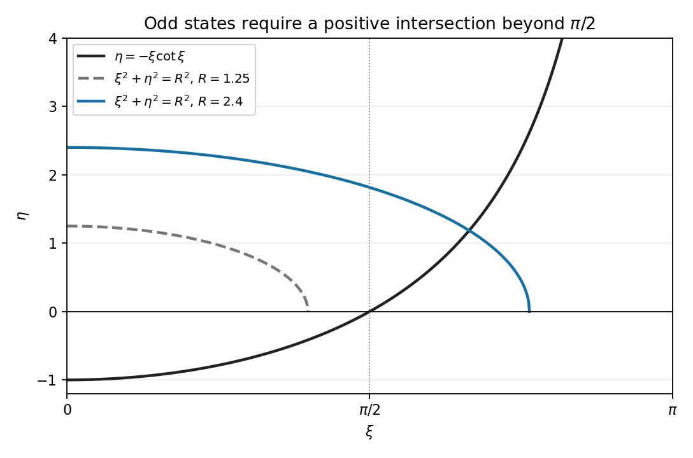

<h1 id="j/j2/solution">Solution</h1>

↑ **Parent:** [J2](../j2.md)

The stationary [Schrödinger equation](../../../../schrodinger-equation.md) is $-\hbar^2\psi''/(2m)+V\psi=E\psi$. A nonzero bound-state function is [square-integrable](../../../../square-integrable-function.md) on the [real line](../../../../real-line.md) and can be scaled to $\int_{\mathbb R}|\psi|^2dx=1$. Odd [parity](../../../../parity-operator.md) means $\psi(-x)=-\psi(x)$.

Set $k=\sqrt{2m(V_0+E)}/\hbar$ and $\kappa=\sqrt{-2mE}/\hbar$, both positive. [Oddness](../../../../parity-operator.md) and decay give

$$
\psi(x)=\begin{cases}-B e^{\kappa(x+a)},&x\le-a,\\A\sin(kx),&|x|<a,\\B e^{-\kappa(x-a)},&x\ge a.\end{cases}
$$

[Continuity](../../../../continuous-function.md) at $a$ gives $B=A\sin(ka)$, and [derivative](../../../../derivative.md) [continuity](../../../../continuous-function.md) gives $-\kappa B=Ak\cos(ka)$. A nonzero solution cannot have $\sin(ka)=0$, since that would force both the value and [derivative](../../../../derivative.md) there to vanish. Dividing therefore yields $\kappa=-k\cot(ka)$. With $\eta=\kappa a$ and $\xi=ka$,

$$
\boxed{\eta=-\xi\cot\xi,\qquad\eta^2+\xi^2=2mV_0a^2/\hbar^2.}
$$

The matching at $-a$ follows automatically by odd [parity](../../../../parity-operator.md).

In the required sketch, the second equation is a first-quadrant circle arc of radius $R=\sqrt{2mV_0a^2}/\hbar$. The curve $-\xi\cot\xi$ starts with limiting value $-1$ at zero, rises to zero at $\pi/2$, and then rises to $+\infty$ as $\xi\uparrow\pi$. Thus a positive-$\eta$ intersection in this range must have $\xi>\pi/2$. The accompanying plot shows the circle below threshold and one above it.

**[Figure 1](#j/j2/image-odd-bound-state-condition-and-the-threshold-circle). Odd bound-state condition and the threshold circle**.

Consequently $R<\pi/2$ rules out all odd states: the first positive branch already requires that radius, and later branches require still larger $\xi$. This is precisely $\boxed{2mV_0<(\pi\hbar/(2a))^2}$. At equality the intersection has $\eta=0$ and would not decay at infinity, so it too is not a [normalizable](../../../../normalizable-wavefunction.md) [bound state](../../../../bound-state.md). An odd state first appears only for a strict increase beyond threshold.

## ↑ Ancestors (12)

1. [J2](../j2.md)
2. [J](../../j.md)
3. [2010](../../../2010-split.md)
4. [Past exam of the Probability, statistics and options II course of the University of Oxford](../../../split.md)
5. [Probability, statistics and options II course of the University of Oxford](../../../../probability-statistics-and-options-ii-course-of-the-university-of-oxford.md)
6. [Year 2 of the mathematics and statistics course of the University of Oxford](../../../../year-2-of-the-mathematics-and-statistics-course-of-the-university-of-oxford.md)
7. [Mathematics and statistics course of the University of Oxford](../../../../mathematics-and-statistics-course-of-the-university-of-oxford.md)
8. [Undergraduate course of the University of Oxford](../../../../undergraduate-course-of-the-university-of-oxford.md)
9. [Course of the University of Oxford](../../../../course-of-the-university-of-oxford.md)
10. [University of Oxford](../../../../university-of-oxford-split.md)
11. [List of universities](../../../../list-of-universities.md)
12. [Codex Wiki](../../../../split.md)
