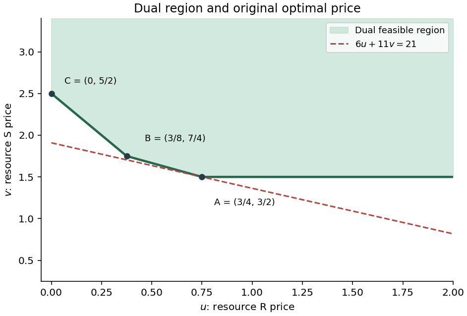

# 2011

↑ **Parent:** [Past exam of the Probability, statistics and options II course of the University of Oxford](../past-exam-of-the-probability-statistics-and-options-ii-course-of-the-university-of-oxford.md)

Source: [Mathematics release](https://www.whatdotheyknow.com/request/maths_past_papers_3), supplied bundle `Part A 2007 11-1.pdf`, pages 309–327. This nineteen-page Mathematics and Statistics paper is dated 30 June 2011. All 23 questions and all 86 printed leaf parts are addressed below, including a counterexample and explicit correction for the false algorithmic assertion in S2(a).

The department's [answer-release policy](https://www.maths.ox.ac.uk/members/students/undergraduate-courses/examinations-assessments) excludes ordinary odd years. Bounded exact-paper checks found no [matching](../matching-graph-theory.md) advertisement of worked answers. No source part is skipped.

**Table of contents**

- [A](#a)
  - [A2](#a/a2)
    - [a](#a/a2/a)
      - [Solution](#a/a2/a/solution)
    - [b](#a/a2/b)
      - [Solution](#a/a2/b/solution)
    - [c](#a/a2/c)
      - [Solution](#a/a2/c/solution)
- [B](#b)
  - [B2](#b/b2)
    - [a](#b/b2/a)
      - [Solution](#b/b2/a/solution)
    - [b](#b/b2/b)
      - [Solution](#b/b2/b/solution)
    - [c](#b/b2/c)
      - [Solution](#b/b2/c/solution)
    - [d](#b/b2/d)
      - [Solution](#b/b2/d/solution)
- [C](#c)
  - [C2](#c/c2)
    - [a](#c/c2/a)
      - [i](#c/c2/a/i)
        - [Solution](#c/c2/a/i/solution)
      - [ii](#c/c2/a/ii)
        - [Solution](#c/c2/a/ii/solution)
      - [iii](#c/c2/a/iii)
        - [Solution](#c/c2/a/iii/solution)
      - [iv](#c/c2/a/iv)
        - [Solution](#c/c2/a/iv/solution)
    - [b](#c/c2/b)
      - [i](#c/c2/b/i)
        - [Solution](#c/c2/b/i/solution)
      - [ii](#c/c2/b/ii)
        - [Solution](#c/c2/b/ii/solution)
    - [c](#c/c2/c)
      - [i](#c/c2/c/i)
        - [Solution](#c/c2/c/i/solution)
      - [ii](#c/c2/c/ii)
        - [Solution](#c/c2/c/ii/solution)
      - [iii](#c/c2/c/iii)
        - [Solution](#c/c2/c/iii/solution)
- [D](#d)
  - [D3](#d/d3)
    - [a](#d/d3/a)
      - [i](#d/d3/a/i)
        - [Solution](#d/d3/a/i/solution)
      - [ii](#d/d3/a/ii)
        - [Solution](#d/d3/a/ii/solution)
    - [b](#d/d3/b)
      - [i](#d/d3/b/i)
        - [Solution](#d/d3/b/i/solution)
      - [ii](#d/d3/b/ii)
        - [Solution](#d/d3/b/ii/solution)
  - [D4](#d/d4)
    - [a](#d/d4/a)
      - [Solution](#d/d4/a/solution)
    - [b](#d/d4/b)
      - [Solution](#d/d4/b/solution)
    - [c](#d/d4/c)
      - [Solution](#d/d4/c/solution)
    - [d](#d/d4/d)
      - [Solution](#d/d4/d/solution)
- [E](#e)
  - [E3](#e/e3)
    - [Solution](#e/e3/solution)
  - [E4](#e/e4)
    - [Solution](#e/e4/solution)
- [F](#f)
  - [F2](#f/f2)
    - [a](#f/f2/a)
      - [i](#f/f2/a/i)
        - [Solution](#f/f2/a/i/solution)
      - [ii](#f/f2/a/ii)
        - [Solution](#f/f2/a/ii/solution)
      - [iii](#f/f2/a/iii)
        - [Solution](#f/f2/a/iii/solution)
    - [b](#f/f2/b)
      - [i](#f/f2/b/i)
        - [Solution](#f/f2/b/i/solution)
      - [ii](#f/f2/b/ii)
        - [Solution](#f/f2/b/ii/solution)
      - [iii](#f/f2/b/iii)
        - [Solution](#f/f2/b/iii/solution)
      - [iv](#f/f2/b/iv)
        - [Solution](#f/f2/b/iv/solution)
- [G](#g)
  - [G2](#g/g2)
    - [Solution](#g/g2/solution)
- [H](#h)
  - [H2](#h/h2)
    - [Solution](#h/h2/solution)
- [J](#j)
  - [J2](#j/j2)
    - [Solution](#j/j2/solution)
- [K](#k)
  - [K3](#k/k3)
    - [Solution](#k/k3/solution)
  - [K4](#k/k4)
    - [Solution](#k/k4/solution)
- [M](#m)
  - [M4](#m/m4)
    - [a](#m/m4/a)
      - [i](#m/m4/a/i)
        - [Solution](#m/m4/a/i/solution)
      - [ii](#m/m4/a/ii)
        - [Solution](#m/m4/a/ii/solution)
    - [b](#m/m4/b)
      - [i](#m/m4/b/i)
        - [Solution](#m/m4/b/i/solution)
      - [ii](#m/m4/b/ii)
        - [Solution](#m/m4/b/ii/solution)
      - [iii](#m/m4/b/iii)
        - [Solution](#m/m4/b/iii/solution)
      - [iv](#m/m4/b/iv)
        - [Solution](#m/m4/b/iv/solution)
      - [v](#m/m4/b/v)
        - [Solution](#m/m4/b/v/solution)
    - [c](#m/m4/c)
      - [Solution](#m/m4/c/solution)
    - [d](#m/m4/d)
      - [Solution](#m/m4/d/solution)
  - [M5](#m/m5)
    - [a](#m/m5/a)
      - [i](#m/m5/a/i)
        - [Solution](#m/m5/a/i/solution)
      - [ii](#m/m5/a/ii)
        - [Solution](#m/m5/a/ii/solution)
      - [iii](#m/m5/a/iii)
        - [Solution](#m/m5/a/iii/solution)
      - [iv](#m/m5/a/iv)
        - [Solution](#m/m5/a/iv/solution)
      - [v](#m/m5/a/v)
        - [Solution](#m/m5/a/v/solution)
      - [vi](#m/m5/a/vi)
        - [Solution](#m/m5/a/vi/solution)
    - [b](#m/m5/b)
      - [i](#m/m5/b/i)
        - [Solution](#m/m5/b/i/solution)
      - [ii](#m/m5/b/ii)
        - [Solution](#m/m5/b/ii/solution)
- [O](#o)
  - [O4](#o/o4)
    - [a](#o/o4/a)
      - [Solution](#o/o4/a/solution)
    - [b](#o/o4/b)
      - [Solution](#o/o4/b/solution)
    - [c](#o/o4/c)
      - [Solution](#o/o4/c/solution)
  - [O5](#o/o5)
    - [a](#o/o5/a)
      - [Solution](#o/o5/a/solution)
    - [b](#o/o5/b)
      - [Solution](#o/o5/b/solution)
    - [c](#o/o5/c)
      - [Solution](#o/o5/c/solution)
    - [d](#o/o5/d)
      - [Solution](#o/o5/d/solution)
- [P](#p)
  - [P3](#p/p3)
    - [a](#p/p3/a)
      - [Solution](#p/p3/a/solution)
    - [b](#p/p3/b)
      - [Solution](#p/p3/b/solution)
    - [c](#p/p3/c)
      - [Solution](#p/p3/c/solution)
    - [d](#p/p3/d)
      - [Solution](#p/p3/d/solution)
  - [P4](#p/p4)
    - [a](#p/p4/a)
      - [Solution](#p/p4/a/solution)
    - [b](#p/p4/b)
      - [Solution](#p/p4/b/solution)
    - [c](#p/p4/c)
      - [Solution](#p/p4/c/solution)
    - [d](#p/p4/d)
      - [Solution](#p/p4/d/solution)
- [R](#r)
  - [R2](#r/r2)
    - [a](#r/r2/a)
      - [i](#r/r2/a/i)
        - [Solution](#r/r2/a/i/solution)
      - [ii](#r/r2/a/ii)
        - [Solution](#r/r2/a/ii/solution)
    - [b](#r/r2/b)
      - [Solution](#r/r2/b/solution)
    - [c](#r/r2/c)
      - [Solution](#r/r2/c/solution)
    - [d](#r/r2/d)
      - [i](#r/r2/d/i)
        - [Solution](#r/r2/d/i/solution)
      - [ii](#r/r2/d/ii)
        - [Solution](#r/r2/d/ii/solution)
- [S](#s)
  - [S2](#s/s2)
    - [a](#s/s2/a)
      - [Solution](#s/s2/a/solution)
    - [b](#s/s2/b)
      - [Solution](#s/s2/b/solution)
    - [c](#s/s2/c)
      - [Solution](#s/s2/c/solution)
- [T](#t)
  - [T2](#t/t2)
    - [a](#t/t2/a)
      - [Solution](#t/t2/a/solution)
    - [b](#t/t2/b)
      - [Solution](#t/t2/b/solution)
    - [c](#t/t2/c)
      - [Solution](#t/t2/c/solution)
- [U](#u)
  - [U2](#u/u2)
    - [a](#u/u2/a)
      - [Solution](#u/u2/a/solution)
    - [b](#u/u2/b)
      - [i](#u/u2/b/i)
        - [Solution](#u/u2/b/i/solution)
      - [ii](#u/u2/b/ii)
        - [Solution](#u/u2/b/ii/solution)
      - [iii](#u/u2/b/iii)
        - [Solution](#u/u2/b/iii/solution)

## A

↑ **Parent:** [2011](2011.md)

<h3 id="a/a2">A2</h3>

↑ **Parent:** [A](#a)

<h4 id="a/a2/a">a</h4>

↑ **Parent:** [A2](#a/a2)

<h5 id="a/a2/a/solution">Solution</h5>

↑ **Parent:** [A](#a/a2/a)

A [splitting field](../galois-theory.md#splitting-field) of $f$ over $F$ is an extension field in which $f$ factors into linear factors and which is generated over $F$ by those roots. The generation requirement excludes unnecessary extra elements.

For existence, induct on the degree. An irreducible factor $p$ of $f$ gives a field $F_1=F[X]/(p)$, since an [irreducible polynomial](../polynomial.md#irreducible-polynomial) generates a maximal ideal in the [polynomial](../polynomial.md) ring over a field. The class $\alpha$ of $X$ is a root of $p$ and hence of $f$. By the [factor theorem](../polynomial.md#factor-theorem), $f=(X-\alpha)g$ over $F_1$, with $\deg g=\deg f-1$. Induction gives a [splitting field](../galois-theory.md#splitting-field) of $g$ over $F_1$. It contains all roots of $f$; taking the subfield generated by these roots over $F$ gives exactly a [splitting field](../galois-theory.md#splitting-field) of $f$. The degree-one case is immediate. Thus

$$
\boxed{\text{Every positive-degree polynomial over a field has a splitting field}.}
$$

<h4 id="a/a2/b">b</h4>

↑ **Parent:** [A2](#a/a2)

<h5 id="a/a2/b/solution">Solution</h5>

↑ **Parent:** [B](#a/a2/b)

Over $\mathbb F_2$, the cubic takes value one at both zero and one, so it has no root. A reducible cubic over a field has a linear factor and therefore a root; hence this cubic is irreducible. Adjoin a root:

$$
K=\mathbb F_2[\alpha],\qquad\alpha^3+\alpha+1=0.
$$

This extension has [basis](../vector-space.md#basis) $1,\alpha,\alpha^2$, degree three and eight elements. Squaring preserves [polynomial](../polynomial.md) equations with coefficients in $\mathbb F_2$, so $\alpha^2$ and $\alpha^4$ are roots too. The nonzero element $\alpha$ is not one; the multiplicative group has prime order seven, so $\alpha$ has order seven. The exponents $1,2,4$ are distinct modulo seven, making these three roots distinct. Thus they are all the roots and already lie in $K$. Therefore

$$
\boxed{\text{The splitting field is }\mathbb F_8=\mathbb F_2[X]/(X^3+X+1),\quad[K:\mathbb F_2]=3.}
$$

<h4 id="a/a2/c">c</h4>

↑ **Parent:** [A2](#a/a2)

<h5 id="a/a2/c/solution">Solution</h5>

↑ **Parent:** [C](#a/a2/c)

All roots are $\pm\sqrt2$ and $\pm\sqrt3$, so the [splitting field](../galois-theory.md#splitting-field) is $K=\mathbb Q(\sqrt2,\sqrt3)$. We have $[\mathbb Q(\sqrt2):\mathbb Q]=2$.

To show that adjoining $\sqrt3$ doubles the degree, suppose $\sqrt3=a+b\sqrt2$ with rational $a,b$. Squaring and using irrationality of $\sqrt2$ gives $ab=0$. If $b=0$, then $a^2=3$; if $a=0$, then $b^2=3/2$. Neither is a rational square, as the prime exponents in a rational square are even. Thus $\sqrt3\notin\mathbb Q(\sqrt2)$. Its quadratic [polynomial](../polynomial.md) remains irreducible over that field, and the tower law gives

$$
\boxed{K=\mathbb Q(\sqrt2,\sqrt3),\qquad[K:\mathbb Q]=4.}
$$

A [basis](../vector-space.md#basis) is $1,\sqrt2,\sqrt3,\sqrt6$.

<h2 id="b">B</h2>

↑ **Parent:** [2011](2011.md)

<h3 id="b/b2">B2</h3>

↑ **Parent:** [B](#b)

<h4 id="b/b2/a">a</h4>

↑ **Parent:** [B2](#b/b2)

<h5 id="b/b2/a/solution">Solution</h5>

↑ **Parent:** [A](#b/b2/a)

A [composition series](../finite-group-theory.md#composition-series) is a finite chain $1=G_0\lhd G_1\lhd\cdots\lhd G_r=G$ in which each inclusion is proper, each [subgroup](../group.md#subgroup) is normal in the next, and every quotient $G_i/G_{i-1}$ is a nontrivial [simple group](../finite-group-theory.md#simple-group). These quotients are the [composition factors](../module-theory.md#composition-factor).

For a finite group, use induction on its order. The trivial group has the empty series. Otherwise choose a maximal proper [normal subgroup](../group-theory.md#normal-subgroup) $N$; such a [subgroup](../group.md#subgroup) exists because there are finitely many subgroups and $1$ is proper. The correspondence theorem says normal subgroups of $G/N$ correspond to normal subgroups of $G$ containing $N$, so maximality makes $G/N$ simple. Inductively construct a [composition series](../finite-group-theory.md#composition-series) of the smaller group $N$ and append $G$. This proves existence.

A nonabelian example with abelian factors is

$$
\boxed{1\lhd A_3\lhd S_3,\qquad\text{factors }C_3,C_2.}
$$

Both factors are simple because their orders are prime.

<h4 id="b/b2/b">b</h4>

↑ **Parent:** [B2](#b/b2)

<h5 id="b/b2/b/solution">Solution</h5>

↑ **Parent:** [B](#b/b2/b)

The [cyclic group](../group.md#cyclic-group) of order six has two different [composition series](../finite-group-theory.md#composition-series):

$$
\boxed{1\lhd C_2\lhd C_6,\qquad1\lhd C_3\lhd C_6.}
$$

Their factor lists are $C_2,C_3$ and $C_3,C_2$ respectively; normality follows from commutativity.

The [Jordan–Hölder theorem](../finite-group-theory.md#jordan-holder-theorem) states that any two [composition series](../finite-group-theory.md#composition-series) of a group have the same length and the same multiset of composition factors up to isomorphism. Equivalently, the factors of one series can be reordered to match those of the other by group isomorphisms. The actual intermediate subgroups need not be the same.

<h4 id="b/b2/c">c</h4>

↑ **Parent:** [B2](#b/b2)

<h5 id="b/b2/c/solution">Solution</h5>

↑ **Parent:** [C](#b/b2/c)

Let $C_n=\langle g\rangle$ and take $H=\langle g^p\rangle$. Since $n=mp$, the order of $g^p$ is $m$, so $H\cong C_m$. All subgroups of a [cyclic group](../group.md#cyclic-group) are normal. The quotient is generated by $gH$ and has order $n/m=p$, giving

$$
\boxed{C_n/H\cong C_p.}
$$

A group of prime order has no nontrivial proper [subgroup](../group.md#subgroup). By the [subgroup](../group.md#subgroup) correspondence theorem, no [normal subgroup](../group-theory.md#normal-subgroup) lies strictly between $H$ and $C_n$. Thus $H$ is a maximal proper [normal subgroup](../group-theory.md#normal-subgroup).

<h4 id="b/b2/d">d</h4>

↑ **Parent:** [B2](#b/b2)

<h5 id="b/b2/d/solution">Solution</h5>

↑ **Parent:** [D](#b/b2/d)

Given a prime factorization $n=p_1\cdots p_r$, repeatedly apply part (c) to the [cyclic group](../group.md#cyclic-group) of order $n$: it has a chain of subgroups of successive orders

$$
n,\quad n/p_1,\quad n/(p_1p_2),\quad\ldots,\quad1.
$$

Read in increasing order, this is a [composition series](../finite-group-theory.md#composition-series) with factors isomorphic to the cyclic groups of orders $p_1,\ldots,p_r$. Any second prime factorization of the same integer produces another [composition series](../finite-group-theory.md#composition-series) of the same group $C_n$.

The [Jordan–Hölder theorem](../finite-group-theory.md#jordan-holder-theorem) equates the two multisets of simple factors. Since $C_p\cong C_q$ for primes $p,q$ implies $p=q$ by equality of group orders, the two prime multisets agree. Hence

$$
\boxed{\text{The prime factorization is unique up to permutation}.}
$$

For $n=1$ both factor lists are empty, corresponding to the trivial group.

<h2 id="c">C</h2>

↑ **Parent:** [2011](2011.md)

<h3 id="c/c2">C2</h3>

↑ **Parent:** [C](#c)

<h4 id="c/c2/a">a</h4>

↑ **Parent:** [C2](#c/c2)

<h5 id="c/c2/a/i">i</h5>

↑ **Parent:** [A](#c/c2/a)

<h6 id="c/c2/a/i/solution">Solution</h6>

↑ **Parent:** [I](#c/c2/a/i)

A square residue modulo $p$ is a congruence class represented by $x^2$ for some integer $x$. For the final all-primes solvability statement, zero is included as a square. The [Legendre symbol](../quadratic-residue.md#legendre-symbol) distinguishes the zero class from the nonzero square and nonsquare classes:

$$
\boxed{\left(\frac ap\right)=\begin{cases}0,&p\mid a,\\1,&p\nmid a\text{ and }a\equiv x^2\pmod p\text{ for some }x,\\-1,&a\text{ is not a square modulo }p.\end{cases}}
$$

When the term [quadratic residue](../quadratic-residue.md) is reserved for nonzero classes, the zero case must be stated separately, as in this definition.

<h5 id="c/c2/a/ii">ii</h5>

↑ **Parent:** [A](#c/c2/a)

<h6 id="c/c2/a/ii/solution">Solution</h6>

↑ **Parent:** [Ii](#c/c2/a/ii)

[Euler's criterion](../quadratic-residue.md#euler-s-criterion) states that, for an odd prime $p$ and $p\nmid a$,

$$
\boxed{a^{(p-1)/2}\equiv\left(\frac ap\right)\pmod p.}
$$

Thus this power is congruent to one for a nonzero square and to minus one for a nonsquare. The congruence also holds when $p\mid a$ if both sides are taken to be zero.

<h5 id="c/c2/a/iii">iii</h5>

↑ **Parent:** [A](#c/c2/a)

<h6 id="c/c2/a/iii/solution">Solution</h6>

↑ **Parent:** [Iii](#c/c2/a/iii)

For distinct odd primes $p,q$, [quadratic reciprocity](../number-theory.md#quadratic-reciprocity) is

$$
\boxed{\left(\frac pq\right)\left(\frac qp\right)=(-1)^{(p-1)(q-1)/4}.}
$$

The usual supplementary laws are

$$
\left(\frac{-1}p\right)=(-1)^{(p-1)/2},\qquad
\left(\frac2p\right)=(-1)^{(p^2-1)/8}.
$$

The first supplement also follows immediately by inserting $a=-1$ into [Euler's criterion](../quadratic-residue.md#euler-s-criterion).

<h5 id="c/c2/a/iv">iv</h5>

↑ **Parent:** [A](#c/c2/a)

<h6 id="c/c2/a/iv/solution">Solution</h6>

↑ **Parent:** [Iv](#c/c2/a/iv)

If $p$ divides $a$ or $b$, it divides their product and both sides of the proposed identity are zero. Otherwise use [Euler's criterion](../quadratic-residue.md#euler-s-criterion) and the ordinary exponent rule:

$$
\left(\frac{ab}p\right)\equiv(ab)^{(p-1)/2}
\equiv a^{(p-1)/2}b^{(p-1)/2}
\equiv\left(\frac ap\right)\left(\frac bp\right)\pmod p.
$$

Both sides are in $\{1,-1\}$, and these two values are distinct modulo the odd prime $p$. Hence the congruence is an equality:

$$
\boxed{\left(\frac{ab}p\right)=\left(\frac ap\right)\left(\frac bp\right).}
$$

<h4 id="c/c2/b">b</h4>

↑ **Parent:** [C2](#c/c2)

<h5 id="c/c2/b/i">i</h5>

↑ **Parent:** [B](#c/c2/b)

<h6 id="c/c2/b/i/solution">Solution</h6>

↑ **Parent:** [I](#c/c2/b/i)

For odd $m,n$,

$$
\frac{mn-1}{2}=\frac{m-1}{2}+\frac{n-1}{2}+\frac{(m-1)(n-1)}2.
$$

The last term is even, so induction over the prime factors, including repetitions, gives $\frac{b-1}{2}\equiv\sum_i\frac{p_i-1}{2}\pmod2$. Using the first supplementary law in each Legendre factor,

$$
\boxed{\left(\frac{-1}b\right)=\prod_i(-1)^{(p_i-1)/2}=(-1)^{(b-1)/2}.}
$$

For $b=1$, the product is empty and both sides equal one.

<h5 id="c/c2/b/ii">ii</h5>

↑ **Parent:** [B](#c/c2/b)

<h6 id="c/c2/b/ii/solution">Solution</h6>

↑ **Parent:** [Ii](#c/c2/b/ii)

If $b,c$ have a common prime factor, both Jacobi symbols are zero, and the identity holds. Otherwise write $b=\prod_i p_i$, $c=\prod_jq_j$ with multiplicity. All cross-pairs of primes are distinct. Multiplying [quadratic reciprocity](../number-theory.md#quadratic-reciprocity) over these pairs gives

$$
\left(\frac bc\right)=\left(\frac cb\right)
(-1)^{\sum_{i,j}[(p_i-1)/2][(q_j-1)/2]}.
$$

The exponent factors as a product of two sums. The parity identity from part (i) makes it congruent modulo two to $[(b-1)/2][(c-1)/2]$. Therefore

$$
\boxed{\left(\frac bc\right)=\left(\frac cb\right)(-1)^{(b-1)(c-1)/4}.}
$$

The same formula includes a denominator equal to one by the empty-product convention.

<h4 id="c/c2/c">c</h4>

↑ **Parent:** [C2](#c/c2)

<h5 id="c/c2/c/i">i</h5>

↑ **Parent:** [C](#c/c2/c)

<h6 id="c/c2/c/i/solution">Solution</h6>

↑ **Parent:** [I](#c/c2/c/i)

Because $a=-b^2$ is odd, $b$ is odd. Choose $k=4b^2-1$, a positive integer congruent to three modulo four. Also $\gcd(k,b)=1$, so the square $b^2$ has [Jacobi symbol](../number-theory.md#jacobi-symbol) one modulo $k$. Multiplicativity in the numerator follows from the corresponding Legendre property in each prime factor. Thus

$$
\boxed{\left(\frac ak\right)=\left(\frac{-1}k\right)\left(\frac{b^2}k\right)=-1.}
$$

This gives an explicit positive odd denominator with the required obstruction.

<h5 id="c/c2/c/ii">ii</h5>

↑ **Parent:** [C](#c/c2/c)

<h6 id="c/c2/c/ii/solution">Solution</h6>

↑ **Parent:** [Ii](#c/c2/c/ii)

Choose a nonzero quadratic nonresidue $c$ modulo $q$. By the [Chinese remainder theorem](../mathematics.md#chinese-remainder-theorem), choose a positive integer $k$ satisfying

$$
k\equiv1\pmod4,\qquad k\equiv1\pmod b,\qquad k\equiv c\pmod q.
$$

The moduli are pairwise [coprime](../divisibility.md#coprime-integers), and $k$ is [coprime](../divisibility.md#coprime-integers) to $qb$. Jacobi reciprocity, with $k\equiv1\pmod4$, gives

$$
\left(\frac bk\right)=\left(\frac kb\right)=1,\qquad
\left(\frac qk\right)=\left(\frac kq\right)=-1,
\qquad\left(\frac{-1}k\right)=1.
$$

Since $t$ is odd, multiplying these symbols yields

$$
\boxed{\left(\frac{\pm q^t b}k\right)=(-1)^t=-1.}
$$

When $b=1$ its congruence imposes no restriction and its Jacobi factor equals one.

<h5 id="c/c2/c/iii">iii</h5>

↑ **Parent:** [C](#c/c2/c)

<h6 id="c/c2/c/iii/solution">Solution</h6>

↑ **Parent:** [Iii](#c/c2/c/iii)

An integer square is a square modulo every prime, with the zero class allowed at primes dividing the integer. Conversely, suppose an odd integer $a$ is not an integer square. If every prime exponent in $|a|$ is even, the nonsquare condition forces $a=-b^2$, handled by part (i). Otherwise some odd prime has an odd exponent, so $a=\pm q^tb$ as in part (ii). In either case there is a positive odd $k$ with $(a/k)=-1$.

Factor $k$ into odd primes. A product of Legendre symbols equalling minus one has at least one factor equal to minus one. Thus $a$ fails to be a square modulo one of those primes, contradicting the hypothesis. Hence

$$
\boxed{a\in\mathbb Z\text{ odd is an integer square iff }x^2\equiv a\pmod p\text{ is solvable for every prime }p.}
$$

The solvability formulation makes explicit the zero-residue convention needed by the printed final assertion. The prime two causes no extra issue because every odd integer is one modulo two.

<h2 id="d">D</h2>

↑ **Parent:** [2011](2011.md)

<h3 id="d/d3">D3</h3>

↑ **Parent:** [D](#d)

<h4 id="d/d3/a">a</h4>

↑ **Parent:** [D3](#d/d3)

<h5 id="d/d3/a/i">i</h5>

↑ **Parent:** [A](#d/d3/a)

<h6 id="d/d3/a/i/solution">Solution</h6>

↑ **Parent:** [I](#d/d3/a/i)

**False.** Take $k(x)=1/(1+|x|)$. This is bounded and measurable on $\mathbb R$, and tends to zero as $x\to\infty$, but

$$
\int_0^Rk(x)\,dx=\log(1+R)\longrightarrow\infty.
$$

Thus decay to zero alone does not imply [Lebesgue integrability](../measure-theory.md#integrability).

<h5 id="d/d3/a/ii">ii</h5>

↑ **Parent:** [A](#d/d3/a)

<h6 id="d/d3/a/ii/solution">Solution</h6>

↑ **Parent:** [Ii](#d/d3/a/ii)

**False.** Let $k$ be the indicator of the positive integers. It is measurable, bounded by one and zero [almost everywhere](../measure-theory.md#almost-everywhere), so its [Lebesgue integral](../measure-theory.md#lebesgue-integral) on $(0,\infty)$ is zero. Yet $k(n)=1$ for every positive integer $n$, so it does not tend to zero at infinity. [Lebesgue integrability](../measure-theory.md#integrability) is unchanged by modifications on a [null set](../measure-theory.md#null-set), whereas a pointwise limit can change.

<h4 id="d/d3/b">b</h4>

↑ **Parent:** [D3](#d/d3)

<h5 id="d/d3/b/i">i</h5>

↑ **Parent:** [B](#d/d3/b)

<h6 id="d/d3/b/i/solution">Solution</h6>

↑ **Parent:** [I](#d/d3/b/i)

Let $H_0=\int_0^\pi|h(u)|\,du<\infty$. On each period, substitute $x=j\pi+u$ and use periodicity:

$$
\int_{j\pi}^{(j+1)\pi}e^{-\beta x}|h(x)|\,dx
=e^{-\beta j\pi}\int_0^\pi e^{-\beta u}|h(u)|\,du
\leq e^{-\beta j\pi}H_0.
$$

Summing over $j\geq0$ gives the convergent geometric bound

$$
\boxed{\int_0^\infty e^{-\beta x}|h(x)|\,dx\leq\frac{H_0}{1-e^{-\beta\pi}}<\infty.}
$$

Measurability is preserved under multiplication by the exponential, so this proves [Lebesgue integrability](../measure-theory.md#integrability).

<h5 id="d/d3/b/ii">ii</h5>

↑ **Parent:** [B](#d/d3/b)

<h6 id="d/d3/b/ii/solution">Solution</h6>

↑ **Parent:** [Ii](#d/d3/b/ii)

Use the nonnegative parts $h^+=\max(h,0)$ and $h^-=\max(-h,0)$, so $h=h^+-h^-$. The zero-mean assumption gives $H:=\int_0^\pi h^+=\int_0^\pi h^-<\infty$. On the $k$-th period, each of the positive and negative weighted integrals lies between $H/((k+1)\pi)$ and $H/(k\pi)$. Their difference therefore satisfies the stronger estimate

$$
\left|\int_{k\pi}^{(k+1)\pi}\frac{h(x)}x\,dx\right|
\leq\frac H\pi\left(\frac1k-\frac1{k+1}\right)
=\frac H{\pi k(k+1)}\leq\boxed{\frac H{\pi k^2}}.
$$

The sum of the absolute values of these block integrals converges, proving the existence of the finite limit of the integrals from $\pi$ to $n\pi$.

For genuine [Lebesgue integrability](../measure-theory.md#integrability) we instead need the integral of the absolute value. Periodicity gives

$$
\int_{k\pi}^{(k+1)\pi}\frac{|h(x)|}x\,dx\geq\frac{2H}{(k+1)\pi}.
$$

If $H>0$, summation diverges by the [harmonic series](../sequence-and-series.md#harmonic-series). If $H=0$, then $h=0$ [almost everywhere](../measure-theory.md#almost-everywhere) and the function is integrable. Thus

$$
\boxed{g\in L^1(\pi,\infty)\quad\Longleftrightarrow\quad h=0\text{ almost everywhere}.}
$$

The finite signed block limit therefore need not be a [Lebesgue integral](../measure-theory.md#lebesgue-integral).

<h3 id="d/d4">D4</h3>

↑ **Parent:** [D](#d)

<h4 id="d/d4/a">a</h4>

↑ **Parent:** [D4](#d/d4)

<h5 id="d/d4/a/solution">Solution</h5>

↑ **Parent:** [A](#d/d4/a)

The [monotone convergence theorem](../measure-theory.md#monotone-convergence-theorem) states that for measurable functions $0\leq f_1\leq f_2\leq\cdots$ converging pointwise to $f$, the limit is measurable and

$$
\boxed{\int f\,d\mu=\lim_{n\to\infty}\int f_n\,d\mu.}
$$

Both sides may be infinite. Monotonicity and nonnegativity replace any need for an integrable dominating function.

<h4 id="d/d4/b">b</h4>

↑ **Parent:** [D4](#d/d4)

<h5 id="d/d4/b/solution">Solution</h5>

↑ **Parent:** [B](#d/d4/b)

The partial sums $S_n=\sum_{k=1}^na_k$ are nonnegative measurable functions and increase pointwise to the extended-valued sum $S=\sum_{k=1}^\infty a_k$. The [monotone convergence theorem](../measure-theory.md#monotone-convergence-theorem) and finite linearity give

$$
\int S\,dx=\lim_n\sum_{k=1}^n\int a_k\,dx
=\sum_{k=1}^\infty\int a_k\,dx<\infty.
$$

A nonnegative [measurable function](../measure-theory.md#measurable-function) with finite integral is finite [almost everywhere](../measure-theory.md#almost-everywhere); if it were infinite on a positive-measure set, its integral would be infinite. Define it arbitrarily on the null exceptional set if a real-valued representative is desired. Hence the series converges [almost everywhere](../measure-theory.md#almost-everywhere) to an integrable function and

$$
\boxed{\int\sum_{k=1}^\infty a_k(x)\,dx=\sum_{k=1}^\infty\int a_k(x)\,dx.}
$$

<h4 id="d/d4/c">c</h4>

↑ **Parent:** [D4](#d/d4)

<h5 id="d/d4/c/solution">Solution</h5>

↑ **Parent:** [C](#d/d4/c)

Substitute $x=e^{-t}$ to get

$$
\int_0^1(x\log x)^k\,dx=(-1)^k\int_0^\infty t^ke^{-(k+1)t}\,dt
=\boxed{\frac{(-1)^kk!}{(k+1)^{k+1}}},
$$

where the second substitution $u=(k+1)t$ reduces the integral to the supplied gamma integral.

On $(0,1)$, $-x\log x\geq0$. Expand $x^{-x}=e^{-x\log x}=\sum_{j=0}^\infty(-x\log x)^j/j!$. The partial sums increase, so the [monotone convergence theorem](../measure-theory.md#monotone-convergence-theorem) permits termwise integration. The integral of the $j$-th term is $1/(j+1)^{j+1}$, including $j=0$. Reindexing gives

$$
\boxed{\int_0^1x^{-x}\,dx=\sum_{k=1}^\infty\frac1{k^k}.}
$$

This is finite, for instance because the summands with $k\geq2$ are bounded by $2^{-k}$.

<h4 id="d/d4/d">d</h4>

↑ **Parent:** [D4](#d/d4)

<h5 id="d/d4/d/solution">Solution</h5>

↑ **Parent:** [D](#d/d4/d)

Expand $x^x=e^{x\log x}=\sum_{j=0}^\infty(x\log x)^j/j!$. The sum of the integrals of the absolute values of its terms is $\sum_{k=1}^\infty k^{-k}<\infty$ by part (c). Absolute summability therefore permits interchange of the series and the integral. Applying the moment formula from part (c),

$$
\boxed{\int_0^1x^x\,dx=\sum_{k=1}^\infty\frac{(-1)^{k+1}}{k^k}.}
$$

Equivalently, the absolute exponential series is $x^{-x}$, an integrable majorant, so dominated convergence gives the same interchange.

## E

↑ **Parent:** [2011](2011.md)

<h3 id="e/e3">E3</h3>

↑ **Parent:** [E](#e)

<h4 id="e/e3/solution">Solution</h4>

↑ **Parent:** [E3](#e/e3)

A [connected space](../geometry-and-topology.md#connected-space) has no separation into two disjoint nonempty open subsets whose union is the space. A continuous surjection to the discrete space $\{0,1\}$ produces such a separation by the two point preimages. Conversely, from a separation define a function equal to zero on one open piece and one on the other; it is continuous and surjective. Thus these formulations of [connectedness](../geometry-and-topology.md#connected-space) are equivalent.

An interval in $\mathbb R$ is connected: if a continuous map from it to $\{0,1\}$ took both values, the intermediate value theorem would force value $1/2$, impossible. Conversely, a subset of $\mathbb R$ that is not an interval has points $a<b$ in it and a point $c\in(a,b)$ outside it. Intersecting it with $(-\infty,c)$ and $(c,\infty)$ separates it. The empty set is connected, and singleton intervals are included.

For the union assertion, any separation of $X$ must put each nonempty connected $A_i$ entirely on one side, since intersecting the separation with $A_i$ would otherwise disconnect it. Pairwise nonempty intersections force all the $A_i$ onto the same side. Their union is $X$, contradicting a nonempty second side. The empty-union case is already connected.

The plane is the union of all lines through the origin. Each line is homeomorphic to $\mathbb R$ and connected, and every pair meets at the origin, so $\mathbb R^2$ is connected. For the punctured plane, let $R_+$ be the positive horizontal ray, and for each $r>0$ let $C_r$ be the circle of radius $r$. Each circle is a continuous image of $[0,2\pi]$ and hence connected; $C_r\cup R_+$ is connected because its two connected pieces meet at $(r,0)$. These unions all contain $R_+$ and cover the punctured plane, proving it connected as well.

Finally suppose a continuous injection $g:\mathbb R^2\to\mathbb R$ existed. Its image is a connected interval, since a continuous image of a [connected space](../geometry-and-topology.md#connected-space) is connected. It contains at least three distinct values; choose $p$ whose value lies strictly between two others. The punctured plane $\mathbb R^2\setminus\{p\}$ is connected by translation of the preceding result. By injectivity its image is precisely $g(\mathbb R^2)\setminus\{g(p)\}$, which is disconnected by the missing interior point. This contradicts [connectedness](../geometry-and-topology.md#connected-space) of a continuous image. Therefore

$$
\boxed{\text{There is no continuous injection }\mathbb R^2\to\mathbb R.}
$$

<h3 id="e/e4">E4</h3>

↑ **Parent:** [E](#e)

<h4 id="e/e4/solution">Solution</h4>

↑ **Parent:** [E4](#e/e4)

A [sequentially compact space](../geometry-and-topology.md#sequentially-compact-space) is one in which every sequence has a subsequence converging to a point of the space. A [limit point](../topology.md#limit-point) $\ell$ of $S$ means every open ball around $\ell$ meets $S\setminus\{\ell\}$.

In a compact [metric space](../topological-analysis.md#metric-space), a sequence with a finite set of values has a constant subsequence. If its value set is infinite and had no [limit point](../topology.md#limit-point), each point of the space would have a neighbourhood containing at most one point of that value set. A finite subcover would then make the value set finite, a contradiction. It therefore has a [limit point](../topology.md#limit-point) in the space, and the permitted subsequence result gives a convergent subsequence. This proves sequential compactness.

For the remaining assertions assume the [compact space](../topology.md#compact-space) is nonempty, as required for a fixed-point claim. The displacement function $q(x)=d(f(x),x)$ is continuous by the stated continuity of the metric and of $f$. The [extreme value theorem](../real-analysis.md#extreme-value-theorem) gives a minimum $\delta=q(p)$. If $\delta>0$, then $p\neq f(p)$, and strict decrease of distances implies

$$
q(f(p))=d(f^2(p),f(p))<d(f(p),p)=\delta,
$$

contradicting minimality. Thus $\delta=0$ and $p$ is a [fixed point](../function.md#fixed-point). Two distinct fixed points would satisfy $d(p,q)=d(f(p),f(q))<d(p,q)$, also impossible. Hence the [fixed point](../function.md#fixed-point) is unique.

On the noncompact real line, take

$$
\boxed{f(x)=\log(1+e^x).}
$$

Its derivative $e^x/(1+e^x)$ is strictly between zero and one. The [mean value theorem](../calculus.md#mean-value-theorem) therefore gives $|f(x)-f(y)|<|x-y|$ for each distinct pair. Yet $f(x)-x=\log(1+e^{-x})>0$, so it has no [fixed point](../function.md#fixed-point). Compactness, rather than merely pointwise strict shrinkage, supplies attainment of a zero displacement in the preceding proof.

## F

↑ **Parent:** [2011](2011.md)

<h3 id="f/f2">F2</h3>

↑ **Parent:** [F](#f)

<h4 id="f/f2/a">a</h4>

↑ **Parent:** [F2](#f/f2)

<h5 id="f/f2/a/i">i</h5>

↑ **Parent:** [A](#f/f2/a)

<h6 id="f/f2/a/i/solution">Solution</h6>

↑ **Parent:** [I](#f/f2/a/i)

The $j$-th [partial derivative](../multivariable-calculus.md#partial-derivative) is the [vector](../vector-space.md#vector) limit

$$
\partial_jf(x)=\lim_{h\to0}\frac{f(x+he_j)-f(x)}h,
$$

when it exists. The [total derivative](../calculus.md#total-derivative) is a [linear map](../vector-space.md#linear-map) $Df(x):\mathbb R^n\to\mathbb R^m$ such that

$$
f(x+h)=f(x)+Df(x)h+o(\|h\|).
$$

The [Jacobian matrix](../multivariable-calculus.md#jacobian-matrix) is $J_f(x)=(\partial_jf_i(x))_{i,j}$. When the [total derivative](../calculus.md#total-derivative) exists, all partial derivatives exist and $J_f(x)$ is its [matrix](../vector-space.md#matrix) in the standard bases; its $j$-th column is $Df(x)e_j$. Existence of partial derivatives alone does not guarantee total differentiability.

<h5 id="f/f2/a/ii">ii</h5>

↑ **Parent:** [A](#f/f2/a)

<h6 id="f/f2/a/ii/solution">Solution</h6>

↑ **Parent:** [Ii](#f/f2/a/ii)

For a scalar-valued function, the [gradient](../multivariable-calculus.md#gradient) is the column [vector](../vector-space.md#vector)

$$
\boxed{\nabla f(x)=(\partial_1f(x),\ldots,\partial_nf(x))^T.}
$$

When $f$ is differentiable, its [total derivative](../calculus.md#total-derivative) is the [linear functional](../dual-space.md#linear-functional)

$$
\boxed{Df(x)h=\nabla f(x)\cdot h.}
$$

Thus the Jacobian is the transpose of the [gradient](../multivariable-calculus.md#gradient) in standard Euclidean coordinates.

<h5 id="f/f2/a/iii">iii</h5>

↑ **Parent:** [A](#f/f2/a)

<h6 id="f/f2/a/iii/solution">Solution</h6>

↑ **Parent:** [Iii](#f/f2/a/iii)

The [chain rule](../calculus.md#chain-rule) at the specified point is

$$
\boxed{D(f\circ g)(x)=Df(g(x))\circ Dg(x).}
$$

In standard coordinates this becomes

$$
\boxed{J_{f\circ g}(x)=J_f(g(x))J_g(x).}
$$

The [matrix](../vector-space.md#matrix) dimensions are respectively $k\times n$, $k\times m$, and $m\times n$, [matching](../matching-graph-theory.md) the composition of the two linear derivative maps.

<h4 id="f/f2/b">b</h4>

↑ **Parent:** [F2](#f/f2)

<h5 id="f/f2/b/i">i</h5>

↑ **Parent:** [B](#f/f2/b)

<h6 id="f/f2/b/i/solution">Solution</h6>

↑ **Parent:** [I](#f/f2/b/i)

Put $Q=1+x^2+y^2>0$. Differentiation of $Q^{-1}$ gives

$$
\boxed{\nabla f(x,y)=\frac{-2}{(1+x^2+y^2)^2}\begin{pmatrix}x\\y\end{pmatrix}.}
$$

The positive denominator also shows that the function and these derivatives are smooth throughout $\mathbb R^2$.

<h5 id="f/f2/b/ii">ii</h5>

↑ **Parent:** [B](#f/f2/b)

<h6 id="f/f2/b/ii/solution">Solution</h6>

↑ **Parent:** [Ii](#f/f2/b/ii)

At $(-1,0)$ the [gradient](../multivariable-calculus.md#gradient) is $(1/2,0)^T$. The [total derivative](../calculus.md#total-derivative) is therefore the [linear functional](../dual-space.md#linear-functional)

$$
\boxed{Df(-1,0)(h,k)=\frac h2,\qquad J_f(-1,0)=\begin{pmatrix}1/2&0\end{pmatrix}.}
$$

<h5 id="f/f2/b/iii">iii</h5>

↑ **Parent:** [B](#f/f2/b)

<h6 id="f/f2/b/iii/solution">Solution</h6>

↑ **Parent:** [Iii](#f/f2/b/iii)

The derivative of the curve is

$$
\boxed{Dg(t)h=h\begin{pmatrix}\cos t\\-\sin t\end{pmatrix}.}
$$

Its image lies on the unit circle, so $f(g(t))=1/2$ and $\boxed{D(f\circ g)(t)=0}$. Meanwhile

$$
J_f(g(t))=\begin{pmatrix}-\sin t/2&-\cos t/2\end{pmatrix},
$$

and multiplication by $J_g(t)$ gives $-\sin t\cos t/2+\cos t\sin t/2=0$. This verifies the [chain rule](../calculus.md#chain-rule) explicitly.

<h5 id="f/f2/b/iv">iv</h5>

↑ **Parent:** [B](#f/f2/b)

<h6 id="f/f2/b/iv/solution">Solution</h6>

↑ **Parent:** [Iv](#f/f2/b/iv)

Because $2|x|\leq1+x^2\leq Q$, we have $|f_x(x,y)|=2|x|/Q^2\leq1/Q\leq1$; similarly $|f_y|\leq1$. Apply the one-variable [mean value theorem](../calculus.md#mean-value-theorem) on the horizontal and vertical segments joining $(x,y)$ to $(u,y)$ to $(u,v)$. The [triangle inequality](../topological-analysis.md#triangle-inequality) gives

$$
\begin{aligned}
|f(x,y)-f(u,v)|&\leq|f(x,y)-f(u,y)|+|f(u,y)-f(u,v)|\\
&\leq\boxed{|x-u|+|y-v|}.
\end{aligned}
$$

Thus the function is globally one-Lipschitz for the $\ell^1$ metric on the plane.

## G

↑ **Parent:** [2011](2011.md)

<h3 id="g/g2">G2</h3>

↑ **Parent:** [G](#g)

<h4 id="g/g2/solution">Solution</h4>

↑ **Parent:** [G2](#g/g2)

For a normal constrained extremal, introduce a constant [Lagrange multiplier](../mathematical-optimization.md#lagrange-multiplier) and use $L=F-\lambda G$. The [Euler-Lagrange equation](../analysis.md#euler-lagrange-equation) is

$$
\boxed{L_y-\frac d{dx}L_{y'}=0.}
$$

When both integrands have no explicit $x$ dependence, the [Beltrami identity](../analysis.md#beltrami-identity) gives $L-y'L_{y'}=\text{constant}$, as follows by differentiating this expression and using the [Euler-Lagrange equation](../analysis.md#euler-lagrange-equation).

Parametrize the surface by $(f(z)\cos\theta,f(z)\sin\theta,z)$. The [cross product](../vector-space.md#cross-product) of its two coordinate tangents has magnitude $f\sqrt{1+(f')^2}$, so integration in $\theta$ gives $A=2\pi\int_a^bf\sqrt{1+(f')^2}\,dz$. Integrating the cross-sectional disk areas gives $V=\pi\int_a^bf^2\,dz$.

Dividing the augmented functional $A-\lambda V$ by $\pi$, use

$$
L=2f\sqrt{1+(f')^2}-\lambda f^2.
$$

The [Euler-Lagrange equation](../analysis.md#euler-lagrange-equation) is

$$
\boxed{\frac d{dz}\left(\frac{2ff'}{\sqrt{1+(f')^2}}\right)
-2\sqrt{1+(f')^2}+2\lambda f=0.}
$$

The [Beltrami identity](../analysis.md#beltrami-identity) becomes $2f/\sqrt{1+(f')^2}-\lambda f^2=C$. At an endpoint $f\to0$, the absolute value of the first term is at most $2f$, so $C=0$, even if the profile has an infinite endpoint slope. For a nondegenerate regular closed surface take $f>0$ on $(a,b)$. Then $\lambda>0$, and, with $R=2/\lambda$,

$$
f^2(1+(f')^2)=R^2.
$$

Combining this identity with the [Euler-Lagrange equation](../analysis.md#euler-lagrange-equation) yields $f''=-R^2/f^3$. Consequently $(f^2)''=2((f')^2+ff'')=-2$. The two zero endpoint values uniquely determine

$$
\boxed{f(z)^2=(z-a)(b-z)
=\left(\frac{b-a}{2}\right)^2-\left(z-\frac{a+b}{2}\right)^2.}
$$

The positive radius profile is therefore a semicircle and generates a [sphere](../euclidean-geometry.md#sphere), centred at height $(a+b)/2$, with radius $R=(b-a)/2$. In particular

$$
\boxed{\lambda=\frac2R=\frac4{b-a}.}
$$

The [graph](../graph.md) is smooth in the interior; its vertical slopes at the two poles are compatible with a smooth spherical surface. Its [volume](../geometry-and-topology.md#volume) is $4\pi R^3/3$, the [volume](../geometry-and-topology.md#volume) associated with this stationary candidate.

For minimality, the three-dimensional [isoperimetric inequality](../euclidean-geometry.md#isoperimetric-inequality) says that every closed surface enclosing [volume](../geometry-and-topology.md#volume) $V$ has $A^3\geq36\pi V^2$, with equality for a [sphere](../euclidean-geometry.md#sphere). The displayed extremal attains equality, proving that it minimizes area at its fixed enclosed [volume](../geometry-and-topology.md#volume). The uniqueness above concerns the regular connected positive profile with the two stated endpoint heights.

## H

↑ **Parent:** [2011](2011.md)

<h3 id="h/h2">H2</h3>

↑ **Parent:** [H](#h)

<h4 id="h/h2/solution">Solution</h4>

↑ **Parent:** [H2](#h/h2)

For symmetric quadratic coefficient matrices, the [Euler-Lagrange equations](../analysis.md#euler-lagrange-equation) give $T\ddot q+Vq=0$, where $T$ is the positive-definite [mass matrix](../finite-element-method.md#mass-matrix). Substitute a normal-mode oscillation $q=v\cos(\omega t+\phi)$ to get

$$
\boxed{(V-\omega^2T)v=0,\qquad\det(V-\omega^2T)=0.}
$$

The positive roots $\omega^2$ determine the squared normal frequencies and their nonzero null vectors give mode shapes. Repeated eigenvalues give multidimensional mode spaces.

The particle's [kinetic energy](../energy.md#kinetic-energy) is $m|\dot q|^2/2$. For a taut elastic string at length $r=\sqrt{x^2+y^2+z^2}$, [Hooke's law](../elasticity-physics.md#hooke-s-law) gives tension $\lambda(r-a)/a$ and elastic energy $\lambda(r-a)^2/(2a)$. With $\lambda=mg$ and gravitational potential $mgz$, this gives exactly

$$
T=\frac m2(\dot x^2+\dot y^2+\dot z^2),\qquad
V=mgz+\frac{mg}{2a}(r-a)^2.
$$

This is the taut-string regime containing the equilibrium. Differentiating the potential gives

$$
\boxed{\ddot x=-\frac ga\frac{r-a}{r}x,\quad
\ddot y=-\frac ga\frac{r-a}{r}y,\quad
\ddot z=-g-\frac ga\frac{r-a}{r}z.}
$$

At $(0,0,-2a)$, $r=2a$ and all three accelerations vanish.

With $z=-2a+\zeta$, expansion to quadratic order gives $r=2a-\zeta+(x^2+y^2)/(4a)+O(3)$. Substitution cancels the linear terms, leaving

$$
\boxed{V=-\frac32mga+\frac{mg}{4a}(x^2+y^2)+\frac{mg}{2a}\zeta^2+O(3).}
$$

The [mass matrix](../finite-element-method.md#mass-matrix) remains $mI$, and the [stiffness matrix](../finite-element-method.md#stiffness-matrix) is $\operatorname{diag}(mg/(2a),mg/(2a),mg/a)$. Therefore

$$
\boxed{\omega_x=\omega_y=\sqrt{\frac g{2a}},\qquad
\omega_z=\sqrt{\frac ga}.}
$$

The horizontal frequency is doubly degenerate: a linearly polarized oscillation in any horizontal direction is a [normal mode](../wave-equation.md#normal-mode). The remaining mode is vertical stretching and contraction of the string, with horizontal coordinates zero.

## J

↑ **Parent:** [2011](2011.md)

<h3 id="j/j2">J2</h3>

↑ **Parent:** [J](#j)

<h4 id="j/j2/solution">Solution</h4>

↑ **Parent:** [J2](#j/j2)

The general [time-independent Schrödinger equation](../mathematical-physics.md#time-independent-schrodinger-equation) is $[-\hbar^2\nabla^2/(2m)+V]\psi=E\psi$. For a spherically symmetric wave function, $\nabla^2\psi=\psi''+2\psi'/r$; the Coulomb attraction between the proton and electron is $V=-q^2/(4\pi\epsilon_0r)$. These supply respectively the kinetic and potential terms in the displayed radial equation. Rearranging identifies

$$
\boxed{a=\frac{4\pi\epsilon_0\hbar^2}{mq^2}}
$$

as the [Bohr radius](../mathematical-physics.md#bohr-radius).

Substitute $\psi=(A+Br)e^{-\lambda r}$ into the rearranged equation and put $\epsilon=2mE/\hbar^2$. Equating the coefficients of $r,1,r^{-1}$ after cancelling the exponential gives

$$
B(\lambda^2+\epsilon)=0,\qquad
A(\lambda^2+\epsilon)+B(2/a-4\lambda)=0,\qquad
B=(\lambda-1/a)A.
$$

A nonzero state has $A\neq0$. If $B=0$, these identities give $\lambda=1/a$ and $\epsilon=-1/a^2$. If $B\neq0$, they give $\lambda=1/(2a)$, $B=-A/(2a)$, and $\epsilon=-1/(4a^2)$. Thus the two independent eigenfunctions and their corresponding energies are

$$
\boxed{\begin{array}{c|c}
\psi\text{ up to normalization}&E\\\hline
e^{-r/a}&-\hbar^2/(2ma^2)\\
(1-r/(2a))e^{-r/(2a)}&-\hbar^2/(8ma^2)
\end{array}}
$$

They are eigenfunctions at different energies, rather than two independent solutions at one fixed energy.

For the higher-energy state, radial probabilities include the spherical [volume](../geometry-and-topology.md#volume) factor $4\pi r^2$. The normalization constant and $4\pi$ cancel in the ratio. Using the supplied integral at $b=a$ and at infinity,

$$
\Pr(r<a)=\frac{\int_0^ar^2(r-2a)^2e^{-r/a}\,dr}{\int_0^\infty r^2(r-2a)^2e^{-r/a}\,dr}
=\frac{8a^5-21a^5/e}{8a^5}.
$$

Hence

$$
\boxed{\Pr(r<a)=1-\frac{21}{8e}\approx0.0343.}
$$

This calculation fixes the denominator as $8e$ in the source's unparenthesized expression; interpreting it as a product with $e$ would give a negative [probability](../probability-theory.md#probability).

## K

↑ **Parent:** [2011](2011.md)

<h3 id="k/k3">K3</h3>

↑ **Parent:** [K](#k)

<h4 id="k/k3/solution">Solution</h4>

↑ **Parent:** [K3](#k/k3)

On the circle put $\zeta=ae^{i\theta}$. The [Joukowski map](../geometry-and-topology.md#joukowski-map) gives $z=2a\cos\theta$, so its image is the slit $S=[-2a,2a]$. Away from that circle, the inverse equation is $\zeta^2-z\zeta+a^2=0$. For $z\notin S$, neither root has modulus $a$, and their product is $a^2$, so exactly one root has modulus greater than $a$. Selecting that root defines the exterior inverse.

More explicitly, define $s(z)=\sqrt{z^2-4a^2}$ to be the branch analytic on $\mathbb C\setminus S$ normalized by $s(z)/z\to1$ at infinity. It is positive for real $z>2a$ and negative for real $z<-2a$. Then

$$
\boxed{g(z)=\frac{z+s(z)}2.}
$$

Existence and analyticity of this branch also follow from the exterior inverse: $J'(\zeta)=1-a^2/\zeta^2$ is nonzero for $|\zeta|>a$, so the selected simple root varies analytically; $s=2g-z$ has the stated normalization. The exterior map is injective because $J(\zeta_1)=J(\zeta_2)$ with distinct roots would imply $\zeta_1\zeta_2=a^2$, impossible for two exterior points. Thus $g$ is a conformal bijection throughout $\mathbb C\setminus S$.

The proposed potential is a uniform stream plus its cylinder doublet and the [circulation](../vorticity.md#circulation-physics) term. On $\zeta=ae^{i\theta}$, the first two terms sum to the real quantity $2Ua\cos(\theta-\alpha)$, while the imaginary part of the logarithmic term is the constant $-\Gamma\log a/(2\pi)$. Thus the cylinder is a [streamline](../fluid-mechanics.md#streamline). At infinity the [complex velocity](../fluid-mechanics.md#complex-velocity) tends to $Ue^{-i\alpha}$ and the [circulation](../vorticity.md#circulation-physics) is $\Gamma$, verifying both far-field conditions. Logarithms may be chosen locally; their derivative gives a single-valued velocity.

Composition therefore gives the plate potential

$$
\boxed{w(z)=U\left(g(z)e^{-i\alpha}+\frac{a^2e^{i\alpha}}{g(z)}\right)-\frac{i\Gamma}{2\pi}\log g(z).}
$$

At the [edge](../graph-theory.md#edge-of-a-graph) $z=2a$, corresponding to $\zeta=a$, the physical [complex velocity](../fluid-mechanics.md#complex-velocity) is $W'(\zeta)/J'(\zeta)$. Since the denominator has a simple zero, finiteness requires

$$
W'(a)=-2iU\sin\alpha-\frac{i\Gamma}{2\pi a}=0,
$$

which is exactly

$$
\boxed{\Gamma+4\pi Ua\sin\alpha=0.}
$$

With this cancellation, the limiting ratio is $W''(a)/J''(a)$. The Kutta value of the [circulation](../vorticity.md#circulation-physics) gives $W''(a)=2U\cos\alpha/a$ and $J''(a)=2/a$. Hence the finite [edge](../graph-theory.md#edge-of-a-graph) velocity is

$$
\boxed{u-iv=U\cos\alpha,\quad\text{or }(u,v)=(U\cos\alpha,0).}
$$

<h3 id="k/k4">K4</h3>

↑ **Parent:** [K](#k)

<h4 id="k/k4/solution">Solution</h4>

↑ **Parent:** [K4](#k/k4)

The material surface is $F(x,y,t)=y-\eta(x,t)=0$. Its material derivative vanishes, giving the exact kinematic condition

$$
\boxed{\eta_t+\phi_x\eta_x=\phi_y\quad\text{on }y=\eta.}
$$

For [irrotational flow](../vorticity.md#irrotational-flow) $u=\nabla\phi$, the [Euler equations](../euler-equations-for-an-inviscid-fluid.md) and $(u\cdot\nabla)u=\nabla(|u|^2/2)$ integrate spatially to $\phi_t+|\nabla\phi|^2/2+gy+p/\rho=C(t)$. Adding a suitable function of time to $\phi$ changes no velocity and makes the right side $p_a/\rho$. Thus

$$
\boxed{\phi_t+\frac12|\nabla\phi|^2+gy+\frac{p-p_a}{\rho}=0.}
$$

Take $p_a$ as the air-side pressure and use the given capillary pressure jump on the fluid side. At first order in wave amplitude, the product $\phi_x\eta_x$ and kinetic-energy term are quadratic, the curvature denominator is one to the required order, and replacing $y=\eta$ by $y=0$ changes first-order quantities only at second order. Consequently

$$
\boxed{\phi_y=\eta_t,\qquad\phi_t+g\eta-\frac T\rho\eta_{xx}=0\quad(y=0).}
$$

For a harmonic wave $\eta=A\cos(kx-\omega t)$, the harmonic potential decaying with depth is

$$
\phi=\frac{A\omega}{k}e^{ky}\sin(kx-\omega t),\qquad y<0.
$$

It satisfies the kinematic condition. Substituting into the dynamic condition gives

$$
\boxed{\omega^2=gk+\frac T\rho k^3.}
$$

The phase speed is $c=\omega/k$ and the [group velocity](../dispersion-relation.md#group-velocity) of a narrow wave packet is $c_g=d\omega/dk$. For the positive-frequency branch and $\sigma=T/\rho$,

$$
c_g=\frac{g+3\sigma k^2}{2\sqrt{gk+\sigma k^3}},\qquad
\frac{c_g}{c}=\frac{g+3\sigma k^2}{2(g+\sigma k^2)}.
$$

For positive [surface tension](../surface-tension.md) this ratio exceeds one exactly when $\sigma k^2>g$, proving

$$
\boxed{c_g>c\quad\Longleftrightarrow\quad k>\sqrt{\rho g/T}.}
$$

## M

↑ **Parent:** [2011](2011.md)

<h3 id="m/m4">M4</h3>

↑ **Parent:** [M](#m)

<h4 id="m/m4/a">a</h4>

↑ **Parent:** [M4](#m/m4)

<h5 id="m/m4/a/i">i</h5>

↑ **Parent:** [A](#m/m4/a)

<h6 id="m/m4/a/i/solution">Solution</h6>

↑ **Parent:** [I](#m/m4/a/i)

The [moment-generating function](../probability-distribution.md#moment-generating-function) is $M_X(t)=\mathbb E[e^{tX}]$ for real $t$ where this [expectation](../expected-value.md) is finite. Usually one requires finiteness on a neighbourhood of zero when using it to characterize a distribution. The [characteristic function](../characteristic-function.md) is

$$
\boxed{\varphi_X(t)=\mathbb E[e^{itX}],\quad t\in\mathbb R.}
$$

It always exists because the integrand has absolute value one. In both definitions the [expectation](../expected-value.md) is taken with respect to the distribution of $X$.

<h5 id="m/m4/a/ii">ii</h5>

↑ **Parent:** [A](#m/m4/a)

<h6 id="m/m4/a/ii/solution">Solution</h6>

↑ **Parent:** [Ii](#m/m4/a/ii)

A [characteristic function](../characteristic-function.md) is useful for proving convergence in distribution, including for laws without a finite [moment-generating function](../probability-distribution.md#moment-generating-function): the continuity theorem says that pointwise convergence of characteristic functions to a [characteristic function](../characteristic-function.md) continuous at zero implies convergence in distribution to its law. For example, the [Cauchy distribution](../probability-distribution.md#cauchy-distribution) has a [characteristic function](../characteristic-function.md) although its [moment-generating function](../probability-distribution.md#moment-generating-function) is not finite on any neighbourhood of zero.

A [moment-generating function](../probability-distribution.md#moment-generating-function) is especially useful for exponential tail bounds: for $t>0$ where it is finite, [Markov's inequality](../probability-inequality.md#markov-s-inequality) gives

$$
\boxed{\Pr(X\geq a)\leq e^{-ta}M_X(t).}
$$

Optimizing over $t$ yields a [Chernoff bound](../probability-inequality.md#chernoff-bound). The positive real exponential in this argument permits the inequality; a unit-modulus complex exponential does not give the corresponding tail bound.

<h4 id="m/m4/b">b</h4>

↑ **Parent:** [M4](#m/m4)

<h5 id="m/m4/b/i">i</h5>

↑ **Parent:** [B](#m/m4/b)

<h6 id="m/m4/b/i/solution">Solution</h6>

↑ **Parent:** [I](#m/m4/b/i)

Expand the analytic factor around zero by the [binomial series](../sequence-and-series.md#binomial-series):

$$
(14-5z)^{-1/2}=\frac1{\sqrt{14}}\sum_{j=0}^\infty
\frac{\binom{2j}{j}}{4^j}\left(\frac5{14}\right)^jz^j.
$$

Every coefficient is nonnegative. Adding $2/3$ to the constant coefficient gives probabilities $p_j$ with sum $g(1)=2/3+1/3=1$. Define $\Pr(T=j)=p_j$ for $j\geq0$. This is a nonnegative integer-valued [random variable](../random-variable.md) and its [probability generating function](../probability-distribution.md#probability-generating-function) is exactly $g$. The power series has radius $14/5>1$, so the evaluations and derivatives used below are finite.

<h5 id="m/m4/b/ii">ii</h5>

↑ **Parent:** [B](#m/m4/b)

<h6 id="m/m4/b/ii/solution">Solution</h6>

↑ **Parent:** [Ii](#m/m4/b/ii)

For a [probability generating function](../probability-distribution.md#probability-generating-function), $\mathbb ET=g'(1)$ and $\mathbb E[T(T-1)]=g''(1)$. Here

$$
g'(z)=\frac52(14-5z)^{-3/2},\qquad
g''(z)=\frac{75}4(14-5z)^{-5/2}.
$$

Thus $\mathbb ET=5/54$ and $\mathbb E[T(T-1)]=25/324$. Adding the first moment gives $\mathbb ET^2=55/324$, hence

$$
\boxed{\mathbb ET=\frac5{54},\qquad\operatorname{Var}(T)=\frac{55}{324}-\frac{25}{2916}=\frac{235}{1458}.}
$$

<h5 id="m/m4/b/iii">iii</h5>

↑ **Parent:** [B](#m/m4/b)

<h6 id="m/m4/b/iii/solution">Solution</h6>

↑ **Parent:** [Iii](#m/m4/b/iii)

[Markov's inequality](../probability-inequality.md#markov-s-inequality) states that for a nonnegative [random variable](../random-variable.md) $Z$ and $a>0$,

$$
\boxed{\Pr(Z\geq a)\leq\frac{\mathbb EZ}{a}.}
$$

It follows immediately from $Z\geq a\mathbf1_{\{Z\geq a\}}$ and monotonicity of [expectation](../expected-value.md). A finite [expectation](../expected-value.md) makes the bound informative.

<h5 id="m/m4/b/iv">iv</h5>

↑ **Parent:** [B](#m/m4/b)

<h6 id="m/m4/b/iv/solution">Solution</h6>

↑ **Parent:** [Iv](#m/m4/b/iv)

By the definition of the [probability generating function](../probability-distribution.md#probability-generating-function),

$$
\boxed{\mathbb E[2^T]=g(2)=\frac23+(14-10)^{-1/2}=\frac76.}
$$

The evaluation at two is valid because two is inside the power-series radius $14/5$.

<h5 id="m/m4/b/v">v</h5>

↑ **Parent:** [B](#m/m4/b)

<h6 id="m/m4/b/v/solution">Solution</h6>

↑ **Parent:** [V](#m/m4/b/v)

The event $T\geq5$ is the same as $2^T\geq32$. Apply [Markov's inequality](../probability-inequality.md#markov-s-inequality) to the nonnegative [random variable](../random-variable.md) $2^T$ and use part (iv):

$$
\boxed{\Pr(T\geq5)\leq\frac{7/6}{32}=\frac7{192}\approx0.03646<0.05.}
$$

The strict numerical comparison is enough even though the probabilistic inequality itself is non-strict.

<h4 id="m/m4/c">c</h4>

↑ **Parent:** [M4](#m/m4)

<h5 id="m/m4/c/solution">Solution</h5>

↑ **Parent:** [C](#m/m4/c)

At each index the two independent uniform symbols match with [probability](../probability-theory.md#probability) $p=k/k^2=1/k$. The match indicators are independent across indices. Consequently the waiting times between successive matches are independent geometric random variables on $1,2,\ldots$ with success [probability](../probability-theory.md#probability) $p$, and $S_m$ is their sum.

For one waiting time $G$, summing the [geometric series](../sequence-and-series.md#geometric-series) gives $\mathbb Ee^{tG}=pe^t/[1-(1-p)e^t]$. Independence yields

$$
\boxed{M_{S_m}(t)=\left(\frac{e^t/k}{1-(1-1/k)e^t}\right)^m,\qquad
\mathbb ES_m=mk.}
$$

For $k>1$ the [moment-generating function](../probability-distribution.md#moment-generating-function) is finite for $t<\log(k/(k-1))$. When $k=1$, every index matches, $S_m=m$ deterministically and the formula reduces to $e^{mt}$ for every real $t$.

<h4 id="m/m4/d">d</h4>

↑ **Parent:** [M4](#m/m4)

<h5 id="m/m4/d/solution">Solution</h5>

↑ **Parent:** [D](#m/m4/d)

For $t\geq0$, the geometric survival [probability](../probability-theory.md#probability) gives

$$
\Pr(T_k>t)=\Pr(S_1>kt)=\left(1-\frac1k\right)^{\lfloor kt\rfloor}\longrightarrow e^{-t}.
$$

For $t<0$, the distribution functions are zero, as is the limiting [exponential distribution](../continuous-probability-distribution.md#exponential-distribution) function. Since that limiting distribution function is continuous everywhere, these limits prove

$$
\boxed{T_k\xrightarrow{d}\operatorname{Exp}(1).}
$$

The parameter is rate one, so the limiting mean is one, consistent with $\mathbb E(S_1/k)=1$.

<h3 id="m/m5">M5</h3>

↑ **Parent:** [M](#m)

<h4 id="m/m5/a">a</h4>

↑ **Parent:** [M5](#m/m5)

<h5 id="m/m5/a/i">i</h5>

↑ **Parent:** [A](#m/m5/a)

<h6 id="m/m5/a/i/solution">Solution</h6>

↑ **Parent:** [I](#m/m5/a/i)

Given $X_n=k$, the next child takes a fresh uniform choice from $1,\ldots,k$, making $X_{n+1}$ uniform on $0,\ldots,k-1$. At zero the count stays zero. This conditional law depends only on the current count, so $X_n$ is a [Markov chain](../markov-chain.md).

The amounts taken do not generally retain that state information. For $N\geq3$, compare two positive-[probability](../probability-theory.md#probability) histories with the same current value $Y_2=1$: if $Y_1=N-2$, exactly one sticker remains and $Y_3=1$; if $Y_1=N-1$, none remains and $Y_3=0$. Thus the next amount depends on earlier history even after conditioning on the current amount, violating the [Markov property](../markov-chain.md#markov-property).

The non-Markov assertion needs this nondegenerate range of $N$. With $N=1$ the amount process is trivial; for $N=2$ it is also Markov if time-inhomogeneous transitions are permitted. The history counterexample establishes the intended failure for every $N\geq3$.

<h5 id="m/m5/a/ii">ii</h5>

↑ **Parent:** [A](#m/m5/a)

<h6 id="m/m5/a/ii/solution">Solution</h6>

↑ **Parent:** [Ii](#m/m5/a/ii)

The state space is $\{0,1,\ldots,N\}$. In this increasing ordering, the [transition matrix](../markov-chain.md#stochastic-matrix) is specified by

$$
\boxed{P_{00}=1,\qquad P_{kj}=\frac1k\ (k\geq1,\ 0\leq j<k),\qquad P_{kj}=0\text{ otherwise}.}
$$

For each positive $k$, the $k$ possible amounts taken correspond bijectively to the $k$ possible remaining counts. Each positive-state row therefore sums to one.

<h5 id="m/m5/a/iii">iii</h5>

↑ **Parent:** [A](#m/m5/a)

<h6 id="m/m5/a/iii/solution">Solution</h6>

↑ **Parent:** [Iii](#m/m5/a/iii)

A state is a [recurrent state](../markov-chain.md#recurrent-state) if the [probability](../probability-theory.md#probability) of a return at some positive time, starting there, is one. It is a [transient state](../markov-chain.md#transient-state) if that return [probability](../probability-theory.md#probability) is less than one. It is an [absorbing state](../markov-chain.md#absorbing-state) if its one-step [probability](../probability-theory.md#probability) of remaining there is one. An [absorbing state](../markov-chain.md#absorbing-state) is recurrent, since every subsequent time is a return.

<h5 id="m/m5/a/iv">iv</h5>

↑ **Parent:** [A](#m/m5/a)

<h6 id="m/m5/a/iv/solution">Solution</h6>

↑ **Parent:** [Iv](#m/m5/a/iv)

State zero is absorbing and recurrent. Every positive state is transient: after leaving it, the sticker count strictly decreases until reaching zero and can never return to that positive value. In fact absorption occurs after at most $N$ children who take a positive amount. Hence

$$
\boxed{0\text{ is the sole recurrent and absorbing state; }1,\ldots,N\text{ are transient}.}
$$

<h5 id="m/m5/a/v">v</h5>

↑ **Parent:** [A](#m/m5/a)

<h6 id="m/m5/a/v/solution">Solution</h6>

↑ **Parent:** [V](#m/m5/a/v)

Let $e_k$ be the expected number of future children receiving stickers from a box containing $k$, with $e_0=0$. Conditioning on the first uniform remainder gives

$$
e_k=1+\frac1k\sum_{j=0}^{k-1}e_j.
$$

Subtract the corresponding identity for $k-1$ after multiplying each by its denominator. This gives $ke_k=k e_{k-1}+1$, so $e_k=e_{k-1}+1/k$. Therefore $e_N=\sum_{j=1}^N1/j$, and

$$
\boxed{e_4=1+\frac12+\frac13+\frac14=\frac{25}{12}.}
$$

The recurrence counts the current positive recipient once and excludes all later children arriving after the box is empty.

<h5 id="m/m5/a/vi">vi</h5>

↑ **Parent:** [A](#m/m5/a)

<h6 id="m/m5/a/vi/solution">Solution</h6>

↑ **Parent:** [Vi](#m/m5/a/vi)

The remainder after the first child, $X_2$, is uniform on $0,\ldots,N-1$. Given $X_2=j\geq1$, the second child takes an average of $(j+1)/2$ stickers; when $j=0$ the amount is zero. Hence, for $N\geq1$,

$$
\boxed{\mathbb EY_2=\frac1N\sum_{j=1}^{N-1}\frac{j+1}{2}
=\frac{(N-1)(N+2)}{4N}.}
$$

The expression gives zero for $N=1$, as expected.

<h4 id="m/m5/b">b</h4>

↑ **Parent:** [M5](#m/m5)

<h5 id="m/m5/b/i">i</h5>

↑ **Parent:** [B](#m/m5/b)

<h6 id="m/m5/b/i/solution">Solution</h6>

↑ **Parent:** [I](#m/m5/b/i)

Since refilling is immediate, the observed arrival-state space becomes $\{1,\ldots,N\}$. A zero remainder is replaced by $N$, while all positive remainders are unchanged. Thus

$$
\boxed{P_{kN}=\frac1k,\qquad P_{kj}=\frac1k\ (1\leq j<k),\qquad P_{kj}=0\text{ otherwise}.}
$$

In particular state one moves to $N$ with [probability](../probability-theory.md#probability) one, and state $N$ has a self-loop of [probability](../probability-theory.md#probability) $1/N$.

<h5 id="m/m5/b/ii">ii</h5>

↑ **Parent:** [B](#m/m5/b)

<h6 id="m/m5/b/ii/solution">Solution</h6>

↑ **Parent:** [Ii](#m/m5/b/ii)

Write $Q=\sum_{m=1}^N1/m$ and propose $\pi_N=1/Q$, $\pi_j=1/((j+1)Q)$ for $j<N$. These probabilities sum to one because $1+\sum_{j=1}^{N-1}1/(j+1)=Q$.

For $j<N$, the incoming stationary [probability](../probability-theory.md#probability) is

$$
\sum_{k=j+1}^N\frac{\pi_k}{k}
=\frac1Q\left\{\sum_{k=j+1}^{N-1}\frac1{k(k+1)}+\frac1N\right\}
=\frac1{(j+1)Q}=\pi_j,
$$

using the telescoping identity $1/(k(k+1))=1/k-1/(k+1)$. Similarly $\sum_{k=1}^N\pi_k/k=1/Q=\pi_N$. Thus $\pi$ is stationary.

The finite chain is irreducible: every state can reach $N$, and from $N$ every state is reachable in one step. Its self-loop at $N$ makes it aperiodic. The finite-state convergence theorem therefore gives the claimed limit from any initial state:

$$
\boxed{\lim_{n\to\infty}\Pr(X_n=j)=\begin{cases}1/((j+1)Q),&1\leq j<N,\\1/Q,&j=N.\end{cases}}
$$

For $N=1$ this is the single absorbing refill state and the same formula gives [probability](../probability-theory.md#probability) one.

## O

↑ **Parent:** [2011](2011.md)

<h3 id="o/o4">O4</h3>

↑ **Parent:** [O](#o)

<h4 id="o/o4/a">a</h4>

↑ **Parent:** [O4](#o/o4)

<h5 id="o/o4/a/solution">Solution</h5>

↑ **Parent:** [A](#o/o4/a)

Ignoring the multinomial coefficient, the likelihood is $L(\theta)=\prod_{i,j}\theta_{ij}^{n_{ij}}$. Maximize $\ell=\sum_{i,j}n_{ij}\log\theta_{ij}$ with $\sum\theta_{ij}=1$. A [Lagrange multiplier](../mathematical-optimization.md#lagrange-multiplier) gives $n_{ij}/\theta_{ij}=\lambda$; summing the resulting $\theta_{ij}=n_{ij}/\lambda$ gives $\lambda=N$. Thus

$$
\boxed{\widehat\theta_{ij}=\frac{n_{ij}}N.}
$$

Because every count is positive, the [log-likelihood](../maximum-likelihood-estimation.md#log-likelihood) is strictly concave on the interior simplex and this solution is its unique maximum.

<h4 id="o/o4/b">b</h4>

↑ **Parent:** [O4](#o/o4)

<h5 id="o/o4/b/solution">Solution</h5>

↑ **Parent:** [B](#o/o4/b)

Under the product constraint the [log-likelihood](../maximum-likelihood-estimation.md#log-likelihood) separates:

$$
\ell(\alpha,\beta)=\sum_i n_{i.}\log\alpha_i+\sum_jn_{.j}\log\beta_j.
$$

Maximizing the two simplex problems independently gives $\widehat\alpha_i=n_{i.}/N$ and $\widehat\beta_j=n_{.j}/N$. Hence

$$
\boxed{\widehat\theta_{ij}^{\,0}=\frac{n_{i.}n_{.j}}{N^2}.}
$$

The fitted expected cell counts under independence are consequently $N\widehat\theta_{ij}^{\,0}=n_{i.}n_{.j}/N$.

<h4 id="o/o4/c">c</h4>

↑ **Parent:** [O4](#o/o4)

<h5 id="o/o4/c/solution">Solution</h5>

↑ **Parent:** [C](#o/o4/c)

The generalized [likelihood ratio](../statistical-hypothesis-test.md#likelihood-ratio) compares the constrained maximum from part (b) with the unrestricted maximum from part (a). Taking minus twice its logarithm gives

$$
\boxed{\Lambda=2\sum_{i,j}n_{ij}\log\frac{n_{ij}N}{n_{i.}n_{.j}}.}
$$

The unrestricted $3\times3$ model has $9-1=8$ free parameters; the independence model has $(3-1)+(3-1)=4$. Thus the asymptotic null distribution is $\chi^2_4$, with four degrees of freedom. The supplied value gives

$$
p\text{-value}\approx1-F_4(11.8)=0.02.
$$

Therefore **reject independence at the 5% level**, but not at the 1% level. There is evidence of an association between the two classifications. The fitted expected counts are all about nine or larger, so the usual chi-squared approximation has no very small expected cells here.

<h3 id="o/o5">O5</h3>

↑ **Parent:** [O](#o)

<h4 id="o/o5/a">a</h4>

↑ **Parent:** [O5](#o/o5)

<h5 id="o/o5/a/solution">Solution</h5>

↑ **Parent:** [A](#o/o5/a)

The normal-error [log-likelihood](../maximum-likelihood-estimation.md#log-likelihood), for fixed [variance](../variance.md), is a constant minus $\|Y-X\theta\|^2/(2\sigma^2)$. Differentiating the squared residual gives the normal equations $X^TX\widehat\theta=X^TY$. Since $X$ has full column rank, $X^TX$ is positive definite and the squared residual is strictly convex in $\theta$. Hence the unique minimizer, and thus the [maximum-likelihood estimator](../maximum-likelihood-estimation.md#maximum-likelihood-estimator), is

$$
\boxed{\widehat\theta=(X^TX)^{-1}X^TY.}
$$

Profiling over the unknown positive [variance](../variance.md) does not change the residual-minimizing value of $\theta$.

<h4 id="o/o5/b">b</h4>

↑ **Parent:** [O5](#o/o5)

<h5 id="o/o5/b/solution">Solution</h5>

↑ **Parent:** [B](#o/o5/b)

Write $A=(X^TX)^{-1}X^T$. Since $AX=I$, the estimator is $\widehat\theta=\theta+A\epsilon$. Therefore

$$
\boxed{\mathbb E\widehat\theta=\theta,\qquad
\operatorname{Var}(\widehat\theta)=A(\sigma^2I)A^T=\sigma^2(X^TX)^{-1}.}
$$

Its [expectation](../expected-value.md) proves unbiasedness. It is also jointly normal, being an affine transformation of the normal error [vector](../vector-space.md#vector).

<h4 id="o/o5/c">c</h4>

↑ **Parent:** [O5](#o/o5)

<h5 id="o/o5/c/solution">Solution</h5>

↑ **Parent:** [C](#o/o5/c)

Let $\mathrm{RSS}=\|Y-X\widehat\theta\|^2$. The usual unbiased error-[variance](../variance.md) estimator is

$$
\boxed{s^2=\frac{\mathrm{RSS}}{n-p}.}
$$

Indeed the residual is the [orthogonal projection](../hilbert-space.md#orthogonal-projection) of $\epsilon$ onto the $(n-p)$-dimensional complement of the design column space, giving $\mathrm{RSS}/\sigma^2\sim\chi^2_{n-p}$ and expected RSS equal to $(n-p)\sigma^2$. The [maximum-likelihood estimator](../maximum-likelihood-estimation.md#maximum-likelihood-estimator) instead divides RSS by $n$; the unbiased divisor above is the one used for the exact t-interval in part (d).

<h4 id="o/o5/d">d</h4>

↑ **Parent:** [O5](#o/o5)

<h5 id="o/o5/d/solution">Solution</h5>

↑ **Parent:** [D](#o/o5/d)

Put $C=(X^TX)^{-1}$ and $\nu=n-p$. The normal law of the estimator gives $(\widehat\theta_i-\theta_i)/(\sigma\sqrt{C_{ii}})\sim N(0,1)$. The fitted and residual Gaussian projections are [orthogonal](../inner-product.md#orthogonal-vectors) and hence independent, so this quantity is independent of $\nu s^2/\sigma^2\sim\chi^2_\nu$. Their ratio therefore has [Student's t-distribution](../continuous-probability-distribution.md#student-s-t-distribution):

$$
\frac{\widehat\theta_i-\theta_i}{s\sqrt{C_{ii}}}\sim t_\nu.
$$

If $t_{\nu,1-\alpha/2}$ is its upper $1-\alpha/2$ [quantile](../probability-distribution.md#quantile-function), rearranging its central [probability](../probability-theory.md#probability) event gives

$$
\boxed{\left[\widehat\theta_i-t_{\nu,1-\alpha/2}s\sqrt{C_{ii}},\quad
\widehat\theta_i+t_{\nu,1-\alpha/2}s\sqrt{C_{ii}}\right].}
$$

This interval has exact coverage $1-\alpha$ under the given normal linear model, rather than merely large-sample coverage.

## P

↑ **Parent:** [2011](2011.md)

<h3 id="p/p3">P3</h3>

↑ **Parent:** [P](#p)

<h4 id="p/p3/a">a</h4>

↑ **Parent:** [P3](#p/p3)

<h5 id="p/p3/a/solution">Solution</h5>

↑ **Parent:** [A](#p/p3/a)

The best [polynomial](../polynomial.md) minimizes the weighted squared error among all polynomials of degree at most $n$:

$$
\boxed{\|u-p_n\|\leq\|u-q\|\quad\text{for every }q\in\Pi_n.}
$$

The given [inner product](../inner-product.md) is positive definite on continuous functions despite the weight vanishing at zero: a continuous nonzero function is nonzero on an interval containing nonzero points, so its weighted square integral is strictly positive.

<h4 id="p/p3/b">b</h4>

↑ **Parent:** [P3](#p/p3)

<h5 id="p/p3/b/solution">Solution</h5>

↑ **Parent:** [B](#p/p3/b)

If the error is [orthogonal](../inner-product.md#orthogonal-vectors) to $\Pi_n$, then for any $q\in\Pi_n$,

$$
\|u-q\|^2=\|u-p_n\|^2+\|p_n-q\|^2\geq\|u-p_n\|^2,
$$

proving sufficiency. Conversely, if $p_n$ minimizes, perturb it to $p_n+tq$ for any real $t$. The squared error becomes

$$
\|u-p_n\|^2-2t(u-p_n,q)+t^2\|q\|^2.
$$

A minimum at $t=0$ forces the linear coefficient to vanish, proving necessity.

For existence, choose the [basis](../vector-space.md#basis) $1,x,\ldots,x^n$. Its [Gram matrix](../inner-product.md#gram-matrix) $G$ is positive definite because $c^TGc$ is the squared [norm](../normed-vector-space.md#norm) of the nonzero [polynomial](../polynomial.md) with coefficients $c$. Thus $G$ is invertible, and the normal equations $Gc=((u,x^j))_{j=0}^n$ have a solution, giving an [orthogonal](../inner-product.md#orthogonal-vectors) residual and therefore a minimizer. The Pythagorean identity shows any other minimizer differs by a [polynomial](../polynomial.md) of zero [norm](../normed-vector-space.md#norm), so it is equal to the first. Hence the best [polynomial](../polynomial.md) exists and is unique.

<h4 id="p/p3/c">c</h4>

↑ **Parent:** [P3](#p/p3)

<h5 id="p/p3/c/solution">Solution</h5>

↑ **Parent:** [C](#p/p3/c)

For odd $u$, define $q(x)=-p_n(-x)$. It is another [polynomial](../polynomial.md) in $\Pi_n$. Changing variables $x\mapsto-x$, and using evenness of the weight $x^2$, gives $\|u-q\|=\|u-p_n\|$. Thus $q$ is also a best [polynomial](../polynomial.md). Uniqueness from part (b) gives $p_n(x)=-p_n(-x)$, proving

$$
\boxed{p_n\text{ is odd}.}
$$

Equivalently, the even component of a candidate is [orthogonal](../inner-product.md#orthogonal-vectors) to the odd residual and can only increase the squared error.

<h4 id="p/p3/d">d</h4>

↑ **Parent:** [P3](#p/p3)

<h5 id="p/p3/d/solution">Solution</h5>

↑ **Parent:** [D](#p/p3/d)

By part (c), the best degree-at-most-two [polynomial](../polynomial.md) is odd, so it must be $p_2(x)=bx$. [Orthogonality](../inner-product.md#orthogonal-vectors) to $x$ gives

$$
b=\frac{(x^{2011},x)}{(x,x)}
=\frac{\int_{-1}^1x^{2014}\,dx}{\int_{-1}^1x^4\,dx}
=\frac{2/2015}{2/5}=\frac1{403}.
$$

Therefore

$$
\boxed{p_2(x)=\frac{x}{403}.}
$$

Its error is automatically [orthogonal](../inner-product.md#orthogonal-vectors) to the even [basis](../vector-space.md#basis) functions $1,x^2$ by parity, and the chosen coefficient makes it [orthogonal](../inner-product.md#orthogonal-vectors) to $x$, so part (b) verifies optimality.

<h3 id="p/p4">P4</h3>

↑ **Parent:** [P](#p)

<h4 id="p/p4/a">a</h4>

↑ **Parent:** [P4](#p/p4)

<h5 id="p/p4/a/solution">Solution</h5>

↑ **Parent:** [A](#p/p4/a)

For nonzero $w$, the [Householder transformation](../linear-algebra.md#householder-transformation) is

$$
\boxed{H(w)=I-2\frac{ww^T}{w^Tw}.}
$$

The rank-one [matrix](../vector-space.md#matrix) $P=ww^T/(w^Tw)$ is symmetric and satisfies $P^2=P$. Consequently $H^T=H$ and $H^TH=(I-2P)^2=I-4P+4P^2=I$. Thus the [matrix](../vector-space.md#matrix) is symmetric and [orthogonal](../inner-product.md#orthogonal-vectors); geometrically it reflects the component along $w$ and fixes its perpendicular hyperplane.

<h4 id="p/p4/b">b</h4>

↑ **Parent:** [P4](#p/p4)

<h5 id="p/p4/b/solution">Solution</h5>

↑ **Parent:** [B](#p/p4/b)

Let $r=\|u\|_2>0$ and choose $s=1$ when $u_1\geq0$, otherwise $s=-1$. Set $w=u+sr e_1$, which is nonzero because $r+su_1>0$. Compute

$$
w^Tu=r(r+su_1),\qquad w^Tw=2r(r+su_1).
$$

Thus the reflecting term in $H(w)u$ is exactly $w$, giving

$$
\boxed{H(w)u=u-w=-sr e_1.}
$$

Its first coordinate is nonzero and all remaining coordinates vanish. The choice of sign also avoids subtracting nearly equal vectors when the first component is large.

<h4 id="p/p4/c">c</h4>

↑ **Parent:** [P4](#p/p4)

<h5 id="p/p4/c/solution">Solution</h5>

↑ **Parent:** [C](#p/p4/c)

Apply part (b) to the first column of $A$, using an [orthogonal](../inner-product.md#orthogonal-vectors) reflection to zero all entries below the first. Next apply a [Householder reflection](../linear-algebra.md#householder-transformation) to the trailing subvector of the second column, embedded as $\operatorname{diag}(1,H_2)$ so it leaves the first row and the zeros already created intact. Continue similarly through the columns. If a trailing column subvector is zero, skip that step.

The product of these embedded [orthogonal](../inner-product.md#orthogonal-vectors) matrices sends $A$ to an [upper triangular matrix](../linear-algebra.md#upper-triangular-matrix) $R$. Write that product as $Q^T$; its transpose $Q$ is also [orthogonal](../inner-product.md#orthogonal-vectors). Hence

$$
\boxed{Q^TA=R,\qquad A=QR.}
$$

The argument uses no inverse of $A$ and therefore includes singular matrices.

<h4 id="p/p4/d">d</h4>

↑ **Parent:** [P4](#p/p4)

<h5 id="p/p4/d/solution">Solution</h5>

↑ **Parent:** [D](#p/p4/d)

Multiplying the system by $Q^T$ turns it into $Rx=Q^Tb$. For nonsingular $A$, compute the transformed right side and solve the upper triangular system by [back substitution](../linear-algebra.md#back-substitution). [Orthogonal](../inner-product.md#orthogonal-vectors) transformations preserve Euclidean lengths and do not amplify errors in that transformation.

If $A$ is singular,

$$
0=\det A=\det Q\det R=\det Q\prod_{i=1}^nr_{ii}.
$$

Since $\det Q=\pm1$, at least one diagonal entry of $R$ is zero. The resulting triangular system must then be checked for consistency and any free variables, rather than applying divisions by zero.

## R

↑ **Parent:** [2011](2011.md)

<h3 id="r/r2">R2</h3>

↑ **Parent:** [R](#r)

<h4 id="r/r2/a">a</h4>

↑ **Parent:** [R2](#r/r2)

<h5 id="r/r2/a/i">i</h5>

↑ **Parent:** [A](#r/r2/a)

<h6 id="r/r2/a/i/solution">Solution</h6>

↑ **Parent:** [I](#r/r2/a/i)

Suppose a [graph](../graph.md) satisfying [Ore's theorem](../graph-theory.md#ore-s-theorem) were not Hamiltonian. Extend it, on the same vertices, to an [edge](../graph-theory.md#edge-of-a-graph)-maximal non-[Hamiltonian graph](../graph-theory.md#hamiltonian-graph) $H$. Adding edges preserves the degree-sum hypothesis. The [complete graph](../graph-theory.md#complete-graph) is Hamiltonian, so $H$ has a missing [edge](../graph-theory.md#edge-of-a-graph) $uv$. By maximality, $H+uv$ has a [Hamiltonian cycle](../graph-theory.md#hamilton-cycle), which must use the new [edge](../graph-theory.md#edge-of-a-graph). Removing it gives a [Hamiltonian path](../graph-theory.md#hamiltonian-path) in $H$, labelled $u=v_1,v_2,\ldots,v_n=v$.

If some $i$ has both edges $uv_{i+1}$ and $vv_i$, the path can be closed into the cycle

$$
v_1,v_2,\ldots,v_i,v_n,v_{n-1},\ldots,v_{i+1},v_1,
$$

contradicting the choice of $H$. Thus the index sets $\{i:uv_{i+1}\in E(H)\}$ and $\{i:vv_i\in E(H)\}$ are disjoint subsets of $\{1,\ldots,n-1\}$. Their sizes are $\deg_Hu$ and $\deg_Hv$. Consequently $\deg_Hu+\deg_Hv\leq n-1$, contradicting the degree-sum condition for the nonadjacent pair $u,v$. Hence the original [graph](../graph.md) is Hamiltonian.

<h5 id="r/r2/a/ii">ii</h5>

↑ **Parent:** [A](#r/r2/a)

<h6 id="r/r2/a/ii/solution">Solution</h6>

↑ **Parent:** [Ii](#r/r2/a/ii)

Take a [complete graph](../graph-theory.md#complete-graph) on vertices $a,b,c,d$ and add a fifth [vertex](../graph.md#vertex-graph-theory) $v$ joined only to $a$ and $b$. The minimum degree is two, which is less than $5/2$. The only nonadjacent pairs are $(v,c)$ and $(v,d)$, and each has degree sum $2+3=5$. Thus Ore's condition holds even though the minimum-degree condition fails. For example,

$$
\boxed{v,a,c,d,b,v}
$$

is a [Hamiltonian cycle](../graph-theory.md#hamilton-cycle) in this [graph](../graph.md).

<h4 id="r/r2/b">b</h4>

↑ **Parent:** [R2](#r/r2)

<h5 id="r/r2/b/solution">Solution</h5>

↑ **Parent:** [B](#r/r2/b)

Represent the two sides of the marriage problem as the parts $L,R$ of a [bipartite graph](../bipartite-graph.md), with an [edge](../graph-theory.md#edge-of-a-graph) for each allowed pairing. A [matching](../matching-graph-theory.md) is a set of edges with no common endpoint; a complete [matching](../matching-graph-theory.md) of $L$ covers every [vertex](../graph.md#vertex-graph-theory) in $L$. When the two parts have equal size it also covers $R$, giving a [perfect matching](../matching-graph-theory.md#perfect-matching).

[Hall's marriage theorem](../matching-graph-theory.md#hall-s-marriage-theorem) gives the exact finite-[graph](../graph.md) criterion:

$$
\boxed{|N(S)|\geq|S|\quad\text{for every }S\subseteq L.}
$$

Here $N(S)$ is the set of right-side neighbours of $S$. Necessity follows because distinct matched vertices of $S$ need distinct neighbours; Hall's theorem supplies sufficiency.

<h4 id="r/r2/c">c</h4>

↑ **Parent:** [R2](#r/r2)

<h5 id="r/r2/c/solution">Solution</h5>

↑ **Parent:** [C](#r/r2/c)

Let $k=\chi(G)$. For $k\leq1$ the bound is immediate. Otherwise choose a [vertex](../graph.md#vertex-graph-theory)-minimal subgraph $H$ with [chromatic number](../graph-coloring.md#chromatic-number) $k$. Each [vertex](../graph.md#vertex-graph-theory) has degree at least $k-1$ in $H$: if one had degree at most $k-2$, a $(k-1)$-colouring of the smaller [graph](../graph.md) obtained by deleting it could be extended to it using an absent neighbour colour, contradicting $\chi(H)=k$.

The [graph](../graph.md) $H$ has at least $k$ vertices. By the degree-sum identity,

$$
2m\geq2|E(H)|=\sum_{v\in H}\deg_Hv\geq(k-1)|V(H)|\geq k(k-1).
$$

Solving the quadratic inequality gives

$$
\boxed{\chi(G)=k\leq\frac12+\sqrt{2m+\frac14}.}
$$

<h4 id="r/r2/d">d</h4>

↑ **Parent:** [R2](#r/r2)

<h5 id="r/r2/d/i">i</h5>

↑ **Parent:** [D](#r/r2/d)

<h6 id="r/r2/d/i/solution">Solution</h6>

↑ **Parent:** [I](#r/r2/d/i)

Root the [tree](../tree-graph-theory.md) at any [vertex](../graph.md#vertex-graph-theory) and order vertices so every parent precedes its children. The root has $k$ colour choices. Each of the other $n-1$ vertices has exactly one earlier adjacent [vertex](../graph.md#vertex-graph-theory), its parent, and therefore exactly $k-1$ choices. There are no other restrictions because a [tree](../tree-graph-theory.md) has no cycles and no extra edges between those branches. Multiplication yields

$$
\boxed{P_G(k)=k(k-1)^{n-1}.}
$$

The formula also includes the one-[vertex](../graph.md#vertex-graph-theory) [tree](../tree-graph-theory.md).

<h5 id="r/r2/d/ii">ii</h5>

↑ **Parent:** [D](#r/r2/d)

<h6 id="r/r2/d/ii/solution">Solution</h6>

↑ **Parent:** [Ii](#r/r2/d/ii)

In the [complete graph](../graph-theory.md#complete-graph) every pair of vertices is adjacent, so all $n$ colours assigned to vertices must be distinct. Choose colours successively, leaving one fewer choice at each step. Thus

$$
\boxed{P_{K_n}(k)=k(k-1)\cdots(k-n+1).}
$$

For nonnegative integer $k<n$ the product is zero, as required.

## S

↑ **Parent:** [2011](2011.md)

<h3 id="s/s2">S2</h3>

↑ **Parent:** [S](#s)

<h4 id="s/s2/a">a</h4>

↑ **Parent:** [S2](#s/s2)

<h5 id="s/s2/a/solution">Solution</h5>

↑ **Parent:** [A](#s/s2/a)

**The assertion is false for the algorithm as printed.** Its second output depends only on $V$. For $0<V\leq1/2$ its sine factor is nonnegative. For $1/2<V<1$, its radius is at most $\sqrt{2\log2}$, so in every case $Y\geq-\sqrt{2\log2}$. Therefore $\Pr(Y<-2)=0$, whereas a standard normal variable has positive [probability](../probability-theory.md#probability) below $-2$. The printed output cannot be a pair of independent standard normals.

The minimal correction is to use $U$ in both logarithms. Let $R=\sqrt{-2\log U}$, $\Theta=2\pi V$, and set $X=R\cos\Theta$, $Y=R\sin\Theta$. Independence of $U,V$ gives independent $R,\Theta$ with densities $re^{-r^2/2}$ for $r>0$ and $1/(2\pi)$ for the angle. The polar-coordinate Jacobian is $r$, so the joint Cartesian density is

$$
\boxed{f_{X,Y}(x,y)=\frac1{2\pi}e^{-(x^2+y^2)/2}
=\frac{e^{-x^2/2}}{\sqrt{2\pi}}\frac{e^{-y^2/2}}{\sqrt{2\pi}}.}
$$

This proves independent standard normal outputs for the corrected [Box-Muller transform](../monte-carlo-method.md#box-muller-transform). The private transcription retains the source's original $\log V$ and records this correction separately.

<h4 id="s/s2/b">b</h4>

↑ **Parent:** [S2](#s/s2)

<h5 id="s/s2/b/solution">Solution</h5>

↑ **Parent:** [B](#s/s2/b)

For the independent standard normals stipulated in this part, simulate $n$ values and average the exceedance indicators:

$$
\boxed{\widehat z_0=\frac1n\sum_{k=1}^n\mathbf1_{\{X_k>c\}}.}
$$

Each indicator is Bernoulli with [probability](../probability-theory.md#probability) $z_c$, so [expectation](../expected-value.md) and independence give

$$
\boxed{\mathbb E\widehat z_0=z_c,\qquad v_0=\operatorname{Var}(\widehat z_0)=\frac{z_c(1-z_c)}n.}
$$

Thus the Monte Carlo estimator is unbiased.

<h4 id="s/s2/c">c</h4>

↑ **Parent:** [S2](#s/s2)

<h5 id="s/s2/c/solution">Solution</h5>

↑ **Parent:** [C](#s/s2/c)

Let $\phi$ denote the standard normal density. Under the shifted sampling density $q(y)=\phi(y-c)$, the [likelihood ratio](../statistical-hypothesis-test.md#likelihood-ratio) is $\phi(y)/q(y)=e^{-cy+c^2/2}$. Simulate independent $Y_k\sim N(c,1)$ and use

$$
\boxed{\widehat z_c=\frac1n\sum_{k=1}^n\mathbf1_{\{Y_k>c\}}e^{-cY_k+c^2/2}.}
$$

Multiplying the weight by $q$ restores the original density, so each summand $H$ has [expectation](../expected-value.md) $\int_c^\infty\phi(y)\,dy=z_c$. The estimator is unbiased. For the second moment,

$$
\mathbb E_qH^2=\int_c^\infty e^{-cy+c^2/2}\phi(y)\,dy
\leq e^{-c^2/2}z_c,
$$

because $y\geq c$. Since $nv_c=\mathbb E_qH^2-z_c^2$,

$$
\boxed{nv_c+z_c^2\leq e^{-c^2/2}z_c.}
$$

For $c>0$, $e^{-c^2/2}<1$ and $z_c>0$, so $nv_c<z_c-z_c^2=nv_0$, proving $v_c<v_0$. Nonnegativity of [variance](../variance.md) also implies $z_c^2\leq e^{-c^2/2}z_c$; division by the positive $z_c$ gives

$$
\boxed{z_c\leq e^{-c^2/2}.}
$$

## T

↑ **Parent:** [2011](2011.md)

<h3 id="t/t2">T2</h3>

↑ **Parent:** [T](#t)

<h4 id="t/t2/a">a</h4>

↑ **Parent:** [T2](#t/t2)

<h5 id="t/t2/a/solution">Solution</h5>

↑ **Parent:** [A](#t/t2/a)

With nonnegative production amounts $x_1,x_2,x_3$, the primal linear programme is

$$
\boxed{\max 5x_1+6x_2+3x_3,\qquad4x_1+2x_2\leq6,\quad2x_1+3x_2+2x_3\leq11.}
$$

Introduce slacks $s_R,s_S\geq0$. The initial basic variables are the slacks, and the reduced profits of the goods are $5,6,3$. The greatest is six, so $x_2$ enters. The [ratio test](../sequence-and-series.md#ratio-test) compares $6/2=3$ and $11/3$, so $s_R$ leaves. The resulting dictionary is

$$
x_2+2x_1+\tfrac12s_R=3,\qquad
s_S-4x_1+2x_3-\tfrac32s_R=2,
$$

with profit $18-7x_1+3x_3-3s_R$. The greatest positive reduced profit is now three, so $x_3$ enters; its only positive pivot coefficient is two in the second row, and $s_S$ leaves. The final tableau, expressed as equations, is

$$
\begin{aligned}
x_2+2x_1+\tfrac12s_R&=3,\\
x_3-2x_1-\tfrac34s_R+\tfrac12s_S&=1,\\
P&=21-x_1-\tfrac34s_R-\tfrac32s_S.
\end{aligned}
$$

All nonbasic reduced profits are nonpositive, proving optimality at

$$
\boxed{(x_1,x_2,x_3)=(0,3,1),\qquad P=21.}
$$

The ordered optimal [basis](../vector-space.md#basis) is $(x_2,x_3)$, hence

$$
\boxed{B=\begin{pmatrix}2&0\\3&2\end{pmatrix},\qquad
B^{-1}=\begin{pmatrix}1/2&0\\-3/4&1/2\end{pmatrix}.}
$$

The inverse is read from the two slack columns of the final basic equations.

<h4 id="t/t2/b">b</h4>

↑ **Parent:** [T2](#t/t2)

<h5 id="t/t2/b/solution">Solution</h5>

↑ **Parent:** [B](#t/t2/b)

The dual prices $u,v\geq0$ solve

$$
\boxed{\min 6u+11v,\qquad4u+2v\geq5,\quad2u+3v\geq6,\quad2v\geq3.}
$$

The optimal tableau gives $(u,v)=c_B^TB^{-1}=(6,3)B^{-1}=(3/4,3/2)$. This [vector](../vector-space.md#vector) is dual feasible and has objective $21$, equal to the primal value, proving optimality.

Thus an extra unit of R is worth $3/4$ while the current [basis](../vector-space.md#basis) stays feasible. Increasing its supply by $\delta$ changes the basic values to

$$
B^{-1}\begin{pmatrix}6+\delta\\11\end{pmatrix}
=\begin{pmatrix}3+\delta/2\\1-3\delta/4\end{pmatrix}.
$$

For increases, feasibility is retained exactly up to $\delta=4/3$. Therefore the firm can buy **up to $4/3$ extra units at a marginal value of $3/4$ per unit**. The reduced profits do not change during this right-hand-side variation.

For the proposed fourth good, the reduced profit is $8-(4u+4v)=8-9=-1$. Its profit is below the resource opportunity cost, so **it is not worth producing at the current optimum**. The old dual solution also satisfies the new good's inequality, certifying that introducing it cannot improve the optimum.

<h4 id="t/t2/c">c</h4>

↑ **Parent:** [T2](#t/t2)

<h5 id="t/t2/c/solution">Solution</h5>

↑ **Parent:** [C](#t/t2/c)

In the $(u,v)$ plane the feasible set lies in the first quadrant above the three lines $v=3/2$, $v=5/2-2u$ and $v=2-(2/3)u$. Its lower boundary has vertices

$$
A=(3/4,3/2),\qquad B=(3/8,7/4),\qquad C=(0,5/2),
$$

and the region is unbounded upward and to the right. The objective at these vertices is respectively $21$, $43/2$ and $55/2$, so $A$ is optimal for the original supply.

<a id="t/t2/c/image-dual-feasible-region-and-its-three-finite-boundary-vertices"></a>


**[Figure 1](#t/t2/c/image-dual-feasible-region-and-its-three-finite-boundary-vertices). Dual feasible region and its three finite boundary vertices**.

Let the available amount of R be $r\geq0$. Comparing the three dual [vertex](../graph.md#vertex-graph-theory) objectives gives the optimal value

$$
\boxed{V(r)=\begin{cases}
3r/4+33/2,&0\leq r\leq22/3,\\
3r/8+77/4,&22/3\leq r\leq22,\\
55/2,&r\geq22.
\end{cases}}
$$

Thus the marginal shadow price of R is $3/4$ below $22/3$, then $3/8$ between $22/3$ and $22$, and zero beyond $22$. At the two breakpoints, optimal dual prices range between the adjacent one-sided prices: $[3/8,3/4]$ and $[0,3/8]$ respectively. At zero supply the right marginal value is $3/4$; dual multipliers on the zero resource can be nonunique. These slope changes describe why the first extra $4/3$ units from the original supply six have the original price, but subsequent units do not.

## U

↑ **Parent:** [2011](2011.md)

<h3 id="u/u2">U2</h3>

↑ **Parent:** [U](#u)

<h4 id="u/u2/a">a</h4>

↑ **Parent:** [U2](#u/u2)

<h5 id="u/u2/a/solution">Solution</h5>

↑ **Parent:** [A](#u/u2/a)

Compare every complete row with the given [vector](../vector-space.md#vector), returning as soon as a match is found. The length check prevents recycling of the [vector](../vector-space.md#vector); `seq_len` also handles an empty [matrix](../vector-space.md#matrix) correctly. This implementation treats a missing comparison as a nonmatch and always returns a Boolean.

```
row.match <- function(X, y) {
  stopifnot(is.matrix(X), length(y) == ncol(X))
  for (i in seq_len(nrow(X))) {
    eq <- X[i, ] == y
    if (all(!is.na(eq) & eq)) return(TRUE)
  }
  FALSE
}
```

For the integer-coordinate matrices used below there are no missing values, so this is ordinary exact row equality.

<h4 id="u/u2/b">b</h4>

↑ **Parent:** [U2](#u/u2)

<h5 id="u/u2/b/i">i</h5>

↑ **Parent:** [B](#u/u2/b)

<h6 id="u/u2/b/i/solution">Solution</h6>

↑ **Parent:** [I](#u/u2/b/i)

The recursive worker extends a current path by one uniformly selected unused neighbour. A trapped extension returns `NULL` all the way to the outer loop, which restarts from the origin. It does not backtrack and try a different branch of the same attempt, since the stated process restarts the entire walk.

```
saw <- function(N) {
  stopifnot(length(N) == 1L, is.finite(N), N >= 0,
            N == floor(N))
  steps <- rbind(c(1L, 0L), c(-1L, 0L),
                 c(0L, 1L), c(0L, -1L))
  grow <- function(path) {
    if (nrow(path) == N + 1L) return(path)
    last <- path[nrow(path), ]
    candidates <- sweep(steps, 2L, last, "+")
    keep <- vapply(seq_len(nrow(candidates)), function(i) {
      !row.match(path, candidates[i, ])
    }, logical(1))
    candidates <- candidates[keep, , drop = FALSE]
    if (nrow(candidates) == 0L) return(NULL)
    j <- sample.int(nrow(candidates), 1L)
    grow(rbind(path, candidates[j, ]))
  }
  repeat {
    path <- grow(matrix(c(0L, 0L), nrow = 1L))
    if (!is.null(path)) return(path)
  }
}
```

The base case has exactly $N+1$ visited vertices. Every extension is a unit horizontal or vertical step to a new [vertex](../graph.md#vertex-graph-theory), proving the output dimensions and self-avoidance by induction. A straight path has positive [probability](../probability-theory.md#probability), so each independent attempt has a positive chance of success and repeated attempts terminate almost surely.

<h5 id="u/u2/b/ii">ii</h5>

↑ **Parent:** [B](#u/u2/b)

<h6 id="u/u2/b/ii/solution">Solution</h6>

↑ **Parent:** [Ii](#u/u2/b/ii)

**The scheme is not uniform in general.** A particular successful path has [probability](../probability-theory.md#probability) equal to the product of the reciprocals of its available-neighbour counts. Those counts depend on the path geometry.

For length four, the straight path $(0,0),(1,0),(2,0),(3,0),(4,0)$ has [probability](../probability-theory.md#probability) $1/(4\cdot3\cdot3\cdot3)=1/108$. The path $(0,0),(1,0),(1,1),(0,1),(-1,1)$ has only two available neighbours at its last choice, because the previous point and the origin block two directions. Its [probability](../probability-theory.md#probability) is $1/(4\cdot3\cdot3\cdot2)=1/72$. There is no trapping before four steps, so these are already the output probabilities. They differ, disproving uniformity on $S_4$.

At lengths where restarts occur, conditioning an attempt on success normalizes these path probabilities by a common success [probability](../probability-theory.md#probability); it does not remove the unequal products.

<h5 id="u/u2/b/iii">iii</h5>

↑ **Parent:** [B](#u/u2/b)

<h6 id="u/u2/b/iii/solution">Solution</h6>

↑ **Parent:** [Iii](#u/u2/b/iii)

A simple square-lattice polygon has even perimeter at least four. Generate a [self-avoiding walk](../combinatorics.md#self-avoiding-walk) of length $M-1$, reject unless its endpoint is a neighbour of the origin, then add the final [edge](../graph-theory.md#edge-of-a-graph) to close it.

```
sap <- function(M) {
  stopifnot(length(M) == 1L, is.finite(M), M >= 4,
            M == floor(M), M %% 2 == 0)
  repeat {
    path <- saw(M - 1L)
    if (sum(abs(path[nrow(path), ])) == 1L) {
      return(rbind(path, c(0L, 0L)))
    }
  }
}
```

The output has $M+1$ coordinate rows and $M$ unit edges. The first $M$ vertices are distinct by the call to `saw`; the last row repeats only the origin. Neighbouring lattice edges cannot create an additional crossing without a repeated [vertex](../graph.md#vertex-graph-theory). A rectangle of perimeter $M$ exists for every permitted even $M$, giving a positive [probability](../probability-theory.md#probability) of eventual acceptance.

## ↑ Ancestors (9)

1. [Past exam of the Probability, statistics and options II course of the University of Oxford](../past-exam-of-the-probability-statistics-and-options-ii-course-of-the-university-of-oxford.md)
2. [Probability, statistics and options II course of the University of Oxford](../university-of-oxford.md#probability-statistics-and-options-ii-course-of-the-university-of-oxford)
3. [Year 2 of the mathematics and statistics course of the University of Oxford](../university-of-oxford.md#year-2-of-the-mathematics-and-statistics-course-of-the-university-of-oxford)
4. [Mathematics and statistics course of the University of Oxford](../university-of-oxford.md#mathematics-and-statistics-course-of-the-university-of-oxford)
5. [Undergraduate course of the University of Oxford](../university-of-oxford.md#undergraduate-course-of-the-university-of-oxford)
6. [Course of the University of Oxford](../university-of-oxford.md#course-of-the-university-of-oxford)
7. [University of Oxford](../university-of-oxford.md)
8. [List of universities](../README.md#list-of-universities)
9. [Codex Wiki](../README.md)
