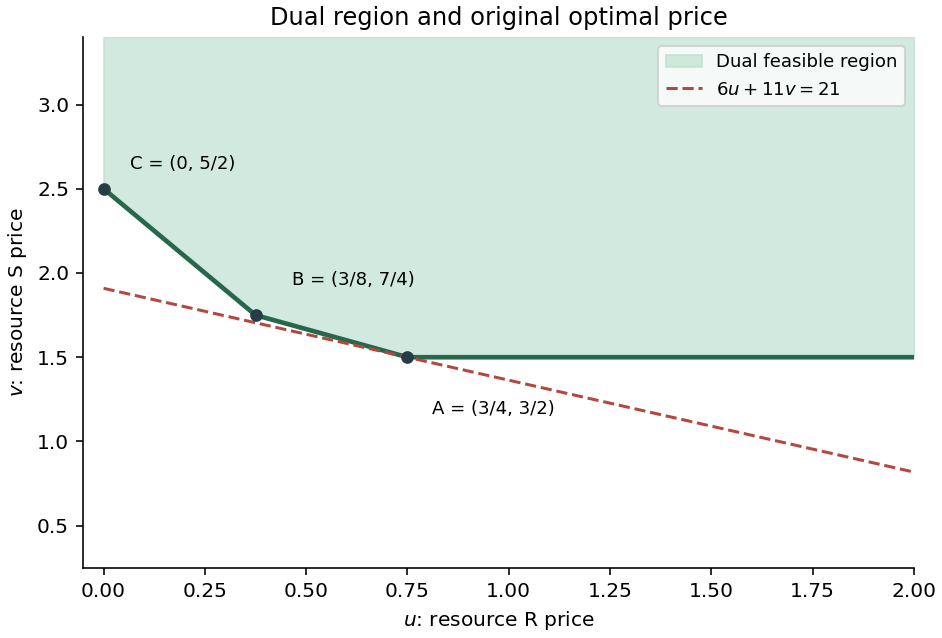

<h1 id="t/t2/c/solution">Solution</h1>

↑ **Parent:** [C](../c.md)

In the $(u,v)$ plane the feasible set lies in the first quadrant above the three lines $v=3/2$, $v=5/2-2u$ and $v=2-(2/3)u$. Its lower boundary has vertices

$$
A=(3/4,3/2),\qquad B=(3/8,7/4),\qquad C=(0,5/2),
$$

and the region is unbounded upward and to the right. The objective at these vertices is respectively $21$, $43/2$ and $55/2$, so $A$ is optimal for the original supply.

**[Figure 1](#t/t2/c/image-dual-feasible-region-and-its-three-finite-boundary-vertices). Dual feasible region and its three finite boundary vertices**.

Let the available amount of R be $r\geq0$. Comparing the three dual [vertex](../../../../../vertex-graph-theory.md) objectives gives the optimal value

$$
\boxed{V(r)=\begin{cases}
3r/4+33/2,&0\leq r\leq22/3,\\
3r/8+77/4,&22/3\leq r\leq22,\\
55/2,&r\geq22.
\end{cases}}
$$

Thus the marginal shadow price of R is $3/4$ below $22/3$, then $3/8$ between $22/3$ and $22$, and zero beyond $22$. At the two breakpoints, optimal dual prices range between the adjacent one-sided prices: $[3/8,3/4]$ and $[0,3/8]$ respectively. At zero supply the right marginal value is $3/4$; dual multipliers on the zero resource can be nonunique. These slope changes describe why the first extra $4/3$ units from the original supply six have the original price, but subsequent units do not.

## ↑ Ancestors (13)

1. [C](../c.md)
2. [T2](../../t2.md)
3. [T](../../../t.md)
4. [2011](../../../../2011-split.md)
5. [Past exam of the Probability, statistics and options II course of the University of Oxford](../../../../split.md)
6. [Probability, statistics and options II course of the University of Oxford](../../../../../probability-statistics-and-options-ii-course-of-the-university-of-oxford.md)
7. [Year 2 of the mathematics and statistics course of the University of Oxford](../../../../../year-2-of-the-mathematics-and-statistics-course-of-the-university-of-oxford.md)
8. [Mathematics and statistics course of the University of Oxford](../../../../../mathematics-and-statistics-course-of-the-university-of-oxford.md)
9. [Undergraduate course of the University of Oxford](../../../../../undergraduate-course-of-the-university-of-oxford.md)
10. [Course of the University of Oxford](../../../../../course-of-the-university-of-oxford.md)
11. [University of Oxford](../../../../../university-of-oxford-split.md)
12. [List of universities](../../../../../list-of-universities.md)
13. [Codex Wiki](../../../../../split.md)
