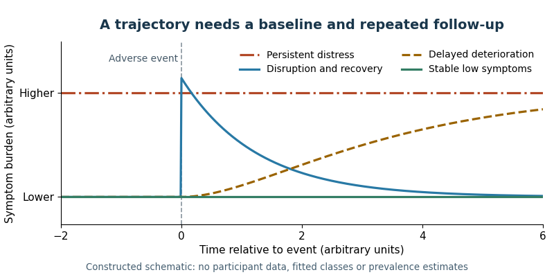

# 2022

↑ **Parent:** [Past exam of the psychological disorders: risk and resilience course of the University of Oxford](../past-exam-of-the-psychological-disorders-risk-and-resilience-course-of-the-university-of-oxford.md)

Worked essays for all six options in the historical paper dated 30 May 2022. Source release: [Oxford psychology examination release](https://www.whatdotheyknow.com/request/experimental_psychology_past_exa/response/2757831/attach/3/New%20Compressed%20zipped%20Folder.zip?cookie_passthrough=1), member `a15655w1.pdf`. Part II is the audited classification retained from the scaffold; the cover itself prints Second Public Examination. The paper asks candidates to select three questions, whereas this study edition addresses every option. The research used below predates the examination; current portrait and diagnostic-reference pages are identified separately from research findings.

**Table of contents**

- [1](#1)
  - [Solution](#1/solution)
- [2](#2)
  - [Solution](#2/solution)
- [3](#3)
  - [Solution](#3/solution)
- [4](#4)
  - [Solution](#4/solution)
- [5](#5)
  - [Solution](#5/solution)
- [6](#6)
  - [Solution](#6/solution)

## 1

↑ **Parent:** [2022](2022.md)

<h3 id="1/solution">Solution</h3>

↑ **Parent:** [1](#1)

**[Psychological resilience](../psychology.md#psychological-resilience) is best defined as successful adaptation in the context of significant [adversity](../psychology.md#adversity), specified by outcome, developmental context and time.** It is inferred from an [adversity](../psychology.md#adversity)–adaptation relationship, not established merely by a high [personality](../psychology.md#personality) score or the absence of a diagnosis at one assessment. The definition needs both credible [exposure](../causal-inference.md#exposure) and an explicit criterion of adaptation: an unexposed person with good [mental health](../psychiatry.md#mental-health) has not thereby demonstrated resistance to that particular challenge.

[Suniya S. Luthar](../psychologist.md#suniya-s-luthar) and colleagues emphasized this dual requirement and the danger of treating success in one domain as success in all domains. A young person might maintain academic performance while experiencing substantial [depression](../psychology.md#depression), or recover emotionally while material circumstances remain difficult. An investigation should therefore state whether it concerns symptoms, social relationships, school functioning or several outcomes. It should not define [psychological resilience](../psychology.md#psychological-resilience) as every desirable attribute simultaneously, because that makes meaningful measurement and explanation nearly impossible.[2000, definition, multidimensionality and operational criteria](../psychology-bibliography.md#the-construct-of-resilience-by-suniya-s-luthar-and-others)

Time is equally important. Stable low disturbance, initial disturbance followed by [recovery after adversity](../psychology.md#recovery-after-adversity), chronic difficulty and delayed deterioration are different trajectories. A single post-event score can confuse them, especially without a pre-event baseline. [George A. Bonanno](../psychologist.md#george-a-bonanno) and colleagues assessed 205 people before spousal bereavement and again at six and eighteen months afterward. They identified several patterns, including relatively stable adaptation, chronic difficulties and improvement from pre-existing [depression](../psychology.md#depression). The prospective baseline made distinctions possible that a retrospective “how well did you cope?” question could not establish.[2002, preloss assessment, follow-up and five observed patterns](../psychology-bibliography.md#resilience-to-loss-and-chronic-grief-by-george-a-bonanno-and-others)

**[Figure 1](#1/image-different-histories-of-adaptation-can-share-the-same-score-at-one-follow-up). Different histories of adaptation can share the same score at one follow-up**. Original schematic trajectories around an adverse event. Curves are constructed illustrations, not fitted classes or data from the cited bereavement study. They distinguish stable low symptoms, recovery, persistent distress and delayed deterioration without asserting universal population proportions.

Trajectory methods need their own scrutiny. A [growth mixture model](../latent-variable.md#growth-mixture-model) can describe heterogeneous longitudinal patterns, but the number and size of classes depend on assumptions about within-class variation and error. [Frank J. Infurna](../psychologist.md#frank-j-infurna) and colleagues reanalyzed responses to bereavement, divorce and unemployment. Relaxing restrictions on class [variances](../variance.md) and within-class change substantially altered the apparent prevalence of a resilient class. This demonstrates model dependence, not that every earlier low-distress trajectory was fictitious. Researchers should compare plausible models, report uncertainty in class assignment and avoid treating a convenient latent class as a naturally discrete kind of person.[2016, reanalysis and alternative growth-mixture specifications](../psychology-bibliography.md#resilience-to-major-life-stressors-is-not-as-common-as-thought-by-frank-j-infurna-and-suniya-s-luthar)

[Exposure](../causal-inference.md#exposure) measurement must characterize what happened, its severity, duration, developmental timing and relevant context. Counting heterogeneous events as equivalent can conceal very different experiences. Subjective appraisal matters, but using the same distressed respondent to report both [adversity](../psychology.md#adversity) and symptoms can create [common method variance](../psychology.md#common-method-variance). Independent records, contextual interviews and repeated assessments improve inference, while still potentially missing chronic insecurity or unrecorded events. [Exposure](../causal-inference.md#exposure) groups also need comparable follow-up opportunities: selective loss of the most impaired participants can make adaptation appear better than it was.

Adaptation should be measured with reliable, culturally appropriate instruments and, where feasible, several informants. Absence of disorder and positive functioning are related but distinct outcomes. Cutoffs need justification and [sensitivity analysis](../probability-and-statistics.md#sensitivity-analysis); moving a threshold should not silently redefine a large group as resilient. [Measurement invariance](../psychology.md#measurement-invariance) matters when comparing ages, languages or social groups. Biological measures of [psychological stress](../psychology.md#psychological-stress) may clarify a mechanism, but a low [cortisol](../signal-transduction.md#cortisol) response alone is not a complete assessment of psychological functioning or evidence of a universally optimal response.

[Self-report](../psychology.md#self-report) capacity measures have a useful but narrower role. The original [Connor-Davidson Resilience Scale](../psychology.md#connor-davidson-resilience-scale), developed by [Kathryn M. Connor](../psychiatry.md#kathryn-m-connor) and [Jonathan R. T. Davidson](../psychiatry.md#jonathan-r-t-davidson), contains 25 items rating perceived [coping](../psychology.md#coping)-related qualities. Its original validation examined community and clinical samples and sensitivity to treatment-associated change. These findings support a measurable self-reported construct; they do not prove that the scale independently identifies successful adaptation to a documented [adversity](../psychology.md#adversity). Concurrent symptoms can influence perceived competence, so prospective prediction beyond baseline distress is a stronger test than a concurrent [correlation](../variance.md#pearson-correlation-coefficient).[2003, original 25-item scale, validation samples and treatment-associated change](../psychology-bibliography.md#development-of-a-new-resilience-scale-by-kathryn-m-connor-and-jonathan-r-t-davidson)

Another approach measures better-than-expected outcomes conditional on [exposure](../causal-inference.md#exposure). With distress $D_i$ and [adversity](../psychology.md#adversity) $S_i$, one possible score is $R_i=\widehat m(S_i)-D_i$, where $\widehat m$ predicts distress. Higher $R_i$ then means less distress than the selected model predicts. [Ananda B. Amstadter](../psychologist.md#ananda-b-amstadter) and colleagues used a [regression residual](../probability-and-statistics.md#regression-residual)-based approach in longitudinal twin research. Its advantage is explicit conditioning on [exposure](../causal-inference.md#exposure); its limitations are dependence on the reference sample, [exposure](../causal-inference.md#exposure) measurement and prediction model. An in-sample [regression residual](../probability-and-statistics.md#regression-residual) is not a new independent biological capacity.[2014, exposure-conditioned symptom residual phenotype](../psychology-bibliography.md#psychiatric-resilience-longitudinal-twin-study-by-ananda-b-amstadter-and-others)

The best design combines prospective [adversity](../psychology.md#adversity) measurement, pre-event functioning and repeated, multidomain outcomes, with an operational definition registered before outcome selection. Capacity scales, trajectories and [regression residual](../probability-and-statistics.md#regression-residual) scores can answer complementary questions if their differences are preserved. **[Psychological resilience](../psychology.md#psychological-resilience) should be treated as a context-dependent pattern of adaptation that can change, while proposed capacities and protective mechanisms are tested as predictors of that pattern.** Otherwise the explanation becomes circular: calling someone resilient because they did well cannot itself explain why they did well.

## 2

↑ **Parent:** [2022](2022.md)

<h3 id="2/solution">Solution</h3>

↑ **Parent:** [2](#2)

**[Psychological resilience](../psychology.md#psychological-resilience) research has redirected prevention toward strengthening modifiable adaptive systems and reducing avoidable [adversity](../psychology.md#adversity), rather than identifying unusually invulnerable people.** Its contribution is a set of hypotheses about protective processes and developmental opportunities. Whether an intervention actually promotes adaptation must then be established through appropriate comparisons and meaningful follow-up outcomes; the word “[psychological resilience](../psychology.md#psychological-resilience)” in a program title is not evidence of effectiveness.

Early longitudinal work, including [Emmy E. Werner](../psychologist.md#emmy-e-werner)'s Kauai research, showed that high-risk developmental histories did not imply uniformly poor outcomes. Later synthesis by [Ann S. Masten](../psychologist.md#ann-s-masten) argued that adaptation often relies on ordinary systems such as effective caregiving, [self-regulation](../psychology.md#self-regulation) and learning. This suggests three broad intervention routes: reduce [exposure](../causal-inference.md#exposure), preserve external supports and strengthen relevant [coping](../psychology.md#coping) or regulatory skills. The implication is ecological: a child's capacities operate through relationships and opportunities, not in isolation from them.[1993, developmental follow-up and protective processes](../psychology-bibliography.md#risk-resilience-and-recovery-by-emmy-e-werner)[2001, adaptive systems and implications for intervention](../psychology-bibliography.md#ordinary-magic-by-ann-s-masten)

A protective correlate is not automatically a causal target. Good [parenting](../psychology.md#parenting) may accompany unmeasured resources, and a child's behavior may affect [parenting](../psychology.md#parenting). Intervention development therefore needs a proposed mechanism, a feasible procedure and a test of whether changing it improves subsequent functioning. It also needs to distinguish a [promotive factor](../psychology.md#promotive-factor), beneficial across [adversity](../psychology.md#adversity) levels, from a [stress-buffering interaction](../biology.md#stress-buffering-interaction), whose effect depends on [exposure](../causal-inference.md#exposure). Both can be useful; neither is established by simply correlating a [questionnaire](../psychology.md#questionnaire) with current well-being.

The [Penn Resiliency Program](../biology.md#penn-resiliency-program) illustrates efforts to teach [coping](../psychology.md#coping) and cognitive skills in schools. [Jane E. Gillham](../psychologist.md#jane-e-gillham) and colleagues randomized 697 children across three middle schools to the program, an alternative program controlling nonspecific ingredients, or a control condition. There was no overall reduction in average depressive symptoms across the full sample, although benefits appeared in two schools and not the third. The active comparison improved the test of specificity. The variation cautions against assuming that a curriculum transfers unchanged across settings or that a symptom effect establishes prevention of first-onset disorder.[2007, three-arm trial, school variation and three-year follow-up](../psychology-bibliography.md#school-based-prevention-of-depressive-symptoms-by-jane-e-gillham-and-others)

Family interventions put supportive relationships closer to the proposed mechanism. The [Family Bereavement Program](../biology.md#family-bereavement-program) uses caregiver and youth groups to develop [parenting](../psychology.md#parenting), [coping](../psychology.md#coping) and communication after parental death. Its randomized follow-up found benefits in several symptom and functioning domains six years later, while diagnostic effects varied with baseline problems. This is consistent with strengthening adaptation after a defined [adversity](../psychology.md#adversity), rather than treating ordinary grief as illness. A literature-control comparison, however, does not separate the specific skills from all benefits of group attention and support.[2010, intervention components, comparison condition and outcome-specific follow-up](../psychology-bibliography.md#six-year-follow-up-of-a-preventive-intervention-for-parentally-bereaved-youths-by-irwin-sandler-and-others)

Environmental intervention can be still more direct. In the [Bucharest Early Intervention Project](../psychology.md#bucharest-early-intervention-project), institutionalized young children were randomized to a supported foster-care offer or care as usual. [Katie A. McLaughlin](../psychologist.md#katie-a-mclaughlin) and colleagues assessed [attachment security](../psychology.md#attachment-security) at 42 months and internalizing outcomes at 54 months. The foster-care intervention reduced [internalizing disorders](../psychiatry.md#internalizing-disorder) among girls, with attachment findings consistent with a protective pathway; a comparable statistically demonstrated intervention effect was not found in boys. A significant result in one sex and a nonsignificant result in the other do not alone establish an interaction. This supports changing a caregiving environment while preserving the sex- and outcome-specific limits of the result.[2012, randomized foster-care offer, attachment assessment and internalizing outcomes](../psychology-bibliography.md#attachment-security-as-a-mechanism-linking-foster-care-placement-to-improved-mental-health-outcomes-in-previously-institutionalized-children-by-katie-a-mclaughlin-and-others)

The mediator claim deserves separate evaluation. Placement was randomized; [attachment security](../psychology.md#attachment-security) was not. Attachment may mark other changes in caregiving, and mediator–outcome [confounding](../causal-inference.md#confounding) can survive randomization of the overall intervention. The trial therefore provides stronger causal evidence for the foster-care package than for attachment as its unique active ingredient. This distinction turns [psychological resilience](../psychology.md#psychological-resilience) theory into a research program: assess whether proposed processes change before outcomes, examine alternatives and test components where ethical and feasible.

Structural resources also matter. [E. Jane Costello](../biology.md#e-jane-costello) and colleagues exploited a casino-related income supplement during a [longitudinal study](../causal-inference.md#longitudinal-study). Children in families lifted out of poverty showed improvements particularly in conduct and oppositional symptoms, while [anxiety](../psychology.md#anxiety) and [depression](../psychology.md#depression) symptoms did not show the same benefit. Although not a randomized cash trial, the externally generated change offered stronger leverage than a cross-sectional poverty–symptom [correlation](../variance.md#pearson-correlation-coefficient). It shows why prevention need not consist solely of training a person to tolerate an unchanged environment.[2003, natural experiment and outcome-specific effects](../psychology-bibliography.md#relationships-between-poverty-and-psychopathology-by-e-jane-costello-and-others)

Targeting can be universal, selective or indicated, according to population risk and early symptoms. [Judy Garber](../psychologist.md#judy-garber) and colleagues' [depression](../psychology.md#depression)-prevention trial found an overall benefit from a cognitive-behavioral program in high-risk adolescents but no demonstrated benefit when the parent was currently depressed. Because eligibility also included previous episodes, the study mixes first-onset and recurrence-related questions. Its relevance is that individual skills can depend on family context; it does not justify a universal exclusion rule based on one subgroup analysis.[2009, eligibility and baseline parental-depression moderation](../psychology-bibliography.md#prevention-of-depression-in-at-risk-adolescents-by-judy-garber-and-others)

Finally, evaluation should assess actual [exposure](../causal-inference.md#exposure), disorder onset, functioning, harms, implementation and durability, not merely improvement on the same [psychological resilience](../psychology.md#psychological-resilience) [questionnaire](../psychology.md#questionnaire) used to teach the course. Reach and material inequalities affect who can benefit. **The strongest influence of [psychological resilience](../psychology.md#psychological-resilience) research is a move toward developmentally timed, multilevel prevention, evaluated with the same causal rigor as treatment.** Protecting ordinary relationships and resources can be as relevant as teaching [coping](../psychology.md#coping); successful adaptation should remain an outcome to demonstrate rather than a trait attributed to those a program happens to help.

## 3

↑ **Parent:** [2022](2022.md)

<h3 id="3/solution">Solution</h3>

↑ **Parent:** [3](#3)

**A [risk factor](../biology.md#risk-factor) is a cause when an appropriate change in that factor would change the relevant psychological outcome, under specified conditions.** Prediction and causation are different: a variable can forecast disorder because it is a marker, a consequence of emerging illness, or correlated with an unmeasured cause. Confidence comes from designs that address different alternative explanations and from convergence on a clearly defined [exposure](../causal-inference.md#exposure), population and outcome.

A [cross-sectional study](../causal-inference.md#cross-sectional-study) can establish an association and suggest hypotheses, but timing is ambiguous. A depressed respondent may recall more [adversity](../psychology.md#adversity), and family disadvantage may influence both [exposure](../causal-inference.md#exposure) and symptoms. A [case–control study](../causal-inference.md#case-control-study) is efficient for uncommon disorders but remains sensitive to recall, control selection and [exposure](../causal-inference.md#exposure) misclassification. Adjusting for many measured variables is not automatically an improvement: controlling a consequence of [exposure](../causal-inference.md#exposure) can block a real pathway, while conditioning on a common consequence of [exposure](../causal-inference.md#exposure) and outcome can induce [collider bias](../causal-inference.md#collider-bias).

Prospective [longitudinal studies](../causal-inference.md#longitudinal-study) improve temporal ordering. In [Constance Hammen](../psychologist.md#constance-hammen) and colleagues' two-year follow-up, childhood-[adversity](../psychology.md#adversity) histories predicted depressive reactions at lower subsequent [psychological stress](../psychology.md#psychological-stress) levels. Measuring events and symptoms over time made this more informative than asking affected people retrospectively why they became ill. Yet [adversity](../psychology.md#adversity) was not randomized, and histories may be measured imperfectly. Temporal precedence is necessary for the proposed direction of influence, but does not remove familial liability, prior symptoms or unmeasured social circumstances as competing explanations.[2000, two-year follow-up and sensitization hypothesis](../psychology-bibliography.md#depression-and-sensitization-to-stressors-among-young-women-as-a-function-of-childhood-adversity-by-constance-hammen-and-others)

Stronger observational designs make their counterfactual comparison explicit. A [natural experiment](../causal-inference.md#natural-experiment) exploits an external change that alters [exposure](../causal-inference.md#exposure) without being produced by the same individual characteristics that usually determine it. [E. Jane Costello](../biology.md#e-jane-costello) and colleagues observed children before and after an income supplement associated with a casino opening. Comparing developmental changes across differently affected families strengthened the social-causation interpretation for particular behavioral outcomes. It did not randomize poverty, and concurrent community changes or selection into an income-defined subgroup remain possible alternatives.[2003, longitudinal quasi-experimental comparison](../psychology-bibliography.md#relationships-between-poverty-and-psychopathology-by-e-jane-costello-and-others)

A [difference-in-differences](../causal-inference.md#difference-in-differences) analysis formalizes such reasoning as the exposed group's change minus the comparison group's change. Its causal interpretation requires a credible untreated trend comparison, no differential concurrent change that explains the effect, and careful attention to anticipation and changes in sample composition. Merely measuring before and after a policy is not sufficient. Examining pre-intervention trends can expose some problems but cannot prove that every counterfactual assumption is true.

A [randomized controlled trial](../causal-inference.md#randomized-controlled-trial) offers another route by breaking systematic baseline links between allocation and measured or unmeasured causes. The foster-care offer in the [Bucharest Early Intervention Project](../psychology.md#bucharest-early-intervention-project) is an example of ethically intervening to improve a harmful setting, rather than deliberately assigning children to initial deprivation. Under suitable follow-up and analysis, differences between allocated groups estimate the effect of offering that intervention. Nonadherence, placement changes and attrition still matter. An [intention-to-treat analysis](../causal-inference.md#intention-to-treat-analysis) retains the allocation comparison; simply regrouping children by the care they eventually received can reintroduce selection.[2012, random allocation and subsequent mental-health assessment](../psychology-bibliography.md#attachment-security-as-a-mechanism-linking-foster-care-placement-to-improved-mental-health-outcomes-in-previously-institutionalized-children-by-katie-a-mclaughlin-and-others)

Even a successful trial does not identify the causal contribution of every component. A foster-care package changes several experiences simultaneously. A [coping](../psychology.md#coping) course may alter attention, expectations, peer contact and behavior. To identify a mediator, it is necessary to consider [confounding](../causal-inference.md#confounding) of the mediator–outcome relationship and its temporal ordering, not only whether the treatment changes both mediator and outcome. Conversely, a null intervention can reflect inadequate delivery, insufficient contrast or the wrong developmental timing; it need not prove that the proposed [risk factor](../biology.md#risk-factor) is irrelevant under every possible intervention.

Genetically informed studies address another set of alternatives. Comparing differently exposed identical twins can reduce [confounding](../causal-inference.md#confounding) by inherited sequence and shared family background. However, [exposure](../causal-inference.md#exposure) differences can arise from nonshared antecedents that also affect disorder, and within-pair [measurement error](../probability-and-statistics.md#measurement-error) can be substantial. Family and adoption designs are similarly informative without making every remaining environmental association causal. Molecular associations can indicate inherited liability, but [linkage disequilibrium](../population-genetics.md#linkage-disequilibrium) and [population stratification](../genetics.md#population-stratification) separate an associated marker from a demonstrated mechanism.

[Mendelian randomization](../causal-inference.md#mendelian-randomization) uses [genetic variants](../genetics.md#genetic-variant) as instruments for an [exposure](../causal-inference.md#exposure), requiring relevant instruments, independence from [exposure](../causal-inference.md#exposure)–outcome confounders and an [exclusion restriction](../causal-inference.md#exclusion-restriction). The design can be useful when its assumptions are credible. It is not a shortcut for every social [risk factor](../biology.md#risk-factor): [horizontal pleiotropy](../causal-inference.md#horizontal-pleiotropy), parental genetic effects and ancestry structure can create misleading estimates. A genetic score associated with stressful experiences does not necessarily act only through those experiences. This is a methodological distinction, not evidence that any particular untested [exposure](../causal-inference.md#exposure) is causal.

Animal experiments can manipulate mechanisms and timing more tightly. [Karen J. Parker](../neuroscientist.md#karen-j-parker) and colleagues randomized young squirrel monkeys to intermittent separation experiences or a comparison condition and later tested responses in a novel setting. This supports causal conclusions about that rearing contrast and those measured responses. It does not directly estimate the effect of [childhood adversity](../psychology.md#childhood-adversity) on human psychiatric diagnoses: species, development, [psychological stressor](../psychology.md#psychological-stressor) meaning and outcomes differ.[2004, randomized rearing contrast and later behavioral/endocrine tests](../psychology-bibliography.md#prospective-investigation-of-stress-inoculation-in-young-monkeys-by-karen-j-parker-and-others)

The strongest conclusion is obtained when these designs converge despite their different weaknesses, with sensitivity analyses and transparent outcome definitions. **A causal claim should specify the contrast it establishes and the alternatives it has not excluded.** Prospective timing, externally driven [exposure](../causal-inference.md#exposure) changes, randomization, within-family controls and mechanistic experiments together can provide much stronger evidence than any isolated risk [correlation](../variance.md#pearson-correlation-coefficient), while still leaving uncertainty about transport to another population or developmental stage.

## 4

↑ **Parent:** [2022](2022.md)

<h3 id="4/solution">Solution</h3>

↑ **Parent:** [4](#4)

**Individual characteristics contribute to adaptation, but their effects depend on [adversity](../psychology.md#adversity), relationships, opportunities and the outcome being measured.** [Psychological resilience](../psychology.md#psychological-resilience) is therefore not well explained by dividing people into inherently strong and weak types. A useful account asks which characteristic predicts which aspect of functioning under which conditions, and whether changing that characteristic would improve the outcome.

Cognitive capacities can help a person understand a problem, plan a response and use available support. [Temperament](../psychology.md#temperament) and [emotion regulation](../psychology.md#emotion-regulation) may influence how strongly threat is experienced and how readily attention can be redirected. [Coping](../psychology.md#coping) confidence may encourage engagement, while flexible strategies can help match responses to a controllable or uncontrollable situation. These are plausible mechanisms, not proof that a single score measures [psychological resilience](../psychology.md#psychological-resilience). Some apparently personal resources, such as social competence, also operate by eliciting or maintaining helpful relationships.

Longitudinal evidence supports contributions from both person and context. [Emmy E. Werner](../psychologist.md#emmy-e-werner)'s Kauai study followed a birth cohort from early life into adulthood, identifying protective patterns among people exposed to substantial developmental risks. Individual capacities, supportive caregivers and opportunities outside the immediate family all featured in the account. Because these resources were not randomly allocated, their predictive value does not isolate a pure individual effect from the environments that helped develop or express it.[1993, prospective developmental course and protective-resource clusters](../psychology-bibliography.md#risk-resilience-and-recovery-by-emmy-e-werner)

More specific evidence comes from [Ann S. Masten](../psychologist.md#ann-s-masten) and colleagues' ten-year follow-up of 205 children recruited during elementary school. Using multiple methods and informants, they examined academic, conduct and peer competence in relation to [adversity](../psychology.md#adversity). Intellectual functioning and [parenting](../psychology.md#parenting) resources predicted favorable outcomes across domains; findings also suggested protective roles for IQ and [parenting](../psychology.md#parenting) in relation to antisocial behavior. Resilient adolescents resembled competent low-[adversity](../psychology.md#adversity) peers in several ordinary resources rather than exhibiting an entirely separate human type.[1999, longitudinal sample, competence domains and intellectual/parenting resources](../psychology-bibliography.md#competence-in-the-context-of-adversity-by-ann-s-masten-and-others)

The causal interpretation remains qualified. Better intellectual performance can reflect previous schooling, health and caregiving as well as inherited variation. [Parenting](../psychology.md#parenting) can respond to child behavior, and both may share unmeasured antecedents. A variable measured before a later outcome is a stronger predictor than a simultaneous self-description, but prediction alone does not establish that raising its score will reproduce the observed benefit. An intervention needs to test the proposed process rather than assume the correlational ordering is causal.

Promotive and buffering effects should also be separated. For an adverse outcome $D$, [adversity](../psychology.md#adversity) $S$ and resource $P$, consider an illustrative model,

$$
\mathbb E[D\mid S,P]=\beta_0+\beta_1S+\beta_2P+\beta_3SP.
$$

When $\beta_3=0$ and $\beta_2<0$, the resource has a constant favorable association across the modeled [adversity](../psychology.md#adversity) range. A negative $\beta_3$ instead means that increasing the resource reduces the [adversity](../psychology.md#adversity) slope, $\beta_1+\beta_3P$. This is a [psychological stress](../psychology.md#psychological-stress)-buffering pattern on this scale. Neither coefficient alone proves causation; interaction can change with the outcome scale, and a statistically nonsignificant interaction may reflect poor measurement or insufficient power rather than equal effects everywhere.[2000, precision in protective terminology and interactive patterns](../psychology-bibliography.md#the-construct-of-resilience-by-suniya-s-luthar-and-others)

Context can enable or suppress a capacity. Planning is less useful when there are no safe options, and willingness to seek support cannot ensure that responsive support exists. A [coping](../psychology.md#coping) response that helps during a brief challenge can be costly during prolonged insecurity. High observable achievement can coexist with internal distress, so defining success entirely by school performance can exaggerate the apparent protection conferred by conscientious behavior. Outcome selection changes which characteristics seem important.

Experimental evidence argues against treating context as a passive background. The supported foster-care offer in the [Bucharest Early Intervention Project](../psychology.md#bucharest-early-intervention-project) improved some later mental-health outcomes, with sex-specific uncertainty. Such a change cannot be explained solely by an immutable difference between supposedly resilient and nonresilient children. It demonstrates that modifying a developmental environment can change observed adaptation, while not establishing that every child benefits equally or through one unique mechanism.[2012, randomized environmental intervention and outcome heterogeneity](../psychology-bibliography.md#attachment-security-as-a-mechanism-linking-foster-care-placement-to-improved-mental-health-outcomes-in-previously-institutionalized-children-by-katie-a-mclaughlin-and-others)

The relative importance of characteristics can change over time. A relationship or opportunity encountered later can alter a developmental course; stable adaptation after one event does not guarantee the same response to another. Prospective bereavement findings also show why baseline functioning matters: a favorable post-event score can represent stable functioning or improvement from earlier difficulty. A [personality](../psychology.md#personality) correlate measured only after the event may partly be a consequence of the adjustment being explained.[2002, prospective baseline and heterogeneous courses](../psychology-bibliography.md#resilience-to-loss-and-chronic-grief-by-george-a-bonanno-and-others)

Genetic findings do not restore a simple fixed-trait account. A heritable [regression residual](../probability-and-statistics.md#regression-residual)-based adaptation score still depends on [exposure](../causal-inference.md#exposure) measurement, the surrounding environment and inherited influences on the component symptoms. [Heritability](../genetics.md#heritability) partitions variation in a studied population; it does not say that an individual's [coping](../psychology.md#coping) capacity is fixed or that a social intervention cannot help. Equally, environmental influence does not make every individual difference transient or unimportant.

**Individual characteristics are consequential resources within a developmental system, not sufficient explanations of who will adapt successfully.** Good research compares personal and contextual predictors prospectively, tests interactions and mechanisms, and evaluates functioning across domains. Prevention can strengthen relevant skills while also protecting relationships and material conditions. This is a more useful consequence of individual-difference evidence than attributing continuing difficulty to an alleged lack of personal [psychological resilience](../psychology.md#psychological-resilience).

## 5

↑ **Parent:** [2022](2022.md)

<h3 id="5/solution">Solution</h3>

↑ **Parent:** [5](#5)

**Inherited variation contributes to psychiatric vulnerability and to some measured differences in adaptation after [psychological stress](../psychology.md#psychological-stress), but its importance is [phenotype](../genetics.md#phenotype)-, population- and environment-dependent.** Genetic influence is not equivalent to inevitability, a single large-effect [gene](../genetics.md#gene) or a wholly separate set of protective [genes](../genetics.md#gene). A satisfactory answer must distinguish genetic effects on [exposure](../causal-inference.md#exposure), on symptoms and on responses conditional on [exposure](../causal-inference.md#exposure).

Family resemblance provides an initial clue, but families transmit environments and social circumstances as well as DNA. Twin comparisons exploit differences in relatedness: monozygotic pairs share essentially all inherited sequence variation, whereas dizygotic pairs share about half their segregating additive variation on average. Under an [ACE model](../genetics.md#ace-model), greater resemblance of monozygotic pairs can support a genetic component if the relevant environmental and ascertainment assumptions hold. Equal environments means comparable effects of relevant environmental similarity, not literally identical treatment of every twin.

Disorder-level evidence is substantial. [Patrick F. Sullivan](../biologist.md#patrick-f-sullivan) and colleagues' ascertainment-aware synthesis of [schizophrenia](../psychiatry.md#schizophrenia) [twin studies](../genetics.md#twin-study) estimated liability [heritability](../genetics.md#heritability) at roughly $81\%$, with uncertainty. [Paul Lichtenstein](../biologist.md#paul-lichtenstein) and colleagues' Swedish family-register study supported partially shared inherited liability to [schizophrenia](../psychiatry.md#schizophrenia) and [bipolar disorder](../psychiatry.md#bipolar-disorder) using biological, adoptive and sibling relationships. The convergence supports inherited vulnerability while showing that diagnostic categories do not necessarily partition genetic causes into entirely independent sets.[2003, twin-liability synthesis](../psychology-bibliography.md#schizophrenia-as-a-complex-trait-by-patrick-f-sullivan-and-others)[2009, family/adoption comparisons and cross-disorder liability](../psychology-bibliography.md#common-genetic-determinants-of-schizophrenia-and-bipolar-disorder-in-swedish-families-by-paul-lichtenstein-and-others)

Molecular evidence provides a different test. The [Psychiatric Genomics Consortium](../genetics.md#psychiatric-genomics-consortium)'s 2014 [schizophrenia](../psychiatry.md#schizophrenia) study identified associations spanning 108 loci in a large multi-stage genome-wide analysis. Many common variants contribute small effects; an associated locus is not automatically one causal [gene](../genetics.md#gene) or a known mechanism. [Population stratification](../genetics.md#population-stratification), [linkage disequilibrium](../population-genetics.md#linkage-disequilibrium), case ascertainment and sample overlap still require control. A [genetic risk score](../genetics.md#genetic-risk-score) can predict risk differences in independent data while remaining far from a deterministic diagnosis or a transportable measure of one person's [psychological resilience](../psychology.md#psychological-resilience).[2014, multi-stage associations and polygenic interpretation](../psychology-bibliography.md#biological-insights-from-108-schizophrenia-associated-genetic-loci-by-psychiatric-genomics-consortium)

[Psychological resilience](../psychology.md#psychological-resilience) needs additional definition because favorable outcomes without [adversity](../psychology.md#adversity) do not establish [psychological stress](../psychology.md#psychological-stress) resistance. [Ananda B. Amstadter](../psychologist.md#ananda-b-amstadter) and colleagues studied 7,500 adult twins at two assessments, modeling internalizing symptoms relative to cumulative stressful events. Their [regression residual](../probability-and-statistics.md#regression-residual)-based [phenotype](../genetics.md#phenotype) had estimated [heritability](../genetics.md#heritability) around $31\%$ at each wave; longitudinal modeling that accounted for [measurement error](../probability-and-statistics.md#measurement-error) and occasion-specific influences gave a larger latent estimate, around $50\%$. This supports both inherited and environmental contributions to that operationalization, not a universal percentage for every meaning of [psychological resilience](../psychology.md#psychological-resilience).[2014, residual phenotype, wave-specific and longitudinal estimates](../psychology-bibliography.md#psychiatric-resilience-longitudinal-twin-study-by-ananda-b-amstadter-and-others)

The shift in estimates is conceptually informative. Independent [measurement error](../probability-and-statistics.md#measurement-error) adds to observed [variance](../variance.md) without adding the corresponding genetic signal. In a simple measurement model, if $V_G$ is genetic [variance](../variance.md), $V_T$ true-score [variance](../variance.md) and $V_\epsilon$ independent error [variance](../variance.md), then

$$
h^2_{\mathrm{observed}}=\frac{V_G}{V_T+V_\epsilon}=\frac{V_T}{V_T+V_\epsilon}h^2_{\mathrm{true}}.
$$

Removing noise can therefore raise estimated [heritability](../genetics.md#heritability) without changing anyone's [genes](../genetics.md#gene). This illustration is not a reconstruction of the study's full model: occasion-specific effects and longitudinal assumptions also matter, so $31/50$ should not be reported as an independently established [measurement reliability](../psychology.md#measurement-reliability) coefficient.

A [regression residual](../probability-and-statistics.md#regression-residual) [phenotype](../genetics.md#phenotype) also inherits assumptions from its construction. If [adversity](../psychology.md#adversity) is undermeasured or a prediction model is misspecified, the [regression residual](../probability-and-statistics.md#regression-residual) includes more than protective capacity. Genetic effects on [depression](../psychology.md#depression) or [anxiety](../psychology.md#anxiety) can appear as genetic effects on low symptom burden after [psychological stress](../psychology.md#psychological-stress), even without a separate buffering mechanism. Demonstrating a [psychological resilience](../psychology.md#psychological-resilience)-specific effect would require stronger evidence that inherited variation changes the response to comparable [exposure](../causal-inference.md#exposure), with adequate [exposure](../causal-inference.md#exposure) measurement and explicit competing models.

[Gene](../genetics.md#gene)–environment processes further complicate simple partitioning. [Gene-environment correlation](../genetics.md#gene-environment-correlation) occurs when inherited characteristics influence environments encountered or elicited, or when parental characteristics affect both inherited liability and the rearing environment. [Genotype-environment interaction](../genetics.md#genotype-environment-interaction) instead means that inherited differences have different consequences across environments. Neither can be inferred merely because both [genes](../genetics.md#gene) and [psychological stress](../psychology.md#psychological-stress) predict the outcome. Restricting analysis to people with a particular [exposure](../causal-inference.md#exposure) can also create [selection bias](../causal-inference.md#selection-bias) if [exposure](../causal-inference.md#exposure) is influenced by several causes relevant to symptoms.

Historical candidate-[gene](../genetics.md#gene) findings illustrate the need for stringent evidence. [Richard Border](../biologist.md#richard-border) and colleagues' large, preregistered analyses did not support widely proposed [depression](../psychology.md#depression) candidate-[gene](../genetics.md#gene) or candidate-[gene](../genetics.md#gene)-by-environment effects. This challenges those specific claims and the power of small discovery studies; it does not demonstrate that all interactions are absent. [Replication](../design-of-experiments.md#replication-in-experimental-design), correction for multiple testing, ancestry-aware analyses and precise [phenotype](../genetics.md#phenotype) definitions are essential before a plausible biological story becomes a reliable finding.[2019, candidate-variant, gene and interaction tests](../psychology-bibliography.md#no-support-for-historic-candidate-gene-or-candidate-gene-by-interaction-hypotheses-for-major-depression-across-multiple-large-samples-by-richard-border-and-others)

Finally, high [heritability](../genetics.md#heritability) does not mean an outcome cannot be changed. It describes sources of variation under a particular range of environments, not the response to an environment absent from the data. Genetic effects can act through modifiable developmental systems, and external support can benefit people across inherited-risk levels. Predictive accuracy and equity can also deteriorate when scores are transferred to populations unlike the discovery sample.

**[Genes](../genetics.md#gene) contribute meaningfully to liability and to particular measured adaptation [phenotypes](../genetics.md#phenotype), while evidence for specific protective mechanisms is narrower than evidence for [heritability](../genetics.md#heritability).** The strongest account combines family and molecular results with explicit [exposure](../causal-inference.md#exposure) and developmental models, rather than assigning a fixed genetic percentage to an individual or replacing environmental prevention with genetic classification.

## 6

↑ **Parent:** [2022](2022.md)

<h3 id="6/solution">Solution</h3>

↑ **Parent:** [6](#6)

**Psychological [psychological stress](../psychology.md#psychological-stress) is neither universally necessary nor sufficient for psychological disorder, and prior [exposure](../causal-inference.md#exposure) can increase or decrease later [psychological stress](../psychology.md#psychological-stress) reactivity under different conditions.** This conclusion requires a specific definition of [psychological stress](../psychology.md#psychological-stress). If every internal demand, inherited vulnerability or symptom is relabeled “[psychological stress](../psychology.md#psychological-stress),” necessity becomes nearly impossible to falsify. It is more useful to distinguish an external [psychological stressor](../psychology.md#psychological-stressor), its appraisal, physiological responses and the subsequent clinical outcome.

For a defined [exposure](../causal-inference.md#exposure) $S$ and disorder $D$, necessity would mean $D\Rightarrow S$, while sufficiency would mean $S\Rightarrow D$. A causal [risk factor](../biology.md#risk-factor) need satisfy neither implication: it can increase risk for some people without producing disorder in all exposed people or accounting for every case. The absence of a recorded stressful event is not proof that no relevant [adversity](../psychology.md#adversity) occurred, but repeated measurement can make a proposed universal requirement more testable. A diagnostic qualification is [post-traumatic stress disorder](../psychiatry.md#post-traumatic-stress-disorder), which requires a qualifying traumatic [exposure](../causal-inference.md#exposure) as part of its definition; even there, [exposure](../causal-inference.md#exposure) alone does not meet the remaining diagnostic requirements.[DSM-5 Criteria for PTSD, Criterion A and the requirement for the full syndrome; used to verify the pre-examination diagnostic distinction](../psychology-bibliography.md#ptsd-and-dsm-5-by-national-center-for-ptsd)

[Exposure](../causal-inference.md#exposure) is clearly not sufficient for all adverse outcomes. Prospective studies identify heterogeneous courses following bereavement, including maintained functioning and [recovery after adversity](../psychology.md#recovery-after-adversity). Individual liability, developmental timing, available support and continuing consequences alter risk. A vulnerability–[psychological stress](../psychology.md#psychological-stress) account therefore treats [exposure](../causal-inference.md#exposure) as interacting with other causes rather than as a switch that produces the same outcome in everyone. The observation that some exposed people adapt well does not imply the [exposure](../causal-inference.md#exposure) was harmless or that those with continuing difficulties lacked effort.

[Stress sensitization](../psychology.md#stress-sensitization) proposes that prior [adversity](../psychology.md#adversity) lowers the threshold for a later adverse response. [Constance Hammen](../psychologist.md#constance-hammen) and colleagues followed young women for two years and found that those with significant [childhood adversity](../psychology.md#childhood-adversity) were more likely to develop [depression](../psychology.md#depression) following less subsequent [psychological stress](../psychology.md#psychological-stress) than those without such histories. The finding was not explained by the measured chronic [psychological stress](../psychology.md#psychological-stress) or previous [depression](../psychology.md#depression). This supports a sensitization pattern, while leaving its precise biological and psychological mechanisms unresolved and retaining the limitations of observational [exposure](../causal-inference.md#exposure) histories.[2000, prospective sensitization test and alternative measured explanations](../psychology-bibliography.md#depression-and-sensitization-to-stressors-among-young-women-as-a-function-of-childhood-adversity-by-constance-hammen-and-others)

Possible pathways include altered threat appraisal, reduced regulatory resources and persistent disruption of supportive relationships. These mechanisms make different predictions and need direct tests. A lower observed [psychological stress](../psychology.md#psychological-stress) level before an episode could also reflect incomplete event measurement, emerging illness generating [psychological stress](../psychology.md#psychological-stress) or shared vulnerability to both [exposure](../causal-inference.md#exposure) and [depression](../psychology.md#depression). Sensitization should be distinguished from [stress generation](../psychology.md#stress-generation), where symptoms or related characteristics increase the probability of later stressful experiences. Both processes could form a feedback loop without being identical.

[Stress inoculation](../psychology.md#stress-inoculation) makes a different prediction: manageable prior challenges can sometimes improve later regulation or [coping](../psychology.md#coping). [Mark D. Seery](../psychologist.md#mark-d-seery) and colleagues' multiyear study found that people reporting some, rather than zero or very high, lifetime [adversity](../psychology.md#adversity) had more favorable mental-health and functioning outcomes and appeared less affected by recent events. This supports a nonmonotonic association, but not a causal recommendation to expose people to [adversity](../psychology.md#adversity). Retrospective histories, selection, differences in resources and unmeasured [confounding](../causal-inference.md#confounding) could help produce the pattern.[2010, quadratic adversity associations and response to subsequent events](../psychology-bibliography.md#whatever-does-not-kill-us-by-mark-d-seery-and-others)

Experimental animal evidence addresses some causal alternatives. [Karen J. Parker](../neuroscientist.md#karen-j-parker) and colleagues randomly assigned twenty young squirrel monkeys to intermittent separation experiences or a comparison condition during postnatal weeks 17–27. Subsequent testing included a novel environment with the mother present and a home-cage exploratory task, with behavioral observations and plasma [cortisol](../signal-transduction.md#cortisol) measurements. The intermittently exposed animals showed greater exploration and lower [anxiety](../psychology.md#anxiety)-related and hormonal responses on specified measures. The contrast provides evidence that this particular developmental experience changed later responses.[2004, randomized rearing contrast, novel-environment test and behavioral/endocrine outcomes](../psychology-bibliography.md#prospective-investigation-of-stress-inoculation-in-young-monkeys-by-karen-j-parker-and-others)

The limits are important. The comparison concerns a controlled, intermittent challenge with return to a social environment, not severe chronic maltreatment. Exploration and [psychological stress](../psychology.md#psychological-stress)-hormone measures are not equivalent to prevention of human psychiatric diagnoses. Maternal responses and subsequent experiences can mediate the randomized package, so the result does not identify one cellular mechanism. Human application would need independent evidence about benefits, harms, developmental timing and the meaning of the experience; deliberately creating harmful [adversity](../psychology.md#adversity) does not follow from this experiment.

Sensitization and inoculation can coexist because [exposure](../causal-inference.md#exposure) varies in intensity, duration, controllability, timing and the support available afterward. Repeated overwhelming threat can exhaust or disrupt adaptive systems, while manageable experiences may provide opportunities for learning and [recovery after adversity](../psychology.md#recovery-after-adversity). Nevertheless, “moderate [psychological stress](../psychology.md#psychological-stress) helps” is not a universal law: what is manageable differs by person and context, and a population-level curved association does not identify a beneficial dose for an individual. Neither pattern should be assumed merely from knowing the number of events.

A discriminating human study would measure functioning before [exposure](../causal-inference.md#exposure), assess prior and subsequent [psychological stress](../psychology.md#psychological-stress) independently where possible, and follow several clinical and functional outcomes. It would examine whether earlier [exposure](../causal-inference.md#exposure) modifies the effect of a later comparable challenge rather than merely correlating history with current symptoms. Within-family comparisons, externally driven changes and ethical intervention studies can help test alternatives. Predefined analyses should distinguish [stress generation](../psychology.md#stress-generation), sensitization, [recovery after adversity](../psychology.md#recovery-after-adversity) and true moderation, with attention to selective attrition and shared-reporting bias.

**[Psychological stress](../psychology.md#psychological-stress) contributes to disorder probabilistically, through developmentally situated mechanisms; its presence does not guarantee illness and its absence from a checklist does not establish an exclusively nonenvironmental cause.** Sensitization has prospective human support and inoculation has observational human and experimentally controlled animal support, but their scope and causal strength differ. The practical implication for prevention is to reduce harmful [exposure](../causal-inference.md#exposure) and strengthen support and adaptive learning, not to assume either inevitable damage or inevitable strengthening.

## ↑ Ancestors (9)

1. [Past exam of the psychological disorders: risk and resilience course of the University of Oxford](../past-exam-of-the-psychological-disorders-risk-and-resilience-course-of-the-university-of-oxford.md)
2. [Psychological disorders: risk and resilience course of the University of Oxford](../university-of-oxford.md#psychological-disorders-risk-and-resilience-course-of-the-university-of-oxford)
3. [Year 3 of the psychology (experimental) course of the University of Oxford](../university-of-oxford.md#year-3-of-the-psychology-experimental-course-of-the-university-of-oxford)
4. [Psychology (experimental) course of the University of Oxford](../university-of-oxford.md#psychology-experimental-course-of-the-university-of-oxford)
5. [Undergraduate course of the University of Oxford](../university-of-oxford.md#undergraduate-course-of-the-university-of-oxford)
6. [Course of the University of Oxford](../university-of-oxford.md#course-of-the-university-of-oxford)
7. [University of Oxford](../university-of-oxford.md)
8. [List of universities](../README.md#list-of-universities)
9. [Codex Wiki](../README.md)
