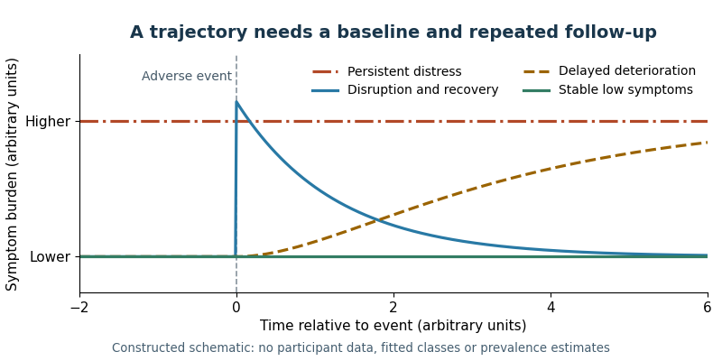

<h1 id="1/solution">Solution</h1>

↑ **Parent:** [1](../1.md)

**[Psychological resilience](../../../psychological-resilience.md) is best defined as successful adaptation in the context of significant [adversity](../../../adversity.md), specified by outcome, developmental context and time.** It is inferred from an [adversity](../../../adversity.md)–adaptation relationship, not established merely by a high [personality](../../../personality.md) score or the absence of a diagnosis at one assessment. The definition needs both credible [exposure](../../../exposure.md) and an explicit criterion of adaptation: an unexposed person with good [mental health](../../../mental-health.md) has not thereby demonstrated resistance to that particular challenge.

[Suniya S. Luthar](../../../suniya-s-luthar.md) and colleagues emphasized this dual requirement and the danger of treating success in one domain as success in all domains. A young person might maintain academic performance while experiencing substantial [depression](../../../depression.md), or recover emotionally while material circumstances remain difficult. An investigation should therefore state whether it concerns symptoms, social relationships, school functioning or several outcomes. It should not define [psychological resilience](../../../psychological-resilience.md) as every desirable attribute simultaneously, because that makes meaningful measurement and explanation nearly impossible.[2000, definition, multidimensionality and operational criteria](../../../the-construct-of-resilience-by-suniya-s-luthar-and-others.md)

Time is equally important. Stable low disturbance, initial disturbance followed by [recovery after adversity](../../../recovery-after-adversity.md), chronic difficulty and delayed deterioration are different trajectories. A single post-event score can confuse them, especially without a pre-event baseline. [George A. Bonanno](../../../george-a-bonanno.md) and colleagues assessed 205 people before spousal bereavement and again at six and eighteen months afterward. They identified several patterns, including relatively stable adaptation, chronic difficulties and improvement from pre-existing [depression](../../../depression.md). The prospective baseline made distinctions possible that a retrospective “how well did you cope?” question could not establish.[2002, preloss assessment, follow-up and five observed patterns](../../../resilience-to-loss-and-chronic-grief-by-george-a-bonanno-and-others.md)

**[Figure 1](#1/image-different-histories-of-adaptation-can-share-the-same-score-at-one-follow-up). Different histories of adaptation can share the same score at one follow-up**. Original schematic trajectories around an adverse event. Curves are constructed illustrations, not fitted classes or data from the cited bereavement study. They distinguish stable low symptoms, recovery, persistent distress and delayed deterioration without asserting universal population proportions.

Trajectory methods need their own scrutiny. A [growth mixture model](../../../growth-mixture-model.md) can describe heterogeneous longitudinal patterns, but the number and size of classes depend on assumptions about within-class variation and error. [Frank J. Infurna](../../../frank-j-infurna.md) and colleagues reanalyzed responses to bereavement, divorce and unemployment. Relaxing restrictions on class [variances](../../../variance-split.md) and within-class change substantially altered the apparent prevalence of a resilient class. This demonstrates model dependence, not that every earlier low-distress trajectory was fictitious. Researchers should compare plausible models, report uncertainty in class assignment and avoid treating a convenient latent class as a naturally discrete kind of person.[2016, reanalysis and alternative growth-mixture specifications](../../../resilience-to-major-life-stressors-is-not-as-common-as-thought-by-frank-j-infurna-and-suniya-s-luthar.md)

[Exposure](../../../exposure.md) measurement must characterize what happened, its severity, duration, developmental timing and relevant context. Counting heterogeneous events as equivalent can conceal very different experiences. Subjective appraisal matters, but using the same distressed respondent to report both [adversity](../../../adversity.md) and symptoms can create [common method variance](../../../common-method-variance.md). Independent records, contextual interviews and repeated assessments improve inference, while still potentially missing chronic insecurity or unrecorded events. [Exposure](../../../exposure.md) groups also need comparable follow-up opportunities: selective loss of the most impaired participants can make adaptation appear better than it was.

Adaptation should be measured with reliable, culturally appropriate instruments and, where feasible, several informants. Absence of disorder and positive functioning are related but distinct outcomes. Cutoffs need justification and [sensitivity analysis](../../../sensitivity-analysis.md); moving a threshold should not silently redefine a large group as resilient. [Measurement invariance](../../../measurement-invariance.md) matters when comparing ages, languages or social groups. Biological measures of [psychological stress](../../../psychological-stress.md) may clarify a mechanism, but a low [cortisol](../../../cortisol.md) response alone is not a complete assessment of psychological functioning or evidence of a universally optimal response.

[Self-report](../../../self-report.md) capacity measures have a useful but narrower role. The original [Connor-Davidson Resilience Scale](../../../connor-davidson-resilience-scale.md), developed by [Kathryn M. Connor](../../../kathryn-m-connor.md) and [Jonathan R. T. Davidson](../../../jonathan-r-t-davidson.md), contains 25 items rating perceived [coping](../../../coping.md)-related qualities. Its original validation examined community and clinical samples and sensitivity to treatment-associated change. These findings support a measurable self-reported construct; they do not prove that the scale independently identifies successful adaptation to a documented [adversity](../../../adversity.md). Concurrent symptoms can influence perceived competence, so prospective prediction beyond baseline distress is a stronger test than a concurrent [correlation](../../../pearson-correlation-coefficient.md).[2003, original 25-item scale, validation samples and treatment-associated change](../../../development-of-a-new-resilience-scale-by-kathryn-m-connor-and-jonathan-r-t-davidson.md)

Another approach measures better-than-expected outcomes conditional on [exposure](../../../exposure.md). With distress $D_i$ and [adversity](../../../adversity.md) $S_i$, one possible score is $R_i=\widehat m(S_i)-D_i$, where $\widehat m$ predicts distress. Higher $R_i$ then means less distress than the selected model predicts. [Ananda B. Amstadter](../../../ananda-b-amstadter.md) and colleagues used a [regression residual](../../../regression-residual.md)-based approach in longitudinal twin research. Its advantage is explicit conditioning on [exposure](../../../exposure.md); its limitations are dependence on the reference sample, [exposure](../../../exposure.md) measurement and prediction model. An in-sample [regression residual](../../../regression-residual.md) is not a new independent biological capacity.[2014, exposure-conditioned symptom residual phenotype](../../../psychiatric-resilience-longitudinal-twin-study-by-ananda-b-amstadter-and-others.md)

The best design combines prospective [adversity](../../../adversity.md) measurement, pre-event functioning and repeated, multidomain outcomes, with an operational definition registered before outcome selection. Capacity scales, trajectories and [regression residual](../../../regression-residual.md) scores can answer complementary questions if their differences are preserved. **[Psychological resilience](../../../psychological-resilience.md) should be treated as a context-dependent pattern of adaptation that can change, while proposed capacities and protective mechanisms are tested as predictors of that pattern.** Otherwise the explanation becomes circular: calling someone resilient because they did well cannot itself explain why they did well.

## ↑ Ancestors (11)

1. [1](../1.md)
2. [2022](../../2022-split.md)
3. [Past exam of the psychological disorders: risk and resilience course of the University of Oxford](../../split.md)
4. [Psychological disorders: risk and resilience course of the University of Oxford](../../../psychological-disorders-risk-and-resilience-course-of-the-university-of-oxford.md)
5. [Year 3 of the psychology (experimental) course of the University of Oxford](../../../year-3-of-the-psychology-experimental-course-of-the-university-of-oxford.md)
6. [Psychology (experimental) course of the University of Oxford](../../../psychology-experimental-course-of-the-university-of-oxford.md)
7. [Undergraduate course of the University of Oxford](../../../undergraduate-course-of-the-university-of-oxford.md)
8. [Course of the University of Oxford](../../../course-of-the-university-of-oxford.md)
9. [University of Oxford](../../../university-of-oxford-split.md)
10. [List of universities](../../../list-of-universities.md)
11. [Codex Wiki](../../../split.md)
