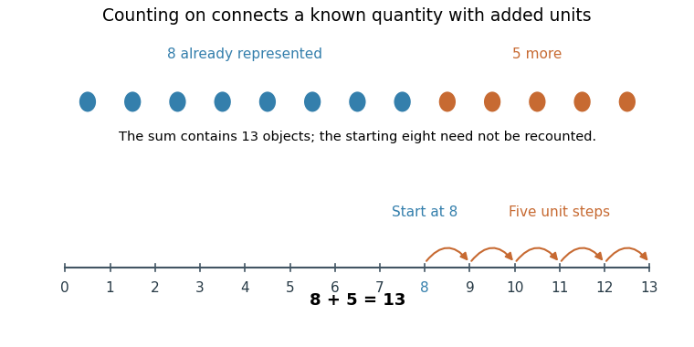
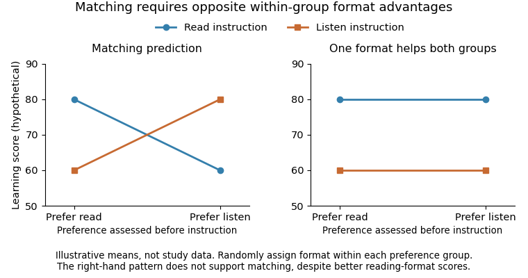

# 2022

↑ **Parent:** [Past exam of the psychology and primary education course of the University of Oxford](../past-exam-of-the-psychology-and-primary-education-course-of-the-university-of-oxford.md)

Source release: [Oxford-released bundle, member a15915w1.pdf](https://www.whatdotheyknow.com/request/experimental_psychology_past_exa/response/2757831/attach/3/New%20Compressed%20zipped%20Folder.zip?cookie_passthrough=1).

The cover requires three answers and gives a limit of 1,800 words without explicitly stating whether it applies per answer or per submission. All six options are developed here as separate study essays, each below 1,800 words; their aggregate is not presented as a three-answer submission. Scientific evidence is restricted to work available by 27 May 2022.

**Table of contents**

- [1](#1)
  - [Solution](#1/solution)
- [2](#2)
  - [Solution](#2/solution)
- [3](#3)
  - [Solution](#3/solution)
- [4](#4)
  - [Solution](#4/solution)
- [5](#5)
  - [Solution](#5/solution)
- [6](#6)
  - [Solution](#6/solution)

## 1

↑ **Parent:** [2022](2022.md)

<h3 id="1/solution">Solution</h3>

↑ **Parent:** [1](#1)

**[Arithmetic](../arithmetic.md) develops through [learning](../animal-behaviour.md#learning) what [number](../arithmetic.md#number) words and symbols mean, coordinating [counting](../psychology.md#counting) with quantities, and selecting increasingly useful strategies. Teaching should connect these components and diagnose how a child obtained an answer, rather than treating fluent recitation or speed as sufficient evidence of understanding.** Early abilities to notice quantity are relevant resources, but they do not by themselves supply exact symbolic [arithmetic](../arithmetic.md). The educational question concerns how children connect representations and procedures across tasks.

[Counting](../psychology.md#counting) requires more than producing a familiar sequence. The child must coordinate one [number](../arithmetic.md#number) word with each object, preserve a stable word order and use the final count to answer how many objects there are. The [cardinality principle](../psychology.md#cardinality-principle) links the [counting](../psychology.md#counting) procedure to the [cardinality](../cardinal-number.md#cardinality) of the [set](../set.md). A child may recite farther than the quantities they can reliably produce on request. Comparing recitation, [counting](../psychology.md#counting) a displayed collection and giving a requested [number](../arithmetic.md#number) of objects therefore reveals different aspects of knowledge rather than redundant measures of one skill.

[Karen Wynn](../psychologist.md#karen-wynn)'s [longitudinal study](../causal-inference.md#longitudinal-study) followed two- and three-year-olds as they learned [number](../arithmetic.md#number)-word meanings and the [counting](../psychology.md#counting) system. Children could recognize that [number](../arithmetic.md#number) words referred to distinct quantities before knowing the exact quantity associated with each word. Their acquisition was gradual, with a substantial interval between early word-specific knowledge and understanding how [counting](../psychology.md#counting) represents quantity. A request to give a [number](../arithmetic.md#number) of objects is particularly informative because repeating the word sequence alone cannot satisfy it. The result argues against assuming that a correct count routine establishes a complete [number](../arithmetic.md#number) concept.[1992; longitudinal number-word and requested-set tasks](../psychology-bibliography.md#children-s-acquisition-of-the-number-words-and-the-counting-system-by-karen-wynn)

This transition also explains why a single performance should not be overinterpreted. A child can misunderstand instructions, lose track of touched objects or know a quantity in one context without transferring the word to another. Assessment should vary the arrangement and objects while keeping the numerical question comparable. Success with a small collection need not show that the child understands arbitrary larger counts; failure on a lengthy verbal instruction need not show absence of every numerical insight. [Number-word knower levels](../psychology.md#number-word-knower-level) are useful descriptions of task performance, not fixed identities or universal timetable requirements.

[Arithmetic](../arithmetic.md) then creates opportunities to coordinate these meanings. For $8+5$, a [count-all strategy](../psychology.md#count-all-strategy) can represent both collections and count the combined objects. A [counting-on strategy](../psychology.md#counting-on-strategy) starts from the known eight and counts five further steps. A child can also use decomposition, $8+5=8+2+3=10+3=13$, drawing on a relation to ten. These are different routes to **13**, with different demands on [attention](../psychology.md#attention), [working memory](../neuroscience.md#working-memory) and available facts. They should not be inferred solely from a correct answer or a fast response.

**[Figure 1](#1/image-an-original-worked-example-of-counting-on-five-steps-from-a-known-eight-give-thirteen). An original worked example of counting on: five steps from a known eight give thirteen**.

[Counting](../psychology.md#counting) on from the larger addend reduces the [number](../arithmetic.md#number) of required increments. For nonnegative [natural numbers](../arithmetic.md#natural-number) $a$ and $b$, [commutativity](../algebraic-operation.md#commutativity) permits starting from $\max(a,b)$ and making $\min(a,b)$ unit steps. This reduces [counting](../psychology.md#counting) effort without changing the sum. Understanding that relation is different from memorizing a rule to start with the larger written digit. When children explain or model why the shortcut works, the teacher can check whether it reflects a relation between quantities or only a rehearsed instruction.

Strategy development is not well described as every child abandoning one method on the same date. Children can use several procedures depending on [number](../arithmetic.md#number) size, familiarity and confidence. [Robert S. Siegler](../psychologist.md#robert-s-siegler) and colleagues used a [microgenetic method](../psychology.md#microgenetic-method) to study second-graders discovering an [arithmetic](../arithmetic.md) shortcut, with trial-by-trial response times and explicit reports. Evidence of the shortcut often appeared in performance before children could report it. The study shows why explanations and performance measures should be combined: failure to verbalize a strategy does not necessarily mean that no useful change has occurred.[1998; implicit performance and explicit-report measures of shortcut discovery](../psychology-bibliography.md#conscious-and-unconscious-strategy-discoveries-a-microgenetic-analysis-by-robert-s-siegler-and-others)

Increasing fluency can reduce the resources needed for familiar calculations, but rote speed and [conceptual knowledge](../neuroscience.md#conceptual-knowledge) are not opposing educational goals. Reliable facts can support reasoning with less familiar [numbers](../arithmetic.md#number); understanding a relation can make facts easier to derive and check. Conversely, rapid retrieval of a wrong fact is not progress. Error patterns, use of inverses and flexible decomposition provide stronger evidence about developing [arithmetic](../arithmetic.md) than a single timed total. Practice should therefore be evaluated through accuracy, efficiency, flexibility and retention, with task demands made explicit.

The teaching implications are specific. [Counting](../psychology.md#counting) activities should connect spoken [numbers](../arithmetic.md#number), objects and written numerals. Materials are useful when children understand what each object or movement represents, rather than merely manipulating attractive objects. Teachers can compare different correct solutions, ask children to predict how an answer changes when an addend changes, and connect a verbal story to its symbolic form. The relevant support depends on the child's current knowledge: supplying a more elaborate verbal explanation may burden someone who still needs to coordinate the count.

[Thomas P. Carpenter](../README.md#thomas-p-carpenter) and colleagues tested whether research knowledge about children's mathematical thinking could improve classroom instruction. Twenty first-grade teachers received a workshop and twenty were randomly assigned to a control condition. The workshop did not prescribe one script; intervention teachers paid more [attention](../psychology.md#attention) to children's problem-solving processes, and their pupils showed stronger outcomes on several mathematical measures. This is evidence that teacher understanding can matter beyond distributing a new worksheet. It does not identify one isolated workshop component as the unique cause or show that unguided discovery is always superior.[1989; teacher randomization, instructional changes and pupil outcomes](../psychology-bibliography.md#using-knowledge-of-children-s-mathematics-thinking-in-classroom-teaching-an-experimental-study-by-thomas-p-carpenter-and-others)

Language, opportunities to participate, familiarity with symbols and classroom instruction all affect the observations used to judge [arithmetic](../arithmetic.md). A child [learning](../animal-behaviour.md#learning) the language of instruction may need a way to show a quantity without a lengthy explanation. Apparent success on a memorized format may fail on an unfamiliar representation. [Formative assessment](../psychology.md#formative-assessment) should therefore sample multiple tasks and use errors to select the next instructional step, while retaining ambitious goals rather than fixing a child permanently at an inferred ability level.

**The strongest implication is to teach and assess connections: [number](../arithmetic.md#number) words to quantities, [counting](../psychology.md#counting) to [cardinality](../cardinal-number.md#cardinality), procedures to relations, and practiced facts to flexible calculation.** Developmental research identifies informative distinctions and plausible mechanisms; classroom experiments test whether using that knowledge improves [learning](../animal-behaviour.md#learning). Neither a universal maturation schedule nor one preferred teaching method follows from the evidence.

## 2

↑ **Parent:** [2022](2022.md)

<h3 id="2/solution">Solution</h3>

↑ **Parent:** [2](#2)

**Psychological research can improve mathematical intervention by identifying a child's component difficulties, translating a proposed mechanism into teachable activities and testing whether gains transfer to meaningful mathematics. Low attainment is an outcome to explain, not proof of one defective “[number sense](../psychology.md#number-sense)” system.** A useful intervention must also specify its comparison condition, dose, intended learners and success criteria. The same program need not suit children whose errors have different origins.

Assessment can separate [counting](../psychology.md#counting), [number](../arithmetic.md#number)-word and numeral knowledge, [symbolic magnitude comparison](../psychology.md#symbolic-magnitude-comparison), [number-line estimation](../psychology.md#number-line-estimation), fact retrieval, calculation procedures and understanding of word problems. Language and [working memory](../neuroscience.md#working-memory) can affect these tasks, as can prior instruction and opportunity to practice. A broad low score may therefore conceal a relatively specific bottleneck. [Developmental dyscalculia](../psychology.md#developmental-dyscalculia) describes persistent mathematical [learning](../animal-behaviour.md#learning) difficulty in an appropriate assessment context; it should not be inferred from one poor session or used to assume that every affected child has the same cognitive profile.

[Ann Dowker](../psychologist.md#ann-dowker)'s [Numeracy](../psychology.md#numeracy) Recovery work illustrates a component-oriented approach: examine the child's performance in different arithmetical activities and provide targeted support rather than prescribing identical exercises from an overall score. Its early pilot status is important. Improvement after a program is compatible with benefit, but without a strong counterfactual it can also reflect ordinary teaching, repeated testing or [regression toward the mean](../probability-and-statistics.md#regression-toward-the-mean). The psychological formulation supplies a rationale that subsequently requires controlled evaluation; it is not itself an effect estimate.[2001; component assessment and targeted intervention in the pilot scheme](../psychology-bibliography.md#numeracy-recovery-a-pilot-scheme-for-early-intervention-with-young-children-with-numeracy-difficulties-by-ann-dowker)

For a child who can recite [numbers](../arithmetic.md#number) but cannot connect them to quantities, an intervention can make the relationship between [number](../arithmetic.md#number) words, numerals and ordered quantities explicit. [Geetha B. Ramani](../psychologist.md#geetha-b-ramani) and colleagues tested a linear [number](../arithmetic.md#number) board game against an otherwise similar color board game with low-income preschoolers. Roughly an hour of play improved several numerical outcomes, including magnitude comparison, [counting](../psychology.md#counting), numeral identification and [number-line estimation](../psychology.md#number-line-estimation); gains were retained at a nine-week follow-up. The matched game comparison helps separate numerical content from merely receiving [attention](../psychology.md#attention) or playing with an adult.[2008; numerical versus color board, four outcomes and retention](../psychology-bibliography.md#promoting-broad-and-stable-improvements-in-low-income-children-s-numerical-knowledge-through-playing-number-board-games-by-geetha-b-ramani-and-others)

The result supports a mechanism-informed activity, but its scope needs care. Low-income preschoolers are not equivalent to children diagnosed with [developmental dyscalculia](../psychology.md#developmental-dyscalculia). A [number](../arithmetic.md#number)-board game combines several cues—[counting](../psychology.md#counting) words, movement, spatial order and numerals—so improvement does not uniquely identify which cue was necessary. Transfer to the assessed numerical tasks is informative without proving a lasting effect on every school [arithmetic](../arithmetic.md) outcome. An extension should test classroom implementation and broader [learning](../animal-behaviour.md#learning) rather than equating a promising short intervention with complete remediation.

Practice can then be selected according to a learner's developing strategies. [Lynn S. Fuchs](../README.md#lynn-s-fuchs) and colleagues randomized at-risk first-graders to tutoring with speeded practice, tutoring with nonspeeded practice or no tutoring. Both tutoring conditions shared a substantial [number](../arithmetic.md#number)-knowledge component and differed in the final five minutes of each session. Sixteen weeks of tutoring improved mathematical outcomes, while the practice contrast provided additional evidence about efficient [counting](../psychology.md#counting) and [arithmetic](../arithmetic.md) [learning](../animal-behaviour.md#learning). Because most instruction was shared, the comparison does not test timed practice as a stand-alone replacement for teaching concepts.[2013; shared number-knowledge tutoring and randomized practice contrast](../psychology-bibliography.md#effects-of-first-grade-number-knowledge-tutoring-with-contrasting-forms-of-practice-by-lynn-s-fuchs-and-others)

This design is useful because it distinguishes package benefit from a narrower component question. A teacher observing that children improve after frequent [arithmetic](../arithmetic.md) practice cannot tell whether time, feedback, explanation or practice format produced the gain. Randomizing a well-defined component within otherwise similar sessions provides a more interpretable answer. Yet a component can have different effects at different levels of prior knowledge. Testing those [interactions](../statistical-model.md#interaction-statistics) requires prespecified measures and sufficient [statistical power](../probability-and-statistics.md#statistical-power), not selecting a subgroup only after the average result is disappointing.

Computer delivery can adapt task difficulty and record detailed responses, but an adaptive interface is not evidence of efficacy. [Pekka Räsänen](../psychology.md#pekka-rasanen) and colleagues randomized children with low [numeracy](../psychology.md#numeracy) between two computer games emphasizing different numerical representations. The study found improvements in [number](../arithmetic.md#number) comparison, with more limited [generalization](../statistical-learning.md#generalization-in-statistical-learning) to other skills. It therefore supports asking which representation is trained and which outcome changes, rather than treating all improvement as a rise in general mathematical ability. The modest study and comparison structure also limit a universal ranking of software.[2009; randomized game comparison and outcome-specific transfer](../psychology-bibliography.md#computer-assisted-intervention-for-children-with-low-numeracy-skills-by-pekka-rasanen-and-others)

A common alternative is to train a domain-general capacity thought to constrain mathematics. The crucial distinction is between association and intervention: [working memory](../neuroscience.md#working-memory) can predict performance without working-memory practice becoming an effective [arithmetic](../arithmetic.md) treatment. [Darren L. Dunning](../psychologist.md#darren-l-dunning) and colleagues randomized children with low [working memory](../neuroscience.md#working-memory) to adaptive training, low-level practice or a comparison condition. Improvements in related memory performance did not establish a corresponding generalized academic benefit. The study illustrates why [near transfer](../animal-behaviour.md#near-transfer) should not be presented as demonstrated [far transfer](../animal-behaviour.md#far-transfer) to mathematics.[2013; randomized training comparison and limits of academic generalization](../psychology-bibliography.md#does-working-memory-training-lead-to-generalized-improvements-in-children-with-low-working-memory-by-darren-l-dunning-and-others)

Intervention evaluation should include untaught examples, delayed tests and classroom-relevant performance. A program that only improves practiced items may still have value, but its claim is narrower than improving flexible calculation or word-problem understanding. Blinded assessors, comparable adult contact, monitoring of attendance and suitable analysis of class or school clustering strengthen inference. A no-treatment comparison estimates the package effect relative to ordinary opportunities; an active comparison is needed for stronger claims about distinctive instructional ingredients.

Researchers should also ask why an intervention fails. A child may not understand the [vocabulary](../README.md#vocabulary), may be overloaded by instructions or may have had too little opportunity to participate. Mathematical [anxiety](../psychology.md#anxiety) can affect engagement, but it should not become an unfalsifiable explanation for every weak response. Fidelity and acceptability matter alongside cognitive mechanism: an effective activity in a closely supported laboratory may be difficult to deliver in an ordinary classroom. Those constraints are part of the educational intervention, not distractions from its psychological theory.

The practical model is a cycle of assessment, targeted teaching and reassessment. Performance can determine the next task, while repeated review prevents a provisional description from becoming a permanent ceiling. A strong design measures proposed processes before outcomes, then tests whether the intervention changed the intended process and whether that change predicts relevant [learning](../animal-behaviour.md#learning). [Statistical mediation](../statistical-modelling.md#statistical-mediation) alone remains weaker than a selective manipulation of the mechanism, especially when motivation and extra teaching change together.

**The contribution of psychology is not one universal cure but a disciplined way to match an instructional problem to a testable account of [learning](../animal-behaviour.md#learning).** Targeted [number](../arithmetic.md#number) teaching has encouraging experimental support; the evidence also warns against mistaking commercial sophistication, trained-task improvement or a correlational cognitive predictor for demonstrated mathematical benefit. Evaluation should remain tied to the particular child population, content and transferable outcome claimed.

## 3

↑ **Parent:** [2022](2022.md)

<h3 id="3/solution">Solution</h3>

↑ **Parent:** [3](#3)

**Separating pupils by attainment is not, by itself, a reliable solution to [individual differences](../psychology.md#individual-differences). Benefits depend on whether the arrangement changes the instruction pupils receive, while costs can arise from restricted opportunities, inaccurate placement and persistent labels.** Evidence distinguishes whole-curriculum separation from subject-specific and flexible grouping; it does not justify treating all forms as one intervention. Current achievement should also not be mistaken for a fixed measure of [learning](../animal-behaviour.md#learning) potential.

[Streaming by attainment](../README.md#streaming-by-attainment) assigns a pupil to a group across much of the curriculum. [Subject setting](../README.md#subject-setting) regroups pupils for a particular subject, allowing different placements in, for example, [reading](../psychology.md#reading) and mathematics. [Within-class grouping](../README.md#within-class-grouping) creates smaller instructional groups inside a shared classroom and can be revised by task. These arrangements differ in exposure to peers, teachers, curriculum and opportunities to move. A finding about flexible mathematics groups therefore cannot automatically defend an enduring all-subject stream.

The favorable hypothesis is instructional fit. A narrower range of prior knowledge may let a teacher select examples, pace and support more accurately, while advanced pupils avoid unnecessary repetition. But the group label must actually change the lesson in a useful way. Separating pupils and then delivering the same unsuitable instruction supplies little reason to expect benefit. Nor does an appropriate lesson logically require fixed separation: [formative assessment](../psychology.md#formative-assessment) and flexible task allocation can address differences within a mixed classroom.

[Robert E. Slavin](../README.md#robert-e-slavin)'s best-evidence synthesis distinguished assignment to self-contained ability classes, which lacked a general achievement advantage, from some subject regrouping and within-class mathematics arrangements with more favorable results. Its conditions emphasized reassessment and adapting the level and pace of teaching. The historical importance is the distinction between organization and instruction, not a timeless verdict that any arrangement called “grouping” works. A synthesis also inherits variation in the quality of its constituent comparisons.[1987; separate conclusions on self-contained classes, subject regrouping and within-class instruction](../psychology-bibliography.md#ability-grouping-and-student-achievement-in-elementary-schools-a-best-evidence-synthesis-by-robert-e-slavin)

[Saiying Steenbergen-Hu](../README.md#saiying-steenbergen-hu) and colleagues' later second-order [meta-analysis](../statistical-inference.md#meta-analysis) likewise separated forms of grouping. Across thirteen meta-analyses, between-class grouping showed little overall achievement benefit, while [within-class grouping](../README.md#within-class-grouping), cross-grade subject grouping and specialized arrangements had more positive average results. Acceleration was analyzed separately and should not be collapsed into ordinary attainment sorting. The evidence spans school ages and implementations, so its averages are not estimates of one particular primary-school policy. Reviews that share primary studies are also not independent replications to be counted as separate votes.[2016; grouping categories, second-order synthesis and separate acceleration analyses](../psychology-bibliography.md#what-one-hundred-years-of-research-says-about-the-effects-of-ability-grouping-and-acceleration-on-k-12-students-academic-achievement-findings-of-two-second-order-meta-analyses-by-saiying-steenbergen-hu-and-others)

These conclusions do not establish that tracking must harm low-attaining pupils in every setting. [Esther Duflo](../README.md#esther-duflo) and colleagues conducted a randomized tracking experiment in 121 Kenyan primary schools. In that context, tracking benefited lower-achieving pupils through better instructional targeting, despite the potential advantages of exposure to higher-achieving peers. The experiment provides a causal counterexample to a universal claim that mixed-attainment classes are always best. Its teacher incentives, curriculum and wider school conditions also limit transfer to a different [education](../README.md#education) system.[2011; randomized primary-school tracking experiment and instructional-level mechanism](../psychology-bibliography.md#peer-effects-teacher-incentives-and-the-impact-of-tracking-evidence-from-a-randomized-evaluation-in-kenya-by-esther-duflo-and-others)

The Kenyan result helps distinguish two effects often conflated in discussion. [Peer effects](../psychology.md#peer-effect) concern how classmates' skills or behavior influence [learning](../animal-behaviour.md#learning); instructional targeting concerns what a teacher teaches to whom. They can act in opposite directions. A lower-attaining group might lose some peer opportunities yet gain a lesson that it can use. A different system could concentrate less experienced teachers or narrow tasks in the same group, producing a different outcome. The causal question is therefore the effect of the whole implemented arrangement, not a social label in isolation.

Placement creates further challenges. An assessment contains [measurement error](../probability-and-statistics.md#measurement-error) and reflects prior opportunity, language and familiarity with the task. Selecting pupils at one time point can therefore turn temporary performance differences into apparently stable categories. Even frequent movement on paper is insufficient if movement rarely occurs in practice. Researchers need placement histories and the material actually taught, not only the school's description of its policy. Comparing final scores of high and low groups is especially uninformative because initial attainment helped define those groups.

[Teacher expectations](../psychology.md#teacher-expectation) and children's interpretations of their placement are plausible additional pathways. A label can affect the challenge offered or the opportunities to demonstrate improvement; a child may interpret it as a statement of fixed worth. These are hypotheses requiring direct measurement rather than automatic explanations for every group difference. Self-concept, participation and belonging matter even when an average test score is unchanged. Conversely, a pupil may value appropriately demanding peers and tasks, so increased challenge should not be equated with social harm merely because it involves grouping.

A useful evaluation would randomize schools or classes to well-specified arrangements, measure baseline attainment before allocation and monitor curriculum, staffing and movement. It should retain an intention-to-treat comparison rather than excluding pupils whose placements changed. Multilevel analysis or appropriate uncertainty estimates are required when pupils share teachers or classrooms. Prespecified subgroup analyses can ask whether effects differ by starting attainment, while distributional outcomes show whether an average gain masks widening gaps. Longer follow-up is important because early curricular restriction may have consequences beyond an immediate assessment.

The relevant comparison should be equally credible. A well-resourced setting program compared with an under-supported mixed class does not identify separation alone as the active ingredient. Equally, a mixed class receiving no help to differentiate instruction is not a decisive test of responsive mixed teaching. Comparing arrangements under explicit resource and implementation conditions makes the evidence more useful for practice. It also permits testing whether flexibility and good assessment capture the benefit without committing pupils to permanent categories.

For [primary education](../README.md#primary-education), where performance profiles and opportunities can change quickly, the most defensible principle is responsiveness. Grouping may serve a specific instructional purpose when it is revisable and tied to what the pupil needs to learn next. Its effects should be monitored rather than justified by a presumed innate hierarchy. Maintaining ambitious curriculum access and checking actual movement are safeguards whose value should be assessed alongside attainment, not assumed to follow from a policy name.

**The research supports evaluating instructional fit, opportunity and flexibility rather than endorsing streaming or setting as default answers to [individual differences](../psychology.md#individual-differences).** Broad between-class sorting has weak average support, while particular subject and within-class arrangements can help under specified conditions. A successful contextual experiment does not universalize the policy, and an overall null average does not make the content and quality of teaching irrelevant.

## 4

↑ **Parent:** [2022](2022.md)

<h3 id="4/solution">Solution</h3>

↑ **Parent:** [4](#4)

**Language matters substantially for [reading](../psychology.md#reading), but spoken-language competence, properties of the writing system and the conditions of instruction must be distinguished. Different orthographies change the difficulty and useful grain of decoding, while oral language remains crucial for constructing meaning.** Cross-language differences therefore do not imply that children have fundamentally different [reading](../psychology.md#reading) minds or that speaking one language sets a fixed ceiling on literacy.

[Reading](../psychology.md#reading) performance is not a single outcome. [Word decoding](../psychology.md#word-decoding) can be accurate but slow; fluent pronunciation can occur without good [reading comprehension](../psychology.md#reading-comprehension). Alphabetic writing connects [graphemes](../README.md#grapheme) with [phonemes](../README.md#phoneme), but those correspondences differ in consistency and complexity. Spoken [vocabulary](../README.md#vocabulary) and sentence understanding contribute to interpreting a text after its words have been identified. The language a child speaks at home is also distinct from the language being learned at school and from the script used to write either language. These distinctions determine what a study can show.

[Philip H. K. Seymour](../psychologist.md#philip-h-k-seymour) and colleagues compared early literacy acquisition across European orthographies, using word and nonword [reading](../psychology.md#reading). Basic accuracy developed more slowly in deep orthographies, especially English, than in many more consistent systems; syllabic complexity also mattered. The result shows why an English [reading](../psychology.md#reading) milestone should not be assumed to describe every language. However, countries differ in school entry, teaching and exposure, so the study does not randomly isolate spelling consistency from all other features of instruction and language.[2003; early word/nonword acquisition, orthographic depth and syllabic complexity](../psychology-bibliography.md#foundation-literacy-acquisition-in-european-orthographies-by-philip-h-k-seymour-and-others)

The mechanism is plausible without making language an all-or-none determinant. When a [grapheme](../README.md#grapheme) has a relatively reliable pronunciation, a beginning reader can more often apply a small-unit correspondence successfully. An inconsistent mapping makes larger patterns and word-specific information more valuable. This does not mean that an inconsistent [orthography](../README.md#orthography) should be taught by visual memorization alone, or that a consistent one eliminates the need for phonological skills. It predicts differences in how information is combined, as well as in the pace at which basic accuracy reaches ceiling.

Longitudinal comparison can test shared predictors more directly. [Markéta Caravolas](../psychologist.md#marketa-caravolas) and colleagues followed children [learning](../animal-behaviour.md#learning) English, Spanish, Czech and Slovak over ten months. [Phoneme](../README.md#phoneme) awareness, letter knowledge and [rapid automatized naming](../psychology.md#rapid-automatized-naming) predicted later literacy growth in all four languages, whereas verbal memory span was not a reliable unique predictor in the reported models. The study used comparable component measures and modeled prior literacy. Its findings support common proximal skills across orthographies while leaving room for differences in levels and rates of [learning](../animal-behaviour.md#learning). Prediction still does not establish that practicing any one predictor will necessarily cause better [reading](../psychology.md#reading).[2012; longitudinal multigroup models and component-skill predictors](../psychology-bibliography.md#common-patterns-of-prediction-of-literacy-development-in-different-alphabetic-orthographies-by-marketa-caravolas-and-others)

Measurement matters in interpreting such comparisons. A pronunciation-accuracy task can become too easy to reveal meaningful differences in a consistent [orthography](../README.md#orthography), while speed or comprehension continues to vary. A rapid naming task measures a coordinated performance, not one isolated neural process. Similarly, a nonword is only comparable across languages if its phonological and orthographic demands are appropriate. Equivalent labels on tests do not establish [measurement invariance](../psychology.md#measurement-invariance). Claims about universal causes need to survive those design problems rather than rely on national mean differences.

Not all writing systems organize the task in the same way. Chinese characters commonly provide information relevant to [morphemes](../README.md#morpheme) and syllables, so an account based only on an English-style [phoneme](../README.md#phoneme) task is incomplete. [Hua Shu](../psychologist.md#hua-shu) and colleagues compared Chinese children with developmental dyslexia and age-matched controls using multiple cognitive measures. [Morphological awareness](../psychology.md#morphological-awareness), naming and [vocabulary](../README.md#vocabulary) were particularly informative, with [morphological awareness](../psychology.md#morphological-awareness) strongly associated with literacy measures. This supports examining linguistic units beyond [phonemes](../README.md#phoneme). The selected dyslexic comparison is not a randomized manipulation of writing system or proof that [phonology](../README.md#phonology) has no role in Chinese [reading](../psychology.md#reading).[2006; fifth/sixth-grade comparison and multiple cognitive constructs](../psychology-bibliography.md#understanding-chinese-developmental-dyslexia-morphological-awareness-as-a-core-cognitive-construct-by-hua-shu-and-others)

Oral-language competence also matters within one [orthography](../README.md#orthography). A child may decode a word yet not know its meaning or be able to integrate its sentence with the rest of a passage. [Vocabulary](../README.md#vocabulary), grammatical interpretation and relevant knowledge contribute to [reading comprehension](../psychology.md#reading-comprehension). A low comprehension score therefore should not automatically trigger more decoding practice when the child's main difficulty concerns language understanding. Conversely, strong spoken understanding does not remove the need to learn how a script represents words.

[Paula J. Clarke](../README.md#paula-j-clarke) and colleagues tested interventions for children whose [reading comprehension](../psychology.md#reading-comprehension) was poor despite relatively adequate word [reading](../psychology.md#reading). They compared text-comprehension, oral-language and combined approaches with a control condition. The trial found benefits from intervention, with particularly informative delayed gains for the oral-language approach and [vocabulary](../README.md#vocabulary)-related change. This provides stronger evidence for a contribution from language-focused teaching than a cross-sectional correlation alone. It does not establish [vocabulary](../README.md#vocabulary) change as the sole causal mediator, because the intervention changed several experiences together.[2010; randomized poor-comprehender interventions and delayed outcomes](../psychology-bibliography.md#ameliorating-children-s-reading-comprehension-difficulties-a-randomized-controlled-trial-by-paula-j-clarke-and-others)

The question about the language children speak therefore requires care with bilingualism and dialect. Limited experience with the language of a particular test can affect performance without demonstrating a general [learning](../animal-behaviour.md#learning) deficit. Dialect differences should not be treated as absence of language, and unfamiliar [vocabulary](../README.md#vocabulary) can obscure a child's understanding of a concept. Studies should measure relevant language experience, exposure to print, educational opportunities and the task language. These considerations identify confounds and assessment needs rather than proving that every bilingual experience produces the same advantage or disadvantage.

Teaching implications are correspondingly differentiated. Explicit links between written and spoken units can be adapted to the writing system while meaningful oral and written language activities develop comprehension. Assessing decoding, fluency and understanding separately helps identify the target. Children [learning](../animal-behaviour.md#learning) a new language of instruction may need opportunities to build [vocabulary](../README.md#vocabulary) and demonstrate understanding without being assigned a fixed low-ability identity. Cross-language evidence is useful for testing which principles generalize, not for copying an entire curriculum while ignoring context.

**The strongest conclusion is substantial linguistic influence with shared [learning](../animal-behaviour.md#learning) resources and modifiable opportunities.** Orthographic properties affect the path to accurate and fluent word [reading](../psychology.md#reading); spoken-language knowledge affects understanding; instruction and exposure shape both. [Reading](../psychology.md#reading) performance cannot be attributed to the name of a language alone, and evidence about one component should not be substituted for evidence about the whole task.

## 5

↑ **Parent:** [2022](2022.md)

<h3 id="5/solution">Solution</h3>

↑ **Parent:** [5](#5)

**Children possess structured expectations about living things, but knowledge of biological words, causal mechanisms and illness risk develops unevenly. Those expectations can shape [pandemic](../biology.md#pandemic) explanations and [emotions](../psychology.md#emotion) without determining one uniform reaction.** Developmental findings are useful for generating predictions about children's interpretations; direct [pandemic](../biology.md#pandemic) data are needed before those predictions are treated as demonstrated responses to [COVID-19](../biology.md#covid-19).

[Intuitive biology](../psychology.md#intuitive-biology) includes expectations about growth, internal properties, needs and the persistence of kinds despite changes in appearance. [Susan A. Gelman](../psychologist.md#susan-a-gelman) and colleagues' experiments showed that children can attend to nonobvious internal properties rather than reasoning only from what an object looks like. This challenges a picture of young children as entirely restricted to surface appearance. It does not establish a complete adult theory of physiology or a correct understanding of every invisible cause. An experiment on familiar animals is also not a direct test of understanding a novel infectious [disease](../biology.md#disease).[1991; internal properties, category judgments and nonobvious biological expectations](../psychology-bibliography.md#insides-and-essences-early-understandings-of-the-non-obvious-by-susan-a-gelman-and-others)

Children's explanations can nevertheless extend beyond adult biological boundaries. [Deborah Kelemen](../psychologist.md#deborah-kelemen) compared preferences for purpose-based and physical explanations of natural properties. Children accepted teleological explanations more broadly than adults, including for nonliving features. The tasks suggest a readiness to interpret nature in terms of what things are for. Their forced alternatives and wording constrain what follows: the result does not show that every child believes all natural events are intentionally designed, or that a child cannot understand a mechanistic explanation when it is made available.[1999; judgments of purpose-based and physical explanations](../psychology-bibliography.md#why-are-rocks-pointy-children-s-preference-for-teleological-explanations-of-the-natural-world-by-deborah-kelemen)

Applied to a [pandemic](../biology.md#pandemic), [teleological reasoning](../psychology.md#teleological-reasoning) could encourage a question about what a [virus](../biology.md#virus) or restriction is “for,” rather than what caused it. A [virus](../biology.md#virus) need not be understood as a tiny agent with human intentions for the child to ask that question. Adults can help distinguish the reason for a public-health decision from the biological cause of an illness. This is an educational implication of the developmental account, not an empirical claim that the laboratory study measured children's [pandemic](../biology.md#pandemic) beliefs.

Knowledge about germs is a particularly important case of facts versus a causal system. [Gregg E. A. Solomon](../psychologist.md#gregg-e-a-solomon) and colleagues presented stories in which similar symptoms arose through different causes and asked about contagion. Across five studies, preschoolers' answers often failed to integrate germs into a consistent biological causal account. Some responses were more compatible with treating particular symptoms as contagious than with tracking the cause. Additional tasks questioned whether children understood germs as distinctively biological agents. Knowing the word “germ” therefore should not be equated with understanding how illness can spread.[1999; matched-symptom stories, cause-based contagion judgments and germ-property studies](../psychology-bibliography.md#on-facts-and-conceptual-systems-young-children-s-integration-of-their-understandings-of-germs-and-contagion-by-gregg-e-a-solomon-and-others)

That distinction yields concrete predictions. A child might overgeneralize danger from any visible sign of illness, fail to understand why someone who appears well can still matter in a [disease](../biology.md#disease) account, or apply a rule correctly without being able to explain it. Conversely, prior discussion, schooling and family experience can support more coherent reasoning. These possibilities require direct assessment rather than inference from age alone. Children can also learn a practical action through trusted instruction before they possess an adult mechanism; practical participation and conceptual completeness are different outcomes.

[Psychological essentialism](../psychology.md#psychological-essentialism) can support expectations of stable kinds, but it can also encourage an overly fixed distinction between “safe people” and “sick people.” [Infection](../biology.md#infection) status and a person's moral worth are not the same property. A useful educational account can explain change and recovery without assigning blame to a person or community. This is a reason to examine the interpretation of biological categories, not to attribute prejudice automatically to every child's causal error. Context and what adults say matter alongside the child's prior concepts.

There is direct evidence that school-age children actively sought to understand the [pandemic](../biology.md#pandemic). [Lucy Bray](../biology.md#lucy-bray) and colleagues surveyed 390 children aged seven to twelve and caregivers in six countries during the first wave. The online survey combined closed and open questions about information, knowledge and needs. Parents were a major information source, with school more prominent in Sweden; adults often filtered information, yet children still reported awareness of serious consequences. The study shows active interpretation and unmet information needs rather than simple ignorance protected by adult silence.[2021; first-wave six-country child/caregiver survey and information-source findings](../psychology-bibliography.md#children-s-health-literacy-relating-to-a-global-pandemic-covid-19-an-international-cross-sectional-study-by-lucy-bray-and-others)

Its method also limits the conclusion. An online volunteer sample is not representative of all children, countries experienced different conditions, and a factual statement in a survey is not a detailed causal model. Older school-age participants should not be treated as interchangeable with preschoolers in the germ studies. Nor does the survey establish that a particular explanation reduced [anxiety](../psychology.md#anxiety) or changed behavior: that would require a comparison or intervention design. Cross-study differences in age, questions and context can explain apparent inconsistencies without requiring that one result be dismissed.

Emotional reactions can be understandable even with accurate biological knowledge. Concern about relatives, changes to routines and loss of ordinary contact are not simply failures to understand germs. Information can also interact with perceived control and the consistency of adults' explanations. An implication is to ask what the child thinks and fears before selecting an explanation. Developmental knowledge should help make a conversation interpretable, not be used to assume that a child is incapable of understanding or ought to be unconcerned.

An educational approach can distinguish agents, causes and protective decisions using accessible explanations, ask children to apply an idea to a new case and correct a misunderstanding without shame. Checking transfer is more informative than asking whether the child can repeat a phrase. Explanations can acknowledge uncertainty and distinguish a possibility from its [probability](../probability-theory.md#probability). This remains a general communication principle; it is not a substitute for appropriate, time-specific health advice, and the examination does not provide data for choosing a clinical or public-health protocol.

A rigorous follow-up would measure prior biological reasoning and language, elicit [pandemic](../biology.md#pandemic) explanations in the child's own words, and separately assess factual knowledge, [emotion](../psychology.md#emotion) and action. An age-appropriate explanatory intervention could then be compared with equally supportive information, using delayed tests and unfamiliar scenarios. Family circumstances and educational access would need measurement. Such a design would test whether changing understanding contributes to a better outcome, rather than assuming that knowledge and reassurance are equivalent.

**The research predicts a mixture of genuine biological insight, incomplete mechanisms and active meaning-making.** It supports listening to children's explanations, differentiating factual labels from causal understanding and testing communication rather than relying on a simple age stereotype. [Pandemic](../biology.md#pandemic) reactions arise within families, schools and changing circumstances as well as within the child's developing concepts.

## 6

↑ **Parent:** [2022](2022.md)

<h3 id="6/solution">Solution</h3>

↑ **Parent:** [6](#6)

**Public understanding of [neuroscience](../neuroscience.md) can be improved, and some [neuromyth](../neuroscience.md#neuromyth) beliefs can be reduced, but better quiz performance does not itself establish better teaching or pupil attainment.** The educational case depends on a chain from understanding to decisions, implementation and [learning](../animal-behaviour.md#learning) outcomes. Each link requires evidence. Brain-related language can inform a sound educational explanation, but its presence is not a substitute for a test of the proposed method.

A [neuromyth](../neuroscience.md#neuromyth) is a misconception presented as following from knowledge about the brain. Examples include rigid learner types inferred from hemispheric labels or the claim that teaching should be matched to a learner's preferred sensory modality. Preferences and [individual differences](../psychology.md#individual-differences) are real phenomena, but a preference for a format does not prove that [learning](../animal-behaviour.md#learning) is better in that format. Nor does a demonstration of neural involvement establish a unique classroom prescription: every [learning](../animal-behaviour.md#learning) activity has biological implementation.

[Sanne Dekker](../README.md#sanne-dekker) and colleagues surveyed teachers about general brain knowledge and common [neuromyth](../neuroscience.md#neuromyth) statements. Myth endorsement was frequent even in a sample interested in [educational neuroscience](../neuroscience.md#educational-neuroscience), and greater general knowledge did not provide a simple guarantee against misconceptions. This is evidence about the co-occurrence of facts and beliefs in that sample, not a randomized test that [neuroscience](../neuroscience.md) [education](../README.md#education) makes teachers worse. Questionnaire wording and recruitment also affect prevalence estimates, so a headline percentage should not be generalized to every teacher.[2012; teacher knowledge and myth-endorsement questionnaire](../psychology-bibliography.md#neuromyths-in-education-prevalence-and-predictors-of-misconceptions-among-teachers-by-sanne-dekker-and-others)

[Kelly Macdonald](../psychology.md#kelly-macdonald) and colleagues compared respondents with different [education](../README.md#education) and [neuroscience](../neuroscience.md) backgrounds. Greater relevant training was associated with lower endorsement, yet misconceptions remained. Because training was not randomly assigned, the study cannot isolate its causal effect from selection, interests and other educational differences. Its value is to show that expertise and misinformation are not all-or-none categories. A useful public program needs more than exposure to additional terminology; it should support evaluating how a claim follows from evidence.[2017; cross-sectional training-background comparisons and persistent misconceptions](../psychology-bibliography.md#dispelling-the-myth-training-in-education-or-neuroscience-decreases-but-does-not-eliminate-beliefs-in-neuromyths-by-kelly-macdonald-and-others)

[Deena Skolnick Weisberg](../psychologist.md#deena-skolnick-weisberg) and colleagues supplied a possible reason for undue credibility. Participants judged explanations that varied in quality and in whether they included [neuroscience](../neuroscience.md) information irrelevant to the logic. Such information increased the apparent satisfaction of some explanations, particularly poor ones, among nonexperts; relevant expertise changed the pattern. This was a text-explanation experiment, not a demonstration that every brain image persuades a teacher or that all biological explanation is misleading. It suggests teaching people to ask whether the extra information actually improves the argument.[2008; explanation-quality and irrelevant-neuroscience manipulations](../psychology-bibliography.md#the-seductive-allure-of-neuroscience-explanations-by-deena-skolnick-weisberg-and-others)

The [learning-style matching hypothesis](../psychology.md#learning-style-matching-hypothesis) makes the evidential requirement especially clear. Classify a preference before instruction, randomly allocate learners within each preference group to formats, and assess both with a fair common outcome. Matching predicts that the preferred format is better within each group. In notation, if $\mu_{p,f}$ is mean [learning](../animal-behaviour.md#learning) for preference $p$ and format $f$, the visual/auditory version requires

$$
\mu_{V,V}-\mu_{V,A}>0,\qquad
\mu_{A,V}-\mu_{A,A}<0.
$$

A main effect in which one format helps everyone is not this pattern. Even a statistical [interaction](../statistical-model.md#interaction-statistics) is insufficient if one format remains better in both groups. Preference reports or satisfaction ratings alone do not test the proposed [learning](../animal-behaviour.md#learning) advantage.

**[Figure 2](#6/image-original-illustrative-patterns-for-testing-learning-style-matching-hypothetical-scores-not-experimental-data). Original illustrative patterns for testing learning-style matching; hypothetical scores, not experimental data**.

[Beth A. Rogowsky](../README.md#beth-a-rogowsky) and colleagues tested preferences, instructional format and comprehension using audio and written materials with college-educated adults. The findings did not support the predicted matching benefit. That is a direct test of a specific [meshing hypothesis](../psychology.md#learning-style-matching-hypothesis), not proof that every individual difference is educationally irrelevant. Its adult sample also limits a claim about every primary-age child. A sensible response is to select representations for the content and [learning](../animal-behaviour.md#learning) goal, then evaluate their effect, rather than assign a permanent type from a preference questionnaire.[2015; preference assessment, audio/e-text instruction and comprehension outcomes](../psychology-bibliography.md#matching-learning-style-to-instructional-method-effects-on-comprehension-by-beth-a-rogowsky-and-others)

Correction experiments provide a more direct answer about reducing myths. [Marta Ferrero](../README.md#marta-ferrero) and colleagues exposed teacher-[education](../README.md#education) students to [refutation texts](../README.md#refutation-text), variants adding origin information, and comparison conditions. Myth endorsement decreased immediately but the benefit was short-lived and intentions to use related educational methods did not show a corresponding improvement. This separates correcting a statement from changing an instructional decision. It also shows why an immediate post-course questionnaire is an incomplete evaluation of a [neuroscience](../neuroscience.md)-literacy program.[2020; refutation conditions, delayed endorsement and intended teaching practices](../psychology-bibliography.md#an-attempt-to-correct-erroneous-ideas-among-teacher-education-students-the-effectiveness-of-refutation-texts-by-marta-ferrero-and-others)

The mechanism of a useful correction should therefore be considered rather than assumed. A [refutation text](../README.md#refutation-text) can state what is wrong and supply a better explanation; repeated application to new examples could help learners use that explanation rather than merely remember the correct answer. Opportunities to compare claims, evaluate controls and identify an unjustified inference are plausible [additions](../arithmetic.md#addition). Their effectiveness still needs testing, including retention and behavior, rather than being declared established because they sound scientifically sophisticated.

Educational benefit is possible through better decisions and reduced opportunity cost. Time and money spent diagnosing unsupported fixed learner types could be redirected to evaluating subject-specific instruction and [formative assessment](../psychology.md#formative-assessment). A [neuroscience](../neuroscience.md) account might also help explain genuine constraints without labeling them as immutable. Yet correcting a belief is not automatically equivalent to changing established classroom routines, and a teacher can use an effective practice while holding an inaccurate account of why it works. Evidence about beliefs should therefore not be used as a complete ranking of teaching quality.

A stronger evaluation would compare a [neuroscience](../neuroscience.md)-literacy program with an equally credible program teaching general research literacy. It would measure immediate knowledge, delayed reasoning about unfamiliar claims, actual instructional choices and relevant pupil outcomes. [Randomization](../causal-inference.md#randomization) and appropriate analysis of class or school clustering would help distinguish the effect from recruitment of unusually motivated teachers. Process measures could ask whether changed reasoning altered decisions, while implementation data show whether those decisions reached pupils. The benefit of a label such as “brain-based” should never be the outcome being optimized.

**Reducing [neuromyths](../neuroscience.md#neuromyth) is achievable to a degree, but durable understanding and positive educational effects must be demonstrated separately.** The most promising aim is not collecting isolated brain facts; it is [learning](../animal-behaviour.md#learning) to connect a claim, its mechanism, a fair test and the outcome that matters. [Neuroscience](../neuroscience.md) can contribute to that process alongside cognitive and [educational psychology](../psychology.md#educational-psychology), with its practical value judged by evidence rather than prestige.

## ↑ Ancestors (9)

1. [Past exam of the psychology and primary education course of the University of Oxford](../past-exam-of-the-psychology-and-primary-education-course-of-the-university-of-oxford.md)
2. [Psychology and primary education course of the University of Oxford](../university-of-oxford.md#psychology-and-primary-education-course-of-the-university-of-oxford)
3. [Year 3 of the psychology (experimental) course of the University of Oxford](../university-of-oxford.md#year-3-of-the-psychology-experimental-course-of-the-university-of-oxford)
4. [Psychology (experimental) course of the University of Oxford](../university-of-oxford.md#psychology-experimental-course-of-the-university-of-oxford)
5. [Undergraduate course of the University of Oxford](../university-of-oxford.md#undergraduate-course-of-the-university-of-oxford)
6. [Course of the University of Oxford](../university-of-oxford.md#course-of-the-university-of-oxford)
7. [University of Oxford](../university-of-oxford.md)
8. [List of universities](../README.md#list-of-universities)
9. [Codex Wiki](../README.md)
