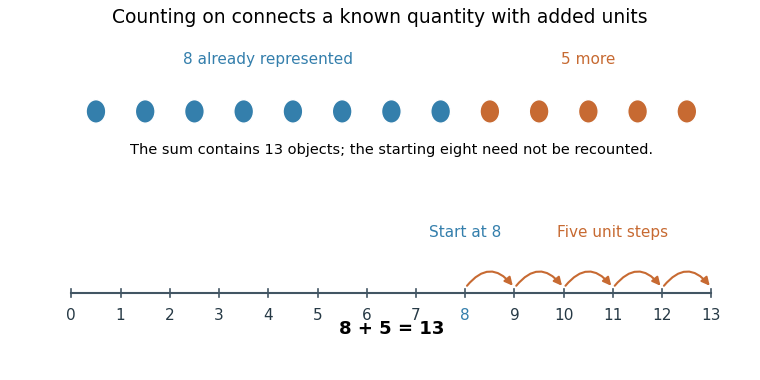

<h1 id="1/solution">Solution</h1>

↑ **Parent:** [1](../1.md)

**[Arithmetic](../../../arithmetic-split.md) develops through [learning](../../../learning.md) what [number](../../../number.md) words and symbols mean, coordinating [counting](../../../counting.md) with quantities, and selecting increasingly useful strategies. Teaching should connect these components and diagnose how a child obtained an answer, rather than treating fluent recitation or speed as sufficient evidence of understanding.** Early abilities to notice quantity are relevant resources, but they do not by themselves supply exact symbolic [arithmetic](../../../arithmetic-split.md). The educational question concerns how children connect representations and procedures across tasks.

[Counting](../../../counting.md) requires more than producing a familiar sequence. The child must coordinate one [number](../../../number.md) word with each object, preserve a stable word order and use the final count to answer how many objects there are. The [cardinality principle](../../../cardinality-principle.md) links the [counting](../../../counting.md) procedure to the [cardinality](../../../cardinality.md) of the [set](../../../set-split.md). A child may recite farther than the quantities they can reliably produce on request. Comparing recitation, [counting](../../../counting.md) a displayed collection and giving a requested [number](../../../number.md) of objects therefore reveals different aspects of knowledge rather than redundant measures of one skill.

[Karen Wynn](../../../karen-wynn.md)'s [longitudinal study](../../../longitudinal-study.md) followed two- and three-year-olds as they learned [number](../../../number.md)-word meanings and the [counting](../../../counting.md) system. Children could recognize that [number](../../../number.md) words referred to distinct quantities before knowing the exact quantity associated with each word. Their acquisition was gradual, with a substantial interval between early word-specific knowledge and understanding how [counting](../../../counting.md) represents quantity. A request to give a [number](../../../number.md) of objects is particularly informative because repeating the word sequence alone cannot satisfy it. The result argues against assuming that a correct count routine establishes a complete [number](../../../number.md) concept.[1992; longitudinal number-word and requested-set tasks](../../../children-s-acquisition-of-the-number-words-and-the-counting-system-by-karen-wynn.md)

This transition also explains why a single performance should not be overinterpreted. A child can misunderstand instructions, lose track of touched objects or know a quantity in one context without transferring the word to another. Assessment should vary the arrangement and objects while keeping the numerical question comparable. Success with a small collection need not show that the child understands arbitrary larger counts; failure on a lengthy verbal instruction need not show absence of every numerical insight. [Number-word knower levels](../../../number-word-knower-level.md) are useful descriptions of task performance, not fixed identities or universal timetable requirements.

[Arithmetic](../../../arithmetic-split.md) then creates opportunities to coordinate these meanings. For $8+5$, a [count-all strategy](../../../count-all-strategy.md) can represent both collections and count the combined objects. A [counting-on strategy](../../../counting-on-strategy.md) starts from the known eight and counts five further steps. A child can also use decomposition, $8+5=8+2+3=10+3=13$, drawing on a relation to ten. These are different routes to **13**, with different demands on [attention](../../../attention.md), [working memory](../../../working-memory.md) and available facts. They should not be inferred solely from a correct answer or a fast response.

**[Figure 1](#1/image-an-original-worked-example-of-counting-on-five-steps-from-a-known-eight-give-thirteen). An original worked example of counting on: five steps from a known eight give thirteen**.

[Counting](../../../counting.md) on from the larger addend reduces the [number](../../../number.md) of required increments. For nonnegative [natural numbers](../../../natural-number.md) $a$ and $b$, [commutativity](../../../commutativity.md) permits starting from $\max(a,b)$ and making $\min(a,b)$ unit steps. This reduces [counting](../../../counting.md) effort without changing the sum. Understanding that relation is different from memorizing a rule to start with the larger written digit. When children explain or model why the shortcut works, the teacher can check whether it reflects a relation between quantities or only a rehearsed instruction.

Strategy development is not well described as every child abandoning one method on the same date. Children can use several procedures depending on [number](../../../number.md) size, familiarity and confidence. [Robert S. Siegler](../../../robert-s-siegler.md) and colleagues used a [microgenetic method](../../../microgenetic-method.md) to study second-graders discovering an [arithmetic](../../../arithmetic-split.md) shortcut, with trial-by-trial response times and explicit reports. Evidence of the shortcut often appeared in performance before children could report it. The study shows why explanations and performance measures should be combined: failure to verbalize a strategy does not necessarily mean that no useful change has occurred.[1998; implicit performance and explicit-report measures of shortcut discovery](../../../conscious-and-unconscious-strategy-discoveries-a-microgenetic-analysis-by-robert-s-siegler-and-others.md)

Increasing fluency can reduce the resources needed for familiar calculations, but rote speed and [conceptual knowledge](../../../conceptual-knowledge.md) are not opposing educational goals. Reliable facts can support reasoning with less familiar [numbers](../../../number.md); understanding a relation can make facts easier to derive and check. Conversely, rapid retrieval of a wrong fact is not progress. Error patterns, use of inverses and flexible decomposition provide stronger evidence about developing [arithmetic](../../../arithmetic-split.md) than a single timed total. Practice should therefore be evaluated through accuracy, efficiency, flexibility and retention, with task demands made explicit.

The teaching implications are specific. [Counting](../../../counting.md) activities should connect spoken [numbers](../../../number.md), objects and written numerals. Materials are useful when children understand what each object or movement represents, rather than merely manipulating attractive objects. Teachers can compare different correct solutions, ask children to predict how an answer changes when an addend changes, and connect a verbal story to its symbolic form. The relevant support depends on the child's current knowledge: supplying a more elaborate verbal explanation may burden someone who still needs to coordinate the count.

[Thomas P. Carpenter](../../../thomas-p-carpenter.md) and colleagues tested whether research knowledge about children's mathematical thinking could improve classroom instruction. Twenty first-grade teachers received a workshop and twenty were randomly assigned to a control condition. The workshop did not prescribe one script; intervention teachers paid more [attention](../../../attention.md) to children's problem-solving processes, and their pupils showed stronger outcomes on several mathematical measures. This is evidence that teacher understanding can matter beyond distributing a new worksheet. It does not identify one isolated workshop component as the unique cause or show that unguided discovery is always superior.[1989; teacher randomization, instructional changes and pupil outcomes](../../../using-knowledge-of-children-s-mathematics-thinking-in-classroom-teaching-an-experimental-study-by-thomas-p-carpenter-and-others.md)

Language, opportunities to participate, familiarity with symbols and classroom instruction all affect the observations used to judge [arithmetic](../../../arithmetic-split.md). A child [learning](../../../learning.md) the language of instruction may need a way to show a quantity without a lengthy explanation. Apparent success on a memorized format may fail on an unfamiliar representation. [Formative assessment](../../../formative-assessment.md) should therefore sample multiple tasks and use errors to select the next instructional step, while retaining ambitious goals rather than fixing a child permanently at an inferred ability level.

**The strongest implication is to teach and assess connections: [number](../../../number.md) words to quantities, [counting](../../../counting.md) to [cardinality](../../../cardinality.md), procedures to relations, and practiced facts to flexible calculation.** Developmental research identifies informative distinctions and plausible mechanisms; classroom experiments test whether using that knowledge improves [learning](../../../learning.md). Neither a universal maturation schedule nor one preferred teaching method follows from the evidence.

## ↑ Ancestors (11)

1. [1](../1.md)
2. [2022](../../2022-split.md)
3. [Past exam of the psychology and primary education course of the University of Oxford](../../split.md)
4. [Psychology and primary education course of the University of Oxford](../../../psychology-and-primary-education-course-of-the-university-of-oxford.md)
5. [Year 3 of the psychology (experimental) course of the University of Oxford](../../../year-3-of-the-psychology-experimental-course-of-the-university-of-oxford.md)
6. [Psychology (experimental) course of the University of Oxford](../../../psychology-experimental-course-of-the-university-of-oxford.md)
7. [Undergraduate course of the University of Oxford](../../../undergraduate-course-of-the-university-of-oxford.md)
8. [Course of the University of Oxford](../../../course-of-the-university-of-oxford.md)
9. [University of Oxford](../../../university-of-oxford-split.md)
10. [List of universities](../../../list-of-universities.md)
11. [Codex Wiki](../../../split.md)
