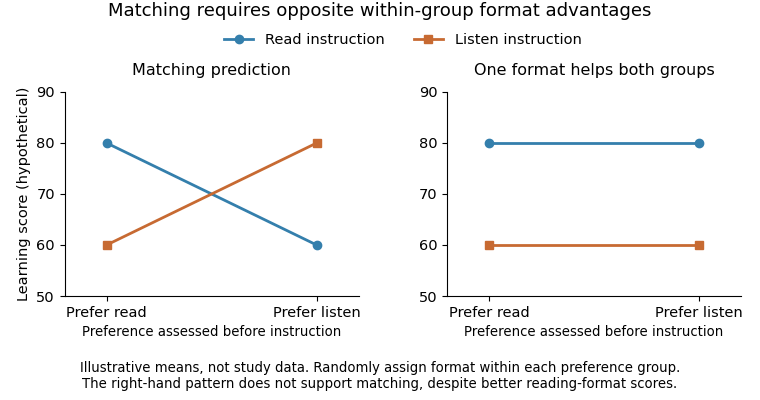

<h1 id="6/solution">Solution</h1>

↑ **Parent:** [6](../6.md)

**Public understanding of [neuroscience](../../../neuroscience-split.md) can be improved, and some [neuromyth](../../../neuromyth.md) beliefs can be reduced, but better quiz performance does not itself establish better teaching or pupil attainment.** The educational case depends on a chain from understanding to decisions, implementation and [learning](../../../learning.md) outcomes. Each link requires evidence. Brain-related language can inform a sound educational explanation, but its presence is not a substitute for a test of the proposed method.

A [neuromyth](../../../neuromyth.md) is a misconception presented as following from knowledge about the brain. Examples include rigid learner types inferred from hemispheric labels or the claim that teaching should be matched to a learner's preferred sensory modality. Preferences and [individual differences](../../../individual-differences.md) are real phenomena, but a preference for a format does not prove that [learning](../../../learning.md) is better in that format. Nor does a demonstration of neural involvement establish a unique classroom prescription: every [learning](../../../learning.md) activity has biological implementation.

[Sanne Dekker](../../../sanne-dekker.md) and colleagues surveyed teachers about general brain knowledge and common [neuromyth](../../../neuromyth.md) statements. Myth endorsement was frequent even in a sample interested in [educational neuroscience](../../../educational-neuroscience.md), and greater general knowledge did not provide a simple guarantee against misconceptions. This is evidence about the co-occurrence of facts and beliefs in that sample, not a randomized test that [neuroscience](../../../neuroscience-split.md) [education](../../../education.md) makes teachers worse. Questionnaire wording and recruitment also affect prevalence estimates, so a headline percentage should not be generalized to every teacher.[2012; teacher knowledge and myth-endorsement questionnaire](../../../neuromyths-in-education-prevalence-and-predictors-of-misconceptions-among-teachers-by-sanne-dekker-and-others.md)

[Kelly Macdonald](../../../kelly-macdonald.md) and colleagues compared respondents with different [education](../../../education.md) and [neuroscience](../../../neuroscience-split.md) backgrounds. Greater relevant training was associated with lower endorsement, yet misconceptions remained. Because training was not randomly assigned, the study cannot isolate its causal effect from selection, interests and other educational differences. Its value is to show that expertise and misinformation are not all-or-none categories. A useful public program needs more than exposure to additional terminology; it should support evaluating how a claim follows from evidence.[2017; cross-sectional training-background comparisons and persistent misconceptions](../../../dispelling-the-myth-training-in-education-or-neuroscience-decreases-but-does-not-eliminate-beliefs-in-neuromyths-by-kelly-macdonald-and-others.md)

[Deena Skolnick Weisberg](../../../deena-skolnick-weisberg.md) and colleagues supplied a possible reason for undue credibility. Participants judged explanations that varied in quality and in whether they included [neuroscience](../../../neuroscience-split.md) information irrelevant to the logic. Such information increased the apparent satisfaction of some explanations, particularly poor ones, among nonexperts; relevant expertise changed the pattern. This was a text-explanation experiment, not a demonstration that every brain image persuades a teacher or that all biological explanation is misleading. It suggests teaching people to ask whether the extra information actually improves the argument.[2008; explanation-quality and irrelevant-neuroscience manipulations](../../../the-seductive-allure-of-neuroscience-explanations-by-deena-skolnick-weisberg-and-others.md)

The [learning-style matching hypothesis](../../../learning-style-matching-hypothesis.md) makes the evidential requirement especially clear. Classify a preference before instruction, randomly allocate learners within each preference group to formats, and assess both with a fair common outcome. Matching predicts that the preferred format is better within each group. In notation, if $\mu_{p,f}$ is mean [learning](../../../learning.md) for preference $p$ and format $f$, the visual/auditory version requires

$$
\mu_{V,V}-\mu_{V,A}>0,\qquad
\mu_{A,V}-\mu_{A,A}<0.
$$

A main effect in which one format helps everyone is not this pattern. Even a statistical [interaction](../../../interaction-statistics.md) is insufficient if one format remains better in both groups. Preference reports or satisfaction ratings alone do not test the proposed [learning](../../../learning.md) advantage.

**[Figure 2](#6/image-original-illustrative-patterns-for-testing-learning-style-matching-hypothetical-scores-not-experimental-data). Original illustrative patterns for testing learning-style matching; hypothetical scores, not experimental data**.

[Beth A. Rogowsky](../../../beth-a-rogowsky.md) and colleagues tested preferences, instructional format and comprehension using audio and written materials with college-educated adults. The findings did not support the predicted matching benefit. That is a direct test of a specific [meshing hypothesis](../../../learning-style-matching-hypothesis.md), not proof that every individual difference is educationally irrelevant. Its adult sample also limits a claim about every primary-age child. A sensible response is to select representations for the content and [learning](../../../learning.md) goal, then evaluate their effect, rather than assign a permanent type from a preference questionnaire.[2015; preference assessment, audio/e-text instruction and comprehension outcomes](../../../matching-learning-style-to-instructional-method-effects-on-comprehension-by-beth-a-rogowsky-and-others.md)

Correction experiments provide a more direct answer about reducing myths. [Marta Ferrero](../../../marta-ferrero.md) and colleagues exposed teacher-[education](../../../education.md) students to [refutation texts](../../../refutation-text.md), variants adding origin information, and comparison conditions. Myth endorsement decreased immediately but the benefit was short-lived and intentions to use related educational methods did not show a corresponding improvement. This separates correcting a statement from changing an instructional decision. It also shows why an immediate post-course questionnaire is an incomplete evaluation of a [neuroscience](../../../neuroscience-split.md)-literacy program.[2020; refutation conditions, delayed endorsement and intended teaching practices](../../../an-attempt-to-correct-erroneous-ideas-among-teacher-education-students-the-effectiveness-of-refutation-texts-by-marta-ferrero-and-others.md)

The mechanism of a useful correction should therefore be considered rather than assumed. A [refutation text](../../../refutation-text.md) can state what is wrong and supply a better explanation; repeated application to new examples could help learners use that explanation rather than merely remember the correct answer. Opportunities to compare claims, evaluate controls and identify an unjustified inference are plausible [additions](../../../addition.md). Their effectiveness still needs testing, including retention and behavior, rather than being declared established because they sound scientifically sophisticated.

Educational benefit is possible through better decisions and reduced opportunity cost. Time and money spent diagnosing unsupported fixed learner types could be redirected to evaluating subject-specific instruction and [formative assessment](../../../formative-assessment.md). A [neuroscience](../../../neuroscience-split.md) account might also help explain genuine constraints without labeling them as immutable. Yet correcting a belief is not automatically equivalent to changing established classroom routines, and a teacher can use an effective practice while holding an inaccurate account of why it works. Evidence about beliefs should therefore not be used as a complete ranking of teaching quality.

A stronger evaluation would compare a [neuroscience](../../../neuroscience-split.md)-literacy program with an equally credible program teaching general research literacy. It would measure immediate knowledge, delayed reasoning about unfamiliar claims, actual instructional choices and relevant pupil outcomes. [Randomization](../../../randomization.md) and appropriate analysis of class or school clustering would help distinguish the effect from recruitment of unusually motivated teachers. Process measures could ask whether changed reasoning altered decisions, while implementation data show whether those decisions reached pupils. The benefit of a label such as “brain-based” should never be the outcome being optimized.

**Reducing [neuromyths](../../../neuromyth.md) is achievable to a degree, but durable understanding and positive educational effects must be demonstrated separately.** The most promising aim is not collecting isolated brain facts; it is [learning](../../../learning.md) to connect a claim, its mechanism, a fair test and the outcome that matters. [Neuroscience](../../../neuroscience-split.md) can contribute to that process alongside cognitive and [educational psychology](../../../educational-psychology.md), with its practical value judged by evidence rather than prestige.

## ↑ Ancestors (11)

1. [6](../6.md)
2. [2022](../../2022-split.md)
3. [Past exam of the psychology and primary education course of the University of Oxford](../../split.md)
4. [Psychology and primary education course of the University of Oxford](../../../psychology-and-primary-education-course-of-the-university-of-oxford.md)
5. [Year 3 of the psychology (experimental) course of the University of Oxford](../../../year-3-of-the-psychology-experimental-course-of-the-university-of-oxford.md)
6. [Psychology (experimental) course of the University of Oxford](../../../psychology-experimental-course-of-the-university-of-oxford.md)
7. [Undergraduate course of the University of Oxford](../../../undergraduate-course-of-the-university-of-oxford.md)
8. [Course of the University of Oxford](../../../course-of-the-university-of-oxford.md)
9. [University of Oxford](../../../university-of-oxford-split.md)
10. [List of universities](../../../list-of-universities.md)
11. [Codex Wiki](../../../split.md)
