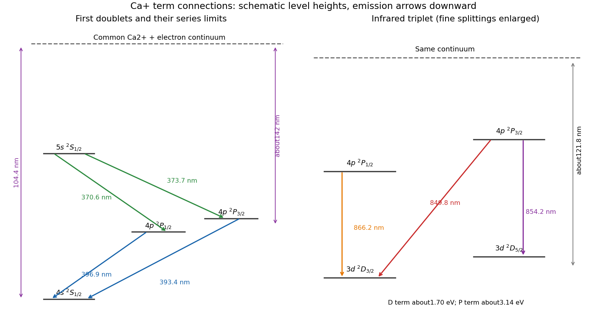
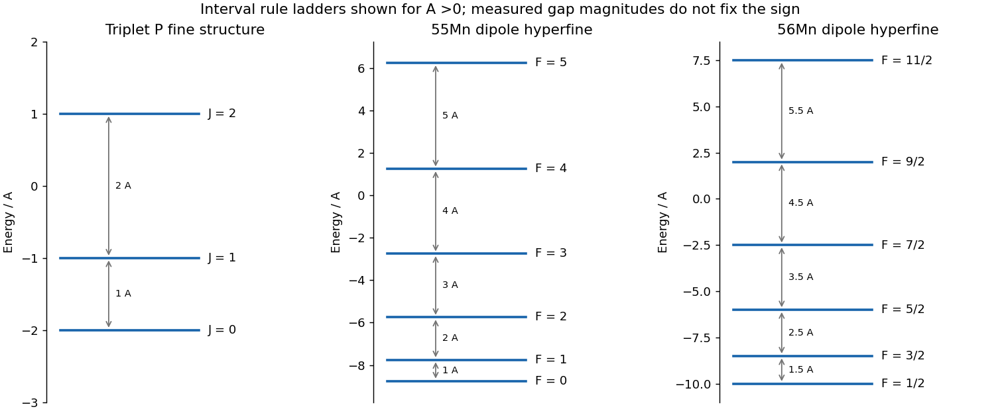
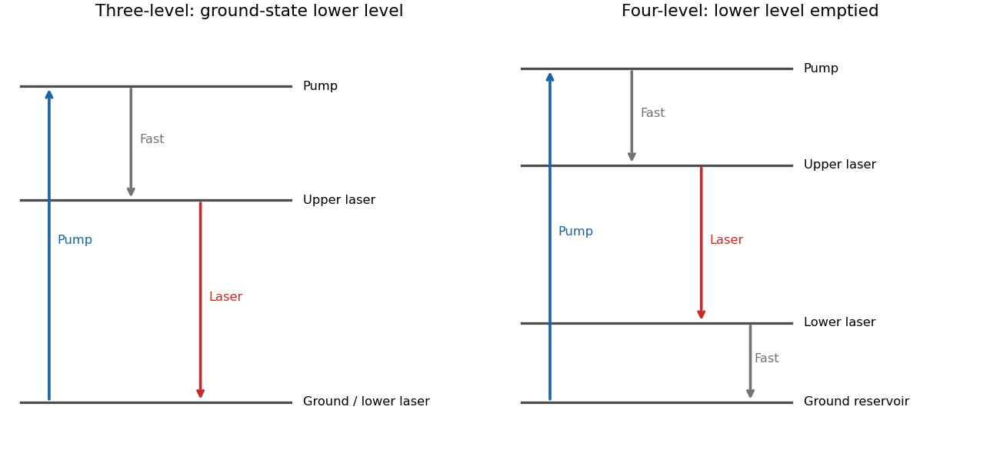
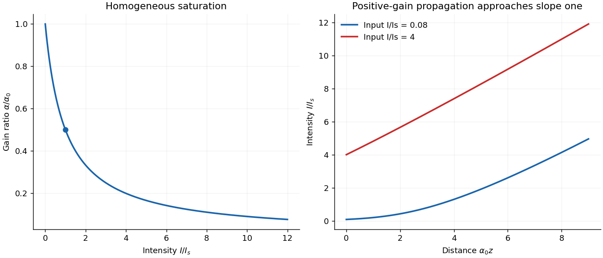
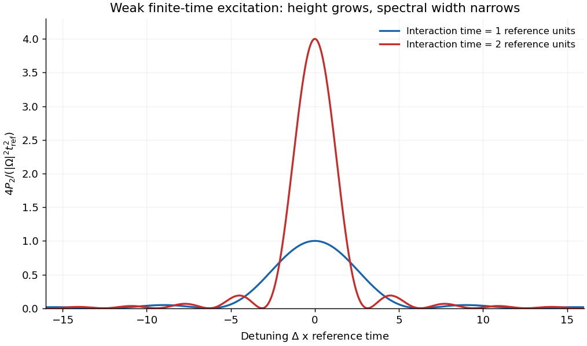

# 2016

↑ **Parent:** [Past exam of the quantum, atomic and molecular physics course of the University of Oxford](../past-exam-of-the-quantum-atomic-and-molecular-physics-course-of-the-university-of-oxford.md)

Source paper: [https://www.whatdotheyknow.com/request/physics_past_exam_papers_2015_16/response/973997/attach/3/Cowell%20Attachment.zip?cookie_passthrough=1](https://www.whatdotheyknow.com/request/physics_past_exam_papers_2015_16/response/973997/attach/3/Cowell%20Attachment.zip?cookie_passthrough=1)

**Table of contents**

- [1](#1)
  - [a](#1/a)
    - [Solution](#1/a/solution)
  - [b](#1/b)
    - [Solution](#1/b/solution)
  - [c](#1/c)
    - [Solution](#1/c/solution)
  - [d](#1/d)
    - [Solution](#1/d/solution)
- [2](#2)
  - [a](#2/a)
    - [Solution](#2/a/solution)
  - [b](#2/b)
    - [Solution](#2/b/solution)
  - [c](#2/c)
    - [Solution](#2/c/solution)
  - [d](#2/d)
    - [Solution](#2/d/solution)
  - [e](#2/e)
    - [Solution](#2/e/solution)
- [3](#3)
  - [a](#3/a)
    - [Solution](#3/a/solution)
  - [b](#3/b)
    - [Solution](#3/b/solution)
  - [c](#3/c)
    - [Solution](#3/c/solution)
  - [d](#3/d)
    - [Solution](#3/d/solution)
  - [e](#3/e)
    - [Solution](#3/e/solution)
- [4](#4)
  - [a](#4/a)
    - [Solution](#4/a/solution)
  - [b](#4/b)
    - [Solution](#4/b/solution)
  - [c](#4/c)
    - [Solution](#4/c/solution)
  - [d](#4/d)
    - [Solution](#4/d/solution)

## 1

↑ **Parent:** [2016](2016.md)

<h3 id="1/a">a</h3>

↑ **Parent:** [1](#1)

<h4 id="1/a/solution">Solution</h4>

↑ **Parent:** [A](#1/a)

[Potassium](../chemical-substance.md#potassium) has a closed 18-electron core and one [valence electron](../chemical-bond.md#valence-electron). In $3d\,{}^2D_{5/2}$ the orbital label specifies [principal quantum number](../mathematical-physics.md#principal-quantum-number) $n=3$ and single-electron [orbital angular momentum](../quantum-mechanics.md#orbital-angular-momentum) $l=2$. The term letter D specifies total [orbital angular momentum](../quantum-mechanics.md#orbital-angular-momentum) $L=2$, the superscript $2S+1=2$ specifies $S=1/2$, and the subscript is total electronic [angular momentum](../momentum.md#angular-momentum) $J=5/2$. The $5p\,{}^2P_{3/2}$ state instead has $n=5$, $l=L=1$, the same [spin](../angular-momentum-operator.md#spin), and $J=3/2$. The [closed electron shell](../chemistry.md#closed-electron-shell) that forms the core contributes no net $L$ or $S$ in this alkali-like approximation. The dash identifies a pair of levels rather than by itself specifying the direction of emission.

The leading [electric dipole transition](../quantum-mechanics.md#electric-dipole-transition) rules for one active [electron](../physics.md#electron) are

$$
\boxed{\Delta l=\pm1,\quad\Delta S=0,\quad
\Delta J=0,\pm1\ \text{except }J=0\leftrightarrow0,\quad
\Delta m_J=0,\pm1.}
$$

The electronic [parity](../quantum-mechanics.md#parity) must change, since the [electric dipole operator](../quantum-mechanics.md#electric-dipole-operator) is odd under [spatial reflection](../quantum-mechanics.md#spatial-reflection). The [electric-dipole selection rule](../quantum-mechanics.md#electric-dipole-selection-rule) imposes no general restriction on changing $n$ by more than one. The rule for [magnetic sublevels](../quantum-mechanics.md#magnetic-sublevel) depends on the radiation's [polarization](../wave.md#polarization-waves) relative to the [quantization axis](../angular-momentum-operator.md#quantization-axis): the $q=0$ component couples equal $m_J$, whereas $q=\pm1$ supplies the other changes. In a many-electron description using [LS coupling](../angular-momentum-operator.md#ls-coupling) the total orbital rule is $\Delta L=0,\pm1$, excluding $L=0\leftrightarrow0$; for a single active [electron](../physics.md#electron) the stronger $\Delta l=\pm1$ applies. Thus the displayed D–P pair satisfies the leading rules. Relativistic mixing and higher-multipole transitions can permit weaker lines outside the approximation of [electric dipole transitions](../quantum-mechanics.md#electric-dipole-transition).

<h3 id="1/b">b</h3>

↑ **Parent:** [1](#1)

<h4 id="1/b/solution">Solution</h4>

↑ **Parent:** [B](#1/b)

Use the common [ionization continuum](../atomic-physics.md#ionization-continuum) consisting of a divalent [calcium ion](../chemical-substance.md#calcium-ion) and a free [electron](../physics.md#electron) as the upper reference, with the [singly ionized calcium](../chemical-substance.md#singly-ionized-calcium) ground state $4s\,{}^2S_{1/2}$ at zero [energy](../energy.md). The resonance [doublet](../stellar-astrophysics.md#doublet-spectroscopy) is

$$
\boxed{4p\,{}^2P_{3/2}\to4s\,{}^2S_{1/2}\ (393.4\ \mathrm{nm}),\qquad
4p\,{}^2P_{1/2}\to4s\,{}^2S_{1/2}\ (396.9\ \mathrm{nm}).}
$$

The higher-$J$ P component is higher in [energy](../energy.md) because its emission to the common lower level has the shorter [wavelength](../wave-equation.md#wavelength). The full series is $np\,{}^2P_{1/2,3/2}\to4s\,{}^2S_{1/2}$. As $n\to\infty$, its two upper levels approach the same continuum, so the ground-state [ionization energy](../mathematical-physics.md#ionization-energy) is approximately $hc/(104.4\ \mathrm{nm})=11.88$ eV.

The second doublet has a common **upper** S level and two lower P levels:

$$
\boxed{5s\,{}^2S_{1/2}\to4p\,{}^2P_{3/2}\ (373.7\ \mathrm{nm}),\qquad
5s\,{}^2S_{1/2}\to4p\,{}^2P_{1/2}\ (370.6\ \mathrm{nm}).}
$$

Both combinations put $5s\,{}^2S_{1/2}$ near $6.47$ eV above the ground state. The series is $ns\,{}^2S_{1/2}\to4p\,{}^2P_{1/2,3/2}$ with $n\geq5$. Its two limits measure the [ionization energy](../mathematical-physics.md#ionization-energy) **from each lower P level**, giving slightly different limit [wavelengths](../wave-equation.md#wavelength) near 142 nm, not two unrelated continua. From the rounded [wavelengths](../wave-equation.md#wavelength), $E(4p_{1/2})\simeq3.124$ eV and $E(4p_{3/2})\simeq3.152$ eV, leaving roughly $8.74$ eV to the same continuum. The tabulated level ordering and labels independently agree with these assignments.[4s,4p and5s entries and Ca III continuum limit](../physics-bibliography.md#energy-levels-of-singly-ionized-calcium-ca-ii-by-national-institute-of-standards-and-technology)

The quoted [wavelengths](../wave-equation.md#wavelength) and limits are rounded; air and vacuum conventions also matter for precision spectroscopy. They justify a labelled schematic and the approximate [energy](../energy.md) differences, not an artificial claim of exact closure at every printed decimal.

**[Figure 1](#1/b/image-common-continuum-assignments-of-the-ca-plus-doublets-and-infrared-triplet). Common-continuum assignments of the Ca+ doublets and infrared triplet**. Original schematic showing every first-doublet and infrared-triplet transition and the three approximate series limits. Fine splittings are visually enlarged; vertical positions are not a precision energy scale.

<h3 id="1/c">c</h3>

↑ **Parent:** [1](#1)

<h4 id="1/c/solution">Solution</h4>

↑ **Parent:** [C](#1/c)

The limit near 121.8 nm lies about $hc/(121.8\ \mathrm{nm})\simeq10.18$ eV above its lower term. Subtracting from the approximately $11.88$ eV ground-state [ionization energy](../mathematical-physics.md#ionization-energy) puts that lower term near $1.70$ eV: the $3d\,{}^2D_{3/2,5/2}$ pair. The first upper levels are the already identified $4p\,{}^2P_{1/2,3/2}$ pair. Their allowed decays are

$$
\boxed{\begin{array}{c|c}
\lambda&\text{emission assignment}\\\hline
849.8\ \mathrm{nm}&4p\,{}^2P_{3/2}\to3d\,{}^2D_{3/2}\\
854.2\ \mathrm{nm}&4p\,{}^2P_{3/2}\to3d\,{}^2D_{5/2}\\
866.2\ \mathrm{nm}&4p\,{}^2P_{1/2}\to3d\,{}^2D_{3/2}
\end{array}}
$$

The fourth possible pairing, $P_{1/2}\to D_{5/2}$, has $|\Delta J|=2$ and is forbidden as an [electric dipole transition](../quantum-mechanics.md#electric-dipole-transition). The three lines therefore arise from **[doublet terms](../atomic-physics.md#doublet-term)**, not a spin-triplet term: “triplet series” counts three [spectral lines](../stellar-astrophysics.md#spectral-line).

For example, the first two [wavelengths](../wave-equation.md#wavelength) together with the $4p_{3/2}$ [energy](../energy.md) give $E(3d_{3/2})\simeq1.693$ eV and $E(3d_{5/2})\simeq1.700$ eV. The longer 854.2 nm [wavelength](../wave-equation.md#wavelength) from the same upper level places its lower D level higher. The 866.2 nm transition independently returns the lower D [energy](../energy.md) within the rounding precision. Increasing the upper [principal quantum number](../mathematical-physics.md#principal-quantum-number) gives $np\,{}^2P\to3d\,{}^2D$ triplets with two nearby lower-term ionization limits near 121.8 nm. The arrows are included in [b](#1/b); their emission direction is **P to D**, not the reverse. The independent tabulation confirms the D-term position and ordering.[3d entries at13650.20 and13710.89 inverse centimetres](../physics-bibliography.md#energy-levels-of-singly-ionized-calcium-ca-ii-by-national-institute-of-standards-and-technology)

<h3 id="1/d">d</h3>

↑ **Parent:** [1](#1)

<h4 id="1/d/solution">Solution</h4>

↑ **Parent:** [D](#1/d)

In the regime of [weak-field Zeeman splitting](../atomic-physics.md#weak-field-zeeman-splitting), $J,m_J$ remain good labels and $\Delta E=\mu_B g_Jm_JB$. For the 393.4 nm line, $J_u=3/2$ in $4p\,{}^2P_{3/2}$ and $J_l=1/2$ in $4s\,{}^2S_{1/2}$. The [Landé g-factors](../atomic-physics.md#lande-g-factor) are $g_u=4/3$ and $g_l\simeq2$. Apply $\Delta m_J=0,\pm1$ to the four upper and two lower sublevels. The allowed pairs $(m_u,m_l)$ are

$$
(3/2,1/2),\ (1/2,1/2),\ (-1/2,1/2),\
(1/2,-1/2),\ (-1/2,-1/2),\ (-3/2,-1/2).
$$

Their [frequency](../wave.md#frequency) displacements in units of $\mu_BB/h$ are respectively $1,-1/3,-5/3,5/3,1/3,-1$, so none coincide. Looking perpendicular to the field permits both the $\pi$ radiation from $q=0$ transitions and the $\sigma$ radiation from $q=\pm1$ transitions. Consequently

$$
\boxed{\text{six distinct components: two }\pi\text{ and four }\sigma.}
$$

A linear [polarizer](../electromagnetic-wave.md#polarizer) parallel to the field isolates the two $\pi$ components; a transverse [polarizer](../electromagnetic-wave.md#polarizer) selects the four $\sigma$ components. Without [polarization](../wave.md#polarization-waves) selection both sets are present. This count assumes a field small compared with [fine structure](../atomic-physics.md#fine-structure) coupling and neglects isotope-dependent [hyperfine structure](../quantum-mechanics.md#hyperfine-structure); the strong-field [Paschen-Back effect](../atomic-physics.md#paschen-back-effect) or a resolved nonzero-spin isotope would require a different model. The spectral spacings are unnecessary for the count, but the distinct shifts verify that counting allowed transitions does not inadvertently count degenerate lines twice.

## 2

↑ **Parent:** [2016](2016.md)

<h3 id="2/a">a</h3>

↑ **Parent:** [2](#2)

<h4 id="2/a/solution">Solution</h4>

↑ **Parent:** [A](#2/a)

First make the units explicit. Use [angular momentum operators](../angular-momentum-operator.md) in units of $\hbar$, so their squared [eigenvalues](../linear-operator-theory.md#eigenvalue) are $J(J+1)$ rather than $\hbar^2J(J+1)$; the coefficient $A$ then has units of [energy](../energy.md). The operator identity

$$
\mathbf J^2=(\mathbf J_1+\mathbf J_2)^2
=\mathbf J_1^2+\mathbf J_2^2+2\mathbf J_1\cdot\mathbf J_2
$$

gives, at fixed $J_1,J_2$,

$$
E_J=\frac A2[J(J+1)-J_1(J_1+1)-J_2(J_2+1)].
$$

Subtracting the expression for the adjacent allowed value $J-1$ leaves

$$
\boxed{E_J-E_{J-1}=\frac A2[J(J+1)-(J-1)J]=AJ.}
$$

This is the [Landé interval rule](../angular-momentum-operator.md#lande-interval-rule). Its content is that consecutive gaps grow in proportion to the higher total-angular-momentum quantum number, with the same coefficient within an isolated coupled multiplet. A negative $A$ reverses the ordering of the levels, while positive observed transition [frequencies](../wave.md#frequency) alone measure gap magnitudes.

If the source symbols instead denote physical angular momenta with units of action, the [Hamiltonian](../hamiltonian-mechanics.md#hamiltonian) written literally as $A\mathbf J_1\cdot\mathbf J_2$ gives the gap $A\hbar^2J$. Recovering the printed form then requires absorbing $\hbar^2$ into the coefficient or writing $H=(A/\hbar^2)\mathbf J_1\cdot\mathbf J_2$. The convention is essential to dimensional consistency rather than an extra dynamical assumption.

<h3 id="2/b">b</h3>

↑ **Parent:** [2](#2)

<h4 id="2/b/solution">Solution</h4>

↑ **Parent:** [B](#2/b)

For two [valence electrons](../chemical-bond.md#valence-electron), the central-field shell structure should be the largest scale, residual electrostatic interactions should establish a reasonably definite configuration and [atomic term](../atomic-physics.md#atomic-term), and [spin-orbit coupling](../atomic-physics.md#spin-orbit-interaction) should be weaker than the separations between the relevant terms. Then $L$ and $S$ remain approximately good quantum numbers. Within a well-isolated term the leading [fine structure](../atomic-physics.md#fine-structure) interaction can be represented as $A\mathbf L\cdot\mathbf S$. Its coefficient must be effectively constant for all $J$ levels in that term. Mixing of neighboring terms, [spin-spin interactions](../angular-momentum-operator.md#spin-spin-interaction), higher-order corrections or strong applied fields can spoil the simple interval rule; [hyperfine structure](../quantum-mechanics.md#hyperfine-structure) must be negligible or separately resolved.

A suitable approximate example is the [magnesium](../chemical-substance.md#magnesium) $3s3p\,{}^3P_J$ term, with $L=1$, $S=1$ and $J=0,1,2$. The interval-rule prediction is

$$
\boxed{E_0=-2A,\qquad E_1=-A,\qquad E_2=A,\qquad
E_1-E_0=A,\quad E_2-E_1=2A.}
$$

An arbitrary common term [energy](../energy.md) may be added. For $A>0$ the levels ascend in the order ${}^3P_0,{}^3P_1,{}^3P_2$, with gap ratio one to two. Each level still contains $2J+1$ degenerate [magnetic sublevels](../quantum-mechanics.md#magnetic-sublevel) in zero external field. The superscript three labels the [spin multiplicity](../angular-momentum-operator.md#spin-multiplicity) $2S+1$, while the different subscripts identify [fine structure](../atomic-physics.md#fine-structure) components of that same term. This is an approximate example of [LS coupling](../angular-momentum-operator.md#ls-coupling), not a claim that every real two-electron atom has exact one-to-two fine splitting.

**[Figure 2](#2/b/image-fine-structure-and-magnetic-dipole-hyperfine-interval-ladders). Fine-structure and magnetic-dipole hyperfine interval ladders**. Original angular-momentum eigenvalues for positive coupling coefficients. The fine-structure gaps are A and2A; the two hyperfine examples have different lowest total angular momenta. Measured positive gaps alone do not fix the coupling signs.

<h3 id="2/c">c</h3>

↑ **Parent:** [2](#2)

<h4 id="2/c/solution">Solution</h4>

↑ **Parent:** [C](#2/c)

Within a fixed isolated electronic $J$ multiplet, the electronic field at the [nucleus](../atomic-nucleus.md) is a vector operator. [Rotational symmetry](../linear-algebra.md#rotational-symmetry) and the [Wigner-Eckart theorem](../representation-theory.md#wigner-eckart-theorem) imply that its projection into this multiplet is proportional to $\mathbf J$:

$$
P_J\mathbf B_eP_J=b_J\mathbf J.
$$

Its detailed orbital, spin-dipolar and contact contributions are included in the reduced coefficient $b_J$. Consequently the projected [magnetic-dipole hyperfine interaction](../quantum-mechanics.md#magnetic-dipole-hyperfine-interaction) becomes

$$
\boxed{H_{\rm hfs}=A\mathbf I\cdot\mathbf J,\qquad A=-g_I\mu_Nb_J,}
$$

in the same dimensionless angular-momentum convention as [a](#2/a). The proportionality is a statement about [matrix elements](../vector-space.md#matrix-element) **within** the chosen electronic manifold, not an identity for the [electron](../physics.md#electron) field operator on the entire atomic Hilbert space.

Define $\mathbf F=\mathbf I+\mathbf J$. In zero external field the [quantum states](../quantum-system.md#quantum-state) obtained by [addition of angular momentum](../angular-momentum-operator.md#addition-of-angular-momentum) are labelled $|\gamma J,I;F,m_F\rangle$, where $\gamma$ specifies the [electron configuration](../chemistry.md#electron-configuration) and other fixed labels. The good quantum numbers include $I,J,F,m_F$, with $F=|I-J|,\ldots,I+J$ and $m_F=-F,\ldots,F$. In a description using [LS coupling](../angular-momentum-operator.md#ls-coupling) the fixed electronic labels can also include $L,S$. The [energies](../energy.md) depend on $F$ but not $m_F$:

$$
E_F=\frac A2[F(F+1)-I(I+1)-J(J+1)].
$$

This neglects coupling to other electronic manifolds, [electric-quadrupole hyperfine interactions](../quantum-mechanics.md#electric-quadrupole-hyperfine-interaction) and the [Zeeman effect](../atomic-physics.md#zeeman-splitting) from external fields. Those additions can shift the intervals or change which quantum numbers remain useful.

<h3 id="2/d">d</h3>

↑ **Parent:** [2](#2)

<h4 id="2/d/solution">Solution</h4>

↑ **Parent:** [D](#2/d)

For a [hyperfine multiplet](../quantum-mechanics.md#hyperfine-multiplet) governed by the [magnetic-dipole hyperfine interaction](../quantum-mechanics.md#magnetic-dipole-hyperfine-interaction), adjacent [frequency](../wave.md#frequency) gaps obey $\nu_F=|A|F/h$. The five measured gaps for the first isotope are approximately in the ratios $1:2:3:4:5$. Therefore the six levels have $F=0,1,2,3,4,5$: the first measured gap corresponds to higher $F=1$. In particular $F_{\min}=|I-J|=0$ and $F_{\max}=I+J=5$, giving

$$
\boxed{I=J=5/2.}
$$

This inference uses both the number of intervals and their successive ratios. Merely seeing six levels would specify only $\min(I,J)=5/2$ and would not by itself establish equality.

Solving a [linear least-squares problem](../inner-product.md#linear-least-squares-problem) for a fit through the origin, taking the rounded [frequencies](../wave.md#frequency) as equally weighted, gives

$$
\boxed{\frac{|A_{55}|}{h}=\frac{\sum_{F=1}^5F\nu_F}{\sum_{F=1}^5F^2}
=72.42\ \mathrm{MHz}\quad\text{approximately}.}
$$

Thus the scale of the [hyperfine structure](../quantum-mechanics.md#hyperfine-structure) is about $4.80\times10^{-26}$ J, or $3.00\times10^{-7}$ eV. The displayed [frequencies](../wave.md#frequency) have unequal rounding precision, so additional fit digits are not physically warranted. The gap pattern supports a leading dipole interval rule, with small residuals that do not establish higher-multipole constants without uncertainties.

The total width between $F=0$ and $F=5$ is $15|A_{55}|$, about $1.086$ GHz in [frequency](../wave.md#frequency) units. The sign of $A_{55}$, the absolute [nuclear g-factor](../electromagnetism.md#nuclear-g-factor) and the electronic field coefficient cannot be separated from these gap magnitudes alone. Measuring the level ordering or using another known magnetic property would supply additional information. The figure in [b](#2/b) shows the positive-$A$ ordering as an illustration.

<h3 id="2/e">e</h3>

↑ **Parent:** [2](#2)

<h4 id="2/e/solution">Solution</h4>

↑ **Parent:** [E](#2/e)

For the second isotope, consecutive gap differences are approximately $56.4$ MHz, but the smallest gap is about $1.5$ times this value. The higher-$F$ values for the five gaps are therefore $3/2,5/2,7/2,9/2,11/2$. The six levels run from $F=1/2$ to $11/2$. The electronic state is unchanged, so $J=5/2$ as in [d](#2/d); the endpoints give

$$
\boxed{I_{56}=3,\qquad \frac{|A_{56}|}{h}\simeq56.41\ \mathrm{MHz}.}
$$

For example, fitting $\nu_F$ to $F|A|/h$ with the same equal-weight convention gives $56.408$ MHz. The nearly constant gap differences are compatible with the same leading model of the [magnetic-dipole hyperfine interaction](../quantum-mechanics.md#magnetic-dipole-hyperfine-interaction) and the printed rounding.

Within an unchanged electronic state, and neglecting isotope-dependent changes of the electronic [wave function](../wave-function.md) and [hyperfine anomaly](../quantum-mechanics.md#hyperfine-anomaly), $A\propto g_I$. Thus

$$
\boxed{\left|\frac{g_I(^{56}\mathrm{Mn})}{g_I(^{55}\mathrm{Mn})}\right|
\simeq\frac{56.41}{72.42}=0.779,}
$$

or the reciprocal magnitude is about $1.284$. This is a ratio of **[nuclear g-factors](../electromagnetism.md#nuclear-g-factor)**, not directly a ratio of [nuclear magnetic moments](../electromagnetism.md#nuclear-magnetic-moment): $\mu_I=g_I I\mu_N$, so the moment-magnitude ratio would additionally contain $I_{56}/I_{55}=3/(5/2)$ and is about $0.935$.

The positive transition [frequencies](../wave.md#frequency) do not fix either coupling sign. If a signed ratio is required, equal signs must be supplied as an additional assumption or determined by an ordering-sensitive measurement. No absolute [nuclear g-factor](../electromagnetism.md#nuclear-g-factor) is inferred without a calibrated electronic field coefficient. The second ladder in [b](#2/b) illustrates the inferred half-integer $F$ sequence without turning that sign ambiguity into a falsely measured ordering.

## 3

↑ **Parent:** [2016](2016.md)

<h3 id="3/a">a</h3>

↑ **Parent:** [3](#3)

<h4 id="3/a/solution">Solution</h4>

↑ **Parent:** [A](#3/a)

In the ideal [three-level laser](../laser.md#three-level-laser), pumping excites atoms out of the ground state to a higher auxiliary level, rapid relaxation fills a relatively long-lived upper [laser](../laser.md) level, and the [laser transition](../laser.md#laser-transition) returns to the ground state. A [ruby laser](../laser.md#ruby-laser) is a standard example of this classification. Since the lower [laser](../laser.md) state initially holds most atoms, substantial pumping is needed to reverse the population per sublevel. With upper and lower degeneracies $g_2,g_1$ and $N_1+N_2\simeq N_T$, the positive-gain condition is

$$
N_2/g_2>N_1/g_1,\qquad
\boxed{N_2>\frac{g_2}{g_1+g_2}N_T.}
$$

For equal degeneracies more than half the active atoms must be excited before [optical gain](../laser.md#optical-gain) is even positive.

In a [four-level laser](../laser.md#four-level-laser) the lower [laser](../laser.md) level is above the ground reservoir and empties rapidly after [laser](../laser.md) emission. Pumping again feeds a higher auxiliary level which relaxes into the upper [laser](../laser.md) state, but the lower laser-state population can remain small. The [helium-neon laser](../laser.md#helium-neon-laser) provides a multilevel physical realization often represented by this scheme for a [four-level laser](../laser.md#four-level-laser). Positive [population inversion](../laser.md#population-inversion) then requires much less depletion of the ground reservoir, giving a much lower [laser pump threshold](../laser.md#laser-pump-threshold) for comparable lifetimes, [emission cross sections](../laser.md#emission-cross-section) and cavity losses.

The threshold of a [four-level laser](../laser.md#four-level-laser) is not literally zero. Oscillation requires round-trip [optical gain](../laser.md#optical-gain) to overcome output coupling and other losses, and competing decay or incomplete lower-level removal raises the required pump. Real [laser](../laser.md) media contain more atomic states than ideal diagrams for a [three-level laser](../laser.md#three-level-laser) or a [four-level laser](../laser.md#four-level-laser); the labels describe the relevant pumping and laser-transition cycle rather than the total number of states in the material.

**[Figure 3](#3/a/image-why-ground-state-and-rapidly-emptied-lower-laser-levels-give-different-thresholds). Why ground-state and rapidly emptied lower laser levels give different thresholds**. Original three- and four-level pumping cycles. The diagrams distinguish pump absorption, rapid relaxation and stimulated laser emission; real media can contain additional levels.

<h3 id="3/b">b</h3>

↑ **Parent:** [3](#3)

<h4 id="3/b/solution">Solution</h4>

↑ **Parent:** [B](#3/b)

Let $A=A_{21}$ and $r=g_2/g_1$. Before [stimulated emission](../laser.md#stimulated-emission) and [stimulated absorption](../atomic-physics.md#stimulated-absorption) are added, the source and decay terms give

$$
\dot N_2=R_2-AN_2,\qquad
\dot N_1=AN_2-\frac{N_1}{\tau_1}.
$$

The upper level is fed at a specified rate of addition to the [number density](../statistical-physics.md#number-density), its spontaneous decay feeds the lower level, and lower-level removal leads to states outside this [two-level system](../canonical-ensemble.md#two-level-system). This is therefore an open pumped system, not a closed [two-level system](../canonical-ensemble.md#two-level-system) with conserved population.

At steady state,

$$
N_2^{(0)}=\frac{R_2}{A},\qquad N_1^{(0)}=R_2\tau_1,
\qquad\boxed{N_0^*=R_2\left(\frac1A-r\tau_1\right).}
$$

The degeneracy-weighted [population inversion](../laser.md#population-inversion) compares population per [magnetic sublevel](../quantum-mechanics.md#magnetic-sublevel). It is positive only if $rA\tau_1<1$; a positive pump rate alone cannot guarantee [optical gain](../laser.md#optical-gain) if lower-level removal is too slow. A short lower-state lifetime is consequently helpful even when the upper-state pumping is unchanged.

The equations assume finite positive $A$ and $\tau_1$, approximately constant pumping and no other specified sources, sinks or branching channels. A finite steady state would not exist for continuous pumping if the lower level had no escape route. The fixed source rate also presumes access to an external reservoir; it does not imply that the two populations can grow beyond all available active atoms in a real finite medium.

<h3 id="3/c">c</h3>

↑ **Parent:** [3](#3)

<h4 id="3/c/solution">Solution</h4>

↑ **Parent:** [C](#3/c)

Define $\sigma(\omega)$ as the [emission cross section](../laser.md#emission-cross-section) for an upper-level atom, averaged over the participating sublevels, and let $W=\sigma I/(\hbar\omega)$. Detailed balance gives the upward stimulated rate per lower-level atom as $rW$, where $r=g_2/g_1$. With $D=N_2-rN_1$ the complete [laser rate equations](../laser.md#laser-rate-equation) are

$$
\dot N_2=R_2-AN_2-WD,\qquad
\dot N_1=AN_2+WD-N_1/\tau_1.
$$

Adding them eliminates the internal transitions. Therefore steady state has $N_1=R_2\tau_1$ **even when the radiation is strong**. Substitution into the upper equation gives

$$
N_2=\frac{R_2(1+rW\tau_1)}{A+W},\qquad
D=\frac{R_2(1-rA\tau_1)}{A+W}
=\frac{D_0}{1+W/A}.
$$

One net stimulated transition changes the beam [energy](../energy.md) by $\hbar\omega$, so the coefficient of [optical gain](../laser.md#optical-gain) for [intensity](../wave.md#intensity-physics) is $\alpha(\omega,I)=\sigma(\omega)D$. At line center, with $\sigma_0=\sigma(\omega_{21})$,

$$
\boxed{\alpha=\frac{\alpha_0}{1+I/I_s},\qquad
\alpha_0=\sigma_0R_2\left(A^{-1}-r\tau_1\right),\qquad
I_s=\frac{\hbar\omega_{21}A}{\sigma_0}.}
$$

Here $\alpha_0$ is the unsaturated **[intensity](../wave.md#intensity-physics)** [optical gain](../laser.md#optical-gain) per length, which may be negative, and $I_s$ is the [intensity](../wave.md#intensity-physics) at which its magnitude is halved in this model with [homogeneous broadening](../stellar-astrophysics.md#homogeneous-broadening). The cancellation of $\tau_1$ from $I_s$ follows from exclusive upper-to-lower decay and constant upper-state pumping. Keeping $N_1=A\tau_1N_2$ in the stimulated problem would discard the stimulated feeding term and give an incorrect saturation scale. Other decay branches or different pump constraints lead to different expressions.

For a traveling beam with uniform pump, no additional loss and local steady populations,

$$
\frac{dI}{dz}=\frac{\alpha_0 I}{1+I/I_s},\qquad
\boxed{\ln\frac{I(z)}{I(0)}+\frac{I(z)-I(0)}{I_s}=\alpha_0z.}
$$

If $\alpha_0>0$ and $I\gg I_s$, the increment becomes $dI/dz\simeq\alpha_0I_s=\hbar\omega_{21}R_2(1-rA\tau_1)$, approximately constant. [Intensity](../wave.md#intensity-physics) then grows **linearly**, rather than exponentially, with distance while that strong-saturation regime persists. Negative $\alpha_0$ gives [saturable absorption](../optics.md#saturable-absorption) and a decreasing beam.

**[Figure 4](#3/c/image-saturated-gain-and-the-crossover-from-exponential-to-approximately-linear-amplification). Saturated gain and the crossover from exponential to approximately linear amplification**. Original steady-state calculation for the specified open pumped model. The propagation curves assume positive unsaturated gain and no added loss; a negative gain example is absorptive.

<h3 id="3/d">d</h3>

↑ **Parent:** [3](#3)

<h4 id="3/d/solution">Solution</h4>

↑ **Parent:** [D](#3/d)

Keep the given [emission cross section](../laser.md#emission-cross-section) in square centimetres so that the density remains per cubic centimetre. For the first transition, $r=5/3$ and

$$
A^{-1}-r\tau_1=\frac1{3\times10^6}-\frac53(2\times10^{-8})
=3.00\times10^{-7}\ \mathrm s.
$$

Thus

$$
D_0=(5\times10^{19})(3.00\times10^{-7})=1.50\times10^{13}\ \mathrm{cm^{-3}},
\qquad\boxed{\alpha_0=(4\times10^{-15})D_0=0.0600\ \mathrm{cm^{-1}}=6.00\ \mathrm{m^{-1}}.}
$$

The separate populations are $N_2^{(0)}=1.667\times10^{13}$ cm$^{-3}$ and $N_1^{(0)}=1.00\times10^{12}$ cm$^{-3}$. Subtracting $5N_1/3$, rather than $N_1$ alone, reproduces the [population inversion](../laser.md#population-inversion) used above.

Here $rA\tau_1=0.10<1$, so upper-state pumping and sufficiently rapid lower-level removal produce positive small-signal [optical gain](../laser.md#optical-gain). This coefficient is an [intensity](../wave.md#intensity-physics) [optical gain](../laser.md#optical-gain); a weak field amplitude would grow with half this exponent. A positive single-pass coefficient also does not by itself establish [laser oscillation](../laser.md#laser-oscillation) without a cavity-loss budget. No transition [wavelength](../wave-equation.md#wavelength) was supplied for this numerical example, so a numerical [saturation intensity](../canonical-ensemble.md#saturation-intensity) is not needed or invented to calculate $\alpha_0$.

<h3 id="3/e">e</h3>

↑ **Parent:** [3](#3)

<h4 id="3/e/solution">Solution</h4>

↑ **Parent:** [E](#3/e)

For the second transition, $r=3$ and the much longer lower-level lifetime changes the sign of the available [population inversion](../laser.md#population-inversion):

$$
A^{-1}-r\tau_1=\frac1{3\times10^6}-3(3\times10^{-7})
=-5.667\times10^{-7}\ \mathrm s,
\qquad D_0=-2.833\times10^{13}\ \mathrm{cm^{-3}}.
$$

If its [emission cross section](../laser.md#emission-cross-section) equals the first transition's value, the estimate is

$$
\boxed{\alpha_0\simeq-0.1133\ \mathrm{cm^{-1}}=-11.33\ \mathrm{m^{-1}}.}
$$

The word “comparable” does not specify exact equality, so the more general answer is $\alpha_0=-(0.1133\ \mathrm{cm^{-1}})[\sigma_2/(4\times10^{-15}\ \mathrm{cm^2})]$. The quoted numerical value is an explicitly equal-cross-section estimate, while the negative sign is robust for any positive comparable [emission cross section](../laser.md#emission-cross-section).

In this case $rA\tau_1=2.7>1$. At fixed pump, $N_1=1.50\times10^{13}$ cm$^{-3}$, so its degeneracy-weighted contribution exceeds the upper population. The medium therefore absorbs a weak beam at this transition. Increasing the radiation saturates the [photon absorption](../quantum-mechanics.md#photon-absorption) magnitude toward zero according to [c](#3/c); it does not convert this fixed-pump model into an [optical amplifier](../laser.md#optical-amplifier) with positive gain. Simply inserting the magnitude $|\alpha_0|$ into the propagation law for positive [optical gain](../laser.md#optical-gain) would discard the physically important population balance.

## 4

↑ **Parent:** [2016](2016.md)

<h3 id="4/a">a</h3>

↑ **Parent:** [4](#4)

<h4 id="4/a/solution">Solution</h4>

↑ **Parent:** [A](#4/a)

Use an [orthonormal basis](../inner-product.md#orthonormal-basis) of [stationary states](../quantum-system.md#stationary-state) and project the [Time-dependent Schrödinger equation](../mathematical-physics.md#time-dependent-schrodinger-equation) onto state 2 after removing its free-evolution phase. The stationary [Hamiltonian](../hamiltonian-mechanics.md#hamiltonian) terms cancel the derivatives of those phases, leaving

$$
i\hbar\dot c_2=V_{21}(t)e^{i(E_2-E_1)t/\hbar}c_1+V_{22}(t)c_2.
$$

Define $d_{21}=\langle\psi_2|ex|\psi_1\rangle$ and $d_{22}=\langle\psi_2|ex|\psi_2\rangle$. With the supplied [time-dependent quantum perturbation](../quantum-mechanics.md#time-dependent-quantum-perturbation),

$$
\boxed{\omega_0=\frac{E_2-E_1}{\hbar},\qquad
\Omega=\frac{\mathcal E d_{21}}{\hbar},\qquad
V_{22}(t)=\mathcal E d_{22}\cos\omega t,}
$$

and therefore $\dot c_2=-i\Omega\cos(\omega t)e^{i\omega_0t}c_1-iV_{22}c_2/\hbar$. The state phases may be chosen so $d_{21}$ and $\Omega$ are real for this single driven pair; otherwise [probabilities](../probability-theory.md#probability) depend on $|\Omega|^2$ and the conjugate [matrix element](../vector-space.md#matrix-element) appears in the equation for $c_1$. Our $\Omega$ is the resonant [Rabi angular frequency](../quantum-system.md#rabi-angular-frequency) in the usual convention whose rotating-wave off-diagonal [Hamiltonian](../hamiltonian-mechanics.md#hamiltonian) is $\hbar\Omega/2$.

For a field-free atom with symmetry under [spatial reflection](../quantum-mechanics.md#spatial-reflection), each selected nondegenerate stationary orbital can be chosen with definite [parity](../quantum-mechanics.md#parity). Since $x$ is odd, $\langle2|x|2\rangle=-\langle2|x|2\rangle$, so $V_{22}=0$; the same reasoning gives $V_{11}=0$. **Being an [energy eigenstate](../energy-eigenvalue.md#energy-eigenstate) alone is not sufficient.** As an explicit mathematical counterexample, a displaced [quantum harmonic oscillator](../quantum-harmonic-oscillator.md) with potential proportional to $(x-x_c)^2$ has [energy eigenstates](../energy-eigenvalue.md#energy-eigenstate) with $\langle x\rangle=x_c$, giving $V_{22}=e\mathcal E x_c\cos\omega t$ when $x_c\ne0$. The vanishing used in the atomic model rests on its [parity](../quantum-mechanics.md#parity) assumption, not merely on stationarity.

<h3 id="4/b">b</h3>

↑ **Parent:** [4](#4)

<h4 id="4/b/solution">Solution</h4>

↑ **Parent:** [B](#4/b)

At first order in [time-dependent perturbation theory](../quantum-mechanics.md#time-dependent-perturbation-theory) set $c_1\simeq1$ and use the [parity](../quantum-mechanics.md#parity) result $V_{22}=0$. Decomposing the cosine into its two exponentials gives

$$
c_2(t)=-\frac{i\Omega}{2}\int_0^t
[e^{i(\omega_0-\omega)t'}+e^{i(\omega_0+\omega)t'}]dt'.
$$

Both exponentials contribute to the exact first-order result:

$$
\boxed{c_2(t)=-\frac\Omega2\left[
\frac{e^{i(\omega_0-\omega)t}-1}{\omega_0-\omega}
+\frac{e^{i(\omega_0+\omega)t}-1}{\omega_0+\omega}\right].}
$$

Each apparent zero denominator has a continuous limit. In particular the near-resonant fraction tends to $it$ as $\omega\to\omega_0$, while the counter-rotating fraction remains bounded on the optical timescale. One may equivalently write the expression as

$$
c_2(t)=-\frac{i\Omega t}{2}\sum_{\epsilon=\pm1}
 e^{i(\omega_0+\epsilon\omega)t/2}
\operatorname{sinc}[(\omega_0+\epsilon\omega)t/2],
\qquad\operatorname{sinc}u=\frac{\sin u}{u}.
$$

This form makes $c_2(0)=0$ explicit and avoids cancellation at resonance. At extremely short time both [sinc functions](../fourier-transform.md#sinc-function) tend to one, so $c_2\simeq-i\Omega t$, agreeing with the initial derivative of the original cosine-driven equation. No [rotating-wave approximation](../quantum-mechanics.md#rotating-wave-approximation) has yet been made. The separate assumption of weak excitation remains necessary: the first-order expression must not be extended until it predicts [probabilities](../probability-theory.md#probability) comparable to or larger than one.

<h3 id="4/c">c</h3>

↑ **Parent:** [4](#4)

<h4 id="4/c/solution">Solution</h4>

↑ **Parent:** [C](#4/c)

Let $\Delta=\omega-\omega_0$. Near resonance, $|\Delta|\ll\omega_0$, and for weak enough driving $|\Omega|\ll\omega_0$, the term oscillating near $2\omega_0$ averages rapidly compared with the slow response. On times long compared with an optical period it contributes a bounded amplitude of order $\Omega/\omega_0$, whereas the resonant contribution can accumulate. Dropping that counter-rotating term gives

$$
c_2^{\rm RWA}(t)=-i\Omega e^{-i\Delta t/2}\frac{\sin(\Delta t/2)}{\Delta},
\qquad\boxed{P_2(t)=\frac{|\Omega|^2\sin^2(\Delta t/2)}{\Delta^2}
=\frac{|\Omega|^2t^2}{4}\operatorname{sinc}^2(\Delta t/2).}
$$

At exact resonance the continuous limit is $P_2=|\Omega|^2t^2/4$. This remains a **weak-excitation** result, requiring $P_2\ll1$; rotating-wave averaging alone does not justify ignoring depletion forever. Far from resonance or on subcycle timescales, the discarded term may no longer be negligible for the comparison being made.

If one retains the coupled amplitudes instead of fixing $c_1=1$, the rotating-wave propagator is a [unitary operator](../vector-space.md#unitary-operator). The resulting population in the [Driven two-level Rabi model](../quantum-system.md#driven-two-level-rabi-model) is

$$
P_2^{\rm full\ RWA}(t)=\frac{|\Omega|^2}{|\Omega|^2+\Delta^2}
\sin^2\!\left[\frac t2\sqrt{|\Omega|^2+\Delta^2}\right].
$$

It gives bounded [Rabi oscillations](../quantum-system.md#rabi-cycle) and reduces to the weak-excitation expression over its common range. This distinction prevents the resonant quadratic approximation from being mistaken for a population law valid at arbitrary time.

**[Figure 5](#4/c/image-finite-time-weak-excitation-line-shape-and-its-time-bandwidth-scaling). Finite-time weak-excitation line shape and its time–bandwidth scaling**. Original sinc-squared transition envelopes for two illumination times. Longer interaction narrows the frequency response; the weak-excitation probability must remain small.

<h3 id="4/d">d</h3>

↑ **Parent:** [4](#4)

<h4 id="4/d/solution">Solution</h4>

↑ **Parent:** [D](#4/d)

Resolve the weak [broadband radiation](../electromagnetic-radiation.md#broadband-radiation) into narrow [frequency](../wave.md#frequency) intervals whose relative phases are uncorrelated. The transition **[probabilities](../probability-theory.md#probability)**, rather than the coherent amplitudes, can then be added after ensemble or time averaging. For the x-polarized field, the [energy](../energy.md) density in one interval is $\rho(\omega)d\omega=\epsilon_0\mathcal E_\omega^2/2$, so its squared coupling is $|d_{21}|^2\mathcal E_\omega^2/\hbar^2$. Inserting this into the weak rotating-wave result gives

$$
P_2(t)=\frac{|d_{21}|^2}{2\epsilon_0\hbar^2}
\int_0^\infty\rho(\omega)
\left[\frac{\sin[(\omega-\omega_0)t/2]}{(\omega-\omega_0)/2}\right]^2d\omega.
$$

For times long compared with the [optical coherence time](../physical-optics.md#optical-coherence-time) of the field, the narrow resonant kernel samples a nearly constant $\rho(\omega_0)$. Provided the resonance is well away from the zero-frequency boundary, extend the [Rabi detuning](../quantum-system.md#rabi-detuning) integral to the full real line. Its value is $2\pi t$, yielding

$$
\boxed{P_2(t)\simeq W_{1\to2}t,\qquad
W_{1\to2}=\frac{\pi|\langle2|ex|1\rangle|^2}{\epsilon_0\hbar^2}\rho(\omega_0).}
$$

This is the [stimulated absorption](../atomic-physics.md#stimulated-absorption) rate for the specified [polarization](../wave.md#polarization-waves) and spectral [radiation energy density](../statistical-physics.md#radiation-energy-density) **per angular-frequency interval**. The averaging window should also satisfy $Wt\ll1$ while the lower state is treated as undepleted. A deterministic phase-locked broadband pulse would not in general permit adding these [probabilities](../probability-theory.md#probability) without its [interference](../physical-optics.md#interference-wave-propagation) terms.

For isotropic unpolarized radiation with total spectral [radiation energy density](../statistical-physics.md#radiation-energy-density) $\rho_{\rm tot}$, orientational averaging instead gives $W=\pi|\mathbf d_{21}|^2\rho_{\rm tot}(\omega_0)/(3\epsilon_0\hbar^2)$. The factor one third is not inserted into the original x-polarized formula. If ordinary [frequency](../wave.md#frequency) is used, $\rho_\nu=2\pi\rho_\omega$ and the isotropic coefficient becomes $|\mathbf d_{21}|^2/(6\epsilon_0\hbar^2)$ multiplying $\rho_\nu(\nu_0)$. The spectral convention and [polarization](../wave.md#polarization-waves) must be stated together to avoid spurious factors of three or $2\pi$.

## ↑ Ancestors (9)

1. [Past exam of the quantum, atomic and molecular physics course of the University of Oxford](../past-exam-of-the-quantum-atomic-and-molecular-physics-course-of-the-university-of-oxford.md)
2. [Quantum, atomic and molecular physics course of the University of Oxford](../university-of-oxford.md#quantum-atomic-and-molecular-physics-course-of-the-university-of-oxford)
3. [Year 3 of the physics course of the University of Oxford](../university-of-oxford.md#year-3-of-the-physics-course-of-the-university-of-oxford)
4. [Physics course of the University of Oxford](../university-of-oxford.md#physics-course-of-the-university-of-oxford)
5. [Undergraduate course of the University of Oxford](../university-of-oxford.md#undergraduate-course-of-the-university-of-oxford)
6. [Course of the University of Oxford](../university-of-oxford.md#course-of-the-university-of-oxford)
7. [University of Oxford](../university-of-oxford.md)
8. [List of universities](../README.md#list-of-universities)
9. [Codex Wiki](../README.md)
