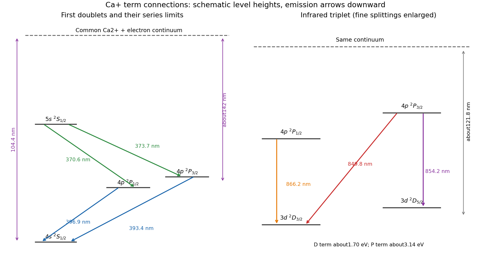

<h1 id="1/b/solution">Solution</h1>

↑ **Parent:** [B](../b.md)

Use the common [ionization continuum](../../../../ionization-continuum.md) consisting of a divalent [calcium ion](../../../../calcium-ion.md) and a free [electron](../../../../electron.md) as the upper reference, with the [singly ionized calcium](../../../../singly-ionized-calcium.md) ground state $4s\,{}^2S_{1/2}$ at zero [energy](../../../../energy-split.md). The resonance [doublet](../../../../doublet-spectroscopy.md) is

$$
\boxed{4p\,{}^2P_{3/2}\to4s\,{}^2S_{1/2}\ (393.4\ \mathrm{nm}),\qquad
4p\,{}^2P_{1/2}\to4s\,{}^2S_{1/2}\ (396.9\ \mathrm{nm}).}
$$

The higher-$J$ P component is higher in [energy](../../../../energy-split.md) because its emission to the common lower level has the shorter [wavelength](../../../../wavelength.md). The full series is $np\,{}^2P_{1/2,3/2}\to4s\,{}^2S_{1/2}$. As $n\to\infty$, its two upper levels approach the same continuum, so the ground-state [ionization energy](../../../../ionization-energy.md) is approximately $hc/(104.4\ \mathrm{nm})=11.88$ eV.

The second doublet has a common **upper** S level and two lower P levels:

$$
\boxed{5s\,{}^2S_{1/2}\to4p\,{}^2P_{3/2}\ (373.7\ \mathrm{nm}),\qquad
5s\,{}^2S_{1/2}\to4p\,{}^2P_{1/2}\ (370.6\ \mathrm{nm}).}
$$

Both combinations put $5s\,{}^2S_{1/2}$ near $6.47$ eV above the ground state. The series is $ns\,{}^2S_{1/2}\to4p\,{}^2P_{1/2,3/2}$ with $n\geq5$. Its two limits measure the [ionization energy](../../../../ionization-energy.md) **from each lower P level**, giving slightly different limit [wavelengths](../../../../wavelength.md) near 142 nm, not two unrelated continua. From the rounded [wavelengths](../../../../wavelength.md), $E(4p_{1/2})\simeq3.124$ eV and $E(4p_{3/2})\simeq3.152$ eV, leaving roughly $8.74$ eV to the same continuum. The tabulated level ordering and labels independently agree with these assignments.[4s,4p and5s entries and Ca III continuum limit](../../../../energy-levels-of-singly-ionized-calcium-ca-ii-by-national-institute-of-standards-and-technology.md)

The quoted [wavelengths](../../../../wavelength.md) and limits are rounded; air and vacuum conventions also matter for precision spectroscopy. They justify a labelled schematic and the approximate [energy](../../../../energy-split.md) differences, not an artificial claim of exact closure at every printed decimal.

**[Figure 1](#1/b/image-common-continuum-assignments-of-the-ca-plus-doublets-and-infrared-triplet). Common-continuum assignments of the Ca+ doublets and infrared triplet**. Original schematic showing every first-doublet and infrared-triplet transition and the three approximate series limits. Fine splittings are visually enlarged; vertical positions are not a precision energy scale.

## ↑ Ancestors (12)

1. [B](../b.md)
2. [1](../../1.md)
3. [2016](../../../2016-split.md)
4. [Past exam of the quantum, atomic and molecular physics course of the University of Oxford](../../../split.md)
5. [Quantum, atomic and molecular physics course of the University of Oxford](../../../../quantum-atomic-and-molecular-physics-course-of-the-university-of-oxford.md)
6. [Year 3 of the physics course of the University of Oxford](../../../../year-3-of-the-physics-course-of-the-university-of-oxford.md)
7. [Physics course of the University of Oxford](../../../../physics-course-of-the-university-of-oxford.md)
8. [Undergraduate course of the University of Oxford](../../../../undergraduate-course-of-the-university-of-oxford.md)
9. [Course of the University of Oxford](../../../../course-of-the-university-of-oxford.md)
10. [University of Oxford](../../../../university-of-oxford-split.md)
11. [List of universities](../../../../list-of-universities.md)
12. [Codex Wiki](../../../../split.md)
