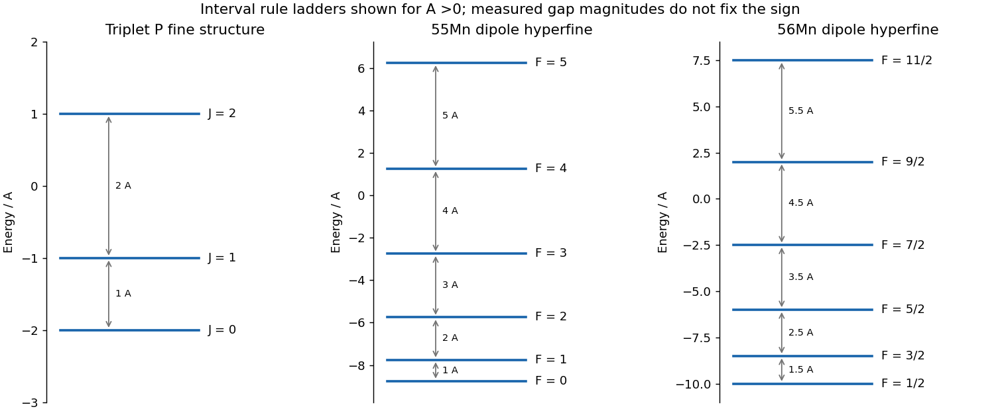

<h1 id="2/b/solution">Solution</h1>

↑ **Parent:** [B](../b.md)

For two [valence electrons](../../../../valence-electron.md), the central-field shell structure should be the largest scale, residual electrostatic interactions should establish a reasonably definite configuration and [atomic term](../../../../atomic-term.md), and [spin-orbit coupling](../../../../spin-orbit-interaction.md) should be weaker than the separations between the relevant terms. Then $L$ and $S$ remain approximately good quantum numbers. Within a well-isolated term the leading [fine structure](../../../../fine-structure.md) interaction can be represented as $A\mathbf L\cdot\mathbf S$. Its coefficient must be effectively constant for all $J$ levels in that term. Mixing of neighboring terms, [spin-spin interactions](../../../../spin-spin-interaction.md), higher-order corrections or strong applied fields can spoil the simple interval rule; [hyperfine structure](../../../../hyperfine-structure.md) must be negligible or separately resolved.

A suitable approximate example is the [magnesium](../../../../magnesium.md) $3s3p\,{}^3P_J$ term, with $L=1$, $S=1$ and $J=0,1,2$. The interval-rule prediction is

$$
\boxed{E_0=-2A,\qquad E_1=-A,\qquad E_2=A,\qquad
E_1-E_0=A,\quad E_2-E_1=2A.}
$$

An arbitrary common term [energy](../../../../energy-split.md) may be added. For $A>0$ the levels ascend in the order ${}^3P_0,{}^3P_1,{}^3P_2$, with gap ratio one to two. Each level still contains $2J+1$ degenerate [magnetic sublevels](../../../../magnetic-sublevel.md) in zero external field. The superscript three labels the [spin multiplicity](../../../../spin-multiplicity.md) $2S+1$, while the different subscripts identify [fine structure](../../../../fine-structure.md) components of that same term. This is an approximate example of [LS coupling](../../../../ls-coupling.md), not a claim that every real two-electron atom has exact one-to-two fine splitting.

**[Figure 2](#2/b/image-fine-structure-and-magnetic-dipole-hyperfine-interval-ladders). Fine-structure and magnetic-dipole hyperfine interval ladders**. Original angular-momentum eigenvalues for positive coupling coefficients. The fine-structure gaps are A and2A; the two hyperfine examples have different lowest total angular momenta. Measured positive gaps alone do not fix the coupling signs.

## ↑ Ancestors (12)

1. [B](../b.md)
2. [2](../../2.md)
3. [2016](../../../2016-split.md)
4. [Past exam of the quantum, atomic and molecular physics course of the University of Oxford](../../../split.md)
5. [Quantum, atomic and molecular physics course of the University of Oxford](../../../../quantum-atomic-and-molecular-physics-course-of-the-university-of-oxford.md)
6. [Year 3 of the physics course of the University of Oxford](../../../../year-3-of-the-physics-course-of-the-university-of-oxford.md)
7. [Physics course of the University of Oxford](../../../../physics-course-of-the-university-of-oxford.md)
8. [Undergraduate course of the University of Oxford](../../../../undergraduate-course-of-the-university-of-oxford.md)
9. [Course of the University of Oxford](../../../../course-of-the-university-of-oxford.md)
10. [University of Oxford](../../../../university-of-oxford-split.md)
11. [List of universities](../../../../list-of-universities.md)
12. [Codex Wiki](../../../../split.md)
