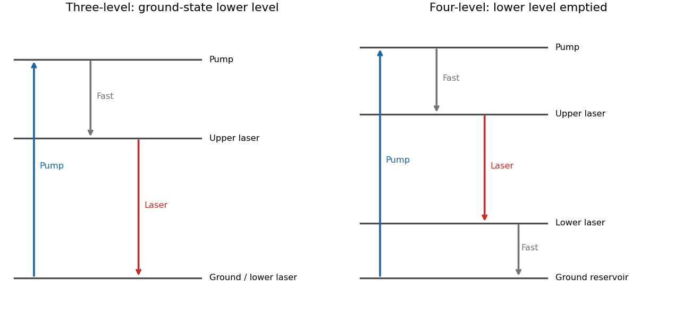

<h1 id="3/a/solution">Solution</h1>

↑ **Parent:** [A](../a.md)

In the ideal [three-level laser](../../../../three-level-laser.md), pumping excites atoms out of the ground state to a higher auxiliary level, rapid relaxation fills a relatively long-lived upper [laser](../../../../laser-split.md) level, and the [laser transition](../../../../laser-transition.md) returns to the ground state. A [ruby laser](../../../../ruby-laser.md) is a standard example of this classification. Since the lower [laser](../../../../laser-split.md) state initially holds most atoms, substantial pumping is needed to reverse the population per sublevel. With upper and lower degeneracies $g_2,g_1$ and $N_1+N_2\simeq N_T$, the positive-gain condition is

$$
N_2/g_2>N_1/g_1,\qquad
\boxed{N_2>\frac{g_2}{g_1+g_2}N_T.}
$$

For equal degeneracies more than half the active atoms must be excited before [optical gain](../../../../optical-gain.md) is even positive.

In a [four-level laser](../../../../four-level-laser.md) the lower [laser](../../../../laser-split.md) level is above the ground reservoir and empties rapidly after [laser](../../../../laser-split.md) emission. Pumping again feeds a higher auxiliary level which relaxes into the upper [laser](../../../../laser-split.md) state, but the lower laser-state population can remain small. The [helium-neon laser](../../../../helium-neon-laser.md) provides a multilevel physical realization often represented by this scheme for a [four-level laser](../../../../four-level-laser.md). Positive [population inversion](../../../../population-inversion.md) then requires much less depletion of the ground reservoir, giving a much lower [laser pump threshold](../../../../laser-pump-threshold.md) for comparable lifetimes, [emission cross sections](../../../../emission-cross-section.md) and cavity losses.

The threshold of a [four-level laser](../../../../four-level-laser.md) is not literally zero. Oscillation requires round-trip [optical gain](../../../../optical-gain.md) to overcome output coupling and other losses, and competing decay or incomplete lower-level removal raises the required pump. Real [laser](../../../../laser-split.md) media contain more atomic states than ideal diagrams for a [three-level laser](../../../../three-level-laser.md) or a [four-level laser](../../../../four-level-laser.md); the labels describe the relevant pumping and laser-transition cycle rather than the total number of states in the material.

**[Figure 3](#3/a/image-why-ground-state-and-rapidly-emptied-lower-laser-levels-give-different-thresholds). Why ground-state and rapidly emptied lower laser levels give different thresholds**. Original three- and four-level pumping cycles. The diagrams distinguish pump absorption, rapid relaxation and stimulated laser emission; real media can contain additional levels.

## ↑ Ancestors (12)

1. [A](../a.md)
2. [3](../../3.md)
3. [2016](../../../2016-split.md)
4. [Past exam of the quantum, atomic and molecular physics course of the University of Oxford](../../../split.md)
5. [Quantum, atomic and molecular physics course of the University of Oxford](../../../../quantum-atomic-and-molecular-physics-course-of-the-university-of-oxford.md)
6. [Year 3 of the physics course of the University of Oxford](../../../../year-3-of-the-physics-course-of-the-university-of-oxford.md)
7. [Physics course of the University of Oxford](../../../../physics-course-of-the-university-of-oxford.md)
8. [Undergraduate course of the University of Oxford](../../../../undergraduate-course-of-the-university-of-oxford.md)
9. [Course of the University of Oxford](../../../../course-of-the-university-of-oxford.md)
10. [University of Oxford](../../../../university-of-oxford-split.md)
11. [List of universities](../../../../list-of-universities.md)
12. [Codex Wiki](../../../../split.md)
