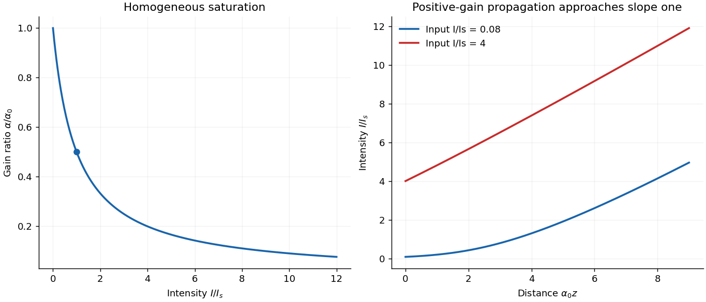

<h1 id="3/c/solution">Solution</h1>

↑ **Parent:** [C](../c.md)

Define $\sigma(\omega)$ as the [emission cross section](../../../../emission-cross-section.md) for an upper-level atom, averaged over the participating sublevels, and let $W=\sigma I/(\hbar\omega)$. Detailed balance gives the upward stimulated rate per lower-level atom as $rW$, where $r=g_2/g_1$. With $D=N_2-rN_1$ the complete [laser rate equations](../../../../laser-rate-equation.md) are

$$
\dot N_2=R_2-AN_2-WD,\qquad
\dot N_1=AN_2+WD-N_1/\tau_1.
$$

Adding them eliminates the internal transitions. Therefore steady state has $N_1=R_2\tau_1$ **even when the radiation is strong**. Substitution into the upper equation gives

$$
N_2=\frac{R_2(1+rW\tau_1)}{A+W},\qquad
D=\frac{R_2(1-rA\tau_1)}{A+W}
=\frac{D_0}{1+W/A}.
$$

One net stimulated transition changes the beam [energy](../../../../energy-split.md) by $\hbar\omega$, so the coefficient of [optical gain](../../../../optical-gain.md) for [intensity](../../../../intensity-physics.md) is $\alpha(\omega,I)=\sigma(\omega)D$. At line center, with $\sigma_0=\sigma(\omega_{21})$,

$$
\boxed{\alpha=\frac{\alpha_0}{1+I/I_s},\qquad
\alpha_0=\sigma_0R_2\left(A^{-1}-r\tau_1\right),\qquad
I_s=\frac{\hbar\omega_{21}A}{\sigma_0}.}
$$

Here $\alpha_0$ is the unsaturated **[intensity](../../../../intensity-physics.md)** [optical gain](../../../../optical-gain.md) per length, which may be negative, and $I_s$ is the [intensity](../../../../intensity-physics.md) at which its magnitude is halved in this model with [homogeneous broadening](../../../../homogeneous-broadening.md). The cancellation of $\tau_1$ from $I_s$ follows from exclusive upper-to-lower decay and constant upper-state pumping. Keeping $N_1=A\tau_1N_2$ in the stimulated problem would discard the stimulated feeding term and give an incorrect saturation scale. Other decay branches or different pump constraints lead to different expressions.

For a traveling beam with uniform pump, no additional loss and local steady populations,

$$
\frac{dI}{dz}=\frac{\alpha_0 I}{1+I/I_s},\qquad
\boxed{\ln\frac{I(z)}{I(0)}+\frac{I(z)-I(0)}{I_s}=\alpha_0z.}
$$

If $\alpha_0>0$ and $I\gg I_s$, the increment becomes $dI/dz\simeq\alpha_0I_s=\hbar\omega_{21}R_2(1-rA\tau_1)$, approximately constant. [Intensity](../../../../intensity-physics.md) then grows **linearly**, rather than exponentially, with distance while that strong-saturation regime persists. Negative $\alpha_0$ gives [saturable absorption](../../../../saturable-absorption.md) and a decreasing beam.

**[Figure 4](#3/c/image-saturated-gain-and-the-crossover-from-exponential-to-approximately-linear-amplification). Saturated gain and the crossover from exponential to approximately linear amplification**. Original steady-state calculation for the specified open pumped model. The propagation curves assume positive unsaturated gain and no added loss; a negative gain example is absorptive.

## ↑ Ancestors (12)

1. [C](../c.md)
2. [3](../../3.md)
3. [2016](../../../2016-split.md)
4. [Past exam of the quantum, atomic and molecular physics course of the University of Oxford](../../../split.md)
5. [Quantum, atomic and molecular physics course of the University of Oxford](../../../../quantum-atomic-and-molecular-physics-course-of-the-university-of-oxford.md)
6. [Year 3 of the physics course of the University of Oxford](../../../../year-3-of-the-physics-course-of-the-university-of-oxford.md)
7. [Physics course of the University of Oxford](../../../../physics-course-of-the-university-of-oxford.md)
8. [Undergraduate course of the University of Oxford](../../../../undergraduate-course-of-the-university-of-oxford.md)
9. [Course of the University of Oxford](../../../../course-of-the-university-of-oxford.md)
10. [University of Oxford](../../../../university-of-oxford-split.md)
11. [List of universities](../../../../list-of-universities.md)
12. [Codex Wiki](../../../../split.md)
