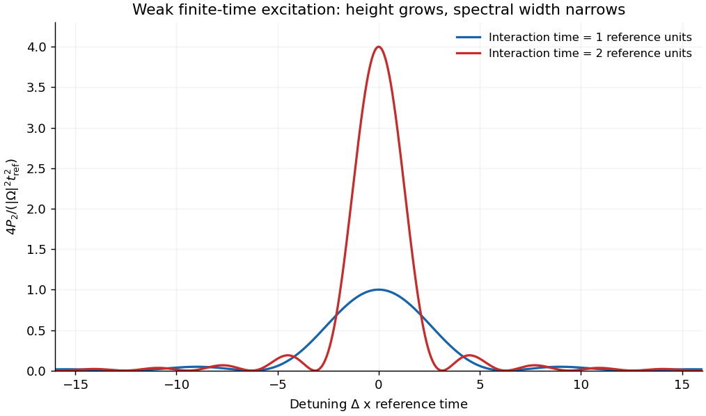

<h1 id="4/c/solution">Solution</h1>

↑ **Parent:** [C](../c.md)

Let $\Delta=\omega-\omega_0$. Near resonance, $|\Delta|\ll\omega_0$, and for weak enough driving $|\Omega|\ll\omega_0$, the term oscillating near $2\omega_0$ averages rapidly compared with the slow response. On times long compared with an optical period it contributes a bounded amplitude of order $\Omega/\omega_0$, whereas the resonant contribution can accumulate. Dropping that counter-rotating term gives

$$
c_2^{\rm RWA}(t)=-i\Omega e^{-i\Delta t/2}\frac{\sin(\Delta t/2)}{\Delta},
\qquad\boxed{P_2(t)=\frac{|\Omega|^2\sin^2(\Delta t/2)}{\Delta^2}
=\frac{|\Omega|^2t^2}{4}\operatorname{sinc}^2(\Delta t/2).}
$$

At exact resonance the continuous limit is $P_2=|\Omega|^2t^2/4$. This remains a **weak-excitation** result, requiring $P_2\ll1$; rotating-wave averaging alone does not justify ignoring depletion forever. Far from resonance or on subcycle timescales, the discarded term may no longer be negligible for the comparison being made.

If one retains the coupled amplitudes instead of fixing $c_1=1$, the rotating-wave propagator is a [unitary operator](../../../../unitary-operator.md). The resulting population in the [Driven two-level Rabi model](../../../../driven-two-level-rabi-model.md) is

$$
P_2^{\rm full\ RWA}(t)=\frac{|\Omega|^2}{|\Omega|^2+\Delta^2}
\sin^2\!\left[\frac t2\sqrt{|\Omega|^2+\Delta^2}\right].
$$

It gives bounded [Rabi oscillations](../../../../rabi-cycle.md) and reduces to the weak-excitation expression over its common range. This distinction prevents the resonant quadratic approximation from being mistaken for a population law valid at arbitrary time.

**[Figure 5](#4/c/image-finite-time-weak-excitation-line-shape-and-its-time-bandwidth-scaling). Finite-time weak-excitation line shape and its time–bandwidth scaling**. Original sinc-squared transition envelopes for two illumination times. Longer interaction narrows the frequency response; the weak-excitation probability must remain small.

## ↑ Ancestors (12)

1. [C](../c.md)
2. [4](../../4.md)
3. [2016](../../../2016-split.md)
4. [Past exam of the quantum, atomic and molecular physics course of the University of Oxford](../../../split.md)
5. [Quantum, atomic and molecular physics course of the University of Oxford](../../../../quantum-atomic-and-molecular-physics-course-of-the-university-of-oxford.md)
6. [Year 3 of the physics course of the University of Oxford](../../../../year-3-of-the-physics-course-of-the-university-of-oxford.md)
7. [Physics course of the University of Oxford](../../../../physics-course-of-the-university-of-oxford.md)
8. [Undergraduate course of the University of Oxford](../../../../undergraduate-course-of-the-university-of-oxford.md)
9. [Course of the University of Oxford](../../../../course-of-the-university-of-oxford.md)
10. [University of Oxford](../../../../university-of-oxford-split.md)
11. [List of universities](../../../../list-of-universities.md)
12. [Codex Wiki](../../../../split.md)
