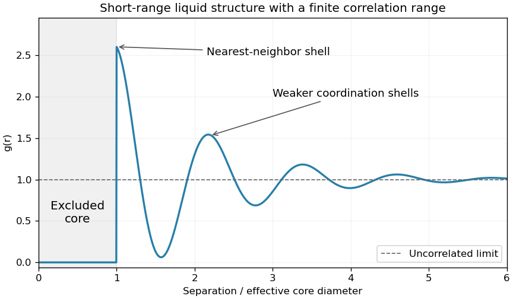
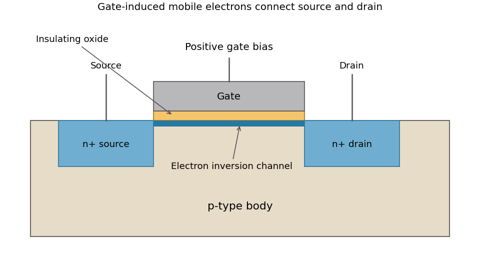
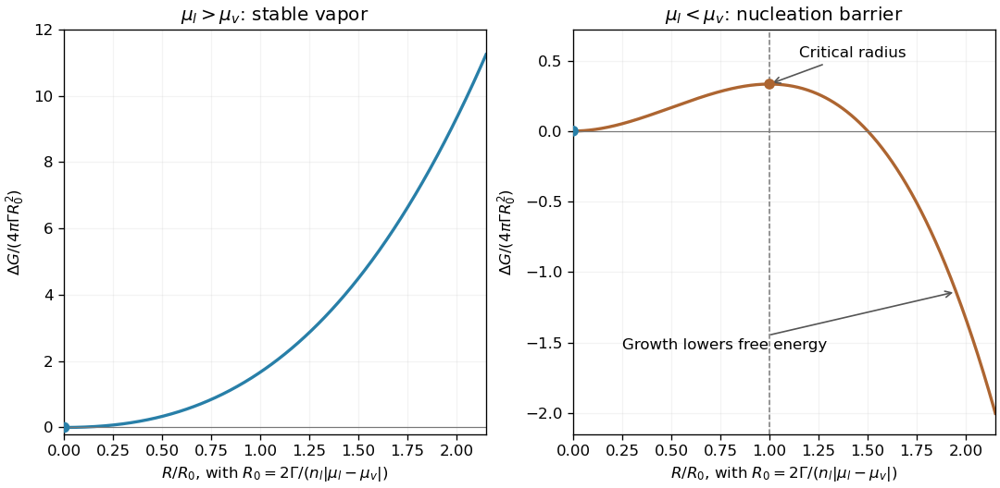
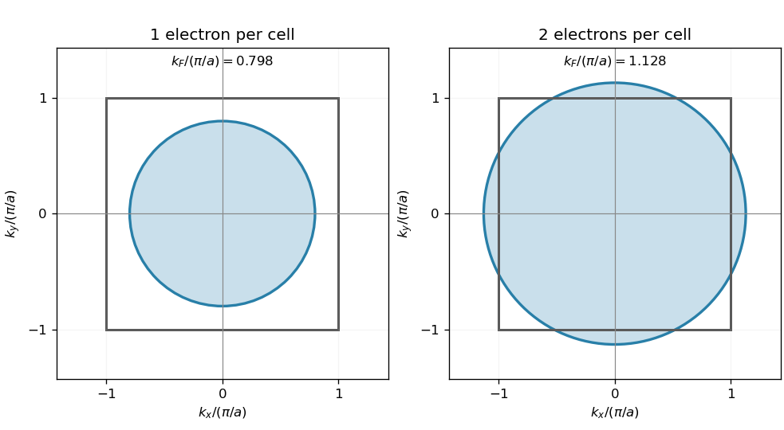
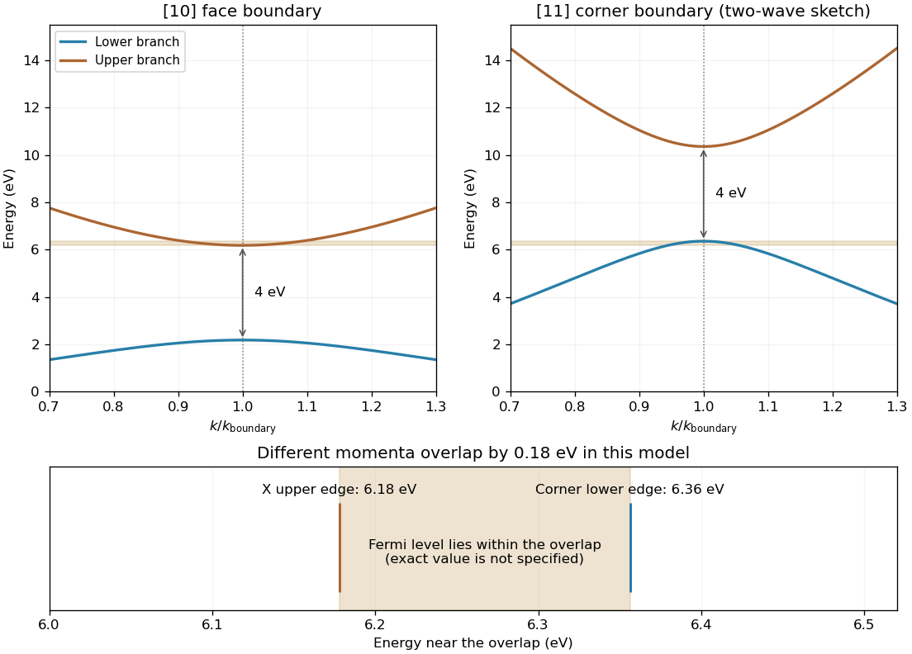

# 2004

↑ **Parent:** [Past exam of the quantum condensed matter course of the University of Cambridge](../past-exam-of-the-quantum-condensed-matter-course-of-the-university-of-cambridge.md)

Official past-paper archive: [https://www.sp.phy.cam.ac.uk/drp2/home.](https://www.sp.phy.cam.ac.uk/drp2/home.) The direct PDF link has not yet been verified.

This archived document is the full Experimental and Theoretical Physics (2) paper, including topics beyond quantum condensed matter.

**Table of contents**

- [Section A](#section-a)
  - [1](#section-a/1)
    - [Solution](#section-a/1/solution)
  - [2](#section-a/2)
    - [Solution](#section-a/2/solution)
  - [3](#section-a/3)
    - [Solution](#section-a/3/solution)
  - [4](#section-a/4)
    - [Solution](#section-a/4/solution)
  - [5](#section-a/5)
    - [Solution](#section-a/5/solution)
  - [6](#section-a/6)
    - [Solution](#section-a/6/solution)
- [Section B](#section-b)
  - [B7](#section-b/b7)
    - [a](#section-b/b7/a)
      - [Solution](#section-b/b7/a/solution)
    - [b](#section-b/b7/b)
      - [Solution](#section-b/b7/b/solution)
    - [c](#section-b/b7/c)
      - [Solution](#section-b/b7/c/solution)
  - [B8](#section-b/b8)
    - [Solution](#section-b/b8/solution)
  - [B9](#section-b/b9)
    - [a](#section-b/b9/a)
      - [Solution](#section-b/b9/a/solution)
    - [b](#section-b/b9/b)
      - [Solution](#section-b/b9/b/solution)
    - [c](#section-b/b9/c)
      - [Solution](#section-b/b9/c/solution)
  - [B10](#section-b/b10)
    - [Solution](#section-b/b10/solution)
- [Section C](#section-c)
  - [C11](#section-c/c11)
    - [Solution](#section-c/c11/solution)
  - [C12](#section-c/c12)
    - [Solution](#section-c/c12/solution)
  - [C13](#section-c/c13)
    - [Solution](#section-c/c13/solution)
  - [C14](#section-c/c14)
    - [Solution](#section-c/c14/solution)

## Section A

↑ **Parent:** [2004](2004.md)

<h3 id="section-a/1">1</h3>

↑ **Parent:** [Section A](#section-a)

<h4 id="section-a/1/solution">Solution</h4>

↑ **Parent:** [1](#section-a/1)

The [radial distribution function](../thermodynamics.md#radial-distribution-function) is the conditional [number density](../statistical-physics.md#number-density) of neighbors at separation $r$, divided by the bulk [number density](../statistical-physics.md#number-density) $n$. In an isotropic three-dimensional liquid, the mean number in a thin spherical shell is $dN=4\pi nr^2g(r)dr$. Strong short-range repulsion makes $g(r)$ very small inside the effective particle core. A first maximum marks the nearest-neighbor coordination shell. More distant shells give weaker oscillations, which decay toward $g(r)=1$ as long-range positional correlations disappear. A typical simple liquid has no indefinitely repeated sharp lattice peaks.

**[Figure 1](#section-a/1/image-excluded-core-and-damped-coordination-shells-in-a-schematic-liquid-pair-distribution). Excluded core and damped coordination shells in a schematic liquid pair distribution**. An original illustrative hard-core liquid profile, not experimental data. The horizontal limit is one; the neighbor count additionally contains the spherical-shell factor $4\pi nr^2$.

The [static structure factor](../critical-phenomenon.md#static-structure-factor) measured by diffraction is related to the Fourier transform of $g(r)-1$. Thus the broad diffraction maxima of a liquid and the damped real-space coordination shells describe the same short-range organization.

<h3 id="section-a/2">2</h3>

↑ **Parent:** [Section A](#section-a)

<h4 id="section-a/2/solution">Solution</h4>

↑ **Parent:** [2](#section-a/2)

Treat $\alpha$ as a constant and use the [canonical ensemble](../canonical-ensemble.md) identity $F=-k_BT\ln Z$. The given formal [partition function](../canonical-ensemble.md#canonical-partition-function) gives $F=\alpha k_BT^3N^2/V$. The [pressure](../pressure.md) is its negative [volume](../geometry-and-topology.md#volume) derivative at fixed $T,N$:

$$
\boxed{P=-\left(\frac{\partial F}{\partial V}\right)_{T,N}=\alpha k_BT^3\frac{N^2}{V^2},\qquad PV^2=\alpha k_BT^3N^2.}
$$

Equivalently $P=k_BT(\partial\ln Z/\partial V)_{T,N}$. The explicit [temperature](../temperature.md) dependence in $\ln Z$ must be retained; this is not the ideal-gas [pressure](../pressure.md) law.

<h3 id="section-a/3">3</h3>

↑ **Parent:** [Section A](#section-a)

<h4 id="section-a/3/solution">Solution</h4>

↑ **Parent:** [3](#section-a/3)

In a [p-n junction](../semiconductor.md#p-n-junction), [diffusion](../thermodynamics.md#diffusion) and [electron-hole recombination](../quantum-mechanics.md#electron-hole-recombination) near the contact leave a [depletion region](../semiconductor.md#depletion-region) of ionized dopants. Its built-in [electric field](../electric-field.md) opposes further majority-carrier [diffusion](../thermodynamics.md#diffusion). At [thermodynamic equilibrium](../thermodynamics.md#thermodynamic-equilibrium) drift and [diffusion](../thermodynamics.md#diffusion) currents cancel. Forward bias lowers the electrostatic barrier and injects [electrons](../physics.md#electron) and [electron holes](../quantum-mechanics.md#electron-hole) across the junction; reverse bias raises the barrier and suppresses that majority-carrier injection. For an ideal diode below breakdown,

$$
\boxed{I=I_s\left(e^{eV/(k_BT)}-1\right).}
$$

Thus a modest forward voltage gives a rapidly increasing current, whereas reverse current remains approximately $-I_s$. This asymmetric current-voltage relation makes the junction a [rectifier](../electrical-circuit.md#rectifier). Real leakage, [electron-hole recombination](../quantum-mechanics.md#electron-hole-recombination) and breakdown limit the ideal expression.

<h3 id="section-a/4">4</h3>

↑ **Parent:** [Section A](#section-a)

<h4 id="section-a/4/solution">Solution</h4>

↑ **Parent:** [4](#section-a/4)

A straight line in $C/T$ against $T^2$ means $C/T=\gamma+\beta T^2$. Reading its intercept and slope gives approximately $\gamma\simeq2.1\,\mathrm{mJ\,mol^{-1}K^{-2}}$ and $\beta\simeq2.7\,\mathrm{mJ\,mol^{-1}K^{-4}}$; the graphical precision is only a few percent. Hence the molar [heat capacity](../heat.md#heat-capacity) is approximately

$$
\boxed{C(T)\simeq(2.1\times10^{-3}\,\mathrm{J\,mol^{-1}K^{-2}})T+(2.7\times10^{-3}\,\mathrm{J\,mol^{-1}K^{-4}})T^3.}
$$

The linear [electronic heat capacity](../heat.md#electronic-heat-capacity) comes from conduction [electrons](../physics.md#electron) within [energy](../energy.md) of order $k_BT$ of the [Fermi energy](../quantum-ideal-gas-statistics.md#fermi-energy); the [Pauli exclusion principle](../tensor-product-of-quantum-systems.md#pauli-exclusion-principle) prevents deeply occupied states from contributing freely. The cubic lattice term is the low-temperature [Debye heat capacity](../quantum-ideal-gas-statistics.md#debye-heat-capacity) of three-dimensional acoustic [phonons](../quantum-ideal-gas-statistics.md#phonon), whose low-frequency [density of states](../quantum-ideal-gas-statistics.md#density-of-states) is proportional to [frequency](../wave.md#frequency) squared. These are molar coefficients, so the [temperature](../temperature.md) powers carry the extra kelvin factors indicated.

<h3 id="section-a/5">5</h3>

↑ **Parent:** [Section A](#section-a)

<h4 id="section-a/5/solution">Solution</h4>

↑ **Parent:** [5](#section-a/5)

For a low [circular orbit](../classical-mechanics.md#circular-orbit), [Newton's law of universal gravitation](../newton-s-law-of-universal-gravitation.md) gives $P=2\pi\sqrt{R^3/(GM)}$. Using $M=4\pi\bar\rho R^3/3$ yields

$$
\boxed{P^2=\frac{3\pi}{G\bar\rho}.}
$$

Thus **the Moon and Mars have roughly comparable [mean densities](../fluid-mechanics.md#mean-density)**: [low circular-orbit period measures mean density](../celestial-mechanics.md#low-circular-orbit-period-measures-mean-density). Equal periods would mean equal [mean densities](../fluid-mechanics.md#mean-density) in this approximation. This does not require their masses or [radii](../topology.md#radius) to be similar. The orbit altitudes must be small compared with the body [radii](../topology.md#radius), and the bodies are being treated as approximately spherical.

<h3 id="section-a/6">6</h3>

↑ **Parent:** [Section A](#section-a)

<h4 id="section-a/6/solution">Solution</h4>

↑ **Parent:** [6](#section-a/6)

The [gain bandwidth](../laser.md#gain-bandwidth) must be expressed as a [frequency](../wave.md#frequency) range:

$$
\Delta\nu=c\left(\frac1{600\,\mathrm{nm}}-\frac1{700\,\mathrm{nm}}\right)\simeq7.14\times10^{13}\,\mathrm{Hz}.
$$

The [gain bandwidth limit on a laser pulse](../optics.md#gain-bandwidth-limit-on-a-laser-pulse) then gives

$$
\boxed{\Delta t\sim\frac1{\Delta\nu}\simeq1.4\times10^{-14}\,\mathrm s,\quad\text{of order }10\,\mathrm{fs}.}
$$

The numerical coefficient depends on the pulse shape and width definition. For example a [Gaussian pulse](../optics.md#gaussian-pulse) whose intensity spectral FWHM actually filled this width would have a transform-limited intensity duration about $6.2\,\mathrm{fs}$. A hard gain interval does not by itself specify such a FWHM. Reaching the estimated scale requires coherent [mode locking](../laser.md#mode-locking) and control of [group velocity dispersion](../dispersion-relation.md#group-velocity-dispersion); the cavity round-trip time determines the pulse separation. An [intensity autocorrelation](../optics.md#intensity-autocorrelation) measurement can estimate the pulse duration once its shape is specified.

## Section B

↑ **Parent:** [2004](2004.md)

<h3 id="section-b/b7">B7</h3>

↑ **Parent:** [Section B](#section-b)

<h4 id="section-b/b7/a">a</h4>

↑ **Parent:** [B7](#section-b/b7)

<h5 id="section-b/b7/a/solution">Solution</h5>

↑ **Parent:** [A](#section-b/b7/a)

This is the [Joule-Thomson coefficient](../enthalpy.md#joule-thomson-coefficient), $\mu_{JT}=(\partial T/\partial P)_H$, describing a [temperature](../temperature.md) change during an isenthalpic [pressure](../pressure.md) change. Here $H$ is [enthalpy](../enthalpy.md), $C_P=(\partial H/\partial T)_P$ is the [heat capacity](../heat.md#heat-capacity) at constant [pressure](../pressure.md), and $V$ is [volume](../geometry-and-topology.md#volume), all for the same chosen amount of substance. Starting with $dH=T\,dS+V\,dP$ and using the [Gibbs free-energy Maxwell relation](../thermodynamic-potential.md#gibbs-free-energy-maxwell-relation) $(\partial S/\partial P)_T=-(\partial V/\partial T)_P$ gives

$$
dH=C_PdT+\left[V-T\left(\frac{\partial V}{\partial T}\right)_P\right]dP.
$$

Setting $dH=0$ proves

$$
\boxed{\mu_{JT}=\frac1{C_P}\left[T\left(\frac{\partial V}{\partial T}\right)_P-V\right].}
$$

In a steady insulated throttle or porous plug, negligible kinetic- and potential-energy changes make the upstream and downstream enthalpies equal. A positive coefficient gives cooling on a [pressure](../pressure.md) decrease; a negative one gives warming. For an [ideal gas](../ideal-gas.md), $V\propto T$ at fixed $P$, so the coefficient is zero. Real-gas interactions permit cooling and an inversion curve, making the effect useful in gas refrigeration and liquefaction.

The [measurement of the Joule-Thomson effect with a porous plug](../enthalpy.md#measuring-the-joule-thomson-effect-with-a-porous-plug) compares pressures and thermometers on the two sides of an insulated flow restriction. Suppressing external [heat](../heat.md) exchange and separating the readings from high-speed jets are part of making the [enthalpy](../enthalpy.md) argument applicable; an arbitrary adiabatic expansion need not be isenthalpic.

<h4 id="section-b/b7/b">b</h4>

↑ **Parent:** [B7](#section-b/b7)

<h5 id="section-b/b7/b/solution">Solution</h5>

↑ **Parent:** [B](#section-b/b7/b)

The [Clapeyron equation](../thermodynamic-potential.md#clausius-clapeyron-relation) gives the slope of a two-phase [phase coexistence curve](../thermodynamic-potential.md#phase-coexistence-curve). Let $s_l,s_v$ and $v_l,v_v$ be [entropy](../entropy.md) and [volume](../geometry-and-topology.md#volume) per molecule, or consistently per mole. Equality of the two [chemical potentials](../chemical-potential.md) and $d\mu=-s\,dT+v\,dP$ imply

$$
0=d(\mu_v-\mu_l)=-(s_v-s_l)dT+(v_v-v_l)dP.
$$

At reversible coexistence the latent [heat](../heat.md) in the same amount convention is $\mathcal L=T(s_v-s_l)$. Therefore

$$
\boxed{\frac{dP}{dT}=\frac{\mathcal L}{T\Delta v},\qquad\Delta v=v_v-v_l.}
$$

The relation assumes [thermodynamic equilibrium](../thermodynamics.md#thermodynamic-equilibrium) between two bulk phases of a pure substance, neglecting curvature and other work terms. For vaporization both latent [heat](../heat.md) and [volume](../geometry-and-topology.md#volume) change are positive, giving a positive vapor-pressure slope. If the vapor is approximately ideal and its [volume](../geometry-and-topology.md#volume) dominates, the [ideal-vapor Clausius-Clapeyron approximation](../thermodynamic-potential.md#ideal-vapor-clausius-clapeyron-approximation) gives $d\ln P/dT\simeq\mathcal L/(k_BT^2)$ with latent [heat](../heat.md) per molecule.

Experimentally, a sealed two-phase sample in a temperature-controlled bath supplies the coexistence [pressure](../pressure.md) as [temperature](../temperature.md) changes. Independent calorimetry and phase-density measurements supply $\mathcal L$ and $\Delta v$, allowing the [pressure](../pressure.md) slope to test the equation. The formula connects those distinct measurements and is a practical route to latent heats.

<h4 id="section-b/b7/c">c</h4>

↑ **Parent:** [B7](#section-b/b7)

<h5 id="section-b/b7/c/solution">Solution</h5>

↑ **Parent:** [C](#section-b/b7/c)

This relates an [thermodynamic equilibrium](../thermodynamics.md#thermodynamic-equilibrium) [variance](../variance.md) to the local stiffness of an appropriate [thermodynamic free energy](../thermodynamic-potential.md#thermodynamic-free-energy). At fixed bath [temperature](../temperature.md), suppose the effective [thermodynamic free energy](../thermodynamic-potential.md#thermodynamic-free-energy) $A(x)$ includes the constraints and the measure for a chosen coordinate. Its [thermodynamic equilibrium](../thermodynamics.md#thermodynamic-equilibrium) [probability density function](../continuous-probability-distribution.md#probability-density-function) is proportional to $e^{-A(x)/(k_BT)}$. Near a stable minimum $x_0$, write

$$
A(x)\simeq A(x_0)+\frac12A''(x_0)(x-x_0)^2,\qquad A''(x_0)>0.
$$

The resulting [normal distribution](../probability-distribution.md#normal-distribution) gives the [Gaussian fluctuation approximation](../perturbative-quantum-field-theory.md#gaussian-fluctuation-approximation)

$$
\boxed{\langle(x-x_0)^2\rangle\simeq\frac{k_BT}{A''(x_0)}.}
$$

This is exact for a quadratic [thermodynamic free energy](../thermodynamic-potential.md#thermodynamic-free-energy) with the stated flat coordinate measure; in general it is a small-fluctuation result. A smaller curvature means a softer restoring response and larger fluctuations. Near vanishing curvature, higher-order terms become important, so the quadratic approximation cannot alone predict an actual infinite variance.

For example [optical trap Langevin calibration](../optics.md#optical-trap-langevin-calibration) uses the Brownian displacement of a trapped bead: $A=\kappa(x-x_0)^2/2$ gives $\kappa=k_BT/\langle\Delta x^2\rangle$. A camera or position detector records the fluctuations. Finite exposure averages rapid motion and can bias the measured variance; the measurement protocol matters as well as the [thermodynamic equilibrium](../thermodynamics.md#thermodynamic-equilibrium) identity.

<h3 id="section-b/b8">B8</h3>

↑ **Parent:** [Section B](#section-b)

<h4 id="section-b/b8/solution">Solution</h4>

↑ **Parent:** [B8](#section-b/b8)

[Entropy](../entropy.md) is a thermodynamic [state function](../thermodynamics.md#state-function). For a reversible [heat](../heat.md) transfer, $dS=\delta Q_{\rm rev}/T$; the [Clausius inequality](../second-law-of-thermodynamics.md#clausius-inequality) generalizes this to irreversible processes. The combined [entropy](../entropy.md) of a system and its surroundings does not decrease. A subsystem can lose [entropy](../entropy.md) by exporting [heat](../heat.md) or matter, so the second-law statement must specify the whole isolated combination. In a simple compressible system,

$$
dU=T\,dS-P\,dV+\mu\,dN,
$$

which identifies [temperature](../temperature.md), [pressure](../pressure.md) and [chemical potential](../chemical-potential.md) as derivatives of the [energy](../energy.md) representation of the state function. [Thermodynamic equilibrium](../thermodynamics.md#thermodynamic-equilibrium) maximizes [entropy](../entropy.md) under fixed total [energy](../energy.md), [volume](../geometry-and-topology.md#volume) and particle number. A [heat](../heat.md) reservoir instead leads to minimizing the [Helmholtz free energy](../thermodynamic-potential.md#helmholtz-free-energy) at fixed $T,V,N$, or the [Gibbs free energy](../thermodynamic-potential.md#gibbs-free-energy) at fixed $T,P,N$.

Statistical mechanics explains the state count. In a [microcanonical ensemble](../statistical-physics.md#microcanonical-ensemble), equally probable compatible microstates give [Boltzmann's entropy formula](../entropy.md#boltzmann-s-entropy-formula), $S=k_B\ln\Omega$. With general discrete probabilities, the [Gibbs entropy](../statistical-physics.md#gibbs-entropy) is

$$
S=-k_B\sum_jp_j\ln p_j.
$$

The microcanonical formula follows by setting every nonzero probability to $1/\Omega$. For a [canonical ensemble](../canonical-ensemble.md), $p_j=e^{-\beta E_j}/Z$, so

$$
\boxed{S=k_B\ln Z+\frac UT,\qquad F=U-TS=-k_BT\ln Z.}
$$

This turns microscopic [energy](../energy.md) levels and their populations into a measurable thermodynamic quantity. Classical phase-space counting needs a consistent microscopic normalization and indistinguishability convention; quantum state counting supplies that normalization. Independent systems have multiplicative state counts and therefore additive entropies.

For an [ideal gas](../ideal-gas.md) freely expanding from [volume](../geometry-and-topology.md#volume) $V$ to $2V$ in an insulated enclosure, [energy](../energy.md) remains fixed while each particle gains twice the accessible position [volume](../geometry-and-topology.md#volume). The state count increases by $2^N$, giving $\boxed{\Delta S=Nk_B\ln2}$. The actual irreversible process transfers no [heat](../heat.md). A reversible isothermal comparison path transfers [heat](../heat.md) $Nk_BT\ln2$ and computes the same [entropy](../entropy.md) change because the initial and final [thermodynamic equilibrium](../thermodynamics.md#thermodynamic-equilibrium) states are the same.

Calorimetry supplies another connection to experiment: at fixed [pressure](../pressure.md) and within one phase, $S(T)-S(0)=\int_0^T C_P(T')\,dT'/T'$, with latent-heat contributions $\mathcal L/T$ at first-order transitions. The [third law of thermodynamics](../thermodynamics.md#third-law-of-thermodynamics) fixes $S(0)=0$ for an ideal perfect crystal with a unique ground state. Degeneracy or frozen disorder can produce [residual entropy](../entropy.md#residual-entropy). [Entropy](../entropy.md) thus links heat-capacity measurements, phase [thermodynamic equilibrium](../thermodynamics.md#thermodynamic-equilibrium) and the number of accessible microscopic configurations.

<h3 id="section-b/b9">B9</h3>

↑ **Parent:** [Section B](#section-b)

<h4 id="section-b/b9/a">a</h4>

↑ **Parent:** [B9](#section-b/b9)

<h5 id="section-b/b9/a/solution">Solution</h5>

↑ **Parent:** [A](#section-b/b9/a)

[Charge carrier mobility](../electric-charge.md#charge-carrier-mobility) measures weak-field drift speed per [electric field](../electric-field.md). For [electrons](../physics.md#electron) and [electron holes](../quantum-mechanics.md#electron-hole),

$$
\mathbf v_e=-\mu_e\mathbf E,\qquad\mathbf v_h=+\mu_h\mathbf E,\qquad\boxed{\sigma=e(n\mu_e+p\mu_h).}
$$

Both mobilities are positive, with SI units $\mathrm{m^2\,V^{-1}s^{-1}}$; the opposite drift signs reflect the opposite carrier charges. In a simple isotropic relaxation-time model, [electron mobility](../electric-charge.md#electron-mobility) is $\mu_e=e\tau_e/m_e^*$ and [hole mobility](../electric-charge.md#hole-mobility) is $\mu_h=e\tau_h/m_h^*$. These are momentum relaxation times, not the [minority carrier lifetime](../quantum-mechanics.md#minority-carrier-lifetime) for [electron-hole recombination](../quantum-mechanics.md#electron-hole-recombination).

Scattering by [phonons](../quantum-ideal-gas-statistics.md#phonon), ionized impurities and defects limits mobility. Increasing [phonon](../quantum-ideal-gas-statistics.md#phonon) populations commonly lowers mobility at high [temperature](../temperature.md); ionized-impurity scattering can dominate at low [temperature](../temperature.md) and high [semiconductor doping](../semiconductor.md#semiconductor-doping). Approximate addition of independent inverse relaxation times is the [Matthiessen's rule](../electric-charge.md#matthiessen-s-rule). At sufficiently strong field, velocity saturation invalidates the constant-mobility drift law.

The [Hall effect](../relativistic-electromagnetism.md#hall-effect) provides a measurement: a current-carrying bar in a perpendicular [magnetic field](../magnetic-field.md) develops a transverse voltage. In a one-carrier model $|R_H|=1/(en)$ and $\mu=\sigma|R_H|$, combining the transverse voltage with longitudinal [electrical conductivity](../electric-charge.md#electrical-conductivity). Multiple carrier types and scattering-dependent Hall factors require a more detailed interpretation.

<h4 id="section-b/b9/b">b</h4>

↑ **Parent:** [B9](#section-b/b9)

<h5 id="section-b/b9/b/solution">Solution</h5>

↑ **Parent:** [B](#section-b/b9/b)

Generation increases the mobile [electron](../physics.md#electron) or hole populations; interband excitation creates an [electron-hole pair](../quantum-mechanics.md#electron-hole-pair). Thermal excitation and absorbed photons are important sources, and [impact ionization](../optical-instrument.md#impact-ionization) can multiply carriers in a strong field. Ordinary single-photon interband absorption needs enough photon [energy](../energy.md) to bridge the [band gap](../bloch-s-theorem.md#band-gap), with the required momentum balance.

[Electron-hole recombination](../quantum-mechanics.md#electron-hole-recombination) removes a pair. [Radiative electron-hole recombination](../quantum-mechanics.md#radiative-electron-hole-recombination) emits a photon, with simple rate $Bnp$; [trap-assisted electron-hole recombination](../semiconductor.md#trap-assisted-electron-hole-recombination) uses localized defect levels and transfers [energy](../energy.md) to the lattice; [Auger recombination](../quantum-mechanics.md#auger-recombination) transfers the [electron-hole recombination](../quantum-mechanics.md#electron-hole-recombination) [energy](../energy.md) to another carrier. The last process becomes especially important at high injection because its rate contains products such as $n^2p$ and $np^2$. The detailed band structure and available defects determine which channel dominates.

At thermal [thermodynamic equilibrium](../thermodynamics.md#thermodynamic-equilibrium), generation and [electron-hole recombination](../quantum-mechanics.md#electron-hole-recombination) continue at equal rates. For the simple radiative model the net [electron-hole recombination](../quantum-mechanics.md#electron-hole-recombination) rate is $B(np-n_i^2)$, enforcing the [semiconductor mass-action law](../semiconductor.md#semiconductor-mass-action-law). Under weak excitation with the majority density nearly fixed, an excess minority density often decays as $\Delta n(t)=\Delta n(0)e^{-t/\tau}$, defining its [minority carrier lifetime](../quantum-mechanics.md#minority-carrier-lifetime).

A short light pulse followed by time-resolved [electrical conductivity](../electric-charge.md#electrical-conductivity) or luminescence measures the relaxation. Spatial [diffusion](../thermodynamics.md#diffusion), trapping and instrumental response must be separated from [electron-hole recombination](../quantum-mechanics.md#electron-hole-recombination) before identifying a single fitted decay constant with the intrinsic lifetime. These processes control photodetector response and light-emitting-device efficiency.

<h4 id="section-b/b9/c">c</h4>

↑ **Parent:** [B9](#section-b/b9)

<h5 id="section-b/b9/c/solution">Solution</h5>

↑ **Parent:** [C](#section-b/b9/c)

An n-channel [MOSFET](../semiconductor.md#mosfet) has two heavily n-doped source and drain regions in a p-type body, with an insulated gate above the intervening surface. A positive gate voltage first depletes surface [electron holes](../quantum-mechanics.md#electron-hole) and then induces an [electron](../physics.md#electron) [semiconductor inversion layer](../semiconductor.md#semiconductor-inversion-layer). Above threshold $V_T$ this layer connects source to drain. Gate voltage controls the channel charge through the oxide capacitance, while the insulating gate permits a very small steady gate current.

**[Figure 2](#section-b/b9/c/image-an-induced-electron-channel-connects-the-source-and-drain-of-an-n-channel-mosfet). An induced electron channel connects the source and drain of an n-channel MOSFET**. Original schematic cross-section in the on state. The oxide separates the gate electrically from the body; the thin surface channel is an inversion layer rather than a permanently n-doped bridge.

For the [long-channel MOSFET current law](../semiconductor.md#long-channel-mosfet-current-law), let $C_{\rm ox}$ be oxide capacitance per area, $W,L$ channel width and length, and use constant mobility $\mu_n$. In the gradual-channel approximation,

$$
I_D=\mu_nC_{\rm ox}\frac WL\left[(V_{GS}-V_T)V_{DS}-\frac{V_{DS}^2}{2}\right],\qquad0<V_{DS}<V_{GS}-V_T.
$$

At larger drain voltage the ideal channel pinches off near the drain and the current saturates at

$$
\boxed{I_{D,\rm sat}=\frac12\mu_nC_{\rm ox}\frac WL(V_{GS}-V_T)^2.}
$$

Carriers still flow through the pinch-off region; pinch-off does not mean zero drain current. These formulas neglect channel-length modulation, short-channel effects and velocity saturation. A p-channel device reverses the carrier type and operating polarities. Gate control makes MOSFETs useful as electronic switches and amplifiers.

<h3 id="section-b/b10">B10</h3>

↑ **Parent:** [Section B](#section-b)

<h4 id="section-b/b10/solution">Solution</h4>

↑ **Parent:** [B10](#section-b/b10)

[Exchange interactions](../electromagnetism.md#exchange-interaction) arise from quantum electronic motion, Coulomb interactions and fermionic antisymmetry. A localized-spin description can be written $H=\sum_{i<j}J_{ij}\mathbf S_i\cdot\mathbf S_j$. In this explicit plus-sign convention $J<0$ favors parallel [spins](../angular-momentum-operator.md#spin) and $J>0$ favors antiparallel [spins](../angular-momentum-operator.md#spin); many texts put a minus sign into the Hamiltonian and reverse that convention.

[Direct exchange](../electromagnetism.md#direct-exchange) involves overlapping orbitals and their Coulomb exchange matrix elements. The [Pauli exclusion principle](../tensor-product-of-quantum-systems.md#pauli-exclusion-principle) correlates [spin](../angular-momentum-operator.md#spin) symmetry with spatial symmetry, changing the electronic [energy](../energy.md). Orbital occupation and competing kinetic processes determine which [spin](../angular-momentum-operator.md#spin) state is favored; the preference is not universally ferromagnetic.

[Superexchange](../electromagnetism.md#superexchange) couples moments through virtual hopping, often via a nonmagnetic ligand. For two half-filled orbitals in the simple repulsive one-band model, the antiferromagnetic coupling is $J\simeq4|t|^2/U$: virtual double occupation lowers the antiparallel-spin state more effectively. Orbital geometry and intermediate-state interactions can change the sign in other configurations. Real charge transport can remain insulating while this magnetic coupling acts.

[Double exchange](../electromagnetism.md#double-exchange-mechanism) instead uses actual carrier motion between mixed-valence sites. Local [Hund's coupling](../chemistry.md#hund-s-coupling) ties the mobile [electron](../physics.md#electron)'s [spin](../angular-momentum-operator.md#spin) to a core moment. Parallel neighboring cores allow a larger effective hopping amplitude and a lower carrier [kinetic energy](../energy.md#kinetic-energy), favoring ferromagnetism. The original model explicitly connected conduction and magnetic order in manganese perovskites.[1951 abstract: correlation of electrical conduction with ferromagnetism and its double-exchange interpretation](../physics-bibliography.md#interaction-between-the-d-shells-in-the-transition-metals-ii-ferromagnetic-compounds-of-manganese-with-perovskite-structure-by-clarence-zener)

[Conduction-electron-mediated exchange](../electromagnetism.md#conduction-electron-mediated-exchange) couples localized moments through a metal's electronic [spin](../angular-momentum-operator.md#spin) response. Its strength and sign depend on separation and the [Fermi surface](../fermi-liquid.md#fermi-surface); in a simple three-dimensional asymptotic model the range factor oscillates as $\cos(2k_Fr)/r^3$. The original nuclear-moment calculation was motivated by resonance-line broadening in silver.[1954 abstract and introduction: nuclear moments coupled through conduction-electron hyperfine interactions](../physics-bibliography.md#indirect-exchange-coupling-of-nuclear-magnetic-moments-by-conduction-electrons-by-m-a-ruderman-and-charles-kittel) In an itinerant metal, an alternative description compares the kinetic-energy cost of unequal [spin](../angular-momentum-operator.md#spin) populations with the exchange-energy gain; the [Stoner criterion](../statistical-physics.md#stoner-criterion) expresses when spontaneous polarization is favorable.

The resulting order also depends on the lattice and competing couplings. In [ferromagnetism](../electromagnetism.md#ferromagnetism), moments align to give a nonzero moment within a domain. In [antiferromagnetism](../electromagnetism.md#antiferromagnetism), opposing sublattices cancel their moments. In [ferrimagnetism](../electromagnetism.md#ferrimagnetism), oppositely ordered sublattices have unequal moments and leave a net one. A bulk zero magnetization alone cannot distinguish antiferromagnetic order from a disordered state or canceling [magnetic domains](../electromagnetism.md#magnetic-domain).

The [manganese monoxide neutron diffraction experiment](../electromagnetism.md#manganese-monoxide-neutron-diffraction-experiment) makes that distinction experimentally. A monochromatic neutron beam scatters from powdered material, and a counter records angular intensity. Comparing the same compound at room [temperature](../temperature.md) and $80\,\mathrm K$ reveals additional low-temperature magnetic reflections, indexed by a larger magnetic unit cell, while nuclear reflections persist. That spatial periodicity is evidence of alternating order even though the net moment cancels.[1949, Fig. 1 and its room-temperature/80 K comparison](../physics-bibliography.md#detection-of-antiferromagnetism-by-neutron-diffraction-by-clifford-glenwood-shull-and-j-samuel-smart)

## Section C

↑ **Parent:** [2004](2004.md)

<h3 id="section-c/c11">C11</h3>

↑ **Parent:** [Section C](#section-c)

<h4 id="section-c/c11/solution">Solution</h4>

↑ **Parent:** [C11](#section-c/c11)

For a bulk liquid and vapor at common fixed [temperature](../temperature.md) and [pressure](../pressure.md), transfer $dN_l$ molecules from vapor to liquid while holding their sum fixed. The [Gibbs free energy](../thermodynamic-potential.md#gibbs-free-energy) change is $dG=(\mu_l-\mu_v)dN_l$. [Thermodynamic equilibrium](../thermodynamics.md#thermodynamic-equilibrium) with both phases present requires stationarity under either sign of transfer, hence $\boxed{\mu_l=\mu_v}$. This is the bulk coexistence condition; an interface's curvature adds a surface-energy cost.

In the capillarity approximation, take an incompressible drop with constant liquid [number density](../statistical-physics.md#number-density) $n_l$, bulk [chemical potential](../chemical-potential.md) $\mu_l$ at the specified reservoir conditions, and size-independent [surface tension](../surface-tension.md) $\Gamma$. The liquid bulk is extensive, so its Gibbs [thermodynamic free energy](../thermodynamic-potential.md#thermodynamic-free-energy) is $N_l\mu_l$. Creating interface area reversibly at fixed [temperature](../temperature.md) adds $\Gamma A$. Equivalently, along growth at fixed bulk parameters the stated differential integrates as $dG_d=\mu_l\,dN_l+\Gamma\,dA$, with the no-drop reference set to zero. For a sphere,

$$
\boxed{G_d=\frac43\pi R^3n_l\mu_l+4\pi R^2\Gamma.}
$$

This approximation uses bulk properties for the interior and neglects the molecular interface thickness, curvature dependence of [surface tension](../surface-tension.md) and higher compressibility corrections. It does not apply quantitatively to drops only a few molecules across.

The vapor contains $N-N_l$ molecules. Treat its [chemical potential](../chemical-potential.md) as approximately unchanged by forming the drop, as for a large surrounding reservoir or negligible vapor depletion. Then

$$
\boxed{G_{\rm tot}(R)=N\mu_v+\frac43\pi n_l(\mu_l-\mu_v)R^3+4\pi\Gamma R^2.}
$$

The [radius](../topology.md#radius) is limited by the available molecules in a finite sample; the constant-reservoir expression is a local nucleation model, not a description of arbitrarily complete vapor depletion. The excess over the vapor reference has derivative

$$
\Delta G'(R)=4\pi R[2\Gamma+n_l(\mu_l-\mu_v)R].
$$

If $\mu_l>\mu_v$, it increases for every $R>0$, leaving only the stable boundary minimum $R=0$. If $\mu_l<\mu_v$, $R=0$ is a metastable local minimum and the additional stationary [radius](../topology.md#radius) is

$$
\boxed{R_c=\frac{2\Gamma}{n_l(\mu_v-\mu_l)}.}
$$

At that [radius](../topology.md#radius) $\Delta G''=-8\pi\Gamma<0$, so it is an unstable maximum. The [classical nucleation theory](../thermodynamic-potential.md#classical-nucleation-theory) barrier is $16\pi\Gamma^3/[3n_l^2(\mu_v-\mu_l)^2]$.

**[Figure 3](#section-c/c11/image-surface-cost-and-bulk-gain-produce-a-critical-droplet-in-supersaturated-vapor). Surface cost and bulk gain produce a critical droplet in supersaturated vapor**. Original dimensionless capillarity curves. The supersaturated case has a barrier at the critical radius; the other curve rises monotonically. These are reservoir-model free energies, before finite-sample depletion changes the chemical potentials.

A fluctuation below $R_c$ tends to shrink because reducing its surface cost lowers [thermodynamic free energy](../thermodynamic-potential.md#thermodynamic-free-energy). **A supercritical drop tends to grow**, because its bulk free-energy gain outweighs the added surface cost. Growth continues while material supply and supersaturation allow it, eventually changing the vapor state or leading to macroscopic liquid. Curved-interface [pressure](../pressure.md) and chemical [thermodynamic equilibrium](../thermodynamics.md#thermodynamic-equilibrium) can also be described through the [Young–Laplace equation](../surface-tension.md#young-laplace-equation) and the [Kelvin equation](../thermodynamic-potential.md#kelvin-equation).

<h3 id="section-c/c12">C12</h3>

↑ **Parent:** [Section C](#section-c)

<h4 id="section-c/c12/solution">Solution</h4>

↑ **Parent:** [C12](#section-c/c12)

Put $z=e^{\beta\mu}$, with $\beta=1/(k_BT)$. For a single quantum state of [energy](../energy.md) $\epsilon$, dilute [Maxwell–Boltzmann statistics](../quantum-ideal-gas-statistics.md#maxwell-boltzmann-statistics) gives $\ln\Xi_\epsilon\simeq ze^{-\beta\epsilon}$. For bosons this is the leading expansion of $-\ln(1-ze^{-\beta\epsilon})$; the occupation must be small for that expansion. Thus the [grand potential](../statistical-physics.md#grand-potential) is

$$
\boxed{\Phi(\epsilon)=-k_BT\ln\Xi_\epsilon\simeq-k_BT e^{-\beta(\epsilon-\mu)}.}
$$

With the ground-state [energy](../energy.md) set to zero, a dilute classical gas requires $e^{\beta\mu}\ll1$, giving negative $\mu$. This sign is relative to the chosen [energy](../energy.md) zero. For an ideal Bose gas, $\mu$ approaches the ground [energy](../energy.md) from below at condensation, so it approaches zero with this convention.

The printed degeneracy formula requires $n_x,n_y,n_z=0,1,2,\ldots$, rather than strictly positive integers. With zero-point [energy](../energy.md) omitted these are the appropriate oscillator quantum numbers. The [stars and bars](../combinatorics.md#stars-and-bars-combinatorics) count of three nonnegative integers summing to $n$ gives

$$
\boxed{d_n=\binom{n+2}{2}=\frac{(n+2)!}{n!\,2!}.}
$$

There is one ground state at $n=0$. If the integers were strictly positive, the count would instead be $\binom{n-1}{2}$ for $n\geq3$, inconsistent with both the printed formula and its [energy](../energy.md) reference.

For large $n$, $d_n\simeq n^2/2$. Consecutive [energy](../energy.md) shells are separated by $\hbar\omega$, giving the continuum [density of states](../quantum-ideal-gas-statistics.md#density-of-states)

$$
\boxed{g(E)\simeq\frac{n^2}{2\hbar\omega}=\frac{E^2}{2(\hbar\omega)^3}.}
$$

Use this when $k_BT\gg\hbar\omega$, and integrate the single-state grand potential over [energy](../energy.md):

$$
\Phi_{\rm tot}\simeq-\frac{k_BT e^{\beta\mu}}{2(\hbar\omega)^3}\int_0^\infty E^2e^{-\beta E}dE=-\frac{(k_BT)^4}{(\hbar\omega)^3}e^{\beta\mu},
$$

because the integral is $2/\beta^3$. Particle number follows by differentiating at fixed [temperature](../temperature.md) and trap [frequency](../wave.md#frequency):

$$
N=-\frac{\partial\Phi}{\partial\mu}=\left(\frac{k_BT}{\hbar\omega}\right)^3e^{\beta\mu},\qquad\boxed{\mu=k_BT\ln\left[N\left(\frac{\hbar\omega}{k_BT}\right)^3\right].}
$$

These are the high-temperature expressions for the [classical grand potential in a harmonic trap](../ideal-gas.md#classical-grand-potential-in-a-harmonic-trap).

Extrapolating to $\mu=0$ gives the requested transition scale

$$
\boxed{T_c\sim\frac{\hbar\omega}{k_B}N^{1/3}.}
$$

It is an order-one estimate because Maxwell-Boltzmann occupations cease to be accurate near condensation. The [Bose-Einstein distribution](../quantum-ideal-gas-statistics.md#bose-einstein-distribution) gives the more precise ideal-trap result $N_{\rm ex}^{\max}=\zeta(3)(k_BT/\hbar\omega)^3$, and hence $T_c=(\hbar\omega/k_B)[N/\zeta(3)]^{1/3}$, about $0.94$ times the estimate. Excess particles populate the ground state after the excited-state capacity saturates: [Bose condensation in a three-dimensional harmonic trap](../quantum-ideal-gas-statistics.md#bose-condensation-in-a-three-dimensional-harmonic-trap).

The [observation of Bose-Einstein condensation in rubidium in 1995](../quantum-ideal-gas-statistics.md#observation-of-bose-einstein-condensation-in-rubidium-in-1995) implemented laser precooling followed by radio-frequency evaporation from a magnetic trap. Imaging the released cloud revealed a narrow anisotropic component within a broader thermal population. This provides an experimental connection to the population-counting argument; the measured expansion also reflects interactions and imaging resolution, not just the ideal-trap [density of states](../quantum-ideal-gas-statistics.md#density-of-states).[1995, pp. 198–201, Figs. 1–4](../physics-bibliography.md#observation-of-bose-einstein-condensation-in-a-dilute-atomic-vapor-by-m-h-anderson-and-others)

<h3 id="section-c/c13">C13</h3>

↑ **Parent:** [Section C](#section-c)

<h4 id="section-c/c13/solution">Solution</h4>

↑ **Parent:** [C13](#section-c/c13)

For an isotropic free-electron gas at zero [temperature](../temperature.md), the [Fermi wavevector](../quantum-ideal-gas-statistics.md#fermi-wavevector) is the [radius](../topology.md#radius) of the occupied region in [wavevector](../elasticity-physics.md#wavevector) space. Its [energy](../energy.md) is $E_F=\hbar^2k_F^2/(2m)$. The first [Brillouin zone](../bloch-s-theorem.md#brillouin-zone) is the Wigner-Seitz cell of the [reciprocal lattice](../quantum-scattering.md#reciprocal-lattice); it contains one distinct crystal momentum per primitive cell and per band, with [spin](../angular-momentum-operator.md#spin) counted separately.

For a two-dimensional sample of area $A$, allowed wavevectors have density $A/(2\pi)^2$. Including two [spin](../angular-momentum-operator.md#spin) states, filling a circle gives $N=2[A/(2\pi)^2]\pi k_F^2$. Dividing by area therefore yields

$$
\boxed{k_F=\sqrt{2\pi n}.}
$$

The square lattice has one atom per area $a^2$, so for valence $z$ the free-electron density is $z/a^2$. Its [Brillouin zone](../bloch-s-theorem.md#brillouin-zone) has $|k_x|,|k_y|\leq\pi/a$. Thus

$$
\boxed{k_F^{(1)}=\frac{\sqrt{2\pi}}a\simeq8.36\times10^9\,\mathrm{m^{-1}},\qquad k_F^{(2)}=\frac{\sqrt{4\pi}}a\simeq1.18\times10^{10}\,\mathrm{m^{-1}}.}
$$

The monovalent Fermi circle lies inside the square. The divalent circle crosses the faces but misses the corners; its area equals the zone's area. These are the free-electron contours before distortion by the periodic potential.

**[Figure 4](#section-c/c13/image-free-electron-fermi-circles-for-one-and-two-electrons-per-square-lattice-cell). Free-electron Fermi circles for one and two electrons per square-lattice cell**. Original reciprocal-space diagrams in units of $\pi/a$. The divalent circle has the same area as the square zone but a different shape, extending beyond the faces while leaving corner regions outside the circle.

At a Bragg plane, the periodic potential mixes degenerate plane waves differing by a [reciprocal lattice vector](../quantum-scattering.md#reciprocal-lattice-vector). The two standing-wave combinations have different charge densities relative to the ions and split in [energy](../energy.md), opening the gap. In a two-wave approximation, the boundary energies are $E_B\pm E_g/2$, with $E_g=2|V_G|$.

The boundary [wavevector](../elasticity-physics.md#wavevector) magnitude is $\pi/a$ along $[10]$ and $\sqrt2\pi/a$ along $[11]$. The free-electron boundary energies are therefore

$$
E_X=\frac{\hbar^2\pi^2}{2ma^2}\simeq4.18\,\mathrm{eV},\qquad E_M=2E_X\simeq8.36\,\mathrm{eV}.
$$

Within the stated direction-independent gap picture, the upper band's lowest face-edge [energy](../energy.md) is approximately $E_X+2\,\mathrm{eV}=6.18\,\mathrm{eV}$, while the lower band's corner-edge [energy](../energy.md) is approximately $E_M-2\,\mathrm{eV}=6.36\,\mathrm{eV}$. There is consequently a small overlap, about $0.18\,\mathrm{eV}$, rather than a global insulating gap. The divalent Fermi level lies in that overlap, producing occupied upper-band states and unfilled lower-band states.

**[Figure 5](#section-c/c13/image-an-equal-local-splitting-can-leave-overlap-between-different-zone-edge-directions). An equal local splitting can leave overlap between different zone-edge directions**. Original schematic two-wave dispersions near the $[10]$ and $[11]$ boundaries. The shaded Fermi-level range marks the overlap implied by the question's direction-independent gap approximation; no precise Fermi energy is inferred. These separate directional sketches do not specify a complete two-dimensional periodic potential.

Thus **the intended isotropic-gap approximation predicts a metal**, with small [electron](../physics.md#electron) and hole pockets. [Positive direct gaps can coexist with band overlap](../bloch-s-theorem.md#positive-direct-gaps-can-coexist-with-band-overlap). A fully specified square-lattice potential would require simultaneous treatment of the corner degeneracies; a numerical boundary splitting alone does not uniquely determine an arbitrary two-dimensional band structure. The conclusion here uses the given simplified gap picture, rather than [electron](../physics.md#electron) count alone.

<h3 id="section-c/c14">C14</h3>

↑ **Parent:** [Section C](#section-c)

<h4 id="section-c/c14/solution">Solution</h4>

↑ **Parent:** [C14](#section-c/c14)

[Semiconductor doping](../semiconductor.md#semiconductor-doping) introduces electrically active impurities. In [gallium arsenide](../chemical-substance.md#gallium-arsenide), [silicon](../chemical-substance.md#silicon) has one more valence [electron](../physics.md#electron) than [gallium](../chemical-substance.md#gallium) but one fewer than [arsenic](../chemical-substance.md#arsenic). [Silicon](../chemical-substance.md#silicon) on a [gallium](../chemical-substance.md#gallium) site can therefore supply a shallow donor [electron](../physics.md#electron), while [silicon](../chemical-substance.md#silicon) on an [arsenic](../chemical-substance.md#arsenic) site can accept an [electron](../physics.md#electron) and leave a mobile hole. It is an [amphoteric dopant](../semiconductor.md#amphoteric-dopant), so its net effect depends on site occupation and growth conditions.[1999 abstract: neutral and ionized donors on Ga sites and acceptors on As sites](../physics-bibliography.md#thermal-equilibrium-concentrations-of-the-amphoteric-dopant-si-and-the-associated-carrier-concentrations-in-gaas-by-chang-ho-chen-and-others)

For isotropic parabolic bands, shift the [energy](../energy.md) origin in the given free-electron [density of states](../quantum-ideal-gas-statistics.md#density-of-states) to the appropriate band edge and use its effective [mass](../classical-mechanics.md#mass):

$$
\boxed{g_c(E)=\frac1{2\pi^2}\left(\frac{2m_e}{\hbar^2}\right)^{3/2}\sqrt{E-\epsilon_c},\quad E\geq\epsilon_c,}
$$

and, for valence [electron](../physics.md#electron) states,

$$
\boxed{g_v(E)=\frac1{2\pi^2}\left(\frac{2m_h}{\hbar^2}\right)^{3/2}\sqrt{\epsilon_v-E},\quad E\leq\epsilon_v.}
$$

The stated normalization includes the two [spin](../angular-momentum-operator.md#spin) states and assumes one effective valley. In a nondegenerate semiconductor, the conduction occupation is approximately $e^{-(E-\mu)/(k_BT)}$ and the probability of a valence hole is approximately $e^{(E-\mu)/(k_BT)}$. Substituting $x=(E-\epsilon_c)/(k_BT)$ in the first integral, and the corresponding hole [energy](../energy.md) in the second, gives

$$
n=N_ce^{-(\epsilon_c-\mu)/(k_BT)},\qquad p=N_ve^{-(\mu-\epsilon_v)/(k_BT)},
$$

where the [effective density of states](../semiconductor.md#effective-density-of-states) values are $N_c=2[m_ek_BT/(2\pi\hbar^2)]^{3/2}$ and $N_v=2[m_hk_BT/(2\pi\hbar^2)]^{3/2}$. The factor $\sqrt\pi/2$ comes from the supplied Gaussian-weighted integral. Multiplying cancels the shared [thermodynamic equilibrium](../thermodynamics.md#thermodynamic-equilibrium) [chemical potential](../chemical-potential.md) and proves the [semiconductor mass-action law](../semiconductor.md#semiconductor-mass-action-law):

$$
\boxed{np=N_cN_ve^{-E_g/(k_BT)}=4\left(\frac{k_BT}{2\pi\hbar^2}\right)^3(m_em_h)^{3/2}e^{-E_g/(k_BT)}.}
$$

For the given sample $N_D=2\times10^{21}\,\mathrm{m^{-3}}$ and $N_A=10^{21}\,\mathrm{m^{-3}}$. With complete donor ionization and occupied acceptors, [charge neutrality](../electric-charge.md#charge-neutrality) gives $n-p=N_D-N_A=10^{21}\,\mathrm{m^{-3}}$. At $293\,\mathrm K$ the given masses and gap give

$$
N_c\simeq3.92\times10^{23}\,\mathrm{m^{-3}},\quad N_v\simeq8.56\times10^{24}\,\mathrm{m^{-3}},\quad n_i^2\simeq1.26\times10^{24}\,\mathrm{m^{-6}}.
$$

Solving the [compensated semiconductor](../semiconductor.md#compensated-semiconductor) equations, or using $n_i\ll N_D-N_A$, yields

$$
\boxed{n\simeq1.00\times10^{21}\,\mathrm{m^{-3}},\qquad p=\frac{n_i^2}{n}\simeq1.26\times10^3\,\mathrm{m^{-3}}.}
$$

The very small minority density is consistent with the wide gap and the strongly n-type balance. Also $n/N_c\simeq2.6\times10^{-3}\ll1$ and $p/N_v\ll1$, checking the nondegenerate approximation. The acceptor levels are occupied in this n-type regime; complete acceptor ionization in the compensation equation is appropriate to the model.

At low [temperature](../temperature.md) [dopant freeze-out](../semiconductor.md#dopant-freeze-out) reduces the conduction-electron population; a quantitative curve would require dopant binding energies and occupation factors. Once donors are ionized while intrinsic excitation is negligible, $n\simeq N_D-N_A$ gives an extrinsic plateau. At higher [temperature](../temperature.md) intrinsic pairs eventually dominate, so $n\simeq p\simeq n_i(T)\propto T^{3/2}e^{-E_g/(2k_BT)}$ if the gap and masses are treated as constant. Real gap and [mass](../classical-mechanics.md#mass) changes modify that last expression.

## ↑ Ancestors (10)

1. [Past exam of the quantum condensed matter course of the University of Cambridge](../past-exam-of-the-quantum-condensed-matter-course-of-the-university-of-cambridge.md)
2. [Quantum Condensed Matter course of the University of Cambridge](../university-of-cambridge.md#quantum-condensed-matter-course-of-the-university-of-cambridge)
3. [Physics course of the year 3 of the natural sciences course of the University of Cambridge](../university-of-cambridge.md#physics-course-of-the-year-3-of-the-natural-sciences-course-of-the-university-of-cambridge)
4. [Year 3 of the natural sciences course of the University of Cambridge](../university-of-cambridge.md#year-3-of-the-natural-sciences-course-of-the-university-of-cambridge)
5. [Year of the natural sciences course of the University of Cambridge](../university-of-cambridge.md#year-of-the-natural-sciences-course-of-the-university-of-cambridge)
6. [Natural sciences course of the University of Cambridge](../university-of-cambridge.md#natural-sciences-course-of-the-university-of-cambridge)
7. [Course of the University of Cambridge](../university-of-cambridge.md#course-of-the-university-of-cambridge)
8. [University of Cambridge](../university-of-cambridge.md)
9. [List of universities](../README.md#list-of-universities)
10. [Codex Wiki](../README.md)
