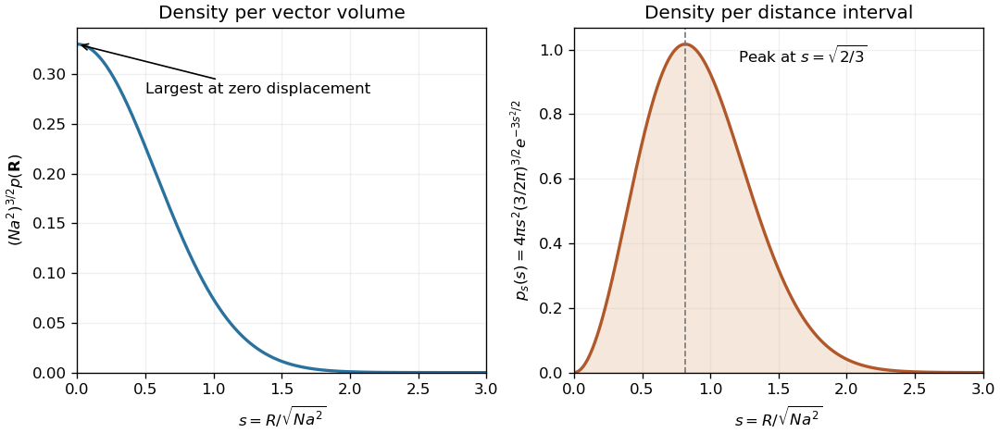

<h1 id="section-a/a3/solution">Solution</h1>

↑ **Parent:** [A3](../a3.md)

An [ideal chain](../../../../ideal-chain.md) can be treated as a [random walk](../../../../random-walk-split.md) when effective segment orientations are independent and isotropic, segment length is fixed, and interactions such as long-range excluded volume are absent or effectively screened. A large number of segments is needed for the Gaussian continuum approximation. Write $\mathbf R=\sum_{j=1}^N\mathbf a_j$. Each Cartesian component has mean zero and variance $Na^2/3$, so the [central limit theorem](../../../../central-limit-theorem.md) gives the [Gaussian limit of the end-to-end distribution of a freely jointed chain](../../../../gaussian-limit-of-the-end-to-end-distribution-of-a-freely-jointed-chain.md)

$$
\boxed{p(\mathbf R,N)\simeq\left(\frac{2\pi Na^2}{3}\right)^{-3/2}\exp\left[-\frac{3R^2}{2Na^2}\right].}
$$

Equivalently, one step has characteristic function $\sin(ka)/(ka)$; taking its $N$th power and expanding its logarithm gives $e^{-Na^2k^2/6}$, whose inverse Fourier transform is this density. It is a density per vector volume $d^3R$. The scalar end-to-end-distance density is **$4\pi R^2p(\mathbf R,N)$**. Thus the printed expression must be interpreted as a vector density; it is also a large-$N$ approximation, not the exact finite-chain distribution near $R=Na$.

For a [freely rotating chain](../../../../freely-rotating-chain.md), neighboring forward bond vectors have fixed angle $\theta$, and independently uniform torsion angles give $\langle\mathbf a_i\cdot\mathbf a_j\rangle=a^2\alpha^{|j-i|}$ with $\alpha=\cos\theta$. Squaring the sum of bonds therefore gives

$$
\langle R^2\rangle=Na^2+2a^2\sum_{i<j}\alpha^{j-i}.
$$

There are $N-k$ pairs separated by $k$ bonds, so the [characteristic ratio of a freely rotating chain](../../../../characteristic-ratio-of-a-freely-rotating-chain.md) is

$$
\boxed{C_N=1+\frac2N\sum_{k=1}^{N-1}(N-k)\alpha^k=1+2\sum_{k=1}^{N-1}\alpha^k-\frac2N\sum_{k=1}^{N-1}k\alpha^k.}
$$

For fixed $|\alpha|<1$, the geometric sums give $C_N=(1+\alpha)/(1-\alpha)-2\alpha(1-\alpha^N)/[N(1-\alpha)^2]$. The correction vanishes as $N\to\infty$, yielding

$$
\boxed{C_\infty=\frac{1+\cos\theta}{1-\cos\theta}.}
$$

For the specified polyethylene parameters, $\alpha=\cos(-70.5^\circ)\simeq0.333807$, so $C_\infty\simeq2.00213$ and $C_{9160}\simeq2.00197$. Hence

$$
\boxed{\sqrt{\langle R^2\rangle}=a\sqrt{NC_N}\simeq20.85\,\mathrm{nm}.}
$$

The negative sign of the stated angle does not affect its cosine. The forward-bond angle is supplementary to the chemical internal bond angle. This freely rotating estimate includes fixed-angle correlations but omits torsional energy preferences; the [Kuhn length of a freely rotating chain](../../../../kuhn-length-of-a-freely-rotating-chain.md) expresses the same long-chain persistence as $b_K=aC_\infty$.

**[Figure 1](#section-a/a3/image-vector-density-and-radial-density-describe-different-polymer-end-to-end-events). Vector density and radial density describe different polymer end-to-end events**. Original large-$N$ Gaussian-chain calculation using $s=R/\sqrt{Na^2}$. The left curve is the scaled three-dimensional vector density; the right includes the shell factor $4\pi s^2$ and is normalized with respect to $ds$. Thus the vector density peaks at zero displacement while the most probable distance is nonzero.

## ↑ Ancestors (13)

1. [A3](../a3.md)
2. [Section A](../../section-a.md)
3. [2005](../../../2005-split.md)
4. [Past exam of the quantum condensed matter course of the University of Cambridge](../../../split.md)
5. [Quantum Condensed Matter course of the University of Cambridge](../../../../quantum-condensed-matter-course-of-the-university-of-cambridge.md)
6. [Physics course of the year 3 of the natural sciences course of the University of Cambridge](../../../../physics-course-of-the-year-3-of-the-natural-sciences-course-of-the-university-of-cambridge.md)
7. [Year 3 of the natural sciences course of the University of Cambridge](../../../../year-3-of-the-natural-sciences-course-of-the-university-of-cambridge.md)
8. [Year of the natural sciences course of the University of Cambridge](../../../../year-of-the-natural-sciences-course-of-the-university-of-cambridge.md)
9. [Natural sciences course of the University of Cambridge](../../../../natural-sciences-course-of-the-university-of-cambridge.md)
10. [Course of the University of Cambridge](../../../../course-of-the-university-of-cambridge.md)
11. [University of Cambridge](../../../../university-of-cambridge-split.md)
12. [List of universities](../../../../list-of-universities.md)
13. [Codex Wiki](../../../../split.md)
