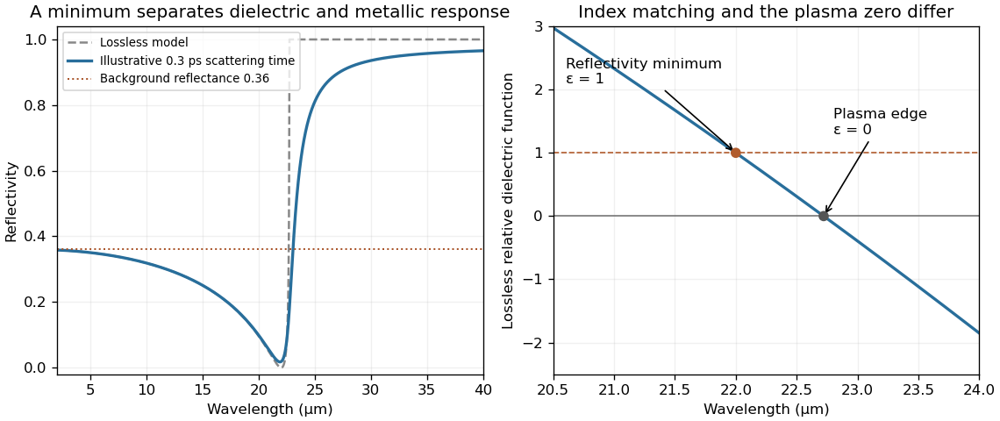

<h1 id="section-b/b5/solution">Solution</h1>

↑ **Parent:** [B5](../b5.md)

In a [direct optical transition](../../../../direct-optical-transition.md), a [photon](../../../../photon.md) promotes an [electron](../../../../electron.md) between the [valence band](../../../../valence-band.md) and [conduction band](../../../../conduction-band.md) at essentially the same crystal wavevector: optical [photon](../../../../photon.md) momentum is small on the scale of the [Brillouin zone](../../../../brillouin-zone.md). An [indirect optical transition](../../../../indirect-optical-transition.md) also needs a [phonon](../../../../phonon.md) or another momentum source. Near an indirect gap, [phonon](../../../../phonon.md) emission requires [photon energy](../../../../photon-energy.md) approximately $E_g+\hbar\Omega$, while [phonon](../../../../phonon.md) absorption permits $E_g-\hbar\Omega$ with a thermally occupied phonon.

Strong direct interband absorption needs both many allowed transitions and a nonzero optical matrix element. The [joint density of states](../../../../joint-density-of-states.md) counts pairs with $E_c(\mathbf k)-E_v(\mathbf k)=\hbar\omega$; nearly parallel bands and critical points of this energy difference can enhance it. Dipole selection rules and polarization weight that count, so a large joint density of states alone does not guarantee a strong absorption peak.

The supplied infrared spectrum lies below the interband threshold and instead probes free-carrier response. In the [Drude model](../../../../drude-model.md), $\epsilon(\omega)=\epsilon_\infty-\omega_p^2/[\omega(\omega+i/\tau)]$, with $\omega_p^2=ne^2/(\epsilon_0m^*)$. At long wavelengths the mobile electrons screen the field and the reflectivity is high. As wavelength decreases through the screened plasma edge, the real dielectric function becomes positive and propagating light can enter. The reflectivity reaches its minimum near index matching, $\epsilon\simeq1$, then rises toward the bound-electron background reflectance.

For background $\epsilon_\infty=16$, its refractive index is four and the normal-incidence [Fresnel equations](../../../../fresnel-equations.md) give $R_\infty=[(4-1)/(4+1)]^2=9/25=0.36$. The short-wavelength side of the figure is approaching a reflectance of this order, consistent with that background; its shortest plotted wavelength still has a carrier correction. Here “infinity” means high frequency relative to the free-carrier scale while remaining below the remote interband resonances.

The [Drude-Lorentz reflectivity minimum](../../../../drude-lorentz-reflectivity-minimum.md) is near $\epsilon=1$, not the plasma-edge zero $\epsilon=0$. Reading the deep minimum as $\lambda_{\min}\simeq22\,\mu\mathrm m$ and neglecting damping there gives $\omega_p^2=(\epsilon_\infty-1)(2\pi c/\lambda_{\min})^2$. The [carrier effective mass from a reflectivity minimum](../../../../carrier-effective-mass-from-a-reflectivity-minimum.md) is therefore

$$
\boxed{m^*=\frac{ne^2\lambda_{\min}^2}{4\pi^2\epsilon_0c^2(\epsilon_\infty-1)}\simeq1.45\times10^{-32}\,\mathrm{kg}\simeq0.016m_e.}
$$

The graph supports only a rough read-off: shifting the minimum by $0.5\,\mu\mathrm m$ changes this mass by about five percent. The deep narrow minimum supports the weak-loss assumption $\omega\tau\gg1$ in this region, although finite scattering explains why the long-wavelength reflectivity is below unity. The estimate also assumes one dominant carrier species, a nonmagnetic bulk sample and a nearly constant background dielectric function. If the plasma-edge zero is used instead, its denominator is $\epsilon_\infty$ and its wavelength is slightly longer; the two wavelengths must not be interchanged.

**[Figure 2](#section-b/b5/image-drude-model-reflectivity-minimum-and-screened-plasma-edge). Drude-model reflectivity minimum and screened plasma edge**. Original calculation using $n=5.50\times10^{23}\,\mathrm{m^{-3}}$, $\epsilon_\infty=16$ and a mass chosen to place the lossless reflectivity minimum at $22\,\mu\mathrm m$. The finite-scattering curve uses an illustrative $0.3\,\mathrm{ps}$ relaxation time, not a fit to the exam's data. The supplied figure has not been copied or traced.

## ↑ Ancestors (13)

1. [B5](../b5.md)
2. [Section B](../../section-b.md)
3. [2005](../../../2005-split.md)
4. [Past exam of the quantum condensed matter course of the University of Cambridge](../../../split.md)
5. [Quantum Condensed Matter course of the University of Cambridge](../../../../quantum-condensed-matter-course-of-the-university-of-cambridge.md)
6. [Physics course of the year 3 of the natural sciences course of the University of Cambridge](../../../../physics-course-of-the-year-3-of-the-natural-sciences-course-of-the-university-of-cambridge.md)
7. [Year 3 of the natural sciences course of the University of Cambridge](../../../../year-3-of-the-natural-sciences-course-of-the-university-of-cambridge.md)
8. [Year of the natural sciences course of the University of Cambridge](../../../../year-of-the-natural-sciences-course-of-the-university-of-cambridge.md)
9. [Natural sciences course of the University of Cambridge](../../../../natural-sciences-course-of-the-university-of-cambridge.md)
10. [Course of the University of Cambridge](../../../../course-of-the-university-of-cambridge.md)
11. [University of Cambridge](../../../../university-of-cambridge-split.md)
12. [List of universities](../../../../list-of-universities.md)
13. [Codex Wiki](../../../../split.md)
