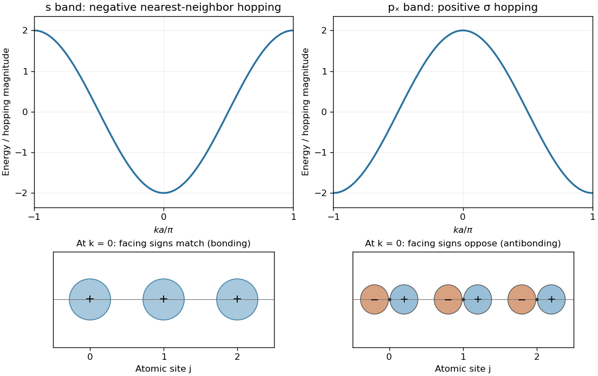

<h1 id="section-b/b6/solution">Solution</h1>

↑ **Parent:** [B6](../b6.md)

In the [Bloch wave](../../../../bloch-state.md) sum, $N$ is the number of sites, $R_j=ja$ the equilibrium position of site $j$, $\phi(r-R_j)$ a localized atomic orbital there, and $k$ the crystal wavevector. The phase factor gives the translation character of the [Bloch state](../../../../bloch-state.md). The factor $1/\sqrt N$ normalizes it when the site orbitals are treated as orthonormal; appreciable intersite overlap requires an overlap-dependent normalization.

For a [tight-binding model](../../../../tight-binding.md), choose localized orbitals and calculate the on-site and intersite Hamiltonian matrix elements. Form Bloch sums for each orbital type and solve $H(k)c=E(k)S(k)c$ at each $k$, where $S(k)$ is the orbital-overlap matrix. In the [orthogonal tight-binding approximation](../../../../orthogonal-tight-binding-approximation.md), $S=I$. The eigenvalues give the energy bands and the eigenvectors their orbital composition; the [nonorthogonal nearest-neighbour tight-binding band](../../../../nonorthogonal-nearest-neighbour-tight-binding-band.md) illustrates how retained overlap modifies this procedure.

For one orthonormal s orbital per site, keep on-site energy $\epsilon_s$ and real nearest-neighbor [hopping integral](../../../../hopping-integral.md) $t=\langle\phi_j|H|\phi_{j+1}\rangle$. The two neighbors contribute phases $e^{\pm ika}$, giving $E_s(k)=\epsilon_s+2t\cos ka$. The band-curvature definition $1/m^*=E''(k)/\hbar^2$ gives

$$
\boxed{m^*(0)=-\frac{\hbar^2}{2ta^2},\qquad m^*(\pm\pi/a)=\frac{\hbar^2}{2ta^2},\qquad W=4|t|.}
$$

With the usual bonding convention $t<0$ for these s orbitals, the center is a minimum with positive electron effective mass and the edge a maximum with negative electron effective mass. Hole masses near a filled-band maximum have the opposite sign.

For p orbitals aligned along the chain, the [orbital phase and the sign of one-dimensional hopping](../../../../orbital-phase-and-the-sign-of-one-dimensional-hopping.md) reverse the usual center-versus-edge ordering. Choose every $p_x$ orbital with its positive lobe on the right. Equal neighboring Bloch coefficients then bring opposite-sign lobes together between sites, giving an antibonding state at $k=0$. Alternating coefficients at $k=\pi/a$ make those facing lobes have the same sign, producing the lower bonding state. Thus a nearest-neighbor model has $E_p(k)=\epsilon_p+2t_\sigma\cos ka$ with the usual $t_\sigma>0$, maximum at zero and minima at the zone edges. This uses a fixed common orbital-phase convention at all sites.

**[Figure 3](#section-b/b6/image-opposite-band-curvature-for-bonding-s-orbitals-and-chain-aligned-p-orbitals). Opposite band curvature for bonding s orbitals and chain-aligned p orbitals**. Original nearest-neighbor dispersions with independent zero on-site energies and unit hopping magnitudes. The lower diagrams show orbital signs for equal site coefficients at the zone center: s lobes face with the same sign, while neighboring $p_x$ lobes face with opposite signs. Energies and orbital sizes are schematic.

## ↑ Ancestors (13)

1. [B6](../b6.md)
2. [Section B](../../section-b.md)
3. [2005](../../../2005-split.md)
4. [Past exam of the quantum condensed matter course of the University of Cambridge](../../../split.md)
5. [Quantum Condensed Matter course of the University of Cambridge](../../../../quantum-condensed-matter-course-of-the-university-of-cambridge.md)
6. [Physics course of the year 3 of the natural sciences course of the University of Cambridge](../../../../physics-course-of-the-year-3-of-the-natural-sciences-course-of-the-university-of-cambridge.md)
7. [Year 3 of the natural sciences course of the University of Cambridge](../../../../year-3-of-the-natural-sciences-course-of-the-university-of-cambridge.md)
8. [Year of the natural sciences course of the University of Cambridge](../../../../year-of-the-natural-sciences-course-of-the-university-of-cambridge.md)
9. [Natural sciences course of the University of Cambridge](../../../../natural-sciences-course-of-the-university-of-cambridge.md)
10. [Course of the University of Cambridge](../../../../course-of-the-university-of-cambridge.md)
11. [University of Cambridge](../../../../university-of-cambridge-split.md)
12. [List of universities](../../../../list-of-universities.md)
13. [Codex Wiki](../../../../split.md)
