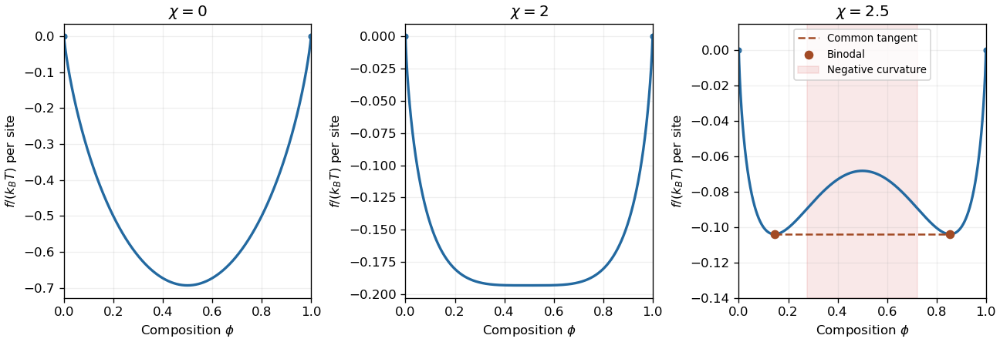

<h1 id="section-a/a2/a/solution">Solution</h1>

↑ **Parent:** [A](../a.md)

For equal-size molecules, let $f$ be the mixing [Helmholtz free energy](../../../../../helmholtz-free-energy.md) per lattice site. [Flory–Huggins solution theory](../../../../../flory-huggins-solution-theory.md) reduces to the [regular solution model](../../../../../regular-solution.md):

$$
\boxed{\frac f{k_BT}=\phi\ln\phi+(1-\phi)\ln(1-\phi)+\chi\phi(1-\phi).}
$$

The first two terms are minus the combinatorial [entropy of mixing](../../../../../entropy-of-mixing.md); the last is the excess cost of unlike contacts. A positive [Flory interaction parameter](../../../../../flory-interaction-parameter.md) penalizes such contacts. Additive terms linear in composition change the chosen pure-component reference but do not change stability.

A small composition fluctuation at fixed mean composition costs energy proportional to $f''$. Thus local stability requires $f''>0$, and the [spinodal](../../../../../spinodal.md) is

$$
\boxed{\frac{f''}{k_BT}=\frac1{\phi(1-\phi)}-2\chi,\qquad \chi_s(\phi)=\frac1{2\phi(1-\phi)}.}
$$

Inside this curve, $f''<0$ and arbitrarily small composition fluctuations grow. The minimum of $\chi_s$ is at $\phi=1/2$, giving **the critical value $\chi_c=2$**. At the [thermodynamic critical point](../../../../../thermodynamic-critical-point.md), $f^{(2)}=f^{(3)}=0$ while $f^{(4)}>0$.

For $\chi=0$, $f$ is strictly convex with its minimum at $1/2$. At $\chi=2$, the central quadratic term vanishes but a positive quartic term remains. At $\chi=2.5$, there are two minima and a central maximum; the [spinodal](../../../../../spinodal.md) compositions are $(1\pm\sqrt{1-2/\chi})/2\simeq0.2764,0.7236$. The [common-tangent construction](../../../../../common-tangent-construction.md) gives coexisting compositions $\phi_b\simeq0.1448$ and $1-\phi_b$, satisfying $\ln[\phi_b/(1-\phi_b)]+\chi(1-2\phi_b)=0$. Between a binodal endpoint and the spinodal, the homogeneous state is locally stable but metastable; global stability requires the convex envelope of $f$.

**[Figure 1](#section-a/a2/a/image-mixing-free-energies-and-the-onset-of-phase-separation). Mixing free energies and the onset of phase separation**. Original lattice-model curves with independent vertical scales. The two-phase free energy for $\chi=2.5$ is the horizontal common tangent between the two marked binodal compositions; shaded regions identify negative curvature.

## ↑ Ancestors (14)

1. [A](../a.md)
2. [A2](../../a2.md)
3. [Section A](../../../section-a.md)
4. [2006](../../../../2006-split.md)
5. [Past exam of the quantum condensed matter course of the University of Cambridge](../../../../split.md)
6. [Quantum Condensed Matter course of the University of Cambridge](../../../../../quantum-condensed-matter-course-of-the-university-of-cambridge.md)
7. [Physics course of the year 3 of the natural sciences course of the University of Cambridge](../../../../../physics-course-of-the-year-3-of-the-natural-sciences-course-of-the-university-of-cambridge.md)
8. [Year 3 of the natural sciences course of the University of Cambridge](../../../../../year-3-of-the-natural-sciences-course-of-the-university-of-cambridge.md)
9. [Year of the natural sciences course of the University of Cambridge](../../../../../year-of-the-natural-sciences-course-of-the-university-of-cambridge.md)
10. [Natural sciences course of the University of Cambridge](../../../../../natural-sciences-course-of-the-university-of-cambridge.md)
11. [Course of the University of Cambridge](../../../../../course-of-the-university-of-cambridge.md)
12. [University of Cambridge](../../../../../university-of-cambridge-split.md)
13. [List of universities](../../../../../list-of-universities.md)
14. [Codex Wiki](../../../../../split.md)
