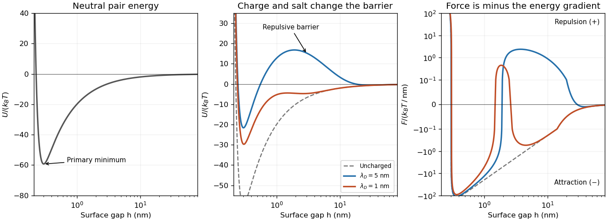

<h1 id="section-a/a3/e/solution">Solution</h1>

↑ **Parent:** [E](../e.md)

The force is determined by the total normal stress of the ionic liquid. The ions contribute [osmotic pressure](../../../../../osmotic-pressure.md) because confining an excess number density costs translational [entropy](../../../../../entropy-split.md). The [osmotic stress in a symmetric electric double layer](../../../../../osmotic-stress-in-a-symmetric-electric-double-layer.md), relative to the bulk reservoir, is

$$
\Pi=k_BT(n_++n_--2n_0)-\frac{\varepsilon E^2}{2}.
$$

The second term is the normal electrostatic stress. The [Poisson-Boltzmann equation](../../../../../poisson-boltzmann-equation.md) makes this combination independent of position between planar surfaces. At the midpoint of identical equally charged surfaces, symmetry gives $E=0$, so

$$
\boxed{\Pi_{\rm mid}=2n_0k_BT\left[\cosh\!\frac{q\psi_{\rm mid}}{k_BT}-1\right].}
$$

Calculating only the repulsion of bare surface charges would omit both the screening ion cloud and its entropic stress. Evaluating the total stress at the midpoint packages their combined force in a particularly simple form.

For equal spheres, assume $h\ll a$, $\kappa a\gg1$, weak surface potential and weak overlap, with prescribed $\psi_0$. Then $\psi_{\rm mid}\simeq2\psi_0e^{-\kappa h/2}$ gives $\Pi\simeq2\varepsilon\kappa^2\psi_0^2e^{-\kappa h}$. Integrating once gives the planar interaction energy per area, $W=\int_h^\infty\Pi(s)ds\simeq2\varepsilon\kappa\psi_0^2e^{-\kappa h}$, and the [Derjaguin approximation](../../../../../derjaguin-approximation.md) gives the repulsive sphere force. Combining it with the [near-contact van der Waals attraction of spheres](../../../../../near-contact-van-der-waals-attraction-of-spheres.md) yields the [DLVO theory](../../../../../dlvo-theory.md) approximation

$$
\boxed{F(h)\simeq2\pi\varepsilon a\kappa\psi_0^2e^{-\kappa h}-\frac{A_Ha}{12h^2}.}
$$

Positive force is repulsive. The exponential term can produce a repulsive barrier in the corresponding pair energy; the short-range attraction leads to a primary minimum, while a shallower secondary minimum may occur farther out. Adding salt shortens the repulsion and can destroy the barrier, allowing [particle aggregation](../../../../../particle-aggregation.md). Molecular contact requires a repulsive-core correction, and changing the charge-regulation boundary condition changes the electrostatic prefactor.

**[Figure 2](#section-a/a3/e/image-neutral-attraction-charge-stabilized-pair-energies-and-the-corresponding-forces). Neutral attraction, charge-stabilized pair energies and the corresponding forces**. Original illustrative model, not measured data: $U/(k_BT)=C[h_0^8/(9h^9)-1/h]+Be^{-h/\lambda}$, with lengths in nm, $C=20\,\mathrm{nm}$, $h_0=0.3\,\mathrm{nm}$ and $B=40$. The neutral curve has $B=0$; the charged curves use screening lengths $5$ and $1\,\mathrm{nm}$. The force is $-dU/dh$, and a positive value means repulsion. The contact core regularizes the continuum attraction.

## ↑ Ancestors (14)

1. [E](../e.md)
2. [A3](../../a3.md)
3. [Section A](../../../section-a.md)
4. [2006](../../../../2006-split.md)
5. [Past exam of the quantum condensed matter course of the University of Cambridge](../../../../split.md)
6. [Quantum Condensed Matter course of the University of Cambridge](../../../../../quantum-condensed-matter-course-of-the-university-of-cambridge.md)
7. [Physics course of the year 3 of the natural sciences course of the University of Cambridge](../../../../../physics-course-of-the-year-3-of-the-natural-sciences-course-of-the-university-of-cambridge.md)
8. [Year 3 of the natural sciences course of the University of Cambridge](../../../../../year-3-of-the-natural-sciences-course-of-the-university-of-cambridge.md)
9. [Year of the natural sciences course of the University of Cambridge](../../../../../year-of-the-natural-sciences-course-of-the-university-of-cambridge.md)
10. [Natural sciences course of the University of Cambridge](../../../../../natural-sciences-course-of-the-university-of-cambridge.md)
11. [Course of the University of Cambridge](../../../../../course-of-the-university-of-cambridge.md)
12. [University of Cambridge](../../../../../university-of-cambridge-split.md)
13. [List of universities](../../../../../list-of-universities.md)
14. [Codex Wiki](../../../../../split.md)
