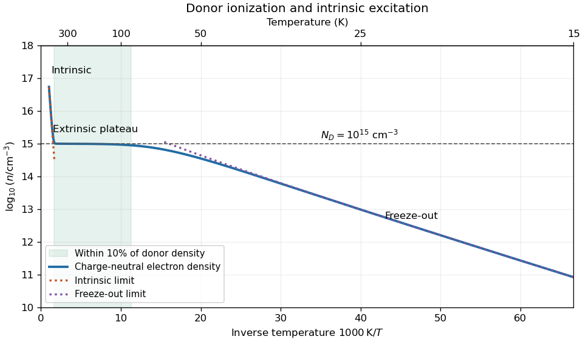

<h1 id="section-b/b5/solution">Solution</h1>

↑ **Parent:** [B5](../b5.md)

An [intrinsic semiconductor](../../../../intrinsic-semiconductor.md) has negligible electrically active impurity doping, and thermal excitation across its [band gap](../../../../band-gap.md) produces equal electron and hole densities $n=p=n_i$. In an extrinsic sample, [semiconductor doping](../../../../semiconductor-doping.md) supplies [donor impurities](../../../../donor-impurity.md) or [acceptor impurities](../../../../acceptor-impurity.md), so one carrier species dominates over a range of temperatures. Doping does not remove the possibility of low-temperature [dopant freeze-out](../../../../dopant-freeze-out.md) or high-temperature intrinsic behavior.

Assume parabolic isotropic band edges, spin degeneracy two, a single valley, [thermal equilibrium](../../../../thermal-equilibrium-split.md) and nondegenerate carriers. Write $E_F$ for the [Fermi level](../../../../fermi-level.md), and measure conduction-band energy by $E=E_c+\epsilon$. Counting momentum states gives the [density of states](../../../../density-of-states.md) per unit volume

$$
g_c(\epsilon)=\frac1{2\pi^2}\left(\frac{2m_e^*}{\hbar^2}\right)^{3/2}\sqrt\epsilon.
$$

The low-occupation [Maxwell–Boltzmann statistics](../../../../maxwell-boltzmann-statistics.md) gives

$$
n=e^{(E_F-E_c)/(k_BT)}\int_0^\infty g_c(\epsilon)e^{-\epsilon/(k_BT)}d\epsilon=N_c e^{(E_F-E_c)/(k_BT)},\quad N_c=2\left(\frac{m_e^*k_BT}{2\pi\hbar^2}\right)^{3/2}.
$$

The substitution $x=\epsilon/(k_BT)$ and $\int_0^\infty\sqrt{x}e^{-x}dx=\sqrt\pi/2$ give the coefficient. Similarly $p=N_v e^{(E_v-E_F)/(k_BT)}$ and $N_v=2[m_h^*k_BT/(2\pi\hbar^2)]^{3/2}$. Multiplication eliminates $E_F$, proving the [semiconductor mass-action law](../../../../semiconductor-mass-action-law.md)

$$
\boxed{np=n_i^2=N_cN_ve^{-E_g/(k_BT)}=4\left(\frac{k_BT}{2\pi\hbar^2}\right)^3(m_e^*m_h^*)^{3/2}e^{-E_g/(k_BT)}.}
$$

Here the supplied effective masses are treated as the masses entering the [effective density of states](../../../../effective-density-of-states.md). A detailed multivalley silicon model would require the appropriate valley degeneracy and density-of-states masses consistently; adding an extra factor without changing the stated model would alter the requested expression.

A pentavalent arsenic impurity supplies a weakly bound excess electron. In the [hydrogenic donor state](../../../../hydrogenic-donor-state.md) approximation, dielectric screening reduces the Coulomb attraction and the band effective mass replaces the free mass. Hence the donor binding energy is

$$
\boxed{E_b=13.6057\,\mathrm{eV}\,\frac{m_e^*/m_e}{\varepsilon_r^2}=13.6057\frac{0.3}{12^2}\,\mathrm{eV}\simeq0.0283\,\mathrm{eV}=28.3\,\mathrm{meV}.}
$$

This is the effective-mass estimate, without a material-specific central-cell correction.

For the temperature plot use donor density $N_D=10^{15}\,\mathrm{cm}^{-3}$ and no acceptors. The [charge neutrality with partial donor ionization](../../../../charge-neutrality-with-partial-donor-ionization.md) model puts $E_D=E_c-E_b$ and includes the twofold spin degeneracy of an occupied donor:

$$
N_D^+=\frac{N_D}{1+2e^{(E_F-E_D)/(k_BT)}}=\frac{N_D}{1+(2n/N_c)e^{E_b/(k_BT)}},\qquad n-p=N_D^+,\qquad p=\frac{n_i^2}{n}.
$$

These equations give three regimes. At low temperature, $p$ is negligible and strong [dopant freeze-out](../../../../dopant-freeze-out.md) gives $n\simeq\sqrt{N_DN_c/2}\,e^{-E_b/(2k_BT)}$. At intermediate temperature, the donors are almost ionized and intrinsic holes remain rare, so $n\simeq N_D$. At high temperature, $n\simeq p\simeq n_i\propto T^{3/2}e^{-E_g/(2k_BT)}$. Thus the log-density plot against inverse temperature has a steep intrinsic segment on the left, a nearly horizontal extrinsic plateau, and a freeze-out decline on the right; the $T^{3/2}$ and $T^{3/4}$ factors give slight curvature.

**[Figure 3](#section-b/b5/image-carrier-freeze-out-extrinsic-plateau-and-intrinsic-excitation-in-the-specified-donor-model). Carrier freeze-out, extrinsic plateau and intrinsic excitation in the specified donor model**. Original charge-neutral calculation using $N_D=10^{15}\,\mathrm{cm}^{-3}$, constant $E_g=1.12\,\mathrm{eV}$, the supplied single-valley effective masses and donor degeneracy factor two. Dotted lines show limiting expressions where they apply; the shaded temperature interval uses a stated ten-percent plateau tolerance.

To quantify “approximately constant”, require $0.9N_D\leq n\leq1.1N_D$. At $300\,\mathrm K$, the specified model gives $N_c\simeq4.12\times10^{18}$, $N_v\simeq8.61\times10^{18}$ and $n_i\simeq2.33\times10^9\,\mathrm{cm}^{-3}$. The full neutrality equations give the ten-percent plateau interval

$$
\boxed{T\simeq89\text{–}600\,\mathrm K\quad\text{(roughly }90\text{–}600\,\mathrm K\text{ in this model).}}
$$

The lower boundary is set by donor ionization and the upper boundary by intrinsic electron-hole production. The large ratio $N_c/N_D$ allows substantial donor ionization even when $k_BT<E_b$; using only $k_BT\gg E_b$ would incorrectly exclude much of the plateau. The quoted interval depends on the chosen tolerance and the constant-gap band model, rather than being an exact measured range for arsenic-doped silicon.

## ↑ Ancestors (13)

1. [B5](../b5.md)
2. [Section B](../../section-b.md)
3. [2006](../../../2006-split.md)
4. [Past exam of the quantum condensed matter course of the University of Cambridge](../../../split.md)
5. [Quantum Condensed Matter course of the University of Cambridge](../../../../quantum-condensed-matter-course-of-the-university-of-cambridge.md)
6. [Physics course of the year 3 of the natural sciences course of the University of Cambridge](../../../../physics-course-of-the-year-3-of-the-natural-sciences-course-of-the-university-of-cambridge.md)
7. [Year 3 of the natural sciences course of the University of Cambridge](../../../../year-3-of-the-natural-sciences-course-of-the-university-of-cambridge.md)
8. [Year of the natural sciences course of the University of Cambridge](../../../../year-of-the-natural-sciences-course-of-the-university-of-cambridge.md)
9. [Natural sciences course of the University of Cambridge](../../../../natural-sciences-course-of-the-university-of-cambridge.md)
10. [Course of the University of Cambridge](../../../../course-of-the-university-of-cambridge.md)
11. [University of Cambridge](../../../../university-of-cambridge-split.md)
12. [List of universities](../../../../list-of-universities.md)
13. [Codex Wiki](../../../../split.md)
