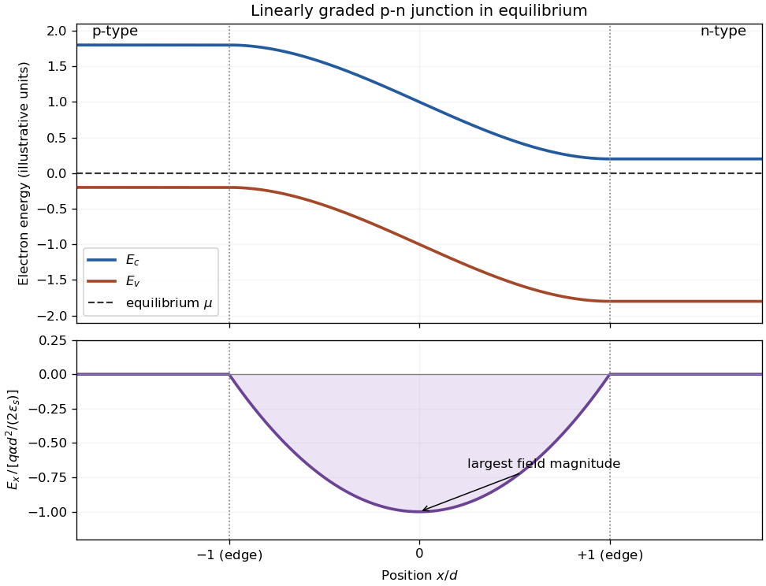
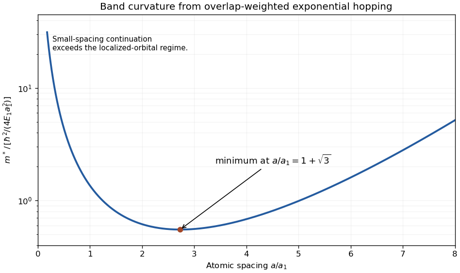

# 2007

↑ **Parent:** [Past exam of the quantum condensed matter course of the University of Cambridge](../past-exam-of-the-quantum-condensed-matter-course-of-the-university-of-cambridge.md)

Official past-paper archive: [https://www.sp.phy.cam.ac.uk/drp2/home.](https://www.sp.phy.cam.ac.uk/drp2/home.) The direct PDF link has not yet been verified.

**Table of contents**

- [Section A](#section-a)
  - [A1](#section-a/a1)
    - [a](#section-a/a1/a)
      - [Solution](#section-a/a1/a/solution)
    - [b](#section-a/a1/b)
      - [Solution](#section-a/a1/b/solution)
    - [c](#section-a/a1/c)
      - [Solution](#section-a/a1/c/solution)
  - [A2](#section-a/a2)
    - [a](#section-a/a2/a)
      - [Solution](#section-a/a2/a/solution)
    - [b](#section-a/a2/b)
      - [Solution](#section-a/a2/b/solution)
    - [c](#section-a/a2/c)
      - [Solution](#section-a/a2/c/solution)
    - [d](#section-a/a2/d)
      - [Solution](#section-a/a2/d/solution)
  - [A3](#section-a/a3)
    - [a](#section-a/a3/a)
      - [Solution](#section-a/a3/a/solution)
    - [b](#section-a/a3/b)
      - [Solution](#section-a/a3/b/solution)
      - [i](#section-a/a3/b/i)
        - [Solution](#section-a/a3/b/i/solution)
      - [ii](#section-a/a3/b/ii)
        - [Solution](#section-a/a3/b/ii/solution)
      - [iii](#section-a/a3/b/iii)
        - [Solution](#section-a/a3/b/iii/solution)
    - [c](#section-a/a3/c)
      - [Solution](#section-a/a3/c/solution)
    - [d](#section-a/a3/d)
      - [Solution](#section-a/a3/d/solution)
    - [e](#section-a/a3/e)
      - [Solution](#section-a/a3/e/solution)
  - [A4](#section-a/a4)
    - [a](#section-a/a4/a)
      - [Solution](#section-a/a4/a/solution)
    - [b](#section-a/a4/b)
      - [Solution](#section-a/a4/b/solution)
    - [c](#section-a/a4/c)
      - [Solution](#section-a/a4/c/solution)
    - [d](#section-a/a4/d)
      - [Solution](#section-a/a4/d/solution)
    - [e](#section-a/a4/e)
      - [Solution](#section-a/a4/e/solution)
- [Section B](#section-b)
  - [B1](#section-b/b1)
    - [a](#section-b/b1/a)
      - [Solution](#section-b/b1/a/solution)
    - [b](#section-b/b1/b)
      - [Solution](#section-b/b1/b/solution)
    - [c](#section-b/b1/c)
      - [Solution](#section-b/b1/c/solution)
  - [B2](#section-b/b2)
    - [a](#section-b/b2/a)
      - [Solution](#section-b/b2/a/solution)
    - [b](#section-b/b2/b)
      - [Solution](#section-b/b2/b/solution)
    - [c](#section-b/b2/c)
      - [Solution](#section-b/b2/c/solution)
    - [d](#section-b/b2/d)
      - [Solution](#section-b/b2/d/solution)
  - [B3](#section-b/b3)
    - [Solution](#section-b/b3/solution)
  - [B4](#section-b/b4)
    - [Solution](#section-b/b4/solution)

## Section A

↑ **Parent:** [2007](2007.md)

<h3 id="section-a/a1">A1</h3>

↑ **Parent:** [Section A](#section-a)

<h4 id="section-a/a1/a">a</h4>

↑ **Parent:** [A1](#section-a/a1)

<h5 id="section-a/a1/a/solution">Solution</h5>

↑ **Parent:** [A](#section-a/a1/a)

For a narrowly aligned [nematic liquid crystal](../critical-phenomenon.md#nematic-liquid-crystal), the scalar [nematic order parameter](../critical-phenomenon.md#nematic-order-parameter) is $S=\langle(3\cos^2\theta-1)/2\rangle\simeq1-\frac32\langle\theta^2\rangle$. Hence the [small-angle width of nematic orientation](../critical-phenomenon.md#small-angle-width-of-nematic-orientation) is

$$
\boxed{\theta_{\rm rms}\simeq\sqrt{\frac{2(1-S)}3}=0.183\,\mathrm{rad}\simeq10.5^\circ.}
$$

This is a root-mean-square angular width about the unoriented [nematic director](../critical-phenomenon.md#nematic-director). The single value of $S$ does not determine a complete distribution or its full width at half maximum. For an isotropic two-component Gaussian tilt, each transverse component would have standard deviation $\theta_{\rm rms}/\sqrt2$.

<h4 id="section-a/a1/b">b</h4>

↑ **Parent:** [A1](#section-a/a1)

<h5 id="section-a/a1/b/solution">Solution</h5>

↑ **Parent:** [B](#section-a/a1/b)

For a spherical [micelle](../physical-chemistry.md#micelle) of [sodium dodecyl sulfate](../surface-tension.md#sodium-dodecyl-sulfate) with $n$ molecules and a sharp tail-filled core of [radius](../topology.md#radius) $R$, volume and head-group area give $nv=4\pi R^3/3$ and $na_0=4\pi R^2$. Dividing gives the [spherical micelle geometry](../physical-chemistry.md#spherical-micelle-geometry)

$$
\boxed{R=\frac{3v}{a_0}=1.84\,\mathrm{nm},\qquad n=\frac{4\pi R^2}{a_0}\simeq75.}
$$

There is a consistency limit: $R$ exceeds the supplied maximum tail length $1.67\,\mathrm{nm}$. Equivalently the [amphiphile packing parameter](../physical-chemistry.md#amphiphile-packing-parameter) is $v/(a_0l_c)=0.368>1/3$, outside the strict spherical-core bound. Thus the requested spherical assumption gives these estimates, but the three molecular dimensions cannot all be exact within that ideal sharp-core geometry. Effective head area, core structure or aggregate shape must adjust; silently replacing $R$ by $l_c$ would no longer satisfy both packing equations.

<h4 id="section-a/a1/c">c</h4>

↑ **Parent:** [A1](#section-a/a1)

<h5 id="section-a/a1/c/solution">Solution</h5>

↑ **Parent:** [C](#section-a/a1/c)

For the [polybutadiene](../polymer.md#polybutadiene) chain in [1,4-dioxane](../chemical-substance.md#1-4-dioxane), define $R_x$ from the negative end charge toward the positive one. The [electric dipole](../electrostatics.md#electric-dipole) energy is $-eER_x$, so the force conjugate to end separation is $eE$, even though the two endpoint [forces](../force.md) are opposite. Balancing it against the [entropic spring](../mathematical-biology.md#entropic-spring) force gives

$$
\langle R_x\rangle=\frac{Na^2eE}{3k_BT},\qquad T=299.65\,\mathrm K.
$$

Numerically,

$$
\boxed{\langle R_x\rangle=46.5\,\mathrm{nm},\qquad R_{\rm rms,0}=a\sqrt N=60.0\,\mathrm{nm},\qquad\frac{\langle R_x\rangle}{R_{\rm rms,0}}=0.775.}
$$

The zero-field rms of just the $x$ component is $60/\sqrt3=34.6\,\mathrm{nm}$, a different comparison. The mean extension is still much smaller than the contour length $Na=6\,\mathrm{\mu m}$, consistent with the Gaussian [ideal chain](../mathematical-biology.md#ideal-chain) force law. This is an [end-charged ideal polymer in an electric field](../mathematical-biology.md#end-charged-ideal-polymer-in-an-electric-field); the direct endpoint [Coulomb interaction](../electrostatics.md#coulomb-interaction) is omitted as stipulated.

<h3 id="section-a/a2">A2</h3>

↑ **Parent:** [Section A](#section-a)

<h4 id="section-a/a2/a">a</h4>

↑ **Parent:** [A2](#section-a/a2)

<h5 id="section-a/a2/a/solution">Solution</h5>

↑ **Parent:** [A](#section-a/a2/a)

Long anisometric molecules cannot pack independently. In the [Onsager excluded-volume mechanism](../critical-phenomenon.md#onsager-excluded-volume-mechanism), two slender rods of length $L$ and diameter $D$ exclude a relative-position volume approximately $2L^2D|\sin\gamma|$, where $\gamma$ is their mutual angle. Aligning rods reduces this [excluded volume](../statistical-physics.md#excluded-volume), increasing the translational entropy available at a fixed [number density](../statistical-physics.md#number-density). It simultaneously reduces orientational [entropy](../entropy.md). At sufficiently high concentration the positional gain wins, producing a [nematic liquid crystal](../critical-phenomenon.md#nematic-liquid-crystal) even for purely repulsive rods.

The [nematic director](../critical-phenomenon.md#nematic-director) is apolar: $\mathbf n$ and $-\mathbf n$ describe the same orientation. The molecules retain liquid-like positional disorder, in contrast to a [smectic phase](../critical-phenomenon.md#smectic-phase) with layered order. A typical dimensionless concentration controlling the slender-rod competition is $cL^2D$, although finite aspect ratio, flexibility and attractions change the transition. The mechanism illustrates that ordering can increase total [entropy](../entropy.md): the lost orientational freedom is compensated by less mutual obstruction.

<h4 id="section-a/a2/b">b</h4>

↑ **Parent:** [A2](#section-a/a2)

<h5 id="section-a/a2/b/solution">Solution</h5>

↑ **Parent:** [B](#section-a/a2/b)

At a micrometre scale, [viscous forces](../dynamic-viscosity.md#viscous-force) normally dominate inertia. As an illustrative Newtonian estimate, $L=1\,\mathrm{\mu m}$, $U=10\,\mathrm{\mu m\,s^{-1}}$, $\rho=10^3\,\mathrm{kg\,m^{-3}}$ and $\eta=10^{-3}\,\mathrm{Pa\,s}$ give a [Reynolds number](../dynamic-viscosity.md#reynolds-number) $\rho UL/\eta=10^{-5}$. The surrounding flow is approximately a [Stokes flow](../stokes-flow.md), satisfying $-\nabla p+\eta\nabla^2\mathbf u=0$ and $\nabla\cdot\mathbf u=0$.

A body of radius $0.5\,\mathrm{\mu m}$ translated at that speed in an unbounded Newtonian liquid would need [Stokes drag](../stokes-flow.md#stokes-s-law) $6\pi\eta aU\simeq9.4\times10^{-14}\,\mathrm N$. It stops almost immediately when propulsion stops. The [scallop theorem](../stokes-flow.md#scallop-theorem) rules out propulsion by a single reciprocal stroke in this ideal regime; a rotating helix or a nonreciprocal cycle of shapes can propel it. [Brownian motion](../brownian-motion.md) also randomizes position and orientation: [Stokes–Einstein relation](../stokes-flow.md#stokes-einstein-relation) scales as $a^{-1}$ and [rotational diffusion](../thermodynamics.md#rotational-diffusion) as $a^{-3}$, so retaining heading becomes harder as size decreases.

The Newtonian calculation is a scale estimate, not a complete model of blood. Vessel walls alter drag, the imposed flow advects the body, and nearby [red blood cells](../biological-cell.md#red-blood-cell) make the medium heterogeneous at this scale. [Non-Newtonian fluid](../rheology.md#non-newtonian-fluid) effects and deformable obstacles can matter; steering must be assessed against those effects rather than inertial coasting.

<h4 id="section-a/a2/c">c</h4>

↑ **Parent:** [A2](#section-a/a2)

<h5 id="section-a/a2/c/solution">Solution</h5>

↑ **Parent:** [C](#section-a/a2/c)

A [lipid bilayer](../mathematical-biology.md#lipid-bilayer) is fluid within its plane, so a bare equilibrated bilayer has no static in-plane shear modulus. Stretching its area is nevertheless expensive, whereas bending is much softer. The [Helfrich membrane energy](../mathematical-biology.md#thermal-membrane-undulation) expresses this distinction through

$$
F=\int\left[\frac\kappa2(2H-C_0)^2+\bar\kappa K+\sigma\right]dA,
$$

with [membrane bending rigidity](../mathematical-biology.md#membrane-bending-rigidity) $\kappa$, mean [curvature](../differential-geometry.md#curvature) $H$, Gaussian [curvature](../differential-geometry.md#curvature) $K$, spontaneous curvature $C_0$ and membrane [tension](../force.md#tension) $\sigma$. Area dilation additionally costs approximately $K_A(\Delta A)^2/(2A_0)$. For a closed surface of fixed topology, the [Gauss-Bonnet theorem](../differential-geometry.md#gauss-bonnet-theorem) makes the integrated Gaussian-curvature term constant.

These energies control vesicle shapes, budding and the ease of forming membrane tubes. Asymmetric leaflet composition or bound proteins can change the preferred curvature. Real cell membranes can also be coupled to a [cytoskeleton](../biological-cell.md#cytoskeleton), which supplies shear elasticity absent from a free lipid bilayer. Thus a red-cell shape cannot generally be inferred from the bare bilayer model alone.

Two useful measurements probe different terms. Optical tracking of thermal membrane flickering measures fluctuation amplitudes; for small height modes, a normalization with $h_q=A^{-1}\int h e^{-i\mathbf q\cdot\mathbf x}d^2x$ gives $\langle|h_q|^2\rangle=k_BT/[A(\kappa q^4+\sigma q^2)]$. [Micropipette aspiration](../mathematical-biology.md#micropipette-aspiration) controls pressure while measuring the membrane drawn into a narrow pipette, linking apparent area change to [tension](../force.md#tension) and, at larger strain, area dilation. The observables test the elastic coefficients rather than merely showing a membrane image.

<h4 id="section-a/a2/d">d</h4>

↑ **Parent:** [A2](#section-a/a2)

<h5 id="section-a/a2/d/solution">Solution</h5>

↑ **Parent:** [D](#section-a/a2/d)

In diffusion-controlled aggregation, particles meet through [Brownian motion](../brownian-motion.md) and stick with probability close to one on encounter. [Diffusion-limited cluster aggregation](../mixture.md#diffusion-limited-cluster-aggregation) allows already formed clusters to diffuse and join; [diffusion-limited aggregation](../mixture.md#diffusion-limited-aggregation) in its usual single-seed model instead adds diffusing individual particles to one growing cluster. First-contact sticking shields inner regions from later arrivals, favouring open branched structures. A [reaction-limited cluster aggregation](../mixture.md#reaction-limited-cluster-aggregation) model has a small sticking probability and permits many failed encounters before attachment.

For two dilute spherical species, the [Smoluchowski diffusion-controlled encounter rate](../mixture.md#smoluchowski-diffusion-controlled-encounter-rate) is $k_{12}=4\pi(D_1+D_2)(a_1+a_2)$. In relative coordinates, solve the steady [diffusion equation](../diffusion-equation.md) with an absorbing surface at $R=a_1+a_2$ and concentration $c_\infty$ at infinity: $c(r)=c_\infty(1-R/r)$. The inward [diffusive flux](../mathematical-physics.md#diffusive-flux) is $4\pi(D_1+D_2)Rc_\infty$, proving the rate coefficient. Interaction barriers and non-spherical aggregates require changes to this ideal encounter calculation.

Cluster growth can be tested by microscopy and [light scattering](../optics.md#scattering-of-light). A [mass fractal dimension](../geometry-and-topology.md#mass-fractal-dimension) $d_f$ relates particle number to cluster size through $N\propto R^{d_f}$; a scattering regime between the monomer and cluster length scales can reveal that scaling. The measured morphology depends on whether whole clusters move, on the sticking rule, and on possible bond rearrangement.

<h3 id="section-a/a3">A3</h3>

↑ **Parent:** [Section A](#section-a)

<h4 id="section-a/a3/a">a</h4>

↑ **Parent:** [A3](#section-a/a3)

<h5 id="section-a/a3/a/solution">Solution</h5>

↑ **Parent:** [A](#section-a/a3/a)

Use polymer [volume fraction](../continuum-mechanics.md#volume-fraction) $\phi$ and interaction parameter $\chi$, increasing toward poor-solvent conditions. The [Flory–Huggins solution theory](../mixture.md#flory-huggins-solution-theory) free energy per lattice site is

$$
\frac{f}{k_BT}=\frac\phi N\ln\phi+(1-\phi)\ln(1-\phi)+\chi\phi(1-\phi).
$$

The common-tangent construction gives the [binodal](../critical-phenomenon.md#binodal); $f''=0$ gives the [spinodal](../critical-phenomenon.md#spinodal), $2\chi_s=1/(N\phi)+1/(1-\phi)$. Its critical point is $\phi_c=1/(1+\sqrt N)$, $\chi_c=\frac12(1+N^{-1/2})^2$. Above the binodal in this $\chi$ plot, the solution separates into polymer-poor and polymer-rich phases; between binodal and spinodal it is metastable, while inside the spinodal a homogeneous state is unstable.

The line $\chi=1/2$ is the [theta solvent](../mixture.md#theta-solvent) condition for a long dilute chain. Below it is the [good solvent](../mixture.md#good-solvent) side; above it is the [poor solvent](../mixture.md#poor-solvent) side. Poor solvent does not imply that every composition is already phase separated. Independently, a homogeneous solution is dilute for $\phi\ll\phi^*$, [semidilute](../mixture.md#semidilute-polymer-solution) for $\phi\gg\phi^*$ below close packing, and concentrated as $\phi$ approaches one.

**[Figure 1](#section-a/a3/a/image-solvent-quality-and-phase-separation-in-a-polymer-solution). Solvent quality and phase separation in a polymer solution**. Calculated Flory-Huggins binodal and spinodal for $N=1000$. Larger $\chi$ means poorer solvent quality; the dashed horizontal line is the dilute-chain theta condition. The concentration regimes are distinct from the coexistence boundaries.

<h4 id="section-a/a3/b">b</h4>

↑ **Parent:** [A3](#section-a/a3)

<h5 id="section-a/a3/b/solution">Solution</h5>

↑ **Parent:** [B](#section-a/a3/b)

Here $R$ denotes a typical chain size, such as an rms [end-to-end distance of a polymer chain](../polymer.md#end-to-end-distance-of-a-polymer-chain), rather than the mean end-to-end vector of an isotropic solution, which is zero. The [Flory approximation](../polymer.md#flory-approximation) gives $R\sim aN^{3/5}$ in a [good solvent](../mixture.md#good-solvent), an [ideal chain](../mathematical-biology.md#ideal-chain) has $R\sim aN^{1/2}$ in a [theta solvent](../mixture.md#theta-solvent), and a compact [polymer globule](../mixture.md#polymer-globule) has size $R\sim aN^{1/3}$ in a strongly [poor solvent](../mixture.md#poor-solvent). These are scaling estimates with order-one prefactors omitted, treating the stated $N$ as the segment count associated with the supplied statistical length.

<h5 id="section-a/a3/b/i">i</h5>

↑ **Parent:** [B](#section-a/a3/b)

<h6 id="section-a/a3/b/i/solution">Solution</h6>

↑ **Parent:** [I](#section-a/a3/b/i)

In [ethylbenzene](../chemical-substance.md#ethylbenzene), the [good solvent](../mixture.md#good-solvent) makes effective segment repulsions swell the coil. With the [Flory approximation](../polymer.md#flory-approximation),

$$
\boxed{R\sim0.67\,\mathrm{nm}\times1000^{3/5}\simeq42\,\mathrm{nm}.}
$$

<h5 id="section-a/a3/b/ii">ii</h5>

↑ **Parent:** [B](#section-a/a3/b)

<h6 id="section-a/a3/b/ii/solution">Solution</h6>

↑ **Parent:** [Ii](#section-a/a3/b/ii)

At the specified theta condition in [cyclohexane](../chemical-substance.md#cyclohexane), the leading effective [excluded volume](../statistical-physics.md#excluded-volume) vanishes and the [ideal chain](../mathematical-biology.md#ideal-chain) estimate is

$$
\boxed{R\sim0.67\,\mathrm{nm}\sqrt{1000}\simeq21\,\mathrm{nm}.}
$$

<h5 id="section-a/a3/b/iii">iii</h5>

↑ **Parent:** [B](#section-a/a3/b)

<h6 id="section-a/a3/b/iii/solution">Solution</h6>

↑ **Parent:** [Iii](#section-a/a3/b/iii)

In [water](../chemical-substance.md#water), the strongly [poor solvent](../mixture.md#poor-solvent) favours a compact [polymer globule](../mixture.md#polymer-globule). A site-volume estimate gives

$$
\boxed{R\sim0.67\,\mathrm{nm}\times1000^{1/3}\simeq6.7\,\mathrm{nm}.}
$$

The exact numerical conversion between globule radius and rms end-to-end distance depends on its density and shape; this calculation supplies the characteristic size scale.

<h4 id="section-a/a3/c">c</h4>

↑ **Parent:** [A3](#section-a/a3)

<h5 id="section-a/a3/c/solution">Solution</h5>

↑ **Parent:** [C](#section-a/a3/c)

The [polymer overlap concentration](../mixture.md#polymer-overlap-concentration) corresponds to about one chain per coil volume. Approximating the occupied volume of one statistical segment by $a^3$ gives

$$
\boxed{\phi^*\sim\frac{Na^3}{R_\theta^3}=N^{-1/2}=0.0316.}
$$

Thus the site-volume model predicts overlap at a few percent volume fraction. A separately specified molecular segment volume or a coil-volume prefactor would change this numerical prefactor.

<h4 id="section-a/a3/d">d</h4>

↑ **Parent:** [A3](#section-a/a3)

<h5 id="section-a/a3/d/solution">Solution</h5>

↑ **Parent:** [D](#section-a/a3/d)

For a [concentration blob](../mixture.md#concentration-blob) with $g$ ideal segments, $\xi\sim a\sqrt g$ and concentration matching gives $\phi\sim ga^3/\xi^3\sim g^{-1/2}$. Thus the [concentration-blob size in a theta solvent](../mixture.md#concentration-blob-size-in-a-theta-solvent) is

$$
\boxed{\xi\sim\frac a\phi=6.7\,\mathrm{nm},\qquad g\sim\phi^{-2}=100.}
$$

The whole chain contains about ten blobs, so the separation of scales is moderate. Below $\xi$, theta-solvent segments have [ideal chain](../mathematical-biology.md#ideal-chain) statistics; above it, screening also gives Gaussian random-walk statistics for the sequence of blobs. There is no good-solvent self-avoiding regime to insert in this particular theta-solvent calculation. Density correlations and segment dynamics can still cross over at the blob scale.

<h4 id="section-a/a3/e">e</h4>

↑ **Parent:** [A3](#section-a/a3)

<h5 id="section-a/a3/e/solution">Solution</h5>

↑ **Parent:** [E](#section-a/a3/e)

In a dilute solution, solvent-mediated [hydrodynamic interactions](../stokes-flow.md#hydrodynamic-interaction) couple distant chain segments. The [Zimm model](../polymer.md#zimm-model) describes the resulting cooperative dynamics: an intermediate-time segment mean-square displacement scales as $t^{2/3}$, while whole-chain translation has $D_Z\sim k_BT/(\eta_sR)$. Once internal modes relax, each tagged segment follows the chain's ordinary long-time [diffusion](../thermodynamics.md#diffusion), with mean-square displacement asymptotic to $6D_Zt$.

In a concentrated solution or [polymer melt](../polymer.md#polymer-melt), hydrodynamic coupling is screened. The unentangled [Rouse model](../polymer.md#rouse-model) has an intermediate $t^{1/2}$ segment regime and whole-chain diffusivity proportional to $N^{-1}$. Long chains with [polymer entanglement](../polymer.md#polymer-entanglement) are additionally confined by neighbouring chains: [reptation](../polymer.md#reptation) gives a slower intermediate $t^{1/4}$ regime and an asymptotic chain diffusivity scaling approximately as $N^{-2}$. The time windows depend on segment, entanglement and terminal relaxation times, so these powers do not all describe the same time interval.

After sufficiently long times both dilute and concentrated chains undergo ordinary translational [diffusion](../thermodynamics.md#diffusion). The main long-time difference is the coefficient and its chain-length dependence, with entanglement strongly reducing mobility when the chains are long enough; concentration alone does not guarantee an entangled regime.

<h3 id="section-a/a4">A4</h3>

↑ **Parent:** [Section A](#section-a)

<h4 id="section-a/a4/a">a</h4>

↑ **Parent:** [A4](#section-a/a4)

<h5 id="section-a/a4/a/solution">Solution</h5>

↑ **Parent:** [A](#section-a/a4/a)

Creating a liquid surface changes the molecular environment and costs interfacial [free energy](../thermodynamic-potential.md#thermodynamic-free-energy). In the dispersion-only cleavage model, the attractive [Van der Waals force](../force.md#van-der-waals-force) per area has magnitude $A/(6\pi h^3)$. Separating two contacting halves from a molecular cutoff $h_0$ to infinity takes work per area

$$
\frac WA=\int_{h_0}^{\infty}\frac{A_H}{6\pi h^3}dh=\frac{A_H}{12\pi h_0^2}.
$$

Here $A_H$ denotes the [Hamaker constant](../mathematical-biology.md#hamaker-constant), to distinguish it from an area. Cleavage creates two free surfaces, giving the [Hamaker estimate of liquid surface tension](../surface-tension.md#hamaker-estimate-of-liquid-surface-tension)

$$
\boxed{\gamma\simeq\frac{A_H}{24\pi h_0^2}.}
$$

The continuum attraction diverges at zero separation and neglects molecular impenetrability and short-range repulsion. The cutoff is therefore an effective contact separation of molecular size, commonly of order $0.1$–$0.3\,\mathrm{nm}$, not a limit that can be taken to zero.

An experimental limitation is the strong temperature dependence of [surface tension](../surface-tension.md). For water in equilibrium with its vapour, the recommended experimental values decrease from $71.98\,\mathrm{mN\,m^{-1}}$ at $25\,{}^\circ\mathrm C$ to $58.92\,\mathrm{mN\,m^{-1}}$ at $100\,{}^\circ\mathrm C$, and the fitted tension vanishes at the critical point. A fixed pairwise cleavage energy misses interfacial entropy, changing density and many-body correlations.[2014 release, printed pp. 3–4: temperature-dependent equation and Table 1](../physics-bibliography.md#revised-release-on-surface-tension-of-ordinary-water-substance-by-international-association-for-the-properties-of-water-and-steam) The dispersion-only model is unsuitable when cohesion is dominated by [hydrogen bonds](../chemical-bond.md#hydrogen-bond), ionic interactions or [metallic bonding](../chemical-bond.md#metallic-bonding); liquid metals are a clear example of the latter failure.

<h4 id="section-a/a4/b">b</h4>

↑ **Parent:** [A4](#section-a/a4)

<h5 id="section-a/a4/b/solution">Solution</h5>

↑ **Parent:** [B](#section-a/a4/b)

For a smooth homogeneous solid and a partially wetting liquid at equilibrium, tangential balance at the [contact line](../surface-tension.md#contact-line) gives [Young's equation](../surface-tension.md#young-s-equation)

$$
\boxed{\gamma_{SV}=\gamma_{SL}+\gamma_{LV}\cos\theta.}
$$

The angle is measured through the liquid. Replacing solid-vapour area by solid-liquid plus liquid-vapour area changes free energy by $-S$ per wetted area, where the [spreading coefficient](../surface-tension.md#spreading-coefficient) is

$$
\boxed{S=\gamma_{SV}-\gamma_{SL}-\gamma_{LV}.}
$$

For partial [wetting](../surface-tension.md#wetting), $S=\gamma_{LV}(\cos\theta-1)<0$. Positive $S$ favours a spreading film and zero macroscopic equilibrium [contact angle](../surface-tension.md#contact-angle); the finite-angle Young construction cannot be extrapolated to $\cos\theta>1$.

<h4 id="section-a/a4/c">c</h4>

↑ **Parent:** [A4](#section-a/a4)

<h5 id="section-a/a4/c/solution">Solution</h5>

↑ **Parent:** [C](#section-a/a4/c)

The intended chemically matched surface approximation is $\gamma_{SL}\simeq0$. It gives $S\simeq23-21.3=1.7\,\mathrm{mN\,m^{-1}}>0$, so increasing the wetted area lowers [free energy](../thermodynamic-potential.md#thermodynamic-free-energy). The initially steep drop spreads and flattens toward [complete wetting](../surface-tension.md#complete-wetting):

$$
\boxed{\theta_{\rm eq}=0\quad\text{in the negligible-}\gamma_{SL}\text{ approximation}.}
$$

The initial $90^\circ$ angle describes a nonequilibrium shape and must not be inserted into equilibrium [Young's equation](../surface-tension.md#young-s-equation) to fix $\gamma_{SL}$. More precisely, complete wetting requires $\gamma_{SL}\leq1.7\,\mathrm{mN\,m^{-1}}$ in this surface-energy model; chemical similarity alone is not a measurement of that interfacial energy.

Water on such a low-energy, oil-like surface is expected to bead into a comparatively rounded, high-angle drop because the substrate does not compensate its cohesive interactions. Its numerical [contact angle](../surface-tension.md#contact-angle) needs the water-solid interfacial energy, which is not supplied.

<h4 id="section-a/a4/d">d</h4>

↑ **Parent:** [A4](#section-a/a4)

<h5 id="section-a/a4/d/solution">Solution</h5>

↑ **Parent:** [D](#section-a/a4/d)

The liquid does not wet the glass because $\cos140^\circ<0$. The [liquid meniscus](../mixture.md#meniscus-liquid-surface) is convex, with the capillary mercury level depressed below the reservoir. Balancing vertical surface-tension force against the hydrostatic column gives [Jurin's law](../surface-tension.md#jurin-s-law), using the inner radius $r=0.5\,\mathrm{mm}$:

$$
\boxed{h=\frac{2\gamma\cos\theta}{\rho gr}=\frac{2(0.436)\cos140^\circ}{(1.35\times10^4)(9.81)(5\times10^{-4})}=-1.01\times10^{-2}\,\mathrm m.}
$$

Thus the depression is approximately **$10.1\,\mathrm{mm}$**. The simple height law neglects small meniscus-volume corrections. Mercury's high [surface tension](../surface-tension.md) reflects strong [metallic bonding](../chemical-bond.md#metallic-bonding), not merely dispersion between weakly interacting molecular units.

**[Figure 2](#section-a/a4/d/image-nonwetting-mercury-is-depressed-in-a-glass-capillary-and-has-a-convex-meniscus). Nonwetting mercury is depressed in a glass capillary and has a convex meniscus**. Original schematic with the tube width enlarged relative to the vertical scale. The arrow marks the approximate hydrostatic depression; the drawn meniscus shape is schematic.

<h4 id="section-a/a4/e">e</h4>

↑ **Parent:** [A4](#section-a/a4)

<h5 id="section-a/a4/e/solution">Solution</h5>

↑ **Parent:** [E](#section-a/a4/e)

A thin soap bubble has two interfaces, so the [Young–Laplace equation](../surface-tension.md#young-laplace-equation) gives $\Delta p=4\gamma/R=8\gamma/d$. Hence

$$
\boxed{d=\frac{8\gamma}{\Delta p}=\frac{8(0.025)}{10}=0.020\,\mathrm m=2.0\,\mathrm{cm}.}
$$

At equal [surface tension](../surface-tension.md), the smaller bubble has the higher internal [pressure](../pressure.md). Air diffuses through their separating film from the smaller to the larger bubble, so the smaller shrinks and the larger grows. The pressure difference increases as the smaller shrinks. This is gas transfer driven by curvature, not necessarily immediate merging of the interfaces; coalescence additionally requires film rupture.

## Section B

↑ **Parent:** [2007](2007.md)

<h3 id="section-b/b1">B1</h3>

↑ **Parent:** [Section B](#section-b)

<h4 id="section-b/b1/a">a</h4>

↑ **Parent:** [B1](#section-b/b1)

<h5 id="section-b/b1/a/solution">Solution</h5>

↑ **Parent:** [A](#section-b/b1/a)

The mobile electrons in a [metal](../chemical-substance.md#metal) screen an incident optical field. In the weak-damping [Drude model](../electric-charge.md#drude-model), $\varepsilon(\omega)\simeq\varepsilon_\infty-\omega_p^2/\omega^2$. Below the screened [plasma frequency](../physics.md#plasma-frequency), the real dielectric response is negative, the wave is evanescent inside the metal, and a clean surface is highly reflective. Above the plasma edge, the response can become positive and propagating waves are allowed, explaining the qualitative transmission window at sufficiently high, often ultraviolet, frequencies.

This is a free-carrier argument, not a statement that every metal is transparent throughout the ultraviolet. [Interband absorption](../bloch-s-theorem.md#interband-absorption), damping and sample thickness can still produce strong absorption above the plasma edge.

<h4 id="section-b/b1/b">b</h4>

↑ **Parent:** [B1](#section-b/b1)

<h5 id="section-b/b1/b/solution">Solution</h5>

↑ **Parent:** [B](#section-b/b1/b)

The [hydrogenic donor state](../semiconductor.md#hydrogenic-donor-state) radius is the [Bohr radius](../mathematical-physics.md#bohr-radius) rescaled by screening and [effective mass](../bloch-s-theorem.md#band-effective-mass):

$$
\boxed{a_B^*=a_0\frac{\varepsilon_r}{m^*/m_e}=(0.0529\,\mathrm{nm})\frac{16}{0.2}=4.23\,\mathrm{nm}.}
$$

The [donor-state overlap estimate](../semiconductor.md#donor-state-overlap-estimate) compares the mean spacing $n_D^{-1/3}$ to this radius. Taking the spacing as $a_B^*$ gives $n_D\sim(a_B^*)^{-3}=1.32\times10^{25}\,\mathrm{m^{-3}}=1.32\times10^{19}\,\mathrm{cm^{-3}}$. Taking it as the orbital diameter gives a factor eight less, $1.65\times10^{18}\,\mathrm{cm^{-3}}$. Thus a geometric estimate is **roughly $10^{18}$–$10^{19}\,\mathrm{cm^{-3}}$**, with its contact convention stated. The exponential tails do not have a sharp overlap boundary, and this estimate should not be identified with a precise metal-insulator transition threshold.

<h4 id="section-b/b1/c">c</h4>

↑ **Parent:** [B1](#section-b/b1)

<h5 id="section-b/b1/c/solution">Solution</h5>

↑ **Parent:** [C](#section-b/b1/c)

Let the missing electron occupy the [Bloch state](../bloch-s-theorem.md#bloch-state) of [crystal momentum](../bloch-s-theorem.md#crystal-momentum) $\hbar\mathbf k_e$ and [energy](../energy.md) $E_e(\mathbf k_e)$. Relative to the filled band, define $\mathbf k_h=-\mathbf k_e$ modulo a reciprocal-lattice vector and $E_h(\mathbf k_h)=C-E_e(-\mathbf k_h)$, with a fixed reference $C$. Then

$$
\boxed{\mathbf p_h=-\mathbf p_e,\quad E_h=C-E_e,\quad\mathbf v_h=\mathbf v_e,\quad(m_h^{*-1})_{ij}=-(m_e^{*-1})_{ij},\quad q_h=-q_e.}
$$

The velocity equality follows by differentiating the hole energy with respect to $\mathbf k_h$; two minus signs cancel. The signed [band effective mass](../bloch-s-theorem.md#band-effective-mass) is therefore opposite, becoming a positive hole mass near an electron-band maximum. The hole [electric charge](../electric-charge.md) is $+e$ when the electron charge is $-e$. These momenta are crystal momenta, and the electron mass being compared is the signed band mass, not the bare electron mass. The positive hole current equals the current lost by removing that electron.

<h3 id="section-b/b2">B2</h3>

↑ **Parent:** [Section B](#section-b)

<h4 id="section-b/b2/a">a</h4>

↑ **Parent:** [B2](#section-b/b2)

<h5 id="section-b/b2/a/solution">Solution</h5>

↑ **Parent:** [A](#section-b/b2/a)

[Angle-resolved photoemission spectroscopy](../physical-chemistry.md#angle-resolved-photoemission-spectroscopy) maps occupied [energy bands](../bloch-s-theorem.md#energy-band): ultraviolet or x-ray photons eject electrons, and an energy- and angle-resolving analyzer measures $E_{\rm kin}$ and emission direction. The [photoelectric effect](../quantum-mechanics.md#photoelectric-effect) gives the binding energy $E_B=h\nu-\Phi-E_{\rm kin}$; the parallel momentum follows from $k_\parallel=\sqrt{2mE_{\rm kin}}\sin\theta/\hbar$, up to surface reciprocal vectors. Clean surfaces and controlled photon energy are needed, and an occupied-state measurement alone does not map an empty [conduction band](../quantum-mechanics.md#conduction-band).

[Scanning tunneling spectroscopy](../quantum-mechanics.md#scanning-tunneling-spectroscopy) instead brings a conducting tip close to a surface and modulates the bias while recording the differential tunnel current. At low temperature with a smooth tip density of states and tunnelling matrix element, $dI/dV$ probes the local [density of states](../quantum-ideal-gas-statistics.md#density-of-states) near energy $E_F+eV$. The signal is thermally broadened and depends on tunnelling selection, so it is not an unqualified map of the whole bulk band structure.

Bulk probes complement these surface measurements. In the [de Haas-van Alphen effect](../quantum-theory.md#de-haas-van-alphen-effect), a low-temperature magnetization or torque measurement versus magnetic field gives quantum-oscillation frequencies $F=\hbar A_{\rm ext}/(2\pi e)$, measuring extremal [Fermi surface](../fermi-liquid.md#fermi-surface) sections; temperature damping gives a [cyclotron effective mass](../bloch-s-theorem.md#cyclotron-effective-mass). The linear [electronic heat capacity](../heat.md#electronic-heat-capacity) gives the density of low-energy excitations at the Fermi level. Optical absorption measures transition thresholds and matrix-element-weighted joint densities, rather than a unique full dispersion by itself.

<h4 id="section-b/b2/b">b</h4>

↑ **Parent:** [B2](#section-b/b2)

<h5 id="section-b/b2/b/solution">Solution</h5>

↑ **Parent:** [B](#section-b/b2/b)

In a [heavy fermion material](../physics.md#heavy-fermion-material), interactions of narrow, often $f$-derived states with conduction electrons produce low-energy [quasiparticles](../quantum-mechanics.md#quasiparticle) with very large thermodynamic [effective mass](../bloch-s-theorem.md#band-effective-mass). A coherent [Kondo lattice](../physics.md#kondo-lattice) can form a narrow low-energy band, so the large mass is an interaction-renormalized response rather than a larger bare electron mass.

Two concrete experimental signatures are an enormous linear [electronic heat capacity coefficient](../heat.md#electronic-heat-capacity-coefficient) and a strongly enhanced quadratic low-temperature [electrical resistivity](../electric-charge.md#electrical-resistivity). Calorimetry separates $C=\gamma T+\beta T^3$ by plotting $C/T$ against $T^2$; the intercept measures the electronic coefficient rather than a lattice contribution. Four-terminal transport tests the [Fermi liquid](../fermi-liquid.md) law $\rho=\rho_0+AT^2$. The [low-temperature calorimetry and resistivity of CeAl3](../physics.md#low-temperature-calorimetry-and-resistivity-of-ceal3) found $\gamma=1.62\,\mathrm{J\,mol^{-1}\,K^{-2}}$ and $A=35\,\mathrm{\mu\Omega\,cm\,K^{-2}}$ below $0.2\,\mathrm K$, making both signatures quantitative.[Abstract: specific heat and electrical resistivity below 0.2 K, with gamma and the quadratic resistivity coefficient](../physics-bibliography.md#4f-virtual-bound-state-formation-in-ceal3-at-low-temperatures-by-klaus-andres-and-others)

An enhanced nearly temperature-independent spin susceptibility and a large quantum-oscillation [cyclotron effective mass](../bloch-s-theorem.md#cyclotron-effective-mass) provide additional tests. Not every heavy-fermion compound has the same ordered ground state; magnetism or superconductivity can intervene before a simple normal Fermi-liquid limit is reached.

<h4 id="section-b/b2/c">c</h4>

↑ **Parent:** [B2](#section-b/b2)

<h5 id="section-b/b2/c/solution">Solution</h5>

↑ **Parent:** [C](#section-b/b2/c)

A partly filled one-dimensional [energy band](../bloch-s-theorem.md#energy-band) is especially sensitive to a lattice modulation at $2k_F$. At half filling, $2k_F=\pi/a$, so the [Peierls distortion](../quantum-ideal-gas-statistics.md#peierls-distortion) alternates the bond lengths and doubles the primitive unit cell. Mixing states at the Fermi points opens a [band gap](../bloch-s-theorem.md#band-gap), lowering the energy of occupied states. In the ideal weak-coupling, zero-temperature chain, the electronic gain behaves as $-u^2\ln(1/|u|)$ while the elastic cost is proportional to $u^2$, favouring a small distortion. The [dimerized tight-binding chain](../quantum-ideal-gas-statistics.md#dimerized-tight-binding-chain) gives an explicit band calculation.

The structural signature is extra diffraction intensity at the modulation wavevector; optical absorption can detect the gap and transport can detect loss of metallic conduction. A dynamic precursor is a [Kohn anomaly](../quantum-ideal-gas-statistics.md#kohn-anomaly), with phonon softening near $2k_F$. [Inelastic neutron scattering of TTF-TCNQ](../quantum-ideal-gas-statistics.md#inelastic-neutron-scattering-of-ttf-tcnq), using a deuterated sample over $60$–$300\,\mathrm K$, found an anomaly near $2k_F$ developing below about $150\,\mathrm K$ as the $54\,\mathrm K$ transition was approached. This probes a lattice mode coupled to the electronic instability rather than inferring distortion from resistance alone.[Abstract: inelastic neutron scattering, temperature range, 2kF anomaly and transition temperature](../physics-bibliography.md#phonon-dispersion-and-kohn-anomaly-in-tetrathiafulvalene-tetracyanoquinodimethane-ttf-tcnq-by-gen-shirane-and-others)

Away from half filling, the modulation need not simply double the lattice. Finite-temperature ordering in real quasi-one-dimensional solids also involves interchain coupling and fluctuations; the ideal isolated-chain argument alone does not establish a finite-temperature transition.

<h4 id="section-b/b2/d">d</h4>

↑ **Parent:** [B2](#section-b/b2)

<h5 id="section-b/b2/d/solution">Solution</h5>

↑ **Parent:** [D](#section-b/b2/d)

The [nearly-free electron model](../bloch-s-theorem.md#nearly-free-electron-model) treats a weak periodic potential as a perturbation of plane waves. Near a [Bragg plane](../quantum-scattering.md#bragg-plane), states with wavevectors $\mathbf k$ and $\mathbf k-\mathbf G$ are nearly degenerate and must be mixed together. Their two-state Hamiltonian is

$$
\begin{pmatrix}\varepsilon_{\mathbf k}&V_{\mathbf G}\\V_{\mathbf G}^*&\varepsilon_{\mathbf k-\mathbf G}\end{pmatrix},\qquad E_\pm=\frac{\varepsilon_{\mathbf k}+\varepsilon_{\mathbf k-\mathbf G}}2\pm\sqrt{\left(\frac{\varepsilon_{\mathbf k}-\varepsilon_{\mathbf k-\mathbf G}}2\right)^2+|V_{\mathbf G}|^2}.
$$

At the unperturbed crossing, the [band gap](../bloch-s-theorem.md#band-gap) is $2|V_{\mathbf G}|$. The corresponding standing waves place different charge densities near the ions and between them, giving different potential energies. Far from a crossing, ordinary perturbation theory is adequate; near it, the degenerate two-wave calculation is essential. In three dimensions, gaps at individual zone boundaries do not guarantee a global insulating gap because bands from different directions can overlap.

<h3 id="section-b/b3">B3</h3>

↑ **Parent:** [Section B](#section-b)

<h4 id="section-b/b3/solution">Solution</h4>

↑ **Parent:** [B3](#section-b/b3)

A [direct band gap](../bloch-s-theorem.md#direct-band-gap) has its conduction minimum and valence maximum at the same [crystal momentum](../bloch-s-theorem.md#crystal-momentum). A photon can then connect the band-edge states with negligible momentum change. An [indirect band gap](../bloch-s-theorem.md#indirect-band-gap) requires an additional phonon to supply or remove momentum, making radiative recombination much less probable. Direct-gap materials such as [gallium arsenide](../chemical-substance.md#gallium-arsenide) or [gallium nitride](../chemical-substance.md#gallium-nitride) are therefore usually better for a [light-emitting diode](../electrical-circuit.md#light-emitting-diode) than [silicon](../chemical-substance.md#silicon).

For the graded junction, let $q=|e|>0$, $\varepsilon_s=\varepsilon_0\varepsilon_r$, and use electrostatic potential $\varphi$ with $E_x=-\varphi'$. Fully ionized dopants have charge density $\rho=q(N_D-N_A)=q\alpha x$, so [Poisson's equation](../partial-differential-equation.md#poisson-s-equation) is $\varphi''=-q\alpha x/\varepsilon_s$. The paper's displayed plus sign corresponds to using the negative potential $V=-\varphi$, or a signed electron charge in that formula. The positive barrier magnitude and charge magnitude must be used consistently in the width below.

The intended compensation point is **$x=0$**, where $N_D=N_A$ and the net doping changes sign. A locally neutral model with comparable electron and hole mobilities has its lowest carrier conductivity near there. The [depletion approximation](../semiconductor.md#depletion-approximation) neglects mobile-carrier conductivity throughout the layer, so it does not by itself locate an exact conductivity minimum; unequal mobilities or asymmetric carrier profiles can shift it.

Let the depletion edges be $x=\pm d$. With zero exterior field, integrating $E_x'=\rho/\varepsilon_s$ and imposing $E_x(\pm d)=0$ gives the [linearly graded p-n junction](../semiconductor.md#linearly-graded-p-n-junction) field

$$
\boxed{E_x(x)=\frac{q\alpha}{2\varepsilon_s}(x^2-d^2),\qquad |E_x|_{\max}=\frac{q\alpha d^2}{2\varepsilon_s}\text{ at }x=0.}
$$

Its integral gives $\varphi(x)=\varphi(0)+q\alpha(d^2x-x^3/3)/(2\varepsilon_s)$, so the [electric potential](../electric-field.md#electric-potential) increases toward the n-type side while the electron band edges $E_c,E_v$ bend downward together. Their separation is the local band gap, and the equilibrium [electrochemical potential](../chemical-potential.md#electrochemical-potential) is flat. The [built-in potential](../semiconductor.md#built-in-potential) arises when carrier diffusion exposes ionized dopants until the opposing field balances further diffusion.

**[Figure 3](#section-b/b3/image-band-bending-and-electric-field-in-a-symmetric-linearly-graded-junction). Band bending and electric field in a symmetric linearly graded junction**. Original schematic band edges and a flat equilibrium chemical potential. The lower panel plots the normalized parabolic depletion field; outside the edges it is zero. Energy offsets are illustrative, while the cubic potential and field shape follow from the graded-charge model.

Finally the positive barrier is

$$
V_b=\varphi(d)-\varphi(-d)=-\int_{-d}^dE_x\,dx=\frac{2q\alpha d^3}{3\varepsilon_s}.
$$

With total width $w=2d$, this yields the [linearly graded junction depletion width](../semiconductor.md#linearly-graded-junction-depletion-width)

$$
\boxed{w=\left(\frac{12\varepsilon_0\varepsilon_rV_b}{q\alpha}\right)^{1/3}.}
$$

Here $\alpha>0$ labels p-to-n progression with increasing $x$; otherwise use its magnitude in the width formula.

<h3 id="section-b/b4">B4</h3>

↑ **Parent:** [Section B](#section-b)

<h4 id="section-b/b4/solution">Solution</h4>

↑ **Parent:** [B4](#section-b/b4)

[Bloch's theorem](../bloch-s-theorem.md) states that an eigenfunction in a periodic potential can be written $\psi_{\mathbf k}(\mathbf r)=e^{i\mathbf k\cdot\mathbf r}u_{\mathbf k}(\mathbf r)$, with $u_{\mathbf k}$ lattice-periodic. In the [orthogonal tight-binding approximation](../bloch-s-theorem.md#orthogonal-tight-binding-approximation), choose localized orthonormal orbitals $|j\rangle$ with on-site matrix element $E_0$ and real nearest-neighbour [hopping integral](../bloch-s-theorem.md#hopping-integral) $t$. The Bloch sum $|k\rangle=N^{-1/2}\sum_j e^{ikja}|j\rangle$ is an eigenstate because each neighbour shift contributes a phase $e^{\pm ika}$. Thus

$$
\boxed{E(k)=E_0+t(e^{ika}+e^{-ika})=E_0+2t\cos ka.}
$$

The [simple-cubic nearest-neighbour tight-binding band](../bloch-s-theorem.md#simple-cubic-nearest-neighbour-tight-binding-band) has six neighbours, giving $E(\mathbf k)=E_0+2t[\cos(k_xa)+\cos(k_ya)+\cos(k_za)]$. The cosine sum ranges from $-3$ to $3$, so the positive [bandwidth](../electrical-engineering.md#bandwidth-signal-processing) is $W=12|t|$. The stated hopping formula is negative when $E_1>0$, so the printed $12t$ must be read as a bandwidth magnitude.

Near the zone centre, $E=E_0+6t-ta^2k^2+O(k^4)$. To leading order the constant-energy surfaces are spheres, and comparison with $E_\Gamma+\hbar^2k^2/(2m^*)$ gives

$$
\boxed{m^*=-\frac{\hbar^2}{2ta^2}=\frac{\hbar^2e^{a/a_1}}{4E_1a^2(1+a/a_1)}.}
$$

This is the [effective mass for overlap-weighted exponential hopping](../bloch-s-theorem.md#effective-mass-for-overlap-weighted-exponential-hopping). With $s=a/a_1$, its logarithmic derivative is $d\ln m^*/ds=1-2/s-1/(1+s)$. The positive stationary point is $s=1+\sqrt3$, and it is a minimum. The formula grows at both very small and very large $s$; the small-separation divergence is a mathematical extrapolation into a regime where localized tight binding itself becomes unreliable.

**[Figure 4](#section-b/b4/image-competing-orbital-hopping-and-geometric-curvature-give-an-effective-mass-minimum). Competing orbital hopping and geometric curvature give an effective-mass minimum**. The mass is plotted in units $\hbar^2/(4E_1a_1^2)$ against $a/a_1$. The marked minimum is at $1+\sqrt3$; the formula's small-spacing continuation should not be treated as a quantitative strong-overlap model.

For the bandwidth, $W=24E_1(1+s)e^{-s}$ and $d\ln W/d\ln a=-s^2/(1+s)$. At $s=1$, a fractional spacing change $-0.01$ therefore gives

$$
\boxed{\frac{\Delta W}{W}\simeq+0.005=+0.50\%.}
$$

The exact ratio $W(0.99a_1)/W(a_1)=(1.99/2)e^{0.01}=1.004999916\ldots$ checks the first-order result. Compression strengthens the hopping and widens the band.

## ↑ Ancestors (10)

1. [Past exam of the quantum condensed matter course of the University of Cambridge](../past-exam-of-the-quantum-condensed-matter-course-of-the-university-of-cambridge.md)
2. [Quantum Condensed Matter course of the University of Cambridge](../university-of-cambridge.md#quantum-condensed-matter-course-of-the-university-of-cambridge)
3. [Physics course of the year 3 of the natural sciences course of the University of Cambridge](../university-of-cambridge.md#physics-course-of-the-year-3-of-the-natural-sciences-course-of-the-university-of-cambridge)
4. [Year 3 of the natural sciences course of the University of Cambridge](../university-of-cambridge.md#year-3-of-the-natural-sciences-course-of-the-university-of-cambridge)
5. [Year of the natural sciences course of the University of Cambridge](../university-of-cambridge.md#year-of-the-natural-sciences-course-of-the-university-of-cambridge)
6. [Natural sciences course of the University of Cambridge](../university-of-cambridge.md#natural-sciences-course-of-the-university-of-cambridge)
7. [Course of the University of Cambridge](../university-of-cambridge.md#course-of-the-university-of-cambridge)
8. [University of Cambridge](../university-of-cambridge.md)
9. [List of universities](../README.md#list-of-universities)
10. [Codex Wiki](../README.md)
